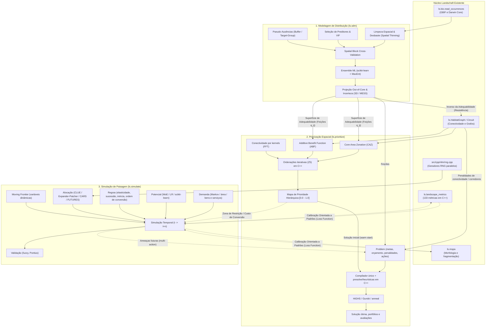

# Ideias para o landschaft (métricas de paisagem)

Ideias levantadas durante o desenho das métricas de paisagem (comparando com
landscapemetrics e pylandstats) que ficaram fora do escopo atual, para
implementar em outro momento. As fases combinadas estão no fim, para referência.

## Métricas e estatísticas extras

- `convention="fragstats"`: PROX com a área só da parte do vizinho dentro do raio (a
  documentação do FRAGSTATS é ambígua; usamos a área inteira). Sem o FRAGSTATS para
  comparar, as métricas FRAGSTATS-only foram testadas contra implementações diretas
  das definições.

## Uso e API

- O que faltava da API do landscapemetrics: `full_name`, `return_raster` no
  `sample_metrics` e os helpers `construct_buffer`, `pad_raster`, `unpad_raster`,
  `raster_to_points` e `get_unique_values`. **Feito** (0.49.0, bit a bit com o R; o
  `sin` do círculo é o `fsin` x87; o extent dos recortes é o do terra num raster intacto:
  o `crop(mask = TRUE)` do terra reescreve o extent do raster recortado, e no
  `sample_lsm` os plots depois do primeiro saem deslocados alguns ulps, o que não
  reproduzimos).

## Exportação


## Análises no estilo pylandstats


## Desempenho e escala

- ENN: a construção das árvores e a passada estável por classe ainda são limitadas
  pela memória (~0,5 s cada em 100 M pixels); nós menores (sem `begin`/`end` nos
  nós internos, caixas em 16 bits relativas) reduziriam o tráfego.
- Rótulos em 64 bits para rasters em memória com mais de 2^31 pixels (hoje esses
  casos ficam para o processamento por tiles).
- **Medidas de 2026-10-07** (início do item "desempenho", i5-13600K, núcleos P): paisagem inteira é rápida (clc
  4000² com todas as métricas de um nível: 0,25 s). O lento é a janela móvel: `input` 1000², janela 21×21, todas
  as métricas de paisagem 7,4 s com 11 threads; uma só (`np`) 1,45 s. Numa thread: ~2 µs fixos por janela mais
  ~20 ns por célula (janela 21×21: 10 µs). Perfil nativo no Linux (py-spy, `np`): `label_patches` 70 %, o
  construtor do `Landscape` 12 %, malloc/new 6-9 %. Ideias em ordem: fundir as passadas por célula (a cópia da
  janela já pode dar os índices densos e o histograma; o construtor refaz min/max, histograma e tabela;
  `label_strip` inicializa `code` numa passada à parte), reaproveitar os buffers de `StripStats`/`Patches`
  entre janelas (~35 alocações por janela) e medir o custo de cada métrica na janela
  (script `window_metric_costs.py` no scratchpad da sessão: refazer). No Windows o py-spy não resolveu os
  símbolos do `_core` mesmo com o PDB ao lado: perfilar no WSL (venv `~/lsprof` com a wheel e o py-spy,
  `LD_PRELOAD` da libstdc++ do sistema).
  **Feito (2026-10-09)**, bit a bit: todas as métricas 7,47 -> 3,7 s, `np` 1,45 -> 0,60 s (numa thread 10,2 -> 3,9 s).
  Em ordem de ganho: (1) um `Landscape` por thread reaproveitado por `reset()` (patches, núcleo,
  adjacências e valores por patch guardam a memória; os caches por patch ficam no lugar, marcados como
  velhos; as métricas com estatísticas em posições fixas, sem `std::map` de strings; `std::string_view` no
  caminho dos nomes); no Windows a alocação pesa muito mais que no Linux (o perfil do Linux dava 5 %, o ganho
  no Windows foi ~30 %); (2) a cópia da janela já entrega índices locais, valores verdadeiros das classes e
  contagens (corrigiu as tabelas de contraste/similaridade, que eram lidas pelo índice denso); (3) rótulos com
  a árvore de decisão de Wu, Otoo e Suzuki (2009) (`uf_find` era 34 % do `np`), estatísticas por pedaço num
  registro só (o MSVC não faz análise de alias por tipo e recarregava os 9 vetores a cada célula) e rotulagem
  "leve" das áreas núcleo (só classe, células e primeira célula); (4) núcleo com `edge_depth` = 1 pelos quatro
  vizinhos, sem a distância city-block; (5) casco dos círculos com o y mínimo e máximo de cada coluna, sem
  ordenar os cantos; (6) nenhuma região OpenMP (`#pragma omp parallel if (falso)` ainda monta uma equipe
  serializada) nos caminhos das paisagens pequenas (`parallel_for_scratch`). Custo extra por grupo sobre o
  `np` (400², 11 threads, 160 mil janelas): núcleo +0,07 s, círculo +0,07, adjacências +0,04, ENN +0,035,
  `gyrate` +0,035 (script `per_metric.py`). O que falta é o algoritmo incremental abaixo.
- Janela móvel: reaproveitar rótulos globais e só corrigir os patches cortados pela
  borda da janela (algoritmo incremental). Hoje cada janela é uma paisagem pequena
  (1000×1000, janela 21×21, 66 métricas: ~7 s; ~73 µs por janela numa thread).
  Perfil (py-spy --native, build com /Zi): círculo, rótulo e core são as maiores
  partes, e as alocações ~10%: reaproveitar os buffers do `Landscape` entre janelas
  cortaria as alocações.
- Fora da memória (`block_rows`): o ENN guarda todas as células de borda (~24 B cada);
  um ENN realmente fora da memória (p. ex. árvores por bloco em disco, ou busca por
  anéis de blocos vizinhos) tiraria esse limite. `labels()`/`to_raster()` por blocos
  poderiam gravar direto num GeoTIFF (reescrevendo os rótulos na passada de detalhe).
  **Feito (2026-10-09)**: `TiledLandscape::block_labels` rerrotula um bloco da primeira passada (sem estado:
  qualquer ordem, qualquer thread) e dá os ids finais pelo `piece_patch`; no Python os mapas são dask
  preguiçosos (um pedaço por bloco, `TiledReader.lazy_map`) e o `write_raster` grava bloco a bloco.
  Blocos processados em paralelo (hoje um bloco por vez, paralelo por faixas) ajudariam
  em rasters estreitos. **Feito (2026-10-09)**: `TiledLandscape` separa `prepare_block`/`prepare_detail`
  (de qualquer thread) de `merge_block`/`merge_detail` (em ordem de bloco: mesma numeração dos pedaços e
  mesmas somas); no Python, uma thread lê à frente (`_blocks`, `rasterio.Env` uma vez por thread: abrir um
  por bloco custava ~0,5 ms) e um pool prepara blocos lado a lado, **uma thread cada**: misturar vários blocos
  com 2-4 threads OpenMP cada era pior (regiões paralelas pequenas, threads ociosas girando). Medidas em 100M
  de células (10000² e 1000 x 100000), construção e passada de detalhe: 1,21 -> 0,56 s e 1,93 -> 0,86 s;
  1,13 -> 0,74 s e 2,09 -> 0,66 s; na memória 0,41 e 0,66 s. Com um bloco grande só (o antigo "auto", 64
  linhas por thread) o detalhe ficava em ~1,5 s: as partes seriais de cada bloco pesam; por isso o "auto"
  agora é 64 linhas (>= 32768 células). Mapas preguiçosos: pedaços dask de vários blocos, linhas múltiplas de
  512 (os tiles do `write_raster`: janelas de 64 linhas recomprimiam tiles parciais, 10 s contra 1,8 s) e
  >= 4M células; o `write_raster` calcula vários pedaços de uma vez. A passada 0 usa o `lsm_unique_values`
  (o `np.bincount` segura o GIL). Fica sequencial a passada de empates do `gyrate` com `cell_center`.

## Reprojeção (`ls.reproject`, como o `project()` do terra)

**Feito (fase 1):** `ls.reproject` para rasters e vetores (CRS, `res=`, referência
`like=` raster ou vetor, `crs=` de um objeto, `densify=` nos vetores). O warp é o do
GDAL, mas sempre nos mesmos blocos de 1024 células ancorados na origem do destino,
cada um com a janela de origem que vê e o XSCALE/YSCALE da grade inteira. O que
motivou isso (medido num 8000×8000 float32, UTM 23S → EPSG:4326, Apple M, 9 threads):

- O warp do GDAL depende de como ele divide o trabalho: só mudar o `warp_mem_limit`
  (64 MB vs 2 GB) muda 48 M células no bilinear e 11 mil no nearest. O transformador
  aproximado (erro de 1/8 de célula) interpola ao longo das linhas de cada chunk, e o
  XSCALE/YSCALE dos kernels é calculado por chunk. Threads não mudam nada.
- Com blocos fixos, em memória, lazy (dask) e a partir de arquivo (lido por janelas)
  fazem as mesmas chamadas ao GDAL: os mesmos bits, floats inclusive. Com um bloco
  só, o resultado é o da chamada padrão do GDAL; com `tolerance=0` (transformação
  exata), o do GDAL com o destino inteiro num chunk (até 1 ulp nos contínuos).
- Tempos: nearest 0,14 s, bilinear 0,36 s, average 0,37 s (GDAL padrão: 0,09 / 0,14 /
  0,33 s; rioxarray: 0,13 / 0,32 / 0,35 s); `tolerance=0`: 0,9 / 1,1 / 2,0 s (o custo é o
  PROJ transformando cada pixel). De arquivo: 1,3 s. O `match_grid` e o
  `load_raster(like=)` passaram a usar o mesmo warp.
- As janelas de origem dos blocos saem de uma grade 11×11 de pontos por bloco
  transformada de uma vez com um `Transformer` do pyproj: o `transform_bounds` do
  rasterio reconstrói a transformação a cada chamada (12 ms por bloco entre
  EPSG:3035 e UTM).

**Feito (fase 2): kernel C++ próprio** (`src/cpp/io/warp.cpp`, `_reproject.py`,
`_gdaltransform.py`), com o determinismo e agora bit a bit igual ao GDAL com
`tolerance=0`:

- Porte do `gdalwarpkernel.cpp` (GDAL 3.12.4, o do rasterio 1.5.1) só pelos caminhos que
  o GDAL toma no nosso caso: o destino tem NoData, então sempre há `panDstValid` e nunca
  os caminhos `NoMasksOrDstDensityOnly` (nearest de Byte/Int8/Int16/UInt16/Float32 por
  `GWKNearestThread<T>`, o resto por `GWKRealCase`; `GWKAverageOrMode` com o modo por
  histograma nos tipos de 8/16 bits e `GWKModeRealType` nos outros). Mesmas operações na
  mesma ordem (pesos, `SRC_DENSITY_THRESHOLD`, mistura de densidade < 0,9999, arredondamento
  e `AvoidNoData`, máscara unificada de NoData das bandas, a soma SSE2 de 6 colunas do
  Lanczos de Byte, `floor`/`ceil` trocados por conversões inteiras equivalentes). As
  coordenadas são as da origem inteira (a janela só indexa): subtrair o deslocamento
  inteiro da janela é exato, então o resultado não depende da janela.
- Coordenadas: o transformador do próprio GDAL (`GDALCreateGenImgProjTransformer2` +
  `GDALGenImgProjTransform` da DLL que o rasterio carrega, achada pelos módulos do
  processo e chamada por ctypes, que solta o GIL; um transformador por thread). O pyproj
  não serve para a paridade: traz o PROJ 9.5 e o rasterio o 9.8, e a inversa da LAEA
  difere em até 0,7 mm. Sem a DLL, o pyproj é a reserva (mesmo determinismo, últimos
  bits diferentes). O C++ recebe o ponteiro da função para o que o GDAL transforma sob
  demanda: coordenadas exatas por linha (`tolerance=0`), o ajuste de borda
  `GWKAdjustSrcOffsetOnEdge` (um canto da origem fora do domínio da projeção) e o teste
  de antimeridiano das áreas (ponto médio da célula).
- Grade de coordenadas ancorada na origem do destino: nós exatos a cada 16 amostras,
  verificados no centro e nos meios das arestas de cima e da esquerda de cada célula
  (erro |dx| + |dy|, como o transformador aproximado do GDAL) e refinados para 8, 4, 2, 1
  onde passa da tolerância ou algo falha; células bem fora da origem não refinam. Cada
  célula só depende de si: cada tarefa lazy calcula a grade das suas células (a memória
  não cresce com o raster). Erro medido: 2e-5 célula (UTM → 4326), 0,16 perto do polo
  (4326 → 3031; as verificações são só nos pontos médios).
- XSCALE/YSCALE como o GDAL para o destino inteiro num chunk: `ComputeSourceWindow`
  (21 pontos por aresta, todos se um canto falha, grade 23×23 se algum falha ou um polo
  cai no destino — o `GDALTransformLonLatToDestGenImgProjTransformer` nem reprojeta o
  polo quando a origem é geográfica, replicado — e `ComputeSourceWindowStartingFromSource`),
  depois as regras do `PerformWarp`. Translação inteira no mesmo CRS: nearest.
- Validação (`tests/test_reproject.py`, 202 testes): `tolerance=0` igual bit a bit ao GDAL
  com o destino num chunk para todos os métodos (menos `sum`), tipos (u)int8/16/32, int64,
  float32/64 com e sem NoData, 3 bandas com NaN diferentes, origem geográfica, mesmo CRS,
  e um mundo em 4326 para ortográfica (pontos fora do globo, antimeridiano) e polar, com
  buracos de NaN; memória = lazy = threads = pickle em todos. O padrão fica a ≤ 1e-3 do
  exato nos contínuos e troca < 0,1% das células nos que escolhem valores.
- Tempos (8000×8000 float32, UTM 23S → 4326, i5-13600K, 11 threads nos 6 núcleos P):
  nearest 0,13 s, bilinear 0,21 s, cubic 0,46 s, average 0,33 s, mode 0,40 s; o GDAL do
  rasterio na mesma máquina (padrão, 11 threads): 0,49 / 0,57 / 0,74 / 0,64 / 0,68 s; a
  fase 1: 0,38 / 0,45 / 0,62 / 0,56 / 0,55 s. `tolerance=0`: 0,93 / 1,0 / 1,3 / 1,2 / 1,3 s
  (fase 1: 1,8–2,0 s). A grade custa 0,05 s; numa thread o kernel leva ~6 ns por célula no
  nearest, 17 no bilinear, 38 no cubic.

Bugs do GDAL corrigidos (só a forma correta, testada contra o GDAL corrigido):

- `GDALTransformLonLatToDestGenImgProjTransformer` (GDAL 3.12 e master): com origem
  geográfica, a "otimização" que evita criar a transformação lon/lat → origem também pula
  a reprojeção origem → destino, e o polo vira coordenadas de pixel sem sentido; o GDAL não
  vê o polo no destino e estima a escala do kernel só pelas bordas. Aqui o polo é
  reprojetado; os testes comparam com o GDAL com `SAMPLE_GRID=YES` (o que o GDAL corrigido
  faz ao ver o polo).
- GDAL < 3.12.3 (o rasterio 1.5.2 do Linux traz o 3.12.2): o tipo de trabalho partia de
  Byte, e Byte ∪ Int8 = Int16, então rasters Int8 eram warpados em Int16 (no cubic e no
  Lanczos, valores abaixo de -128 viravam -128, o NoData, sem o `AvoidNoData`). Aqui é
  Int8, como no 3.12.3+; o teste pula Int8 com GDAL mais antigo.

Ficou de fora / próximos passos:

- `sum` continua no warp do GDAL em blocos (fase 1): usa a transformação inversa e uma
  quadtree (`GWKSumPreserving`), cuja ordem de soma teria de ser replicada.
- Um NoData sem nenhuma célula NoData: o GDAL descarta a máscara e o Lanczos soma em outra
  ordem (diferença nos últimos bits); aqui a máscara fica sempre, para não depender da
  janela de cada tarefa.
- Velocidade: o cubic e o modo por histograma de 16 bits são os mais lentos por célula;
  as 4 linhas do cubic caberiam em SIMD (2 linhas por registro SSE2, mesma ordem por
  linha). **Feito (2026-10-09)**, bit a bit: 8000² float32 UTM -> 4326, 11 threads, 0,43 -> 0,27 s
  (numa thread, 4000²: 0,68 -> 0,375 s); o perfil dava o `cubic4` em 76 %, metade em `convol4` e metade nas
  16 verificações de NoData (agora 4 bytes da máscara por vez, ou NaN nos próprios valores carregados).
  Fora do x86 fica o escalar. Ficam: cubic spline (0,74 s) e Lanczos (1,24 s), que passam pelo `resample`
  genérico, e o modo por histograma. A janela de origem de cada tarefa lazy refaz a grade da tarefa (o
  dobro do custo da grade, pequeno).
- Operações fundidas numa passada (reprojetar + recortar + reclassificar).
- Outras ideias: o `partial` do terra para vetores que saem do domínio da projeção
  (hoje viram coordenadas infinitas), referências do `terra::project` em R para a
  escolha da grade (hoje é a do GDAL, `calculate_default_transform`), e alinhar a
  origem à resolução (`-tap` do gdalwarp) como opção.

## Conectividade em grafos (Conefor Sensinode / Makurhini)

Análise de 2026-09-26. O Conefor Sensinode 2.2 (`C:\Users\eduar\Documents\dev\Conefor
Sensinode 2.2`) é o motor original dos índices de Saura: C++ Borland com interface gráfica
só para Windows (cálculo em `landscape.cpp` e `sensinodeProgram.cpp`, em `float` de 32 bits).
Lê só tabelas (nós com atributo, conexões como distâncias, probabilidades ou adjacências)
e calcula NC, NL, H, CCP, LCP, IIC, F, AWF e PC, com `p = exp(ln(k)/d₀ · d)` e caminhos de
produto máximo (Dijkstra sobre `-log p`, poda por `minProb`), além de dI por remoção de nós
(frações intra, flux e connector), varPC (adição de nós) e nós de área zero. Não tem
betweenness (BC, BCIIC, BCPC), que só existe no Conefor 2.6 de linha de comando.
O Makurhini 3.0 (`C:\Users\eduar\Documents\dev\Makurhini`, R) cobre o fluxo inteiro:
- nós em vetor ou raster;
- distâncias (`distancefile`): centroide, borda, menor custo, commute-time;
- índices: `MK_dPCIIC` (frações intra/direct/step), `MK_dECA`, `MK_dPCIIC_links`,
  `MK_Focal_nodes` (IICf, PCf, CCI);
- ProtConn e frações (`MK_ProtConn`, `MK_ProtConnMult`, `MK_ProtConn_raster`);
- centralidades `MK_BCentrality` (via Conefor 2.6) e `MK_RMCentrality`;
- versões em grade (`MK_Connect_grid`, `MK_dECA_grid`) e o PC por SAMC (`MK_dPC_SAMC`);
- `MK_Fragmentation`, `dispersal_distance`, `probability_distance`, `test_metric_distance`.

No dI ele recalcula as distâncias do grafo inteiro a cada nó removido (lento com milhares
de nós). Todos são GPL, como o landschaft.

Já existe no landschaft: `gtn_components` e `gtn_importance` (ECA, DOC e dPC na versão
topológica do GTB: cores e bridges do MSPA, `p = 1`), `conefor_inputs`, `cost_distance` e
`least_cost_path`; no `lsm`, rotulagem, área, core, a árvore do ENN (base da distância borda
a borda), `grid_zones`, `zonal_metrics` e `SpatioTemporalAnalysis`.

Proposta: módulo novo com a arquitetura do `lsm` (motor C++/OpenMP em `src/cpp/conn/` e um
objeto Python que guarda os resultados intermediários):

```python
g = ls.HabitatGraph.from_raster(cover, habitat=[1], min_area=10, distance="edge", threshold=20_000)
g = ls.HabitatGraph.from_vector(gdf, attribute="area", distance="least-cost", resistance=res)
g = ls.HabitatGraph.from_conefor("nodes.txt", "distances.txt")
g.overall(["pc", "iic", "eca", "nc", "h", "awf"], distance=[1000, 5000], probability=0.5)
g.node_importance("pc", distance=5000, probability=0.5)  # dPC, intra, flux, connector
g.link_importance("pc", ...); g.centrality(["bc", "bcpc", "radial", "medial"], ...)
g.add_nodes(candidates)                                  # varPC (restauração)
ls.eca_change([g_2000, g_2020]); ls.protconn(pas, region, distance=10_000, probability=0.5)
ls.connectivity_grid(g, grid_zones(...))
```

- Motor em camadas:
  1. nós (rotulagem do `lsm`; vetores pela rasterização all-touched ou pela geometria);
  2. distâncias esparsas até o limiar (borda a borda pela árvore do ENN, menor custo por
     Dijkstra multi-fonte em paralelo por nó, commute-time por sistema linear esparso
     com Eigen);
  3. grafo em CSR, PC por Dijkstra de produto máximo por nó em paralelo, IIC por busca
     em largura, dI recalculando só os caminhos que passavam pelo nó removido e só no
     componente dele;
  4. ProtConn (frações sobre PC e ECA, região e transfronteira).
- `gtn_importance` vira um caso especial (grafo do MSPA com `p = 1`); `HabitatGraph.to_conefor`
  generaliza o `conefor_inputs`.
- Fases:
  1. motor de grafo (IIC, PC, ECA, NC, NL, H, CCP, LCP, F, AWF, dI com frações) lendo e
     escrevendo os arquivos do Conefor. **Feita** (0.30.0: `HabitatGraph`, conferido com
     o Makurhini a 1e-12 e com o Conefor 2.2 compilado, em precisão simples);
  2. nós de raster e vetor, distâncias euclidianas (centroide e borda) com limiar.
     **Feita** (0.31.0: `from_raster`, `from_vector`, `node_table`, `distance_table`, os
     mesmos bits do Makurhini; o `keep` do Makurhini, simplificação com `rmapshaper`,
     ficou de fora);
  3. distâncias de menor custo. **Feita** (0.32.0: o `costDistance` do gdistance bit a
     bit, sem o `bounding_circles` nem o caminho em Java do Makurhini);
  4. importância das ligações, varPC, dECA no tempo e índices em grade. Ligações,
     mudanças de ligação e nós a adicionar (restauração, modo "adding nodes" do Conefor):
     **feita** (0.33.0); dECA no tempo **feito** (0.34.0, `eca_change`); os índices em grade
     (`MK_Connect_grid`, `MK_dECA_grid`) dependem do ProtConn (recorte dos nós por célula,
     áreas transfronteiriças) e passam para a fase 5;
  5. ProtConn completo (uma ou várias regiões). **Feito** (0.35.0, `protconn`,
     `protconn_regions`; sem a simplificação do mapshaper, que só muda os nós quando
     altera as formas); ProtConn em raster e índices em grade **feitos** (0.36.0,
     `protconn_raster`, `make_grid`, `connectivity_grid`, `eca_change_grid`);
  6. centralidades (BC, BCIIC, BCPC, radial, medial) **feitas** (0.37.0,
     `node_importance(["BC", "BCIIC", "BCPC"])`, `centrality`; conferidas com o
     `MK_RMCentrality` e com a linha de comando do Conefor 2.7.1, sem o Louvain, que é
     aleatório); focais **feitos** (0.38.0, `focal_nodes` = `MK_Focal_nodes`, sem a
     simplificação do mapshaper nem as estatísticas de fragmentação);
  7. opcionais: commute-time **feito** (0.39.0, `distance="commute-time"`, o
     `commuteDistance` do gdistance a 1e-11); SAMC **feito** (0.40.0,
     `settlement_probabilities`, `HabitatGraph.from_samc` = `MK_dPC_SAMC`, a 1e-14 do
     samc; sem a amostragem aleatória de vértices nem o `keep` do mapshaper).
     Todas as fases do plano concluídas.
- Decidido: o Makurhini (instalado na biblioteca do RStudio) é a referência, e o
  Conefor 2.2 compilado (`tools/conefor`) é conferido na precisão simples dele.
- Desempenho do PC em grafos densos (milhares de nós com `pij_min` baixo): o Dijkstra
  de todas as fontes é limitado pela memória (5000 nós, 4,3 M pares: 14 s dos 19 s).
  Ideias: linhas ordenadas por custo com poda (parar a varredura quando
  `d_v + w` passa do maior custo provisório, depois que todos os nós foram
  alcançados); custos em `float` só para filtrar; quando as distâncias são métricas
  (centroides), o caminho direto já é o melhor para os pares ligados.
- Decidido depois: geopandas/shapely são dependências normais (o `pyproject` instala tudo por
  padrão); ProtConn e SAMC entraram (fases 5 e 7).

## Conectividade por teoria de circuitos (Omniscape / Circuitscape)

Análise de 2026-09-26. O Omniscape.jl 0.7 (`C:\Users\eduar\Documents\dev\Omniscape.jl`, Julia,
~1,7 mil linhas em `src/`) calcula conectividade omnidirecional sobre raster, sem manchas:
uma janela móvel circular (`radius`, mais `buffer`) centrada em cada alvo (blocos de
`block_size`², só onde a soma das fontes do bloco é > 0) injeta a força do bloco nas fontes
da janela (fora do bloco-alvo, proporcional à força de cada uma), aterra o centro e soma a
corrente dos nós num mapa acumulado (`cum_currmap`). Opcionais: `flow_potential` (a mesma
coisa com condutância 1), `normalized_cum_currmap` (a razão), correção de artefatos de bloco
(`calc_correction`, dois solves nulos), conectividade condicional (condições presentes e
futuras, `within` pela mediana, `equal` pela moda), reclassificação, `source_from_resistance`
com `r_cutoff`, `precision = single`. O núcleo numérico é o `compute_omniscape_current` do
Circuitscape.jl 6.1 (Laplaciano do grid, solve `cg+amg` ou `cholmod`, corrente nos nós).
Completa o módulo `conn` (commute-time e SAMC já são circuitos e cadeias de Markov) e não há
versão nativa em Python. Todos GPL/MIT, compatíveis.

Critério de igualdade (o bit a bit dos outros módulos não se aplica: o solver padrão é
iterativo com tolerância ~1e-6, a ordem dos alvos é sorteada com `randperm` e somada por
fatia de thread, e os testes do próprio Omniscape usam `rtol = 1e-6`):
- estrutura idêntica: mesmos alvos, máscara de NoData, células nulas e não nulas, bordas;
- contra `solver = cholmod`: diferença relativa ≤ ~1e-10;
- contra o padrão `cg+amg`: dentro da tolerância do solver (1e-6, como os testes deles);
- o nosso determinístico (mesmos bits com qualquer número de threads).

Circuitscape 6.1 (`compute_omniscape_current`, lido no fonte instalado): nós são as células com
condutância > 0 (os `-9999` do Omniscape caem fora), numeradas em ordem de coluna; arestas para
direita, baixo e as duas diagonais da direita com `(x+y)/2` e `(x+y)/(2√2)`; componentes conexas
do grafo inteiro, e só se resolve a que tem fonte e terra (a do centro); terra `Inf` = nó
removido, tensão 0; `cholmod` fatora com `shift = 10ε` e refina se o resíduo relativo passar
de 1e-5; `cg+amg` (agregação suavizada, Gauss-Seidel, `Pinv` no nível grosso, sem a
regularização do modo pairwise) para em `rtol = 1e-6` no resíduo precondicionado e repete com
`rtol/100` se o resíduo verdadeiro passar de 1e-4. Corrente do nó = `max(entrada, saída)` das
correntes de ramo `|G[i,j]| (v_i − v_j)`, ignorando ramos com `|b / max| < 1e-8` (máximo com
sinal separado para o triângulo superior e o inferior da matriz).

Peculiaridades a reproduzir (confirmar no fonte):
- `get_source` zera o bloco-alvo em `radius+buffer+1` do recorte, que perto das bordas não é
  o centro (o recorte foi cortado); `xupper_sub` compara com `ncols` do mapa inteiro;
- `clip` põe `missing` onde a distância ao centro é > raio (fontes no raio, condutância no
  raio + buffer); o `buffer` só acrescenta colunas/linhas de NoData às fontes;
- `calc_correction`: limiar `1e-6 * maximum(block_null_current)`, sensível a células perto
  dele (um solver diferente pode jogá-las do outro lado); zeros viram fator 1;
- `mode` do StatsBase desempata pela ordem de um `Dict`; `median` com `skipmissing`;
- `flow_potential` usa o retângulo inteiro com condutância 1 (sem o recorte circular);
- no Circuitscape: vizinhança 8 (ou 4 com `connect_four_neighbors_only`), média das
  condutâncias, diagonais /√2, terra `Inf` = nó removido (tensão 0), componentes sem terra,
  corrente do nó (convenção exata a ler no fonte do Circuitscape.jl, a clonar);
- `precision = single` faz tudo em `Float32`.

Proposta: motor C++ novo `src/cpp/circuit/` (`circuitcore`: `grid.cpp` Laplaciano como o
Circuitscape, `solve.cpp`, `omniscape.cpp`), Python `ls.omniscape(resistance, radius=...,
block_size=..., source=..., ...)` devolvendo um `xarray.Dataset` (`cum_currmap`,
`flow_potential`, `normalized`) e `ls.omniscape_ini(path)` para os `.ini` existentes. O Eigen
entra no projeto aqui (ainda não é usado em `src/cpp`; só cabeçalhos, FetchContent ou
vendorizado).

Desempenho (o Omniscape, por janela, recorta arrays com `missing`, monta o grafo, acha
componentes, monta o AMG do zero e roda o CG, duas vezes com flow potential):
- janelas interiores têm o mesmo formato (disco de `radius + buffer`): ordenação por nested
  dissection geométrica e fatoração simbólica uma vez; por janela só a numérica (NoData como
  condutância 0 e linha identidade no nó isolado, mantendo o padrão fixo);
- o Laplaciano nulo (condutância 1) é o mesmo em todas as janelas interiores: fatorar uma
  vez por formato (cache para as bordas) e o flow potential vira duas substituições
  triangulares;
- correção de artefatos calculada uma vez, como no original;
- OpenMP nos alvos (`schedule(dynamic)`), área de trabalho por thread, zero alocação no laço;
  acumulação em ordem fixa por blocos com coloração 2D (um acumulador do tamanho do mapa por
  thread, como no Omniscape, daria ~13 GB em 10k × 10k com 16 threads);
- risco: Cholesky custa ~n^1,5 e o AMG ~n; para raio grande (≥ ~300 px, ~280 mil nós) o AMG
  pode ganhar, e aí seria preciso um CG com AMG por agregação suavizada em C++. Medir antes.

Fases:
0. benchmark rápido: tempo por janela do Omniscape (Julia, várias threads) contra Eigen LDLT
   com nested dissection, CG+IC e CHOLMOD, com r = 25, 50, 100, 200; decide o solver.
   **Feita** (`tools/omniscape_window_benchmark.jl`; uma thread, disco de raio r, condutância
   aleatória, terra no centro, ms por janela):

   | r (nós) | Circuitscape cg+amg | Circuitscape cholmod | Eigen LDLT, ND fixa (monta + fatora) | só a substituição |
   |---|---|---|---|---|
   | 25 (2 mil) | 6,1 | 4,0 | 1,0 | 0,07 |
   | 50 (8 mil) | 20,8 | 15,6 | 4,9 | 0,25 |
   | 100 (31 mil) | 119 | 67 | 35 | 1,6 |
   | 200 (126 mil) | 510 | 268 | 234 | 8,9 |

   Eigen com AMD em vez da ND geométrica: 66 ms (r = 100) e 700 ms (r = 200); CG+IC e CG+Jacobi
   (1e-6) 3–10× mais lentos que o direto; SparseLU 2× mais lento. Decidido: Eigen
   `SimplicialLDLT` com ordenação por nested dissection geométrica, análise simbólica uma vez
   por formato de janela e só a fatoração numérica por alvo; o flow potential sai da fatoração
   nula em cache (só a substituição). Com flow potential o Omniscape paga dois solves: ~11× (r =
   25) a ~4× (r = 200) por janela. Para r ≥ ~150 um Cholesky supernodal/multifrontal (blocos
   densos nos separadores) é o próximo ganho, na fase 3. O cg+amg do Circuitscape refaz o solve
   com `rtol/100` quando o resíduo verdadeiro passa de 1e-4 (aconteceu em r = 100 e 200);
1. núcleo de circuito (Laplaciano, solve, corrente nos nós), conferido com o
   `compute_omniscape_current` com `cholmod`. **Feita** (0.41.0: `ls.circuit.advanced`,
   `src/cpp/circuit/` com `CellSystem`, o padrão fixo reaproveitável pelas janelas; a 1,2e-13
   do CHOLMOD, mesmas células com corrente; o cg+amg fica a 2e-7);
2. Omniscape básico (alvos, fontes, terra, correção, flow potential, normalizada,
   `mask_nodata`, com as peculiaridades), conferido com `test/output_verify` (test1–5) e
   referências novas. **Feita** (0.42.0: `ls.omniscape`, também `source_threshold`,
   `r_cutoff`, condutância e 4 vizinhos; conferido com o `run_omniscape` por INI nas
   configurações 1–3 do Omniscape e em mapas sintéticos, a 1,7e-11 do CHOLMOD. Janelas
   agrupadas por formato, um `CellSystem` por formato e thread, flow potential com a
   fatoração em cache; soma por linhas em ordem fixa. 300×300, r = 25, bloco 3, com flow
   potential: Omniscape 17,4 s com 20 threads, landschaft 0,87 s (8,2 s numa thread));
3. desempenho (reuso simbólico, cache do nulo, OpenMP, acumulação determinística) e
   benchmark final contra o Omniscape. **Feita** (0.43.0): Cholesky multifrontal próprio
   sobre a ND geométrica (`system.cpp`: fronts densos nos separadores, LLT/TRSM/SYRK do
   Eigen; r = 100: 26 → 12 ms, r = 200: 206 → 78 ms), estrutura simbólica por formato
   compartilhada entre threads, substituição direta fundida na fatoração, flow potential
   em lotes de até 8 alvos (`solve_many`), módulo `_circuit_avx2` (x86-64, carregado por
   `cpu_supports_avx2_fma`; buffers alinhados a 64 bytes para o resultado não depender do
   endereço). Com 20 threads: 800² r = 10 0,64 s (Omniscape 29,4 s), 700² r = 25 1,36 s
   (46,7 s), 1000² r = 100 12,4 s (275 s). Ficou para depois: com r grande e muitas threads
   a banda de memória limita (6× de 1 para 20 threads em r = 100; o fator de uma janela tem
   13 MB); folhas da ND de 4 a 64 células dão o mesmo tempo; o Omniscape com `cholmod` é
   tão lento quanto com `cg+amg`;
4. conectividade condicional, reclassificação, `source_from_resistance`, `r_cutoff`, `.ini`,
   `precision = single`. **Feita** (0.44.0: condições no C++ depois da escala das fontes,
   mediana `a/2 + b/2`, moda do StatsBase = o primeiro valor a passar a maior contagem em
   ordem de coluna; `ls.circuit.omniscape_ini` com o parser do Omniscape; conferido com os
   INI de teste do próprio Omniscape (1–7, 4a–4c, 32 bit, reclass) a 5e-13 do CHOLMOD; o
   `config7` tem resistência 0 e o Omniscape recusa, como nós; em `single` a aritmética
   fica em double: o Omniscape em float32 fica a até 2,4e-4);
5. opcionais: solver iterativo para raio grande; modos raster do Circuitscape (pairwise,
   one-to-all, all-to-one, advanced) sobre o mesmo núcleo. Decidido (2026-09-26): o solver
   iterativo não compensa (o direto ganha até em r = 200; o limite real é a memória); a
   fase vira o port dos modos raster do Circuitscape 6.1, conferido com a suíte de
   verificação dele (`test/output_verify`: `sg` pairwise, `mg` advanced, `oneToAll`,
   `allToOne`, com polígonos, máscara, pares incluídos, fontes variáveis, média de
   resistências, 4/8 vizinhos, mapas de tensão/corrente/acumulada/máxima e a matriz de
   resistências) e com o CHOLMOD dele:
   - 5a. Omniscape com janelas enormes: threads limitadas pela memória do fator por thread.
     **Feita** (0.45.0: `memory_limit`, metade da RAM por padrão, estimado pela estrutura
     simbólica da janela cheia; `attrs["threads"]`);
   - 5b. núcleo raster do Circuitscape e modo advanced completo (mapa de habitat como
     resistência ou condutância, `connect_using_avg_resistances`, polígonos de curto-circuito,
     máscara, fontes e terras de arquivo, as quatro políticas de conflito, terra como
     resistência, terras diretas, mapas de tensão e corrente, `set_null_*_to_nodata`).
     **Feita** (0.46.0: `circuitscape.cpp` = mapa de nós e grafo do Circuitscape, solve por
     componente com `frontal_analyze_graph` (nós de polígono na raiz); leitor ASCII em
     double (o GDAL daria float32); `circuitscape_advanced`, `circuitscape_ini` com
     `scenario = advanced`; referências: as entradas de teste do Circuitscape copiadas e
     rodadas com CHOLMOD (`tools/make_reference_circuitscape.py`, todos os modos já
     gravados), mg1–7 e ex_advanced a 5e-12; no modo advanced o Circuitscape ignora
     `set_null_*_to_nodata` e escreve 0 fora dos nós);
   - 5c. pairwise (pontos e regiões focais, pares incluídos/excluídos, matriz de
     resistências `.out`, corrente acumulada e máxima, mapas por par); uma fatoração por
     componente e muitos lados direitos (`solve_many`). **Feita** (0.47.0:
     `raster_pairwise` com um nó aterrado por componente, lotes de 8 colunas por thread,
     `SolveScratch` por thread sobre o mesmo fator; o atalho do Circuitscape reproduzido
     com a peculiaridade da linha 1 da matriz de tensões; regiões focais com um grafo por
     par (`region_polymap` = `create_new_polymap`), pares em paralelo; sg1–17 batem,
     sgVerify17 a 9e-10 relativo porque o CHOLMOD resolve a laplaciana singular com
     deslocamento 10ε);
   - 5d. one-to-all e all-to-one (fontes variáveis, `set_focal_node_currents_to_zero`).
     **Feita** (0.48.0: o driver em Python monta fontes e terras por ponto como o
     `run_onetoall`, e `circuitscape_multi_advanced` resolve os pontos em paralelo sobre um
     grafo, só no componente do ponto; os 25 casos a 5e-14);
   - 5e. `ls.circuit.circuitscape_ini(path)` e a gravação das saídas como o Circuitscape.
     **Feita** junto com 5b–5d (todos os cenários raster; mapas `.asc`/`.tif`,
     `_resistances.out`, `_resistances_3columns.out`, a configuração em `output_file`).
     Fase 5 concluída; o modo de rede (grafos) do Circuitscape continua fora.

Próximos passos sugeridos (2026-09-26, depois da 0.48.0):
- Fatoração paralela de um componente grande. **Feita** (0.51.0: partes da árvore em
  paralelo, os fronts acima por alturas, fronts grandes por Cholesky em blocos fixos;
  mesmos bits com qualquer número de threads; 1000×1000: fatoração 3,4 → 0,7 s com 20
  threads). O que sobra no advanced de um componente só é serial: montar o grafo, o
  `factor_component` e as correntes (~1,6 s dos 2,6 s num raster 1000×1000), e no
  pairwise as substituições (lotes de 8 colunas relendo o L inteiro). Plano original:
  - paralelismo na árvore: subárvores independentes da ND fatoradas ao mesmo tempo, por
    alturas (OpenMP 2.0 do MSVC não tem `task`: `parallel for` sobre os nós de mesma
    altura), com as matrizes de atualização em áreas próprias por nó em vez da pilha única
    (o pico de memória sobe; somar os `u²` por nível para estimar);
  - paralelismo nos kernels densos dos fronts do topo (os separadores de ~N células
    concentram a maior parte dos flops: só a árvore dá no máximo ~3×): LLT/TRSM/SYRK em
    blocos com `parallel for`, ou o GEMM paralelo do Eigen onde couber;
  - manter o resultado determinístico (mesma ordem de soma com qualquer número de
    threads) e conferir com o CHOLMOD como nas outras partes.
- Modo de rede (grafos) do Circuitscape (`data_type = network`). **Feito** (0.50.0:
  `circuitscape_network_pairwise` / `_advanced`, `circuitscape_ini`; dissecção aninhada
  por níveis de BFS para grafos sem geometria, em paralelo por profundidade; os casos de
  rede do Circuitscape e seis sintéticos a 1,1e-14 do CHOLMOD; 1 M de nós, 20 pontos:
  7,2 s contra 27,7 s do CHOLMOD e 182 s do cg+amg; 5,0 s com a fatoração paralela).
- Omniscape com raio grande e muitas threads: limitado pela banda de memória (6× de 1 para
  20 threads em r = 100; o fator de uma janela tem 13 MB). Ideias: fatorar o landscape em
  precisão mista não serve (condicionamento); reduzir o tráfego guardando só a parte de L
  que a substituição reversa lê, ou resolver lotes de alvos vizinhos na mesma thread para
  reaproveitar a cache.

Referência: Julia 1.13.0 (`C:\Users\eduar\AppData\Local\Programs\Julia-1.13.0`) com
Omniscape 0.7 (o clone local, `Pkg.develop`) e Circuitscape 6.1 num depot separado
(`C:\Users\eduar\AppData\Local\landschaft-julia`, `JULIA_DEPOT_PATH=...\depot`,
`--project=...\env`; `jl.sh` lá dentro chama o Julia assim); script
`tools/make_reference_omniscape.jl` gravando em `tests/data/reference/circuit`.

## Modelos neutros de paisagem (NLMR)

Análise de 2026-09-28. O NLMR 1.4.0 (`C:\Users\eduar\Documents\dev\NLMR`, R, GPL-3) simula
paisagens neutras: gradientes (`nlm_planargradient`, `nlm_edgegradient`,
`nlm_distancegradient`), aleatórios (`nlm_random`, `nlm_percolation`), agrupados
(`nlm_randomcluster`, `nlm_curds`, `nlm_neigh`, `nlm_randomrectangularcluster`), fractais
(`nlm_mpd`, `nlm_fbm`), campos gaussianos (`nlm_gaussianfield`), mosaicos
(`nlm_mosaicfield`, `nlm_mosaictess`, `nlm_mosaicgibbs`) e a classificação
`landscape_classify` (proporções ou quebras de Jenks). Não há nada disso no landschaft.

A aleatoriedade vem de dois lugares, e os dois precisam ser reproduzidos para o mesmo
`user_seed` dar o mesmo mapa:
- R (`set.seed`, `runif`, `rnorm`, `sample`, `sample.int`): Mersenne-Twister do R com a
  mistura inicial do `set.seed`, `unif_rand` com `fixup`, `norm_rand` por inversão
  (`qnorm5` do AS241 sobre `u = (int)(2^27 u1) + u2`, com o `log` x87 do mingw),
  `R_unif_index` por rejeição (`rbits` em pedaços de 16 bits), `sample` sem reposição
  (Fisher-Yates parcial), com `prob` (`revsort` + busca linear; Walker com mais de 200
  probabilidades relevantes; sem reposição com remoção), `sample2` com hash para
  `n > 1e7`; mais tarde `rpois`/`exp_rand` para o spatstat;
- C++ do NLMR (`mpd`, `neigh`, `randomrectangularcluster`): `std::mt19937` com as
  distribuições da libstdc++ do Rtools (GCC 13.3): `generate_canonical` com duas palavras de
  32 bits, normal polar com o valor guardado, inteiros pelo método de Lemire (64 bits) e o
  `std::shuffle` que sorteia duas posições de uma vez quando `n² < 2^32`.

Critério de igualdade: bit a bit com o NLMR para a mesma semente em tudo, menos nas
tesselações de Voronoi (`mosaictess`, `mosaicgibbs`): o `st_union` ordena os germes e o
`st_voronoi` do GEOS devolve as células na ordem da sua estrutura interna, e os valores são
atribuídos nessa ordem. Ali: germes bit a bit, a mesma partição (a menos de empates exatos)
e o mesmo conjunto de valores; a ordem do GEOS pode ser portada depois.

Peculiaridades a reproduzir (com `nlmr_compat=True`, o padrão; `False` faz o que a
documentação promete):
- `mpd`: quadrado de lado `max(nrow, ncol) + 1` (ímpar), menos uma célula de cada borda,
  então a saída não tem as dimensões pedidas; uma `normal_distribution` nova por célula
  (o segundo valor do método polar é jogado fora);
- `neigh`: `p_neigh` e `p_empty` passam por `float`; embaralhamento da libstdc++;
- `distancegradient`: `origin` indexa `[linhas, colunas]` no terra, apesar das verificações
  contra `ncol`;
- `randomcluster`: o preenchimento olha o mapa antes de preencher (sem propagação); empates
  por `sample(fili, 1)`, sem vizinho por `sample(prob = ai)` sem reposição;
- `randomrectangularcluster`: varre a matriz inteira depois de cada retângulo (O(N·k));
  um contador de células vazias dá o mesmo resultado;
- `fbm` e `gaussianfield` estão desativadas no NLMR 1.4.0 (só uma mensagem); a referência
  são as funções internas novas `NLMR:::simulate_fbm` e `simulate_gaussian_field`
  (espectral e embutimento circulante com o `fft` do R).

Proposta: motor C++ `src/cpp/nlm/` (`rng.hpp/.cpp` com os dois geradores, o `fft` do R
portado, um arquivo por família de modelos) e o subpacote Python `landschaft.nlm`
(`ls.nlm.mpd()`, `ls.nlm.random_cluster()`, ..., `ls.nlm.classify()`, `ls.nlm.rescale()`),
devolvendo `xarray.DataArray` com a resolução, `seed` (o `user_seed` do NLMR; `None` sorteia
e guarda em `attrs`), `rescale` e `n_threads`. Desempenho: o gerador é serial por natureza,
mas o que vem depois dele é paralelo (uniformes em série e `qnorm` em paralelo; passos do
diamond-square em paralelo; FFT 1D por linha/coluna; distância exata; rotulagem), e somem
os custos do R (o `vapply` por célula do `percolation`, o `dplyr` por linha do
`randomcluster`, as varreduras do `randomrectangularcluster`, o `disagg` do `curds`).

Referência: NLMR do clone local instalado numa biblioteca R própria
(`C:\Users\eduar\AppData\Local\R\landschaft-nlm-lib`, sem mexer na do RStudio), R 4.4.2,
`tools/make_reference_nlm.py` gravando em `tests/data/reference/nlm`; as distribuições da
libstdc++ conferidas com um programa compilado pelo g++ do Rtools.

Fases:
0. geradores do R e da libstdc++, biblioteca R com o NLMR, script de referência.
   **Feita** (`src/cpp/nlm/rng.cpp`: todos os fluxos bit a bit com o R 4.4.2 e com um
   programa compilado pelo g++ 13.3 do Rtools, na primeira tentativa);
1. gradientes, `random`, `percolation`, `rescale`, `classify` (com Jenks). **Feita**
   (0.54.0, tudo bit a bit com o NLMR). Descoberto: o `terra::rast(ncol, nrow, xmin = 0,
   xmax = ncol, ...)` sem CRS vira lon/lat quando o extent cabe em ±360 × ±90, então o
   `distancegradient` de rasters até 360 × 90 dá distâncias haversine em metros (esfera de
   6378137 m, busca podada por latitude do terra, `sin`/`cos`/`atan2` x87 do mingw); acima
   disso é o `GDALComputeProximity` (varredura com o alvo mais próximo propagado, float32).
   `sum`/`cumsum` das proporções do `classify` em 80 bits; o Jenks roda coluna a coluna
   com as linhas em paralelo (as mesmas somas);
2. `mpd`, `neigh`, `randomrectangularcluster`. **Feita** (0.55.0, bit a bit na primeira
   tentativa, também em toro e com o `shuffle` de mais de 65535 células; no `mpd` só o
   gerador e o teste de aceitação do método polar ficam em série, o `log`/`sqrt` e as
   células de cada passo vão em paralelo: 3× o NLMR em 1025²; `neigh` é serial por
   natureza);
3. `randomcluster`, `curds`. **Feita** (0.56.0, bit a bit; o `terra::patches` numera pela
   primeira célula de cada mancha em ordem de linha (a união guarda o menor rótulo, o R
   renumera em ordem); `randomcluster` 200² 19 s no R contra 3 ms);
4. o `fft` do R portado; `gaussianfield`, `fbm`. **Feita** (0.57.0, bit a bit com as
   `simulate_*` internas do NLMR; `fft.c` do R portado linha a linha, colunas e linhas em
   paralelo com os mesmos bits; `exp` e `x^y` do R no Windows são os do mingw-w64 v11 em
   x87 (`__expl_internal` com log2(e) partido em duas constantes; `powl`: expoente inteiro
   por quadrados em 80 bits, 0,5 por `fsqrt`, os demais `exp2l(y log2l |x|)`), agora em
   `lsm/rmath.hpp` (`r_exp`, `r_pow`) e no MASM; 6–8× o NLMR);
5. `mosaicfield` (`rpoislinetess`, `rMosaicField`, `rLGCP` do spatstat). **Feita** (0.58.0,
   bit a bit, também `collect` e `infinit`; `rpois`/`exp_rand` do R portados; os ladrilhos
   são as células do arranjo de retas no quadrado unitário na ordem lexicográfica do
   `chop.tess` (abaixo antes de acima), recortando o quadrado reta a reta (o polyclip do
   spatstat arredonda os vértices a ~1e-9: um pixel a essa distância de uma reta, ou uma
   lasca mais fina que isso, poderia divergir, nunca visto); 200² com 20 mosaicos: 9,95 s no
   R, 10 ms aqui);
6. `mosaictess`, `mosaicgibbs` (`st_sample`, `rSSI`, Voronoi). **Feita** (0.59.0, bit a bit, melhor
   que o previsto: a ordem das células do GEOS vem do próprio GEOS pelo shapely (3.13 dá a
   mesma ordem que o 3.12 do sf), dependência opcional com aviso; o `terra::rasterize` grava
   float32; a rasterização é por germe mais próximo em grade de baldes, em paralelo;
   25–70× o NLMR). Resta: portar a triangulação incremental do GEOS para não depender do
   shapely;
7. opcionais: `blend`/`merge` do antigo landscapetools, modelos do NLMpy, gerador paralelo
   rápido (`rng="fast"`, diferente do R) para rasters enormes. **Feita em parte** (0.60.0:
   `merge` e `binarize` do landscapetools (sem referência em R: o pacote saiu do CRAN), o
   tutorial *Neutral landscapes* com um teste de modelo nulo). Ficam de fora: o gerador
   paralelo (o gerador serial não é o gargalo: `random` 2000² leva 44 ms) e os modelos do
   NLMpy (outra referência, com o gerador do numpy); portar a triangulação do GEOS para
   o `mosaictess`/`mosaicgibbs` dispensarem o shapely.

## Análise de biodiversidade (Biodiverse)

Análise de 2026-09-28. O Biodiverse 5.99_004 (`C:\Users\eduar\Documents\dev\biodiverse`, Perl,
GPL-3, ~98 mil linhas em `lib/`, metade GUI Gtk) analisa a distribuição espacial da
biodiversidade. O núcleo:
- **BaseData**: matriz esparsa grupos × rótulos (células × espécies, contagem de amostras),
  grupos com coordenadas em N eixos e tamanhos de célula; propriedades de rótulos e grupos;
  importação de CSV, raster e shapefile;
- **condições espaciais**: expressões Perl avaliadas por `eval` (`sp_circle(radius => r)`,
  `sp_block`, `sp_annulus`, `sp_ellipse`, `sp_rectangle`, `sp_select_*`, `sp_is_left_of`,
  `sp_in_line_with`, `$D`, `$C`, `$d[0]`, `$coord[1]`...) definindo um ou dois conjuntos de
  vizinhos por grupo, e a *definition query*;
- **análise espacial**: 119 cálculos, 382 índices (`indices.json`): contagens e listas,
  endemismo, raridade, dissimilaridade taxonômica, estimadores de riqueza, rótulos
  hierárquicos, filogenéticos (PD, família PE, AED, clade contributions/loss, turnover,
  relativos RPD/RPE, PhyloCom MPD/MNTD/NRI/NTI, RWiBaLD), propriedades de rótulos e grupos
  (estatísticas, quantis, Gi*), rótulos numéricos, matriz e Rao QE;
- **randomizações** (`rand_structured`, `rand_csr_by_group`, independent swaps, curveball,
  random walk, diffusion, espacialmente estruturada) e comparações `C_/Q_/P_/SUM_/T_`,
  z-scores, significância e **CANAPE**;
- **cluster e RegionGrower**: aglomerativo sobre a matriz de dissimilaridade dos grupos, com
  as ligações do Biodiverse (average, average_unweighted, minimum, maximum, recalculate),
  tie-breakers, restrição espacial e índices por nó da árvore;
- árvores (Nexus/Newick) e matrizes de dissimilaridade entre rótulos.

Fora do escopo: a GUI, os arquivos de projeto `.bds`/`.bps` (Sereal), o Remap GUI e a
importação de planilhas (o pandas cobre).

Proposta: motor C++ `src/cpp/bio/` e subpacote `landschaft.bio` (`ls.bio`):

```python
bd   = ls.bio.BaseData.from_table("sites.csv", label_columns=["genus", "species"],
                                  group_columns=["x", "y"], cell_sizes=[100000, 100000])
tree = ls.bio.read_tree("tree.nex")
res  = ls.bio.spatial_analysis(bd, conditions=["sp_circle(radius=>200000)"],
                               calculations=["endemism_whole", "pd", "pe"], tree=tree)
res.table; res.to_raster("PE_WE")
rnd  = ls.bio.randomise(bd, res, function="rand_structured", iterations=999, seed=42)
ls.bio.canape(rnd)
cl   = ls.bio.cluster(bd, index="SORENSON", linkage="average"); cl.to_raster(n_clusters=10)
ls.bio.list_calculations()
```

- Nomes: índices com os nomes do Biodiverse (`PE_WE`, `ENDW_WE`), cálculos sem o prefixo
  `calc_` (aceito também com ele); metadados a partir do `indices.json` (GPL-3).
- Condições espaciais: parser da sintaxe do Biodiverse (funções `sp_*`, variáveis `$D`, `$C`,
  `$d[i]`, `$D[i]`, `$coord[i]`, `&&`, `||`, `!`, comparações, aritmética) numa AST avaliada em
  C++; callable Python como alternativa lenta.
- Desempenho: vizinhança por índice em grade/KD (círculo, quadrado, anel, elipse, retângulo),
  listas em CSR, OpenMP por grupo, reaproveitamento das vizinhanças de `sp_block`;
  "estatísticas suficientes" por vizinhança (acumulador denso por thread + rótulos tocados)
  alimentando todas as famílias de índices numa agregação; árvore em arrays em pós-ordem, PD
  subindo até a raiz com marcas, ranges dos nós pré-computados; A/B/C entre todos os pares de
  grupos por `X·Xᵀ` esparso (Eigen) ou GEMM em blocos; randomizações com arrays de inteiros,
  geração sequencial (mesmo fluxo do original) e índices por iteração em paralelo, com modo
  opcional de fluxos independentes para iterações em paralelo; `n_threads` em tudo.

Formatos modernos (o núcleo só recebe arrays grupos/rótulos/contagens; formatos são
adaptadores em Python, e a paridade é conferida pelo CSV):
- `from_dataframe` (tabela longa grupo/rótulo/contagem ou larga), `from_sparse`
  (scipy.sparse), `from_xarray`;
- ocorrências do GBIF / Darwin Core (DwC-A ou CSV simples: `decimalLatitude`,
  `decimalLongitude`, `species`/`taxonKey`, `individualCount`), com reprojeção e agregação em
  células e filtros (`coordinateUncertaintyInMeters`, duplicatas, `basisOfRecord`);
- pilhas de SDM (GeoTIFF/COG multibanda, NetCDF, Zarr; uma banda/variável por espécie, limiar
  ou peso por probabilidade), lidas em blocos (dask) direto para a matriz esparsa;
- GeoParquet e GeoPackage na entrada e na saída (resultados com a geometria das células), COG,
  e o CSV no formato do Biodiverse;
- CRS explícito no `BaseData` (unidades de `sp_circle` claras);
- grades hexagonais e H3 (`h3` opcional), hexágonos do `make_grid`;
- árvores: Newick/Nexus com parser próprio; objetos `Bio.Phylo`/`dendropy`/`ete` se
  instalados;
- formato nativo de sessão em Parquet/Zarr em vez do Sereal.
Dependências novas só em extras opcionais (`h3`, `pygbif`, `dendropy`); `pyarrow` e
`geopandas` já estão no extra `vector`.

Critério de igualdade (decidido 2026-09-28): o Strawberry Perl usa `double` (sem long double
nem x87). O Biodiverse soma vários valores na ordem do hash (`sum values %$nodes_in_path` no
PD), que muda o último bit a cada execução. Referências com `PERL_HASH_SEED=0` e
`PERL_PERTURB_KEYS=0` e um overlay no harness que troca essas somas pela ordem das chaves
ordenadas; do nosso lado os ids de rótulos e nós seguem a ordem das strings, e a comparação é
**bit a bit** contra o Biodiverse com o overlay, ~1e-12 contra o original sem patch. PRNG:
`Math::Random::MT::Auto` (MT19937-64, `irand`, `rand`, `shuffle`, `binomial`, `gaussian`)
portado do C; percentis de `Statistics::Descriptive`/PDL portados. Fixtures extras: os
valores esperados embutidos em `biodiverse/t/24-Indices-*.t` (`__DATA__`). Checagem cruzada
do CANAPE com o pacote R `canaper`.

Referência: Strawberry Perl 5.42 (`C:\Strawberry`), dependências do Biodiverse com
`cpanm -L` numa biblioteca própria (sem mexer na do Strawberry); shims no harness para o que
não for preciso (GDAL), já que a referência lê CSV; `tools/make_reference_bio.py` +
`tools/bio_reference.pl` gravando em `tests/data/reference/bio`.

Fases:
0. harness Perl (biblioteca própria, overlay de soma ordenada, script de referência), dados
   de exemplo. **Feita** (0.61.0): `tools/bio_harness.py` monta o overlay reescrevendo
   todo `keys`/`values`/`each`, `for my ($k, $v) (%h)`, `pairs`/`pairmap` sobre hashes
   (1100+ pontos) para funções `LSK::*` que devolvem as chaves ordenadas respeitando o
   contexto escalar, e o `foreach (values %h)` para uma fatia ordenada (mantém o alias);
   `tools/bio_reference.pl` roda o Biodiverse sobre um job JSON e grava números com 17
   dígitos. Biblioteca Perl em `%LOCALAPPDATA%/landschaft-bio-perl5` (`cpanm -L`, PDL
   compilado); GDAL pelo `Geo::GDAL::FFI` apontado para o `gdal.dll` do ambiente conda
   `geo` (módulo `Geo::GDAL::gdal` e um `Alien::gdal` de fachada); GSL 2.8 pelo
   `Alien::GSL` (compilado com o MSYS) e `PDL::GSL` com um `bin/gsl-config.bat` que
   responde versão e flags;
1. `BaseData` (tabela, DataFrame, esparsa, xarray, pontos, raster, vetor, GeoParquet/GPKG,
   CRS, `to_raster`, ranges, contagens), `Tree` (Nexus/Newick), `Matrix`. **Feita**
   (0.61.0): tudo igual ao Biodiverse bit a bit (grupos, coordenadas, contagens, ranges,
   árvores com os nomes `N___`/`__dupN`, matrizes), menos as áreas de polígonos (7e-15: o
   Biodiverse corta primeiro numa grade 8× mais grossa). Descobertas: o Biodiverse pede
   `quote_space => 0` ao Text::CSV_XS mas filtra a opção, então nomes com espaço ou tab
   saem entre aspas (`'east west':11.25`); contagem vazia vira 0 (`// 0` antes do teste de
   indefinido); a importação de texto arredonda `(x - origem) / tamanho` a 1e-10 antes do
   `floor`, a de feições e a de raster não; números viram texto com `%.15g` e as
   coordenadas são relidas do nome;
1b. GBIF/Darwin Core e pilhas de SDM (em blocos). **Feita** (0.62.0): `read_occurrences`
   (download "simple CSV" do GBIF em zip ou tsv, Darwin Core Archive pelo `meta.xml`, ou
   DataFrame do `pygbif`; lido em pedaços; filtros de ausência, coordenadas, incerteza,
   `basisOfRecord`, issues e duplicatas) e `BaseData.from_occurrences` (reprojeção pelo
   `rasterio.warp`, células como na importação de texto); `from_raster` e `from_xarray`
   leem em blocos de linhas (COG, NetCDF/Zarr com dask); `_from_records` trabalha com
   códigos inteiros e só nomeia os grupos distintos. Nomes com espaço: a importação de
   texto põe aspas como o Biodiverse; as de ocorrências e de pilhas mantêm o nome puro;
2. motor de vizinhança: parser das condições espaciais, todas as `sp_*`, *definition query*,
   reaproveitamento de vizinhanças. **Feita** (0.63.0): `ls.bio.neighbours`,
   `definition_query`, `SpatialCondition`; parser de Perl (`_perlexpr.py`, precedência do
   Perl, `my`, `qr//`, `q{}`) compilado para uma árvore avaliada em C++ por par de grupos
   (`src/cpp/bio/conditions.cpp`, grade uniforme nos dois primeiros eixos quando a condição
   limita a distância, OpenMP); as funções que só dependem de um grupo (texto, regex,
   polígonos, riqueza) viram máscaras em Python. 48 casos iguais ao Biodiverse, inclusive as
   peculiaridades: o "tipo de resultado" é deduzido do texto (junta os tipos das `sp_*`
   chamadas: `sp_select_all() && $D < 5` pega todos os grupos, `sp_point_in_poly(...) && $D
   < 2` usa a lista do primeiro grupo para todos) e as listas de vizinhos são reaproveitadas
   entre grupos (`non_overlapping` só no primeiro conjunto, `text_match_exact`,
   `always_true`, `always_same`), emulado em Python só quando a condição mistura essas
   funções com termos que dependem do local. Descobertas: o Perl do Strawberry usa a mesma
   libm x87 do mingw que o R (`lsm/rmath.hpp`: sin, cos, exp, log, atan2 batem 100%); o `**`
   do Perl eleva a expoentes inteiros por quadrados em double (negativos: 1/x^n) e usa o
   `powl` x87 nos demais (`bio/perlmath.hpp`); `$C[i]` sozinho fica indefinido (o
   Biodiverse só calcula distâncias em células com `$C` ou `$c[i]`); `WHERE "campo" =
   "2"` do SQLite compara número. 490 mil grupos, círculo de raio 3: 0,5 s. Ficam para as
   fases seguintes as condições de ranges de rótulos, clusters, saídas espaciais e o
   `sp_select_block` (aleatório);
3. análise espacial e índices não filogenéticos: contagens e listas, endemismo, raridade,
   dissimilaridade taxonômica, estimadores de riqueza, rótulos hierárquicos. **Feita**
   (0.64.0): `ls.bio.spatial_analysis`, `list_calculations`, `SpatialResult` (tabela de
   escalares, listas longas construídas sob demanda, `to_raster`); motor em C++
   (`src/cpp/bio/indices.cpp`): agregação ABC por vizinhança (presença, grupos por rótulo,
   soma das amostras grupo a grupo na ordem da lista, o conjunto 1 somado antes do 2) e os
   45 cálculos portados linha a linha, com OpenMP por grupo. 11 análises (uma e duas
   vizinhanças, blocos, *definition query*, contagens inteiras e fracionárias) iguais bit a
   bit ao Biodiverse. Descobertas: o `sqrt` do Perl é o x87 do mingw (`r_sqrt`, arredondamento
   duplo: 1 ulp em desvios padrão e erros do Chao/ACE); `Statistics::Descriptive` soma com
   `List::Util::sum`, variância `(Σx² − n·média²)/(n−1)` limitada a 0, percentil pelo índice
   `int(0.5 + (n−1)p/100)`; hashes de chaves numéricas (frequências nos estimadores) são
   percorridos na ordem das chaves como texto; `calc_hierarchical_label_ratios` do Biodiverse
   nunca usa as bases por nível que monta (todos os níveis dão o mesmo A/B/C), reproduzido; o
   ACE divide por zero (e o Biodiverse aborta) quando `a2 == 1`. Grupos com as mesmas
   vizinhanças são calculados uma vez quando nada depende do grupo processado (blocos:
   19 s → 4 s em 90 mil grupos com todos os cálculos; o custo restante é o volume das
   listas, ~180 milhões de entradas);
4. filogenéticos: PD, família PE, clade contributions/loss, AED, PD local, turnover
   filogenético. **Feita** (0.65.0): 33 cálculos com `tree=` (`src/cpp/bio/phylo.cpp`:
   árvore em arrays na ordem dos nomes, alcance dos nós na árvore podada por marcação dos
   caminhos grupo a grupo, PE por grupo calculado uma vez, ES/ED/AED globais; por vizinhança,
   uniões de caminhos com marcas e a sub-árvore de `get_sub_tree_as_hash` com os filhos na
   ordem de inserção). 7 análises iguais bit a bit ao Biodiverse, também com poda e com
   rótulos fora da árvore. Descobertas: o `trim` do Biodiverse só poda (termina com a remoção
   dos nós `___` sem descendente nomeado, e só se algo foi removido antes); o PE_WE_P usa o
   comprimento da árvore podada e o PD_P o da árvore inteira; `_calc_abc_any` repassa o
   primeiro ABC calculado na ordem dos pré-cálculos (presença, grupos ou amostras), o que
   muda os valores de `PHYLO_LABELS_NOT_ON_TREE`: a ordem é reproduzida em Python a partir
   das dependências extraídas do Biodiverse (`bio/data/biodiverse_dependencies.json`); as
   contribuições de clado truncam em 1e-11 (`int(1e11 x) / 1e11`), por isso o Biodiverse
   sem o overlay varia nesse dígito. PD e PE em 90 mil grupos (árvore de 500 pontas): 0,5 s.
   O RWiBaLD depende da árvore de ramos equalizados e fica na fase 5;
5. filogenéticos relativos (RPD/RPE, árvores aparadas), PhyloCom (MPD/MNTD, NRI/NTI, valores
   esperados, VPD), RWiBaLD, CWE/CWR. **Feita** (0.66.0): RPD1/2, RPE1/2/central, rótulos na
   árvore aparada e RWiBaLD (limiares de cotovelo do PDL) iguais bit a bit nos 7 casos da fase 4;
   PhyloCom (`src/cpp/bio/phylocom.cpp`) em 8 casos novos, bit a bit, inclusive NTI e VPD
   amostrados. Descobertas: o cache de caminhos do Biodiverse depende da ordem dos grupos em
   árvores ultramétricas (o comprimento é o dobro do caminho do primeiro rótulo do primeiro par
   consultado sob cada ancestral, e só os filhos vizinhos por número de terminais recebem o
   valor): em árvores binárias o valor de cada ancestral fica fixo no primeiro grupo que o
   abrange, então uma passagem sequencial barata o determina e o resto roda em paralelo; com
   politomias (ou rótulos em nós internos) o processamento é sequencial e grupos com a mesma
   vizinhança não são deduplicados. O NTI amostrado usa o Math::Random::MT::Auto (MT19937-64,
   portado e conferido com o Perl) num único fluxo na ordem de primeira aparição de cada número
   de rótulos; com VPD, dois rótulos refazem a amostragem a cada grupo (consumindo o gerador) e
   isso é reproduzido. Os sorteios são feitos em lotes: conjuntos em sequência, distâncias em
   paralelo, e o gerador volta ao ponto onde o Biodiverse para. 90 mil grupos, árvore de 500
   pontas: MPD+MNTD 2,2 s, NRI/NTI 1,1 s (ultramétrica) e 2,0 s (amostrado);
6. propriedades de rótulos e grupos (estatísticas, quantis, Gi*), rótulos numéricos, índices
   de matriz, Rao QE. **Feita** (0.67.0): 29 cálculos (`src/cpp/bio/props.cpp`), 9 análises
   iguais bit a bit. Descobertas: as estatísticas vêm de um objeto
   Statistics::Descriptive::PDL::SampleWeighted compartilhado pelos cálculos do grupo, com
   cache e uma ordenação feita na primeira mediana ou quantil, depois da qual as somas seguem a
   ordem ordenada: o resultado depende da ordem em que o Biodiverse roda os cálculos (a dos
   pré-cálculos), reproduzida; os valores são as chaves de um hash (a string lida, então
   "20.700" e "20.7" são valores distintos) com pesos inteiros truncados; o PDL soma a partir
   de 0, eleva a potências inteiras por quadrados e tira raiz com arredondamento correto (o
   `sqrt` do Perl é x87); o Gi* usa o `sqrt` do Perl. O overlay do harness passou a reescrever
   também os módulos do Statistics::Descriptive::PDL (a ordem das chaves dentro deles chega
   aos resultados; as referências anteriores não mudaram). Campos vazios nos arquivos de
   propriedades ficam definidos sem valor (listados, fora das estatísticas); valores não
   numéricos são descartados. 90 mil grupos: 0,3 a 0,6 s;
7. MT::Auto portado, randomizações, comparações, z-scores, significância, CANAPE.
   **7a feita** (0.68.0): `ls.bio.randomise` com `rand_csr_by_group` e `rand_nochange`,
   contadores C/Q/T/P/SUMX/SUMXX por índice e por item das listas, p-ranks, z-scores (com o
   `sqrt` x87 do Perl) e as quatro variantes do CANAPE, iguais bit a bit (3 casos, com
   reciclagem de resultados). Descobertas: o Biodiverse descarta índices que pedem mais
   conjuntos de vizinhança que os dados (`index_uses_nbr_lists`, agora extraído com as
   dependências por `make_reference_bio.py dependencies`), então `RICHNESS_SET2` etc. não
   aparecem com um conjunto; o `RECYCLED_SET` interno entra nas comparações e é ignorado.
   A análise é refeita pelo `_evaluate` com as vizinhanças originais. **7b feita** (0.69.0):
   `rand_structured` em C++ (`src/cpp/bio/randomise.cpp`) com a fase de trocas
   (`swap_to_reach_richness_targets`, incluindo o List::Unique::DeterministicOrder e suas
   remoções por troca com o último), multiplicador e adição de riqueza; 4 casos bit a bit.
   Peculiaridades reproduzidas: `scalar @$obj` num DeterministicOrder vale sempre 2 (as
   remoções "se vazio" nunca ocorrem) e um `delete` remove um rótulo de uma lista de grupos.
   A escolha do j-ésimo grupo ainda livre usa uma árvore de Fenwick (0,95 s por
   randomização com 90 mil grupos e 630 mil registros). **7c feita** (0.70.0):
   `rand_independent_swaps`, `rand_independent_swaps_modified` (com o
   Statistics::Sampler::Multinomial::Indexed portado) e `rand_curveball` (desvio binomial do
   MT::Auto portado e conferido com o Perl nos três caminhos), com `swap_count`,
   `max_swap_attempts`, `stop_on_all_swapped` e `use_max_swap`; 6 casos bit a bit. Na versão
   modificada o Biodiverse nunca preenche os pares originais, então `stop_on_all_swapped` não
   tem efeito, como lá. Ficam para depois: o modo hipergeométrico do curveball (desvio
   gaussiano e CDF do GSL) e os pares de troca espaciais. **7d feita** (0.71.0): alocação
   espacial do `rand_structured` (`rand_spatially_structured`, `rand_diffusion`,
   `rand_random_walk`: ordens difusão, passeio aleatório, aleatória e proximidade,
   retrocesso, re-semeadura, condição de semeadura), randomização por subconjuntos
   (`spatial_conditions_for_subset`, `definition_query`), rótulos fixos
   (`labels_not_to_randomise`), propriedades de grupo (`by_set`, `by_item`) e embaralhamento
   dos nomes terminais das árvores; 17 casos novos bit a bit (32 no total). Peculiaridades
   reproduzidas: os caches de vizinhança e o sorteio de desempate da proximidade valem para
   todas as iterações; os alvos da condição de semeadura só são usados na primeira (o cache
   por rótulo evita recalculá-los); uma semente que já saiu da lista escolhe o último alvo
   (índice -1); subconjuntos usam um objeto de randomização novo por iteração; os grupos
   reprovados pela definição mantêm as propriedades embaralhadas da iteração anterior; com
   rótulos fixos a base randomizada perde as propriedades. Ficam de fora: condições que
   dependem do rótulo corrente, `track_label_allocation_order`, e os itens do 7c;
8. cluster e RegionGrower (ligações, tie-breakers, restrição espacial, índices por nó, export
   Newick/Nexus). **Feita** (0.72.0): `ls.bio.cluster` e
   `ls.bio.region_grower` (`src/cpp/bio/cluster.cpp`: a matriz do Biodiverse com o índice por
   valor em `%.2g` e empates pela string `%.15g`, a construção das matrizes por condição com a
   matriz-sombra, o laço de junções com as ligações média, média não ponderada, mínima, máxima
   e recálculo, empates por embaralhamento, por `random` ou agrupando zeros; a árvore termina
   em Python como o TreeNode: comprimentos pelos valores de junção, ramos de comprimento zero
   subidos, raízes unidas, `ladderise` e numeração dos terminais). 14 análises iguais bit a bit,
   inclusive os índices por nó. Descobertas: no modo par a par o PHYLO_B/C vem do total menos o
   compartilhado; no modo hierárquico os nós herdam as contagens do primeiro filho e os
   rótulos dos outros filhos recebem contagem 1 (as amostras são somadas), o que muda o
   endemismo por nó; a análise de vizinhança exclui os grupos já processados. Ficam para depois:
   desempates por índice, `link_recalculate` com cache de ABC e a exportação; 2500 grupos em
   13 s;

9. grades hexagonais/H3, formato nativo de sessão, árvores de `Bio.Phylo`/`dendropy`/`ete`.
   **Feita** (0.73.0): `BaseData.from_hex` (hexágonos com ponta ou lado para cima, grupos nos
   centros para as condições por distância) e `BaseData.from_h3` (`h3` opcional, centros em
   graus, ids das células em `grid`), desenhados como hexágonos pelo `to_geodataframe`;
   `BaseData.save`/`load` e `save_session`/`load_session` (zip de Parquet: base, árvores em
   Newick, matrizes e resultados espaciais e de agrupamento); conversão de árvores para e de
   Bio.Phylo, DendroPy e ete pelo Newick com precisão total (o escritor do Bio.Phylo arredonda
   os comprimentos) lido pelo nosso parser compatível com o Biodiverse. Extra opcional `bio`;
10. extras (IEI do BiodiverseX, export no formato do Biodiverse), tutorial, otimização
    (janela incremental etc.). **Feita** (0.74.0): `iei_stats` e `iei_data` (o plugin
    BiodiverseX::Indices::IEI entra no `@ISA` do harness), iguais bit a bit;
    `SpatialResult.to_biodiverse_csv` escreve o texto do export "Delimited text" byte a byte
    (9 casos: listas simétricas e assimétricas, listas-array contadas, `no_data_value`,
    separador tab e aspas simples; `make_reference_bio.py export`); `ClusterResult.cut(k)`;
    `ls.bio.example_data` (dados de exemplo do Biodiverse no pacote) e o tutorial
    `docs/tutorials/biodiversity.md`. Descobertas: o export simétrico pega as chaves do
    primeiro elemento e troca indefinidos por `no_data_value`; o assimétrico usa a união das
    chaves, deixa vazios os indefinidos e soma 1 ao `no_data_value` por ocorrência nas
    listas-array; as chaves seguem o `natsort` do Sort::Key::Natural (dígitos pelo
    comprimento). Otimização: a janela incremental ficou desnecessária (17,6 mil grupos com
    PD/PE/RPE em 0,1 s); o gargalo real era a alocação espacial das randomizações
    (conjuntos por rótulo em `std::set` percorridos para cada ocorrência → vetores
    marcados por passagem: `rand_diffusion` 10× e `rand_random_walk` 5× mais rápidos, com as
    listas de vizinhos montadas em numpy) e as iterações da família `rand_structured` passam a
    randomizar a próxima enquanto a atual é analisada (~30 %; as trocas ficam em sequência
    porque o curveball perde velocidade ao lado das threads da análise).

## Distâncias e rotas em grades (gdistance)

Análise de 2026-09-29. O gdistance 1.6.4 (`C:\Users\eduar\Documents\dev\gdistance`, R,
GPL >= 2; na biblioteca do RStudio está o 1.6.5, que só muda a documentação) calcula
distâncias e rotas sobre o grafo de células vizinhas de um raster: a matriz de transição
(`transition`, com uma função dos dois valores, 4/8/16 direções, simétrica ou não;
`geoCorrection`; `normalize`; aritmética; `sumReciprocal`; barreiras, áreas e Mahalanobis),
o menor custo (`accCost`, `costDistance`, `shortestPath`), o passeio aleatório
(`commuteDistance`, `passage` sem `theta`), os passeios aleatórios de menor custo (RSP:
`passage` com `theta`, `rSPDistance`) e a sobreposição de rotas (`pathInc`).

O que já existia no landschaft: o grafo de condutância só por dentro do `conn` (duas funções,
4/8 direções, simétrico, raster projetado), o `costDistance` e o `commuteDistance` só entre
os nós de um `HabitatGraph`, e as versões do GTB (`ls.cost_distance`, `ls.least_cost_path`),
com outra semântica, que ficam como estão.

Desenho (aceito pelo usuário): submódulo `ls.cost` (`src/cpp/cost/`), nomes em snake_case.
- `Transition`: um valor por célula e por direção (`values[d, célula]`; metade das direções
  quando simétrica, o valor de `f(x[menor índice], x[maior índice])`; todas quando não, o
  valor de `f(x[origem], x[destino])`), 0 = sem ligação. Mais compacto e previsível que uma
  matriz esparsa genérica; lon/lat global dá a volta no meridiano 180 como o gdistance.
- Funções prontas em C++ (`"mean"` com o `mean` do R, min, max, soma, origem, destino...)
  ou qualquer callable vetorizado que recebe `x` (2 x n) como a função do R recebe `c(x1, x2)`;
  `1 / tr`, `tr * tr2`, `tr.map(f, pairs="edges"|"all")` para o exemplo de Tobler.
- Pontos como coordenadas (n x 2), pontos do shapely/GeoDataFrame, ou máscaras raster.

Critério de igualdade (referências geradas no R com `tools/make_reference_cost.py`, casos em
`tests/cost_cases.py`): bit a bit na transição, na geoCorrection (tentar também lon/lat:
GeographicLib 2.0 do pacote raster com a libm do mingw), no normalize, na aritmética, no
`acc_cost` e no `cost_distance`; o `shortest_path` com a mesma sequência de células,
inclusive nos empates (ordem do heap do Dijkstra do igraph); commute, `passage`, RSP e
`path_inc` com tolerância (~1e-10), porque os solvers esparsos somam em outra ordem.

Fases:
0. harness de referência, casos, dados de exemplo (`maungawhau`, `Europe`, `genDist`,
   `popCoord`) e o esqueleto de `ls.cost`. **Feita** (d122c50);
1. `Transition` (motor C++/OpenMP, funções prontas e callables, 4/8/16 direções, assimétrica,
   `geo_correction` c/r com lon/lat e volta global, `normalize`, aritmética,
   `sum_reciprocal`, `to_raster`, `adjacency`, Mahalanobis). **Feita** (0.75.0: bit a bit
   em 43 casos, inclusive lon/lat e grade global; o `"mahal"` e o `normalize("symm")` com
   NA do gdistance falham, aqui dão o valor pretendido);
2. menor custo: `acc_cost`, `cost_distance` (from/to, assimétrico), `shortest_path`
   (células, raster, transição, linhas), Dijkstra direto na grade, origens em paralelo.
   **Feita** (0.76.0: bit a bit em 10 cenários, caminhos iguais nos empates com o heap
   indexado do igraph portado);
3. passeio aleatório: `commute_distance` e `passage` sem `theta` com a Cholesky multifrontal
   do `circuit` (o `HabitatGraph` passa a usá-la no lugar do SuperLU). **Feita** (0.77.0:
   1e-14 típico, 8e-12 no pior caso; `gdistance_compat` mantém o potencial errado da célula
   aterrada do gdistance);
4. RSP: `passage(theta=...)` e `rsp_distance` (métodos 1/2, net/total); uma fatoração de
   `I - W` e Sherman-Morrison por destino (`I - W_j` difere em uma linha) no lugar de uma
   fatoração por par. **Feita** (0.78.0) de outro jeito: `I - W` escalado por linha é
   simétrico definido positivo (transições simétricas, método 1) e vai para a Cholesky do
   `circuit`, uma fatoração por destino (Sherman-Morrison cancela catastroficamente com
   theta pequeno); assimétricas e método 2 por LU do Eigen em ordem de dissecção aninhada;
   1e-15 típico, 1e-10 no pior caso. O `rSPDistance(method = 2)` do gdistance falha;
5. `path_inc` (overlap/nonoverlap, pesos, barreiras e áreas), tutorial com figuras e
   benchmarks contra o gdistance. **Feita** (0.79.0: 1e-14; tutorial "Routes on grids" com
   Tobler, theta e R1b1b2 na Europa; os pesos padrão do `pathInc` do gdistance são lidos
   das ligações erradas quando há células sem ligação). O `pathInc` com `to=` do gdistance devolve só NA (o
   `.finishFlowFromTo` copia a matriz vazia): implementar o comportamento pretendido;
6. opcional, se o profiling justificar: LU multifrontal própria sem pivotamento para o RSP
   (`I - W` é diagonal dominante), com a ordenação ND do `circuit`. **Feita** (0.80.0:
   `frontal_lu.cpp`; o maior ganho veio de outra descoberta do profiling: os fatores de
   `I - W` decaem até subnormais, e a aritmética com eles era 30x mais lenta; FTZ/DAZ por
   thread durante fatoração e soluções. Assimétrico 1000²: 10,2 s -> 1,5 s; simétrico
   2,2 s -> 0,96 s). Todas as fases do plano concluídas.

Fora (não faz sentido portar 1:1): a estrutura S4 (`Coords`, `TransitionData`, `show`,
`==`, `[<-` com matriz de índices, `Summary` linha a linha), a função do R chamada ligação
por ligação (aqui vetorizada), o processamento em pedaços em arquivo temporário do
`pathInc` e as duas rotinas internas de transição (mesmos valores).

## Métricas de superfície contínua (ISO 25178: geodiv; terreno: spatialEco)

Análise de 2026-09-30. A ideia inicial era partir do spatialEco
(`C:\Users\eduar\Documents\dev\spatialEco`, 2.0-5), mas ele não tem as métricas ISO 25178:
tem métricas de terreno em janela móvel (`tpi`, `tri`, `vrm`, `srr`, `dissection`,
`curvature`, `spherical.sd`, `hsp`, `trasp`, `hli`). As métricas ISO 25178 de gradiente de
superfície (McGarigal et al. 2009) estão no geodiv 1.1.1 (Smith et al. 2021,
github.com/bioXgeo/geodiv, MIT; CRAN 2026-07-21). Em Python o mais próximo é o surfalize
(ISO 25178 para perfilometria: métricas globais corretas, sem janela móvel nem raster
georreferenciado) e o xDEM (TPI, TRI, rugosidade de DEMs); nenhum reproduz o geodiv.

Referências: geodiv para a ISO 25178, spatialEco (sobre terra 1.9.50) para o terreno.
Biblioteca R privada `%LOCALAPPDATA%\R\landschaft-surf-lib` (geodiv 1.1.1 compilado da
fonte do CRAN com Rtools44, porque o binário do CRAN para R 4.4 é o 1.1.0; spatialEco do
clone local) na frente da biblioteca do RStudio (terra, sf, pracma, e1071, dplyr, zoo).

Desenho (aceito pelo usuário): submódulo `ls.surface` (`src/cpp/surf/`), nomes do geodiv
em minúsculas.
- métricas globais: `ls.surface.sa(z)`, ..., `ls.surface.metrics(z, metrics=None)` numa
  tabela; `aacf(z)` devolve o raster; pré-processamento `fit_plane(z, order)`,
  `best_fit_plane`, `remove_plane` (polinômio de ordem 0 a 3, `spatial::surf.ls`);
- janela móvel: `ls.surface.window_metrics(z, window=5, shape="square"|"circle",
  metrics=[...])` (o `texture_image`/`focal_metrics` do geodiv) num `xarray.Dataset`;
- terreno: `ls.surface.tpi`, `tri`, `vrm`, `srr`, `dissection`, `curvature`,
  `spherical_sd`, `hsp`, `trasp`, `hli`;
- entrada: caminho, `DataArray` ou matriz (como no `ls.cost`), `n_threads` em tudo.

Defeitos do geodiv encontrados na leitura (e conferidos no R): `sdq6` usa `-9 * z(x+2)`
duas vezes no lugar de `+9 * z(x-2)` (idem em y); `findvalleys` monta a matriz em ordem de
coluna (`findpeaks` usa `byrow = TRUE`): vales transpostos (5 de 6 num 9x12), afeta `s10z`;
`surface_area` normaliza z para [0, 1] (`scale = TRUE`), o `sdr` depende da amplitude;
`mean(deltax, deltay)` é `deltax` (o segundo argumento é `trim`); `ssk`/`sku` misturam
`sd()` (N - 1) com momentos por N; `findpeaks`/`findvalleys` exigem z > 0 / z < 0
(superfície já centrada); `sfd_` lê fora do vetor em rasters não quadrados (aviso
"subscript out of bounds"); `aacf`/`std`/`srw` recortam o maior quadrado sem NA em volta
do centro e usam `terra::distance` (com extent "de lon/lat" e sem CRS o terra supõe
lon/lat: usar CRS projetado nos casos); `terra::sds` mascara `geodiv::sds` (chamar
sempre com `geodiv::`).

Critério de igualdade (decisão do usuário em 2026-09-30, na fase 5: "se detectamos os
bugs, podemos implementar somente da forma correta"): onde o geodiv está certo, bit a bit
com ele; onde erra, só a forma correta, conferida bit a bit contra o geodiv com o erro
corrigido em R (`tools/surface_fixed.R`, `fx$...`). Sem `convention`. Correções: Sq como
RMS da ISO (N, não N - 1), também em `ssk`/`sku`; `sdq` pela média dos pares válidos;
`sdq6` com o estêncil certo e a média; vales com os próprios vizinhos (e `s10z`); `ssc` da
ISO (sinal e segunda diferença); curva de Abbott-Firestone sobre z, `area_above` = área
entre a curva e o topo com Simpson completo, derivadas de borda por h; `scl`/`std`/`srw`
a partir da frequência zero (a metade do geodiv deixa essa linha de fora), distâncias
exatas, `std` em 0-179,5 graus sem a frequência zero; `sfd` sem o erro de digitação, com
os extremos dos dados e índices base 0; `bestfitplane` por BIC; `fftshift` também com uma
linha/coluna. Mantidos (definições, não erros): alturas reescaladas 0-1 no Sdr e no Ssc,
picos só acima de 0, haversine do terra em lon/lat. O que já existe e dá os bits do R: `nlm::r_fft2` (FFT do R), `lsm/extended.hpp`
e `rmath.hpp` (somas em 80 bits, `sqrt`/`log` x87), `lsm/rlm.cpp` (`lm()`). Terreno igual
ao spatialEco + terra (bordas e NA do `terra::focal`, declividade/aspecto de Horn do
`terra::terrain`).

Otimizações da janela móvel (o geodiv chama uma função R por célula): picos e vales numa
máscara 3x3 global e contagem O(1) com tabela de somas no interior (w - 2)²; máximo e
mínimo deslizantes (van Herk/Gil-Werman) para `sph`, `sv`, `srr`, `dissection`; momentos
por janela em precisão estendida (exato, padrão) ou por somas acumuladas centradas
(`exact=False`, O(1), sem garantia de bits); curva de Abbott-Firestone com a janela
ordenada uma vez e quantis tipo 7 em forma fechada; um plano de FFT por thread; `hsp` com
uma só tabela de somas para todas as escalas; `vrm` com as três somas num kernel.

Fases:
0. harness de referência (`tools/make_reference_surface.py`, `tools/surface_reference.R`,
   casos em `tests/surface_cases.py`, referências em `tests/data/reference/surface/`) e o
   esqueleto de `ls.surface`. **Feita** (junto com a fase 1);
1. amplitude (`sa`, `sq`, `ssk`, `sku`, `sv`, `sph`, `smean`) e plano (`fit_plane`,
   `best_fit_plane`, `remove_plane`). **Feita** (0.81.0: bit a bit em 18 casos; o
   `bestfitplane` escolhe a ordem pelo ruído de arredondamento da média dos resíduos, que o
   R soma por colunas em 80 bits; com menos células que coeficientes o `spatial` lê fora da
   matriz: aqui é erro);
2. híbridas e feições: `sdq`, `sdq6`, `surface_area`, `flat_area`, `sdr`, `find_peaks`,
   `find_valleys`, `sds`, `ssc`, `s10z`. **Feita** (0.82.0: bit a bit em 19 casos; mais um
   defeito: o `sdq6` divide por `length(x)`, que é 1 num SpatRaster; o `findvalleys` acha
   33041 "vales" no `normforest`, onde há 5167; `convention="iso"` corrige);
3. curva de Abbott-Firestone: `bearing_area`, `height_ba`, `sdc`, `sbi`, `svi`, `sci`,
   `sk`, `spk`, `svk`. **Feita** (0.83.0: bit a bit em 9 casos; `ecdf`, `quantile` tipo 7,
   `seq` e o `lm()` do R reproduzidos; o `rlm.cpp` passou a devolver o intercepto);
4. espaciais e fractal: `aacf`, `scl`, `stxr`, `std` (Std/Stdi), `srw` (Srw/Srwi/Shw),
   `sfd`. **Feita** (0.84.0: bit a bit em 12 casos, projetados e lon/lat; reproduz o `crop`
   do terra 1.9-50, o `distance` (proximity do GDAL 3.9 em float nos projetados, haversine
   x87 em lon/lat), a `fft` do R e a janela de Hann do e1071. Com NA o `scl` do geodiv
   falha (centro do raster inteiro na imagem recortada): aqui usa o centro recortado; o
   `sfd` lê fora da matriz quando o quadrado central encosta na borda: aqui é erro);
5. motor de janela móvel (`window_metrics`, quadrada e circular, `pad_edges`) com os
   caminhos O(1), fora da memória por blocos de linhas. **Feita** (0.85.0, junto com as
   correções: cada janela calculada como um raster, em paralelo; atalhos exatos para
   `sv`/`sph`/`sds`; o `texture_image` do geodiv não funciona com o terra atual e o
   `focal_metrics` transpõe as janelas, então a referência é a métrica em cada janela, em
   R; o `find_flat` escolhe a janela por somas prefixadas e só confirma as candidatas com
   a média do R, 100x mais rápido. Fora da memória fica para depois, se precisar);
6. terreno do spatialEco. **Feita** (0.86.0: `terrain` (declividade/aspecto do terra,
   bit a bit; em lon/lat 1e-12, as geodésicas do terra usam sin/cos da UCRT), `tpi`, `tri`,
   `vrm`, `srr`, `dissection`, `curvature`, `spherical_sd`, `hsp`, `trasp`, `hli`. O
   `focal2` do terra desliza somas (bits dependem dos blocos); em 0.88.0 médias, somas e
   desvios focais passaram a somas prefixadas compensadas por linha (pedido do usuário:
   velocidade no TPI/HSP), ~1e-13 da soma direta, tolerância 1e-12 contra `fx$`. Corrigidos (conferidos bit a bit contra
   `fx$`): curvatura (r e t / L^2, bordas NA, sem arredondar, dy, McNab / 8, Bolstad),
   `hsp` (z-score), `trasp` (pi), `hli` (hemisfério sul e radianos), círculos exatos;
   `zero.correct` do `tpi` não é oferecido);
7. tutorial, API, benchmarks contra geodiv e spatialEco. **Feita** (0.87.0: tutorial
   *Surface texture*; `tools/benchmark_surface.py`: 2 a 1100x nas métricas globais, 6000x
   nas imagens de textura do `sk`; TPI e HSP só 2x, porque o terra faz somas deslizantes em
   C++ e aqui cada janela é somada direto para ficar exata). Plano concluído.

Fora: `plot_ba_curve` e os gráficos de `scl`/`std`/`srw` (`create_plot`), `rotate`,
`raster.moments`/`raster.deviation`/`raster.entropy`/`sobel` do spatialEco (estatística
focal genérica), o paralelismo por `parLapply` do geodiv.

## Síntese de licenças e viabilidade legal dos novos módulos

Todos os módulos planejados são plenamente viáveis e compatíveis com a licença do landschaft (**GPL-3.0-or-later**):

| Módulo / Ferramenta de Referência | Status / Licença Original | Compatibilidade e Estratégia |
|---|---|---|
| **Zonation 5** (CAZ / ABF, v2.4) | **GPL-3.0** (código em github.com/zonationteam/Zonation5; vdt LGPL-3) | **100% compatível**. Reimplementação em C++17 das ordenações iterativas. |
| **PLUS Model** (CARS / Inércia) | **Sem fonte e sem licença** (o repositório só tem o `.exe`) | **Clean-room** pelo artigo (Liang et al. 2021); nada a copiar. |
| **TerraME** (Vizinhanças Híbridas) | **LGPL / GPL** (C++/Lua aberto) | **100% compatível**. Inspiração para acoplamento de grade raster com redes e zonas. |
| **lulcc** / **MOLUSCE** / **FUTURES** (CLUE-S, WoE, PGA) | **GPL >= 2** (R, Python, C) | **100% compatível** ("ou posterior" permite GPL-3). |
| **CLUMondo** (sistemas de uso, Dyna-CLUE) | **GPL-3.0** (C++, github.com/VUEG/CLUMondo; GUI fechada) | **100% compatível**. |
| **Dinâmica EGO** (Expander / Patcher) | *Freeware / Closed-source* | **Legalmente seguro via Clean-room**. Os métodos matemáticos (Soares-Filho et al., 2002) estão em domínio público na literatura científica. |
| **biomod2** / **CoordinateCleaner** / **spThin** / **blockCV** | **GPL-2 / GPL-3 / MIT** (R) | **100% compatível**. Reimplementação em Python dos algoritmos de limpeza espacial, desbaste e spatial CV. |
| **prioritizr** 8.0.6 / **prioriactions** 0.5.0 | **GPL-3 / GPL >= 2** (R + C++) | **100% compatível**. Formulações reimplementadas em C++; os pacotes são a referência de paridade. |
| **prioripy** 0.11.11 | **MIT** (do próprio autor) | **100% compatível**. Ponto de partida da API; o núcleo é reescrito. |
| **HiGHS** (solver MILP/LP) | **MIT** (C++) | **100% compatível**. Solver padrão; pode ser embutido no `_core`. |
| **exactextract** (cobertura exata de células por polígonos, usada pelo exactextractr do prioritizr) | **Apache-2.0** (C++, ISciences) | **Compatível com a GPL-3**. Porte em `src/cpp/io/exact` (sem GEOS), com o `LICENSE` original na pasta. |
| **Gurobi** | Comercial (licença acadêmica gratuita) | Só **opcional** em tempo de execução (gurobipy); nunca obrigatório nem embutido. |
| **Marxan** 4.0.6 (simulated annealing) | **MIT** (Possingham, Ball, Watts; código em `C:\Users\eduar\Documents\dev\marxan`) | **Compatível**. Porte em `src/cpp/opt/marxan` com paridade contra o executável (gcc). |

---

## Priorização espacial sistemática (Zonation 5)

Plano acordado em 2026-09-30 (substitui a análise inicial do mesmo dia, que partia do Zonation 4). Porte do
**Zonation 5 v2.4** (Pauli Lehtinen, Atte Moilanen et al., Univ. Helsinki; GPL-3.0, código em
`github.com/zonationteam/Zonation5`, release `z5src-v2.4.zip`) para `src/cpp/prio/` + `landschaft.prioritize`
(`ls.prioritize`). Fonte local: `C:\Users\eduar\Documents\dev\zonation5\src\z5-v2.4`; binários oficiais (Windows,
instalados sem GUI) em `C:\Users\eduar\Documents\dev\zonation5\install` (`z5.exe` = 8 bits, `z5_16bit.exe`).
O Zonation 4 (`zonation-core`, zig4, 2015) fica só como consulta histórica (BLP, BQP, ADMU, unidades de
planejamento e corredores não existem no Z5).

### Por que o Z5 e não o Z4
* É a versão mantida, com o mesmo GPL-3 e ~6 mil linhas de núcleo (contra ~15 mil do zig4, com GUI misturada).
* O algoritmo é outro e **paraleliza**: o zig4 remove célula a célula e reavalia a borda inteira a cada remoção
  (O(N²/warp)); o Z5 faz **ordenações iterativas**: dada a ordem atual de remoção, calcula para cada célula o que
  resta de cada feição no momento da sua remoção (varredura prefixada), a perda marginal da célula nesse ponto,
  e reordena, até o erro médio de ordenação ficar abaixo do limite (0,01 % por padrão; máx. 500 iterações).
* **Determinístico**: o binário dá o mesmo rankmap com 1 ou 7 threads (testado); desempates pela posição da
  célula (sort estável sobre `iota`). Paridade bit a bit é viável.

### Como o Z5 calcula (o que precisa ser reproduzido)
* **Carga e quantização** (`layerdata.cpp`): valores < `threshold` viram 0; `v / max(camada)` em float,
  `* 255` (ou 65535), `round` (meio para longe do zero) → uint8/uint16 esparso por célula. Célula com dado =
  alguma feição não-NoData (e não zero, se `zero mode = none`). Soma por camada `Σ q·(1/255)` em double na
  ordem das linhas (por bloco de linhas GDAL); `layerScale = 1/(soma·255)`; feição `f_ij = q_ij·layerScale_j`
  (soma 1 por camada). Camadas sem dado são descartadas. Pesos (-w), grupos de peso (-W: peso·W_g/Σ|w| do
  grupo), grupos de saída (-g), `keep_zeros`, extração de valor (`arquivo.tif/3`).
* **Regras de perda marginal** (`balancingmethod.h`), por célula, com R = o que resta antes (`R0`) e depois
  (`R1 = R0 - f`) da remoção, somadas separadamente para pesos ≥ 0 (pos) e < 0 (neg), `valor = pos - neg`:
  * `CAZ1`: Σ |w|·f/R0; `CAZ2` (padrão): √Σ (|w|·f/R0)²; `CAZMAX`: max |w|·f/R0; `CAZP p`: (Σ (|w| f/R0)^p)^(1/p);
    `CAZPW p`: Σ|w|·(f/R0)^p, raiz p; pesos negativos usam `(R0-R1)/(inicial - R1)`.
  * `ABF z` (0,25): Σ w·(R0^z - R1^z) (z por camada, coluna `abfz`); potência por `vdt::fast_log/fast_exp`
    (Cephes, LGPL-3, portar exatamente).
  * `RAND` (mt19937 com semente aleatória), `LOAD` (ranking externo: só avalia curvas). `SBF` existe mas o
    próprio Z5 o nomeia `SBF_not_used`: fica de fora.
  * Custo (-X): na comparação `pos /= c`, `neg *= c` com `c = custo·N/Σcusto`; custo 0 sempre por último.
    Máscara hierárquica (-h): nível menor sai antes. Só -x: custo só acompanhado nas curvas.
* **Iteração**: soma inicial Σ|w|f; sort estável; a cada iteração nova soma a partir da ordem anterior; erro
  = média de `(s_i - s_{i+1})/s_i` nos pares fora de ordem (sem cruzar descontinuidades); `smoothing factor`
  mistura somas; para em `erro <= anterior e <= limite`, ou platô (`stop on plateau`), ou máx. iterações.
  Rank = posição/N (float32; 0 = primeira removida).
* **Saídas**: `rankmap.tif`; `feature_curves.csv` (fração restante de cada feição por rank, amostrada a cada
  `curves output interval` = 0,0001), `summary_curves.csv` (média/máx/mín, pos/neg/zero, ponderada, área e custo
  restantes), `feature_density_curves.csv`, `group_curves.csv`, `features_info.csv`, `stats.txt` (iterações,
  erro, AUC).
* Transformações: condição (-c: q·cond, trunca em uint8; `renormalize`), retenção (-r: absoluta, relativa,
  constante), conectividade (-d kernels uniform/triangular/negexp/gaussian por FFT (fftss, double) com corte;
  interação 1/2 (-i/-I); matriz (-m)), saídas de pré-processamento (-b: richness, rsr) e camadas transformadas (-f).
* Pós-processamento (-p, arquivo de chamadas): `area_statistics_*`, `solution_comparison`, `histogram`,
  `flexibility_map`. Avaliação de impactos (-s, -e): cenários de fonte de impacto, zonas, impactos cumulativos.

### Estratégia de desempenho (nossa, com o mesmo resultado)
* **Varredura por feição**: subtrair 0 não muda R, então o R de cada feição no momento de cada célula depende só
  das ocorrências dela na ordem atual. Cada feição é varrida de forma independente (paralelo por camada, O(nnz)
  em vez de O(N·L) do Z5, que avalia todas as camadas em toda célula) e as contribuições voltam para as células
  somadas na ordem das camadas (somar zeros não muda o valor): bit a bit igual ao Z5.
* **Sort estável por chave** (hmask, custo zero, valor) com radix sort paralelo (resultado único por ser estável;
  -0 normalizado para +0).
* Erro de ordenação somado na ordem sequencial (o critério de parada compara com o limite).
* Carga direta de rasters/`xarray`/**dask** por blocos de linhas, quantizando para o armazenamento esparso sem
  materializar a pilha em float; o armazenamento de 1-2 bytes por valor é o que permite rodar mapas continentais
  ou globais. Fase de escala: ranking out-of-core (varreduras sobre armazenamento mapeado em disco).

### Correções do Z5 (implementamos só a forma correta)
* As curvas, a AUC e o `features_info` de alvos são calculados com a ordem da **penúltima** ordenação, mas o
  `rankmap` sai da ordenação seguinte; as nossas curvas descrevem o ranking devolvido. Teste: contra o próprio
  Z5 em modo `LOAD` com o nosso rankmap final como solução externa.
* O histograma e o mapa de flexibilidade do pós-processamento usam essas curvas: os nossos, as do ranking
  devolvido.

### Paridade e testes
* Referência: `z5.exe --maxthreads=1` (e `z5_16bit.exe`), GeoTIFFs escritos com um único bloco de linhas.
  Harness `tools/make_reference_prioritize.py` roda os casos de `tests/prioritize_cases.py` e guarda em
  `tests/data/reference/prioritize/<grupo>.npz/json` (rankmap, curvas, info, estatísticas).
* Bit a bit: rankmap, curvas (comparadas com a mesma formatação `{:.4f}`/`{:.5f}` dos CSVs), iterações.
* Tolerância: transformações de conectividade (FFT fftss vs a nossa); AUC (redução paralela no Z5).

### Fases
0. Harness: binários, casos, determinismo (threads, 8/16 bits), formato dos arquivos. **Feito** (1 thread: só o caso
   de extração de valor muda com 7 threads, pela soma das camadas por thread).
1. Núcleo: carga/quantização (8/16 bits, limiar, zero mode, máscara de área, extração de valor), pesos e grupos,
   regras CAZ1/CAZ2/CAZMAX/CAZP/CAZPW/ABF/RAND/LOAD, custo (-x/-X), máscara hierárquica, iteração e parada,
   curvas, `features_info`, rankmap; entrada numpy/xarray/dask/arquivos; API `ls.prioritize.zonation`.
   **Feito na 0.89.0**: 41 casos bit a bit (rank, iterações) e tabelas idênticas ao texto do Z5 (LOAD);
   benchmark 3,1 M células x 30 feições, 75 iterações: 13 s contra 54 s (z5, 1 thread) e 33 s (12 threads),
   idêntico ao z5 de 1 thread. Achados: vdt compilado com `-Ofast` (constantes dobradas, operações
   reassociadas; reconstruído do binário e conferido contra a DLL); `{}` do fmt do Z5 = `%g` com ".0";
   médias das curvas = soma float do Eigen com pacotes AVX de 8 (colunas da matriz: início alinhado pelo
   deslocamento; subconjuntos: arrays novos alinhados); `Array2d::pow` do CAZP = `generic_pow` do Eigen
   (o MSVC sem SSE4.1 precisa do `pround<Packet2d>`); CAZP com p < 1: 0^p = fast_exp(p·fast_log(0)) ≠ 0,
   as feições ausentes contam; com várias threads as somas das camadas mudam por bloco (só 1 thread é
   referência). Próximos ganhos (fase 6): formato compacto das linhas (máscara de bits + 1 byte por valor)
   para cortar o tráfego da reorganização (~36 ms/iteração no benchmark) e da varredura.
2. Condição e retenção; saídas de pré-processamento e camadas transformadas; projetos `.z5` (ler os arquivos do
   Zonation para rodar projetos existentes). **Feito na 0.90.0**: 9 casos (grupo `transform`) bit a bit (rank,
   tabelas, mapas `richness`/`rsr`, camadas transformadas) e os 50 casos também via `run_project`. Detalhes: a
   condição multiplica o valor quantizado e trunca (`StorageType *= float`), o nível inicial vira a fração
   condicionada (renormalize: escala / nível); a retenção subtrai do valor quantizado e trunca, sem renormalizar
   (a curva termina na fração retida); mapas de pré-processamento = soma float do Eigen (AVX) sobre todas as
   camadas com multiplicador 0/1.
3. Conectividade: kernels, FFT, feição única, interações 1/2, matriz. **Feito na 0.91.0**: 6 casos
   (grupo `connectivity`, grade 200 x 300 com vários blocos de FFT) bit a bit: camadas suavizadas, rank e
   tabelas. A FFT do Z5 (fftss, double, planejada com FFTW_MEASURE) e a nossa (scipy/pocketfft) diferem
   ~1e-16, invisível depois do cast para float; o que importa reproduzir é a soma em float dos blocos na
   ordem do Z5 (overlap-add, blocos do tamanho do kernel, x mais rápido), a normalização do kernel pela soma
   double do Eigen, e a renormalização (máximo -> 2^bits - 1, arredondamento, somas em sequência).
4. Pós-processamento: estatísticas de área, comparação de soluções, histograma, mapa de flexibilidade, ranks da
   máscara hierárquica. **Feito na 0.92.0**: 4 casos (grupo `post`, 8 chamadas cada). Estatísticas, comparação
   e histogramas iguais ao texto do Z5 (corrida LOAD); o mapa de flexibilidade usa as curvas, então herda o erro
   do Z5 (curvas da penúltima ordenação): idêntico onde elas coincidem (`post_presence`) e conferido contra um
   porte direto do algoritmo em NumPy (`tests/prioritize_flex_reference.py`) nos demais (93-99 % das células
   iguais às do Z5). Achado: ranks em float32 (540/600 < 0,9 em float) valem nas faixas de rank.
5. Avaliação de impactos (cenários, zonas, cumulativos, transformada de distância). **Feito na 0.93.0**: 5 casos
   (grupo `impact`) bit a bit: rank e todos os 742 arquivos de impacto. Detalhes: as somas dos totais seguem a
   ordem do Z5 (célula a célula, zona a zona e fase a fase: registro de eventos ordenado); a análise por fonte
   conta células cujo valor zerou na fase cumulativa; o arredondamento de volta ao armazenamento é o do Eigen
   (metade para longe do zero, não o `np.round`); o Z5 exige rasters de fontes e subáreas sem sinal e nomes de
   unidade só com letras.
6. Escala: carga por blocos/dask, ranking out-of-core, benchmarks continentais. **Feito na 0.94.0**: dados
   quantizados em corridas por célula (NoData, zeros, valores; 1-2 bytes por valor: uma feição custa as suas
   ocorrências, não uma entrada por célula com dado, como no Z5); ranking sobre linhas compactas (bitmap das
   camadas ou lacunas entre elas, o que for menor; contagem por chunk com contadores de bytes SWAR), itens de
   16 bytes com passo radix dentro dos baldes do sample sort, perdas especializadas por regra, soma do erro só
   dos termos não nulos; leitura e quantização paralelas (por camada, na ordem das células para as somas do
   Z5), arquivos lidos em threads e blocos dask num só grafo; `storage=dir`: arrays grandes em arquivos
   temporários mapeados em memória (Windows/POSIX), paginados pelo sistema. Benchmark (2000 x 2000, 30
   feições, 75 iterações, 12 threads): 13,1 s -> 6,9 s (z5: 31,9 s em 12 threads, 52,8 s em uma), mesmo
   rankmap do z5 de 1 thread; ~130 bytes por célula na ordenação; 9 M células x 16 feições (dask sintético,
   188 iterações): 71 s, 1,7 GB. Limites: 2^32 - 1 células com dado, 65 535 feições.
7. Tutorial, benchmarks contra o Z5, capítulo do Learn. **Feito na 0.95.0**: tutorial
   `docs/tutorials/prioritization.md` (8 espécies hipotéticas do CORINE: curvas, hotspots x complementaridade,
   regras, pesos, custo, reserva, conectividade, empates), capítulo 12 do Learn "Conservation priorities"
   (conceitos, regras com fórmulas, curvas, metas 17 %/30 %, custos, reservas, dados), glossário e leituras;
   `tools/benchmark_prioritize.py` (campos gaussianos sintéticos, z5 e landschaft com 1 e N threads, rank
   comparado bit a bit com o z5 de 1 thread) e seção em `docs/benchmarks.md`. Achado de desempenho: GeoTIFFs
   em faixas de 1-2 linhas faziam a leitura ir linha a linha; agora blocos grandes, com as somas do Z5
   fechadas por bloco do arquivo dentro de `add_block` (`block_rows`).

```python
import landschaft as ls

res = ls.prioritize.zonation(
    ["sp1.tif", "sp2.tif", "sp3.tif"],   # ou pilha (L, y, x) numpy / xarray / dask
    weights=[2.0, 1.0, 1.0],
    rule="CAZ2",                          # CAZ1, CAZ2, CAZMAX, CAZP, CAZPW, ABF, RAND, LOAD
    cost="custo.tif", cost_in_ranking=True,
    hierarchic_mask="areas_protegidas.tif",
)
res.rank                  # xarray.DataArray 0-1 (1 = maior prioridade)
res.feature_curves        # pandas.DataFrame
ls.write_raster(res.rank, "rankmap.tif")
```

---

## Priorização por otimização (prioritizr / prioriactions) no `ls.prioritize`

Plano acordado em 2026-10-03. Traz para o `ls.prioritize`, ao lado do ranking do Zonation, o paradigma de
**otimização** (programação inteira mista, MILP): conjunto mínimo, objetivos com orçamento, penalidades e
restrições espaciais, portfólios de soluções, avaliação e planejamento com múltiplas ações. Referências de
paridade: **prioritizr 8.0.6** (Hanson et al.; GPL-3) e **prioriactions 0.5.0** (Salgado-Rojas et al.;
GPL >= 2; monta o modelo em C++ com Rcpp/Armadillo e exporta `getModelInfo`), instalados em
`C:\Users\eduar\AppData\Local\R\win-library\4.4` junto com o pacote `gurobi` do R e o `lpsymphony`. O
**prioripy** (`C:\Users\eduar\Documents\dev\prioripy`, 0.11.11, MIT, do próprio autor) é o ponto de partida do
desenho e da API, mas o núcleo é reescrito (ver "Correções do prioripy"). Solvers: **HiGHS** (MIT) como padrão
aberto e **Gurobi** opcional (gurobipy; licença acadêmica válida até 2027-09-21 na máquina de desenvolvimento).

### Por que
* Hoje o `ls.prioritize` só ranqueia. A tabela "Four ways to set priorities" do Learn
  (`docs/learn/prioritization.md`) já cita o conjunto mínimo e a cobertura máxima, que o landschaft não oferece.
  Na prática os dois paradigmas são usados juntos: o ranking enquanto as metas ainda estão em negociação, a
  otimização quando há metas e orçamento.
* Mesmos dados de entrada, mesmo pré-processamento (condição, retenção, kernels de conectividade, impactos) e
  pontes entre os motores (o ranking do Zonation como solução inicial do MILP; comparação das duas soluções com
  o mesmo orçamento). Nem o prioritizr nem o Zonation têm isso.

### Decisão: camada de otimização própria, não um solver MILP geral
Um MILP competitivo (simplex dual numericamente robusto, presolve, dezenas de famílias de cortes, heurísticas
primais, branching, paralelismo, tudo calibrado em milhares de instâncias) é trabalho de uma década com equipe
dedicada, e não há referência para portar bit a bit. Decisão: uma **camada de otimização própria,
especializada em priorização**, em C++/OpenMP, em volta do HiGHS, que dá a prova de otimalidade e o gap. Essa
camada conhece a estrutura do problema e o solver genérico não. Muito do que o prioripy atribui a "só o Gurobi
faz" é limitação do `scipy.milp`, não do HiGHS:

| "Só o Gurobi faz" | Situação com o HiGHS usado diretamente |
|---|---|
| Solução inicial (warm start) | O HiGHS aceita (`setSolution`) |
| Portfólios cuts / shuffle | Cortes no-good adicionados ao modelo e re-solve incremental |
| Portfólio gap | Emulado com cortes + restrição sobre o objetivo (mais lento que o pool nativo do Gurobi) |
| Corredores, multi-action | MILPs comuns; a exigência de Gurobi era do código do prioripy |
| Curvas do prioriactions (`curve > 1`) | O Gurobi tem PWL nativo; no HiGHS, formulação explícita (lambda + binárias) montada por nós |
| Lazy constraints / cortes do usuário | **Lacuna real** (confirmar o estado na versão atual); importa para contiguidade e corredores |
| Velocidade em MILPs grandes | **Lacuna real**; é o que a camada própria (presolve, decomposição, soluções iniciais) ataca |

### Correções do prioripy (não portar)
1. **Os dois backends montam modelos diferentes**: em `max_utility` com penalidade de borda, o Gurobi aplica a
   penalidade inteira (`solvers/gurobi.py:215`) e o HiGHS multiplica custo e penalidades por 1e-5
   (`solvers/highs.py:305`); o resultado depende de o gurobipy estar instalado.
2. **Penalidade de conectividade sem efeito nos objetivos de maximização** (`gurobi.py:234/249`,
   `highs.py:314/330`): o sinal leva o solver a zerar `y_conn`; no `max_utility` do Gurobi ela é ignorada.
3. **Escalas 1e-5 arbitrárias** do custo e das penalidades nos objetivos com orçamento (o prioritizr não faz
   isso); seguir as formulações do prioritizr.
4. **`eval_ferrier_importance` não é o índice de Ferrier et al. (2000)** do prioritizr (é uma razão
   simplificada); falta o `eval_replacement_importance`.
5. **Exceções engolidas** (`except Exception: pass`) no `eval_rank_importance` (`eval.py:276`) e na
   calibração/Pareto (`calibration.py:250, 431, 542, 567`): um passo que falha vira resultado errado sem aviso.
6. **Ordem das chamadas importa**: metas relativas calculadas na hora (condition layer depois das metas dá
   erro); índices de feição adivinhados entre base 0 e 1 (`targets.py:276`).
7. **`max_cover` do prioripy é o `max_features` do prioritizr** (maximiza o número de metas atingidas); o
   `max_cover` do prioritizr é outra coisa. Usar os nomes e definições do prioritizr.
8. Montagem do modelo com laços por linha em Python (`highs.py:141`); contiguidade por fluxo com big-M = N
   (relaxação linear fraca); `add_neighbor_penalties(data=...)` não implementado.

### Desenho
* **`Problem` imutável e preguiçoso**: cada `add_*` devolve um novo problema com a especificação acrescentada;
  metas relativas, condição e transformações só são resolvidas no `compile()`. A ordem das chamadas deixa de
  importar. Nomes `add_*` do prioritizr (scripts em R traduzem quase linha a linha).
* **Unidades de planejamento**: células de raster (`DataArray`), polígonos (`GeoDataFrame`) ou hexágonos H3
  (o `h3` já é dependência). Feições agregadas às unidades pelo `zonal_stats` em C++. Bordas: arestas entre
  células (com `edge_factor`) ou comprimentos de aresta compartilhada entre polígonos (C++).
* **Matriz de feições** CSR (feições x unidades) montada em C++ a partir dos blocos dos rasters (os leitores em
  streaming do `_inputs` do Zonation), sem materializar a pilha em float.
* **Compilador único em C++** → (A em CSR, c, lb, ub, rhs, sentidos, tipos de variável) com o mesmo layout do
  `compile()` do prioritizr. Todos os backends consomem o mesmo modelo: não há divergência entre solvers por
  construção. `Solution` registra o solver usado, o gap e o limite.
* **Backends**: HiGHS **embutido no `_core`** e Gurobi (gurobipy, opcional, detectado em tempo de execução;
  recebe o mesmo modelo compilado pelo Python).
* **HiGHS embutido** (decidido em 2026-10-03): o código-fonte do HiGHS, fixado numa versão, entra no build
  por `FetchContent` como o Eigen (`FETCHCONTENT_SOURCE_DIR_HIGHS=<caminho>` para builds offline), compilado
  como biblioteca estática (sem executável nem testes do HiGHS) e ligado ao `_core`; o nosso C++ chama a
  classe `Highs` diretamente (`passModel` com o CSR do compilador, `setSolution`, `run`, re-solves
  incrementais). Motivo: a camada própria é feita de laços entre o nosso código e o solver (cortes dos
  portfólios, subproblemas da decomposição em paralelo, heurísticas, milhares de re-solves do replacement
  importance), que ficam inteiros em C++/OpenMP, sem passar pelo Python; e o usuário não instala nada além do
  landschaft, sempre com a versão testada. Custos aceitos: primeira compilação mais lenta (depois o
  `-Cbuild-dir` resolve), wheel alguns MB maior, aviso de licença MIT do HiGHS. Cuidado: o HiGHS tem
  agendador de threads próprio, separado do OpenMP; com várias instâncias em paralelo, cada uma usa 1 thread
  do HiGHS e o paralelismo fica do nosso lado (confirmar o comportamento do agendador global na fase 0).
  O build tem que funcionar no MSVC e no gcc do WSL. O `highspy` só é usado no ambiente de desenvolvimento,
  para o benchmark da fase 0; não é dependência do projeto.
* **`n_threads`** padrão = todos os núcleos menos um (`_threads.py`), no solver e na camada própria.
* **I/O comum**: as funções recebem objetos (`ls.load_raster`/`load_vector` para arquivos); `Solution` e os
  resultados de avaliação são `Saveable`; mapas e gráficos pelo `ls.plot`.

```python
import landschaft as ls

feats = ls.load_raster(["sp1.tif", "sp2.tif", "sp3.tif"])
cost = ls.load_raster("custo.tif")
p = (ls.prioritize.problem(cost, feats)          # ou planning_units=gdf (polígonos / H3)
       .add_min_set_objective()
       .add_relative_targets(0.3)
       .add_boundary_penalties(0.5)
       .add_locked_in_constraints(areas_protegidas)
       .add_binary_decisions())
sol = p.solve(solver="highs", gap=0.01)          # "gurobi", "anneal"; warm_start="zonation"
sol.selection            # DataArray / GeoDataFrame
sol.coverage             # DataFrame: metas, atingido, déficit por feição
ls.prioritize.eval_replacement_importance(p, sol)
ls.plot(sol)
```

### Camada de otimização própria (C++/OpenMP)
1. **Presolve específico do domínio**: fixar unidades travadas; remover feições cujas metas as travadas já
   atingem; eliminar unidades **dominadas** no min_set sem penalidades (mesmas feições ou menos, por custo maior
   ou igual); fundir unidades idênticas; descartar unidades sem feição quando nenhuma penalidade ou restrição
   espacial as envolve.
2. **Decomposição**: sem penalidade espacial, ou com componentes que não se tocam, o problema se divide em
   subproblemas independentes resolvidos em paralelo.
3. **Soluções iniciais**: o ranking do Zonation (top x% que atinge as metas), guloso tipo Marxan e busca local
   (trocas 1-opt/2-opt) entregam ao solver uma solução quase ótima, o que reduz o branch-and-bound.
4. **Motor heurístico `solver="anneal"`**: simulated annealing paralelo tipo Marxan (clean-room pelo artigo),
   para escalas que um MILP não alcança (milhões de unidades com borda). Sem prova de otimalidade, mas sempre com
   o **limite inferior** da relaxação linear (HiGHS; PDLP para LPs enormes) e o gap informado.
5. **Formulações mais fortes**: contiguidade e corredores com formulações de relaxação mais apertada (cortes
   separados por nós, se o HiGHS oferecer callbacks de lazy constraints; senão, cortes adicionados em rodadas).
6. **Portfólios no HiGHS**: cuts e shuffle (re-solve incremental), gap (cortes + restrição de objetivo), top;
   no Gurobi, o pool nativo.

### Multi-action (prioriactions)
* Dados como no `inputData` do prioriactions: unidades (custo de monitoramento, status), feições (metas de
  recuperação e conservação), distribuição das feições, ameaças (`blm_actions`), distribuição das ameaças
  (quantidade, custo da ação, status 0/2/3), sensibilidade (parâmetros a, b, c, d das curvas de resposta),
  fronteiras. Entrada também por rasters (uma camada por ameaça, custos por raster ou constante: extensão do
  prioripy).
* Objetivos `minimizeCosts` e `maximizeBenefits`; curvas `curve` 1-3 com `segments`, como formulação linear por
  partes explícita (funciona em qualquer solver).
* Modelo montado em C++, com presolve próprio (ações que não beneficiam nenhuma feição sensível, ameaças
  ausentes, metas inatingíveis avisadas antes de resolver). É onde o ganho de velocidade é mais certo.
* Dependências direcionais (fluxo montante-jusante) do prioripy ficam como extensão nossa, testada contra uma
  formulação de referência escrita à parte.

### Paridade e testes
1. **Modelo idêntico, bit a bit**: as nossas matrizes contra o `compile()` do prioritizr e o modelo do
   prioriactions (`getModelInfo` / exportação). Testa a formulação independentemente do solver.
2. **Ótimo igual**: casos pequenos com gap = 0, objetivo igual ao da referência no Gurobi. A seleção só é
   comparada quando o ótimo é único (empates dão várias soluções ótimas).
3. **Camada própria**: o presolve e a decomposição não mudam o ótimo; heurísticas sempre viáveis e nunca piores
   que o ótimo do Gurobi + X%; limites inferiores válidos.
4. **Avaliações** (`eval_*`) contra as do prioritizr nas mesmas soluções.
* Harness `tools/make_reference_optimize.py` (roda o R via Rscript, `LANDSCHAFT_RSCRIPT`, como os outros);
  casos em `tests/optimize_cases.py`; referências em `tests/data/reference/optimize/<grupo>.npz/json`
  (matrizes CSR, objetivo ótimo, soluções, tabelas de avaliação). Testes com Gurobi pulam sem licença.

### Fases (ao fim de cada fase: versão, commit, push, próxima)
0. **Harness e benchmark de solvers**: casos de referência (prioritizr `compile()`, prioriactions); suíte
   `tools/benchmark_optimize.py` com problemas reais (min_set, borda, contiguidade, multi-action) em tamanhos
   crescentes (10³ a 10⁶ unidades) no HiGHS (via `highspy`, só no ambiente de desenvolvimento), no Gurobi e no
   prioritizr. Saída: onde está a lacuna HiGHS x Gurobi; o que a versão atual do HiGHS oferece (callbacks,
   lazy constraints, pool, agendador de threads); versão do HiGHS a fixar.
1. **Núcleo**: HiGHS embutido no `_core` (`FetchContent`, biblioteca estática, MSVC e gcc), `Problem`
   imutável, unidades (raster, polígonos, H3), matriz de feições em C++, compilador único,
   `add_min_set_objective`, metas relativas/absolutas, locked in/out, decisões binárias/proporção/semicontínuas,
   backends HiGHS e Gurobi, `Solution` (seleção, cobertura, Saveable), warm start pelo Zonation.
2. **Objetivos e metas**: min_shortfall, min_largest_shortfall, max_utility, max_features, max_cover,
   min_penalties, max_phylo_div / max_phylo_end (árvores do `ls.bio`); metas loglinear, manuais (com sentido) e
   por sub-região; pesos das feições.
3. **Penalidades e restrições espaciais**: borda (raster e polígonos), vizinhança, conectividade simétrica e
   assimétrica (matrizes do `ls.conn`, `ls.circuit` e `ls.cost`), penalidades e restrições lineares,
   contiguidade, contiguidade por feição, mínimo de vizinhos, corredores com resistência do `ls.cost`.
4. **Camada de otimização própria**: presolve, decomposição, heurísticas (guloso, busca local), motor `anneal`
   com limite inferior, formulações mais fortes, portfólios (cuts, shuffle, gap, top) também no HiGHS.
5. **Multi-action** (prioriactions): dados, objetivos, curvas, modelo e presolve em C++, entrada por rasters,
   dependências direcionais.
6. **Avaliação**: cobertura de metas, resumo (custo, número de unidades, perímetro), replacement importance
   (re-solves em paralelo), Ferrier (2000), rank importance (Jung et al. 2021), ProxIRR (Baisero et al. 2021),
   irreplaceability/frequência de seleção em portfólios, métricas de paisagem da solução (`ls.lsm`, MSPA).
7. **Calibração e trade-offs**: calibração de BLM e de pesos (joelho da curva de Pareto), frente de Pareto
   custo x déficit, solução iterativa com callback acoplável aos passos do `ls.simulate`. Falhas de passo são
   erros, nunca engolidas.
8. **Integração**: pré-processamento comum (condição, retenção, kernels, impactos do Zonation como
   transformações de feição), risco de extinção pela relação espécie-área (SAR), feições do `ls.sdm`,
   comparação Zonation x MILP no mesmo orçamento, gráficos do `ls.plot` (mapas, Pareto, cobertura) e relatório
   offline.
9. **Escala e desempenho**: benchmarks continentais, agregação em H3/`match_grid`, LPs enormes (decisões de
   proporção) por PDLP, perfil e remoção das partes seriais.
10. **Documentação**: tutorial, capítulo do Learn (conjunto mínimo x ranking, metas, BLM, portfólios,
    multi-action), página de benchmarks e guia de migração do prioritizr/prioriactions/prioripy (tabela R ↔
    Python).

### Resultados da fase 0 (2026-10-03)
**Harness**: `tools/make_reference_optimize.py` + `tools/optimize_reference.R`, casos em
`tests/optimize_cases.py` (entradas geradas em Python com sementes fixas), referências em
`tests/data/reference/optimize/{core,actions}.npz/json`, leitura em `tests/optimize_reference.py`. 16 casos:
`core` (10: min_set com metas relativas por feição e absolutas, locked in/out, decisões binárias, de proporção e
semicontínuas; unidades em raster, tabela, tabelas rij estilo Marxan, polígonos alinhados às células e cortando
células) e `actions` (6: minimizeCosts, blm, metas de conservação, maximizeBenefits com orçamento e blm, curva 3).
Cada caso guarda o modelo compilado (triplas 0-based de A, obj, lb, ub, rhs, sense, vtype, row_ids/col_ids) e o
ótimo do Gurobi com gap 0 em 1 thread. `tests/test_optimize_reference_data.py`: o ótimo satisfaz o modelo e as
mesmas matrizes dão o mesmo ótimo no highspy e no gurobipy (inclusive a curva 3 com `addGenConstrPow`).

**Fatos do prioritizr para a paridade bit a bit (fase 1)**:
* Raster: as unidades são as células com custo, na ordem das células; a matriz traz os valores das feições bit a
  bit (NaN = 0). **Metas relativas usam o total do raster inteiro**, inclusive células sem custo, somado em
  sequência em double (terra), não o total das unidades.
* Tabelas: metas relativas sobre o `sum()` do R (acumulação de 80 bits): o `lsm::r_sum` (SoftExtended) reproduz.
* `add_semicontinuous_decisions(u)` compila como variáveis contínuas com ub = u; locked out vira ub = 0.
* prioriactions: sentidos `==` (o prioritizr usa `=`); `curve > 1` usa restrições gerais de potência do Gurobi
  (`genconpow`: y = x^a), que o HiGHS não tem: formulação linear por partes nossa, paridade por tolerância no
  objetivo. O prioriactions mascara `problem()` e `solve()` do prioritizr: no R, só `prioriactions::`.

**HiGHS 1.15.1** (2026-07-02, a última versão; fixar esta, a mesma do `highspy` do benchmark), lido no código:
* Callbacks: `MipImprovingSolution`, `MipInterrupt`, `MipGetCutPool` (só leitura) e **`MipUserSolution`**: o
  solver pede soluções nossas em 7 pontos da busca (`queryExternalSolution`), entrada natural das heurísticas.
* **Lazy constraints: não existem.** `kCallbackMipDefineLazyConstraints` é só um nome: o MIP nunca o chama e a
  entrada do callback não tem campos para cortes. Contiguidade e corredores: cortes em rodadas (re-solve).
* **Sem pool de soluções** (só `mip_max_improving_sols` + `getSavedMipSolutions`, as soluções que melhoraram):
  portfólios por cortes, como planejado.
* **Agendador por thread**: o executor de tarefas é `thread_local` (`threadLocalExecutorHandle`); cada thread que
  chama o HiGHS cria o seu, com o `threads` da primeira chamada, fixo até `Highs::resetGlobalScheduler`. Várias
  instâncias com `threads = 1` em threads diferentes rodam de fato em paralelo: 8 cópias do `boundary_100` (10⁴
  unidades, gap 10%) em 8 threads levaram 16,8 s contra 86,4 s uma após a outra (5,1x em 6 núcleos físicos).

**Benchmark** (`tools/benchmark_optimize.py`; i5-13600K, P-cores 0-11, 12 threads, gap alvo 1%, limite 120 s;
30 feições tipo espécie, metas de 30%, custo de 1 a 10; tempo até 10% de gap entre colchetes):

| modelo | unidades | linhas x colunas | compile (R) | HiGHS | Gurobi |
|---|---:|---|---:|---|---|
| min_set | 10³ | 30 x 1.024 | 0,3 s | limite, gap 1,2% [0,07 s] | 2 s [0,07 s] |
| min_set | 10⁴ | 30 x 10⁴ | 0,4 s | 0,5 s | 0,1 s |
| min_set | 10⁵ | 30 x 10⁵ | 1,0 s | 7 s | 2 s |
| min_set | 10⁶ | 30 x 10⁶ | 4,7 s | limite, gap 100% (solução 2,1x o ótimo) | 20 s |
| borda | 10³ | 4,0 mil x 3,0 mil | 0,4 s | limite, gap 1,3% [1,3 s] | limite, gap 1,1% [0,4 s] |
| borda | 10⁴ | 40 mil x 30 mil | 0,4 s | 20 s [11 s] | 2 s |
| borda | 10⁵ | 398 mil x 299 mil | 1,2 s | **744 s sem solução** (ignora o limite) | 13 s |
| borda | 10⁶ | 4,0 mi x 3,0 mi | 6,1 s | **sem resposta em 16 min** | limite, sem gap útil |
| contiguidade | 10³ | 3,0 mil x 3,0 mil | 0,4 s | limite, gap 3,6% | limite, gap 1,2% |
| contiguidade | 10⁴ | 30 mil x 30 mil | 0,4 s | limite, sem solução | limite, gap 10,7% |
| max_utility | 10⁴ | 31 x 10⁴ | 0,4 s | 12 s | 0,03 s |
| max_utility | 10⁵ / 10⁶ | 31 x 10⁵ / 10⁶ | 1,0 / 4,9 s | **sem resposta em 16 min** | 1 s / 13 s |
| multi-action | 10⁴ | 40 mil x 52 mil | 0,2 s | 27 s [1,9 s] | 0,3 s |
| multi-action | 10⁵ | 399 mil x 519 mil | 1,6 s | limite, sem solução | 3 s |

* **O gap 1% é difícil mesmo pequeno**: min_set com 30 feições contínuas é uma mochila multidimensional; nenhum
  dos dois fecha 1% em 1.024 unidades no limite, os dois chegam a 10% (o padrão do prioritizr) em < 0,1 s.
* **Threads não ajudam no gap 10%**: borda 10⁴ leva o mesmo tempo com 1, 2, 4 ou 12 threads nos dois solvers (o
  ótimo a 10% sai no nó raiz; o tempo é o LP da raiz, serial). Paralelismo útil = instâncias independentes.
* **Onde o HiGHS trava** (diagnóstico com log): (1) no **presolve do MIP** em modelos largos: o max_utility 10⁵
  reduz a 1 linha (mochila) x 99.844 colunas e fica parado ali sem olhar o limite de tempo; com `presolve=off` o
  mesmo MIP sai em 6 s, e o LP da relaxação sai em 0,5 s; (2) no **processamento da raiz** com 10⁶ colunas: sem
  presolve, o min_set 10⁶ faz 12 iterações de LP em 123 s (limite inferior ainda 0), e as soluções das
  heurísticas são ruins (2,1x o ótimo; borda 10⁵: 18% acima do Gurobi; max_utility 10⁶ passa de 300 s). O LP
  em si não é o problema.
* **O R não é o gargalo**: o `compile()` do prioritizr leva no máximo ~6 s em 10⁶ unidades com borda.

**Consequências para o plano**:
* Com o HiGHS "de fábrica", o landschaft só serviria até ~10⁴ unidades. A camada própria não é otimização de
  luxo: sem ela, 10⁵ já falha. Antecipar para a **fase 1** o mínimo dela (confirmado pelo usuário em 2026-10-03): (a) **presolve próprio** e chamada do
  MIP do HiGHS com o presolve dele desligado ou limitado, sempre com relógio nosso (o limite de tempo do HiGHS
  não é confiável: o max_utility 10⁶ passou de 300 s mesmo com `presolve=off`; interromper pelo callback
  `MipInterrupt` e não mandar ao MIP do HiGHS os modelos largos em que ele trava); (b) para os objetivos com
  **poucas linhas** (min_set, max_utility, max_features: uma linha por feição), **relaxação linear resolvida
  por nós** e arredondamento + busca local: uma solução básica do LP tem no máximo tantas variáveis fracionárias
  quanto linhas (30 em 10⁶), então o arredondamento já dá gap mínimo com limite inferior certificado (o Gurobi
  chega a 0,01% no min_set 10⁶); essa solução entra no HiGHS como solução inicial / `MipUserSolution` quando o
  MIP for tratável.
* Borda e multi-action em 10⁵+: decomposição, soluções iniciais e o motor `anneal` (fase 4) são o caminho; o
  Gurobi também falha na borda 10⁶.
* Contiguidade: fraca nos dois (sem lazy constraints no HiGHS); formulação mais forte e cortes em rodadas.
* O `n_threads` vai para o paralelismo nosso (instâncias, subproblemas, re-solves), com 1 thread do HiGHS por
  instância; threads dentro do HiGHS só para um MIP grande e único.

### Andamento da fase 1
* **Parte 1** (2768b72): HiGHS 1.15.1 embutido (`FetchContent`, estático, fixado por hash), relógio nosso,
  soluções iniciais, agendador por thread; `ls.prioritize.problem()` com os `add_*` do prioritizr (min set, metas
  relativas/absolutas, locked in/out, decisões binárias/proporção/semicontínuas, HiGHS/Gurobi); `compile()` bit
  a bit igual ao do prioritizr (raster, tabela, rij) e o mesmo ótimo.
* **Parte 2** (b41599c): motor de cobertura para min set largo (presolve próprio, relaxação por duais quase
  ótimos + bundle + sifting no HiGHS, arredondamento com poda, fixação por custo reduzido, MIP do HiGHS só se o
  gap pedido não for atingido). 30 feições: 10⁵ unidades em 0,44 s, 10⁶ em 1,7 s com gap 0,002% (Gurobi 20 s).
* **Parte 3**: unidades em **polígonos** com feições em raster: somas ponderadas pela fração exata de cada
  célula coberta, como o `exact_extract(fun = "sum")` do exactextractr 0.10.0 (que o prioritizr usa), bit a bit
  (frações e somas; caso `exact_shapes`: triângulo, buraco, multipolígono, estrela côncava, polígono menor que
  uma célula, parte fora da grade, sobre as bordas das células, quadrado girado). Porte do exactextract em
  `src/cpp/io/exact` sem GEOS; os valores são lidos pela janela da grade e alinhados à grade da cobertura como o
  `RasterView` do exactextract (no polígono menor que uma célula as duas grades diferem em alguns ulps). Polígonos
  noutro CRS são reprojetados para o dos rasters só para as somas. `compile()` dos casos `minset_polygons` e
  `minset_polygons_partial` bit a bit igual ao do prioritizr.
* **Parte 4**: `ls.prioritize.h3_units(cost, resolution)`: os hexágonos H3 que cobrem o raster de custo
  (`contain="overlap"`), no CRS do raster (os seis vértices reprojetados), com o custo somado pela cobertura
  exata; entram no `problem()` como polígonos (extensão nossa: o prioritizr não tem H3). Montagem dos arrays dos
  polígonos vetorizada (`shapely.get_parts`): 4·10⁶ células, 10 feições, 377 mil hexágonos (resolução 9):
  `h3_units` 4,4 s, `problem` 1,4 s, solução 0,5 s (antes 75 s no total, quase tudo em Python).
* **Parte 5**: matriz de feições das unidades em raster montada em C++ (`opt/features.cpp`) a partir de blocos
  de linhas (~64 MB em double; camadas dask calculadas juntas por bloco), sem juntar a pilha: os totais seguem
  uma soma sequencial em double (os mesmos bits com qualquer bloco, chunk ou número de threads; testado).
  30 feições x 4·10⁶ células (48 mi de valores): 1,05 s contra 4,1 s, pico de memória em Python 0,3 GB contra
  4,3 GB (a pilha não é mais copiada em float64; fica só a matriz esparsa).
* **Parte 6**: soluções iniciais. `solve(start=...)` aceita um vetor, `"zonation"` (CAZ2 do Zonation nas feições
  do problema, com o raster de custo se as unidades são células), um `ZonationResult` ou um raster de rank: as
  unidades entram do maior rank para baixo até todas as metas serem atingidas (locked in sempre, locked out
  nunca; polígonos/H3 pelo rank médio ponderado pela cobertura exata). **O motor de cobertura ignorava o
  `start`** (só o HiGHS puro o recebia): agora ele é projetado no modelo reduzido (as colunas fixadas pelo
  presolve estão em nenhuma linha ou forçadas pelos limites), conferido, podado (unidades desnecessárias saem,
  as mais caras primeiro) e usado quando é mais barato que o LP arredondado.
  * **Resultado honesto**: no min set o início do Zonation não ajuda: 10⁶ células, 30 feições, CAZ2 com custo
    em 0,8 s, solução podada 774 mil contra 655 mil do LP arredondado (gap 10⁻⁵). Serve quando o LP não termina
    no tempo e, depois, nas penalidades (fase 3), em que a relaxação é fraca.
  * **Limite de tempo não era respeitado**: gap 0 com limite de 5 s em 10⁶ unidades levava 21 s. Depois da
    fixação por custo reduzido sobravam 931 mil colunas e o MIP do HiGHS passava ~20 s na raiz sem nó nem
    iteração de LP: a **Feasibility Jump** (18 s; o "user termination" dela não olha o nosso callback) e, com ela
    desligada, o **randomized rounding** (25 s; roda mesmo com `mip_heuristic_effort=0`); a detecção de
    simetria soma mais ~7 s. Nenhum interrupt chega a esses passos. Atraso de um limite de 1 s: 0,1-0,3 s até
    10⁵ colunas, 1,5 s em 2·10⁵, 5 s em 4·10⁵, 20 s em 10⁶. Regra: **com limite de tempo, submodelo com mais de
    10⁵ colunas não vai ao MIP do HiGHS** (fica a solução do motor, status `time_limit`: o gap pedido não é
    provado no tempo); sem limite, vai. Agora: 1,7 s para limites de 2, 5 e 10 s. **Vale para as fases 2-3**:
    objetivos que não são de cobertura vão hoje direto ao HiGHS e terão o mesmo problema em modelos largos.
* **Fase 1 completa** (2026-10-04): testes também no Linux (WSL, gcc 13): 84 passam, os do Gurobi e os só de
  Windows pulam. Falta integrar ao `main` (rebase + fast-forward) e a versão.

### Andamento da fase 2
* Formulações lidas do prioritizr 8.0.6 (commit `b3023f9f` de `C:\Users\eduar\Documents\dev\prioritizr`, que está
  em 9.0.0.1; a referência é o pacote 8.0.6 instalado no R).
* **Parte 1** (dc9a554): compilador geral (`_milp_compile.py`): min_shortfall, min_largest_shortfall,
  max_utility, max_features, max_cover, min_penalties (com orçamento), metas manuais (sentido `>=`/`<=`/`=`,
  várias por feição ou nenhuma), loglineares (com teto) e pesos das feições. Grupo `objectives` (14 casos):
  **modelo bit a bit** igual ao `compile()` (matriz comparada em ordem canônica; o prioritizr guarda os
  coeficientes zero que empilha). Detalhes reproduzidos: `cost_scale = -0.01 / sum(custos)` (soma do Rcpp,
  double em ordem), `1/meta` só para metas `> 1e-5` no C++ mas `1/meta` com `Inf -> 0` nos pesos padrão do R,
  `ub` das quantidades no max_utility = soma das partes positivas (`Matrix::rowSums`), `lb = -Inf` com valores
  negativos, interpolação log-linear do `approx()` do R. O `presolve_check()` do prioritizr recusa pesos
  efetivos acima de 1e6 (ainda não temos esse aviso).
  * **O Gurobi não dá o ótimo exato nos objetivos de maximização**: o custo entra só como desempate
    (0,01 x custo / custo total) e o Gurobi para dentro das tolerâncias dele, em ótimos diferentes no prioritizr
    (8,998077) e no gurobipy (8,998085) no `max_features`; o HiGHS acha 8,998091, viável. Teste: o nosso ótimo
    é o da referência ou melhor, até 1e-5 relativo.
* **Parte 2**: motor próprio para os **modelos largos com orçamento** (`opt/wide.cpp`; os objetivos que não
  são de cobertura iam direto ao MIP do HiGHS, que com 10⁵ unidades levou 266 s com limite de 30 s, sem
  solução). Sifting genérico (qualquer sentido de linha; as colunas auxiliares sempre no conjunto de trabalho),
  com: (a) duais iniciais por um **bundle no Lagrangiano** generalizado (sinais dos duais pelo sentido da linha;
  colunas auxiliares com limite infinito viram restrições do mestre; no máximo 40% do tempo restante); (b) **LP
  restrito a quente**: uma instância do HiGHS de rodada em rodada (`addCols`/`deleteCols`/`changeRowsBounds`),
  sem presolve; (c) arredondamentos: para baixo; para cima e poda (unidades desnecessárias saem, as que mais
  pesam no orçamento primeiro); o mesmo a partir do **LP mais barato** (auxiliares nos valores do LP, orçamento
  aberto, gasto mínimo: o ótimo do LP pode gastar todo o orçamento, as unidades não têm custo no min_shortfall);
  **mergulho** nas binárias auxiliares (metas atingidas, feições presentes) ordenadas pelo valor no LP, as k
  primeiras fixadas em 1, busca binária no maior k que cabe; guloso pelo custo reduzido; (d) fixação por custo
  reduzido e MIP do HiGHS só até 10⁵ colunas com limite de tempo. Sem tempo para o LP: a solução do LP
  restrito (ou as unidades no limite inferior) arredondada, com o Lagrangiano como limite.
  * O que pesou, medido: o presolve do HiGHS nos LPs restritos (24 s por LP com 60 mil colunas no
    min_shortfall 10⁶; sem ele, 0,2 s), um conjunto de trabalho pequeno demais (468 rodadas oscilando; com 5 mil
    colunas e corte suave, 3), os duais da amostra (dezenas de milhares de unidades no limite errado; com o
    bundle, uma rodada) e LPs degenerados resolvidos do zero (o min_largest_shortfall só tem custo na coluna do
    maior déficit; a quente, 2,3 s em vez de esgotar o tempo).
  * O mestre do bundle devolve duais com erro de tolerância do lado proibido (-1e-10 numa linha `>=`): projetar
    nos sinais, senão o Lagrangiano multiplica pelo limite infinito da linha (NaN).
  * Benchmark (30 feições gaussianas, orçamento 10% do custo, gap 10%, limite 30 s; i5-13600K):

| objetivo | 10⁵: landschaft | 10⁵: Gurobi | 10⁶: landschaft | 10⁶: Gurobi |
|---|---|---|---|---|
| min_shortfall | 0,6 s, gap 0,7% | 0,8 s, 0,4% | 1,1 s, 0,035% | 13,9 s, 0,043% |
| min_largest_shortfall | 1,0 s, 1,2% | 1,2 s, 1,9% | 3,4 s, 0,087% | sem solução útil |
| max_utility | 0,2 s, 3e-5 | 0,9 s, 1,4% | 1,2 s, 4e-6 | 8,0 s, 3e-6 |
| max_features | 30 s, 25 feições (limite 28,2) | 10 s, 24 (limite 26,4) | 20 s, 25 | nenhuma |
| max_cover | 0,1 s, 30/30 | 0,8 s, 30 | 0,8 s, 30 | 6,7 s, 29 |

  * **Lacuna que fica**: o limite do max_features é o do LP (28,2), mais fraco que o do Gurobi com cortes
    (26,4): a solução é melhor, mas o gap de 10% não é provado. Cortes de cobertura/mochila no LP seriam o
    caminho (fase 4).
* **Parte 3**: `add_max_phylo_div_objective` / `add_max_phylo_end_objective` (árvore do `ls.bio` ou texto
  Newick; arestas na ordem *cladewise* do `read.tree` do ape, a matriz de ramos do `branch_matrix()`, os
  comprimentos do phylo_end divididos pela abundância abaixo de cada ramo, `Matrix::colSums`, e reescalados
  para o menor ser 1). Modelo bit a bit (4 casos).
  * **Bug do prioritizr 8.0.6** (confirmado no R): os dois objetivos reordenam a matriz de ramos com
    `match(tip.label, feature_names)`, a permutação inversa; com as pontas em outra ordem que as feições (e não
    uma simples troca de pares) os ramos ficam ligados às feições erradas (na árvore `((f2,f3),f1)` com feições
    f1, f2, f3, o ramo da ponta f2 exige `met_f3`). Implementado só o certo (`match(feature_names, tip.label)`);
    referência: as funções do prioritizr com esse `match` trocado (`add_max_phylo_*_objective_fixed` em
    `tools/optimize_reference.R`); com as pontas na ordem das feições, o prioritizr original.
  * Motor largo, ajustes medidos nos filogenéticos (muitas binárias auxiliares, Lagrangiano pouco suave): o
    bundle para ao estagnar (melhora < 1e-4 relativa em 50 iterações; antes ia a 1000 iterações, 8 s); a
    partição inicial só põe unidades no limite superior enquanto o orçamento comporta (antes estourava o
    orçamento, o LP restrito ficava inviável e 200 mil unidades entravam no LP); as unidades do limite
    superior contra o custo reduzido entram no conjunto de trabalho com teto e as demais esperam (movê-las
    para o limite inferior fora do LP quebrava a monotonia do sifting); o mergulho ordena só as binárias das
    metas (os ramos seguem delas). 10⁵ unidades, 30 feições, árvore aleatória: div 5,0 s (72,1; Gurobi 5,0 s,
    70,5), end 4,0 s (1.794; Gurobi 1,1 s, 1.707). 10⁶: dentro do limite de 30 s, div 64,9 e end 1.650 (o
    Gurobi não acha solução), mas com limites fracos (220 e 2.740): o LP não converge a tempo, o sifting fica
    com centenas de milhares de violações por rodada (duais degenerados). Melhorar na fase 4 (estabilização
    dos duais do sifting, bundle com caixa adaptativa).
* **Parte 4**: `add_subregional_targets(regions, targets)` (extensão nossa, do prioripy; o prioritizr não tem):
  metas de uma feição dentro de uma região (raster de regiões na grade das unidades; coluna ou valores por
  linha nas tabelas e polígonos), somadas às outras metas; relativas sobre o total da feição na região inteira,
  unidades com e sem custo, como as outras metas relativas (raster: soma em double na ordem das células, lida
  em blocos; tabelas de colunas: o `sum()` do R, como o `colSums`; rij e polígonos: double na ordem das
  linhas). Testado bit a bit contra o caminho do prioritizr: as feições cortadas por região com metas
  relativas. A tabela de cobertura ganha a coluna `region`.
* **Fase 2 completa** (2026-10-04).

### Andamento da fase 3
* **Parte 1**: penalidades de fronteira (do raster: vizinhos de 4 direções com `xres`/`yres` do terra, diagonal
  2 (xres + yres); dos polígonos: comprimento compartilhado e perímetro do shapely arredondados a 8 casas, como o
  `sharedPaths`/`perim` do terra; ou uma matriz de todas as unidades, com o `round(, 6)` do R), de conectividade
  simétrica (triângulo inferior com a diagonal) e assimétrica (matriz inteira), penalidades e restrições
  lineares (raster, coluna ou valores por unidade). Montador incremental (`_milp_spatial.py`): penalidades e
  depois restrições, cada uma na ordem em que foi adicionada, como o `compile()`; colunas `b`/`c`/`ac` e linhas
  1-2-3 da linearização do produto x_i x_j como o prioritizr (a terceira só quando o sinal pede). Grupo
  `spatial` (11 casos, inclusive objetivos de maximização e a ordem de 5 penalidades e restrições misturadas):
  **modelo bit a bit**.
  * O `round()` do R (>= 4.0) não é o `np.round`: escolhe entre os dois candidatos decimais o mais próximo do
    valor (par no empate); o `np.round` arredonda x * 10^d e erra por 1e-6 em valores de 7 casas (`r_round`).
  * Com gap 0 a borda fica lenta mesmo pequena (166 unidades: 25 s no HiGHS puro, igual pelo motor largo); a
    escala da borda é a fase 4 (motor `anneal`, heurísticas).
* **Parte 2**: `add_contiguity_constraints` e `add_neighbors_constraints` (matriz de adjacência do prioritizr:
  células com custo vizinhas em 4 direções; polígonos que se intersectam, inclusive só por um vértice, como o
  `st_intersects`; ou uma matriz dada). Contiguidade: uma coluna por par do triângulo inferior, linhas c1/c2/c3
  (cada unidade aponta para no máximo um vizinho de índice maior e há pares = selecionadas - 1: uma árvore,
  logo um só fragmento; conferido com componentes conexos). Vizinhos: k limitado ao número de vizinhos
  (`clamp`). 5 casos, **modelo bit a bit**.
* **Parte 3**: **formulação expandida** (colunas y por feição e unidade depois das unidades, y <= x, metas
  sobre y, linhas e colunas do objetivo deslocadas) e `add_feature_contiguity_constraints` (a contiguidade sobre
  as colunas y de cada feição; uma matriz para todas ou uma por feição). 2 casos (2 feições: com 5 o Gurobi
  passou de 13 min no gap 0), **modelo bit a bit**.
* **Parte 4**: funções de matriz do prioritizr sobre todas as unidades (`ls.prioritize.boundary_matrix`,
  `adjacency_matrix` com 4 ou 8 direções, `connectivity_matrix` (fronteira x média de um raster ou coluna; com
  polígonos, a média do `exact_extract`: soma e cobertura arredondadas a float e divididas em float, como o
  `RasterStats::mean`), `proximity_matrix`), **bit a bit** com as do R (12 matrizes, raster e polígonos). Ponte
  para as distâncias do landschaft: `unit_points` (centros das células ou ponto interno dos polígonos) para o
  `ls.cost.cost_distance`/`commute_distance` (ou resistências efetivas do `ls.circuit`) e
  `decay_connectivity(d, median)` (exp(-ln 2 d / mediana), a probabilidade de dispersão do Conefor, truncada).
  **Corredores** (extensão do prioripy): `add_corridor_constraints(terminals, resistance, penalty)`, fluxo de uma
  mercadoria do primeiro terminal aos outros (capacidade K x nas duas pontas), resistência por unidade (média
  da aresta) ou uma `Transition` do `ls.cost` (as conexões dela são as arestas, resistência = 1/condutância),
  com peso explícito (o prioripy somava a resistência ao objetivo sem escala). Testado: terminais ligados.
  Relaxação fraca (big-M = K): 166 unidades a gap 10% em 20 s; formulações mais fortes ficam na fase 4.
* **Fase 3 completa** (2026-10-04).

### Andamento da fase 4
* **Parte 1**: portfólios em qualquer solver (`_milp_portfolio.py`): `add_cuts_portfolio`, `add_top_portfolio`
  (as k melhores soluções distintas, uma após a outra, cada uma proibindo as anteriores por um corte
  "no-good" nas unidades), `add_gap_portfolio` (dentro de `pool_gap` do ótimo: os cortes e uma linha no
  objetivo) e `add_shuffle_portfolio` (colunas em ordens aleatórias com semente). `Portfolio`: soluções,
  seleção empilhada, frequência de seleção por unidade, resumo. Mesma sequência de objetivos que o pool do
  Gurobi (top, gap) e que o portfólio de cortes corrigido. O `extra` (soluções que o Gurobi acha no caminho)
  fica para quando as soluções guardadas do HiGHS forem expostas.
  * **Bug do prioritizr (8.0.6 e 9.0)**: o corte do `rcpp_forbid_solution` tem coeficientes 2 s em vez de
    2 s - 1 (o comentário diz "convert 1s to 1 and 0s to -1", o código faz `-= 0`, desde 2019): proíbe manter
    metade da solução anterior, não a solução. Confirmado no R: a 2ª solução repete 2 das 6 unidades da 1ª e a
    3ª já é inviável. Implementado só o corte certo; referência: o mesmo laço no R com
    `add_linear_constraints(sum(s) - 1, "<=", 2 s - 1)`.
* **Parte 2**: porte do **Marxan 4.0.6** (MIT) em C++ (`opt/marxan`) e `ls.prioritize.marxan(pu, spec, puvspr, bound,
  ...)` com as opções do `input.dat`: penalidades das feições (cobertura gulosa de cada meta), pontuação e
  variações, recozimento fixo, de Connolly e adaptativo, melhoria iterativa (tipos 0 e 3), heurísticas 0 e 1,
  PROP, limiar de custo, metas por proporção e por ocorrência, `CONNECTIVITYIN`, unidades travadas; execuções em
  paralelo (OpenMP), as mesmas com qualquer número de threads. Fora: aglomeração/separação, probabilidades,
  conectividade assimétrica, penalidades do usuário (runmodes 3-5), heurísticas 2-7.
  * **Paridade**: as distribuições do `std::mt19937` são as da libstdc++ escritas à mão (inteiros de Lemire,
    `generate_canonical` com dois sorteios de 32 bits, `std::shuffle` com duas posições por sorteio), então o
    resultado não depende da biblioteca do compilador. 8 casos contra o executável compilado com g++ 13.3 no WSL
    (`tools/make_reference_marxan.py`): **as soluções de cada execução unidade por unidade**, pontuação, custo,
    penalidade, conectividade, déficit e penalidades das feições **bit a bit** (17 dígitos na versão corrigida; 6
    dígitos no executável original), nos dois sistemas.
  * **Bugs do Marxan 4.0.6** (só a forma correta; referência = o executável com o código corrigido):
    (1) o `readSpecies` não inicializa `amount` e as inicializações de Connolly e adaptativa pontuam reservas
    aleatórias sem recalcular as quantidades (comportamento indefinido na temperatura inicial): aqui, as
    quantidades da reserva pontuada; (2) a heurística (`Heuristics`) adiciona a melhor unidade dentro da
    varredura e a contagem das feições faltantes reusa o índice `i` da varredura: **nunca termina** quando acha
    uma unidade para adicionar (confirmado: travou o executável); aqui, varre tudo e adiciona a melhor.
  * Armadilha do harness: o `pandas.read_csv` padrão não arredonda corretamente; `float_precision="round_trip"`.
* **Parte 3**: solver `anneal` no `Problem` (`add_anneal_solver`, `_milp_anneal.py`): o recozimento do Marxan
  (o porte da parte 2) sobre o modelo compilado de mínimo conjunto. **Conversão exata e genérica**, lida do
  próprio modelo: colunas das unidades = custos; cada coluna de par (b = x_i x_j linearizada pelas linhas
  b <= x_i, b <= x_j, b >= x_i + x_j - 1) com objetivo q vira fronteira -q/2 do Marxan entre as duas unidades
  e +q/2 no custo de cada uma (q x_i x_j = q/2 (x_i + x_j) - q/2 (x_i + x_j - 2 x_i x_j)); linhas `>=` só
  nas unidades = feições (metas, metas sub-regionais, `add_linear_constraints(">=")`); limites das colunas =
  travas. Daí a penalidade de fronteira do prioritizr ser a do Marxan com BLM = penalidade e fronteira fixa =
  borda exposta x `edge_factor` (testado contra o `ls.prioritize.marxan` com todas as unidades travadas no
  ótimo: o Score é o objetivo), e conectividade simétrica e assimétrica também entrarem. Fora (erro
  explicativo): maximizações, decisões não binárias, linhas `<=`/`=`, contiguidade, corredores, portfólios.
  * Extensões do motor (só no `anneal`; o `marxan()` segue com paridade): penalidades das feições por guloso
    ordenado (o `computePenalties` do Marxan varre todas as unidades a cada unidade adicionada: O(n²) por
    feição, inviável em 10⁶); **reparo** por execução (guloso de déficit por unidade de pontuação, unidades
    que baixam a pontuação primeiro; depois poda das unidades dispensáveis enquanto a pontuação cai, metas
    sempre atendidas); **agenda por tempo** com `time_limit` (as quedas de temperatura espalhadas pela fatia
    de tempo de cada execução: com a agenda por iterações, o corte no limite deixava a reserva quente, 40% pior
    em 10⁶); SPF por execução (`spf=(1, 2)`: as execuções alternam, a melhor vence); correção: com todas as
    unidades travadas o laço do recozimento do Marxan nunca termina (sorteia até achar uma livre): aqui,
    sem recozimento.
  * **SPF**: com o reparo, SPF baixo é melhor (alto deixa a paisagem acidentada): nos 6 casos de referência
    (166 unidades, 3 sementes) o pior caso ficou 1,3% acima do ótimo com SPF 1 e 4-38% com SPF >= 2 ou a agenda
    adaptativa; SPF 1 falhou só em `boundary_polygons` (4,4%; o reparo guloso), que `(1, 2)` resolve (pior caso
    1,5%).
  * Limite inferior: a relaxação linear sem os termos de corte das fronteiras (cada um >= min(0, fronteira) x
    (x_i + x_j)), pelo motor de cobertura: válido mas fraco (35% abaixo nos casos de fronteira). Status
    `"optimal"` só com gap fechado; senão `"heuristic"`.
  * **Benchmark** (borda, penalidade 0,5, 30 feições, metas 30%; i5-13600K, 11 threads; ótimo pelo Gurobi):

    | unidades | Gurobi (gap 1%) | HiGHS | anneal |
    |---:|---|---|---|
    | 10⁴ | 9.591 em 0,9 s | 9.613 em 2,5 s | 9.632 em 10 s (+0,4%); 9.920 em 0,6 s com 10⁶ iterações |
    | 10⁵ | 97.020 em 19 s | sem solução (fase 0) | 98.385 em 30 s (+1,4%); 97.837 em 60 s (+0,8%) |
    | 10⁶ | 975.958 em 289 s | sem resposta (fase 0) | 1.015.526 em 120 s (+4,1%) |

    O Marxan é o Marxan: muito atrás do Gurobi, mas dá solução viável no tempo pedido onde o HiGHS não dá
    nenhuma. A parte 4 resolve a fronteira em escala de outro jeito.
* **Parte 4**: **motor de cortes** (`opt/cut`, `opt/maxflow`) para mínimo conjunto com termos de par >= 0 na
  forma do Marxan (penalidades de fronteira, conectividade simétrica e, no mínimo conjunto, a assimétrica: as
  recompensas dos pares viram fronteiras >= 0). Relaxação lagrangiana das metas: para y >= 0,
  L(y) = y't + min_x sum (c_i - (A'y)_i) x_i + sum w_ij [x_i != x_j], cujo subproblema é um **corte mínimo s-t
  exato** (submodular). Max L = a relaxação linear (o subproblema é integral: testado igual ao LP em 4
  casos), pelo bundle de caixa do motor largo, um fluxo máximo por avaliação. Cada corte é reparado e podado
  (o reparo do `anneal`, agora guloso preguiçoso com heap: o guloso que varria tudo a cada unidade levava 13 s
  por avaliação em 10⁵); no fim, os cortes de y* x θ (θ de 1,02 a 3) como busca primal.
  * Fluxo máximo: Boykov-Kolmogorov escrito do artigo (PAMI 2004: duas árvores, aumento, adoção dos órfãos,
    heurísticas de distância e carimbo de tempo), capacidades double. Igual ao `scipy` em 150 grafos
    aleatórios (assimétricos também), o corte com a capacidade do fluxo; grade de 10⁶ em 0,29 s.
  * **Roteamento**: no `add_highs_solver`, os modelos que a conversão aceita com fronteiras >= 0 vão ao motor
    de cortes; se o gap pedido não fecha e o modelo tem até 50 mil colunas, o MIP do HiGHS continua da
    solução dele (com o melhor limite dos dois). Nos casos pequenos de LP fraco (`boundary_raster`:
    LP 21% abaixo do ótimo) o motor sozinho fica 6% acima; o HiGHS fecha.
  * **Benchmark** (o da parte 3, gap pedido 1%, limite inferior provado):

    | unidades | Gurobi | motor de cortes |
    |---:|---|---|
    | 10⁴ | 9.591 em 0,9 s | 9.610 (gap provado 0,97%) em **0,1 s** |
    | 10⁵ | 97.020 em 19 s | 97.605 (gap 0,91%) em **1,3 s** |
    | 10⁶ | 975.958 em 289 s | 980.968 (gap 0,77%) em **27 s** |

    Onde o HiGHS não dava solução nenhuma (10⁵ e 10⁶ na fase 0) e o `anneal` ficava 1-4% acima. Melhorias
    possíveis: fluxos dinâmicos (reusar o grafo residual entre avaliações: só as capacidades terminais
    mudam, Kohli e Torr), reparo em paralelo, poda com trocas.
* **Presolve e decomposição (itens 1 e 2 da camada própria), revistos**: a eliminação de unidades **dominadas**
  (mesmas feições ou menos, custo maior ou igual) **não é válida** com metas de quantidade: se a dominante já
  está na solução, a dominada ainda pode ser necessária para completar a meta (só vale em cobertura 0/1 com
  meta 1); fundir unidades idênticas também não (ambas podem entrar). As reduções válidas (travadas, feições
  já atendidas pelas travadas, unidades sem feição de custo >= 0 no mínimo conjunto) os motores de cobertura e
  de cortes já fazem por construção (colunas fixadas, linhas satisfeitas). A decomposição em componentes
  independentes não muda a escala: o motor de cobertura resolve 10⁶ unidades inteiras e o de cortes também.
  Ficam fora, com esta justificativa.
* **Formulações mais fortes para contiguidade e corredores**: adiadas para a fase 9 (escala). No benchmark da
  fase 0 o Gurobi também para em gap 1,2% em 10³ unidades de contiguidade: a lacuna é da formulação do
  prioritizr (fluxo com big-M), não do HiGHS; o caminho é a contiguidade por cortes de separadores de nós em
  rodadas (o HiGHS não tem lazy constraints), resolvendo o modelo sem as linhas de fluxo.
* **Fase 4 completa** (2026-10-04): portfólios, porte do Marxan, solver `anneal`, motor de cortes. Linux (WSL,
  gcc 13): 296 passam, 0 falham (112 pulados: as checagens das referências com highspy/gurobipy, só no ambiente de desenvolvimento).

### Andamento da fase 5
* **Parte 1**: porte do **prioriactions 0.5.0** (GPL >= 2; código em `C:\Users\eduar\Documents\dev\prioriactions`)
  em `_actions.py`: `ls.prioritize.actions_data(pu, features, dist_features, threats, dist_threats, sensitivity,
  boundary)` (as checagens, padrões, arredondamentos a 3 casas com o `round` do R e ids internos do
  `inputData()`), `ActionsData.problem(model, budget, blm, curve, segments)` (o `problem()` com o presolve:
  metas acima do máximo viram máximo - 0,1 com aviso; orçamento abaixo das travas, travas + 0,1),
  `compile()` **bit a bit** contra o `getModelInfo` nos 6 casos (benefício por par feição x unidade com as
  curvas de resposta delta1-4, ativação, travas, objetivo com as variáveis de borda y e p, metas de recuperação
  e conservação ou orçamento), `solve()` no HiGHS ou Gurobi com **o ótimo do Gurobi** nos 6, e as figuras da
  solução iguais às do prioriactions **na solução dele**: `cost()` (`getCost`), `benefit()`
  (`getSolutionBenefit`), `local_benefit`, `potential_benefit()` (`getPotentialBenefit`),
  `connectivity_penalty()` (`getConnectivityPenalty`), `action_summary()` (`getActions`, largo e longo).
  * **Curvas 2 e 3**: o prioriactions usa as restrições gerais de potência do Gurobi com `FuncPieces = 1`,
    `FuncPieceLength = round(1/segments, 1)` (pontos sobre a curva); aqui a mesma função linear por partes
    em formulação incremental com binárias por segmento, em qualquer solver: ótimo igual ao do Gurobi
    (94 no caso cúbico).
  * **Bugs do prioriactions** (só a forma correta): (1) sem `status` em `dist_threats`, o `inputData` zera o
    status das **unidades** (`pu$status <- 0`) em vez de criar o das ações; aqui as ações ficam livres e as
    das unidades travadas fora ficam fora; (2) o benefício máximo e o da solução por **conservação** contam
    unidades em vez da quantidade da feição nelas (o modelo usa a quantidade); aqui a quantidade (iguais
    quando as quantidades são 1, como nos casos de referência); (3) a checagem de orçamento das travas do
    `maximizeBenefits` indexa as unidades pelo **id** e não pela posição.
* **Parte 2 (início)**: o `solve()` resolve um modelo **equivalente** ao do prioriactions (o `compile()` segue bit a
  bit): ativação desagregada (x_ik <= w_i por ação em vez de sum x_ik <= |K_i| w_i: mesmas soluções inteiras,
  relaxação muito mais apertada) e, com curva linear, as colunas de benefício b eliminadas quando cada b é
  igual ao lado direito da sua linha no ótimo (coeficientes >= 0 que somam no máximo 1): substituídas nas metas
  (ou no objetivo). Benchmark da fase 0 (10 feições, 3 ameaças, gap 1%): 10⁴ unidades no HiGHS de 28,8 s para
  **1,3 s** (Gurobi 0,9 s); 10⁵ **59 s** (na fase 0 o HiGHS não dava solução; Gurobi 8,4 s). Montagem do
  modelo em 10⁵: 4,7 s em Python (laços por par; a portar para C++).
* **Integração** (2026-10-04): o branch `prioritize-milp` foi rebaseado sobre o `main` (depois do `ls.simulate`
  completo), suíte inteira com 3350 testes passando, **versão 1.21.0** publicada (fases 1-4 e a fase 5 até aqui).
  O trabalho segue na worktree `landschaft-prioritize`, agora a partir desse `main`.
* **Parte 3** (2026-10-04): modelo multi-action em C++ (`src/cpp/opt/actions.cpp`): pares de resposta,
  benefícios (`getPotentialBenefit`/`getSolutionBenefit`), custos, penalidade de conectividade, o `compile()`
  (ainda bit a bit nos 6 casos, mesmas somas na mesma ordem), o modelo equivalente e as curvas 2/3 em formulação
  linear por partes. Em 10⁵ unidades: `problem()` 1,5 s -> 0,03 s, `compile()` 3 s -> 0,1 s.
* **Parte 4** (2026-10-04): **motor de fecho** (`src/cpp/opt/closure.cpp`, "closure engine"): nós (unidades e
  ações) com requisitos z_ação <= z_unidade, termos de par >= 0 (fronteira das unidades e das ações da mesma
  ameaça) e poucas linhas laterais (metas >= ou orçamento <=). Relaxação lagrangiana das linhas laterais: o
  subproblema é um problema de fecho com termos de par, resolvido exato (forma fechada por unidade quando os
  requisitos são estrelas e não há pares; corte mínimo com arcos infinitos nos requisitos, o Boykov-Kolmogorov
  do motor de cortes, quando há) e por isso o limite é o da relaxação linear; multiplicadores pelo método de
  feixe (o do motor de cortes, agora em `opt/bundle.hpp`); limite arredondado para cima com custos inteiros.
  Cada solução interna é reparada (orçamento, metas por razão custo/cobertura com os multiplicadores como
  pesos, adições que melhoram, cortes do que não se paga). Depois, se o gap pedido não fecha: **MIPs de núcleo**
  no HiGHS (as unidades e ações onde a melhor solução e o mínimo interno diferem, mais os quase empates do
  lagrangiano, menor custo de inversão primeiro; um vigésimo das colunas livres, dobrando enquanto o gap fica
  aberto; o resto no valor do mínimo interno, então a melhor solução é o início), com `objective_target` do
  HiGHS no limite do motor; por fim o MIP inteiro, com as colunas fixadas pelo limite (inverter custa mais que
  o gap). Benchmark da fase 0 (10 feições, 3 ameaças): min custo 10⁵ gap 1% **0,7 s** (HiGHS só 57 s, Gurobi
  3 s), gap 0 **6 s** provado ótimo (Gurobi 13 s; HiGHS só não fecha em 300 s); 10⁴ gap 0 5,5 s (HiGHS só 70 s,
  Gurobi 0,95 s: o HiGHS leva 5 s num núcleo de 400 colunas simétrico); max benefício 10⁵ gap 1% 0,2 s (Gurobi
  1,6 s); com fronteira (blm 1, blm_actions 0,5) 10⁴ gap 1% 0,18 s (Gurobi 7,5 s). Com fronteira e gap 0 o
  limite da relaxação é fraco e o HiGHS não fecha (Gurobi 9 s em 10³, 99 s em 10⁴): pendência para a fase 9.

* **Parte 5** (2026-10-04): `ls.prioritize.actions_raster_data(monitoring_cost, features, threats,
  action_cost, target_recovery=, target_conservation=, relative=True, sensitivity=, blm_actions=, locked_in=,
  locked_out=, boundary=)`: unidades = células com custo de monitoramento (ordem das células), uma camada por
  feição e por ameaça (ameaça presente onde > 0, intensidade = valor), custo de ação número ou raster por
  ameaça (sequência, mapeamento por nome ou pilha), metas relativas como fração da quantidade da feição onde
  alguma ameaça a afeta (recuperação) ou onde nenhuma afeta (conservação), fronteira da grade pelo
  `boundary_matrix`. `ActionsSolution.maps()`: pilha (monitoring, uma banda por ameaça), também no `ls.save`.
  Testado contra as tabelas montadas à mão (modelo idêntico).

* **Parte 6** (2026-10-04): `ActionsProblem.add_directional_dependencies(flow, penalty=1, hard=False)`
  (`source_pu`, `target_pu`, `strength`): como no prioripy, max(0, w_alvo - w_origem) x strength x penalty no
  objetivo (coluna d >= w_alvo - w_origem); `hard=True` vira restrição w_alvo <= w_origem. Ficam depois do
  modelo do prioriactions no `compile()` (o resto inalterado). No motor de fecho: termo de par (suave) ou
  requisito entre unidades (rígido: os requisitos deixam de ser estrelas e o subproblema vai para o corte
  mínimo). **Correção do prioripy**: lá a penalidade entra na expressão de custo que limita o orçamento do
  `maximizeBenefits`; aqui só no objetivo (como o `blm` do prioriactions). Testado contra **enumeração
  exaustiva** escrita à parte (6 unidades, as definições de benefício do prioriactions; min custo e max
  benefício, suave e rígido, 3 sementes) no motor e no HiGHS só. 10⁵ unidades com fluxo em grade, gap 1%:
  suave 1 s, rígido 5,5 s (Gurobi 6 s e 8 s).

* **Parte 7** (2026-10-04): portfólios no multi-action (`add_cuts/top/gap/shuffle_portfolio`, extensão nossa),
  cortes no-good sobre unidades **e** ações no modelo equivalente; `ActionsPortfolio` (soluções, resumo,
  frequência de monitoramento e de cada ação, `maps()` para problemas de raster). No MIP do HiGHS ou no
  Gurobi, não no motor de fecho (os cortes têm coeficientes negativos, as linhas laterais do motor não).
  Testado: o portfólio top dá os k melhores valores da enumeração exaustiva (min e max).

* **Fase 5 completa** (2026-10-04): Linux (WSL, gcc 13), testes do `ls.prioritize` MILP e multi-action:
  352 passam, 0 falham (112 pulados: checagens das referências com highspy/gurobipy). Versão **1.22.0**.

### Andamento da fase 6 (avaliação)
* **Fase 6 completa** (2026-10-04): `src/landschaft/prioritize/_milp_eval.py` + `src/cpp/opt/eval.cpp`, as
  `eval_*` do prioritizr 8.0.6 (lidas no commit `b3023f9f`). Grupo `eval` do harness (6 casos: raster binário e
  em proporções, tabela com metas manuais `>=`/`<=`/`=` e matrizes de fronteira, conectividade e assimétrica,
  replacement em min set e em max utility com fronteira, rank com n = 4). **Bit a bit**: n, custo, fronteira
  (com e sem `edge_factor`), conectividade, assimétrica, representação, cobertura de metas, Ferrier e riqueza
  ponderada pela raridade; replacement e rank: os mesmos ótimos (tolerância 1e-9) e os mesmos ranks.
  Fatos da paridade: `sum`/`colSums` do R = soma de 80 bits (`r_sum`); `rij %*% s` do Matrix (CHOLMOD) e o
  `colSums` do Matrix em matriz densa = soma em ordem em double; `arma::accu` de matriz esparsa = duas somas
  intercaladas (`arrayops::accumulate`), e as entradas que viram 0 saem antes; `accu(rij.row(i))` em ordem;
  `pnorm` do R (nmath 4.4.2, Cody) com o `exp` x87 do mingw (`lsm::r_exp`); o `seq(length.out)` do R; a
  checagem de perímetros do `eval_boundary_summary` é aviso (`verify`), não erro. Mais `eval_landscape_metrics`
  (métricas do `ls.lsm` da classe selecionada) e `eval_mspa` (seleção = primeiro plano, o resto das unidades
  fundo). A frequência de seleção dos portfólios já estava (`Portfolio.frequency`, `ActionsPortfolio`).
  `problem()` aceita `RasterCollection` (`ls.load_raster([...])`, lido em blocos pelo `to_stack()`).
  Desempenho: 10⁵ células com 12.929 selecionadas: Ferrier 0,12 s, fronteira 0,2 s, rank (10 orçamentos)
  1 s, replacement 192 s (uma re-solução do motor de cobertura por unidade, em paralelo; o prioritizr faria
  12.929 resoluções no Gurobi).
  * Linux (WSL, gcc 13): 362 passam, 0 falham (o `pnorm` com o `exp` x87 inline dá os mesmos bits). Versão
    **1.23.0**.
  * **ProxIRR** (Baisero et al.) não existe no prioritizr 8.0.6. Há referência: o pacote `proxirr` 0.5 do
    CRAN (MIT); ver "Lacunas em relação ao prioripy".

### Andamento da fase 7 (calibração e trade-offs)
* **Fase 7 completa** (2026-10-04): `_milp_calibrate.py`, pelo tutorial "Calibrating trade-offs" do prioritizr:
  `calibrate_penalty` (abordagem combinada; sem valores, 1/100 a 100 x a penalidade de Cohon em escala log),
  `calibrate_budget` (hierárquica: min penalties nos limiares de custo, `ceiling(custo x (1 + seq(1e-5, 4,
  9)))` como no tutorial), `cohon_penalty` (Cohon et al. 1979: |Δcusto / Δcritério| das duas soluções ideais,
  arredondado a 5 casas pelo `round` do R), `pareto_front` (min shortfall em orçamentos; critério = soma dos
  déficits como fração das metas, o objetivo; coluna `efficient`), `calibrate(make, values, criterion)` para
  qualquer parâmetro (pesos de feições), `topsis` (o algoritmo do pacote `topsis` do R, que não está instalado:
  testado contra a definição à mão) e `knee_point` (o ponto mais distante da corda, eixos em 0-1); a tabela
  `TradeOffs` marca as escolhas de TOPSIS e do joelho; resoluções em paralelo (uma thread de solver cada).
  `iterative_solve(problem, update, steps, lock_previous)` + `protected_cells(solução)` para as `restrictions`
  do `ls.simulate.Rules`. Falhas de passo propagam (nada engolido, ao contrário do prioripy). Grupo `calibrate`
  do harness (3 casos, Gurobi gap 0 com `force = TRUE, run_checks = FALSE` como no tutorial): os ótimos da
  hierárquica (9 limiares), da combinada (5 penalidades) e da frente (4 orçamentos) iguais aos do prioritizr.
  Linux (WSL): 369 passam, 0 falham. Versão **1.24.0** (a classe virou `TradeOffs`: o `ls.plot` registra os
  gráficos pelo nome da classe e o `ls.simulate` já tem `Calibration`).

### Andamento da fase 8 (integração)
* **Fase 8 completa** (2026-10-04): `_milp_integrate.py` e mais:
  * `zonation_features(...)`: o `zonation()` com uma saída interna antes do ranking (`_transform_only`): as
    camadas transformadas (condição, kernels, interações, conectividade por matriz, retenção, impactos) vezes
    a soma absoluta original de cada feição, de volta às unidades da feição; carregam a quantização do Zonation
    (16 bits: ~1e-5 do máximo da feição). Os nomes vêm das bandas da pilha.
  * **SAR** (extensão nossa): `add_min_extinction_risk_objective(budget, z, segments)`, risco_f >=
    1 - (c_k + s_k quantidade_f / total_f) para as cordas de r^z por r_j = (j / K)^(1/z) (degraus iguais de r^z;
    a interpolação é o mínimo das cordas porque r^z é côncava); desempate de custo 0,01 x custo / custo total
    como no max utility; testado contra **enumeração** (11 unidades, 3 feições, z por feição).
    `eval_extinction_risk` (1 - r^z exato e a soma).
  * `compare_zonation(p, solution, zonation=None)`: o ranking do Zonation (CAZ2 nas feições e custos do
    problema) cortado no custo da solução (travadas primeiro, maior rank primeiro), representação e metas das
    duas, mapas. No caso de teste: MILP atinge as 5 metas, o Zonation no mesmo custo perde uma (f4) mas guarda
    mais em média.
  * `sdm_features(results, env, threshold)` (ensemble ou modelo; limiar número ou o max TSS do `SDMResult`).
  * `report(p, solution)` -> `PrioritizationReport` (resumos, representação, metas, irreplaceability de Ferrier
    ou riqueza ponderada pela raridade, risco SAR, comparação com o Zonation); `ls.plot(report).save(
    "relatorio.html")` = página offline. Gráficos registrados no `ls.plot` (`_plotting/_results.py`):
    `Solution`, `Portfolio`, `TradeOffs`, `ZonationComparison`, `ActionsSolution`, `ActionsPortfolio`,
    `PrioritizationReport`.
  * `eval_boundary_summary` sem `data` para polígonos.
  * Windows: suíte inteira 3407 passam; Linux (WSL): 374 passam, 0 falham. Versão **1.25.0**.

### Andamento da fase 9 (escala e desempenho)
* **Fase 9 completa** (2026-10-04), com o que se mostrou valer a pena:
  * **Re-soluções**: o motor de cobertura fixa em 0 as colunas mais caras que uma cobertura gulosa do que
    falta cobrir (exato com colunas binárias, custos e quantidades >= 0; a gulosa desiste em 1000 escolhas),
    e o replacement importance prepara os arrays do modelo uma vez (`_milp_solve.Prepared`): cada re-solução é
    só a chamada C++ sem GIL. 10⁵ unidades, 12.929 selecionadas: 192 s -> 143 s (~50 ms por re-solução, a maior
    parte no aquecimento do LP largo do motor; a escala em 19 threads fica em ~5x). Tentado e descartado: o
    subproblema dos déficits em Python (77 s em 10⁴ contra 2,4 s: a gulosa e o fatiamento esparso sob o GIL).
  * **Contiguidade por cortes de separadores em rodadas: tentada e descartada.** Mais fraca que a formulação de
    fluxo do prioritizr: em 166 unidades o limite foi de 1590 a 1603 em 13 rodadas (ótimo 1646, o fluxo resolve
    exato); em 10³ unidades, 60 s: cortes 72% de gap, fluxo 33%. Precisa de cortes dentro do branch-and-bound
    (lazy/user cuts), que o HiGHS 1.15 não tem; fica como pendência (B&B próprio ou uma versão futura do HiGHS).
  * **LPs enormes**: o LP do conjunto mínimo com decisões de proporção em 10⁶ unidades resolve exato em 0,95 s
    por sifting: o PDLP não é necessário.
  * **Escala continental**: conjunto mínimo em 10⁷ células (5 feições) ótimo em 60 s. `coarsen(cost, features,
    factor)` / `refine(selection, like)`: blocos de células (somas das células com custo) e a seleção de volta à
    grade fina; em 10⁷ com fator 10: 0,2 s, custo 21% maior (o preço dos blocos). O H3 já existia (`h3_units`).
  * Ficam abertos (pesquisa, não bloqueiam): limite fraco do max_features (cortes), filogenéticos em 10⁶ (LP que
    não converge em 30 s), multi-action com fronteira em gap 0, núcleo simétrico de 10⁴ no multi-action,
    contiguidade/corredores (acima), fluxos dinâmicos e reparo em paralelo no motor de cortes.
  * Windows: suíte inteira 3408 passam; Linux (WSL): 375 passam, 0 falham (o `coarsen` agora sem o
    `coarsen` do xarray, cujo `sum` perdeu o `skipna` na 2026.9). Versão **1.26.0**.

### Andamento da fase 10 (documentação)
* **Fase 10 completa** (2026-10-07). Parte 1 (1.27.0): `example_data()` (Serra Verde), exemplos executáveis em
  todas as funções públicas da otimização, seções da página da API. Parte 2 (1.27.0): parte "Conservation
  priorities" do Learn em dez capítulos, tutorial "Optimized conservation plans", benchmarks e exatidão em
  `docs/benchmarks.md`. Parte 3 (1.28.0): guia de migração `docs/api/prioritization-migration.md` (prioritizr
  8/9, prioriactions e prioripy, função por função; roteiro lado a lado R ↔ Python; o que esperar ao comparar
  resultados: as mudanças do prioritizr 9 (fronteira reescalada para máximo 1, termo de desempate por custo
  removido, nomes novos); o que não existe (zonas, `add_neighbor_penalties`, `multi_problem` com soma ponderada
  e ponto de referência, `presolve_check`, `spec_*_targets`); substitutos das avaliações exclusivas do
  prioripy). Aliases com os nomes do prioritizr 9 e mais novos: `add_max_wtd_sum_objective`,
  `add_max_n_targets_met_objective`, `add_neighbor_constraints` (o modelo continua o do 8.0.6).

### Andamento das pendências de pesquisa (fase 11, iniciada em 2026-10-07)
* **Contiguidade exata** (feito, commitado, ainda sem release). **Bug do prioritizr (8.0.6 e 9.0)**: a
  formulação do `add_contiguity_constraints` (Önal e Briers 2006 na documentação) só cria uma aresta por par
  vizinho, do maior índice para o menor (`tril` + `sum y_ij <= x_j` por coluna): é uma **restrição**. Toda
  unidade selecionada, menos a de maior índice, precisa de um vizinho selecionado de índice maior. Três unidades
  em linha com a do meio de menor índice não têm mancha viável ("infeasible"); em problemas maiores o "ótimo" é
  pior que a melhor mancha (`contiguity_matrix`: prioritizr 1499,58, o Gurobi com cortes lazy acha 1496,98;
  `contiguity_raster`: prioritizr 1646,31, nosso motor acha 1646,02 em 120 s). O mesmo na contiguidade por
  feição. Implementado só o modelo exato (`_milp_spatial._add_connected`): raiz por nó (no máximo uma: seleção
  vazia permitida), arcos nos dois sentidos (grau de entrada + raiz = nó, arco <= nó da cauda, os dois sentidos
  <= 1) e fluxo de um único produto nos arcos (f <= (n-1) arco; cada nó selecionado não raiz retém >= 1).
  `OptimizationProblem.connected` e `.corridors` guardam a estrutura para os cortes (campos novos, fora da
  comparação). O `compile()` deixa de ser bit a bit com o prioritizr só nesses dois casos; testes novos: a
  restrição do nosso modelo (arcos do menor para o maior fixados em 0) dá o ótimo do prioritizr nos 5 casos de
  referência, o ótimo exato bate com enumeração exaustiva numa grade 4 x 4, e o contraexemplo de 3 unidades.
* **Motor de contiguidade e corredores no HiGHS** (`_milp_connect.py`, roteado no `_highs_or_cut`): (1) primeira
  mancha pela restrição do prioritizr dentro do nosso modelo (gap pedido, no mínimo 1 %, 30 % do tempo; 120 s sem
  limite), (2) relaxação do modelo exato com **cortes dirigidos** r(W) + y(entrada em W) >= x_k separados por
  fluxo máximo (`scipy.sparse.csgraph.maximum_flow`, capacidades x 1e7) a partir de uma super-raiz, em rodadas
  enquanto o limite sobe (para após 3 rodadas com alta < 0,1 %; 40 % do tempo), e nos corredores **cortes de
  Steiner por vértices** x(S) >= 1 (fluxo nos nós divididos), (3) o MIP exato do HiGHS com os cortes, partindo da
  primeira mancha. Medidas (120 s): `contiguity_raster` gap 5 % em 0,9 s, `contiguity_matrix` gap 5 % em 1,5 s;
  gap 1 % fica aberto (~2-3 %) nos dois; `feature_contiguity_raster` acha o ótimo do prioritizr (509,27) mas o
  limite com todos os cortes dirigidos converge a 380 (lacuna inerente: só o B&B fecha). Sintético 13 x 13
  (10 feições, metas 20 %): prioritizr 141,06 em 45 s (restrito), nosso 139,9-140,2 em 120 s, Gurobi com cortes
  lazy 136,45 (limite 112,5), Gurobi com cortes dirigidos 139,2 (limite 123). Corredores (Serra Verde, 4825
  unidades, 153 terminais): os cortes de Steiner são válidos mas o limite quase não sobe (28.775 com e sem); o
  gargalo é o B&B do HiGHS na parte de conjunto mínimo (gap 10 % em ~40 s, 1 % não fecha em 300 s). Armadilha:
  com capacidades "infinitas" de 2^30 o `maximum_flow` do scipy (int32) estoura; "infinito" = 10 x escala.
  O tempo-limite é respeitado (uma execução do protótipo antigo, MIP do HiGHS com a formulação restrita, levou
  3144 s com limite de 120 s; não se repetiu no motor novo em 8 execuções).
* **Tentado e descartado**: replacement importance por subproblema residual (só as linhas das feições da unidade
  retirada, colunas não selecionadas, cobertura pequena): 216 s contra 12,7 s do método atual em 2161
  re-soluções (10⁴ unidades); `max_features`: aperto de coeficientes min(a_i, t_f) nas linhas de meta (sem
  efeito: quantidades por unidade << metas) e heurística gulosa por cobertura (8 metas contra 9 do motor atual e
  10 do Gurobi; 10⁴ unidades, 30 feições, orçamento 10 %: limites 17,7 nosso e 14,5 Gurobi em 120 s).
* **Documentação e release 1.29.0** (2026-10-07): Learn 12.5 e `docs/benchmarks.md` com os números novos. Serra
  Verde em blocos de 3 km (543 unidades, 8 feições, metas 20 %), contiguidade, 120 s: rede de 31.683 com gap
  provado de 17 % (antes, no modelo restrito do prioritizr, 31,8 mil); o Gurobi no modelo exato em 600 s acha
  30.300 (gap 3,8 %). Fica como pendência: o limite (cortes dentro do B&B) e a parte primal (busca local em
  manchas) em problemas de centenas de unidades com várias feições.
* **Pendências da fase 9 trabalhadas** (2026-10-07, versão 1.30.0). Instâncias sintéticas: 30 feições gaussianas
  (30 % da área), custo 1-10, metas relativas de 30 %, orçamento de 10 % do custo, árvore aleatória:
  * **Limite de tempo do MIP do HiGHS em modelos largos**: 10⁵ colunas e 10⁶ não zeros passavam 20 s do limite
    de 30 s. O py-spy nativo no WSL mostrou o culpado: a busca em linha do arredondamento central
    (`linesearchRounding` -> `tryRoundedPoint` -> análise de conflitos), sem checar limites entre os passos. Dois
    patches no código do HiGHS 1.15.1, aplicados no build pelo `PATCH_COMMAND` do FetchContent
    (`src/cpp/opt/highs_patch.cmake`, idempotente, erro se a âncora sumir): `checkLimits()` a cada passo da
    busca em linha e `time_limit` no IPM do centro analítico. Com `FETCHCONTENT_SOURCE_DIR_HIGHS` o patch não
    roda. Talvez permita subir o `kWideMip` (10⁵) do motor de cobertura: não medido.
  * **Filogenéticos em 10⁶**: o LP não convergia porque o sifting ciclava (125 mil unidades com custo reduzido
    atraente por rodada, 20 mil admitidas, devolvidas na rodada seguinte). O conjunto de trabalho agora dobra
    enquanto há mais candidatas que a rodada admite: 5 rodadas, 8 s. Depois, **busca local nas metas atingidas**
    (`_milp_subset.py`, para max_features, phylo_div e phylo_end): o valor de um conjunto S de metas é o das
    metas mais o dos ramos com uma meta de S abaixo; S é viável quando o mínimo conjunto de S (motor de
    cobertura, gap 0,5 %) cabe no orçamento; adições e trocas, as de maior valor primeiro, metas atingidas de
    graça contam. O motor largo fica com 40 % do tempo. phylo_div 10⁵: 47,9 -> 53,7 (Gurobi 300 s: 46,7, limite
    75,9); 10⁶: 42,4 -> 52,2 em 60 s (o Gurobi não acha solução); phylo_end 10⁵: 841 (Gurobi 30 s: 179). Os
    limites continuam os do LP (80 para ~54): fechar exige cortes.
  * **max_features**: a busca local não melhora (10⁴, metas 30 %: 7 metas, o mesmo que o Gurobi em 900 s,
    limite 11). Nas metas de 20 % o Gurobi provava o gap de 10 % em 2,3 s e nós não (limite do LP 28,74 para 26
    metas). O objetivo é inteiro mais um desempate de custo em [-0,01, 0]: o limite cai para floor(28,74) = 28
    (`integral_bound` no `wide.cpp`, para qualquer modelo com colunas não unidades inteiras de coeficiente
    inteiro e termos das unidades limitados): 0,48 s, gap 7,7 % provado.
  * **Multi-action com fronteira**: cada par vizinho tinha uma coluna de produto por direção, iguais (3132
    simetrias que o HiGHS detecta em 10³ unidades); agora uma por par, pesos somados (o motor de fecho mantém os
    termos dirigidos): 9266 -> 5760 colunas. O gap 0 ainda não fecha em 10³ (limite do HiGHS para em 1152,8, o
    ótimo do Gurobi é 1156 em 10 s; nossa melhor solução 1160,5 em 120 s): falta força na raiz (cortes).
    O "núcleo simétrico" de 10⁴ sem fronteira: o motor já tem o limite ótimo (6370) em 0,16 s; os 5 s são o
    HiGHS achando a solução de 6370 num núcleo de 395 colunas (1926 nós). Correr sementes em paralelo foi
    descartado sem testar: o resultado dependeria do tempo (a regra é o mesmo resultado em qualquer número de
    threads).
  * **Motor de cortes**: perfil em 10⁶ (gap 1 %): fluxos máximos 1,2 s, reparos 15,2 s de 17,6 s. Os fluxos
    dinâmicos (Kohli e Torr) não pagariam; os reparos agora rodam em `n_threads` threads enquanto o bundle
    segue, que os vê com 8 avaliações de atraso (constante: mesmo resultado em qualquer número de threads,
    testado). 17,6 s -> 7,5 s, e gap melhor (0,30 % contra 0,62 %) por caber mais avaliações.
  * Ficam abertos (pesquisa): limites fortes dos objetivos de metas (cortes ou B&B próprio), contiguidade
    (limite e manchas, ver a 1.29.0), multi-action com fronteira em gap 0.
* Ambiente: `tests/test_zonal_extract.py` usa `np.long` (numpy 2); com numpy 1.26 a coleta falha (não
  relacionado). A suíte de priorização: 670 passam; `test_covering_keeps_the_time_limit_on_wide_models` falhou
  só sob disputa de CPU (passa sozinho).

### Lacunas em relação ao prioripy (levantamento de 2026-10-04)
Comparação da API pública inteira do prioripy 0.11.11 com o `ls.prioritize` 1.26.0. Já cobertos por outro
caminho: condition layer e suavização (`zonation_features`), variável extra no max utility (mais uma feição com
peso), `calibrate_feature_weight` (`calibrate` + `knee_point`), `eval_irreplaceability` (`Portfolio.frequency`),
`calc_extinction_risk_features` (`add_min_extinction_risk_objective`), relatórios e mapas (`report`, `ls.plot`),
`solve_iteratively` (`iterative_solve`), ameaças, sensibilidade e fronteira multi-ação (`actions_data`). Não
portar: `eval_marginal_loss` e `eval_roi_vulnerability` (fórmulas do próprio prioripy, sem referência; a
importância já tem replacement, Ferrier e rare richness). Conferido em 2026-10-04: não vêm do plangea, que não
tem perda marginal, ROI, ameaça nem vulnerabilidade (entraram no commit `6838343` do prioripy). O ROI lembra o
coeficiente benefício/custo do LP do plangea, e o que o plangea tem de fato entra na seção "Restauração a partir
do plangea". Entram as três abaixo, sem ordem obrigatória.

1. **Limites por unidade de planejamento** (o `add_continuous_bounds(upper_bounds, lower_bounds)` do
   prioripy). O prioritizr 8.0.6 tem o mesmo em `add_manual_bounded_constraints(x, data)` e
   `add_manual_locked_constraints(x, data)`, que ainda não temos: a referência passa a ser o prioritizr, com
   compilação bitwise (fonte no git `b3023f9f`, `R/add_manual_*_constraints.R` e
   `src/rcpp_apply_{bounded,locked}_constraints.cpp`).
   * Semântica do prioritizr: `data` com `pu` (índice nas unidades TOTAIS, inclusive células sem custo; as que
     não são unidades de planejamento são descartadas pelo `match`), `zone` opcional, `lower`/`upper`
     (bounded) ou `status` (locked). O C++ só sobrescreve `lb`/`ub` da coluna `(zone - 1) * n_pu + (pu - 1)`,
     na ordem em que as restrições foram adicionadas (a última vence). Validação: `upper >= lower`, finitos,
     `pu` inteiro em `[0, n_total]`. Não valida `lower >= 0`, `upper <= 1` nem a coerência com o tipo de
     decisão (com binárias, `lower = 0,5` vira 1 pela integralidade). Locked com todos os `status` 1 ou 0 vira
     o mesmo objeto de `add_locked_in/out_constraints`.
   * API: os nomes do prioritizr aceitando DataFrame (`pu`, `lower`, `upper` / `status`), mais a forma fácil
     do prioripy pela regra de E/S: `lower=`/`upper=` (ou `status=`) como escalar, raster na grade das
     unidades, array ou nome de coluna dos polígonos/H3. Com unidades raster, `pu` é o índice da célula na
     grade inteira, como no prioritizr.
   * A decidir na implementação: com decisões binárias e limites fracionários, erro claro (é a forma correta;
     o prioritizr aceita em silêncio) ou arredondamento explícito; `lower < 0` ou `upper` acima do limite das
     decisões: erro. Ver como os limites passam pelo pré-solve, pelos motores próprios (cobertura, wide, cut,
     closure, anneal: colunas com `lb > 0` são fixadas como locked in parciais, `ub < 1` entra na escala da
     coluna) e pelos portfólios de cortes (as no-good cuts supõem colunas 0/1).
   * Paridade: `compile()` bitwise com o prioritizr nas três decisões (binária, proporção, semicontínua),
     raster com NA e polígonos; ótimo igual ao do Gurobi em gap 0; o prioriactions não tem equivalente.

2. **Landscape Identification e Landscape Comparison sobre qualquer superfície** (`eval_landscape_identification`
   e `eval_landscape_comparison` do prioripy). Hoje só existem para o rank do Zonation
   (`ZonationResult.area_statistics_separate_areas`, `area_statistics_rank_range`, `solution_comparison`, em
   `_postprocess.py`, com paridade com o Zonation 5) e para a comparação MILP x Zonation (`compare_zonation`).
   * Generalizar para superfícies do MILP e de fora: `eval_ferrier_importance`, `eval_rank_importance`,
     `eval_replacement_importance`, `Portfolio.frequency`, um rank do Zonation ou qualquer raster de valores.
   * Identificação: a fração do topo vira máscara (como o `rank_range_mask`), áreas 8-conexas numeradas em ordem
     de linhas, áreas abaixo de `min_size` descartadas (o `separate_areas`), mais o `merge_distance` do prioripy
     (dilatação antes de rotular, rótulos só nas células originais) e a opção de 4-conexidade. Por área:
     tamanho, importância média, custo e a soma e a fração de cada feição (o `area_statistics`).
   * Comparação: em cada fração do topo, Jaccard, fração de A coberta por B e as contagens de células; tabela
     e gráfico registrados no `ls.plot`.
   * Definir os empates no limiar: o prioripy usa `np.quantile` com `>=` (pode pegar mais células que a fração).
     Usar a regra do Zonation (fração por posição no rank, empates pela ordem do rank) e documentar.
   * Paridade: com o rank do Zonation como superfície, identificação e comparação dão os mesmos bits que o
     pós-processamento do Zonation já portado; o resto contra uma implementação direta à mão (scipy).
   * Nomes a decidir: `eval_landscape_identification(surface, top_fraction, ...)` e
     `eval_landscape_comparison(a, b, fractions)` no padrão dos `eval_*`, com a superfície como dado (raster ou
     resultado de `eval_*`) e o problema opcional (só para as feições e o custo).

3. **ProxIRR** (Baisero, Schuster & Plumptre 2021, "Redefining and Mapping Global Irreplaceability",
   *Conservation Biology*, doi:10.1111/cobi.13806). Referência: o pacote **`proxirr` 0.5** do CRAN
   (2025-10-27, MIT, R puro, sem compilação; tarball em
   `https://cran.r-project.org/src/contrib/proxirr_0.5.tar.gz`). Ainda não está no R lib: instalar para o
   harness.
   * Fórmulas (`R/dot_alphabeta.R`), por feição na unidade, com `local` = quantidade na unidade, `global` =
     total disponível e `target` = meta absoluta: alpha = 0 se `target == 0`; 0 se `triage` e
     `target > global`; se `target >= global`, 1 quando `local > 0`, senão 0; caso geral
     `min(1, local / (global - target))`. Beta da unidade = `1 - prod(1 - alpha)`. Gamma = número de feições
     com alpha == 1 + beta das demais (permite ordenar unidades onde o beta satura em 1). Erros: `local < 0`,
     `global <= 0`, `target < 0`, `local > global`.
   * No `ls.prioritize`: `eval_proxirr(p, triage=False)` sobre o problema compilado (`local` da matriz de
     feições, `global` = os totais que as metas relativas usam, `target` = as metas absolutas do problema,
     inclusive as sub-regionais e as loglineares), devolvendo alpha por feição (esparso, como a matriz) e beta e
     gamma por unidade, em raster ou na tabela das unidades. Em C++ (OpenMP por unidade; o produto em ordem
     fixa das feições, para bits estáveis). Também aceitar um projeto do Marxan (`ls.prioritize.marxan`), como
     o `marxan_alphas/betas/gammas` do pacote.
   * Bug do `proxirr` a não portar (só a forma correta, testada contra a referência corrigida no harness):
     `marxan_alphas` busca os parâmetros da feição por `lalpha[[x]]` com `x` = id da espécie, ou seja por
     POSIÇÃO na lista e não pelo id: com ids do `spec.dat` que não são 1..n em ordem, cada feição recebe o
     total e a meta de outra. Também: `marxan_betas/gammas` chamam `.beta/.gamma` sem `na.rm`, e uma espécie
     ausente do `spec.dat` (alpha NA) derruba a unidade com erro.
   * Paridade: alpha, beta e gamma bitwise contra o `proxirr` (as funções vetorizadas sobre os mesmos
     `local/global/target`; o produto do R é sequencial em double), nos exemplos do pacote, em casos com
     `triage`, metas inalcançáveis e meta zero, e nos problemas do harness (raster com NA, polígonos).

### Andamento das lacunas em relação ao prioripy (2026-10-07, branch do worktree, sem versão)
* **Limites por unidade** (feito): `add_manual_bounded_constraints(data | lower=, upper=)` e
  `add_manual_locked_constraints(data | status=)`. Campo novo `Problem.bounds` (entradas em ordem), aplicado
  no `compile` depois dos `locked_in/out` (a última vence, como o laço do C++ do prioritizr). Tabela do
  prioritizr: `pu` 1-based entre TODAS as unidades (célula da grade inteira, linha da tabela com ou sem custo;
  sem custo descartadas pelo `match`), `pu >= 1` (o `is_count_vector` do prioritizr recusa 0), `upper >= lower`,
  finitos; `zone` só com um valor. Forma fácil: número, raster na grade, coluna ou valores por unidade de
  planejamento (ou por célula/linha); NaN nos dois lados = unidade intocada, um lado NaN ou ausente = limite
  das decisões. Decisões tomadas: com decisões binárias, limites que não são 0/1 dão erro (o prioritizr aceita
  e a integralidade arredonda); `lower < 0` ou `upper` acima do limite das decisões (1 ou o `upper_limit` do
  semicontínuo) dão erro; tudo validado no `compile` (as decisões podem vir depois). `Problem._unit_bounds()`
  (os limites como compilados) passa a alimentar o orçamento mínimo do `eval_rank_importance`, o primeiro
  orçamento do `pareto_front` e a seleção do `compare_zonation`. Grupo novo de referência **`bounds`** (7 casos):
  `compile()` bit a bit e ótimo do Gurobi em gap 0 passando pelos motores de cobertura (LP com proporções),
  largo (max utility), de cortes (borda) e de fechamento (min penalties com borda); semicontínuo em tabela com
  custos NA; dois manuais seguidos. Testes extras: anneal e portfólio de cortes respeitam os status, LP com
  proporções entre limites = `linprog`. Observado: o `add_locked_in_constraints` do prioritizr põe `lb = ub = 1`
  (o nosso só `lb = 1`): igual com binárias e proporções, diferente com semicontínuas de limite < 1 (o
  prioritizr deixa `x = 1` acima do limite; o nosso fica inviável). Não mexido; nenhum caso da referência
  cobre isso.
* **Landscape Identification / Comparison sobre qualquer superfície** (feito, `_landscape.py`):
  `eval_landscape_identification(surface, top_fraction, min_size=, merge_distance=, connectivity=8,
  problem= | features=, cost=)` -> `LandscapeAreas` (mapa das áreas, tabela por área: células, valor médio,
  custo, soma e fração de cada feição; mapa do topo) e `eval_landscape_comparison(a, b, fractions)` ->
  `LandscapeComparison` (tabela: células de a, b, ambos, só a, só b, nenhum, Jaccard, fração de a em b; mapas
  com os códigos do `solution_comparison` do Zonation). Superfície: raster, `ZonationResult` (rank),
  `Portfolio` (frequência), `Solution` (seleção), resultado do Ferrier (banda `total`) ou array 2-D.
  **Regra do topo** = a do Zonation: `position_rank` (o i-ésimo menor de N recebe float32(i / N), empates pela
  ordem das células, ordenação estável) e topo = rank >= 1 - f comparado em double. Em um rank do Zonation o
  `position_rank` devolve o próprio rank bit a bit, então as áreas, tamanhos e médias são as do
  `area_statistics_separate_areas` / `rank_range` (testado, inclusive com células sem dados). O
  `solution_comparison` do Zonation compara em float32: os mesmos números quando 1 - f é exato em float32
  (0,5, 0,25, 0,125; testado), e com outros f pode haver uma célula de diferença na borda (ex.: 600 células,
  f = 0,1: 59 no rank_range, 60 no float32). Números das áreas como o Zonation (os descartados deixam
  buracos). `merge_distance` = dilatação antes de rotular, rótulos só nas células do topo (prioripy).
  Registrados no `ls.plot`. Guia de migração: diferença para o `np.quantile` do prioripy documentada.
* **ProxIRR** (feito, `_proxirr.py` + `src/cpp/opt/proxirr.cpp`): `eval_proxirr(p, triage)` (alpha esparso
  metas x unidades, beta e gamma por unidade em raster/tabela; só metas `>=`; global = os totais das metas
  relativas, região nas sub-regionais) e `eval_proxirr_marxan(pu, spec, puvspr, triage)` (as tabelas do
  `marxan()`; saídas como `marxan_alphas/betas/gammas`). `proxirr` 0.5 instalado no R lib. Detalhes de bits:
  o `prod()` do R acumula em LDOUBLE (80 bits): beta = 1 - (double)prod_80(1 - alpha) com o `SoftExtended` do
  `lsm/extended.hpp`; gamma = contagem de alpha == 1 (inteiro) + beta dos demais; o global dos projetos Marxan
  é o `sum()` do R (80 bits) na ordem do puvspr. Grupo de referência **`proxirr`** (4 casos): entradas da grade
  de teste com metas 0, < global, = global, > global (com e sem triage), 25 alphas por unidade (onde o produto
  em double já difere do R), Marxan com ids 1..n (o proxirr original e o corrigido batem) e com ids fora de
  ordem + feição fora do spec + unidade sem feições (só o corrigido: `proxirr_marxan_fixed` no harness R,
  busca por id e `na.rm`). Tudo bit a bit. Decisão: global 0 com local 0 dá alpha 0 (o proxirr para com erro).
  Registrado no `ls.plot` (mapas de beta e gamma).

### Zonas de manejo do prioritizr (planejado em 2026-10-09)
Pedido do usuário em 2026-10-09. Hoje o `ls.prioritize` só tem uma zona: decide se cada unidade entra ou não.
Com zonas, cada unidade é alocada a no máximo uma de várias zonas de manejo (proteção integral, uso sustentável,
restauração...), cada zona com o seu custo e a sua contribuição para cada feição. As metas podem ser por zona ou
somar zonas, e as penalidades espaciais dizem quanto vale agrupar unidades da mesma zona ou de zonas
diferentes. Os validadores atuais recusam `zone` com mais de um valor (`_milp.py`, "zones are not supported";
`_milp_compile.py`, "one budget (a single zone)").

**Referência**: o prioritizr 8.0.6 (git `b3023f9f`, o mesmo do resto do `ls.prioritize`; instalado no R lib, com
os dados `sim_zones_*`), compilação bitwise contra o `compile()` e ótimo igual ao do Gurobi, como nas fases 1 a
6. O multi-action (prioriactions) é outra coisa: ações sobre ameaças com benefícios por feição, várias por
unidade; as zonas são uma escolha exclusiva por unidade. Ficam os dois, e a documentação diz quando usar cada um.

**Semântica do 8.0.6 a reproduzir** (ler no código antes de cada fase; o que segue é o levantamento inicial):
* Colunas x_{z,i} zona após zona (coluna = z n_pu + i), custo por zona (uma camada ou coluna de custo por zona;
  NA de custo numa zona: a unidade não pode ir para essa zona, a confirmar no harness), feições por zona
  (`zones()`: lista de rasters ou de nomes de colunas, uma por zona; ou tabela longa `pu`, `species`, `zone`,
  `amount`).
* Uma linha por unidade, sum_z x_{z,i} <= 1 (`rcpp_add_zones_constraints`, `row_id` "pu_zone"), depois do
  objetivo e antes das penalidades (a ordem das linhas conta para a paridade); "=" com
  `add_mandatory_allocation_constraints()` (toda unidade recebe uma zona).
* Metas: matriz feição x zona nas absolutas e relativas (a relativa é a fração do total da feição naquela zona);
  `add_manual_targets` com `zone` como lista (uma meta que soma várias zonas), `sense` e `type`; loglinear só
  com uma zona. Formulação comprimida: a linha da meta soma as colunas das zonas da meta; expandida:
  y_{z,f,i} <= x_{z,i}.
* Orçamento total ou um por zona nos objetivos com orçamento (max utility/cover/features/phylo, min shortfall,
  min largest shortfall); pesos das feições por feição x zona; os objetivos filogenéticos somam o que cada
  feição tem em todas as zonas.
* Penalidades com matriz de zonas: borda (diagonal: agrupar na mesma zona; fora dela: entre zonas),
  conectividade simétrica e assimétrica (matriz de zonas ou array 4D unidade x unidade x zona x zona),
  penalidades lineares com dados por zona.
* Restrições com zonas: locked in/out por zona (matriz, raster ou coluna por zona), manuais locked/bounded com a
  coluna `zone` (já validada hoje), contiguidade (matriz binária simétrica de zonas conectadas), contiguidade por
  feição (lista de matrizes), vizinhos (matriz, array 4D ou tabela com `zone1`/`zone2`), restrições lineares
  por zona.
* Avaliação: os resumos ganham uma linha `overall` mais uma por zona; cobertura de metas com metas de várias
  zonas; replacement e rank importance por zona (orçamentos por zona no rank); Ferrier e rare richness só com
  uma zona (erro, como lá). Portfólios valem para todas as formas. Solução: matriz unidade x zona; os ajudantes
  `category_layer`/`binary_stack` convertem entre o raster categórico e a pilha de zonas.
* Bugs do prioritizr achados no caminho: só a forma correta, testada contra a referência corrigida no harness
  (como nas outras fases).

**Decisões tomadas com o usuário em 2026-10-09** (a análise pedida antes da implementação; o objetivo é ter as
funcionalidades sem caminhos tortuosos para o caso comum):
1. **API fácil, nomes do prioritizr**: zonas com nome (dicionários `{"zona": ...}` em custos, contribuições,
   travas e orçamentos); as feições são as mesmas camadas em todas as zonas com uma **contribuição** por zona
   (número, raster na grade ou tabela feição x zona); feições diferentes por zona (`features={"zona": ...}`) e o
   `zones()` do prioritizr continuam aceitos como forma geral. **A meta padrão é a soma das zonas** ponderada pela
   contribuição (`add_relative_targets(0.3)` = 30% do total da feição, somando as zonas), o que no prioritizr é a
   meta manual com `zone = list(todas)` e compila bit a bit contra ela; metas de uma zona com `zone=`. Penalidades
   com `zones="same"` (a identidade, o padrão do prioritizr) e a matriz de zonas como opção. A solução traz o
   raster categórico com os nomes das zonas (`sol.zones`), a pilha e a cobertura com coluna `zone`.
   ```python
   p = (ls.prioritize.problem(cost={"protecao": c1, "uso": c2, "restauracao": c3}, features=especies,
                              contribution={"protecao": 1.0, "uso": 0.5, "restauracao": ganho})
        .add_min_set_objective().add_relative_targets(0.3).add_relative_targets(0.1, zone="protecao")
        .add_boundary_penalties(0.5).add_locked_in_constraints({"protecao": ucs}))
   ```
2. **Cortados (só sob pedido)**: conectividade e vizinhos com array 4D (n² z² de memória), contiguidade por feição
   com zonas, corredores por zona, `anneal` com troca de zona (Marxan with Zones) e alfa-expansão para matrizes de
   zonas que não são métricas (vão para o HiGHS). Recusados com mensagem clara: Ferrier e rare richness com zonas
   (como o prioritizr), loglinear com zonas, ProxIRR e LSI/LSC com zonas.
3. **Integração com o `restoration_problem`**: os ganhos de habitat da restauração entram como a contribuição de
   uma zona de restauração no exemplo de Serra Verde e na documentação, com o guia "zonas x multi-action x
   restauração" (escolha exclusiva por unidade x várias ações contra ameaças x frações contínuas por pixel).

**Fases** (revistas em 2026-10-09; ao fim de cada fase: testes, versão, commit, push, próxima):
0. **Harness e benchmark**: grupo `zones` em `tools/make_reference_optimize.py` / `optimize_reference.R` (entradas
   geradas em Python, rasters por zona e tabelas longas; `compile()` e ótimo no Gurobi); casos com 2 e 3 zonas,
   formulações comprimida e expandida, alocação obrigatória, NA de custo numa zona. Benchmark de 10³ a 10⁶
   unidades x 3 zonas no HiGHS, no Gurobi e no prioritizr: onde o HiGHS para (o modelo tem n_zonas vezes mais
   colunas e uma linha de empacotamento por unidade, o que tira o min set da forma de cobertura).
1. **Núcleo**: entrada das zonas nas formas fáceis (decisão 1), `Problem` com zonas, matriz de feições por zona em
   C++ (a `opt/features.cpp` em blocos por zona), metas (soma das zonas, por zona, manuais com lista de zonas),
   alocação obrigatória, decisões binárias/proporção/semicontínuas, locked/bounded por zona, compilação bitwise,
   `Solution` com a matriz unidade x zona, o mapa categórico e a pilha. Resolução pelo modelo compilado no HiGHS e
   no Gurobi (os motores próprios recusam zonas até a fase 4, com mensagem clara).
2. **Objetivos, orçamentos e pesos**: todos os objetivos com zonas (os filogenéticos inclusive: saem quase de
   graça com o compilador em blocos), orçamento total ou por zona, pesos feição x zona; metas por sub-região
   (extensão nossa) com zonas.
3. **Penalidades e restrições espaciais com matriz de zonas**: borda, conectividade simétrica e assimétrica
   (entradas do `ls.conn`/`ls.circuit`/`ls.cost`), penalidades e restrições lineares por zona, contiguidade e
   vizinhos com matriz de zonas. Compilação bitwise em todas.
4. **Motores próprios com zonas**: (a) min set e afins: o Lagrangiano das metas decompõe por unidade em escolher a
   zona de menor custo reduzido ou nenhuma (forma fechada; com alocação obrigatória, a melhor zona), com
   arredondamento e reparo: o motor de cobertura generalizado, limite = LP; (b) objetivos com orçamento: o motor
   `wide` com um orçamento por zona; (c) borda com a matriz identidade (Potts): alfa-expansão por min-cut no motor
   de cortes (Boykov, Veksler & Zabih 2001), as outras matrizes no HiGHS; (d) portfólios. Meta: 10⁶ unidades x 3
   zonas no tempo do min set de uma zona.
5. **Avaliação, integração e documentação**: `eval_*` com zonas (linha `overall` + por zona) bitwise, replacement
   e rank importance por zona (re-solves em paralelo), as recusas da decisão 2; `eval_landscape_metrics` e
   `eval_mspa` por zona; `ls.plot` (mapa categórico, legendas por zona), relatório, exemplo de Serra Verde com
   zonas (decisão 3), seção do tutorial e do Learn, página da API e guia de migração (tirar "zonas" de "o que
   não existe").

**Resultados da fase 0** (2026-10-09; `tools/benchmark_optimize.py --families zones_minset,zones_maxutil,
zones_boundary`, 3 zonas, gap 1%, 300 s, 12 threads nos P-cores; `build/benchmark_optimize/results.json`):

| modelo | unidades | linhas x colunas | HiGHS embutido | Gurobi | prioritizr (Gurobi) |
|---|---:|---|---:|---:|---:|
| min set | 10³ | 1.054 x 3.072 | 8,4 s | 0,3 s | 0,6 s |
| min set | 10⁴ | 1e4 x 3e4 | 1,3 s | 1,8 s | 2,6 s |
| min set | 10⁵ | 1e5 x 3e5 | 30 s | 10 s | 25 s |
| min set | 10⁶ | 1e6 x 3e6 | sem solução em 310 s | 220 s | 310 s |
| max utility | 10⁴ | 1e4 x 3e4 | 2,7 s | 0,1 s | 0,7 s |
| max utility | 10⁵ | 1e5 x 3e5 | 171 s | 3,3 s | 5,8 s |
| max utility | 10⁶ | 1e6 x 3e6 | sem solução (ignora o limite: 582 s) | 49 s | 69 s |
| borda | 10³ | 1,3e4 x 9e3 | 1,6% no limite (120 s) | 1,0% no limite | 3,5 s |
| borda | 10⁴ | 1,3e5 x 9e4 | 210 s | 7,6 s | 9,2 s |
| borda | 10⁵ | 1,3e6 x 9e5 | sem resposta em 1500 s | 121 s | 154 s |

Conclusões: com zonas o HiGHS para já em 10⁵ (max utility) e 10⁶ (min set), e a borda é inviável nele de 10⁴
para cima; o `compile()` do prioritizr leva 9-10 s em 10⁶ x 3 (o nosso compilador: fase 1). Os motores da fase 4
são necessários: o Lagrangiano por unidade (min set), o `wide` por zona (orçamento) e o de cortes (borda).

**Fase 1 feita** (1.38.0, 2026-10-09): `_zones.py` (entrada das zonas, metas, travas, limites, `category_layer`,
`binary_stack`), `OptFeatureMatrix.add_scaled` (camadas das zonas num passe em C++), 13 casos bit a bit. Fatos de
paridade: as unidades são as células com custo em alguma zona; NA de custo numa zona = objetivo 0 e coluna
fixada em 0; a meta somada sobre as zonas (forma fácil) = meta manual absoluta com a lista de todas as zonas,
o total = o da camada base (`terra::global`); a relativa de uma zona = parte do total da zona; com as feições de
cada zona e uma lista de zonas, o `sum()` do R (80 bits) dos totais; travas por raster só onde há custo na zona
(`intersecting_units`); `rij` com coluna `zone`: totais por (espécie, zona) somados na ordem da tabela. Bug do
prioritizr corrigido: limites manuais reabrem uma zona sem custo (custo 0); aqui a zona fica fechada e um
limite inferior > 0 nela é erro.

**Fase 2 feita** (1.39.0, 2026-10-09): todos os objetivos com zonas, orçamento total ou por zona (lista ou
mapeamento), pesos por meta, por feição ou feição x zona (sem metas: `c(matrix)`, zona após zona), metas por
sub-região com coluna `zone` (totais por região e zona em `zone_region_totals`, das camadas das zonas). 11 casos
bit a bit. Fatos de paridade: as metas "falsas" sem metas são `expand.grid(feature, zone)` (feição primeiro); a
abundância positiva do max utility é a da zona só nas unidades com custo nela (`rowSums` em ordem de unidade);
o fim filogenético usa o `rowSums` do R (80 bits) dos totais das zonas; o orçamento por zona é uma linha por zona.
O risco de extinção (nosso) soma as zonas pelas contribuições (total = o da base). Um problema de uma zona dada
como mapeamento é o problema sem zonas mais uma linha trivial por unidade (testado em 7 objetivos).

**Fase 3 feita** (1.40.0, 2026-10-09): `_zones_spatial.py` (borda com `edge_factor` por zona e matriz de zonas,
conectividade simétrica e assimétrica com matriz de zonas, penalidades lineares por zona, restrições lineares,
vizinhos com `k` por zona e matriz binária, contiguidade por grupos de zonas ligadas: a nossa formulação exata
sobre colunas que somam as zonas do grupo). 10 casos bit a bit (contiguidade: ótimo <= o do prioritizr). Fatos:
a matriz de borda vem das células com custo em alguma zona (`allNA`); os pares de zonas diferentes entram nos
dois sentidos, entrada a entrada; a conectividade usa `tril` de `d * zones[z1, z2]` para todo par (z1, z2), sem a
diagonal fora da diagonal de zonas. Bugs do prioritizr corrigidos (referência corrigida no harness): a adjacência
padrão com zonas pega só as células com custo em todas as zonas (`min(is.finite)`); as penalidades lineares
somem todas quando a de uma zona é 0 (`min(abs(p)) > 1e-50`). Borda e contiguidade com zonas levam minutos no
MIP do HiGHS mesmo em 168 unidades (testes com limite de tempo: limite <= ótimo do prioritizr <= o nosso) até a
fase 4. Ficam de fora (decisão 2): contiguidade por feição e corredores com zonas, arrays 4D.

**Fase 4 feita** (1.41.0, 2026-10-10): três motores em C++ com zonas, escolhidos em `_milp_solve.solve_model`
(`zone_units`): (a) `opt/zones.cpp` para min set (Lagrangiano das metas por unidade em forma fechada, bundle,
sifting por unidades, arredondamento + reparo + aparo, parada assim que a solução reparada do Lagrangiano fica no
gap, fixação Lagrangiana antes do MIP do HiGHS); (b) `opt/zones_wide.cpp` para os objetivos com orçamento (duais
de um LP numa amostra de 2% com limites escalados, sifting com as poucas outras colunas sempre dentro,
arredondamento para baixo e para cima com as outras colunas reotimizadas, unidades acrescentadas por custo
reduzido; até 20 mil outras colunas e 5 mil outras linhas); (c) `opt/zones_cut.cpp` para borda e conectividade
(matriz de zonas >= 0): Lagrangiano das metas = um corte mínimo sobre todas as colunas unidade-zona, com
multiplicadores das linhas de uma zona por unidade (subgradiente dentro de cada avaliação, partida quente),
reparo com GUB e borda, busca local e alfa-expansão (três modos: todas as unidades, só as selecionadas, as
selecionadas e as vizinhas da zona; duais escalados 1-3x porque a penalidade Lagrangiana não satura nas metas);
o HiGHS continua dele até 50 mil colunas; (d) portfólios com zonas (cortes nas colunas unidade-zona; o
embaralhamento permuta as unidades igualmente em todas as zonas). Benchmark (3 zonas, gap 1%, 300 s): min set
10⁶ em 4 s (Gurobi 220 s), max utility 10⁶ em 13 s (Gurobi 49 s), borda 10⁴ em 1,9 s com objetivo melhor que o
do Gurobi e 10⁵ em 22 s a 1,1% do limite (0,4% acima do Gurobi, que levou 121 s). Limites: com borda o LP (e o
Lagrangiano, que o iguala: pares submodulares) é fraco quando a borda domina o custo (penalidade 2 em células de
100 m: 39% de gap), e provar gap 0 em instâncias pequenas continua sendo o MIP do HiGHS (dezenas de segundos).
Bug achado: o reparo entrava em laço com chaves negativas iguais (`k > topo * (1 + 1e-12)`); a tolerância é pelo
módulo.

**Fase 5 feita** (1.42.0, 2026-10-10): `_zones_eval.py` (resumos com linha `overall` + zonas bit a bit: `n` =
`sum()` do R da matriz e `colSums` por zona; custo = `colSums(custo * status, na.rm)` e a soma delas; borda e
conectividades pelas funções C++ `boundary_zones`/`connectivity_zones`/`asym_connectivity_zones` de
`opt/eval.cpp`, que seguem os laços de `rcpp_boundary`/`rcpp_connectivity`/`rcpp_asym_connectivity`, e por zona as
de uma zona com os dados sem escala; representação com `rowSums` de 80 bits; cobertura com o `accu` de cada zona
somado na ordem da lista), importância por substituição e por ranking (`by_zone`) por re-solves, recusa de
Ferrier e raridade, métricas de paisagem no mapa das zonas, MSPA por zona, `report()`, `ls.plot` (produto `ZONES`
com nomes e cores em `_palettes.product_style`), exemplo de Serra Verde (proteção, uso a 0,45 do custo valendo
metade, restauração a 0,2 do custo valendo a fração antrópica da célula) no tutorial, seção "Zones, actions or
restoration" no capítulo 12.8, guia de migração. Pendências (decisão 2, sob pedido): arrays 4D, contiguidade por
feição e corredores com zonas, `anneal` com zonas; calibrações (`calibrate_*`, `pareto_front`) e ProxIRR seguem
recusando zonas.

`add_neighbor_penalties` (do prioritizr 9) continua um item à parte, sob pedido.

### Próximos passos (retomar daqui)
1. Fase 11: feita até onde dava sem cortes no B&B (1.30.0); o que ficou aberto está na lista acima.
2. Desempenho das métricas de paisagem e da reprojeção (ordem pedida pelo usuário): **feito em 2026-10-09**
   (janela móvel 2x, cubic em SSE2 1,6x, mapas fora da memória gravados por blocos, blocos em paralelo; ver
   "Desempenho e escala" e "Reprojeção"). Ficam: o algoritmo incremental da janela móvel, cubic spline e
   Lanczos, o modo por histograma de 16 bits.
3. **Lacunas em relação ao prioripy**: feitas e integradas (1.30.0).
4. **Restauração a partir do plangea**: completa. Partes 1 a 4 integradas (1.30.0/1.31.0); os itens abertos
   (`C`/`D`, alvos por região, curva de trade-off, intactness exata, custo mínimo por interpolação, escala
   global) feitos na 1.37.0 (ver "Itens abertos da restauração").
5. **Zonas do prioritizr**: feitas (fases 0 a 5, 1.38.0 a 1.42.0); ver "Zonas de manejo do prioritizr".
6. Sob pedido: `add_neighbor_penalties`.

### Decisões
* Tomadas em 2026-10-03: o repositório do prioripy fica como está, sem mudanças; a base e a referência são o
  prioritizr e o prioriactions, e o Marxan entra depois como referência do motor `anneal` (verificar a
  licença do código do Marxan 4: se for compatível, portar com paridade contra o executável com semente fixa;
  senão, clean-room pelo artigo); o multi-action fica na fase 5; o HiGHS é embutido no `_core` (ver
  "Desenho"), com o `highspy` só para o benchmark da fase 0.

---

## Restauração a partir do plangea (`ls.prioritize`, mais duas ferramentas gerais)

Pedido em 2026-10-04: trazer do plangea o problema de restauração, a integridade ecológica, a preparação de
habitat e vegetação original, mais uma função geral de propagação de erros. Nada disso existe hoje: o
`ls.prioritize` escolhe unidades para proteger e não modela quanto de cada pixel convertido restaurar, nem o
habitat que volta para cada espécie conforme a classe natural restaurada. O `ls.restoration` atual é outra coisa
(as ferramentas de restauração do GuidosToolbox: ECA, corredores, distância de custo).

### Referência
* **plangea** (`C:\Users\eduar\Documents\dev\plangea-pkg-dev`), pacote R do IIS (International Institute for
  Sustainability), DESCRIPTION 0.1.0, **GPL >= 3** (compatível com o landschaft), arquivos de janeiro de 2024.
  A pasta não é repositório git: não há versão fixa, então copiar o estado usado para o harness (hash dos
  `R/*.R`) e não mexer na pasta. Não está no CRAN nem instalado; das dependências só o `raster` está no R lib
  (faltam `Rsymphony`, `qs`, `fmsb`, `doSNOW`, `snow`, `doParallel`, `progress`, `cli`...). O harness chama as
  funções internas direto com `devtools::load_all` e entradas pequenas, sem o JSON de configuração nem o
  cache de pastas do `harmonize`.
* Artigos: Strassburg et al. 2020, "Global priority areas for ecosystem restoration", *Nature* 586:724-729
  (o modelo); Beyer et al. 2020, "Substantial losses in ecoregion intactness highlight urgency of globally
  coordinated action", *Conservation Letters* 13:e12692 (a integridade); Brooks et al. 2019, "Measuring
  terrestrial Area of Habitat (AOH) and its utility for the IUCN Red List", *TREE* 34:977-986 (área de
  habitat).

### Como o plangea funciona (`R/scen.R`)
* Decisão contínua por pixel: a fração da área do pixel restaurada (`R`), conservada (`C`) ou convertida (`D`,
  x negativo com limite inferior). Limite superior = fração restaurável (área antrópica) x `blim` (constantes
  e rasters modificadores por classe; por sub-região, os limites econométricos).
* Restrições: meta de área na paisagem (ou de custo de oportunidade) e por sub-região (estados, ecorregiões,
  com tabela de metas e sentido por zona); combinações de zoneamentos; curva de trade-off em passos da meta.
* Objetivo (`scen_objective_function`): max Σ (Σ benefícios ponderados / Σ custos) por pixel x área, LP no
  Rsymphony (ou Gurobi). Benefícios: carbono (`cb`), biodiversidade (`bd`), integridade (`it`), colapso de
  ecossistemas (`ec`); custo: custo de oportunidade (`oc`). Fatores de escala automáticos 1/10^trunc(log10 max).
* Não-linearidade por **refresh steps**: a meta é resolvida em n pedaços; depois de cada um, os limites caem
  pelo que já foi restaurado e `bd`/`ec`/`it` são recalculados com o habitat novo (linearização sucessiva,
  uma heurística cujo resultado depende de n).
* `bd` (`multi_calc_bd`, `multi_extinction_slope`): para cada espécie, risco = 1 - (A/Amax)^z (z = 0,25), com
  A = habitat atual e Amax = habitat potencial; a derivada (diferença finita, δ = 1e-6 em área absoluta)
  vezes o habitat que o pixel ganha (`prop_restore` das classes naturais adequadas à espécie), somada sobre as
  espécies cujo range contém o pixel. `ec` (`multi_calc_ec`): o mesmo com as ecorregiões no lugar das espécies
  (área natural atual e potencial de cada ecorregião).
* Pós-processamento: tabelas agregadas por cenário e sub-região (com incerteza), redução total do risco de
  extinção (`multi_exrisk_aggregate`), cenário uniforme (meta espalhada em proporção à área restaurável),
  escolha de pesos (média/desvio dos desempenhos normalizados), gráficos radar, mapas de gradiente.

### 1. Problema de restauração com SAR exata (no `ls.prioritize`)
* Generalizar o `add_min_extinction_risk_objective` (hoje: risco de 1 - (mantido/total)^z, linear por partes
  e convexo) para **habitat de base mais ganho**: A_s = base_s + Σ_i g_si x_i, Amax_s = potencial_s, com o
  ganho g_si = área do pixel x Σ das frações `prop_restore` das classes naturais adequadas à espécie s no
  pixel (dentro do range). O risco é convexo e decrescente em A: minimizar a soma ponderada é um LP com uma
  envoltória linear por partes por espécie, sem binárias, e dá o ótimo exato num único solve (sem os passos
  do plangea). `ec` = o mesmo com as ecorregiões como "espécies".
* Decisões contínuas com limite por unidade (pré-requisito: o item 1 das "Lacunas em relação ao prioripy",
  `add_manual_bounded_constraints` e a forma fácil por raster), e restrições de área por sub-região: um
  `regions=` no `add_linear_constraints` (uma linha por região, limite e sentido por região, de tabela ou
  dicionário), em vez de uma chamada por região.
* Objetivo (**decidido em 2026-10-04**, com o usuário): max dos benefícios ponderados (carbono linear +
  redução de risco SAR exata + colapso de ecossistemas + integridade linearizada) sujeito à meta de área e a
  um orçamento de custo opcional; a forma inversa (min custo sujeito a uma redução de risco alvo) também; os
  trade-offs pelas ferramentas da fase 7 (`pareto_front`, `calibrate`). Motivo: o b/c por pixel do plangea
  mistura benefícios lineares e derivadas num quociente que não tem versão exata (razão de somas não é
  linear). Reproduzir também o procedimento do plangea (b/c por pixel, refresh steps, curva em passos)
  como `method="steps"`, para a paridade e para comparar com o exato (o exato tem de dar benefício >= ao dos
  passos na mesma área: teste).
* **`restoration_discount`** (decidido em 2026-10-04, com o usuário): a fração do valor de habitat que a área
  restaurada NÃO entrega, em [0, 1], padrão 0. O ganho de habitat da espécie s vira
  g_si x (1 - restoration_discount), aplicado uma vez. Escalar ou um valor por espécie (ou grupo); poderá entrar
  na propagação de erros (item 4) como parâmetro incerto.
  * Origem: o `use_restor_weight` do `multi_exrisk_aggregate`, comentário "Using different weight for
    restored areas (Tom Brooks suggestion)", sem referência no código. Ele multiplica a área restaurada por
    0,29, ou seja, mantém 29% do valor: equivale a `restoration_discount = 0,71`. Está desligado (padrão
    `F`, nenhuma chamada passa `TRUE`). O artigo (Strassburg et al. 2020) assume o contrário: as áreas
    restauradas dentro da AOH "were assumed to become habitat for that species in the long-term" (desconto
    0); procurado "0.29", "29%" e "discount" no texto: nada.
  * Bug do plangea (só a forma correta): o desconto fica dentro do laço das combinações de habitat e é
    reaplicado a cada uma (0,29^k), em vez de uma vez.
  * Documentar o sentido sem ambiguidade (desconto = o que se perde, não o que fica) e que não se confunde
    com a taxa de desconto financeira (5%) do custo de oportunidade.
* Escopo: restauração (`R`) primeiro; conservação (`C`) e conversão (`D`, x negativo) depois; o cenário
  uniforme como linha de base (`uniform_scenario`), e a redução total do risco de extinção como `eval_*`.
* Escala: no global a 5 km são milhões de pixels e milhares de espécies, e cada espécie é uma linha com os
  pixels do seu range: testar os motores próprios (wide, cobertura) e o LP por sifting da fase 9.
* Paridade: os coeficientes (`bd`, `ec`, o vetor b/c, as metas por sub-região, os limites) contra as funções
  do plangea; o `method="steps"` contra o laço do `scen` (valores do objetivo e benefícios agregados, não o x:
  o LP pode ter empates); a redução de risco agregada contra o `multi_exrisk_aggregate` corrigido.

### 2. Integridade ecológica de Beyer et al. 2020 (ferramenta geral)
* `multi_calc_it`: qualidade q = exp(-γ HFI) a partir da Pegada Humana (HFI), γ = -ln(0,2)/4; integridade do
  pixel Q = Σ_j (q_i q_j)^z w_ij / Σ_j w_ij numa janela circular de raio n pixels, w = exp(β d) com d em km,
  β = -0,2, z = 0,5. A derivada de Q em relação à restauração (HFI cai pelos pesos das classes antrópicas
  convertidas, `hfi_weights`) entra como benefício `it` no problema de restauração.
* Ferramenta geral do landschaft (fora do `ls.prioritize`, nome a decidir, por exemplo `ls.intactness(hfi,
  radius, gamma, beta, z)`), em C++ com OpenMP, sobre os kernels focais que já temos; a derivada como opção.
* Bugs do plangea (só a forma correta, testada contra a referência corrigida): o laço vai de `foc_index` a
  `nrow - foc_index` e deixa de fora a última linha e a última coluna possíveis, cujos NA viram a média geral;
  a borda deve usar a janela disponível (o `na.rm` já trata janelas parciais). A derivada perturba só o fator
  do pixel central e não o mesmo pixel dentro da janela, e ignora o efeito do pixel restaurado na
  integridade dos vizinhos. **Decidido em 2026-10-04**, com o usuário: a forma correta é a derivada completa
  da integridade total, Σ_j ∂Q_j/∂x_i (o próprio pixel, inclusive dentro da sua janela, mais todos os
  vizinhos cuja janela o contém).
* Paridade: Q (o caminho `aggregate = TRUE`) contra o plangea com a borda corrigida, nos parâmetros padrão e
  em outros; a derivada contra a referência corrigida e contra diferenças finitas da nossa Q.

### 3. Habitat das espécies e vegetação original (ferramentas gerais de preparação)
* **Área de habitat** (`harmonize_bd`; Brooks et al. 2019): habitat de cada espécie = range x soma das frações
  das classes de uso adequadas (tabela espécie -> classes) x área do pixel; habitat potencial = o mesmo com
  as frações da vegetação original. Espécies sem classe na tabela: todas as naturais (`include_absent_spp`) ou
  fora. Saída por espécie (atual, potencial) e o mapa de ganho por pixel que o item 1 usa. Lugar a decidir:
  `ls.sdm` (a seguir dos modelos de distribuição) ou `ls.bio`.
* **Vegetação original das áreas convertidas** (`harmonize_oa`): a proporção de cada classe natural no uso
  passado; onde o passado não tem vegetação natural ou a área antrópica atual passa de 95%, as proporções da
  ecorregião; onde ainda falta, as médias das classes `failsafe_classes_to_fill`. Daí `prop_restore` (para que
  classe cada pixel volta).
* Paridade: contra as funções do plangea em rasters pequenos (com NA, espécies sem tabela, pixels que caem no
  fallback da ecorregião e no failsafe).

### 4. Propagação de erros (ferramenta geral)
* Função geral do landschaft (nome a decidir, por exemplo `ls.propagate_error`), usável pelo `ls.prioritize`,
  pelo `accounting`, pelo `ls.simulate` e pelo usuário. Hoje não há nada de incerteza no landschaft.
* Totais Σ v_i a_i x_i com desvio σ_i por pixel (o `post_aggregate_table_row`): erros independentes
  (quadrático, sqrt(Σ σ_i² a_i² x_i²)) ou totalmente correlacionados (linear, Σ |σ_i a_i x_i|); correlação
  parcial como extensão nossa.
* Produto de duas camadas incertas (`aux_calc_var_sd`): variância exata do produto de independentes
  (Goodman 1960): x²σ_v² + v²σ_x² + σ_x²σ_v².
* Parâmetros (método delta): derivadas centrais de uma função qualquer em relação aos parâmetros, combinadas em
  quadratura ou linearmente (no plangea: γ, β, z da integridade com δ de 0,04, 0,02, 0,1; o z da SAR com
  desvio 0,1); Monte Carlo com semente fixa como alternativa e para validar.
* Intervalo: o quantil normal do nível pedido (o plangea fixa 1,96 por `1 + 0,96 x TRUE`).
* Bugs do plangea (só a forma correta): `multi_exrisk_aggregate` tira a raiz da incerteza acumulada DENTRO do
  laço das espécies (a cada espécie), em vez de somar os quadrados e tirar a raiz uma vez; `aux_calc_var_sd`
  usa `0,1 x sd(x_vals)` como padrão do desvio da variável (deveria ser a própria variável) e, na forma
  quadrática, soma o termo cruzado σ_x σ_v sem elevar ao quadrado. (O bug do `use_restor_weight` está no
  item 1, no `restoration_discount`.)
* Paridade: os totais quadrático e linear contra o plangea; o produto e o método delta contra as fórmulas à mão
  e contra Monte Carlo (convergência); a SAR com incerteza de z contra o `multi_exrisk_aggregate` corrigido.

### Andamento das partes 3, 2 e 4 (2026-10-07; a parte 1 espera os limites por unidade)
* **Feitas as três ferramentas gerais**, no ramo do worktree (sem versão nova; integração pela sessão
  principal). Núcleo C++ novo `src/cpp/rest/` (`restcore`: `habitat.cpp`, `intactness.cpp`, ligações
  `rest_*` no `_core`), com a aritmética do R (somas das classes em sequência, `sum()`/`mean()`/`rowSums()`
  em LDOUBLE pelo `lsm/rmath.hpp`, `exp`/`^`/`sqrt` do R).
  * **Parte 3**: `ls.original_vegetation(land_cover, natural, anthropic, past=, ecoregions=, failsafe=,
    threshold=0.95, restore_to="original"|"current")` (em `_vegetation.py`, no nível de cima, ao lado das
    ferramentas de restauração; página "Distance & restoration") -> `OriginalVegetation` (`original`,
    `restore`, `source` 0 passado / 1 ecorregião / 2 failsafe, `anthropic`, `failsafe`). A média do failsafe
    é sobre os pixels com área antrópica (o `master_index` da restauração) ou sobre toda a terra com
    `restore_to="current"` (o `master_index` de R + D do plangea). `ls.sdm.area_of_habitat(ranges,
    land_cover, natural, suitability=, original=, elevation=, elevation_limits=, include_unlisted=,
    cell_area=)` (em `ls.sdm`: refina as distribuições, um passo depois dos modelos) -> `HabitatAreas`
    (tabela por espécie: `current`, `potential`, `range_cells`, `classes`, `valid`; `gain` esparsa espécie x
    células = área da célula x Σ das frações restauradas das classes da espécie, nas células da distribuição
    com área antrópica; `gain_map()`) e `ls.sdm.cell_area_km2` (projetado: produto das resoluções na unidade
    do CRS; geográfico: a célula no elipsoide).
  * **Parte 2**: `ls.intactness(hfi, radius, gamma, beta, z, cell_size=, reduction=, restored=)` e
    `ls.intactness_gradient(hfi, reduction, radius, ...)` (`intactness.py`; `INTACTNESS_GAMMA` = -ln(0,2)/4,
    os mesmos bits do R). Raio em células (o `n_pixels`), distâncias em km pela resolução (CRS projetado;
    em graus, erro pedindo `cell_size`). Derivada completa da integridade total (decidido em 2026-10-04):
    dT/dx_k = z γ a_k (Q_k + q_k^z Σ_i q_i^z w_ik / W_i), 0 onde a pegada já é 0; duas passadas sobre a
    janela, OpenMP por linha.
  * **Parte 4**: módulo `ls.uncertainty` (`uncertainty.py`, página própria na API): `sum_sd` (quadrática,
    linear, correlação ρ constante: (1-ρ)Σs² + ρ(Σs)²), `product_sd` (variância exata de Goodman, por
    elemento ou do total), `delta_method` (diferenças centrais ou à frente, matriz de covariância,
    Jacobiano), `monte_carlo` (normais, semente fixa, quantis), `interval` (quantil normal do nível; o
    plangea fixa 1,96). Sem os padrões ad hoc do `aux_calc_var_sd` (10 % do desvio): os desvios são dados.
* **Paridade** (`tools/make_reference_plangea.py` + `tools/plangea_reference.R`; entradas em
  `tests/plangea_cases.py`, só com números uniformes; referência em `tests/data/reference/plangea/`, com o md5
  dos `R/*.R` do plangea no JSON). O harness faz `source()` dos arquivos do plangea, troca `aux_save/aux_load`
  por RDS (falta o `qs`) e roda os `foreach` do `harmonize_bd` em sequência (faltam `snow`/`doSNOW`; o
  `devtools::load_all` sai). Tudo **bit a bit**: `harmonize_oa` em 4 casos (passado + ecorregião, só
  ecorregião, sem ecorregião com a forma corrigida, R + D), `harmonize_bd` em 2 (espécies fora da tabela
  incluídas; excluídas + limites de elevação; inválidas: só água, só classe antrópica), o ganho (o
  `prop_restore %*% usphab_proc` vezes a área), `multi_calc_it` com a borda corrigida em 4 casos (padrão,
  outros parâmetros e células de 2 km, com restauração, com NaN), e o `multi_calc_it` original igual ao
  nosso no interior. A derivada contra diferenças centrais (h = 1e-5) da integridade total corrigida no R:
  rtol 1e-6. `prop_quad`/`prop_lin` (avaliados do próprio código do `post_aggregate_table_row`) e o
  `aux_calc_var_sd` corrigido: 1e-14. O `multi_exrisk_aggregate` corrigido (raiz fora do laço) contra o
  `delta_method` (à frente, 1e-6) sobre as reduções de risco por espécie: valor 1e-12, incerteza 1e-6.
  Windows: 31 testes novos passam.
* **Bugs do plangea achados agora** (só a forma correta): (1) sem mapas de ecorregião o `harmonize_oa` dá a
  cada classe natural a fração natural do pixel dividida pelo número de classes (o comentário diz "flat
  among natural types"), e quase toda a área convertida do pixel fica sem classe; aqui partes iguais;
  (2) no failsafe as classes que ele não preenche ficam NA quando a soma era NA, e o `harmonize_oa` para com
  erro; aqui 0; (3) `harmonize_bd_spid_constr` junta os limites com `c(lower, upper)`: uma espécie que falta
  só na tabela do limite inferior tem o superior lido como inferior (aqui a tabela tem as duas colunas);
  (4) a elevação NA vira 0 m (`na_fill = "zero"`); aqui a célula sem elevação fica na distribuição (o limite
  não pode ser verificado).
* **Para a parte 1**: o ganho por espécie está pronto (`HabitatAreas.gain`: área por unidade de x da célula,
  x = fração da célula restaurada, como no plangea); o `bd` do plangea (as inclinações) fica guardado na
  referência (`<caso>/bd`) para a paridade do `method="steps"`. O z da SAR é um parâmetro só, comum a todas
  as espécies: a incerteza da redução total de risco deveria ser |d(total)/dz| σ_z (o `delta_method` sobre o
  total), não a soma quadrática por espécie do plangea, que trata as espécies como independentes; decidir na
  parte 1 (o teste atual reproduz o plangea corrigido só na raiz).

### Andamento da parte 1 (2026-10-07; ramo do worktree, sem versão nova)
* **Feita a variante `R` (restauração)**, em `ls.prioritize` (`_restoration.py`), como classe própria ao lado do
  `ActionsProblem` (a decisão é a fração de cada célula restaurada, os benefícios são não lineares no habitat:
  não cabe no `Problem` do prioritizr). API: `restoration_problem(restorable, limit=, cell_area=)` (unidades =
  células com fração restaurável > 0, `restorable` raster ou `OriginalVegetation`; `limit` = o `blim` do
  plangea, número ou raster) -> `RestorationProblem` imutável com `add_extinction_risk_benefit(areas, z,
  weight, restoration_discount, name)` (um `HabitatAreas`; só as espécies `valid`), `add_linear_benefit(values,
  per="area"|"cell")` (carbono), `add_intactness_benefit(hfi, reduction, radius, ...)` (o gradiente da
  integridade total em x = 0), `add_area_target(target, sense, regions=)` (paisagem ou por região: dicionário
  ou tabela `region`/`target`/`sense`), `add_budget(budget, cost)`, `add_min_cost_objective(benefit, cost)`,
  `add_highs_solver(tolerance=1e-7, ...)`/`add_gurobi_solver`, `solve(method="exact"|"steps", steps)`,
  `evaluate(x)`, `uniform(area)` (o `scen_uniform`) -> `RestorationSolution` (`restored` raster, `values`,
  `area`, `cost`, tabela `benefits`, `benefit`, `objective`, `bound`, `status`, `method`, `rounds`). Mais
  `ecosystem_areas(land_cover, natural, anthropic, ecoregions)` (o `ec`: um `HabitatAreas` com as ecorregiões
  como "espécies", ganho = área da célula nas células com área antrópica) e `eval_risk_reduction(problem,
  solution, z_sd, method)` -> `RiskReduction` (tabela por espécie, total, desvio).
* **Método exato** (decidido em 2026-10-04: max dos benefícios ponderados com metas de área e orçamento; a forma
  inversa também). O benefício 1 - risco = min(r, 1)^z, r = (A + (1 - d) g . x) / P, é côncavo em x.
  * Primeiro tentado: um LP só com planos tangentes de cada espécie (Kelley), cortes adicionados onde a solução
    pede. Com o ganho da espécie inteiro em cada corte, 10⁴ células e 100 espécies em 1,4 s (0,2 s por LP no
    motor largo); com uma coluna de habitat por espécie amarrada por uma linha de igualdade (cortes de 2
    entradas), 10 vezes mais lento por LP. Em 9 x 10⁴ células e 500 espécies (7,9 milhões de ganhos) não
    terminou em 15 min: cada corte repete a linha inteira de ganhos. Descartado.
  * Adotado: **decomposição simplicial**. Os vértices do conjunto de planos vêm de LPs só com as linhas do
    problema (metas, orçamento) e o gradiente dos benefícios como objetivo (motor largo); o plano é a melhor
    mistura dos vértices achados (problema mestre pequeno e suave, SLSQP com gradiente exato, do lambda
    anterior); o limite é o de Frank-Wolfe, F(x) + grad F(x) . (v - x), válido pela concavidade, só com o LP
    do vértice ótimo (um LP parado no tempo não dá limite). Vértices fora da mistura saem. 10⁴ x 100: 0,38 s;
    9 x 10⁴ x 500: **0,57 s** (7 vértices), gap 1e-7 provado. Um mestre por Kelley (LPs densos pequenos) levou
    62 s e depois 3,3 s com tolerância adaptativa: o SLSQP é muito melhor.
  * **Custo mínimo para um benefício**: bissecção no orçamento (o benefício máximo é côncavo e crescente no
    orçamento), cada passo um max com orçamento; o limite é o maior orçamento provado insuficiente (limite do
    max abaixo da meta). 10⁴ x 100: 25 passos, 12 s. A tolerância interna de 0,01 x tol fazia o Frank-Wolfe
    arrastar (2069 iterações): usa a mesma tolerância.
  * Testes: o ótimo contra o SLSQP do scipy no problema inteiro (rtol 1e-6), exato >= passos (1, 3, 10) >=
    uniforme, max com orçamento <-> custo mínimo (o custo volta ao orçamento, rtol 1e-5), metas por região,
    benefício linear = mochila fracionária gulosa, desconto (1: benefício 0; 0,5 = ganho pela metade; por
    espécie), intactness = o gradiente, Gurobi = HiGHS.
* **`method="steps"`** (o procedimento do plangea, para comparação): cada célula com Σ peso x sf x camada / custo
  (sf = 1 / 10^trunc(log10 max|camada|), uma vez no início), a meta de área em `steps` partes (cada LP com o
  limite superior reduzido pelo já restaurado), `bd` e intactness recalculados entre as partes (o `bd` com
  as inclinações por diferença finita δ = 1e-6 em área, vezes a fração de habitat por unidade: a convenção
  do plangea, sem a área da célula). Só metas de área (sem orçamento nem custo mínimo), como o plangea.
* **Paridade** (harness do plangea estendido: `scen_objective_function`, `scen_solver` no Gurobi (falta o
  Rsymphony), `.multi_refresh_vars_update_hab` sem cluster, `multi_calc_ec` com o `harmonize_ec` escrito em RDS):
  * unidades e limites = `master_index` e as frações antrópicas; o `bd` inicial: rtol 1e-15 (o ganho guardado
    por km² e dividido de volta);
  * o laço do `scen` (meta "<=", blim 1, só `bd`, `rescale_ben = FALSE`) em 1, 3 e 4 passos: o x final igual a
    1e-15 (os LPs têm ótimo único); as camadas `bd` recalculadas no x acumulado do plangea: rtol 1e-7 (a
    diferença finita com δ = 1e-6 sobre áreas ~20 amplifica as diferenças de último bit das somas de habitat
    para ~1e-8);
  * `multi_calc_ec` com as áreas das ecorregiões sobre toda a terra: rtol 1e-7 (a mesma diferença finita);
  * `multi_exrisk_aggregate` corrigido: total 1e-12, desvio 1e-6 nas formas independente e linear.
* **Bug do plangea achado agora** (só a forma correta): o `multi_calc_ec` soma a área natural de cada
  ecorregião só nos pixels do problema (`master_index`, os que têm área antrópica), deixando de fora a terra
  intacta da ecorregião: a perda fica exagerada (26 % de diferença na camada nos casos de teste). Aqui toda a
  ecorregião conta; o teste mostra a diferença contra o original.
* **z por espécie** (pedido do usuário em 2026-10-07): `z=` é um número para todas as espécies (padrão 0,25,
  o do plangea), um valor por espécie (na ordem de `areas.table`) ou um dicionário espécie -> z (as que
  faltam ficam com 0,25); o mesmo para o `z_sd` do `eval_risk_reduction` (as que faltam: 0). O método exato
  e o `steps` usam o z de cada espécie (teste contra o SLSQP com z diferentes).
* **Decisões**: (1) a incerteza de z na redução total do risco é |Σ_s d redução_s / dz_s σ_s|
  (`method="correlated"`, padrão: os z erram juntos; com um z só, |d total / dz| σ_z); as formas do plangea ficam como `"independent"`
  (quadrática, corrigida) e `"linear"`; (2) os pesos dos benefícios ficam nas unidades de cada um (sem a
  escala automática do plangea, que só o `steps` usa); (3) a intactness entra linearizada em x = 0 no exato
  (recalculada a cada passo no `steps`); (4) o desconto multiplica o ganho uma vez (o 0,29^k do plangea não).
* **Ficam abertos**: conservação (`C`) e conversão (`D`, x negativo) e os limites econométricos por sub-região;
  a curva de trade-off em passos (usar o exato com várias metas); intactness exata (não é côncava em geral);
  escala global (milhões de células, milhares de espécies) medida só até 9 x 10⁴ x 500; o custo mínimo por
  bissecção poderia usar interpolação (benefício côncavo no orçamento) em vez do meio.

### Itens abertos da restauração (pedido em 2026-10-09: "tudo o que ficou faltando")
Fases, nesta ordem; ao fim de cada uma: testes, commit (versão e push no fim, com o usuário).
* **A. Ações `C` e `D`** (e R+D, R+C). Cada ação é um bloco de colunas x >= 0 (a fração da célula restaurada,
  conservada ou convertida), com seus limites; o habitat das espécies é afim em x: A = base + G x, G com sinal
  (restaurar e conservar ganham, converter perde), e o benefício min(A/P, 1)^z continua côncavo: o exato
  (decomposição simplicial) vale para todas. `D` com variável positiva (área convertida) em vez do x negativo
  do plangea. `C`: o contrafactual do plangea (a terra natural não conservada das unidades se perde),
  generalizado por `threat` (fração perdida sem conservação, padrão 1 = plangea): base = atual - G_nat
  threat nat, conservar x devolve G_nat threat x. C+D na mesma célula não (contraditório).
  * Perda por espécie: `HabitatAreas.loss` = área x Σ das frações atuais das classes adequadas / fração natural
    (a composição natural atual, o `prop_restore` do plangea para C e D), nas células da distribuição com
    terra natural; `ecosystem_areas` também com `loss` (área da célula onde há terra natural).
  * Intactness: `reduction` por unidade restaurada e `increase` por unidade convertida (ou perdida, em C).
  * Bugs do plangea (só a forma correta): em C o `.multi_refresh_vars_update_hab` subtrai a fração natural
    (0-1) de uma área em km²; as inclinações iniciais de C são tomadas no habitat atual, não no contrafactual.
* **B. Alvos por sub-região**: projeções econométricas (variação líquida da área natural por região:
  positiva = restaurar, negativa = converter; a direção restringe as colunas da região, o que o
  `harmonize_sr_r_or_c_bvals` pretendia), compensação `sparable` só no problema só de restauração; alvos
  relativos (fração da área disponível por região, os `flat`); alvos em outras unidades (produção, custo);
  alvos por ecossistema (`harmonize_sr_ecosys`): exato (alocação côncava separável, por bissecção no
  multiplicador) e os passos do plangea para comparar.
  * Bugs do plangea: o caminho econométrico de R+D não funciona (`blim_sr` só é preenchido em C+R, que o
    `check_cfg` proíbe; o `harmonize_sr_sparable` roda também em R+D e zera as metas de conversão).
* **C. Curva de trade-off e gradiente**: o exato em várias metas, independentes (a fronteira) ou aninhadas
  (cada nível contém o anterior: limites inferiores no exato), o mapa de gradiente (`post_gradient_output`: o
  passo em que cada célula entrou) e o `steps` do plangea nos passos da curva; a escolha de pesos por
  média/desvio (`post_choose_weights`) ao lado do `topsis`.
* **D. Intactness exata**: T(x) com a pegada H = max(H0 - a x_R + b x_D, 0) é convexa em t = H0 - H (soma de
  exponenciais) e t é côncava em x: não é côncava. Minorização sucessiva: o plano tangente em t (coeficientes
  >= 0) vezes t(x) côncavo é uma minorante côncava que toca em x0; cada passo é um problema côncavo exato e T
  nunca cai (ótimo local). Limite superior: a secante de cada par (j, k) da janela no seu intervalo de
  t_j + t_k (côncava em x); o gap informado.
* **E. Custo mínimo por interpolação**: a corda entre os dois lados (benefício côncavo no orçamento: o ponto da
  corda alcança a meta) e a extrapolação da secante pela esquerda (limite inferior), com o meio como recurso.
* **F. Escala global**: medir em milhões de células e milhares de espécies (dados sintéticos), perfilar e
  otimizar (oráculo do vértice sem LP quando só há uma linha, produtos com o ganho em C++/OpenMP).

### Andamento dos itens abertos (2026-10-09)
* **A feita** (commit 0cd53bc): blocos de colunas por ação (`action`, `natural`, `threat` por coluna), ganho com
  sinal, `base` (habitat sem o plano) no lugar de `current`, `HabitatAreas.loss` (`area_of_habitat(...,
  loss=True)`, a composição natural atual pelo `rest_habitat_gain`), `ecosystem_areas` com `loss`, alvos por
  ação (`action=`: uma ação, `"all"`, `"net"`), valores e custos por ação (mapeamento), `increase` na
  intactness, mapas `conserved`/`converted` e `areas`. Paridade: o laço do `scen` para D e C (C corrigido) no
  harness (`SCEN_CD_CASES`): planos 1e-12, camadas 1e-7. O caso C com toda a terra natural é degenerado (o
  contrafactual zera o habitat: inclinações em A ~ 1e-15 são ruído); os casos C usam as 7 primeiras colunas.
  * Bug novo do plangea: sob C/D o `harmonize_oa` só calcula a vegetação original nos pixels do problema
    (naturais), então o potencial de habitat depende do tipo de problema (pixels todo convertidos não contam).
  * R+D: colunas separadas para restaurar (vegetação original) e converter (cobertura natural atual) na mesma
    célula; o plangea usa uma só variável por pixel com uma só mistura (a atual onde há natural): sem paridade
    por desenho.
* **B feita** (6c8bc8c): `add_projected_change` (R+D: direção por região e linhas da variação líquida; só R:
  compensação `sparable`, sem metas negativas; só D: as demandas), `relative=True`, `add_linear_target`,
  `ecosystem_targets` exato (multiplicador por bissecção, KKT nos testes) e `steps` (paridade 1e-12 com o
  `harmonize_sr_ecosys` no Gurobi).
* **C feita** (c22dc00): `tradeoff(levels, nested, targets, method, steps)`, `RestorationTradeOff` (tabela,
  planos, gradientes por ação; `best()`), `compare_weights` e `mean_sd`. O `_solve_steps` virou uma
  sequência de níveis (linhas que crescem: incremento/passos; as outras: a parte do que falta). Paridade da
  curva em passos com o refresh corrigido (empates entre unidades de ganhos iguais comparados pela soma).
* **D feita** (12b5f91): `form="exact"`, minorização sucessiva (`_solve_mm`) com termos lineares com teto
  levantados no SD (`_Capped`), limite pela secante (`rest_intactness_secant`). Status `"local"`: gaps de 2 a
  20 % nos testes (a secante sobre toda a faixa é frouxa; apertar exigiria branch-and-bound espacial).
* **E feita** (c61e79e): regula falsi de Illinois no orçamento: 11 resoluções onde a bissecção fazia 26.
* **F feita**: medido com `tools/benchmark_restoration.py` (sintético, núcleos P, 11 threads). Antes: 10⁶ x 2000
  (3,8 x 10⁷ ganhos) 1,9 s; 4 x 10⁶ x 4000 (1,5 x 10⁸) 8,3 s de solve + 5,6 s de montagem (HiGHS 2,5 s, o
  `vtype` como array de strings 1,7 s, produtos do scipy numa thread 3,4 s, seleção de colunas do scipy).
  Agora: oráculo do vértice por mochila fracionária (`rest_knapsack`, seleção ponderada, só com uma linha de
  coeficientes >= 0), produtos `rest_csr_matvec`/`rest_csr_rmatvec` (OpenMP; a transposta por somas locais
  por thread), corte de colunas `rest_csr_select_columns`, sem a matriz `hab` guardada: 0,7 s; 3,4 s + 0,6 s;
  9 x 10⁶ x 5000 (4,3 x 10⁸) 9,9 s, todos provados a 1e-7; com 10 metas por região (HiGHS) 10⁶ x 2000 em
  1,5 s. Fica: a transposta (0,23 s por chamada a 1,5 x 10⁸) poderia usar uma CSC guardada (mais memória).

### Não portar
O JSON de configuração e o cache de pastas do `harmonize` (a nossa E/S faz isso); o deslocamento
`b + |min b| + 1` dos benefícios (muda o ranking de forma arbitrária); o "power range collapse" (reescala
numérica do objetivo); a constante fixa 0,29 do `use_restor_weight` (vira o parâmetro `restoration_discount` do
item 1, sem valor embutido); os gráficos radar e os PNG (o `ls.plot` cobre).
A escolha de pesos por média/desvio pode entrar como mais um critério ao lado do `topsis` e do `knee_point`, se
for barato.

### Ordem sugerida
3 (dados) -> limites por unidade (lacunas do prioripy, item 1) -> 1 (problema de restauração, primeiro `R`) ->
2 (integridade, que entra no 1 como benefício) -> 4 (propagação de erros, nas avaliações do 1 e no resto do
landschaft). Ao fim de cada parte: testes, versão, commit, push.

---

## Simulação de mudança do uso da terra e autômatos celulares (`ls.simulate`)

Plano acordado em 2026-10-03 (substitui a lista de ideias anterior). Submódulo `landschaft.simulate`
(`ls.simulate`), C++ em `src/cpp/sim/`. Objetivo: juntar as funcionalidades da família CLUE (CLUE-S, Dyna-CLUE,
CLUMondo), do Dinamica EGO, do PLUS, do FUTURES e do MOLUSCE num só modelo, fácil de montar e de rodar.

### Referências (levantamento de 2026-10-03)
| Referência | Licença / código | O que traz | Paridade |
|---|---|---|---|
| lulcc 1.0.4 (R; CRAN, republicado em 2025-11-08) | GPL >= 2, R + C | CLUE-S, modelo ordenado (Fuchs et al. 2013), vizinhança, transições permitidas, demanda interpolada, LR/rpart/RF, `ThreeMapComparison`, `AgreementBudget`, `FigureOfMerit` | bit a bit (geradores do R do `nlm`; portar o `glm`) |
| CLUMondo (github.com/VUEG/CLUMondo) | GPL-3, C++ (CLI; a GUI é fechada) | sistemas de uso com composição e intensidade, demanda de bens e serviços, ordem de conversão, resistência, transições bottom-up do Dyna-CLUE | bit a bit (o README diz que só roda bem em Windows 32 bits: compilar Win32 com MSVC) |
| FUTURES (`r.futures`, addons do GRASS, C) | GPL >= 2 | crescimento de manchas (PGA) com biblioteca de tamanhos observados, compacidade, incentivo, demanda por região a partir da população | bit a bit provável (GRASS no WSL) |
| MOLUSCE 5.3 (`dev/qgis_molusce`, plugin QGIS, Python) | GPL >= 2 | WoE, LR, MLP, MCE, matriz de transição, kappa, error budget | fórmulas bit a bit; o CA sorteia com `np.random` sem semente |
| Dinamica EGO 8 | freeware, código fechado | Expander/Patcher, WoE com faixas adaptativas, Cramér/JIU, similaridade fuzzy, matriz de vários passos | clean-room pelos artigos; o binário como caixa-preta nas partes determinísticas (faixas, pesos, similaridade) e comparação estatística no Expander/Patcher; ler o termo de uso na instalação |
| PLUS 1.4.2 (github.com/HPSCIL) | **sem fonte e sem licença** (só o `.exe`) | LEAS (RF sobre as áreas de expansão) + CARS (sementes multiclasse, inércia adaptativa) | clean-room pelo artigo (Liang et al. 2021), sem paridade |
| TerraME (`dev/terrame`) | LGPL, Lua | CA e agentes genéricos, matrizes de proximidade generalizadas | só conceito |
| OpenLand, diffeR (R) | a conferir na fase 0 | análise de intensidade (Aldwaik & Pontius), componentes quantidade/troca/deslocamento | bit a bit |

Algoritmos publicados não são protegidos, o código sim: nada é descompilado nem copiado de Dinamica ou PLUS. As
partes clean-room seguem o critério das métricas só do FRAGSTATS: implementações diretas das definições
publicadas e testes estatísticos (manchas com a distribuição de tamanho pedida, efeito da isometria na forma,
demanda atendida). Fora: agentes (TerraME), SLEUTH, a MLP do MOLUSCE (o scikit-learn cobre).

### Desenho: um modelo feito de peças trocáveis
| Peça | Pergunta | Opções |
|---|---|---|
| `demand` | quanto muda? | `Markov` (um ou vários passos, raiz da matriz para anos intermediários), `AreaDemand` (CLUE-S), `ServiceDemand` (CLUMondo), população -> área (FUTURES); por região |
| `potential` | onde é mais provável? | `WeightsOfEvidence`, `LogisticRegression` (`glm` do R), `Estimator(qualquer sklearn, sample="expansion")` (LEAS), raster pronto (ex.: `ls.sdm.predict`) |
| `rules` | o que pode mudar e como? | conversões permitidas, elasticidade/resistência, restrições, vizinhança, `Succession` (Dyna-CLUE), inércia adaptativa (PLUS), ordem de conversão e tetos (`Cap`) |
| `allocation` | com que forma? | `CLUE` (iterativo), `Ordered`, `ExpanderPatcher`, `CARS`, `PatchGrowing` (FUTURES) |

* Qualquer combinação vale; o `Model` converte entre "línguas" (Markov por transição -> áreas por classe para o
  CLUE; potencial por classe -> por transição) e diz qual peça trocar quando não faz sentido.
* `S.presets.clue_s / ordered / dinamica / plus / futures / clumondo` montam os modelos clássicos (e são o que
  a paridade testa).
* Três níveis, como no `ls.sdm`: `S.run(lc_t0, lc_t1, drivers, until=..., seed=...)` numa chamada (padrão estilo
  Dinamica: Markov + WoE automático + Expander/Patcher com tamanhos e formas medidos pelo `lsm` nas mudanças
  observadas; valida t0 -> t1 antes de projetar; o preset usado aparece no `report`), cada etapa aceita
  `False` / número / `dict` / função, `report`, `settings`, `redo(...)`; peças avulsas; `S.Model(...).run(...)`.
* Variáveis dinâmicas (moving frontier): `dynamic={"dist_floresta": S.distance_to(3)}` recalculadas em C++ a
  cada passo.
* Saída: `xarray.Dataset` com dimensão `year` (mapas, potenciais opcionais), `ls.plot` com slider e Sankey.
* Integração: restrições/custos do `ls.prioritize`, potencial de regeneração do `ls.sdm`, métricas no tempo
  (`lsm`, `mspa`, `HabitatGraph`) por ano e cenário.
* Cenários e réplicas: `S.scenarios(model, start, years, replicates=20, {...})` em paralelo,
  `probability(classe, year)`, `metrics([...])`.
* `seed` em tudo (geradores do R onde a referência é o R; o da referência nos demais), `n_threads` em tudo,
  mesmos bits com qualquer número de threads.

```python
S = ls.simulate
sim = S.run(lc2010, lc2020, drivers, until=2050, seed=42)          # uma chamada
model = S.Model(
    demand=S.AreaDemand(cenario_df, regions=municipios),
    potential=S.Estimator(RandomForestClassifier(), sample="expansion"),
    rules=S.Rules(allowed=permitidas, elasticity={3: 0.8, 15: 0.3}, restrictions=ucs,
                  succession=S.Succession(from_=15, to=3, after_years=12), inertia="adaptive"),
    allocation=S.ExpanderPatcher(expander=0.6, patch_size="observed", isometry=1.4),
    dynamic={"dist_floresta": S.distance_to(3)},
)
sim = model.run(lc2020, years=range(2021, 2051), seed=1)
```

### Sistemas de uso como camadas binárias com sobreposição (extensão nossa do CLUMondo)
* Entrada: um raster binário por camada (floresta, pasto extensivo, pasto intensivo, soja, urbano...), com
  sobreposição permitida. `S.LandSystemStack(camadas)`: máscara de bits por célula (até 32 camadas, `uint32`);
  cada combinação que ocorre é um sistema. `overlaps()` tabela as combinações antes de tudo.
* Política por par ou padrão: `"mosaic"` (sistema próprio), prioridade (`priority=[...]`), `"error"`;
  `min_cells=` funde combinações raras; `allow_new_mosaics=` para criar combinações ausentes do mapa inicial.
* Papéis sem listar transições: `S.Roles(natural=[...], families={"pecuaria": [extensivo, intensivo], ...})`.
  Por camada: perder camada natural = expansão; subir na escada ou ganhar camada produtiva mantendo a natural =
  intensificação; descer = desintensificação; ganhar natural = regeneração/abandono. `roles.table()`,
  `roles.set(par, papel)` para corrigir.
* Oferta: `S.Supply(per_layer=..., mosaic="split" | "full" | {combinação: valores})`.
* Regras por camada, família ou papel: `conversion_order=["intensificacao", "expansao"]`, `resistance`,
  `max_deforestation=S.Cap(...)`, `Succession(role="abandono", after_years=15)`.
* Saída no formato da entrada: um binário por camada e ano (`sim.layers[...]`), mais `sim.supply`,
  `sim.shortfall`, `sim.trajectory()` (área por papel e ano), `sim.cover(...)`.
* Paridade: um mapa categórico vira uma pilha sem sobreposição e cai no CLUMondo original (bit a bit); a
  sobreposição é conferida contra o caso categórico equivalente.

```python
camadas = {"floresta": f, "pasto_extensivo": pe, "pasto_intensivo": pi, "soja": s, "urbano": u}
sist = S.LandSystemStack(camadas, overlap={("soja", "urbano"): "urbano"}, default_overlap="mosaic")
roles = S.Roles(natural=["floresta"],
                families={"pecuaria": ["pasto_extensivo", "pasto_intensivo"], "agricultura": ["soja"]})
model = S.presets.clumondo(
    systems=sist, roles=roles,
    supply=S.Supply(per_layer={"pasto_extensivo": {"gado": 0.6}, "pasto_intensivo": {"gado": 2.5},
                               "soja": {"soja": 3.4}}, mosaic="split"),
    demand=S.ServiceDemand(demanda_df),            # t de soja, cabeças de gado, habitantes por ano
    rules=S.Rules(conversion_order=["intensificacao", "expansao"], restrictions=ucs,
                  max_deforestation=S.Cap(area_ha=50_000, per="year")),
)
sim = model.run(sist, years=range(2021, 2051), seed=7)
sim.supply; sim.shortfall; sim.trajectory()
```

### Validação e calibração
* `S.validate(t0, t1_obs, t1_sim)`: similaridade fuzzy em várias janelas com decaimento (Hagen-Zanker 2003;
  a versão de duas vias do Dinamica), comparação de três mapas em várias resoluções e figure of merit (Pontius,
  lulcc), kappa e error budget (MOLUSCE), métricas do `lsm`/`mspa` lado a lado.
* `S.calibrate(model, start, observed, params={...}, targets={"lsm": [...], "mspa": [...], "fuzzy": ...},
  method="nelder-mead", replicates=...)`: calibração orientada a padrões com otimizadores do scipy.

### Fases (a ordem é livre, contanto que tudo seja coberto; ao fim de cada fase: versão, commit, push, próxima)
0. Harness: biblioteca R própria (lulcc, OpenLand, diffeR), GRASS + `r.futures` no WSL, CLUMondo compilado
   (Win32, MSVC), Dinamica EGO 8 instalado (modelos EGO pela linha de comando; termo de uso lido), MOLUSCE sem o
   QGIS (stubs), `tools/make_reference_simulate.py`, casos em `tests/simulate_cases.py`, dados de exemplo
   (Pontiac do lulcc e um recorte brasileiro), esqueleto de `ls.simulate`. **Feita** (1.5.0):
   - Referências instaladas: biblioteca R `%LOCALAPPDATA%/R/landschaft-sim-lib` (lulcc 1.0.4, OpenLand 1.0.5
     GPL-3, diffeR 0.0-8 GPL >= 2; o lulcc foi republicado no CRAN e ainda depende do `raster`); GRASS 8.3.2 no
     WSL (`apt` como root: `wsl -u root`, o sudo pede senha) com o addon `r.futures` pelo `g.extension` (fonte
     em `dev/futures/grass-addons`); CLUMondo do GitHub (a5c0c1f) compilado Win32 com o MSVC/CMake do VS 2026
     (`dev/CLUMondo/build/bin/Release/clumondo.exe`), o `.exe` oficial de maio de 2017 e o manual de nov/2017
     do DataverseNL (doi 10.34894/XZCPQY, CC0) em `dev/CLUMondo/ref`; Dinamica EGO 8.1.3 (8130) instalado em
     `dev/dinamica_ego/install` (`DinamicaConsole8.exe -processors 1 -predefined-seed model.ego`).
   - Termo de uso do Dinamica: proíbe descompilar, engenharia reversa, obras derivadas do produto e
     redistribuição; usar e comparar saídas é permitido (é o que o harness faz). As submodels `.egoml` que vêm
     no programa não servem de fonte para a implementação (só os artigos).
   - CLUMondo: o manual de 2017 descreve o `.exe` de 2017, mais novo que o fonte do GitHub (2016): tem a
     linha 26 do `main.1` (geração de manchas) e o modo de iteração 2 (desvio por demanda), ausentes do fonte;
     o fonte compilado é a referência bit a bit, o `.exe` de 2017 a caixa-preta desses extras. `NREG = 1`
     (uma região só, como o manual avisa). O site pede uso não comercial, mas o código é GPL-3 (o pedido não
     restringe a licença). Sem dados de exemplo públicos: os casos são sintéticos, escritos pelo harness.
   - Geradores: CLUMondo usa o `rand()` do runtime da Microsoft (LCG 214013/2531011, saída de 15 bits; a
     idade inicial aleatória sem `srand`, ou seja, semente 1; `(rand() % 10000) / 1000000` em
     `calc_change_ch` é divisão inteira, sempre 0); r.futures usa `G_srand48`/`G_drand48` do GRASS (o LCG de
     48 bits do POSIX, semente = 32 bits baixos). Os dois em `src/cpp/sim/rng.hpp`, conferidos com o
     `ucrtbase.dll` e com a `libgrass_gis` (por ctypes no WSL).
   - Saídas do Dinamica: o `SaveTable` grava 15 dígitos significativos (comparar com tolerância ~1e-15 ou
     achar outra saída).
   - Dados de exemplo: o lulcc traz Plum Island (`pie`) e Sibuyan (`sibuyan`, o caso clássico do CLUE-S, com
     quatro cenários de demanda), não Pontiac; exportados por `tools/make_simulate_examples.R` (1,3 MB). São
     Lourenço (OpenLand, Zenodo 3685230, CC-BY-4.0, 6372 x 6546 x 5 anos) baixado sob demanda e convertido
     pelo nosso leitor de `.rda`, que passou a atravessar bytecode do R (`BCODESXP`, do `raster`).
1. Análise de mudança: matriz cruzada, ganhos/perdas, intensidade, componentes de Pontius, `Markov` (vários
   passos, raiz da matriz). **Feita** (1.6.0): `changes` (tabelas do `contingencyTable`, `total`,
   `intensityAnalysis` com os testes de estacionariedade, `acc_changes`), `crosstab`, os componentes do diffeR
   (`difference_components`, `overall_difference`, `difference_resolutions`, `composite_matrix`, `memberships`,
   `mad`, `sample_to_population`) e `Markov`; C++ `src/cpp/sim/change.cpp` (classes por tabela de consulta,
   contagem por thread somada em ordem fixa). Bit a bit com lulcc, OpenLand e diffeR em 11 casos; o Dinamica a
   2e-11 relativo (6 casos). São Lourenço inteiro (5 x 41,7 M células): tabelas 0,16 s (OpenLand
   `contingencyTable` 120 s), intensidade 0,03 s (0,1 s), contagem de mudanças 0,25 s (`acc_changes` 24 s).
   - Somas: o OpenLand soma no `summarise` (o `sum` do R, 80 bits, na ordem das linhas do grupo); o diffeR usa
     `apply(..., sum)`/`colSums` (80 bits) e, no `composite`/`MAD`, o `global` e o `aggregate` do terra (soma
     double sequencial pulando NaN; blocos parciais da borda completados com NaN, então com `na.rm = FALSE`
     viram NaN). O OpenLand ordena as tabelas da intensidade pelo fator de períodos invertido e pelos nomes das
     classes como texto.
   - Corrigidos (forma correta, testada contra a referência corrigida: `tools/differ_fixed.R` e a legenda
     completa no caso do OpenLand): o OpenLand monta a legenda só com as classes de origem e perde as
     transições para uma classe que aparece só no último mapa; o `composite` do diffeR conta o NA como
     categoria (linha e coluna de NA, rótulos na ordem de aparição), e o `differenceMR` dá NaN em todas as
     resoluções grossas de um mapa com células sem dado; o `sample2pop` usa a população da posição da linha, não
     da categoria. Aqui o `composite_matrix` aceita classes diferentes nos dois mapas (união, casadas por valor).
   - Mantido do diffeR: o `MAD` não limita o último fator ao lado do mapa (o `differenceMR` limita).
   - Dinamica (caixa-preta, `DetermineTransitionMatrix`): a matriz de um passo lista só as taxas positivas fora
     da diagonal; a de vários passos é a raiz por autovalores (`V diag(w^(1/n)) V^-1`), sem as taxas negativas,
     e sai vazia ("Unable to calculate the Multi-Step Transition Matrix") com autovalores negativos ou complexos;
     com autovalor repetido a decomposição é instável (o Dinamica perde até entradas positivas). Os mapas
     categóricos precisam ser inteiros (float64 é recusado). Aqui: a raiz principal por `expm(logm(P)/n)` (a 3e-14
     do valor exato com mpmath; a decomposição em autovalores perde até 1,6e-11, a do Dinamica 4,5e-12), pela
     decomposição só em matrizes singulares, erro com autovalor negativo (não há raiz real); uma classe que só
     existe no fim fica com linha identidade (o Dinamica põe zeros: as células somem depois de um passo e as
     taxas para ela saem quase iguais às do período inteiro).
2. Potencial: WoE (binário e multiclasse, faixas adaptativas, Cramér's V, JIU), `glm` do R portado
   (`LogisticRegression`), `Estimator` do sklearn, potencial a partir de raster. **Feita** (1.7.0):
   `WeightsOfEvidence` / `weights_of_evidence` (faixas, pesos, relatório, `correlation`, `probability`),
   `LogisticRegression` (o `glm.fit` do R em `src/cpp/sim/rglm.cpp`, mais `r_dqrls` em `lsm/rlm.cpp`),
   `Estimator` (qualquer classificador do scikit-learn, presença ou expansão = LEAS do PLUS, amostragem e
   balanceamento), `MultiCriteria` (AHP do MCE do MOLUSCE) e `RasterPotential`. O WoE do Dinamica, deduzido das
   saídas (caixa-preta, 9 casos iguais: faixas e contagens exatas, pesos a 1e-13 = os 15 dígitos do relatório):
   - faixas: buffers aninhados a partir de 0 (ou de floor(mín/inc)·inc se negativo), extensão (mín, máx) só nas
     células da classe de origem com valor nos dois mapas; um valor até 1e-14 abaixo de um limite sobe para o
     buffer seguinte; pontos (A, A·exp(W+)) com A = células possíveis acumuladas (exp(W+) = 0 num buffer
     acumulado sem transições ou só com transições, sem a correção); quebra no ponto i quando dx ≥ delta
     mínimo e (dx > delta máximo ou |ângulo(âncora→i) − ângulo(âncora anterior→âncora)| > tolerância), a
     referência inicial horizontal, o último ponto sempre; 84 de 84 sondagens com curvas desenhadas iguais
     (a lição 18 do wiki do Dinamica dá o espaço dos pontos; uma curva ROC acumulada não explica as quebras);
   - categóricas: uma faixa por categoria, [valor, próximo valor), a última até valor + 1;
   - pesos: W+ de Bonham-Carter (o "Weight_Coefficient"), contraste W+ − W−, significativo se |C| > 1,96·s(C);
     anormais (sem transição ou só transições) valem 0, contraste 0; com "fix abnormal weights",
     W+ = −ln(B·N + 1) e ln(B·(A − N) + 1) (deduzido de 5 configurações); "potential transition criteria" =
     `possible="any"` (todas as células da classe) ou `"stay"` (as que ficaram + as da transição);
   - probabilidade (`CalcWOfEProbabilityMap`): logística multinomial entre as transições da mesma classe
     pedidas juntas, exp(S_j) / (1 + Σ_k exp(S_k)), S = soma dos W+; variável ausente na célula soma 0;
     `uint8` = trunc(255·p), 0 fora;
   - correlação: sobre todas as células com valor nas duas variáveis (não só da classe), as faixas da
     transição; valores além da extensão calibrada viram categorias próprias (abaixo, acima) e, quando
     existem, o V de Cramér divide por min(faixas + 2) − 1; qui-quadrado, Cramér, contingência, entropia
     conjunta (ln) e incerteza conjunta de Bonham-Carter.
   - Defeito do Dinamica com valores negativos (só a forma coerente aqui, conferida por invariância a
     deslocamento; os casos de paridade usam variáveis não negativas): o início é (trunc(mín/inc) − 1)·inc
     quando trunc < 0, então valores em (−inc, 0) somem quando o mínimo está aí, aparece um buffer vazio no
     início quando o mínimo é múltiplo, as quebras do lado negativo saem um buffer antes e a última antes de 0
     se perde (um deslocamento de um buffer na contagem do functor de faixas).
   - Escolha nossa (sem referência): na probabilidade, valores além da extensão calibrada usam a primeira ou
     a última faixa.
   - `glm`: bit a bit com o R em 2 casos (o `glmModels` do lulcc em Plum Island e um sintético com variável
     colinear, coeficiente NA): IRLS com o `C_Cdqrls` (tol 1e-11), as funções C da ligação logit (±30), `exp`/
     `log` x87, `sqrt` vetorial x87, deviance com a soma de 80 bits, `x %*% beta` pelo `dgemv` de referência,
     `predict.lm` nas colunas pivotadas; acertou na primeira tentativa.
   - MOLUSCE MCE: pesos pelo autovetor principal (`numpy.linalg.eig`, como o MOLUSCE), razão de consistência de
     Saaty; o MOLUSCE trunca cada termo ponderado para um inteiro (0-100) antes de somar: aqui a soma em ponto
     flutuante (o teste refaz a truncagem a partir dos nossos pesos e fatores e bate). O WoE do MOLUSCE
     (`WoeManager`: o mapa inteiro como área possível, combinação w+ + Σw− − w−, faixas dadas pelo usuário,
     transição de maior peso por célula) e o seu simulador CA ficam para a fase dos presets (7).
3. `Model` e alocação do lulcc: CLUE-S e modelo ordenado, vizinhança, transições permitidas, demanda
   interpolada; bit a bit. **Feita** (1.8.0): `Model(potential, demand, allocation, rules).run(landscape,
   drivers, seed=)` → `Simulation` (mapas por passo, tabela por passo, semente, histórico), `AreaDemand`
   (tabela ou `from_maps` = `approxExtrapDemand`: `approx` do R por bissecção, retas das pontas do
   `Hmisc::approxExtrap`, `roundSum` com ordenação estável), `Rules` (matriz com os códigos 0/1/-1/-2/100+/1000+,
   elasticidade, restrições, histórico), `Neighbourhood` (média focal ponderada em C++), `CLUE` (o
   `allocateclues.c` em `src/cpp/sim/clues.cpp`, com o gerador do R) e `Ordered`. Bit a bit com o lulcc em 7
   casos (vinheta CLUE-S e ordenado, critério da média agindo, todas as regras com histórico e máscara,
   vizinhança nas três classes, ordenado determinístico e com regras + vizinhança), a referência corrigida em
   `tools/lulcc_fixed.R`. Plum Island, 14 passos: CLUE-S 4,1 s (lulcc 10,0 s; 2463 passagens, o custo é o
   gerador serial do R, ~840 M sorteios), ordenado 0,38 s (3,4 s).
   - Corrigidos (forma correta, testada contra o lulcc corrigido): o critério da média do CLUE-S soma as
     diferenças com sinal (somam 0, nunca age), aqui a média dos valores absolutos; a atualização do
     `NeighbRasterStack` guarda só o mapa da última classe (`maps <- eval(cl)`); `CluesModel`/`OrderedModel`
     comparam o número de regras de vizinhança com `length(neighb)`, que num RasterStack é células x camadas
     (regras de vizinhança sempre davam erro); no ordenado, as células liberadas por uma classe que encolhe e
     que nenhuma classe seguinte toma ficam -1 (classe inválida no mapa e no passo seguinte): aqui mantêm a
     classe. O `allow.c` (`break` em código inválido) e o `autoconvert.c` (`NA_REAL` num inteiro) viram erros
     de validação.
   - Mantido do lulcc: no ordenado, até 1001 sorteios por classe e depois as células do último sorteio (a
     demanda pode ficar sem atender): aqui com aviso e o passo marcado como não convergido; o CLUE avisa ao
     chegar em `max_iter` (o lulcc também). Os padrões do lulcc (`scale = 0.0005`) oscilam sem convergir em
     mapas de ~10^5 células (o caso do critério da média usa os parâmetros da vinheta).
4. CLUMondo / Dyna-CLUE: sistemas de uso, `ServiceDemand`, `Supply`, ordem de conversão, resistência, sucessão
   bottom-up, tetos; `LandSystemStack` com sobreposição e `Roles`. **Feita** (1.9.0): `CLUMondo` (alocação com
   laço anual próprio, chamada pelo `Model`), `ServiceDemand`, `Supply` (fixa ou por passo = lusmatrix
   dinâmica), ordem de conversão (`lusconv`; padrão: posto da oferta), pesos, desvio em % ou absoluto,
   `NeighbourhoodEffect` (neighmat + alloc2.reg), preferências locais (locspec, por passo), regras com os códigos
   do CLUMondo (0/1, mapas 2-99 por `allow_maps`, 100+ idade mínima, -100- idade máxima, 1000+ sucessão
   autônoma), restrições, idades (mapa ou `rand() % n + 1`), drivers por passo, `LogisticRegression.
   from_coefficients` (o alloc1.reg) com a suitability em float; C++ `src/cpp/sim/clumondo.cpp`. Bit a bit com o
   CLUMondo (fonte a5c0c1f, Win32 MSVC) em 6 casos (básico, 5 sistemas x 3 serviços com -1 na ordem e
   restrições, regras de idade + sucessão + mapa + desvio absoluto, vizinhança + preferências, drivers e oferta
   dinâmicos + idade de mapa, ano sem solução). 400 x 500 células, 8 anos: 1,7 s (CLUMondo 16,2 s), mapas iguais.
   - Aritmética: floats ficam float (SSE2 /fp:precise do Win32), float com double em double arredondado ao
     guardar; o `expf` do Win32 é exatamente `(float)exp((double)x)` (conferido em 320 M entradas; o do x64
     difere em 3385); o fator aleatório é `srand(101 - 1/speed)` + `rand()` a cada iteração (o `rand()` da idade
     inicial usa a semente 1); a soma da oferta sai das contagens quando é exata em double, senão em ordem.
   - Corrigido (referência: `tools/clumondo_fixed.patch`, motor `clumondo_fixed`): o `calc_age` põe -9999 na
     idade das células restritas depois do 1º ano, e a sucessão autônoma que o manual diz valer nelas para; aqui
     elas envelhecem (150 células e mapas diferentes a partir do ano 2 no caso de idades).
   - CLUMondo quebra com demanda 0 (divide por ela): aqui erro de validação.
   - Do `.exe` de maio/2017 (sem fonte; manual de nov/2017, conferido no log de iteração): tipos de demanda
     (`kinds`: mínimo aceita excesso, máximo aceita falta = desvio 0), desvio por demanda (modo 2: cada uma no
     seu limite), manchas (`patches`: raio, limiar de suitability, tamanho mínimo; semente = célula recém
     alocada, em ordem de linha; dentro de cada iteração, antes do cálculo da oferta). Concordância com o
     `.exe` de 2017: 97-100% das células (o próprio caso simples difere em 2 de 2000 células: outro compilador);
     o 2017 mantém o defeito da idade e trocou a linha 13 (pesos) pelos tipos de demanda. `lusdev` (desvio da
     oferta por célula) e várias regiões (o manual diz que não funciona) ficaram de fora.
   - Extensões nossas (sem referência): `LandSystemStack` (camadas binárias -> máscara de bits; política de
     sobreposição por par ou padrão, prioridade, `min_cells`, `allow_new_mosaics`; `supply` split/full/dado,
     `suitability` média/máx/mín das camadas, `from_categorical`), `Roles` (expansão, regeneração,
     intensificação, desintensificação, other; `set`), regras por papel (`allowed={"expansion": 0}`,
     `transition_resistance`, `conversion_order` = 0,1 de resistência por posição, `caps=[Cap(...)]` com as
     células de maior margem sobre ficar, `succession=[Succession(...)]`), saídas `layers`, `cover`, `supply`,
     `shortfall`, `trajectory`, `outputs` (outputmatrix/initoutputmap). Um mapa categórico como pilha dá os
     mapas do CLUMondo bit a bit; a pilha com mosaicos roda igual ao mapa categórico das combinações.
5. Manchas: Expander/Patcher (clean-room: tamanho log-normal, isometria) e o PGA do FUTURES (bit a bit).
   O FUTURES atual é maior que o previsto: o `r.futures.pga` virou um invólucro do `r.futures.simulation`
   (FUTURES 3.0, ~5700 linhas de C), que além do crescimento de manchas tem redesenvolvimento com densidade,
   demanda a partir da população, zoneamento e um módulo de clima/inundação; o potencial (`r.futures.potential`)
   ajusta modelos mistos com o `glmer` do lme4 (R) e escolhe pelo `dredge` do MuMIn. Dividida em três entregas
   (cada uma com versão, commit e push):
   - **5a. Núcleo do FUTURES (bit a bit com o GRASS 8.3.2 no WSL, addons já instalados):** o laço do
     `r.futures.simulation` em C++: probabilidade por célula (intercepto + pressão de desenvolvimento + soma dos
     preditores em float, logística, transformação de incentivo `pow(i/1000, expoente)` em 1001 pontos, pesos
     `potential_weight` e efeitos de zoneamento com `stringency` por sub-região), células não desenvolvidas por
     sub-região na ordem das linhas com probabilidade acumulada normalizada, semente por bissecção (`probability`)
     ou sorteio (`random`), `MAX_TRIES`/`MAX_SEED_ITER`, desafio `drand48() < p`, tamanho da mancha sorteado da
     biblioteca (`discount_factor`, coluna única ou por sub-região pelo cabeçalho), crescimento com vizinhança 4
     ou 8, candidatos ordenados por `p / dist^alpha` (alpha uniforme em [média - faixa/2, média + faixa/2),
     sorteado por candidato; ordenação estável, como o `qsort` do glibc 2.39, que voltou ao mergesort),
     estratégia `skip`, transbordo entre sub-regiões e entre passos (`patch_overflow`), último passo sem
     ultrapassar a demanda; pressão de desenvolvimento atualizada pela matriz pré-calculada (ocorrência,
     gravidade `s / d^gamma`, kernel `s * exp(-2d/gamma)`; o centro entra como 1, infinito ou `s`); sub-regiões
     e sub-regiões do potencial indexadas pela ordem da primeira aparição; gerador `G_drand48` (já em
     `rng.hpp`). Redesenvolvimento com densidade (`density`, `density_capacity`, `redevelopment_lag`, densidade
     da mancha uniforme entre a média e a capacidade mínima) e demanda por população (`population_demand`,
     população acomodada por mancha). Peças auxiliares: `r.futures.devpressure` (filtro do `r.mfilter`; conferir
     a ordem da soma e o tratamento das bordas no fonte do GRASS, com e sem `-n`) e `r.futures.demand`
     (regressões linear, logarítmica, `logarithmic2` e `exp_approach` do scipy por sub-região, escolha pelo
     RMSE, arredondamento das células por ano). Casos sintéticos escritos pelo harness (motor `grass`).
     **Feita** (1.10.0): `PatchGrowing` (alocação com laço próprio; C++ `src/cpp/sim/futures.cpp`),
     `DevelopmentDemand` (+ `from_population` = r.futures.demand), `DevelopmentPotential` (a tabela do
     r.futures.potential), `development_pressure` (r.futures.devpressure com e sem `-n`), `Simulation.development`
     (o passo em que cada célula foi desenvolvida, a codificação do módulo). Bit a bit com o GRASS em 10 casos
     (uma sub-região com o módulo original; três sub-regiões com biblioteca por sub-região, vizinhança 8 e
     desconto; sementes aleatórias + incentivo + pesos + pressão kernel; zoneamento predefinido + sub-regiões do
     potencial + ocorrência; zoneamento por sub-região com `stringency`; pressão sem `-n` nos três métodos;
     r.futures.demand com linear/logarítmica/exponencial e com os ajustes do scipy: demandas inteiras iguais,
     coeficientes a 1e-12 porque o numpy/scipy do WSL é outro). 600 x 800 células, 5 passos: 0,20 s
     (r.futures.simulation 0,35 s), mapas iguais; acertou na primeira tentativa.
     - Fatos do módulo: a pressão de desenvolvimento lida em float; o r.mfilter soma a janela em double na
       ordem das linhas, qualquer nulo na janela dá nulo, as células a menos de `size` da borda copiam a
       entrada e a saída é float (sem `-n`); sub-regiões indexadas pela primeira aparição entre as células com
       sub-região (mesmo nulas em outras camadas); probabilidade `float` com `exp` em double; ranking dos
       candidatos em double; os candidatos da semente não são ordenados antes do primeiro sorteio.
     - Corrigido (referência `tools/futures_fixed.patch`, instalado no WSL como `r.futures.simulation_fixed`):
       depois de crescer uma mancha o módulo atualiza a pressão só das primeiras n células, n = células dentro
       da sub-região da semente; mancha que atravessa para outra sub-região deixa as últimas sem pressão. Aqui
       todas somam pressão (o módulo original diverge a partir do passo 2: 169 a 691 células no passo 5).
     - Demanda negativa: o módulo a compara como `size_t` e converte todas as células; aqui erro de validação.
     - Redesenvolvimento com densidade: código morto no módulo publicado (`use_density` sempre falso, sem
       opções); fica de fora. A `population_demand` só age no módulo de clima (5b).
   - **5b. Clima e ferramentas do FUTURES:** inundação por profundidade ou probabilidade (HAND e percentil,
     mapas por passo, bacias `huc`), curvas de dano (`depth_damage_functions` por sub-região), capacidade
     adaptativa, resposta (`response_func`, desvio-padrão; gerador gaussiano polar de Marsaglia), adaptação,
     abandono e redistribuição da população pela matriz (`redistribution_matrix`, saída por passo), registro das
     inundações; `r.futures.calib` (biblioteca de manchas a partir das mudanças observadas e calibração da
     compacidade), `r.futures.validation`/`gridvalidation` (já cobertos em parte pela fase 8) e o
     `r.futures.potential`: o `glmer` binomial com intercepto aleatório por sub-região (aproximação de Laplace,
     PIRLS + otimizador) e a seleção do MuMIn; a paridade com o lme4 será por tolerância (otimizador numérico),
     a decidir na fase. **Feita** (1.11.0): `Flooding` (`PatchGrowing(climate=...)`) bit a bit com o
     `r.futures.simulation` corrigido em 2 casos (profundidades por probabilidade em dois passos + curvas por
     sub-região + resposta gaussiana + redistribuição com destino fora da área; probabilidade de inundação + HAND
     no percentil 90 + uma curva + resposta determinística): log das inundações, abandono, adaptação e matrizes de
     redistribuição iguais. `patch_library` e `calibrate_patches` (r.futures.calib -l, -ls e a calibração completa,
     8 combinações x 2 réplicas) bit a bit; `DevelopmentPotential.surface` (r.futures.potsurface) a 1e-15 (o `exp`
     do glibc e o do MSVC diferem em até 2 ulps em 15 de 4690 células); `DevelopmentPotential.fit`
     (r.futures.potential): `glmer` próprio (Laplace = soma da deviance + |u|^2 + log det, modos condicionais por
     Newton por grupo, L-BFGS-B + Nelder-Mead sobre theta e beta) contra lme4 2.0.1/MuMIn 1.48 rodando o mesmo
     modelo do módulo: coeficientes a 2,6e-6 (intercepto aleatório) e 2,4e-5 (inclinação aleatória), -2 log L
     sempre um pouco menor (o lme4 para em ftol 1e-5), dredge com a mesma ordem e AIC a 7e-6; com uma sub-região,
     o `glm` bit a bit.
     - Corrigidos (patch do `r.futures.simulation_fixed`): o `get_max_HAND` percorre só a primeira coluna do
       retângulo da bacia (`col <= bbox->w`); a probabilidade máxima de inundação por bacia lia o id bruto da bacia
       nas células fora da simulação (colide com os índices). A troca altera as próprias inundações (o módulo
       original diverge em ~1000 células no passo 5 do caso HAND).
     - Fatos: o `deviance()` do lme4 para GLMM é a deviance condicional, não -2 log L; com 3 grupos o modelo de
       inclinação aleatória é singular e o lme4 para num ótimo local pior (o nosso acha um menor da mesma função);
       os casos de paridade usam 10 grupos com variação real. O `update_flood_depth` entra em laço infinito quando
       falta o mapa de uma probabilidade num passo: aqui erro de validação. Sem matriz de redistribuição o módulo
       acessa memória não inicializada; aqui a demanda das células abandonadas sai da área.
     - Ficam para as fases 7/8: `r.futures.parallelpga` (réplicas em paralelo) e `r.futures.validation` /
       `gridvalidation` (validação); o `r.sample.category` (amostragem estratificada) é outro addon.
   - **5c. Expander e Patcher do Dinamica (clean-room):** manchas novas e expansão das existentes com tamanho
     médio, variância (log-normal) e isometria, fração expander/patcher por transição, `prune factor`;
     implementados dos artigos (Soares-Filho et al. 2002) e conferidos estatisticamente contra o Dinamica EGO 8
     instalado (tamanhos de mancha, forma, demanda atendida), sem comparação célula a célula.
     **Feita** (1.12.0): `ExpanderPatcher` (alocação com laço próprio; C++ `src/cpp/sim/patches.cpp`): mudanças =
     round(taxa x células da origem) por passo (`Markov`, matriz de taxas ou `{(de, para): taxa}`), fração do
     Expander por transição, o resto e as sobras do Expander ao Patcher; potencial = `WeightsOfEvidence`
     (recalculada a cada passo) ou mapas por transição; tamanhos em células, hectares ou área do mapa.
     - Medido no Dinamica EGO 8.13 (o código é fechado): os functores `Expander`/`Patcher` **quebram com
       manchas de mais de uma célula** (assertion `count > 0` em `chooseBestPivotNeighbor`, mesmo com
       probabilidade e matriz de mudanças feitas pelo próprio Dinamica numa paisagem contínua), então só a
       seleção das sementes foi medida, com manchas de uma célula e 12 chamadas por caso. Expander: aceitação
       P n_j / 5 para n_j = 1..4 e P a partir de 5 (o artigo de 2002 dá n_j / 4 e P a partir de 4: o Dinamica
       EGO usa metade da janela 3 x 3 com o centro); candidatas sorteadas sem reposição em proporção a P',
       cada uma tentada uma vez (com teto de mudanças, as taxas por n_j batem: 0,058 / 0,195 / 0,391 / 0,611
       / 0,83 do Dinamica contra 0,058 / 0,204 / 0,39 / 0,603 / 0,83); as não feitas voltam como mudanças
       restantes. Patcher: sementes sorteadas em proporção a P entre as `prune_factor x mudanças` melhores
       (probabilidade média das escolhidas 0,633 no Dinamica, 0,630 aqui; a média uniforme seria 0,580), sem
       excluir as vizinhas da classe (o artigo de 2002 diz que o Patcher age longe dela; o Dinamica EGO não).
       Formato das tabelas: `"From*","To*","Cells"` (mudanças), `"From*","To*","Mean_Patch_Size",
       "Patch_Size_Variance","Patch_Isometry"` (parâmetros, tamanhos em hectares); a camada de probabilidade
       `probability_i_to_j` (descrição da banda).
     - Crescimento das manchas (dos artigos, sem medida possível): célula a célula, sorteada entre as vizinhas
       da origem em proporção a P x isometria^k, k = células da mancha na janela (isometria 0 = células
       isoladas, 1 = segue as probabilidades, 2 = manchas compactas); tamanho log-normal (média, variância).
       Gerador próprio (xoshiro256**).
6. PLUS: LEAS (`Estimator(sample="expansion")`) e CARS com inércia adaptativa (clean-room). **Feita** (1.13.0):
   `CARS` (alocação com laço próprio; C++ `src/cpp/sim/plus.cpp`), escrito só pelo artigo (Liang et al. 2021,
   CEUS 85, 101569; o preprint arXiv 2010.11541 traz as equações 1-7): probabilidade geral OP = P x Omega x D,
   Omega = w_k x células da classe na janela n x n (sem o centro) / (n² - 1) ao fim da iteração anterior;
   onde Omega = 0, semente aleatória OP = P x (r x mu_k) x D se r < P; roleta sobre OP; muda se P(c) > tau e a
   matriz de transição permite, tau = delta^l x r (normal de média 1 em [0, 2]), l + 1 a cada iteração que
   reduziu a soma dos |desvios| em menos que `step_size` células; D_k (coeficiente adaptativo, Eq. 4) começa em
   1 e cresce quando a falta da classe cresce, encolhe quando o excesso cresce. Padrões do artigo: janela 3,
   mu = 0,1, delta = 0,9, Step = 500. Demanda `AreaDemand` ou `Markov` (projetada do mapa inicial e arredondada
   pelo `roundSum`, como o PLUS faz com a cadeia de Markov); regras: matriz 0/1 e restrições (as demais peças
   das `Rules` dão erro). LEAS = `Estimator(target="expansion")` da fase 2, mais `Estimator.importance()`
   (contribuição de cada variável por classe: `feature_importances_` ou permutação do scikit-learn; o PLUS usa
   o erro OOB com ruído).
   - Escolhas nossas (o artigo não diz; sem código para conferir): desvio-padrão 1/3 na normal do limiar
     (resorteada fora de [0, 2]); as mudanças propostas numa iteração entram em ordem aleatória, uma classe
     não ganha células depois de atingir a demanda nem perde abaixo dela (sem isso a soma dos desvios oscila);
     gerador por hash de (semente, passo, iteração, célula): mesmos mapas com qualquer número de threads.
   - Testes por propriedade (o PLUS não tem fonte nem licença; nada de comparação célula a célula): demanda
     atendida em cada passo, mu = 0 só cresce a partir das manchas (uma mancha 8-conexa), mu > 0 cria manchas
     novas, células novas com P maior que a média, limiar que decai mais com `step_size` grande, regras e
     restrições respeitadas, classe na demanda intocada, Markov, células sem dado e classe nova, D constante
     quando os desvios só diminuem, aviso sem convergência; LEAS (floresta aleatória) + CARS em Plum Island.
     4 M células, 5 classes, 2 passos (42 iterações): 1,5 s com 15 threads (1,1 s no C++), 6,5 s com 1.
   - Fora: o MOP (programação multiobjetivo da demanda) do artigo; demandas otimizadas vêm do `ls.prioritize`
     ou de tabelas.
7. Laço temporal completo: variáveis dinâmicas, demanda por região, vizinhança por rede (`ls.cost`),
   `presets`, `run` / `report` / `redo`, cenários e réplicas em paralelo. Dividida em três entregas (cada uma
   com versão, commit e push):
   - **7a. Variáveis dinâmicas e regiões:** `Model(..., dynamic={nome: peça})` recalcula essas variáveis a
     partir do mapa de cada passo e refaz o potencial (CLUE, Ordered, ExpanderPatcher, CARS, CLUMondo; o
     FUTURES já tem a pressão de desenvolvimento própria). Peças: `distance_to(classes)` (distância euclidiana
     exata, a transformada de Felzenszwalb do `nlm`), `distance_to(classes, cost=Transition)` (custo acumulado
     do `ls.cost` = vizinhança por rede), `share_of(classes, window)` (fração na janela) e qualquer função do
     mapa; cada peça é chamável sozinha (para ajustar o potencial com os mesmos valores no mapa inicial).
     `Regional(regions, {região: demanda})` embrulha qualquer demanda (`AreaDemand`, `Markov`, taxas) por
     região: CLUE e Ordered alocam região a região (uma região = o caminho bit a bit do lulcc), CARS com
     demanda e coeficiente adaptativo por (região, classe) em C++, ExpanderPatcher com as taxas de cada região
     (probabilidade zerada fora dela, como a regionalização do Dinamica); `Regional.from_maps` (demanda
     interpolada por região) e `Regional.markov` (cadeia por região).
     **Feita** (1.14.0): `Model(dynamic=...)`, `distance_to` (euclidiana exata ou custo acumulado do
     `ls.cost`; sem células da classe: a diagonal do mapa ou `inf`), `share_of` (média focal como a
     `Neighbourhood`, sem dado fora da média) e `Regional` em CLUE, Ordered, CARS (C++: demanda, desvios e D por
     região e classe; células fora das regiões ficam como estão) e ExpanderPatcher; CLUMondo aceita variáveis
     dinâmicas e recusa `Regional` (uma região só, como o manual), o FUTURES recusa as duas (tem pressão e
     sub-regiões próprias). Uma região cobrindo o mapa dá os mesmos mapas que o modelo sem regiões (CLUE com o
     gerador do R e CARS); os casos bit a bit do lulcc e do CLUMondo seguem iguais. Testes: distâncias contra o
     `distance_transform_edt` do scipy e o `acc_cost`, fração contra a convolução, o potencial de cada passo
     recebe a distância do mapa do início do passo (CLUE, Ordered, CARS, ExpanderPatcher, CLUMondo), demanda de
     cada região atendida, transições só nas regiões que as têm.
   - **7b. Presets e uma chamada:** `S.presets.clue_s / ordered / dinamica / plus / futures / clumondo /
     molusce` (o `WoeManager` e o simulador CA do MOLUSCE ficaram da fase 2), `S.run(t0, t1, drivers,
     until=..., seed=...)` (padrão estilo Dinamica: Markov + WoE + Expander/Patcher com tamanhos e isometria
     medidos pelo `lsm` nas mudanças observadas; valida t0 -> t1 antes de projetar), `report`, `settings`,
     `redo(...)`, anos em vez de passos, saída `xarray.Dataset` com dimensão `year`.
     **Feita** (1.15.0): `MolusceWoE` + `MolusceCA` (o `WoeManager` e o `Simulator`) bit a bit com o MOLUSCE
     5.3.0 corrigido (motor `molusce_fixed`, `tools/molusce_fixed.patch` em `dev/qgis_molusce_fixed`): pesos,
     previsão, confiança e 3 iterações com `numpy.random.seed(7)`, na primeira tentativa (fatores com faixas e
     categóricos com buracos, códigos de persistência, máscaras que se acumulam fator a fator); `presets`
     (`clue_s`, `ordered`, `clumondo`, `futures` montam as peças; `dinamica`, `plus` e `molusce` ajustam tudo
     de dois mapas), `observed_patches` (manchas de cada transição observada: expansões que tocam a classe de
     destino em t0 e manchas novas, 8 vizinhos; fração, média e variância dos tamanhos), `run` (ajuste em
     t0 -> t1 com um passo por ano, simulação do período observado e `agreement` com t1, projeção a partir de t1
     até `until`; anos lidos da coordenada `year`/`time`/`band`; o MOLUSCE anda um período observado por
     passo), `Projection` (`maps` com dimensão `year`, `calibration`, `validation`, `report`, `settings`,
     `redo`, `to_dataset`), `agreement` (acerto global, figure of merit com acertos de classe errada, falta e
     sobra de cada classe; a validação completa vem na fase 8), `Estimator(stratify=True)`.
     - Corrigidos (patch do MOLUSCE): a confiança do WoE usa como "segundo" o maior peso visto antes do maior
       (depende da ordem das classes; o LR e a MLP do próprio MOLUSCE usam a diferença entre os dois maiores):
       aqui os dois maiores (1489 de 2700 células diferem; os mapas, em 78 a 167 células por iteração); com o
       numpy 2 o `prediction[r, c] = -1` (célula sem peso em nenhuma transição, ex.: buraco num fator) quebra
       ("out of bounds for uint8"; o numpy antigo guardava 255): o patch guarda 255.
     - Diferenças de forma (sem efeito nos casos): o MOLUSCE guarda os fatores em 8 bits (categorias inteiras
       fora de 0-255 dão a volta, frações são truncadas): aqui categorias inteiras com seu valor e frações
       exigem faixas; o simulador recodifica as transições pelas classes do mapa corrente (se uma classe some,
       os códigos deixam de bater com os do modelo): aqui as classes do ajuste.
     - O preset `plus` modela só as classes que se expandiram (LEAS) e amostra estratificado (uma expansão rara
       some numa amostra de 5 % das células); `dinamica` mede a fração do Expander e os tamanhos nas mudanças
       observadas, a isometria não é medível (padrão 1,5; a calibração da fase 9 a ajusta).
   - **7c. Cenários e réplicas:** `S.scenarios(model, start, years, replicates=..., {...})` em paralelo
     (o `r.futures.parallelpga`), `probability(classe, ano)`, `metrics([...])` com `lsm`/`mspa`/`HabitatGraph`
     por ano e cenário, `ls.plot` com slider e Sankey.
     **Feita** (1.16.0): `scenarios(model ou Projection, start, drivers, scenarios={nome: Model | dict de peças
     | função}, replicates=, seed=, steps=, years=, keep=, n_workers=, n_threads=)` → `Ensemble`: as rodadas em
     threads (o guarda de threads é por thread; cada rodada com `n_threads // n_workers`), réplica r com a
     semente `seed + r` em todos os cenários (números aleatórios comuns: os cenários diferem pelas peças, não
     pelos sorteios), mesmos mapas com qualquer número de workers; mapas guardados como índice de classe
     `int16` (`keep=` escolhe os anos), `maps(cenário, réplica)`, `probability(classe, year=, scenario=)`,
     `change_probability`, `cover`, `metrics` (nomes do `ls.landscape_metrics` ou funções do mapa, para
     MSPA/`HabitatGraph`), `to_dataset`, `steps` de todas as rodadas. `ls.plot` de `Simulation` e
     `Projection` (mapas com slider de passo/ano, células por classe, Sankey do início ao fim, a checagem) e de
     `Ensemble` (probabilidade de mudança no último ano por cenário, cobertura média). O `r.futures.
     parallelpga` fica coberto pelo `scenarios` (réplicas do `PatchGrowing` em paralelo).
8. Validação: similaridade fuzzy, três mapas em várias resoluções, figure of merit, kappa, error budget.
   Dividida em duas entregas (cada uma com versão, commit e push):
   - **8a. Pontius e MOLUSCE (bit a bit):** `ThreeMapComparison` do lulcc (referência t0, referência t1 e
     simulado t1 em várias resoluções; agregação do `raster` 3.6-31 em blocos a partir do canto superior
     esquerdo com `expand=TRUE`, soma em double, bloco todo sem dado = NA; equações 1-7 de Pontius et al. 2011,
     a tabela de três dimensões e seus totais com as somas de 80 bits do R: `sum`, `rowSums`), `AgreementBudget`
     (acertos, faltas, acertos de classe errada, falsos alarmes, persistência correta; geral, por classe, por
     transição) e `FigureOfMerit` (equações 9-11); o `DependenceCoef` do MOLUSCE (correlação, acerto, V de
     Cramér, JIU, kappa, kappa de localização e de histograma) e o `ErrorBudget` (`ebmodel.py`).
     **Feita** (1.17.0): `three_map_comparison` → `ThreeMapComparison` (`tables`, `table(f)`,
     `agreement_budget()`, `figure_of_merit()`), `compare_maps`, `error_budget`. Bit a bit, na primeira
     tentativa, com o lulcc 1.0.4 (raster 3.6-31, R 4.4.2) em 2 casos (sintético de 4 classes com 6 resoluções
     e blocos cortados na borda; Plum Island com 6 resoluções: tabelas, orçamento geral/por classe/por
     transição, figure of merit) e com o MOLUSCE 5.3.0 em 2 casos (coeficientes e error budget de 4
     resoluções). As equações 1-7 e as regras 1-4 por bloco num kernel C++ (`src/cpp/sim/validation.cpp`:
     doubles na ordem de operações do lulcc, cada célula da tabela somada em 80 bits na ordem dos blocos;
     4 M células, 5 classes, 4 resoluções: 3,6 s, contra 17,5 s da versão numpy linha a linha); o `rowSums` do
     R em `sim_r_rowsums`.
     Também o `futures_validation` (o `compute` do `r.futures.validation`: discordância de quantidade e de
     alocação, kappa, kappa simulation, acertos/faltas/falsos alarmes e figure of merit para mapas 0/1) bit a
     bit em 3 casos (chamando o `compute` do módulo no GRASS, pois a saída json arredonda a 6 casas); o
     `gridvalidation` (o mesmo por bloco ou sub-região) fica para a 8b.
     - Fatos: o `aggregate(fun = sum)` do `raster` soma em double na ordem das linhas do bloco, blocos a partir
       do canto superior esquerdo, `expand=TRUE` completa com NA, bloco todo NA vira NA; o `np.sum` de um bloco
       de um array 2-D (os laços do `EBudget` do MOLUSCE) é a soma por pares do numpy sobre o bloco achatado em
       ordem C, igual a `sum(axis=-1)` dos blocos copiados contíguos (é como o `error_budget` vetoriza sem
       mudar os bits).
     - Forma correta (sem patch: os casos usam o mesmo `NA` nos três mapas): o lulcc toma as células com valor
       em t0 e, onde t1 ou a simulação não têm valor, desalinha os vetores dos blocos; aqui as células sem
       valor em qualquer um dos três mapas saem dos três.
     - Escolha nossa: no MOLUSCE o kappa e o acerto usam a tabela cruzada sobre as classes dos dois mapas
       (como a validação dele) e o Cramér e o JIU a tabela das classes de cada mapa (como o diálogo de
       correlação).
   - **8b. Similaridade e uma chamada:** similaridade fuzzy de Hagen-Zanker (2003) em várias janelas com
     decaimento e a versão recíproca do Dinamica (`CalcReciprocalSimilarityMap`, caixa-preta), o
     `r.futures.validation` / `gridvalidation` (GRASS), `S.validate(t0, t1_obs, t1_sim)` juntando tudo com as
     métricas do `lsm`/`mspa` lado a lado; o `run` passa a usá-lo.
     **Feita** (1.18.0): `fuzzy_similarity` (→ `FuzzySimilarity`: os dois mapas e as duas médias),
     `differences`, `similarity_of_differences` (várias janelas), `futures_validation_grid`
     (r.futures.gridvalidation: por bloco ou por região), `validate` (→ `Validation`: `three_map`,
     `similarity`, `kappa`, `error_budget`, `futures`, `metrics` lado a lado, `summary()`, `ls.plot`) e
     `Projection.validate(...)` (o `run` guarda o `agreement` rápido; a validação completa da calibração sob
     demanda). C++ `src/cpp/sim/similarity.cpp`.
     - Medido no Dinamica EGO 8.13 (`CalcReciprocalSimilarityMap first second janela decaimento .float32 -1`
       → mapa e média do primeiro, mapa e média do segundo; `CalcSimilarityOfDifferences t0 observado
       simulado decaimento janela` → mapa e valor): numa célula com classe no primeiro mapa, a pertinência da
       classe no segundo = maior f(d) entre as células da mesma classe na janela quadrada (raio de Chebyshev
       (janela - 1) / 2, 0 se nenhuma), f(d) = 2^(-d/2) com d euclidiana em células (decaimento exponencial,
       meia-distância 2 de Hagen 2003; calculado em double e guardado em float32) ou 1 (constante); onde o
       segundo mapa também tem classe, o mínimo com a pertinência inversa; janela par é recusada. As médias
       são sobre as células com classe de cada mapa. O `CalcSimilarityOfDifferences` compara os mapas de
       diferenças (célula que mudou na classe nova, as outras nulas) do simulado (primeiro) e do observado e
       devolve a menor média e o mapa dela. Bit a bit em 36 mapas (janelas 1-11, os dois decaimentos, um bloco
       sem dado); as 36 médias iguais aos 15 dígitos do `SaveTable`.
     - Para o harness: o 2º argumento do `LoadCategoricalMap` é o valor nulo (`.none` ignora o nodata do
       arquivo); valores reais saem por uma tabela literal (`CreateTable` com linhas de CSV) e
       `SetTableCellValue tabela 2 [ chave ] valor`.
9. Calibração orientada a padrões. Plano: `S.calibrate(model ou build, start, observed, drivers, params={...},
   targets={...}, method=..., replicates=..., seed=...)` → `Calibration`. `params`: caminho pontuado nas peças
   do `Model` (`"allocation.step_size"`, `"allocation.seeds[2]"`, `"rules.elasticity[1]"`) com limites
   `(mín, máx)` (inteiros se os dois forem inteiros) ou lista de valores; ou uma função `build(**params) ->
   Model` para o que não cabe num caminho. `targets` `{nome: peso}`: `figure_of_merit`, `similarity` /
   `similarity_<janela>` (similaridade fuzzy das diferenças), `kappa`, `quantity`, `allocation`, `lsm`
   (diferença relativa média das métricas pedidas, nível classe ou paisagem) e funções
   `f(observed, simulated) -> perda` (ex.: MSPA, `HabitatGraph`); perda = soma ponderada. `method`:
   `"nelder-mead"` (scipy, no cubo unitário com limites), `"differential-evolution"` (scipy, semente),
   `"grid"` (produto dos valores; limites viram `grid_points` valores), `"random"` (hipercubo latino);
   cada avaliação é a média de `replicates` rodadas com as mesmas sementes (números aleatórios comuns: a
   superfície de perda fica lisa entre avaliações), avaliações repetidas em cache, `grid`/`random` em
   paralelo. `Calibration`: `best`, `loss`, `history` (parâmetros, perda e cada componente), `model`,
   `simulation`, `validate()`, `ls.plot`. Sem referência externa: testes de recuperação de parâmetros
   conhecidos (mapa "observado" gerado pelo próprio modelo).
   **Feita** (1.19.0): `calibrate` → `Calibration` (`best`, `loss`, `history`, `model`, `simulation`,
   `validate()`, `ls.plot`), como no plano. Os caminhos copiam as peças do `Model` (o modelo dado não muda);
   `grid`/`random` avaliam em paralelo (threads, `n_threads // workers` cada) e gravam o histórico na ordem dos
   pontos; Nelder-Mead parte de um simplex de um quarto de cada faixa (o padrão do scipy é pequeno demais no
   cubo unitário); differential evolution com `popsize=5`, sem polimento, `maxiter` tirado de `max_evals`.
   Testes: a mistura de duas variáveis que gerou o mapa "observado" recuperada por grade (exata) e por
   Nelder-Mead (perda 0), métodos reprodutíveis com a semente e com qualquer número de workers, caminhos com
   índice (`allocation.seeds[2]`), réplicas, alvos `lsm` e funções. Sibuyan, isometria do preset `dinamica`:
   8 avaliações x 2 réplicas em 2,1 s; com poucas réplicas a perda é ruidosa (Nelder-Mead para cedo): mais
   réplicas, ou `grid`/`random`.
10. Tutorial, capítulo do Learn, benchmarks contra lulcc, CLUMondo, FUTURES e Dinamica. Plano: capítulo do Learn
   "Simulating land change" (perguntas, demanda/potencial/alocação, validação e calibração, armadilhas),
   tutorial `tutorials/land-change-simulation.md` (Sibuyan e Plum Island de ponta a ponta: análise de mudança,
   potencial, presets, `run`, cenários, validação, calibração), página de API já existente ligada ao `nav`,
   `tools/benchmark_simulate.py` (tempos contra lulcc, CLUMondo, r.futures e Dinamica nos casos de paridade e
   em mapas maiores) e a tabela em `docs/benchmarks.md`.
   **Feita** (1.20.0): capítulo 14 do Learn (`learn/simulation.md`; "From question to tool" passa a 15, com
   linhas de futuros na tabela de decisão), tutorial `tutorials/land-change-simulation.md` (Sibuyan de ponta a
   ponta: mudança, demanda, potencial, quatro alocações comparadas, `run`/`redo`, `validate`, `calibrate`,
   `scenarios`, variáveis dinâmicas), README e página inicial, `tools/benchmark_simulate.py` e as tabelas de
   velocidade e exatidão do `ls.simulate` em `docs/benchmarks.md` (CLUE-S 36,4 s → 4,1 s; ordenado 2,9 s →
   0,40 s; três mapas 7,2 s → 0,17 s; MOLUSCE 2,0 s → 53 ms; similaridade do Dinamica 0,67 s → 49 ms; CLUMondo
   e FUTURES das fases 4 e 5). Todos os exemplos das páginas e das docstrings rodam (`tools/check_docs.py`),
   `mkdocs build --strict` sem avisos (docstrings com parágrafos soltos depois de `Parameters` passaram para
   `Notes`).
11. Núcleo nativo para o Terraflux (pedido em 2026-10-10). O Terraflux (repositório `sacridini/terraflux`,
   aplicativo em Rust com GUI egui e execução distribuída, sucessor espiritual do Dinamica EGO) roda os modelos
   do `ls.simulate` sem Python, linkando o `simcore`. Plano (fase 0 do Terraflux, `docs/PLAN.md` de lá): portar
   para C++ as peças de cada passo que só existiam em numpy, com o Python passando a chamá-las (uma única
   implementação, os testes bit a bit inalterados), e uma opção do CMake que compila só as bibliotecas
   estáticas. O laço de passos continua no Python daqui e vira o grafo do modelo no Terraflux (uma terceira
   cópia do laço em C++ não traria nada).
   **Feita** (1.43.0): `sim/rules.cpp` (`allow_matrix`, `auto_convert`, `neighbourhood_allow`),
   `sim/ordered.cpp` (`ordered_allocate`, os sorteios do R na mesma ordem), `sim/demand.cpp` (`approx_extrap`,
   `round_sum` com a soma de 80 bits do R, `markov_from_counts`, `markov_root` com o `log()`/`exp()` de matriz do
   Eigen, `markov_project`), `sim/observed.cpp` (`observed_patches`: componentes de 8 vizinhos numerados pela
   primeira célula, como o `scipy.ndimage.label`, média e variância com a soma par a par do numpy) e, em
   `sim/woe.cpp`, `woe_weights`, `woe_generalise` e `woe_normalise`; bindings `sim_*` e `_rules.py`,
   `_allocation.py` (`Ordered`), `_demand.py`, `_markov.py`, `_woe.py` e `presets.observed_patches` chamando-os.
   `LANDSCHAFT_PYTHON=OFF` compila e instala as bibliotecas estáticas e os headers (com os do Eigen), sem
   Python, pybind11, HiGHS nem `optcore`. Testes: os 238 do `ls.simulate` sem mudar tolerâncias (os casos do
   lulcc continuam bit a bit) e `test_simulate_kernels.py`, que guarda o código numpy anterior como referência e
   exige os mesmos bits em entradas aleatórias com empates, NaN e casos de borda (74 testes). A raiz da cadeia
   de Markov sai do Eigen em vez do `logm`/`expm` do SciPy: o mesmo erro (~1e-14), dentro das tolerâncias.
12. Ponte com o Terraflux (fase 2 de lá, pedida em 2026-10-10). `Model.save` grava um modelo ajustado como
   grafo do Terraflux (JSON, formato `terraflux/1`), com as peças ajustadas como valores literais (`woe.weights`,
   `glm.coefficients`, `markov.matrix`, `demand.table`, `patches.settings`, os parâmetros das regras) e os dados
   em GeoTIFF float64 numa pasta ao lado (ou os caminhos dados); `Model.load` lê de volta; `S.terraflux` roda o
   executável. NaN vira `null` no JSON (coeficientes de drivers sem coeficiente).
   **Feita** (1.44.0): `simulate/_graph.py`. Testes (`test_simulate_graph.py`): Dinamica, CLUE-S com todas as
   regras, ordenado, variáveis dinâmicas, CARS e potencial em raster dão os mesmos mapas por `run`, por
   `save` → `load` → `run` e, com o Terraflux instalado (`TERRAFLUX` ou PATH), por `terraflux run`, bit a bit.
   Ainda não vão: demandas regionais, CLUMondo, FUTURES, MOLUSCE, `Estimator` (exportar as previsões como
   `RasterPotential`) e distâncias de custo.
13. O resto da ponte com o Terraflux (pedido em 2026-10-13; todas as fases feitas, 1.45.0). O que cada passo ainda faz em numpy vai para C++
   (uma só implementação, os testes bit a bit inalterados); `Model.save`/`load` escrevem e leem os nós; os
   operadores Rust ficam num branch do Terraflux (`simulate-bridge`, worktree próprio), integrado depois com a
   sessão de lá; cada parte com um caso em `tests/data/bridge` de lá (os mesmos mapas por `terraflux run`).
   Fases, nesta ordem:
   * **A. Potenciais sem forma fechada** (`Estimator`, `MultiCriteria`, qualquer peça com `predict`): sem
     variáveis dinâmicas, as previsões gravadas como `RasterPotential` (camadas por classe); com elas, erro.
     **Feita** (9271a39; Terraflux a4c566b, caso `estimator`).
   * **B. Demandas regionais**: tipo `Regional` no Terraflux (`demand.regional`: o mapa das regiões, os ids e a
     demanda de cada uma, tabela ou Markov); `lulcc.step` aloca região por região com o mesmo gerador,
     `plus.demand`/`cars.step` com a tabela (passos, regiões, classes), `dinamica.step` com as taxas e a
     semente de cada região.
     **Feita**: as tabelas de taxas do Expander/Patcher vão como cadeias de um passo (`single = multi`);
     testes com três regiões (uma parte do mapa fora delas) para CLUE-S com regras, ordenado com vizinhança,
     CARS com Markov e com áreas, Expander/Patcher com Markov e com taxas, bit a bit pelo `terraflux run`.
   * **C. `distance_to` com custo**: a `Transition` gravada como GeoTIFF (uma banda por direção) com
     `directions`/`symmetric`; `dynamic.distance_to` com a entrada `cost` chama o `accumulated_cost` do
     `costcore` (ligado no ls-sys).
     **Feita**: os valores da `Transition` vão como pilha float64 (`direction_1`...), o `layout` com
     `directions`, `symmetric`, `extent` e `wrap`; teste com 8 e 16 direções bit a bit pelo `terraflux run`.
   * **D. MOLUSCE**: `MolusceWoE.total`/`prediction` e o passo do `MolusceCA` em C++ (`sim/molusce.cpp`, com o
     `random_sample` do `RandomState` do numpy sobre o `StdMt19937`); nós `molusce.weights` (os pesos por
     transição, fator e categoria), `rng.numpy` e `molusce.step`.
     **Feita**: sem variáveis dinâmicas vão os mapas do ajuste (`_maps`, que têm NaN onde t0 ou t1 não têm valor,
     diferente dos pesos aplicados aos fatores), com elas os pesos (`molusce.total` no laço); potenciais por
     classe também (regressões, rasters). Empates de confiança + sorteio: as células posteriores primeiro (a
     ordem estável; o quicksort do numpy deixava a ordem à implementação). `test_simulate_kernels.py` guarda o
     numpy anterior (com a ordem estável) e exige os mesmos bits; o caso do MOLUSCE corrigido continua bit a bit.
   * **E. CLUMondo**: o preparo da adequabilidade de cada ano (vizinhança, preferências, logit) em C++; nós
     `clumondo.supply`, `clumondo.demand` e `clumondo.step` (ocupação, idades e elasticidades da demanda
     carregadas de ano a ano).
     **Feita**: o preparo de cada execução saiu do `CLUMondo.simulate` para `CLUMondo._setup`, que o `Model.save`
     usa (as configurações compiladas: matriz com códigos e mapas, papéis, tetos, sucessões, extensões de 2017);
     `clumondo.ages` e `clumondo.step` (as variáveis de iteração da demanda carregadas como lista). O ano sem
     solução encerra o laço: o `control.repeat` do Terraflux ganhou `until` (uma referência booleana; o passo
     em que é verdadeira não é coletado nem carregado). Os casos de referência do CLUMondo (básico, serviços,
     idades, vizinhança, parada), as extensões de 2017, patches, oferta por ano e os papéis dão os mesmos mapas
     pelo `terraflux run`. Drivers dados por passo não vão.
   * **F. FUTURES**: o preparo (soma dos preditores em float32, pressão inicial) em C++; o laço já está em C++
     (`sim_futures_run`) e vira um nó só, `futures.simulation` (sem variáveis dinâmicas, como aqui), com o
     `Flooding`.
     **Feita**, por outro caminho no preparo: o grafo leva as peças do modelo (coeficientes por sub-região,
     demanda, bibliotecas, zoneamento, mapas e tabelas das enchentes) e a pressão inicial como mapa (o campo
     `pressure` do `PatchGrowing`, calculado pelo `development_pressure` quando não dado: assim o Terraflux não
     precisa dos pesos do filtro, que dependem do `pow`/`exp` do numpy); o preparo (sub-regiões por primeira
     aparição, células excluídas, a soma dos preditores em float32, `_zoning`, `_patches`, `Flooding._inputs`)
     é só manipulação de dados e foi espelhado no operador Rust `futures.simulation`, que chama o
     `futures_run` do C++. Os cinco casos de referência do GRASS e os dois de enchentes dão os mesmos mapas
     pelo `terraflux run`.

---

## Mais functores do Dinamica EGO (pedido em 2026-10-15; os quatro feitos em 1.46.0)

Quatro functores do Dinamica EGO que ainda não têm equivalente no landschaft. Mesma regra do `ls.simulate`:
clean-room pelos artigos, pela documentação pública e (no `CalcHilltop`) pelo texto da lei; o Dinamica EGO 8
instalado (`dev/dinamica_ego/install`, `DinamicaConsole8.exe -processors 1 -predefined-seed model.ego`) só
como caixa-preta para medir o comportamento e conferir as saídas; nada descompilado (termo de uso). Núcleos em
C++/OpenMP com `n_threads`, testes unitários, paridade com o Dinamica onde o functor é determinístico e
comparação estatística onde é estocástico; o que o Dinamica fizer de errado entra só na forma correta. Os nomes
abaixo são os do pedido; o lugar no `ls` é sugestão. Cada um ganha também um nó no Terraflux (`Model.save`).

### Prioridade imediata (fácil e alto impacto)

1. **`surface.gravity` (`CalcInteractionPotentialMap`)**: potencial de interação gravitacional contínuo, para
   gerar variáveis explicativas (pressão de cidades, mercados, portos). Forma geral P_i = Σ_j M_j f(d_ij), com
   M_j a massa do atrator j (população, área urbana, produção) e f um decaimento por potência (d^-β) ou
   exponencial. Medir no binário: o decaimento exato, a distância (euclidiana ou de custo), o tratamento de
   d = 0 (a célula do próprio atrator), a normalização e o nodata.
   * Distância euclidiana: convolução com o núcleo de decaimento por FFT (o mesmo caminho dos kernels de
     conectividade do `ls.prioritize`), ou soma direta em C++ quando há poucos atratores e a paridade bit a bit
     pedir a ordem do Dinamica.
   * Distância de custo: um custo acumulado por atrator (`accumulated_cost` do `costcore`), em paralelo por
     atrator, com corte opcional por distância máxima.
   * Lugar: `ls.surface.gravity` e uma variável dinâmica do `ls.simulate` (`dynamic.gravity`, recalculada a cada
     passo com as massas do mapa simulado).
   * Medido no Dinamica EGO 8.13 (`CalcInteractionPotentialMap source mask exponent cellType nullValue`; doc na
     wiki, `calc_interaction_potential_map`): P = Σ m_k / d^β com d **em células** (a resolução não entra) e a
     própria célula de uma fonte a d = 1; termos em float32 (`powf` de uma distância float32) somados em float32,
     quase na ordem das linhas (79-100 % dos bits; o resto a 1 ulp); fontes sob a máscara contam; tipos inteiros
     escalados para a faixa do tipo (não portado: aqui sempre float64); `.float64` como tipo de saída quebra
     ("1.79e308 does not fit Signed 32 Bit Integer").
   * **Feita**: `ls.surface.gravity` (`src/cpp/surf/gravity.cpp`: uma tabela de pesos por deslocamento, cada linha
     de saída soma as fontes em ordem, mesmos bits com qualquer número de threads; FFT do scipy para muitas
     fontes, `method="auto"` direto até 2000 fontes) e `ls.simulate.gravity_of` (variável dinâmica, com massa
     opcional). Teste contra o Dinamica (5 expoentes, com e sem máscara) com rtol 3e-6 (o erro do float32 dele).
     1000 x 1000 com 1000 fontes, 4 cores: 0,10 s contra 0,37 s do Dinamica. Falta: o nó do Terraflux
     (`Model.save` recusa `gravity_of` por enquanto).

2. **`patches.continuous` (`PatcherContinuousState`)**: alocação de cotas contínuas de estoque (biomassa,
   carbono) por manchas, em vez de trocar a classe das células. Reaproveita quase todo o Patcher de
   `sim/patches.cpp` (sementes pela probabilidade, crescimento da mancha, tamanho e isometria): muda só o que se
   aloca (uma quantidade por célula, até a cota do passo) e a regra de parada. Medir no binário: como a cota é
   repartida entre as células da mancha, o que acontece com o resto quando a mancha não cabe e os limites do
   estado (mínimo e máximo por célula).
   * Lugar: uma peça de alocação do `ls.simulate` (`S.ContinuousPatcher` ou um modo do `ExpanderPatcher`),
     com demanda em unidades do estoque.
   * Medido no Dinamica EGO 8.13 (`ml mp rq := PatcherContinuousState stock prob quota mean variance isometry
     linhas colunas prune`; estoque por hectare, tamanhos em hectares): candidatas = estoque > 0 e P > 0; lista =
     as melhores por P enquanto o estoque somado <= quota x prune (o log diz `stateCap`); sementes sorteadas ∝ P
     (32 x 3 sorteios de 20 entre 100 células de P 0,01-1: média 0,653; P daria 0,657, P² 0,737; um primeiro
     teste com execuções separadas sugeria P², mas as execuções estavam correlacionadas: a semente do Dinamica
     depende de mais que `-predefined-seed`, duas pastas deram os mesmos bits); cada célula dá todo o estoque
     (estoque e P vão a 0); para quando a cota é atingida (a última célula pode passar: `rq` negativo); a lista
     não é reordenada quando acaba (sobra cota). Manchas de mais de uma célula **travam** o functor (como o
     Patcher), então o crescimento é o do nosso Patcher.
   * **Feita**: `ls.simulate.ContinuousPatcher` (`allocate`, `run` com cota por passo e rebrota opcional;
     `StockAllocation`, `StockSimulation`), C++ `src/cpp/sim/continuous.cpp` (seleção parcial da lista em blocos
     que dobram, o mesmo resultado da ordenação completa; sorteio por árvore de Fenwick, agora em
     `sim/weighted.hpp`, comum com o Patcher). Testes contra o Dinamica: os casos que não dependem do sorteio
     (lista toda tomada, cota exata, cota maior que o estoque, cota passada) exatos, o sorteio por estatística.
     3000 x 3000, 50 mil células: 0,41 s contra 2,9 s do Dinamica (4 cores). Falta: o nó do Terraflux.

### Prioridade estrutural (diferencial)

3. **`roads.constructor` (`CalcDestinationMap` + `CalcPathwayMap`)**: malha viária endógena, como o construtor
   de estradas do SimAmazonia (Soares-Filho et al. 2004, 2006). `CalcDestinationMap` escolhe os destinos das
   estradas novas (células atrativas sorteadas pela probabilidade); `CalcPathwayMap` traça o caminho de cada
   destino até a malha existente pelo menor custo acumulado, com caminhamento estocástico. Medir no binário: o
   sorteio dos destinos, a regra de cada passo do caminho (o vizinho de menor custo, sorteio entre os melhores
   ou ruído no custo), o que interrompe um caminho e como a malha nova entra no custo do passo seguinte.
   * Base: o custo acumulado e o traçado de menor caminho do `ls.cost` (`_lcp.py`, `costcore`), com o gerador
     do `ls.simulate` para os sorteios.
   * No `ls.simulate`: um passo `RoadBuilder` que atualiza o mapa de estradas a cada ano, e as variáveis
     dinâmicas `distance_to` das estradas passam a ver as novas (o ciclo estrada → desmatamento → estrada).
   * Paridade: estocástica (número de estradas, comprimento total, distribuição das distâncias aos destinos,
     sinuosidade) em várias sementes; o determinístico (custo acumulado, caminho sem ruído) bit a bit.
   * Medido no Dinamica EGO 8.13 (assinaturas pelo parser: `c d := CalcCostMap fontes fricção direções? tipo nulo
     diagonais passes relativa`; `d := CalcDestinationMap atração h v distância tentativas por_quadrante tipo nulo
     esparso`; `p := CalcPathwayMap rede fontes custo_ou_direção é_direção loteria mesclar`; o submodelo
     `Submodels/ClassicRoadConstructor.egoml` mostra a composição):
     - `CalcCostMap`: um passo custa a fricção da célula de **destino** (× √2 exato na diagonal), 8 vizinhos;
       com passes = 0 os custos são os de Dijkstra bit a bit (somas na ordem do caminho); fricção nula e células
       inalcançáveis ficam nulas; "relativa" multiplica pela resolução. As direções são o predecessor no caminho
       ótimo (códigos 1 NO ... 8 O); nos empates seguem a ordem das varreduras do push-broom (sem regra fixa).
     - `CalcPathwayMap` com custos: de cada fonte desce ao vizinho de menor custo até custo <= 0; empates para o
       primeiro na ordem das linhas da janela 3 x 3 (NO, N, NE, O, L, SO, S, SE; medido com custos montados para
       separar das outras ordens); células novas valem 1; com direções, segue os códigos.
     - `CalcDestinationMap`: "horizontal" divide as colunas, "vertical" as linhas, cada quadrante com n // q (o
       resto nunca recebe destino); o sorteio é ∝ atração, mas arredonda U × soma para inteiro e anda pela soma
       acumulada: a primeira célula tem meio peso e o sorteio além do fim pega a última célula do quadrante mesmo
       com atração 0 (~1/(2 x soma) das vezes; medido com 300 sorteios); as tentativas só servem à distância
       mínima (rejeita < mínimo).
   * **Feita**: `ls.simulate.friction_cost`, `destinations` (só a forma correta: quadrantes cobrem o mapa, sorteio
     exato ∝ atração), `pathways`, `RoadBuilder` (`step`, `run`, `dynamic` → `RoadDistance`, a distância às
     estradas como variável dinâmica que constrói um passo a cada mapa novo), C++ `src/cpp/sim/roads.cpp`.
     Testes contra o Dinamica: custos bit a bit (fricções reais e inteiras, com e sem diagonal, relativa, células
     intransponíveis e inalcançáveis), direções iguais fora dos empates (nos empates, ambas predecessoras ótimas),
     caminhos iguais (mesclados, só novos, pelas direções do Dinamica), destinos por estatística. 3000 x 3000:
     custo em 1,2 s contra 308 s do Dinamica (passes ilimitados, 4 cores). Falta: o nó do Terraflux.

### Projeto especial (alto valor para o Brasil)

4. **`terrain.hilltop` (`CalcHilltop`)**: reimplementação clean-room da delimitação de topos de morro e do terço
   superior como APP do Código Florestal (Lei 12.651/2012, art. 4º, IX): morros, montes, montanhas e serras com
   altura mínima de 100 m e inclinação média maior que 25°; a APP é a área acima da curva de nível de 2/3 da
   altura em relação à base, que é o plano da planície ou do espelho d'água adjacente ou, no relevo ondulado,
   a cota do ponto de sela mais próximo da elevação. Hoje os laboratórios ambientais dependem do executável do
   Dinamica para isso; uma versão aberta, documentada e rápida no landschaft acaba com essa dependência.
   * Algoritmo: a base pela proeminência topográfica (o ponto de sela que liga cada cume a um terreno mais
     alto), com union-find sobre as células em ordem decrescente de elevação, O(n log n), em C++; altura =
     cume − base; inclinação média (Horn, em graus) da elevação entre a base e o cume; terço superior = as
     células da elevação acima de base + 2/3 da altura. Planície e espelho d'água adjacentes como entrada
     opcional (máscara) que fixa a base.
   * Ambiguidades da lei a decidir e documentar: "ponto de sela mais próximo" (o de maior cota, que define a
     proeminência, ou o mais próximo em distância), "inclinação média" (de qual área), elevações aninhadas
     (serras com vários cumes) e o efeito da resolução do MDE. Comparar com o `CalcHilltop` em MDEs reais
     (SRTM/Copernicus de 30 m, áreas de serra e de mar de morros) e com a literatura de delimitação de APPs de
     topo de morro; onde a escolha do Dinamica fugir do texto da lei, só a forma da lei, com a diferença
     anotada.
   * Saídas: o mapa da APP, os cumes com base, altura, inclinação média e o ponto de sela de cada elevação
     (tabela), e as elevações que não passam nos critérios (para conferência). Lugar: `ls.surface.hilltop`.
   * Medido no Dinamica EGO 8.13 (`h hh hd pl mx mn := CalcHilltop fatias elevação declividade área ...9 reais
     ... .yes`; doc na wiki, `calc_hilltop`): segue a **CONAMA 303/2002** (morro de 50 a 300 m, declividade
     mínima 17,19° na "linha de maior declividade", base plana até 5,73°, planalto, escarpa, agrupamento por
     distância), sobre o MDE já cortado em fatias hipsométricas com tabelas de elevação/declividade/área por
     fatia; devolve tabelas (as fatias da APP, alturas, mergulhos, planaltos, máximos, mínimos). A altura bate (topo
     − média da fatia da base), mas o "mergulho" mede do topo à célula mais próxima da fatia da base que **toca
     outra feição ou a borda do mapa**, não ao pé do morro: 5,07° num cone isolado de 21,8°, e varia com a
     posição do cone no mapa (medido com cones, bordas elevadas e uma depressão). Por isso não há paridade
     possível nem desejável: o objetivo é a regra da lei.
   * **Feita** (`ls.surface.hilltop`, `Hilltop`; C++ `src/cpp/surf/hilltop.cpp`): árvore de fusão das células em
     ordem decrescente de cota (radix sort das cotas, union-find de 32 bits, bitset das células varridas,
     floresta das ligações com a célula que fez cada ligação). Escolhas (a lei deixa margem):
     - base = cota do ponto de sela onde a região do cume encontra terreno **mais alto** (a sela-chave da
       proeminência topográfica): o pico mais alto de uma serra é medido da base da serra, os demais picos das
       suas selas; base = cota da planície/espelho d'água quando a região chega a uma célula da máscara `plain`
       antes (planícies não são inferidas da declividade: o usuário dá a máscara); o pico mais alto de uma área
       sem planície tem como base a menor cota da área;
     - inclinação média = média da declividade (Horn) das células da região acima da base ligadas ao cume acima
       dela (o terreno plano na cota da base e regiões que só se tocam ali ficam fora); `slope="line"` dá o
       ângulo do cume até o pé (a célula mais próxima com cota <= base), para a CONAMA 303;
     - APP = a parte da região acima de base + 2/3 da altura **ligada ao cume** (um pico separado acima do
       limiar, ligado abaixo dele, é julgado como morro próprio); rótulo = o morro de maior limiar que cobre a
       célula.
     Testes: cones e serras de geometria conhecida, máscara de lago, critérios da CONAMA, e uma implementação
     ingênua por componentes conexos (bases, médias e APP iguais em MDEs aleatórios); o caso do Dinamica mostra
     as mesmas alturas e o mergulho distorcido. 3000 x 3000: 1,7 s (4 cores). Falta: decidir com o usuário as
     escolhas acima; o nó do Terraflux.

---

## Paralelismo entre máquinas (`ls.parallel`, pedido em 2026-10-16)

Pedido: "funções de paralelismo como existe no zeit e/ou no terraflux que possibilitem realizar paralelismo entre
diferentes máquinas de uma forma mais fácil. Tipo uma função para 'emprestar a máquina' pelo cli". Plano
compartilhado com o usuário como doc ("Paralelismo entre máquinas no landschaft").

### Decisões (do usuário, 2026-10-16)

1. Só **operações registradas** viajam: uma tarefa = nome de uma operação do landschaft + parâmetros em JSON +
   arquivos de entrada. Nada de pickle nem de funções do usuário (seria execução remota de código em quem empresta
   a máquina).
2. **Copiar e adaptar** o `zeit/_tiles` (biblioteca padrão + `cryptography`), não extrair um pacote comum.
3. Fases A+B primeiro, depois hidrologia/InVEST; C e D depois.

Não faz sentido (e por quê): distribuir algoritmos globais (Zonation, MILP, Priority-Flood, acumulação, rótulos;
a comunicação dominaria: ficam com OpenMP), `dask.distributed` como caminho principal (pickle, arrays decodificados
pela rede, versões), tarefas pequenas (por janela/pixel), perfis SSH/Slurm/nuvem e coordenador redundante (o
Terraflux já tem; para Slurm basta `srun landschaft worker`).

### Desenho (o que mudou em relação ao zeit)

- `landschaft/_dist/`: `_group`, `_net`, `_pairing`, `_system` quase iguais aos do zeit (portas TCP 47811 e UDP
  47810, para não colidir com o zeit; `LANDSCHAFT_CONFIG_DIR`; a impressão digital é só do código Python, a
  mesma num checkout e numa wheel do mesmo código: com o C++ de `src/cpp` só no checkout, Windows e Linux se
  recusavam). Novos: `_tasks` (`InputFile`, `Task`, `Job`), `_ops` (as operações registradas),
  `_slots`/`_child` (processos filhos), `_coordinator` e `_worker` generalizados.
- **Unidade de trabalho**: `Task(name, op, params, files, root)`; os arquivos ficam na pasta da tarefa pelos nomes
  dados (relativos, conferidos por `check_name`), então um modelo salvo com a sua pasta `_data` viaja inteiro. No
  computador que coordena a tarefa roda direto em `root`. `Job(label, tasks, collect, threads, results_dir)`:
  `collect(task, pasta, stats)` recebe as saídas de cada tarefa terminada.
- **Processos filhos** (`python -m landschaft._dist._child`, JSON por pipe; não `multiprocessing`, que no Windows
  reexecutaria o script do usuário): o landschaft é importado uma vez por processo (~2 s), o processo segue vivo
  entre tarefas e jobs; tarefa cancelada ou que derruba o processo leva só ele.
- **Núcleos**: cada máquina divide os seus entre tarefas simultâneas (`Job.threads`, ou `cores // min(cores,
  tarefas)`); o ajudante busca uma tarefa à frente e começa outra quando há núcleos livres.
- **Arquivos**: chave = SHA-256 de todos os bytes até 256 MB (o mesmo dado salvo em pastas diferentes vai uma
  vez só), acima disso tamanho + data + primeiro e último MiB; cache LRU no ajudante; NAS pela prova de 1 MiB;
  saídas direto na pasta de resultados quando o ajudante a vê.
- **Coordenador persistente**: `ls.helpers()` num `with` mantém o servidor e os ajudantes entre chamadas; fora
  dele cada chamada liga e desliga. Sem grupo ainda, cria um grupo de um (os outros entram depois pelo convite).
- **Estado "collecting"** entre o fim da tarefa e o fim do `collect`: sem ele o job podia terminar antes do
  `collect` da última tarefa (achado no teste dos cenários do Dinamica).

### Fases

- **A (núcleo) — Feito** (sem versão ainda): `_dist`, CLI `landschaft worker|helpers invite|list|firewall|leave`
  (`[project.scripts]` e `python -m landschaft`), `ls.parallel` (`helpers`, `Helpers`, `run_worker`,
  `invite_helpers`, `list_helpers`, `leave_group`, `open_firewall`), `ls.load_result` (pasta do `ls.save` de volta
  como dict). `cryptography` virou dependência.
- **B (primeiros usos) — Feito**: `on=` em `batch`/`mspa_batch` (operações `batch` e `mspa`; ferramenta pelo nome,
  parâmetros JSON, arquivos auxiliares do GDAL junto; o JSON de cada saída reescrito com os caminhos finais;
  retomada como antes), `simulate.scenarios` (operação `simulate.run`: cada cenário salvo com `Model.save`, mapas
  em `.npy` e tabela de passos em Parquet; mesmos `codes` e `steps`) e `simulate.calibrate` grid/random
  (`simulate.losses`: início e observado como float64 com NaN, só alvos embutidos; a simulação do melhor ponto
  roda de novo aqui). Testes (`tests/test_parallel.py`, 17): ajudante numa thread pela rede, mesmos resultados
  que o local (batch, MSPA, cenários CARS e Dinamica, calibração), cache, falha de um raster, grupo/código
  errados, pareamento, descoberta, nomes e tar que tentam sair da pasta, operações não registradas. Ponta a ponta
  com um `python -m landschaft worker` de verdade noutro processo: mapas idênticos; entre sistemas, coordenador no Linux
  (WSL) e ajudante no Windows pelo localhost: os mesmos `codes` (Dinamica, 6 réplicas) que o local do Linux e o do
  Windows. Cuidado conhecido: onde o resultado depende da libm (o `atan` da UCRT na declividade do terreno, ver a
  paridade do Linux) misturar sistemas pode mudar o último bit.
- **C — Feito** (1.49.0): `ls.parallel.map` (operação `call`; `_dist/_registry.py` = a lista das ferramentas,
  só análises de objetos, nunca leitura/escrita/download; strings com `/`, `\`, `:` recusadas: as ferramentas no
  ajudante recebem dados, não caminhos), `_dist/_pack.py` (valores sem pickle: DataArray com coordenadas e atributos
  = georreferência, Dataset, DataFrame/Series em Parquet com colunas não-texto e MultiIndex remapeadas, GeoDataFrame
  em GeoParquet, arrays, dataclasses do landschaft reconstruídas só se a classe for do landschaft);
  `monte_carlo(on=, chunk=)` com `ls.parallel.call(tool, ..., param(i))` (operação `call.draws`; o primeiro sorteio
  aqui, o resto em pedaços); `sdm.fit(on=)` (operação `sdm.fold`: o estimador como classe + `get_params` só de
  scikit-learn/`ls.sdm`, valores simples; voltam as métricas; versão do scikit-learn conferida); `ls.prioritize`
  `calibrate*`/`pareto_front` (operação `prioritize.solve`: o modelo compilado em arrays, `make_solution` aqui) e
  `eval_replacement_importance` sem zonas (operação `prioritize.replacement`, pedaços de unidades, o mesmo caminho
  `Prepared` quando o local o usa). Réplicas do `nlm` = `map("nlm.<gerador>", [dict(seed=s)...])`; carteiras e
  importância por substituição com zonas ficam de fora.
- **D — Feito** (1.49.0): `ls.parallel.tiled(tool, raster, halo=, tile=)` (operação `tile`): bit a bit com o mapa
  inteiro para geomorphons, FAD (os mapas; as estatísticas do mapa inteiro não), `window_metrics`, TRI, `terrain`,
  curvatura, dissecação, TRASP e carbono; as médias de janela por somas corridas ao longo das linhas (TPI, VRM, SRR,
  HSP, desvio esférico) mudam o ponto de partida no tile e ficam a ~1e-12, então não têm halo padrão. Raster lido
  preguiçosamente (`load_raster(chunks=)`) é lido por tile; o resultado é montado em memória (escrita por tile
  fica para depois).
- Para depois: compressão das entradas sem compressão no envio (o ZSTD do zeit), `--idle` (pausar quando o dono
  volta), mandar modelos do `ls.simulate` ao cluster do Terraflux.

---

## Hidrologia e forma do terreno (pedido em 2026-10-16)

Quatro ferramentas de terreno de alto impacto, todas sobre um condicionamento hidrológico comum, como funções
do landschaft (C++/OpenMP, `n_threads`) e nós do Terraflux (`Model.save`; o motor por tiles do Terraflux, onde o
algoritmo for local). Lugar sugerido: `ls.surface` (terreno), com `ls.hydro` se o conjunto crescer.

### 0. Condicionamento do MDE (o "encanamento" de tudo o que usa fluxo acumulado)

Nenhum MDE bruto (SRTM, ALOS, Copernicus) serve direto: depressões espúrias interrompem o fluxo.
* **Priority-Flood** (Barnes, Lehman & Mulla 2014; Wang & Liu 2006): fila de prioridade, O(N log N), ou O(N)
  para inteiros/com fila simples nas planícies (a variante "+ε" para dar caimento às áreas planas, e o
  rebaixamento — *breaching* — de Lindsay 2016 como alternativa ao preenchimento).
* Direções de fluxo D8, D-Infinity (Tarboton 1997) e MFD (Quinn et al. 1991; Freeman 1991; Holmgren 1994),
  área de contribuição (ordem topológica, paralela por bacias) e rede de drenagem por limiar de área.
* Referências de paridade: WhiteboxTools (MIT), RichDEM (GPL-3, do próprio Barnes), TauDEM (GPL), GRASS
  `r.fill.dir`/`r.watershed`/`r.flow` (GPL). Bit a bit onde o algoritmo é determinístico (preenchimento, D8).

### 1. HAND (Height Above Nearest Drainage)

Desenvolvido no Brasil (INPE: Rennó et al. 2008; Nobre et al. 2011): a altura de cada célula acima do ponto da
drenagem para onde ela escoa (caminho D8 descendente sobre o MDE condicionado até a rede).
* Usos: fisionomias (terra firme, várzea, igapó na Amazônia; matas ciliares no Cerrado), profundidade do
  lençol, mapas instantâneos de suscetibilidade a inundação por cota (o `Flooding` do FUTURES já recebe HAND
  como entrada: aqui ele seria calculado), planícies aluviais e áreas úmidas para o Código Florestal (a máscara
  `plain` do `hilltop`).
* Viabilidade média: condicionamento + rede + caminhamento descendente (uma passada em ordem topológica, cada
  célula herda a drenagem do seu receptor). Referências: `HAND` do TerraHidro/INPE, GRASS `r.stream.distance`
  (`-n`, elevação), WhiteboxTools `ElevationAboveStream`.

### 2. Geomorphons (Jasiewicz & Stepinski 2013)

Formas do relevo por padrões de linha de visada nas 8 direções até uma distância de busca (com tolerância de
planura), em vez de derivadas locais de janela 3 x 3: as 10 formas fundamentais (plano, pico, crista, esporão,
encosta, depressão rasa..., vale, garganta, fosso) e o código ternário de cada célula.
* Covariável mais expressiva que declividade e aspecto para LUCC, SDM (Random Forest, MaxNet) e pesos de
  evidência: capta a morfologia do sítio.
* Puramente focal (raios radiais): paraleliza por linhas/tiles e serve ao motor por tiles do Terraflux (borda
  = distância de busca). Referência de paridade: GRASS `r.geomorphon` (GPL), bit a bit.
* **Feito** (`ls.surface.geomorphons`, `Geomorphons`, `GEOMORPHON_FORMS`; C++ `src/cpp/surf/geomorphons.cpp`, porte
  do `r.geomorphon` 8.4 — o binário do QGIS 3.34 é do MinGW contra o msvcrt: atan2 x87 de mingw-w64 (`lsm::r_atan2`),
  atan/tan do msvcrt, DEM lido em float32, coordenadas como `Rast_row_to_northing`). As 12 saídas (formas, ternário,
  positivo/negativo, intensidade, exposição, amplitude, variância, alongamento, azimute, extensão, largura), os três
  modos de comparação, unidades em células ou do mapa, a correção estendida. **Bit a bit** com o GRASS em 9 casos
  guardados (`tools/make_reference_geomorphons.py`, GRASS headless por `grass84.bat --tmp-project --exec`;
  `tests/test_surface_geomorphons.py`, 23 testes); o WhiteboxTools 2.4 (`Geomorphons`, outra implementação) concorda
  em 86-98 % das formas. Erros do `r.geomorphon` corrigidos (o teste emula-os com a opção privada `_grass_errors`
  e confere o GRASS bit a bit, e mostra que a forma correta só muda o corrigido): (1) o buffer de linhas nunca
  mostra a última linha do mapa às células das últimas `search` linhas (as referências levam uma linha nula a
  mais embaixo, que é a escondida); (2) os padrões binários somam o número das direções (`positives += i`) em vez
  de marcar o bit; (3) a segunda busca da correção estendida mantém o `skip` (zera `skip_distance`, que não é
  usado); (4) a forma (alongamento etc.) é toda zero/NaN quando a primeira direção não tem ponto
  (`distance[0]` testado para todas). Desempenho: o zênite e o nadir guardados pela razão altura/distância e o
  atan2 só no fim ou em quase-empates (margem 1e-9: os mesmos bits); 2000 x 2000, busca 10: 2,5 s em 3 threads
  (6,1x o GRASS, que é de uma thread; 2,5x numa thread). DEMs em longitude/latitude recusados (o GRASS mede
  no elipsoide): falta, se pedido. Falta: o nó do Terraflux.

### 3. TWI, SPI e STI com fluxo múltiplo

TWI = ln(a / tan β) (umidade topográfica), SPI = a · tan β (poder erosivo), STI = fator LS da USLE (Moore &
Burch 1986: (a / 22,13)^0,6 (sin β / 0,0896)^1,3), com a área específica de contribuição a de **D-Infinity ou
MFD** (o D8 simples gera as linhas paralelas artificiais) e tratamento de β = 0.
* TWI é um dos drivers mais usados em SDM e expansão agrícola. Referências: WhiteboxTools (`WetnessIndex`,
  `StreamPowerIndex`, `SedimentTransportIndex`), SAGA `ta_hydrology` (GPL), TauDEM `DinfFlowDir`/`AreaDinf`.

### 4. Conectividade de sedimentos (IC de Borselli / Cavalli) e retenção (estilo InVEST SDR)

IC = log10(D_up / D_dn) (Borselli et al. 2008; Cavalli et al. 2013): conectividade entre encostas e drenagem ou
reservatórios, ponderada pela cobertura (fator C, rugosidade); a razão de entrega de sedimentos (SDR) do
InVEST (Apache-2.0, Python/Cython: referência de paridade) com a RUSLE por célula.
* Liga ao `ls.prioritize` (otimização) e à restauração (`plangea`): onde restaurar para reter sedimentos (PSA
  hídrico, assoreamento de hidrelétricas, captação de água das cidades), junto com carbono e biodiversidade, como
  feição ou benefício por ação ("sedimento evitado" se a célula for restaurada).
* Referências: SedInConnect (Crema & Cavalli 2018, GPL), InVEST SDR (`natcap.invest.sdr`).
* **Feito** (2026-10-16) com a fase 3 do InVEST: `ls.hydro.connectivity_index` (o IC do SDR do InVEST para
  qualquer peso W, com os canais dados ou traçados por limiar) e `ls.services.sdr`; o SedInConnect (D-Infinity,
  rugosidade como peso) não foi comparado.

### Ordem sugerida

0 (condicionamento, direções, acumulação) → 1 (HAND) e 3 (TWI/SPI/STI) → 2 (geomorphons, independente) → 4
(IC/SDR, depende de 0 e 3 e de tabelas de C/P por uso; o SDR completo é a fase 3 da seção do InVEST abaixo).

### Andamento (2026-10-16)

- **0, 1 e 3 — Feitos** (`ls.hydro`, C++ `src/cpp/hydro/hydro.cpp`): `fill` (Priority-Flood com fila de poças;
  `drain_flats=True` = Priority-Flood+ε com `nextafter`), `flow_direction` (D8 em códigos ESRI, D-infinito em graus
  a partir do norte), `flow_accumulation` (D8, D-inf, FD8 de Freeman com expoente 1,1, Quinn com comprimentos de
  contorno 0,5/0,354; células, área ou SCA = área / lado médio, como o WhiteboxTools; pesos), `streams`, `hand`,
  `twi`/`spi`/`sti` (declividade de Horn como tangente, sem trigonometria, ou um raster de declividade em graus;
  seno = t / sqrt(1 + t²)). Planícies pelo método de Barnes, Lehman & Mulla (2014) (rótulos a partir das bordas
  baixas, passos a partir das bordas altas e baixas, máscara 2·baixo + (altura − alto)); as acumulações MFD e D-inf
  passam o fluxo das células planas pela direção D8 resolvida.
- **Paridade** com o WhiteboxTools 2.4 (fonte MIT em `dev/hydro_sources/wbt`, binário do pacote `whitebox`;
  `tools/make_reference_hydro.py`, 4 MDEs guardados: SRTM 180 x 220, com buracos, rugoso com células retangulares,
  em degraus com muitas planícies): D8 (ordem NE, E, SE, ... N; o primeiro de declives iguais), D-inf, acumulações,
  SCA, HAND e índices bit a bit (os que ele grava em float32, iguais em float32: ele soma na ordem em que as threads
  entregam as linhas, então nem ele é determinístico no último bit de float64). O D-inf portado com as escolhas do
  WhiteboxTools (facetas com só um vizinho mais baixo, `>=` nos empates).
- **Erro do WhiteboxTools corrigido**: o `FillDepressions` não deixa a água sair pela borda nem pelas células sem
  valor quando a depressão cresce a partir de uma poça interior (só reconhece saída numa célula com vizinho mais
  baixo dentro do mapa), e sobe as células da borda junto. Referência corrigida: o mesmo `FillDepressions` com o MDE
  numa moldura de células a −1e9, recortado. Também: ele marca as células sem valor do D-inf como −1.
- 3000 x 3000, 4 cores: fill 2,1 s contra 3,2 s; acumulação D8 0,62 contra 1,95; D-inf 1,2 contra 1,8; FD8 1,7
  contra 2,0 (com a gravação do resultado).
- **Rebaixamento — Feito**: `ls.hydro.breach` = `BreachDepressionsLeastCost` do WhiteboxTools portado (`breach.cpp`),
  com o `BinaryHeap` do Rust reproduzido (sift_up / sift_down_to_bottom) para os empates de custo saírem na mesma
  ordem: bit a bit nos três MDEs sem buracos, com e sem `min_dist`, contra o WhiteboxTools **numa thread** (com
  várias ele toma as poças de mesma elevação na ordem em que as threads entregam as linhas: não determinístico).
  Erro dele corrigido: o canal que chega à borda não era cavado (o recuo começava na célula além da borda, sem
  `backlink`); referência corrigida pela mesma moldura baixa. As poças que sobram são preenchidas pelo nosso `fill`.
- **Roteamento do pygeoprocessing — Feito** (`mfd.cpp`, para a fase 3 do InVEST): `flow_direction(method="mfd")`
  (as direções em 8 pesos de 4 bits, `int(0.5 + w/soma*15)` cada; queda sobre sqrt 2 nas diagonais, sem o tamanho
  da célula; planícies pela distância à saída mais próxima, com as raízes das planícies na ordem dos blocos de 256
  do `iterblocks`, para as somas de distância saírem na mesma ordem), `flow_accumulation(method="mfd")` (puxada de
  montante, `/<float>soma`), `distance_to_channel` (média ponderada pelos pesos de 4 bits; com pesos, o peso da
  célula de destino no lugar de 1 / sqrt 2). Bit a bit com o pygeoprocessing 2.4.11 nos 4 MDEs
  (`tools/make_reference_pygeoprocessing.py`, rodado no Python da env `invest-ref`); o `fill_pits` dele dá o mesmo
  MDE que o nosso `fill` (borda e células sem valor como saídas), o que confirma a correção feita no WhiteboxTools.
  Também o `extract_streams_mfd` (`streams(trace=0.7, dem=...)`, rastreio com as células "tentativas" 2
  confirmadas para jusante) e o D8 do pygeoprocessing (`_core.hydro_pgp_d8*`: códigos 0 L ... 7 SE, 128 sem
  valor; distância com o peso da célula de montante, diferente do MFD, que usa o da de jusante), bit a bit.
  Falta: nós do Terraflux.

---

## Serviços ecossistêmicos do InVEST (pedido em 2026-10-16)

Modelos do InVEST (Natural Capital Project, `natcap.invest`, Apache-2.0: o código pode ser lido e portado, com
a atribuição) reimplementados de forma otimizada: C++/OpenMP com `n_threads`, os mesmos resultados do InVEST
(bit a bit onde a aritmética permitir; ele grava float32 e usa o `pygeoprocessing`), entradas e saídas pelos
objetos e pelo `ls.load_*`/`ls.write_*` do landschaft (tabelas de parâmetros como DataFrame), resultados
`Saveable`. Por enquanto só no landschaft; depois cada modelo vira nós do Terraflux (`Model.save` e o motor por
tiles onde o algoritmo for local). Lugar sugerido: `ls.services` (ou `ls.invest`).

**Referência e paridade**: `natcap.invest` (última versão estável) numa conda env própria (pip, com GDAL do
conda-forge), rodado pelos `datastack`/`execute(args)` de cada modelo sobre os dados de exemplo do InVEST
(`InVEST sample data`) e sobre casos sintéticos; um harness `tools/make_reference_invest.py` como os outros. Ler
o código de cada modelo antes (a documentação do "User's Guide" e o código às vezes divergem: vale o código,
corrigido onde estiver errado, pela regra de implementar só a forma correta). Os modelos aceitam uma série de
mapas (cenários, anos) e um `Model` do `ls.simulate` alimenta-os diretamente (serviços dos mapas simulados).

### Fase 1 (imediata): `carbon` e `habitat_quality`

Dependem só do mapa de uso, de tabelas de parâmetros e de álgebra de mapas, tabelas de consulta e convoluções.
* **Carbono** (`invest.carbon`): estoques dos quatro reservatórios (acima e abaixo do solo, solo, matéria morta)
  por classe, totais por célula e na paisagem, cenário atual e futuro, sequestro líquido (futuro − atual) e a
  valoração opcional (preço do carbono, taxa de desconto, mudança anual de preço, anos entre os cenários). Uma
  passada em C++ (tabela por classe → quatro somas por célula, somas da paisagem em ordem fixa).
* **Qualidade de habitat** (`invest.habitat_quality`): cada ameaça com peso, distância máxima e decaimento linear
  ou exponencial, mapas de ameaça (atual, futuro, base), sensibilidade de cada habitat a cada ameaça, raster de
  acessibilidade (proteção legal), meia-saturação k e z = 2,5: degradação D = Σ_r Σ_y (w_r / Σw) r_y i_rxy β_x
  S_jr, qualidade Q = H (1 − D^z / (D^z + k^z)), raridade (futuro e base versus atual). As convoluções de cada
  ameaça pelo núcleo de decaimento por FFT (o InVEST usa a convolução em blocos do `pygeoprocessing`, com o
  núcleo normalizado): a mesma convolução, em C++ ou com o `scipy.fft` com `workers`, um mapa por ameaça em
  paralelo.

**Fase 1 feita** (2026-10-16, ramo do worktree, sem versão; `ls.services`, C++ `src/cpp/serv/`): referência
natcap.invest 3.20.2 (pygeoprocessing 2.4.11, numpy 2.5.4) numa conda env `invest-ref` (rodar com `conda run -n
invest-ref`: o python da env chamado direto não acha as DLLs, "DLL load failed while importing pyexpat");
`tools/make_reference_invest.py` (9 casos sintéticos, entradas e saídas guardadas em `tests/data/reference/invest/`).
* `carbon`: os quatro reservatórios por classe em float32, total ((acima + abaixo) + solo) + morto em float32 (o
  `numpy.sum(axis=0)` do InVEST soma um após o outro), mudança e VPL em float32 (o mapa float32 vezes o float do
  Python: a constante vira float32 antes, regra NEP 50), constante de valoração com as contas do InVEST passo a
  passo: **bit a bit** em todos os mapas; totais da paisagem (float64, ordem fixa) com rtol 1e-12 (o InVEST soma
  com a soma par a par do numpy por bloco). Na versão atual os mapas são densidades (t/ha) e os totais em t
  (x área da célula / 10000).
* `habitat_quality`: **o IDEAS dizia convolução, mas o InVEST mudou** (3.12, "HISTORY.rst": a convolução desde a
  3.3.0 nunca foi documentada nem é a do artigo): o decaimento é da **distância euclidiana à célula de ameaça
  mais próxima** (`pygeoprocessing.distance_transform_edt`, Meijster em float32; células de ameaça = valor != 0 e
  != nodata, a intensidade 0-1 só é conferida), linear `(m - d) / m` ou exponencial `exp(-2,99 d / m)`, zero
  além de m (em pixels). Portado o transform deles em float32 (mesmos bits; acima de ~4096 px os quadrados em
  float32 podem arredondar diferente do `pow` do Cython: não testado), a degradação `f32(f64(f32(decay x sens)) x
  peso x acesso)` (o peso é um float64 do numpy, forte na NEP 50), a soma em float32 na ordem das ameaças, a
  qualidade com `powf` (o `np.power` float32 do numpy é o `powf` da UCRT) e o exponencial pela mesma expressão
  numpy do InVEST (o `exp` float32 do numpy é SIMD, sem igual em C: com `exp` em double arredondado davam 2 ulps):
  **bit a bit** em degradações, soma, qualidade e raridade (raster e tabela), com acesso por polígonos
  (`rasterize` do landschaft = o do GDAL).
* Erros do InVEST (só a forma correta, testada contra referência corrigida): (1) carbono: o mapa de mudança tem
  nodata -1, então mudanças de exatamente -1 t/ha somem do total e do VPL (caso `carbon_minus_one_patched`, com o
  nodata trocado por NaN); (2) habitat: uma ameaça sem nenhuma célula tem distância ~ meio perímetro do raster (o
  "infinito numérico" do transform) e, com `max_dist` maior que isso, degrada tudo (casos `hq_empty_threat`, que
  mostra o erro, e `..._patched`); (3) o InVEST 3.20.2 para com `KeyError: 'deg_sum_b'` quando o mapa base tem
  ameaças (a saída nunca registrada): aqui a base com ameaças dá degradação e qualidade (teste: igual ao modelo
  rodado com o mapa base como atual); as referências usam a base só para a raridade.
* Desempenho (3000 x 3000, 3 núcleos, sem E/S): carbono 0,15 s contra 2,4 s do InVEST; qualidade de habitat
  (3 ameaças) 0,82 s contra 12,2 s (o InVEST inclui gravar os GeoTIFFs).
* Fica para depois: a forma "convolução" antiga como opção (densidade de ameaças), entradas em lon/lat (o InVEST
  exige projetado; aqui também), o nó do Terraflux.

### Fase 2 (acoplamento hidrológico): `water_yield`

Álgebra de mapas com clima e somas por microbacia.
* Budyko na forma de Fu/Zhang: AET/P = 1 + PET/P − [1 + (PET/P)^ω]^(1/ω), PET = Kc x ET0, ω = Z x AWC / P + 1,25
  (limitado a 5 como no InVEST), AWC = profundidade de restrição x PAWC; usos de evapotranspiração "real" (água,
  área urbana: AET = min(Kc ET0, P)); rendimento Y = (1 − AET/P) x P por célula.
* Somas e médias por bacia e sub-bacia (polígonos): o `zonal_stats` do landschaft (C++, `ls.io`), com as tabelas
  do InVEST (volumes, médias por área); consumo por uso (demanda), escassez e a valoração hidrelétrica opcional
  (fração de calibração, eficiência, altura da queda, preço, anos de vida, taxa de desconto).

**Fase 2 feita** (2026-10-16, mesmo ramo do worktree, sem versão; `ls.services.water_yield`, C++ em
`src/cpp/serv/services.cpp`):
* O `fractp_op` do InVEST célula a célula (Fu/Zhang, w limitado a 5, classes não vegetadas com min(Kc ET0, P),
  células sem chuva fora do balanço como no InVEST: o `array_equals_nodata(precip, 0)` deles), com o tipo do
  numpy: tudo em float32 se as entradas cabem em float32 (float32, int16...), em float64 se alguma é float64 ou
  int32 (`pow`/`powf` da UCRT, os do numpy); fractp gravado em float32, rendimento `(1 - fractp)` em float32 vezes
  P no tipo de P, AET e PET no tipo de P e de ET0 (`numpy.result_type`). **Bit a bit** nos quatro casos
  (float32, int16, float64, com demanda, sub-bacias e valoração). Mistura de classes de tipo (só P em float64,
  por exemplo) segue um tipo só: aí pode haver diferença no último bit de float32 (não testado).
* Somas por bacia e sub-bacia pelo `ls.zonal_stats` (o rasterizador do GDAL, centros das células, como o
  `gdal.Rasterize(allTouched=False)` do `pygeoprocessing.zonal_statistics`), em float64: o InVEST soma em float32
  (o `feature_data.sum()` de um bloco float32 acumula num escalar float32) e grava 11 casas decimais, então as
  médias, volumes e consumo concordam a 1,2e-7 (relativo). O volume é média x área do polígono / 1000, como lá.
  Fica de fora o caso dos polígonos que não cobrem o centro de nenhuma célula (o InVEST usa então a caixa do
  polígono).
* Erros do InVEST (só a forma correta, testada contra os próprios campos do InVEST): (1) com taxa de desconto 0
  o VPL hidrelétrico sai 0 (o `dsum` fica 0 quando a razão é 1): aqui `time_span` x valor anual; (2) `rsupply_mn`
  subtrai o consumo em m3 por célula do rendimento em mm: aqui m3 por célula (rendimento em mm x área da célula
  / 1000 menos o consumo médio). Também: o "Model Spec" diz `consum_mn` em m3/ha, mas o valor é por célula (o
  landschaft documenta "por célula").
* Desempenho (3000 x 3000, 4 bacias, demanda, 3 núcleos): 0,8 s contra 11,0 s do InVEST.
* Fica para depois: o recorte dos mapas à caixa das bacias (o InVEST alinha as entradas à interseção com a caixa
  do vetor; aqui os mapas cobrem a grade toda), entradas em grades diferentes (aqui na mesma grade).

### Fase 3 (conectividade sedimentar): `sdr`

Acoplada ao condicionamento do MDE da seção "Hidrologia e forma do terreno" (Priority-Flood, fluxo múltiplo).
* RUSLE por célula (R x K x LS x C x P), LS de Desmet & Govers (1996) com a área de contribuição por fluxo múltiplo
  (o MFD do InVEST desde a 3.9; D-Infinity como opção), IC de Borselli (D_up / D_dn com o fator C e a
  declividade), SDR = SDR_max / (1 + exp((IC_0 − IC) / k_b)), exportação, erosão e exportação evitadas (a
  retenção de cada célula, com e sem vegetação), deposição, rede de drenagem por limiar de acumulação e o raster
  de drenagem opcional; somas por bacia.
* Liga ao `ls.prioritize` e à restauração: a retenção de sedimentos (ou a exportação evitada se a célula for
  restaurada) como feição ou benefício por ação, junto de carbono e biodiversidade.

**Fase 3 feita** (2026-10-16, ramo do worktree, sem versão; `ls.services.sdr`, `ls.hydro.connectivity_index`; C++
em `src/cpp/serv/sdr.cpp`):
* Sobre o roteamento do pygeoprocessing portado em `ls.hydro` (`fill` = `fill_pits`, MFD empacotado, D8,
  acumulação, distância ao canal, `extract_streams_mfd` com traço 0,7; o D8 é `acc > limiar`), portados aqui: o
  `calculate_slope` do pygeoprocessing (janela 3 x 3 com as diagonais e as substituições dos vizinhos ausentes, em
  float64, gravado em float32) e o `sediment_deposition.h` do InVEST (MFD e D8: semente nos pontos altos bloco a
  bloco de 256, pilha, proporções em float32 como o `NeighborTuple`, `is_close` deles, `sdr_j == 0` vira 1).
* Cada raster da cadeia no tipo em que o InVEST o grava (os mascarados no tipo de todas as entradas juntas, o
  `result_type` do `raster_map`; LS, barras, D_up e D_dn em float64; o resto float32) e com a mesma expressão
  numpy, aplicada só às células válidas como o `raster_map`: o fator LS, o limiar de declividade, W, CP, RKLS
  (fora dos canais), USLE, W̄ e S̄, 1 / (W S), IC (`log10`), SDR (o `exp` float32 do numpy), E', exportação,
  erosão evitada, retenção total, o que drena para o canal e as somas por bacia (`ls.zonal_stats`). A máscara das
  bacias (centros das células, o `vector_mask_options` do alinhamento) e as células sem valor em qualquer
  entrada ficam fora, como lá.
* **Bit a bit** contra o natcap.invest 3.20.2 em todos os rasters (33 intermediários e saídas) nos casos MFD, D8 e
  com drenagem; totais por bacia a 3e-6 (o InVEST soma em float32). Num raster de 3000 x 3000 também tudo bit a
  bit, exceto deposição, fluxo e retenção total: 1 ulp de float32 em 0,4 % das células, porque o `ManagedRaster`
  do InVEST guarda os valores em double num cache LRU de blocos e os relê do arquivo float32 quando um bloco sai
  do cache (o resultado depende do tamanho do raster); aqui o fluxo fica em double até o fim (a forma estável).
  `connectivity_index` com o mesmo W e o MDE mascarado dá o IC do SDR bit a bit.
* Desempenho (3000 x 3000, MFD, 5 núcleos): 9,8 s contra 114 s do InVEST.
* Fica para depois: entradas em grades diferentes (o InVEST alinha e reamostra; aqui na mesma grade), o recorte à
  caixa das bacias, o D-Infinity como opção, os benefícios por ação no `ls.prioritize`, o nó do Terraflux.

### Depois

Outros modelos que usam as mesmas peças (polinização, retenção de nutrientes NDR, armazenamento sazonal de água,
risco costeiro) ficam para avaliar quando estas fases estiverem prontas.

---

## Modelagem de distribuição de espécies (`ls.sdm`)

Plano acordado em 2026-10-02 (substitui a análise inicial de 2026-09-30). Submódulo `landschaft.sdm` (`ls.sdm`) com
C++ em `src/cpp/sdm/`. O foco é a **preparação dos dados** (80 % do tempo de quem faz SDM: limpeza, desbaste, área
acessível, preditores, background, partições espaciais); o ajuste dos modelos fica com o scikit-learn (API
`fit`/`predict_proba`), com exceção do **MaxNet**, implementado em C++ (última fase).

### Princípios
* **Objetos de dados, arquivos pelo `ls.load_*` / `ls.write_*`** (regra de I/O da 0.97): as funções recebem
  GeoDataFrame / DataFrame / DataArray, nunca caminhos.
* **Três níveis sobre as mesmas funções:** `ls.sdm.prepare(...)` (uma chamada, padrões sensatos); cada etapa como
  função pública (`clean_occurrences`, `thin`, `background`...); e o `SDMData` entra direto no scikit-learn
  (`data.X`, `data.y`, `data.sample_weight`, `data.cv`).
* **Cada etapa do `prepare` aceita** `False` (pula), um número (o parâmetro principal, ex. `thin=20_000` m), um
  `dict` (os argumentos da função da etapa) ou uma função do usuário.
* **Nada some sem explicação:** a limpeza pode só marcar (`action="flag"`, colunas `flag_*`); `data.report` diz
  quantos registros cada etapa tirou e por quê; `data.settings` guarda as escolhas e a `seed` (seção de métodos,
  reprodutibilidade); `data.redo(thin=30_000)` refaz a partir de uma etapa mantendo o resto.
* **Paridade** com os pacotes R de referência de cada etapa (bit a bit onde o cálculo é determinístico; as etapas
  aleatórias usam os geradores do R já portados no `nlm`); **desempenho** em C++/OpenMP com `n_threads` (padrão:
  todos os núcleos menos um). Bugs das referências: só a forma correta, testada contra a referência corrigida.
* **Dependências:** `scikit-learn` no extra `landschaft[sdm]`; `pygbif` só para o download. A preparação (fases
  1-5) não depende de nenhum dos dois. Dados de referência geográfica (terra/mar do Natural Earth, capitais,
  centroides, instituições) **baixados sob demanda com cache** (como o `example_data`), não embutidos.

### Objetos
* Ocorrências: GeoDataFrame comum (o do `ls.bio.read_occurrences` / `ls.load_vector`).
* `SDMData`: `X`, `y` (1 presença, 0 background/ausência), `sample_weight`, `coords`, `folds` / `cv`,
  `predictors`, `area` (M), `report`, `settings`, `.redo(...)`, `ls.save`.
* `SDMResult`: modelos ajustados, métricas por modelo e dobra, limiares, importância.

### Funções por etapa (referência de paridade; C++)
| Etapa | Funções | Referência | C++ |
|---|---|---|---|
| Ocorrências | `download_gbif`; `clean_occurrences` (nulas/iguais, centroides de países e capitais, instituições, mar, outliers, sede do GBIF, país divergente) | CoordinateCleaner | distâncias aos pontos de referência |
| | `one_per_cell`; `thin` (geodésico, grade, espaço ambiental) | spThin (gerador do R) | vizinhos por grade / KD-tree |
| Área | `accessible_area` (buffer, polígono convexo, ecorregiões com presenças) | (geometria) | - |
| Preditores | `select_predictors` (correlação, VIF passo a passo, `keep=`, PCA, categóricas) | usdm `vifstep`/`vifcor` | correlação em blocos |
| Background | `background` (aleatório na área, buffer, viés por grupo-alvo, disco, SRE) | predicts/dismo, biomod2 | amostragem em rasters grandes |
| Montagem | `dataset(occ, bg, env)` (extração pelo `ls.extract`, pesos presença/background) | - | já existe |
| Partição | `spatial_blocks`, `spatial_clusters`, `buffer_loo`, `checkerboard`, `block4`, `autocorrelation_range` | blockCV, ENMeval | atribuição de células |
| Avaliação | `evaluate` (AUC-ROC/PR, TSS, kappa, Boyce contínuo, omissão), `threshold` (max TSS, sens = spec, LPT, P10) | ecospat, predicts, ENMeval | Boyce por janelas |
| Modelos | `fit(data, models)` (qualquer estimador do sklearn, balanceamento, RF subamostrado de Valavi et al. 2021); `MaxNet` | maxnet/glmnet (tolerância) | caminho do glmnet |
| Projeção | `predict` (blocos/dask, ensemble ponderado, desvio padrão, `clamp=`) | blocos = cálculo inteiro, bit a bit | paralelo por bloco |
| Extrapolação | `mess`, `exdet`, `mop` | predicts `mess`, dsmextra, mop | ECDF por variável, busca binária |
| Diagnóstico | `response_curves`, `importance` (permutação), gráficos no `ls.plot` | - | - |

### Pipeline típico
```python
import landschaft as ls
from sklearn.ensemble import RandomForestClassifier

occ  = ls.bio.read_occurrences("gbif_download.zip", max_uncertainty=10_000)
env  = ls.load_raster("worldclim/*.tif", stack=True)            # (band, y, x)

data = ls.sdm.prepare(occ, env, species="Tapirus terrestris")   # limpeza -> M -> 1 por célula -> desbaste
print(data.report)                                              # -> preditores -> background -> dobras

res  = ls.sdm.fit(data, {"rf": RandomForestClassifier(), "maxnet": ls.sdm.MaxNet()})
res.metrics                                                     # AUC, TSS, Boyce por modelo e dobra
suit = ls.sdm.predict(res, env)                                 # ensemble + desvio padrão
ls.write_raster(suit, "adequabilidade.tif")

# os detalhes, sem sair do prepare
data = ls.sdm.prepare(
    occ, env, species="Tapirus terrestris",
    area={"method": "buffer", "distance": 300_000, "within": cerrado},
    clean={"centroids": 2_000, "institutions": False, "action": "flag"},
    thin=20_000,
    predictors={"vif": 5, "keep": ["bio1", "bio12"]},
    background={"n": 20_000, "bias": target_group_occ},
    folds={"method": "blocks", "size": 100_000, "k": 5},
    seed=42,
)
data2 = data.redo(thin=40_000)

# etapa por etapa
occ  = ls.sdm.clean_occurrences(occ, centroids=2_000)
occ  = ls.sdm.one_per_cell(occ, env)
occ  = ls.sdm.thin(occ, 20_000)
m    = ls.sdm.accessible_area(occ, buffer=300_000)
env2 = ls.sdm.select_predictors(env, area=m, vif=5)
bg   = ls.sdm.background(env2, n=20_000, area=m)
data = ls.sdm.dataset(occ, bg, env2, folds=ls.sdm.spatial_blocks(size=100_000, k=5))

# futuro e extrapolação
fut = ls.load_raster("ssp585_2050/*.tif", stack=True)
ls.sdm.predict(res, fut, clamp=True)
ls.sdm.mess(data, fut)
```

### Fases
0. Harness: biblioteca R própria (`%LOCALAPPDATA%/R/landschaft-sdm-lib`: CoordinateCleaner, spThin, usdm, blockCV,
   ENMeval, ecospat, predicts, dismo, maxnet, glmnet, biomod2, mop), `tools/sdm_reference.R`,
   `tools/make_reference_sdm.py`, `tests/sdm_cases.py`, dados de exemplo (*Bradypus* + bioclimáticos do
   dismo/maxnet, GPL), cache de dados geográficos sob demanda.
1. Ocorrências: `clean_occurrences`, `one_per_cell`, `thin`, `download_gbif`.
2. Área e preditores: `accessible_area`, `select_predictors`.
3. Background e montagem: `background`, `dataset`, `SDMData`.
4. Partições espaciais: blocos, clusters, LOO com buffer, checkerboard, block4.
5. Avaliação: `evaluate`, `threshold`.
6. Ajuste e projeção: `prepare`, `fit`, `predict` em blocos, ensemble, `mess`/`exdet`/`mop`, curvas de resposta,
   importância.
7. MaxNet nativo em C++ (feições do maxnet e caminho do glmnet, otimizado ao máximo), conferido com tolerância.
8. Tutorial, capítulo do Learn, benchmarks contra os pacotes R e o elapid.

### Andamento (2026-10-02)
0. **Feito**: harness (`tools/make_reference_sdm.py`, `tools/sdm_reference.R`, `tests/sdm_cases.py`; tabelas em
   binário, rasters em GeoTIFF, vetores em GPKG; `TOOLS` dá ao R a pasta `tools/` com as versões corrigidas);
   dados de exemplo do predicts; cache de downloads com SHA-256 (`landschaft/_download.py`); leitor de `.rda` /
   `.rds` sem R (`landschaft/_rdata.py`: XDR v2/v3, gzip/bzip2/xz, ALTREP, S4, `PackedSpatVector`).
1. **Feito**: `download_gbif` (API REST, sem pygbif), `one_per_cell` (bit a bit com `terra::cellFromXY`), `thin`
   (spThin bit a bit, C++ sem a matriz n x n: 100 mil registros em 0,12 s), `clean_occurrences` (os 13 testes
   do CoordinateCleaner, iguais ao R; círculos geodésicos bit a bit em `src/cpp/sdm/geocircle`: GeographicLib
   C++ 2.7 do geosphere e C 1.52 do terra, GEOS 3.12.2 portado, seno/cosseno/atan2 x87; dados de referência do
   tarball do CRAN e do Natural Earth, baixados sob demanda).
2. **Feito**: `accessible_area` (buffers geodésicos, polígono convexo, regiões; antimeridiano), `select_predictors`
   / `vif` (usdm bit a bit: `lm` do R para p colunas em `lsm::r_lm_residuals`, amostragem do `spatSample`).
3. **Feito**: `background` (dismo `randomPoints` bit a bit; máscaras de área com células tocadas como
   `terra::mask`; "disk" e "SRE" do biomod2; viés), `dataset`, `SDMData`.
4. **Feito**: `spatial_blocks` (blockCV quadrados e hexágonos bit a bit), `spatial_clusters` (`kmeans` do R
   portado bit a bit, Hartigan-Wong / Lloyd / MacQueen), `buffer_folds`, `autocorrelation_range` (variograma do
   gstat igual; ajuste de Gauss-Newton do gstat passo a passo, 1e-6), `quadrant_folds`, `checkerboard_folds`,
   `random_folds`, `jackknife_folds` (ENMeval bit a bit).
5. **Feito**: `evaluate` (predicts `pa_evaluate` bit a bit; p-valor 1e-9), `boyce`, `threshold`,
   `omission_rate` (ENMeval). `cor(x, y)` do R (`cov_na_2`, com `sqrtl` de 80 bits: `lsm::sqrt_ext`) e `round(x,
   d)` do R portados.
6. **Feito**: `prepare` (uma chamada; `report`, `settings`, `redo`), `fit`,
   `predict` (em blocos, ensemble ponderado, desvio entre modelos, clamp), `response_curves`, `importance`,
   `mess` (predicts bit a bit), `mop` (mop bit a bit; Mahalanobis 1e-9), `exdet` (dsmextra; NT2 1e-9).
7. **Feito**: `MaxNet` em C++ (`maxnet.cpp`, `lognet.cpp`: o caminho do glmnet com a ordem de soma do Eigen e o
   `exp` x87 do R), bit a bit com o maxnet em 13 casos (Windows e Linux); 10 mil pontos de background e 20
   preditores em 0,47 s contra 6,4 s no R (KKT decidido por cota de resíduo e cópia de 16 bits com erro
   rigoroso; AVX2 com a mesma ordem de soma). Modelo padrão do `fit`.
8. **Feito**: capítulo 13 do Learn ("Species distributions"; "From question to tool" virou 14), tutorial
   `docs/tutorials/species-distributions.md`, glossário, leituras, índice da API. Benchmarks contra os pacotes
   R na página de benchmarks (`docs/benchmarks.md`, seção do `ls.sdm`).
Desempenho: o `sample.int(..., prob)` sem reposição do R ficou exato e rápido (sequências de pesos iguais em
forma fechada + Fenwick: 1 milhão de células e 30 mil sorteios em 0,24 s contra 16-20 s).

### Erros das referências (só a forma correta, testada contra a referência corrigida)
* CoordinateCleaner (`tools/cc_fixed.R`): raio do `cc_zero` em graus (o terra >= 1.8 o tornou 0,5 m);
  `cc_cen(test = "provinces")` = "both"; círculos que cruzam o antimeridiano ou contêm um polo; `cc_coun`
  desalinhado em fronteiras; `cc_inst(verify)` quebrado; `cc_outl` marcando tudo quando nenhuma espécie tem
  registros suficientes e não marcando nada no caminho por raster (espécies com 10 mil registros ou mais).
* usdm: falhas com uma variável restante, com todas em `keep` e com nomes com espaço; o terra amostra as
  primeiras células (não ao acaso) em rasters de 7 a 10 mil células.
* blockCV: `offset` em metros somado a graus em dados lon/lat; bordas dos blocos em lon/lat pelo s2 (aqui
  retas, como os blocos são desenhados); `predefined` ignorado com hexágonos.
* ENMeval: `get.block` com uma ocorrência; `get.checkerboard` com coordenadas duplicadas e pontos fora da grade.
* dismo: sem limite de candidatos com `prob = TRUE`; `threshold(sensitivity)` devolve o primeiro limiar abaixo da
  sensibilidade pedida.
* ecospat: o "+1 trick" do `ecospat.boyce` (a última janela some em predições 0-1 e fica em 0-1000: o índice
  dependia da escala) e a última razão igual a 1 descartada; `nclass` em vetor falhava.
* mop: Mahalanobis com a covariância das células testadas (aqui da referência); falhas com `g` em data.frame e
  com blocos de uma linha. dsmextra: índice MIC combinatório invertido.
* maxnet: comparação de presenças como texto com fatores; `response.plot` com o nível errado.

### Decisões tomadas pela regra "só a forma correta" (confirmadas pelo usuário em 2026-10-03)
* Boyce sem o "+1 trick": o CBI deixa de coincidir com ecospat / ENMeval / biomod2 em predições 0-1 (muda na
  3ª casa em ~90 % dos casos).
* `cc_coun` com `iso_a3_eh` / `iso_a2_eh` (com `iso_a3` França e Noruega são "-99"); `aohi` com 10 000 m (o
  padrão do `cc_aohi`); limite de 7000 linhas também no `vifstep` de tabelas (usdm usa 6000 só ali).
* `mop`: Mahalanobis com a covariância da referência (a área de calibração), como na definição do MOP; o pacote
  `mop` usa a das células testadas.
* Dependências: o `pyproject` instala tudo por padrão (sem extras); o `ls.sdm` não exige scikit-learn (o `fit`
  aceita qualquer estimador com a API dele; o MaxNet é nativo) e o download do GBIF usa a API REST direto.

---

## SWAT+ (`ls.hydro.swat`, pedido em 2026-10-16)

Plano do usuário: `plano_integracao_swat_landschaft_terraflux.md` ("SWAT-Landscape": balanço hídrico diário, MUSLE,
roteamento na rede, tudo a partir de rasters, depois nós do Terraflux; não clonar as 150 mil linhas do SWAT+, só a
física central). Decisão de implementação, pela regra de paridade do landschaft: em vez de reescrever as equações
"no espírito" do SWAT, **portar fielmente o subconjunto do SWAT+ que essa física usa** (C++/OpenMP, `float` como o
`real` do Fortran) e conferir **bit a bit** contra o próprio SWAT+ rodando os mesmos dados. Assim "os mesmos resultados
do SWAT+" é verificável, e não uma convergência aproximada. Fica de fora o que o plano chama de burocracia agronômica
(pesticidas, patógenos, sais, constituintes, sépticos, urbano, áreas úmidas/arrozais, alocação de água, esterco,
gwflow, SWAT-C/CENTURY, rachaduras, Green-Ampt, drenos, decisões condicionais além de agendas simples, calibração).

**Referência**: SWAT+ 62.0.1 (tag do `swat-model/swatplus`, LGPL-2.1: portável para a GPL-3), fonte em
`dev/swat_sources/swatplus`. Compilado por nós com o **flang 22** do conda-forge (env `swat-ref22`) e o linker do MSVC,
contra a UCRT, sem otimização: a mesma libm do nosso build MSVC, o que torna o bit a bit possível no Windows (no
Linux, tolerância, como `assert_ucrt_close`). Três declarações corrigidas para o flang (índices `real` em
`cbn_rsd_decomp`, `cbn_rsd_transfer`, `ch_temp`, fora do subconjunto). Validado: no caso `Ames_sub1` (12 HRUs,
1975-2020) o nosso executável dá as mesmas saídas, em todos os dígitos impressos, que o binário oficial gnu-win
62.0.1; o gnu-lin difere em 3 valores na 7ª casa. Para a paridade, o executável de referência ganha um *dump*
binário diário (balanços de água, sedimento, nutrientes e plantas por HRU; aquíferos; canais) em vez das saídas de
texto com 3 casas.

**Subconjunto** (`codes.bsn`: `pet` 0/1/2, `rte_cha` 0/1, `nostress` 0/1/2, `carbon` 0, `cn` pela umidade do solo
ou pela ET das plantas, `event` 0):
* Clima: séries medidas (pcp, tmp, slr, hmd, wnd) e o gerador WGN do SWAT para as faltas (com o RNG dele),
  correção por altitude, ETP de Priestley-Taylor, Penman-Monteith ou Hargreaves.
* HRU: inicialização dos solos (camadas, CC/PMP, Ksat, `soil_phys_init`), temperatura do solo, interceptação,
  neve, CN diário, escoamento superficial e o atraso (`surlag`), ET real (solo/plantas), percolação em camadas
  (*tipping bucket*), escoamento lateral, recarga ao aquífero; plantas (EPIC: unidades de calor, IAF, biomassa,
  raízes, dormência, estresses, comunidades) e operações agendadas (plantio, colheita, morte, preparo, adubação,
  `skip`); ciclo de N e P do carbono estático (mineralização, nitrificação/volatilização, lixiviação, perdas com
  sedimento), que alimenta o estresse das plantas.
* Erosão: MUSLE (vazão de pico, fator C dinâmico, LS, CFRG), USLE de saída, sedimento no escoamento lateral.
* Aquífero 1-D (`aqu_1d_control`: fluxo de base com `alpha`, revap, percolação profunda).
* Rede: o laço de comandos (objetos HRU, unidades de roteamento, aquíferos, canais SWAT-DEG, exutórios; frações de
  conexão; hidrogramas que passam para o dia seguinte) e os canais `sd_channel_control3` (curvas de descarga,
  armazenamento variável ou Muskingum, sedimento do canal `sd_channel_sediment3`, nutrientes só transportados).

### Fases (cada uma: versão, commit; push quando pedido)

0. **Harness de referência**: patch do *dump* binário, `tools/make_reference_swat.py` (escreve o TxtInOut de cada
   caso, roda o SWAT+ do flang, guarda os dumps em `tests/data/reference/swat`), leitor/escritor de TxtInOut em
   Python (`ls.hydro.swat.load_txtinout` -> `SwatProject`, `SwatProject.write`), conversão exata de texto para
   `float` (a do Fortran: correta, sem passar por `double`).
1. **Clima e ETP**: estações, séries, WGN, ETP; dump do `w` diário por estação.
2. **HRU sem plantas e com plantas**: solos, água, neve, CN, ET, percolação, lateral, plantas, operações.
3. **Nutrientes** (carbono estático).
4. **Erosão**.
5. **Aquífero e roteamento** (laço de comandos, `.con`, unidades de roteamento).
6. **Canais** (água e sedimento).
7. **Da paisagem para o modelo** (o diferencial do plano): delineamento com o `ls.hydro` (fill/breach, D8, rede por
   limiar, sub-bacias, exutórios), HRUs por uso x solo x classe de declividade (limiares como no QSWAT+), parâmetros
   por tabelas (plantas e CN por uso, solos por tabela ou SoilGrids), clima de tabelas/Zarr, LS do MDE; escreve o
   TxtInOut (para rodar no SWAT+ oficial também) e mapeia os resultados de volta para rasters (perda de solo t/ha/ano
   por célula da HRU, vazão por trecho).
8. **API, resultados e desempenho**: `ls.hydro.swat.run(project)` -> `SwatResult` (séries diárias/mensais/anuais por
   HRU, aquífero, canal e bacia, `Saveable`), HRUs sem afluência em paralelo (OpenMP, mesmas somas em ordem fixa:
   bits independentes do número de threads), documentação.
9. **Terraflux**: `crates/ls-sys` e nós `hydrology.swat_basin`, `hydrology.musle_erosion`,
   `hydrology.stream_discharge`; modelos do Builder (cenários de uso -> assoreamento; PSA hídrico com o
   `ls.prioritize`).

### Andamento

- **0 e 1 — Feitas** (2026-10-16): `src/cpp/swat` (`swatcore`): `fio` = leitura *list-directed* do Fortran sobre
  arquivos em memória (registros, `backspace`/`rewind`, brancos/tabs/vírgulas, `/`, nulos, `r*c`, aspas, iostat;
  texto -> `float` correto, sem passar por `double`; nomes de arquivo sem distinção de caixa, como no Windows),
  `farray` (vetores com os limites do Fortran, índice fora dos limites = exceção), `fmath` (`x**n` = FPowI do
  flang-rt, MAX/MIN como o flang, `aunif`), leitores do `proc_bsn` e todo o clima (séries medidas, WGN com o RNG
  dele, estações, `climate_control`). A entrada é o próprio TxtInOut (o mesmo caminho de leitura do SWAT+):
  `ls.hydro.swat.load_txtinout` -> `SwatProject` (arquivos em memória, `write`), `run` -> `SwatResult.weather`.
  **Bit a bit** com a referência: Hubbard Brook (19 estações, 2000-2020: 145.749 registros estação-dia, os 16
  campos) e Ames. Harness `tools/make_reference_swat.py` (casos guardados em `tests/data/reference/swat`, séries
  climáticas recortadas aos anos simulados), patch `tools/swat/swat_reference.patch`, testes
  `tests/test_hydro_swat.py`.
- **Erros da referência** (só a forma correta, com a referência corrigida):
  1. `search.f90` é busca binária: nomes de listas fora de ordem (o `tmp.cli` do Hubbard Brook: `STA1, STA6,
     STA14...`) não são achados, e o posto passa em silêncio ao gerador (só um aviso no `diagnostics.out`).
     Corrigido para busca exata (também na referência).
- **Candidatos a erro, mantidos por ora (decidir com o usuário)**:
  1. `cli_tmeas` muda a tabela global de meses (`ndays`, bissexto ou não) conforme o último ano lido do arquivo
     de temperatura, e o `cli_initwgn` (depois) usa essa tabela para os dias de cada mês: as estatísticas do
     gerador para fevereiro dependem de o arquivo terminar num ano bissexto.
  2. `cli_slrgen` gera a radiação e depois a substitui pela média mensal (`solarav`): a radiação gerada nunca
     varia no mês.
  3. `cli_tmeas` divide as médias mensais de todos os meses pela contagem do último mês lido (sem efeito: as
     médias não são usadas).
- **2-4 (HRUs) — Feitas para o Hubbard Brook** (2026-10-16): `hru_init.cpp` (`proc_hru`: `hru_read`, `hrudb_init`,
  uso do solo, topografia e hidrologia, solos com camadas próprias, plantas e crescimento inicial, números de curva,
  `hydro_init`; `time_conc_init`; `soil_nutcarb_init` do carbono estático), `calibration.cpp` (as mudanças de
  parâmetros do `calibration.cal`), `hru_daily.cpp` (`hru_control` inteiro no subconjunto: neve, interceptação,
  temperatura do solo, ETP Priestley-Taylor/Penman-Monteith/Hargreaves, ET real, CN diário e escoamento, MUSLE,
  percolação e fluxo lateral, decomposição de resíduos, mineralização, nitrificação/volatilização, fósforo,
  comunidade de plantas e crescimento, nutrientes no sedimento e na água, armazenamentos de defasagem,
  `hru_hyds`), `mgt.cpp` (`mgt_newtillmix_cswat0`: a mistura biológica de fim de ano). Simulação inteira do Hubbard
  Brook (HRUs reais alimentando o roteamento, 3 anos, e o caso Muskingum) **bit a bit** em todos os campos dos
  balanços diários dos HRUs (tags 10-13), hidrogramas, aquíferos e canal; fora `sw_init`, `sno_init`, `sno_final` e
  `bm_max`, que só o `hru_output` (saídas impressas, fase 8) escreve. Manejo (`mgt.cpp`): `mgt_operatn`/`mgt_sched`
  com plantio, colheita de grão e de resíduo, morte, colheita+morte, preparo, irrigação manual, adubação mineral e
  `skip`; tabelas de decisão do uso do solo (`dtbl_lum_read`, `proc_cond`, `hru_dtbl_actions_init`, `conditions`
  com as condições de HRU, `actions` com a irrigação de fonte ilimitada). Ames (12 HRUs, 1975-1979, manejo agendado
  e irrigação automática por tabela de decisão: 264 dias irrigados) **bit a bit** nos mesmos campos. Recusados com
  erro claro: colheita de biomassa/tubérculo, transplante, esterco, pesticidas, pastejo, queima, outras ações e
  condições das tabelas, entradas nos HRUs (run-on, lateral, aquífero), Green-Ampt, fósforo de Vadas-White, carbono
  não estático. Testes `tests/test_hydro_swat_hru.py`.
- **Candidatos a erro nos HRUs, mantidos por ora (decidir com o usuário)**:
  1. `plant_init`: `sl_len` (de `cons_prac sl_len_mx`) calculado e não usado.
  2. `hydro_init`: `tsoil = (tmpmx(12) + tmpmx(12)) / 2` (dezembro duas vezes; o certo seria máxima e mínima).
  3. `soil_nutcarb_init` zera os totais do carbono estático.
  4. `cal_parm_select`: `lab_p`, `hum_c_n`, `hum_c_p` aplicados `nly` vezes à mesma camada.
  5. `sq_snom`: a temperatura do pacote de neve (`snotmp`) recomeça de 0 a cada dia (local sem SAVE).
  6. `et_pot` (Penman-Monteith): a resistência do dossel usa o `gsi_adj` da última planta, não a média ponderada.
  7. `ero_ysed`: a atenuação pela neve nunca é aplicada (aninhamento dos `if`).
  8. `swr_latsed`: o sedimento lateral é somado duas vezes.
  9. `pl_tstr`: `rto > 0 .or. rto < 2` é sempre verdadeiro e sobrescreve o estresse de temperatura calculado.
  10. `pl_leaf_gro`: `sumlaiht` soma `plg(ipl)%lai` (a planta corrente) em vez de `plg(jpl)%lai`.
  11. `nut_psed`: as frações ativa/estável do P mineral trocadas, e `man(1)%p` contado duas vezes.
  12. `pl_seed_gro` usa `ob(j)%wst` com `j` = número do HRU (não o do objeto).
  13. `mgt_newtillmix_cswat0`: a massa de cada camada usa a densidade da camada 1.
  14. `pl_fert`: o P orgânico ativo recebe `hsta(l)%p + ...` (o estável) em vez de `hact(l)%p + ...`; o N e o P
      orgânicos do adubo entram também em `tot(l)` e no resíduo da planta 1.
  15. `hru%irr_yr` nunca é zerado (a linha do fim de ano está comentada): o limite "anual" de irrigação das tabelas
      de decisão (`irr_year`) vale para a simulação inteira.
  16. `hru_dtbl_actions_init` indexa o HRU pelo número do objeto (`sp_ob1%hru + i - 1`): errado quando os HRUs não
      são os primeiros objetos do `object.cnt`.
  17. `conditions` guarda `ipl` entre chamadas (SAVE): `phu_plant` sem plantas usa o `ipl` de
      uma condição anterior.
- **5 e 6 (roteamento) — Feitas no ramo do fork** (2026-10-16): `command.cpp` (laço de comandos, `ru_control`,
  `dr_ru`), `aquifer.cpp` (`proc_aqu`, `aqu_1d_control`), `channel.cpp` (`proc_cha`, curvas de descarga,
  `sd_channel_control3`, `sd_channel_sediment3`, `ch_rtmusk`, `ch_watqual4`, `ch_temp`), `hyd_ops.hpp` (os operadores
  dos hidrogramas). Testado com as saídas dos HRUs da referência injetadas (`swat_run(..., inject={6, 10, 40})`;
  tag 6 nova no dump: `ru_elem%dr`): entradas e saídas de todos os objetos, aquíferos e canal do Hubbard Brook
  **bit a bit** (3 anos com armazenamento variável; caso `hubbard_brook_musk`, 2 anos com Muskingum), inclusive a
  temperatura da água. As somas `SUM` de séries do Fortran (flang) batem com a soma simples em `float`. Fora: sais,
  pesticidas, patógenos, constituintes, áreas úmidas da planície, gwflow, alocação de água, `aqu_cha.lin`,
  `chan-surf.lin`, separação de hidrogramas (`hdsep`, só saída), saídas de fim de dia.
- **Candidatos a erro no roteamento, mantidos por ora (decidir com o usuário)**:
  1. `command`: `hin_aqu` nunca é zerado (acumula de um dia para o outro) — afetaria HRUs que recebem água de
     aquífero (`rls_routeaqu`).
  2. `command`: a vazão sub-diária de entrada (`tsin`) de um HRU/unidade de roteamento "tot" soma `hd(4)+hd(5)` ao
     `hyd_flo`, que já é `hd(1)` (= superficial + lateral + dreno): o lateral conta duas vezes na vazão de entrada
     do canal (`ch_rtmusk` usa-a na curva de descarga; o armazenamento fica certo porque a razão é limitada a 1).
  3. `aqu_initial`: o armazenamento inicial usa `aqu_d(iaqdb)%dep_wt` (o aquífero numerado como a entrada do banco)
     em vez de `aqu_d(iaq)`.
  4. `sd_channel_read` procura os nomes de `sd_dat(ichi)` em vez de `sd_dat(i)`; `ch_watqual4` e `ch_temp` indexam o
     banco hidráulico `sd_chd` pelo número do canal.
  5. `sd_channel_sediment3` sobrescreve todo dia `bankfull_flo`, `fp_inun_days`, `d50` e `bed_exp` por constantes
     (os valores de entrada são ignorados); `sd_channel_control3` nunca calcula `hc_sed`, `ebtm_m`, `ebank_m`
     (saídas zero).
  6. `ch_temp`: o `ob%hd(1) = ht2` vem antes do `ch_temp`, então a temperatura calculada não chega ao hidrograma de
     saída (só a `ch_stor`); usa sempre `w_temp(0)` (os padrões: o `temperature.cha` não tem efeito); testa
     `ru_elem(ielem)` em vez de `ru_elem(ise)`.
  7. `ch_rtmusk`: sem vazão de entrada, a curva de descarga usa o `inflo` da chamada anterior (variável SAVE); a
     perda por transmissão é calculada com o perímetro molhado e logo trocada pela largura. `ch_watqual4`: `gra`
     SAVE quando `algcon >= 5000`. (Os SAVE estão em `Sim::saved`.)
- Comportamento mantido do SWAT+: posto não encontrado (o Ames cita `ames.tem`, o `tmp.cli` lista `ames.tmp`)
  -> gerador, com o aviso do `diagnostics.out` devolvido em `SwatResult.warnings` (e `warnings.warn`).
- **7 (da paisagem para o modelo) — Feita no ramo do fork, integrada** (2026-10-16): a mesma divisão de trabalho do QSWAT+ e
  do SWAT+ Editor, cada um portado. `ls.hydro.swat.watershed` (`_qswat.py`) faz o papel do QSWAT+ 4 (fonte do
  QSWAT+3, C. George, GPL-2+): MDE preenchido, D8, rede por limiar de área (km², padrão 1 % do MDE), trechos
  (`ls.hydro.stream_links`, novo, divididos nas junções e nos exutórios, `ls.hydro.snap_outlets`, 300 m), sub-bacias
  (`ls.hydro.watersheds`, novo), um canal e uma LSU por sub-bacia (sem *landscapes*), HRUs uso x solo x classe de
  declividade com a seleção do QSWAT+ (`dominant_hru`, o padrão dele; `dominant`; `filter` por % de uso/solo/
  declividade; `area`; redistribuição das áreas removidas como ele faz), largura/profundidade 1,29 A^0,6 e 0,13 A^0,4,
  aquífero raso por sub-bacia e profundo por exutório, `gis_routing` como o `routeChannelsOutletsAndBasins`; as
  tabelas `gis_*`, `soils_sol`, `soils_sol_layer` do banco do QSWAT+ (solos de uma tabela *usersoil* ou no formato
  do SWAT+). `from_tables` (`_editor.py`) porta o *import* GIS do Editor 4.0.2 (domínio público), a importação de
  clima observado (postos nas coordenadas dos arquivos, objeto -> posto mais próximo, posto -> WGN mais próximo,
  período = interseção dos arquivos) e os escritores de arquivos; os arquivos iguais para todo projeto (bancos de
  plantas, adubos, preparo, `lum.dtl`, `codes.bsn`, `parameters.bsn`, `print.prt`, ...) e as tabelas do banco de
  dados do editor (comunidades de plantas, usos padrão) vêm do próprio editor (`data/swatplus_editor.zip`, 45 kB,
  `tools/swat/make_editor_data.py`). `load_qswat_project` lê um banco `.sqlite` do QSWAT+; `climate` e
  `wgn_from_series` (estatísticas WXGEN dos dados diários; `pcp_hhr` dado: não se tira de dados diários) fazem os
  arquivos de clima; `hru_map`, `channel_map`, `reach_discharge` devolvem resultados ao mapa (por ora sobre o *dump*,
  `_landscape._daily`, para a fase 8 trocar pelo `SwatResult`).
  **Validação**: `tools/swat/editor_txtinout.py` roda o próprio SWAT+ Editor 4.0.2 sem interface (fonte em
  `dev/swat_sources/swatplus-editor`, commit d8551ab; precisa de `peewee`) sobre as tabelas do `watershed`; os nossos
  arquivos são **iguais aos do editor token a token** (64 arquivos; também com rotações de culturas anuais —
  `management.sch` com `pl_hv_summer1`/`pl_hv_winter1` — e uso urbano), e a simulação do porte sobre eles é **bit a
  bit** com o SWAT+ 62.0.1 de referência (casos `landscape`, sintético 2000-2001, 4 sub-bacias, 15 HRUs; todos os
  tags dos HRUs, aquíferos, canais e hidrogramas, fora os 4 campos só do `hru_output`). Conferido também num MDE real
  (dados de teste `duff` do QSWAT+, 282 km², exutório de shapefile, uso e solo em outras resoluções: 33 sub-bacias,
  100 HRUs): arquivos iguais aos do editor e simulação bit a bit. Caso `landscape_crops` guardado para quando o porte
  simular as rotações automáticas e o uso urbano (o teste pula com o erro claro de hoje). 3,6 M células -> 382
  sub-bacias e 1542 HRUs em 3,7 s. Testes `tests/test_hydro_swat_landscape.py`.
  Diferenças do QSWAT+ (documentadas): análise de terreno do `ls.hydro` em vez do TauDEM (preenchimento, D8 com as
  planícies de Barnes, declividade D8 do MDE preenchido como o `sd8`); um canal por sub-bacia (limiar de canal =
  limiar de rede); sem *landscapes*, lagos, reservatórios, fontes pontuais; o comprimento de um trecho conta o passo
  da última célula (uma célula de largura se ela não drena para nada, para que nenhum canal tenha comprimento zero); o
  ponto médio do canal é o meio entre o centro da primeira célula e o da célula abaixo da última. Áreas úmidas
  (`WATR`, `WETL`, ...) são recusadas pelo `from_tables` (o editor faria `wetland.wet`, que o porte não simula).
- **Candidatos a erro no QSWAT+ / SWAT+ Editor, mantidos (decidir com o usuário)**:
  1. Editor `insert_routing_units`: o comprimento de rampa da unidade de roteamento usa `get_slope_len(slope / 100)`
     (fração numa tabela em %): sempre 121 m para declividades abaixo de 100 %.
  2. Editor `insert_hrus`: `perco`, `cn3_swf`, `latq_co` de `get_perco_cn3_swf_latq_co(hyd_grp, slope / 100)`, de
     novo fração numa tabela em %: todo HRU cai na classe de declividade baixa.
  3. Editor `Parameters_bsn.write`: `lin_sed` e `exp_sed` sempre escritos 0.0 (`value_overrides`), seja qual for o
     banco (o banco diz `exp_sed = 1`).
  4. Editor `insert_landuse`: os itens de uma comunidade do banco recebem todos a planta do uso (`plnt_name = p_id`):
     uma comunidade de várias plantas vira a mesma planta repetida.
  5. Editor `update_closest_lat_lon`: o posto mais próximo em graus planos, sem o fator cos(lat) que o
     `closest_lat_lon` dele usa.
  6. QSWAT+ e Editor têm duas regras de comprimento de rampa (`getSlsubbsn`: 120/100/90/60/30 m; `get_slope_len`:
     121/90/60/30/10 m); a do QSWAT+ (`gis_subbasins.sll`) não é usada.
  7. QSWAT+: células sem uso ou solo recebem o uso/solo padrão (código 0 ou o primeiro da tabela) em vez de ficarem
     de fora (e de terem sua área redistribuída).
- **8 (resultados) — Em andamento** (2026-10-16): `output.cpp` porta o que o SWAT+ imprime: `hru_output`,
  `basin_output`, `aquifer_output`, `sd_channel_output` (dia, mês, ano, média anual, com as regras de soma/média de
  cada campo), o `print.prt` inteiro (ordem fixa ou por rótulo), o intervalo de impressão diária, `basin_sw_init`,
  `lsu_read_elements` (frações da bacia) e os zeramentos anuais do `time_control`; a aritmética dos tipos de saída
  é gerada do Fortran (`tools/swat/ops2cpp.py` -> `out_ops.hpp`). Para conferir, a referência faz um *dump* antes de
  cada WRITE dessas tabelas (`tools/swat/patch_output_dumps.py`, tag = a unidade Fortran 2000-2083, 2500-2523; os
  casos ligam todas as tabelas no `print.prt`, HB com `nyskip` 1): **bit a bit** nos casos HB, HB Muskingum, Ames e
  `landscape`, e os 4 campos antes excluídos (`sw_init`, `sno_init`, `sno_final`, `bm_max`) agora batem. API:
  `SwatResult.tables` / `result.table(nome, passo)` (DataFrames com os nomes e unidades dos cabeçalhos do SWAT+,
  `tools/swat/tables2py.py` -> `_tables.py`), `SwatProject.set_print`, `run(project, tables=..., nyskip=...)`;
  `hru_map`/`channel_map`/`reach_discharge` passam a usar as tabelas (o "anual" é o `aa` do SWAT+). Fora do Windows
  os testes aceitam 1e-4 da escala de cada coluna (`conftest.assert_swat_close`; a libm acumula em anos: pior caso
  2,4e-5). Falta: OpenMP nos HRUs, documentação, rotações automáticas do editor (`pl_hv_summer1/winter1`).
- **Candidatos a erro nas saídas, mantidos (decidir com o usuário)**:
  1. `basin_output`/`basin_sw_init` usam `lsu_elem(lsu_elem(ihru)%obtypno)` (o número do elemento como índice de novo).
  2. `aquifer_output`: a média anual de `stor`, `dep_wt`, `no3_st` divide a soma dos meses por 12 mesmo num ano
     parcial.
  3. `time%yrs_prt` divide os dias por `365 + num_leap / nbyr` com divisão inteira: a correção do bissexto some (2
     anos com um bissexto: 731/365 anos).

---

## Roteiro integrado dos novos módulos

A integração entre os módulos do landschaft consolida um ecossistema completo para ecologia espacial e planejamento
da conservação:



---

## Observações para os testes

- O círculo circunscrito do landscapemetrics usa um algoritmo aleatorizado: regerar
  as referências muda `circle` em ~1e-16 (1 ulp). Comparar com tolerância relativa
  e não regravar as referências sem necessidade.
- O landscapemetrics não calcula `circle` com células não quadradas (erro); o script
  de referência pula essas métricas nesse caso (mesmo teste `all.equal` do pacote).
  O landschaft calcula com a largura e a altura reais da célula.
- Ler as referências sempre com `float_precision="round_trip"` (o parser rápido do
  pandas muda o último bit de alguns valores).
- Bit a bit: somas, médias e desvios reproduzem o `long double` de 80 bits do R
  (`src/cpp/lsm/extended.hpp`, emulado no MSVC) e `log`/`sqrt` usam o x87 como a
  libm do mingw (`rmath.hpp`, `x87_msvc.asm`). Faltam `gyrate` (o R soma coordenadas
  e distâncias célula a célula em ordem de linha, em 80 bits: exigiria percorrer as
  células de cada patch em sequência; fora da memória, mais 3 passadas no arquivo)
  e alguns `enn` com células quase quadradas (a busca podada do R). `pafrac` já é
  bit a bit (QR do `lm()` portado, `rlm.cpp`).
  `circle` não tem como: o R embaralha os pontos ao acaso.
- Plataformas: MSVC x64 usa a x87 via MASM (`x87_msvc.asm`); gcc/clang em x86-64
  (Linux, macOS Intel) usam `long double` nativo e asm inline para log/sqrt; MinGW no
  Windows emula (`SoftExtended`), pois o Windows deixa a x87 em 53 bits. Em ARM64
  (Apple M1–M6, Linux aarch64) as somas são emuladas (os mesmos bits do R em x86),
  mas `log`/`sqrt` vêm da libm do sistema: podem diferir no último bit do R-Windows
  nas métricas com logaritmo (shdi, ent, frac...). Falta: CI em Linux/macOS/ARM
  (cibuildwheel no GitHub Actions) com os testes bit a bit tolerando só essas, ou um
  `log` x87 emulado em software (`fyl2x`/`fyl2xp1` com 64 bits) para ser bit a bit
  também em ARM. OpenMP no macOS (Apple clang não traz; libomp) também é pendência.

## Fases combinadas (referência)

1. Motor C++ + área/borda, forma, agregação, diversidade, complexidade. **Feita.**
2. Área core (`core`, `cai`, `ncore`, `tca`, `cpland`, `ndca`, `dcad`, `dcore_*`). **Feita.**
3. ENN, círculo circunscrito. **Feita** (PROX continua nas ideias acima).
4. Vários rasters em paralelo, zonas/buffers/amostragem (`sample_lsm`), janela
   móvel (`window_lsm`). **Feita.**
5. Processamento fora da memória por tiles, juntando patches cortados nas costuras.
   **Feita** (`block_rows`), com todas as métricas idênticas ao cálculo em memória.
   Proposta original (2026-09-26):
   - ler o raster em blocos de linhas (faixas), rotular cada bloco com o motor atual e
     juntar os pedaços de patch cortados nas costuras, como já se faz entre as faixas
     de 64 linhas em memória (union-find sobre os pedaços + soma das estatísticas);
   - primeira etapa: as métricas que dependem só das estatísticas somáveis por patch e
     das adjacências entre classes (área, borda, forma, agregação, diversidade,
     complexidade), exatas e idênticas ao landscapemetrics;
   - segunda etapa: ENN, círculo e core, que precisam de informação que cruza os
     blocos (células de borda de patches vizinhos, caixas envolventes, distância à
     borda com `edge_depth`);
   - API a definir (p. ex. `landscape_metrics(..., tiled=True)` ou um objeto próprio),
     no estilo do `mspa_tiled` já existente; testar comparando com o cálculo em memória
     e com o landscapemetrics em mapas pequenos cortados em blocos pequenos.
6. Estatísticas extras do FRAGSTATS (`_am`, `_md`, `_ra`, `perim_*`), nomes do
   FRAGSTATS/pylandstats, `n_threads` e valores bit a bit iguais ao R. **Feita.**
7. Utilitários do landscapemetrics (`get_centroids`, `get_nearestneighbour`,
   `get_circumscribingcircle`, `get_adjacencies`, `get_boundaries`, `get_patches`,
   `extract_lsm`, `check_landscape`, `calculate_correlation`), bit a bit. **Feita.**
   Fora da memória (`block_rows`) esses utilitários não existem (precisam do raster).
8. Métricas do FRAGSTATS que o landscapemetrics não tem (`prox`, `simi`, `connect`,
   `econ`, `cwed`, `teci` e as estatísticas de `prox`/`simi`/`econ`) e
   `convention="fragstats"` (perímetro físico com células não quadradas, `dcore_*`
   sobre os tamanhos das áreas core). **Feita.**
9. Exportação e integração: `write_table` (CSV, Parquet, GeoPackage...),
   `zonal_metrics` (GeoDataFrame por zona), `to_raster` de métricas de classe e com
   gravação, `scale_sample` (bit a bit com o landscapemetrics) e `batch()` com
   `"landscape_metrics"` / `"window_metrics"` (tabelas CSV ou Parquet). **Feita.**
10. Gráficos com matplotlib (opcional): `show_patches`, `show_cores`, `show_lsm`,
    `show_correlation`. **Feita.**
11. Análises no estilo pylandstats: `SpatioTemporalAnalysis` (séries de métricas no
    tempo, de mapas inteiros, zonas, buffers ou grade, com gráficos) e
    `SpatialSignatureAnalysis` (PCA e k-means das assinaturas, com gráficos). **Feita.**
12. Desempenho (parte): rótulo com somas, radix sort e permutações em paralelo;
    laços pequenos fora do OpenMP; rasterização "all touched" do GDAL portada para C++
    (plots circulares e polígonos: 10 mil círculos 5,4 s → 2,2 s, as mesmas células).
    **Feita.** O que falta está em "Desempenho e escala".
13. `pafrac` bit a bit: o `lm()` do R portado (`dqrdc2`/`dqrsl` do LINPACK sobre o BLAS
    de referência do R, com o `dnrm2` do LAPACK 3.12), e as janelas móveis
    transpostas como no `window_lsm` (ordem dos patches do R). **Feita.**
14. `convention="fragstats"` completa: SHAPE raster (perímetro / perímetro mínimo),
    LSI físico com células não quadradas, desvio padrão sobre n nos `_sd`/`_cv`, e o
    círculo circunscrito sobre o patch inteiro (fecho convexo exato das extremidades
    de cada linha, também fora da memória). **Feita.**
15. Tabelas grandes em pedaços: `Landscape.write_metrics` / `write_patch_metrics`
    (Parquet com um row group por pedaço, CSV, CSV.gz) e o `batch("landscape_metrics")`
    gravando assim. **Feita.**
16. `SpatialSignatureAnalysis`: NMF (NNDSVDa + HALS, como o scikit-learn), agrupamento
    hierárquico (ligações do scipy) e o clustergrama (`clustergram`,
    `plot_clustergram`, como o `get_cgram` do pylandstats). **Feita.**
17. Desempenho: inicialização paralela (faixa de valores, histograma por thread, sem
    zerar o raster de classes; 100 M pixels: 0,43 s → 0,07 s), ENN de mapas pequenos
    por pares de patches com SSE2, `stat_values` sem cópias, nomes comparados como
    `string_view`, laços `omp if` trocados por `parallel_for` (janelas: 130 → 97 µs
    por janela numa thread; 1000×1000 com 66 métricas: 12,0 s → 8,7 s). **Feita.**
18. Somas do R na x87 (MSVC x64: `sum`, `mean`, `var` e `sum_of` em MASM, os mesmos
    bits; estatísticas em 27 M de patches 5–8× mais rápidas, janelas 97 → 73 µs) e
    portabilidade: o build com gcc (MinGW) passa todos os testes (emulação no Windows,
    gyrate em `double` em todo lugar), MASM e intrínsecos só em x64. **Feita.**
