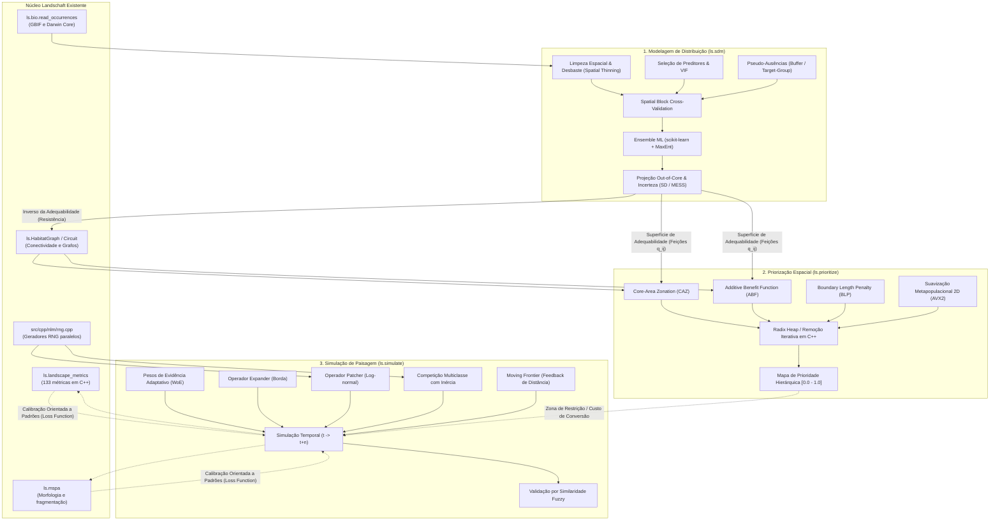

# Ideias para o landschaft (métricas de paisagem)

Ideias levantadas durante o desenho das métricas de paisagem (comparando com
landscapemetrics e pylandstats) que ficaram fora do escopo atual, para
implementar em outro momento. As fases combinadas estão no fim, para referência.

## Métricas e estatísticas extras

- `convention="fragstats"`: PROX com a área só da parte do vizinho dentro do raio (a
  documentação do FRAGSTATS é ambígua; usamos a área inteira). Sem o FRAGSTATS para
  comparar, as métricas FRAGSTATS-only foram testadas contra implementações diretas
  das definições.

## Uso e API

- O que faltava da API do landscapemetrics: `full_name`, `return_raster` no
  `sample_metrics` e os helpers `construct_buffer`, `pad_raster`, `unpad_raster`,
  `raster_to_points` e `get_unique_values`. **Feito** (0.49.0, bit a bit com o R; o
  `sin` do círculo é o `fsin` x87; o extent dos recortes é o do terra num raster intacto:
  o `crop(mask = TRUE)` do terra reescreve o extent do raster recortado, e no
  `sample_lsm` os plots depois do primeiro saem deslocados alguns ulps, o que não
  reproduzimos).

## Exportação


## Análises no estilo pylandstats


## Desempenho e escala

- ENN: a construção das árvores e a passada estável por classe ainda são limitadas
  pela memória (~0,5 s cada em 100 M pixels); nós menores (sem `begin`/`end` nos
  nós internos, caixas em 16 bits relativas) reduziriam o tráfego.
- Rótulos em 64 bits para rasters em memória com mais de 2^31 pixels (hoje esses
  casos ficam para o processamento por tiles).
- Janela móvel: reaproveitar rótulos globais e só corrigir os patches cortados pela
  borda da janela (algoritmo incremental). Hoje cada janela é uma paisagem pequena
  (1000×1000, janela 21×21, 66 métricas: ~7 s; ~73 µs por janela numa thread).
  Perfil (py-spy --native, build com /Zi): círculo, rótulo e core são as maiores
  partes, e as alocações ~10%: reaproveitar os buffers do `Landscape` entre janelas
  cortaria as alocações.
- Fora da memória (`block_rows`): o ENN guarda todas as células de borda (~24 B cada);
  um ENN realmente fora da memória (p. ex. árvores por bloco em disco, ou busca por
  anéis de blocos vizinhos) tiraria esse limite. `labels()`/`to_raster()` por blocos
  poderiam gravar direto num GeoTIFF (reescrevendo os rótulos na passada de detalhe).
  Blocos processados em paralelo (hoje um bloco por vez, paralelo por faixas) ajudariam
  em rasters estreitos.

## Reprojeção (`ls.reproject`, como o `project()` do terra)

**Feito (fase 1):** `ls.reproject` para rasters e vetores (CRS, `res=`, referência
`like=` raster ou vetor, `crs=` de um objeto, `densify=` nos vetores). O warp é o do
GDAL, mas sempre nos mesmos blocos de 1024 células ancorados na origem do destino,
cada um com a janela de origem que vê e o XSCALE/YSCALE da grade inteira. O que
motivou isso (medido num 8000×8000 float32, UTM 23S → EPSG:4326, Apple M, 9 threads):

- O warp do GDAL depende de como ele divide o trabalho: só mudar o `warp_mem_limit`
  (64 MB vs 2 GB) muda 48 M células no bilinear e 11 mil no nearest. O transformador
  aproximado (erro de 1/8 de célula) interpola ao longo das linhas de cada chunk, e o
  XSCALE/YSCALE dos kernels é calculado por chunk. Threads não mudam nada.
- Com blocos fixos, em memória, lazy (dask) e a partir de arquivo (lido por janelas)
  fazem as mesmas chamadas ao GDAL: os mesmos bits, floats inclusive. Com um bloco
  só, o resultado é o da chamada padrão do GDAL; com `tolerance=0` (transformação
  exata), o do GDAL com o destino inteiro num chunk (até 1 ulp nos contínuos).
- Tempos: nearest 0,14 s, bilinear 0,36 s, average 0,37 s (GDAL padrão: 0,09 / 0,14 /
  0,33 s; rioxarray: 0,13 / 0,32 / 0,35 s); `tolerance=0`: 0,9 / 1,1 / 2,0 s (o custo é o
  PROJ transformando cada pixel). De arquivo: 1,3 s. O `match_grid` e o
  `load_raster(like=)` passaram a usar o mesmo warp.
- As janelas de origem dos blocos saem de uma grade 11×11 de pontos por bloco
  transformada de uma vez com um `Transformer` do pyproj: o `transform_bounds` do
  rasterio reconstrói a transformação a cada chamada (12 ms por bloco entre
  EPSG:3035 e UTM).

**Feito (fase 2): kernel C++ próprio** (`src/cpp/io/warp.cpp`, `_reproject.py`,
`_gdaltransform.py`), com o determinismo e agora bit a bit igual ao GDAL com
`tolerance=0`:

- Porte do `gdalwarpkernel.cpp` (GDAL 3.12.4, o do rasterio 1.5.1) só pelos caminhos que
  o GDAL toma no nosso caso: o destino tem NoData, então sempre há `panDstValid` e nunca
  os caminhos `NoMasksOrDstDensityOnly` (nearest de Byte/Int8/Int16/UInt16/Float32 por
  `GWKNearestThread<T>`, o resto por `GWKRealCase`; `GWKAverageOrMode` com o modo por
  histograma nos tipos de 8/16 bits e `GWKModeRealType` nos outros). Mesmas operações na
  mesma ordem (pesos, `SRC_DENSITY_THRESHOLD`, mistura de densidade < 0,9999, arredondamento
  e `AvoidNoData`, máscara unificada de NoData das bandas, a soma SSE2 de 6 colunas do
  Lanczos de Byte, `floor`/`ceil` trocados por conversões inteiras equivalentes). As
  coordenadas são as da origem inteira (a janela só indexa): subtrair o deslocamento
  inteiro da janela é exato, então o resultado não depende da janela.
- Coordenadas: o transformador do próprio GDAL (`GDALCreateGenImgProjTransformer2` +
  `GDALGenImgProjTransform` da DLL que o rasterio carrega, achada pelos módulos do
  processo e chamada por ctypes, que solta o GIL; um transformador por thread). O pyproj
  não serve para a paridade: traz o PROJ 9.5 e o rasterio o 9.8, e a inversa da LAEA
  difere em até 0,7 mm. Sem a DLL, o pyproj é a reserva (mesmo determinismo, últimos
  bits diferentes). O C++ recebe o ponteiro da função para o que o GDAL transforma sob
  demanda: coordenadas exatas por linha (`tolerance=0`), o ajuste de borda
  `GWKAdjustSrcOffsetOnEdge` (um canto da origem fora do domínio da projeção) e o teste
  de antimeridiano das áreas (ponto médio da célula).
- Grade de coordenadas ancorada na origem do destino: nós exatos a cada 16 amostras,
  verificados no centro e nos meios das arestas de cima e da esquerda de cada célula
  (erro |dx| + |dy|, como o transformador aproximado do GDAL) e refinados para 8, 4, 2, 1
  onde passa da tolerância ou algo falha; células bem fora da origem não refinam. Cada
  célula só depende de si: cada tarefa lazy calcula a grade das suas células (a memória
  não cresce com o raster). Erro medido: 2e-5 célula (UTM → 4326), 0,16 perto do polo
  (4326 → 3031; as verificações são só nos pontos médios).
- XSCALE/YSCALE como o GDAL para o destino inteiro num chunk: `ComputeSourceWindow`
  (21 pontos por aresta, todos se um canto falha, grade 23×23 se algum falha ou um polo
  cai no destino — o `GDALTransformLonLatToDestGenImgProjTransformer` nem reprojeta o
  polo quando a origem é geográfica, replicado — e `ComputeSourceWindowStartingFromSource`),
  depois as regras do `PerformWarp`. Translação inteira no mesmo CRS: nearest.
- Validação (`tests/test_reproject.py`, 202 testes): `tolerance=0` igual bit a bit ao GDAL
  com o destino num chunk para todos os métodos (menos `sum`), tipos (u)int8/16/32, int64,
  float32/64 com e sem NoData, 3 bandas com NaN diferentes, origem geográfica, mesmo CRS,
  e um mundo em 4326 para ortográfica (pontos fora do globo, antimeridiano) e polar, com
  buracos de NaN; memória = lazy = threads = pickle em todos. O padrão fica a ≤ 1e-3 do
  exato nos contínuos e troca < 0,1% das células nos que escolhem valores.
- Tempos (8000×8000 float32, UTM 23S → 4326, i5-13600K, 11 threads nos 6 núcleos P):
  nearest 0,13 s, bilinear 0,21 s, cubic 0,46 s, average 0,33 s, mode 0,40 s; o GDAL do
  rasterio na mesma máquina (padrão, 11 threads): 0,49 / 0,57 / 0,74 / 0,64 / 0,68 s; a
  fase 1: 0,38 / 0,45 / 0,62 / 0,56 / 0,55 s. `tolerance=0`: 0,93 / 1,0 / 1,3 / 1,2 / 1,3 s
  (fase 1: 1,8–2,0 s). A grade custa 0,05 s; numa thread o kernel leva ~6 ns por célula no
  nearest, 17 no bilinear, 38 no cubic.

Bugs do GDAL corrigidos (só a forma correta, testada contra o GDAL corrigido):

- `GDALTransformLonLatToDestGenImgProjTransformer` (GDAL 3.12 e master): com origem
  geográfica, a "otimização" que evita criar a transformação lon/lat → origem também pula
  a reprojeção origem → destino, e o polo vira coordenadas de pixel sem sentido; o GDAL não
  vê o polo no destino e estima a escala do kernel só pelas bordas. Aqui o polo é
  reprojetado; os testes comparam com o GDAL com `SAMPLE_GRID=YES` (o que o GDAL corrigido
  faz ao ver o polo).
- GDAL < 3.12.3 (o rasterio 1.5.2 do Linux traz o 3.12.2): o tipo de trabalho partia de
  Byte, e Byte ∪ Int8 = Int16, então rasters Int8 eram warpados em Int16 (no cubic e no
  Lanczos, valores abaixo de -128 viravam -128, o NoData, sem o `AvoidNoData`). Aqui é
  Int8, como no 3.12.3+; o teste pula Int8 com GDAL mais antigo.

Ficou de fora / próximos passos:

- `sum` continua no warp do GDAL em blocos (fase 1): usa a transformação inversa e uma
  quadtree (`GWKSumPreserving`), cuja ordem de soma teria de ser replicada.
- Um NoData sem nenhuma célula NoData: o GDAL descarta a máscara e o Lanczos soma em outra
  ordem (diferença nos últimos bits); aqui a máscara fica sempre, para não depender da
  janela de cada tarefa.
- Velocidade: o cubic e o modo por histograma de 16 bits são os mais lentos por célula;
  as 4 linhas do cubic caberiam em SIMD (2 linhas por registro SSE2, mesma ordem por
  linha). A janela de origem de cada tarefa lazy refaz a grade da tarefa (o dobro do
  custo da grade, pequeno).
- Operações fundidas numa passada (reprojetar + recortar + reclassificar).
- Outras ideias: o `partial` do terra para vetores que saem do domínio da projeção
  (hoje viram coordenadas infinitas), referências do `terra::project` em R para a
  escolha da grade (hoje é a do GDAL, `calculate_default_transform`), e alinhar a
  origem à resolução (`-tap` do gdalwarp) como opção.

## Conectividade em grafos (Conefor Sensinode / Makurhini)

Análise de 2026-09-26. O Conefor Sensinode 2.2 (`C:\Users\eduar\Documents\dev\Conefor
Sensinode 2.2`) é o motor original dos índices de Saura: C++ Borland com interface gráfica
só para Windows (cálculo em `landscape.cpp` e `sensinodeProgram.cpp`, em `float` de 32 bits).
Lê só tabelas (nós com atributo, conexões como distâncias, probabilidades ou adjacências)
e calcula NC, NL, H, CCP, LCP, IIC, F, AWF e PC, com `p = exp(ln(k)/d₀ · d)` e caminhos de
produto máximo (Dijkstra sobre `-log p`, poda por `minProb`), além de dI por remoção de nós
(frações intra, flux e connector), varPC (adição de nós) e nós de área zero. Não tem
betweenness (BC, BCIIC, BCPC), que só existe no Conefor 2.6 de linha de comando.
O Makurhini 3.0 (`C:\Users\eduar\Documents\dev\Makurhini`, R) cobre o fluxo inteiro:
- nós em vetor ou raster;
- distâncias (`distancefile`): centroide, borda, menor custo, commute-time;
- índices: `MK_dPCIIC` (frações intra/direct/step), `MK_dECA`, `MK_dPCIIC_links`,
  `MK_Focal_nodes` (IICf, PCf, CCI);
- ProtConn e frações (`MK_ProtConn`, `MK_ProtConnMult`, `MK_ProtConn_raster`);
- centralidades `MK_BCentrality` (via Conefor 2.6) e `MK_RMCentrality`;
- versões em grade (`MK_Connect_grid`, `MK_dECA_grid`) e o PC por SAMC (`MK_dPC_SAMC`);
- `MK_Fragmentation`, `dispersal_distance`, `probability_distance`, `test_metric_distance`.

No dI ele recalcula as distâncias do grafo inteiro a cada nó removido (lento com milhares
de nós). Todos são GPL, como o landschaft.

Já existe no landschaft: `gtn_components` e `gtn_importance` (ECA, DOC e dPC na versão
topológica do GTB: cores e bridges do MSPA, `p = 1`), `conefor_inputs`, `cost_distance` e
`least_cost_path`; no `lsm`, rotulagem, área, core, a árvore do ENN (base da distância borda
a borda), `grid_zones`, `zonal_metrics` e `SpatioTemporalAnalysis`.

Proposta: módulo novo com a arquitetura do `lsm` (motor C++/OpenMP em `src/cpp/conn/` e um
objeto Python que guarda os resultados intermediários):

```python
g = ls.HabitatGraph.from_raster(cover, habitat=[1], min_area=10, distance="edge", threshold=20_000)
g = ls.HabitatGraph.from_vector(gdf, attribute="area", distance="least-cost", resistance=res)
g = ls.HabitatGraph.from_conefor("nodes.txt", "distances.txt")
g.overall(["pc", "iic", "eca", "nc", "h", "awf"], distance=[1000, 5000], probability=0.5)
g.node_importance("pc", distance=5000, probability=0.5)  # dPC, intra, flux, connector
g.link_importance("pc", ...); g.centrality(["bc", "bcpc", "radial", "medial"], ...)
g.add_nodes(candidates)                                  # varPC (restauração)
ls.eca_change([g_2000, g_2020]); ls.protconn(pas, region, distance=10_000, probability=0.5)
ls.connectivity_grid(g, grid_zones(...))
```

- Motor em camadas:
  1. nós (rotulagem do `lsm`; vetores pela rasterização all-touched ou pela geometria);
  2. distâncias esparsas até o limiar (borda a borda pela árvore do ENN, menor custo por
     Dijkstra multi-fonte em paralelo por nó, commute-time por sistema linear esparso
     com Eigen);
  3. grafo em CSR, PC por Dijkstra de produto máximo por nó em paralelo, IIC por busca
     em largura, dI recalculando só os caminhos que passavam pelo nó removido e só no
     componente dele;
  4. ProtConn (frações sobre PC e ECA, região e transfronteira).
- `gtn_importance` vira um caso especial (grafo do MSPA com `p = 1`); `HabitatGraph.to_conefor`
  generaliza o `conefor_inputs`.
- Fases:
  1. motor de grafo (IIC, PC, ECA, NC, NL, H, CCP, LCP, F, AWF, dI com frações) lendo e
     escrevendo os arquivos do Conefor. **Feita** (0.30.0: `HabitatGraph`, conferido com
     o Makurhini a 1e-12 e com o Conefor 2.2 compilado, em precisão simples);
  2. nós de raster e vetor, distâncias euclidianas (centroide e borda) com limiar.
     **Feita** (0.31.0: `from_raster`, `from_vector`, `node_table`, `distance_table`, os
     mesmos bits do Makurhini; o `keep` do Makurhini, simplificação com `rmapshaper`,
     ficou de fora);
  3. distâncias de menor custo. **Feita** (0.32.0: o `costDistance` do gdistance bit a
     bit, sem o `bounding_circles` nem o caminho em Java do Makurhini);
  4. importância das ligações, varPC, dECA no tempo e índices em grade. Ligações,
     mudanças de ligação e nós a adicionar (restauração, modo "adding nodes" do Conefor):
     **feita** (0.33.0); dECA no tempo **feito** (0.34.0, `eca_change`); os índices em grade
     (`MK_Connect_grid`, `MK_dECA_grid`) dependem do ProtConn (recorte dos nós por célula,
     áreas transfronteiriças) e passam para a fase 5;
  5. ProtConn completo (uma ou várias regiões). **Feito** (0.35.0, `protconn`,
     `protconn_regions`; sem a simplificação do mapshaper, que só muda os nós quando
     altera as formas); ProtConn em raster e índices em grade **feitos** (0.36.0,
     `protconn_raster`, `make_grid`, `connectivity_grid`, `eca_change_grid`);
  6. centralidades (BC, BCIIC, BCPC, radial, medial) **feitas** (0.37.0,
     `node_importance(["BC", "BCIIC", "BCPC"])`, `centrality`; conferidas com o
     `MK_RMCentrality` e com a linha de comando do Conefor 2.7.1, sem o Louvain, que é
     aleatório); focais **feitos** (0.38.0, `focal_nodes` = `MK_Focal_nodes`, sem a
     simplificação do mapshaper nem as estatísticas de fragmentação);
  7. opcionais: commute-time **feito** (0.39.0, `distance="commute-time"`, o
     `commuteDistance` do gdistance a 1e-11); SAMC **feito** (0.40.0,
     `settlement_probabilities`, `HabitatGraph.from_samc` = `MK_dPC_SAMC`, a 1e-14 do
     samc; sem a amostragem aleatória de vértices nem o `keep` do mapshaper).
     Todas as fases do plano concluídas.
- Decidido: o Makurhini (instalado na biblioteca do RStudio) é a referência, e o
  Conefor 2.2 compilado (`tools/conefor`) é conferido na precisão simples dele.
- Desempenho do PC em grafos densos (milhares de nós com `pij_min` baixo): o Dijkstra
  de todas as fontes é limitado pela memória (5000 nós, 4,3 M pares: 14 s dos 19 s).
  Ideias: linhas ordenadas por custo com poda (parar a varredura quando
  `d_v + w` passa do maior custo provisório, depois que todos os nós foram
  alcançados); custos em `float` só para filtrar; quando as distâncias são métricas
  (centroides), o caminho direto já é o melhor para os pares ligados.
- A decidir:
  - vetores com geopandas/shapely como dependências opcionais (extra `vector`);
  - se ProtConn e SAMC entram no escopo.

## Conectividade por teoria de circuitos (Omniscape / Circuitscape)

Análise de 2026-09-26. O Omniscape.jl 0.7 (`C:\Users\eduar\Documents\dev\Omniscape.jl`, Julia,
~1,7 mil linhas em `src/`) calcula conectividade omnidirecional sobre raster, sem manchas:
uma janela móvel circular (`radius`, mais `buffer`) centrada em cada alvo (blocos de
`block_size`², só onde a soma das fontes do bloco é > 0) injeta a força do bloco nas fontes
da janela (fora do bloco-alvo, proporcional à força de cada uma), aterra o centro e soma a
corrente dos nós num mapa acumulado (`cum_currmap`). Opcionais: `flow_potential` (a mesma
coisa com condutância 1), `normalized_cum_currmap` (a razão), correção de artefatos de bloco
(`calc_correction`, dois solves nulos), conectividade condicional (condições presentes e
futuras, `within` pela mediana, `equal` pela moda), reclassificação, `source_from_resistance`
com `r_cutoff`, `precision = single`. O núcleo numérico é o `compute_omniscape_current` do
Circuitscape.jl 6.1 (Laplaciano do grid, solve `cg+amg` ou `cholmod`, corrente nos nós).
Completa o módulo `conn` (commute-time e SAMC já são circuitos e cadeias de Markov) e não há
versão nativa em Python. Todos GPL/MIT, compatíveis.

Critério de igualdade (o bit a bit dos outros módulos não se aplica: o solver padrão é
iterativo com tolerância ~1e-6, a ordem dos alvos é sorteada com `randperm` e somada por
fatia de thread, e os testes do próprio Omniscape usam `rtol = 1e-6`):
- estrutura idêntica: mesmos alvos, máscara de NoData, células nulas e não nulas, bordas;
- contra `solver = cholmod`: diferença relativa ≤ ~1e-10;
- contra o padrão `cg+amg`: dentro da tolerância do solver (1e-6, como os testes deles);
- o nosso determinístico (mesmos bits com qualquer número de threads).

Circuitscape 6.1 (`compute_omniscape_current`, lido no fonte instalado): nós são as células com
condutância > 0 (os `-9999` do Omniscape caem fora), numeradas em ordem de coluna; arestas para
direita, baixo e as duas diagonais da direita com `(x+y)/2` e `(x+y)/(2√2)`; componentes conexas
do grafo inteiro, e só se resolve a que tem fonte e terra (a do centro); terra `Inf` = nó
removido, tensão 0; `cholmod` fatora com `shift = 10ε` e refina se o resíduo relativo passar
de 1e-5; `cg+amg` (agregação suavizada, Gauss-Seidel, `Pinv` no nível grosso, sem a
regularização do modo pairwise) para em `rtol = 1e-6` no resíduo precondicionado e repete com
`rtol/100` se o resíduo verdadeiro passar de 1e-4. Corrente do nó = `max(entrada, saída)` das
correntes de ramo `|G[i,j]| (v_i − v_j)`, ignorando ramos com `|b / max| < 1e-8` (máximo com
sinal separado para o triângulo superior e o inferior da matriz).

Peculiaridades a reproduzir (confirmar no fonte):
- `get_source` zera o bloco-alvo em `radius+buffer+1` do recorte, que perto das bordas não é
  o centro (o recorte foi cortado); `xupper_sub` compara com `ncols` do mapa inteiro;
- `clip` põe `missing` onde a distância ao centro é > raio (fontes no raio, condutância no
  raio + buffer); o `buffer` só acrescenta colunas/linhas de NoData às fontes;
- `calc_correction`: limiar `1e-6 * maximum(block_null_current)`, sensível a células perto
  dele (um solver diferente pode jogá-las do outro lado); zeros viram fator 1;
- `mode` do StatsBase desempata pela ordem de um `Dict`; `median` com `skipmissing`;
- `flow_potential` usa o retângulo inteiro com condutância 1 (sem o recorte circular);
- no Circuitscape: vizinhança 8 (ou 4 com `connect_four_neighbors_only`), média das
  condutâncias, diagonais /√2, terra `Inf` = nó removido (tensão 0), componentes sem terra,
  corrente do nó (convenção exata a ler no fonte do Circuitscape.jl, a clonar);
- `precision = single` faz tudo em `Float32`.

Proposta: motor C++ novo `src/cpp/circuit/` (`circuitcore`: `grid.cpp` Laplaciano como o
Circuitscape, `solve.cpp`, `omniscape.cpp`), Python `ls.omniscape(resistance, radius=...,
block_size=..., source=..., ...)` devolvendo um `xarray.Dataset` (`cum_currmap`,
`flow_potential`, `normalized`) e `ls.omniscape_ini(path)` para os `.ini` existentes. O Eigen
entra no projeto aqui (ainda não é usado em `src/cpp`; só cabeçalhos, FetchContent ou
vendorizado).

Desempenho (o Omniscape, por janela, recorta arrays com `missing`, monta o grafo, acha
componentes, monta o AMG do zero e roda o CG, duas vezes com flow potential):
- janelas interiores têm o mesmo formato (disco de `radius + buffer`): ordenação por nested
  dissection geométrica e fatoração simbólica uma vez; por janela só a numérica (NoData como
  condutância 0 e linha identidade no nó isolado, mantendo o padrão fixo);
- o Laplaciano nulo (condutância 1) é o mesmo em todas as janelas interiores: fatorar uma
  vez por formato (cache para as bordas) e o flow potential vira duas substituições
  triangulares;
- correção de artefatos calculada uma vez, como no original;
- OpenMP nos alvos (`schedule(dynamic)`), área de trabalho por thread, zero alocação no laço;
  acumulação em ordem fixa por blocos com coloração 2D (um acumulador do tamanho do mapa por
  thread, como no Omniscape, daria ~13 GB em 10k × 10k com 16 threads);
- risco: Cholesky custa ~n^1,5 e o AMG ~n; para raio grande (≥ ~300 px, ~280 mil nós) o AMG
  pode ganhar, e aí seria preciso um CG com AMG por agregação suavizada em C++. Medir antes.

Fases:
0. benchmark rápido: tempo por janela do Omniscape (Julia, várias threads) contra Eigen LDLT
   com nested dissection, CG+IC e CHOLMOD, com r = 25, 50, 100, 200; decide o solver.
   **Feita** (`tools/omniscape_window_benchmark.jl`; uma thread, disco de raio r, condutância
   aleatória, terra no centro, ms por janela):

   | r (nós) | Circuitscape cg+amg | Circuitscape cholmod | Eigen LDLT, ND fixa (monta + fatora) | só a substituição |
   |---|---|---|---|---|
   | 25 (2 mil) | 6,1 | 4,0 | 1,0 | 0,07 |
   | 50 (8 mil) | 20,8 | 15,6 | 4,9 | 0,25 |
   | 100 (31 mil) | 119 | 67 | 35 | 1,6 |
   | 200 (126 mil) | 510 | 268 | 234 | 8,9 |

   Eigen com AMD em vez da ND geométrica: 66 ms (r = 100) e 700 ms (r = 200); CG+IC e CG+Jacobi
   (1e-6) 3–10× mais lentos que o direto; SparseLU 2× mais lento. Decidido: Eigen
   `SimplicialLDLT` com ordenação por nested dissection geométrica, análise simbólica uma vez
   por formato de janela e só a fatoração numérica por alvo; o flow potential sai da fatoração
   nula em cache (só a substituição). Com flow potential o Omniscape paga dois solves: ~11× (r =
   25) a ~4× (r = 200) por janela. Para r ≥ ~150 um Cholesky supernodal/multifrontal (blocos
   densos nos separadores) é o próximo ganho, na fase 3. O cg+amg do Circuitscape refaz o solve
   com `rtol/100` quando o resíduo verdadeiro passa de 1e-4 (aconteceu em r = 100 e 200);
1. núcleo de circuito (Laplaciano, solve, corrente nos nós), conferido com o
   `compute_omniscape_current` com `cholmod`. **Feita** (0.41.0: `ls.circuit.advanced`,
   `src/cpp/circuit/` com `CellSystem`, o padrão fixo reaproveitável pelas janelas; a 1,2e-13
   do CHOLMOD, mesmas células com corrente; o cg+amg fica a 2e-7);
2. Omniscape básico (alvos, fontes, terra, correção, flow potential, normalizada,
   `mask_nodata`, com as peculiaridades), conferido com `test/output_verify` (test1–5) e
   referências novas. **Feita** (0.42.0: `ls.omniscape`, também `source_threshold`,
   `r_cutoff`, condutância e 4 vizinhos; conferido com o `run_omniscape` por INI nas
   configurações 1–3 do Omniscape e em mapas sintéticos, a 1,7e-11 do CHOLMOD. Janelas
   agrupadas por formato, um `CellSystem` por formato e thread, flow potential com a
   fatoração em cache; soma por linhas em ordem fixa. 300×300, r = 25, bloco 3, com flow
   potential: Omniscape 17,4 s com 20 threads, landschaft 0,87 s (8,2 s numa thread));
3. desempenho (reuso simbólico, cache do nulo, OpenMP, acumulação determinística) e
   benchmark final contra o Omniscape. **Feita** (0.43.0): Cholesky multifrontal próprio
   sobre a ND geométrica (`system.cpp`: fronts densos nos separadores, LLT/TRSM/SYRK do
   Eigen; r = 100: 26 → 12 ms, r = 200: 206 → 78 ms), estrutura simbólica por formato
   compartilhada entre threads, substituição direta fundida na fatoração, flow potential
   em lotes de até 8 alvos (`solve_many`), módulo `_circuit_avx2` (x86-64, carregado por
   `cpu_supports_avx2_fma`; buffers alinhados a 64 bytes para o resultado não depender do
   endereço). Com 20 threads: 800² r = 10 0,64 s (Omniscape 29,4 s), 700² r = 25 1,36 s
   (46,7 s), 1000² r = 100 12,4 s (275 s). Ficou para depois: com r grande e muitas threads
   a banda de memória limita (6× de 1 para 20 threads em r = 100; o fator de uma janela tem
   13 MB); folhas da ND de 4 a 64 células dão o mesmo tempo; o Omniscape com `cholmod` é
   tão lento quanto com `cg+amg`;
4. conectividade condicional, reclassificação, `source_from_resistance`, `r_cutoff`, `.ini`,
   `precision = single`. **Feita** (0.44.0: condições no C++ depois da escala das fontes,
   mediana `a/2 + b/2`, moda do StatsBase = o primeiro valor a passar a maior contagem em
   ordem de coluna; `ls.circuit.omniscape_ini` com o parser do Omniscape; conferido com os
   INI de teste do próprio Omniscape (1–7, 4a–4c, 32 bit, reclass) a 5e-13 do CHOLMOD; o
   `config7` tem resistência 0 e o Omniscape recusa, como nós; em `single` a aritmética
   fica em double: o Omniscape em float32 fica a até 2,4e-4);
5. opcionais: solver iterativo para raio grande; modos raster do Circuitscape (pairwise,
   one-to-all, all-to-one, advanced) sobre o mesmo núcleo. Decidido (2026-09-26): o solver
   iterativo não compensa (o direto ganha até em r = 200; o limite real é a memória); a
   fase vira o port dos modos raster do Circuitscape 6.1, conferido com a suíte de
   verificação dele (`test/output_verify`: `sg` pairwise, `mg` advanced, `oneToAll`,
   `allToOne`, com polígonos, máscara, pares incluídos, fontes variáveis, média de
   resistências, 4/8 vizinhos, mapas de tensão/corrente/acumulada/máxima e a matriz de
   resistências) e com o CHOLMOD dele:
   - 5a. Omniscape com janelas enormes: threads limitadas pela memória do fator por thread.
     **Feita** (0.45.0: `memory_limit`, metade da RAM por padrão, estimado pela estrutura
     simbólica da janela cheia; `attrs["threads"]`);
   - 5b. núcleo raster do Circuitscape e modo advanced completo (mapa de habitat como
     resistência ou condutância, `connect_using_avg_resistances`, polígonos de curto-circuito,
     máscara, fontes e terras de arquivo, as quatro políticas de conflito, terra como
     resistência, terras diretas, mapas de tensão e corrente, `set_null_*_to_nodata`).
     **Feita** (0.46.0: `circuitscape.cpp` = mapa de nós e grafo do Circuitscape, solve por
     componente com `frontal_analyze_graph` (nós de polígono na raiz); leitor ASCII em
     double (o GDAL daria float32); `circuitscape_advanced`, `circuitscape_ini` com
     `scenario = advanced`; referências: as entradas de teste do Circuitscape copiadas e
     rodadas com CHOLMOD (`tools/make_reference_circuitscape.py`, todos os modos já
     gravados), mg1–7 e ex_advanced a 5e-12; no modo advanced o Circuitscape ignora
     `set_null_*_to_nodata` e escreve 0 fora dos nós);
   - 5c. pairwise (pontos e regiões focais, pares incluídos/excluídos, matriz de
     resistências `.out`, corrente acumulada e máxima, mapas por par); uma fatoração por
     componente e muitos lados direitos (`solve_many`). **Feita** (0.47.0:
     `raster_pairwise` com um nó aterrado por componente, lotes de 8 colunas por thread,
     `SolveScratch` por thread sobre o mesmo fator; o atalho do Circuitscape reproduzido
     com a peculiaridade da linha 1 da matriz de tensões; regiões focais com um grafo por
     par (`region_polymap` = `create_new_polymap`), pares em paralelo; sg1–17 batem,
     sgVerify17 a 9e-10 relativo porque o CHOLMOD resolve a laplaciana singular com
     deslocamento 10ε);
   - 5d. one-to-all e all-to-one (fontes variáveis, `set_focal_node_currents_to_zero`).
     **Feita** (0.48.0: o driver em Python monta fontes e terras por ponto como o
     `run_onetoall`, e `circuitscape_multi_advanced` resolve os pontos em paralelo sobre um
     grafo, só no componente do ponto; os 25 casos a 5e-14);
   - 5e. `ls.circuit.circuitscape_ini(path)` e a gravação das saídas como o Circuitscape.
     **Feita** junto com 5b–5d (todos os cenários raster; mapas `.asc`/`.tif`,
     `_resistances.out`, `_resistances_3columns.out`, a configuração em `output_file`).
     Fase 5 concluída; o modo de rede (grafos) do Circuitscape continua fora.

Próximos passos sugeridos (2026-09-26, depois da 0.48.0):
- Fatoração paralela de um componente grande. **Feita** (0.51.0: partes da árvore em
  paralelo, os fronts acima por alturas, fronts grandes por Cholesky em blocos fixos;
  mesmos bits com qualquer número de threads; 1000×1000: fatoração 3,4 → 0,7 s com 20
  threads). O que sobra no advanced de um componente só é serial: montar o grafo, o
  `factor_component` e as correntes (~1,6 s dos 2,6 s num raster 1000×1000), e no
  pairwise as substituições (lotes de 8 colunas relendo o L inteiro). Plano original:
  - paralelismo na árvore: subárvores independentes da ND fatoradas ao mesmo tempo, por
    alturas (OpenMP 2.0 do MSVC não tem `task`: `parallel for` sobre os nós de mesma
    altura), com as matrizes de atualização em áreas próprias por nó em vez da pilha única
    (o pico de memória sobe; somar os `u²` por nível para estimar);
  - paralelismo nos kernels densos dos fronts do topo (os separadores de ~N células
    concentram a maior parte dos flops: só a árvore dá no máximo ~3×): LLT/TRSM/SYRK em
    blocos com `parallel for`, ou o GEMM paralelo do Eigen onde couber;
  - manter o resultado determinístico (mesma ordem de soma com qualquer número de
    threads) e conferir com o CHOLMOD como nas outras partes.
- Modo de rede (grafos) do Circuitscape (`data_type = network`). **Feito** (0.50.0:
  `circuitscape_network_pairwise` / `_advanced`, `circuitscape_ini`; dissecção aninhada
  por níveis de BFS para grafos sem geometria, em paralelo por profundidade; os casos de
  rede do Circuitscape e seis sintéticos a 1,1e-14 do CHOLMOD; 1 M de nós, 20 pontos:
  7,2 s contra 27,7 s do CHOLMOD e 182 s do cg+amg; 5,0 s com a fatoração paralela).
- Omniscape com raio grande e muitas threads: limitado pela banda de memória (6× de 1 para
  20 threads em r = 100; o fator de uma janela tem 13 MB). Ideias: fatorar o landscape em
  precisão mista não serve (condicionamento); reduzir o tráfego guardando só a parte de L
  que a substituição reversa lê, ou resolver lotes de alvos vizinhos na mesma thread para
  reaproveitar a cache.

Referência: Julia 1.13.0 (`C:\Users\eduar\AppData\Local\Programs\Julia-1.13.0`) com
Omniscape 0.7 (o clone local, `Pkg.develop`) e Circuitscape 6.1 num depot separado
(`C:\Users\eduar\AppData\Local\landschaft-julia`, `JULIA_DEPOT_PATH=...\depot`,
`--project=...\env`; `jl.sh` lá dentro chama o Julia assim); script
`tools/make_reference_omniscape.jl` gravando em `tests/data/reference/circuit`.

## Modelos neutros de paisagem (NLMR)

Análise de 2026-09-28. O NLMR 1.4.0 (`C:\Users\eduar\Documents\dev\NLMR`, R, GPL-3) simula
paisagens neutras: gradientes (`nlm_planargradient`, `nlm_edgegradient`,
`nlm_distancegradient`), aleatórios (`nlm_random`, `nlm_percolation`), agrupados
(`nlm_randomcluster`, `nlm_curds`, `nlm_neigh`, `nlm_randomrectangularcluster`), fractais
(`nlm_mpd`, `nlm_fbm`), campos gaussianos (`nlm_gaussianfield`), mosaicos
(`nlm_mosaicfield`, `nlm_mosaictess`, `nlm_mosaicgibbs`) e a classificação
`landscape_classify` (proporções ou quebras de Jenks). Não há nada disso no landschaft.

A aleatoriedade vem de dois lugares, e os dois precisam ser reproduzidos para o mesmo
`user_seed` dar o mesmo mapa:
- R (`set.seed`, `runif`, `rnorm`, `sample`, `sample.int`): Mersenne-Twister do R com a
  mistura inicial do `set.seed`, `unif_rand` com `fixup`, `norm_rand` por inversão
  (`qnorm5` do AS241 sobre `u = (int)(2^27 u1) + u2`, com o `log` x87 do mingw),
  `R_unif_index` por rejeição (`rbits` em pedaços de 16 bits), `sample` sem reposição
  (Fisher-Yates parcial), com `prob` (`revsort` + busca linear; Walker com mais de 200
  probabilidades relevantes; sem reposição com remoção), `sample2` com hash para
  `n > 1e7`; mais tarde `rpois`/`exp_rand` para o spatstat;
- C++ do NLMR (`mpd`, `neigh`, `randomrectangularcluster`): `std::mt19937` com as
  distribuições da libstdc++ do Rtools (GCC 13.3): `generate_canonical` com duas palavras de
  32 bits, normal polar com o valor guardado, inteiros pelo método de Lemire (64 bits) e o
  `std::shuffle` que sorteia duas posições de uma vez quando `n² < 2^32`.

Critério de igualdade: bit a bit com o NLMR para a mesma semente em tudo, menos nas
tesselações de Voronoi (`mosaictess`, `mosaicgibbs`): o `st_union` ordena os germes e o
`st_voronoi` do GEOS devolve as células na ordem da sua estrutura interna, e os valores são
atribuídos nessa ordem. Ali: germes bit a bit, a mesma partição (a menos de empates exatos)
e o mesmo conjunto de valores; a ordem do GEOS pode ser portada depois.

Peculiaridades a reproduzir (com `nlmr_compat=True`, o padrão; `False` faz o que a
documentação promete):
- `mpd`: quadrado de lado `max(nrow, ncol) + 1` (ímpar), menos uma célula de cada borda,
  então a saída não tem as dimensões pedidas; uma `normal_distribution` nova por célula
  (o segundo valor do método polar é jogado fora);
- `neigh`: `p_neigh` e `p_empty` passam por `float`; embaralhamento da libstdc++;
- `distancegradient`: `origin` indexa `[linhas, colunas]` no terra, apesar das verificações
  contra `ncol`;
- `randomcluster`: o preenchimento olha o mapa antes de preencher (sem propagação); empates
  por `sample(fili, 1)`, sem vizinho por `sample(prob = ai)` sem reposição;
- `randomrectangularcluster`: varre a matriz inteira depois de cada retângulo (O(N·k));
  um contador de células vazias dá o mesmo resultado;
- `fbm` e `gaussianfield` estão desativadas no NLMR 1.4.0 (só uma mensagem); a referência
  são as funções internas novas `NLMR:::simulate_fbm` e `simulate_gaussian_field`
  (espectral e embutimento circulante com o `fft` do R).

Proposta: motor C++ `src/cpp/nlm/` (`rng.hpp/.cpp` com os dois geradores, o `fft` do R
portado, um arquivo por família de modelos) e o subpacote Python `landschaft.nlm`
(`ls.nlm.mpd()`, `ls.nlm.random_cluster()`, ..., `ls.nlm.classify()`, `ls.nlm.rescale()`),
devolvendo `xarray.DataArray` com a resolução, `seed` (o `user_seed` do NLMR; `None` sorteia
e guarda em `attrs`), `rescale` e `n_threads`. Desempenho: o gerador é serial por natureza,
mas o que vem depois dele é paralelo (uniformes em série e `qnorm` em paralelo; passos do
diamond-square em paralelo; FFT 1D por linha/coluna; distância exata; rotulagem), e somem
os custos do R (o `vapply` por célula do `percolation`, o `dplyr` por linha do
`randomcluster`, as varreduras do `randomrectangularcluster`, o `disagg` do `curds`).

Referência: NLMR do clone local instalado numa biblioteca R própria
(`C:\Users\eduar\AppData\Local\R\landschaft-nlm-lib`, sem mexer na do RStudio), R 4.4.2,
`tools/make_reference_nlm.py` gravando em `tests/data/reference/nlm`; as distribuições da
libstdc++ conferidas com um programa compilado pelo g++ do Rtools.

Fases:
0. geradores do R e da libstdc++, biblioteca R com o NLMR, script de referência.
   **Feita** (`src/cpp/nlm/rng.cpp`: todos os fluxos bit a bit com o R 4.4.2 e com um
   programa compilado pelo g++ 13.3 do Rtools, na primeira tentativa);
1. gradientes, `random`, `percolation`, `rescale`, `classify` (com Jenks). **Feita**
   (0.54.0, tudo bit a bit com o NLMR). Descoberto: o `terra::rast(ncol, nrow, xmin = 0,
   xmax = ncol, ...)` sem CRS vira lon/lat quando o extent cabe em ±360 × ±90, então o
   `distancegradient` de rasters até 360 × 90 dá distâncias haversine em metros (esfera de
   6378137 m, busca podada por latitude do terra, `sin`/`cos`/`atan2` x87 do mingw); acima
   disso é o `GDALComputeProximity` (varredura com o alvo mais próximo propagado, float32).
   `sum`/`cumsum` das proporções do `classify` em 80 bits; o Jenks roda coluna a coluna
   com as linhas em paralelo (as mesmas somas);
2. `mpd`, `neigh`, `randomrectangularcluster`. **Feita** (0.55.0, bit a bit na primeira
   tentativa, também em toro e com o `shuffle` de mais de 65535 células; no `mpd` só o
   gerador e o teste de aceitação do método polar ficam em série, o `log`/`sqrt` e as
   células de cada passo vão em paralelo: 3× o NLMR em 1025²; `neigh` é serial por
   natureza);
3. `randomcluster`, `curds`. **Feita** (0.56.0, bit a bit; o `terra::patches` numera pela
   primeira célula de cada mancha em ordem de linha (a união guarda o menor rótulo, o R
   renumera em ordem); `randomcluster` 200² 19 s no R contra 3 ms);
4. o `fft` do R portado; `gaussianfield`, `fbm`. **Feita** (0.57.0, bit a bit com as
   `simulate_*` internas do NLMR; `fft.c` do R portado linha a linha, colunas e linhas em
   paralelo com os mesmos bits; `exp` e `x^y` do R no Windows são os do mingw-w64 v11 em
   x87 (`__expl_internal` com log2(e) partido em duas constantes; `powl`: expoente inteiro
   por quadrados em 80 bits, 0,5 por `fsqrt`, os demais `exp2l(y log2l |x|)`), agora em
   `lsm/rmath.hpp` (`r_exp`, `r_pow`) e no MASM; 6–8× o NLMR);
5. `mosaicfield` (`rpoislinetess`, `rMosaicField`, `rLGCP` do spatstat). **Feita** (0.58.0,
   bit a bit, também `collect` e `infinit`; `rpois`/`exp_rand` do R portados; os ladrilhos
   são as células do arranjo de retas no quadrado unitário na ordem lexicográfica do
   `chop.tess` (abaixo antes de acima), recortando o quadrado reta a reta (o polyclip do
   spatstat arredonda os vértices a ~1e-9: um pixel a essa distância de uma reta, ou uma
   lasca mais fina que isso, poderia divergir, nunca visto); 200² com 20 mosaicos: 9,95 s no
   R, 10 ms aqui);
6. `mosaictess`, `mosaicgibbs` (`st_sample`, `rSSI`, Voronoi). **Feita** (0.59.0, bit a bit, melhor
   que o previsto: a ordem das células do GEOS vem do próprio GEOS pelo shapely (3.13 dá a
   mesma ordem que o 3.12 do sf), dependência opcional com aviso; o `terra::rasterize` grava
   float32; a rasterização é por germe mais próximo em grade de baldes, em paralelo;
   25–70× o NLMR). Resta: portar a triangulação incremental do GEOS para não depender do
   shapely;
7. opcionais: `blend`/`merge` do antigo landscapetools, modelos do NLMpy, gerador paralelo
   rápido (`rng="fast"`, diferente do R) para rasters enormes. **Feita em parte** (0.60.0:
   `merge` e `binarize` do landscapetools (sem referência em R: o pacote saiu do CRAN), o
   tutorial *Neutral landscapes* com um teste de modelo nulo). Ficam de fora: o gerador
   paralelo (o gerador serial não é o gargalo: `random` 2000² leva 44 ms) e os modelos do
   NLMpy (outra referência, com o gerador do numpy); portar a triangulação do GEOS para
   o `mosaictess`/`mosaicgibbs` dispensarem o shapely.

## Análise de biodiversidade (Biodiverse)

Análise de 2026-09-28. O Biodiverse 5.99_004 (`C:\Users\eduar\Documents\dev\biodiverse`, Perl,
GPL-3, ~98 mil linhas em `lib/`, metade GUI Gtk) analisa a distribuição espacial da
biodiversidade. O núcleo:
- **BaseData**: matriz esparsa grupos × rótulos (células × espécies, contagem de amostras),
  grupos com coordenadas em N eixos e tamanhos de célula; propriedades de rótulos e grupos;
  importação de CSV, raster e shapefile;
- **condições espaciais**: expressões Perl avaliadas por `eval` (`sp_circle(radius => r)`,
  `sp_block`, `sp_annulus`, `sp_ellipse`, `sp_rectangle`, `sp_select_*`, `sp_is_left_of`,
  `sp_in_line_with`, `$D`, `$C`, `$d[0]`, `$coord[1]`...) definindo um ou dois conjuntos de
  vizinhos por grupo, e a *definition query*;
- **análise espacial**: 119 cálculos, 382 índices (`indices.json`): contagens e listas,
  endemismo, raridade, dissimilaridade taxonômica, estimadores de riqueza, rótulos
  hierárquicos, filogenéticos (PD, família PE, AED, clade contributions/loss, turnover,
  relativos RPD/RPE, PhyloCom MPD/MNTD/NRI/NTI, RWiBaLD), propriedades de rótulos e grupos
  (estatísticas, quantis, Gi*), rótulos numéricos, matriz e Rao QE;
- **randomizações** (`rand_structured`, `rand_csr_by_group`, independent swaps, curveball,
  random walk, diffusion, espacialmente estruturada) e comparações `C_/Q_/P_/SUM_/T_`,
  z-scores, significância e **CANAPE**;
- **cluster e RegionGrower**: aglomerativo sobre a matriz de dissimilaridade dos grupos, com
  as ligações do Biodiverse (average, average_unweighted, minimum, maximum, recalculate),
  tie-breakers, restrição espacial e índices por nó da árvore;
- árvores (Nexus/Newick) e matrizes de dissimilaridade entre rótulos.

Fora do escopo: a GUI, os arquivos de projeto `.bds`/`.bps` (Sereal), o Remap GUI e a
importação de planilhas (o pandas cobre).

Proposta: motor C++ `src/cpp/bio/` e subpacote `landschaft.bio` (`ls.bio`):

```python
bd   = ls.bio.BaseData.from_table("sites.csv", label_columns=["genus", "species"],
                                  group_columns=["x", "y"], cell_sizes=[100000, 100000])
tree = ls.bio.read_tree("tree.nex")
res  = ls.bio.spatial_analysis(bd, conditions=["sp_circle(radius=>200000)"],
                               calculations=["endemism_whole", "pd", "pe"], tree=tree)
res.table; res.to_raster("PE_WE")
rnd  = ls.bio.randomise(bd, res, function="rand_structured", iterations=999, seed=42)
ls.bio.canape(rnd)
cl   = ls.bio.cluster(bd, index="SORENSON", linkage="average"); cl.to_raster(n_clusters=10)
ls.bio.list_calculations()
```

- Nomes: índices com os nomes do Biodiverse (`PE_WE`, `ENDW_WE`), cálculos sem o prefixo
  `calc_` (aceito também com ele); metadados a partir do `indices.json` (GPL-3).
- Condições espaciais: parser da sintaxe do Biodiverse (funções `sp_*`, variáveis `$D`, `$C`,
  `$d[i]`, `$D[i]`, `$coord[i]`, `&&`, `||`, `!`, comparações, aritmética) numa AST avaliada em
  C++; callable Python como alternativa lenta.
- Desempenho: vizinhança por índice em grade/KD (círculo, quadrado, anel, elipse, retângulo),
  listas em CSR, OpenMP por grupo, reaproveitamento das vizinhanças de `sp_block`;
  "estatísticas suficientes" por vizinhança (acumulador denso por thread + rótulos tocados)
  alimentando todas as famílias de índices numa agregação; árvore em arrays em pós-ordem, PD
  subindo até a raiz com marcas, ranges dos nós pré-computados; A/B/C entre todos os pares de
  grupos por `X·Xᵀ` esparso (Eigen) ou GEMM em blocos; randomizações com arrays de inteiros,
  geração sequencial (mesmo fluxo do original) e índices por iteração em paralelo, com modo
  opcional de fluxos independentes para iterações em paralelo; `n_threads` em tudo.

Formatos modernos (o núcleo só recebe arrays grupos/rótulos/contagens; formatos são
adaptadores em Python, e a paridade é conferida pelo CSV):
- `from_dataframe` (tabela longa grupo/rótulo/contagem ou larga), `from_sparse`
  (scipy.sparse), `from_xarray`;
- ocorrências do GBIF / Darwin Core (DwC-A ou CSV simples: `decimalLatitude`,
  `decimalLongitude`, `species`/`taxonKey`, `individualCount`), com reprojeção e agregação em
  células e filtros (`coordinateUncertaintyInMeters`, duplicatas, `basisOfRecord`);
- pilhas de SDM (GeoTIFF/COG multibanda, NetCDF, Zarr; uma banda/variável por espécie, limiar
  ou peso por probabilidade), lidas em blocos (dask) direto para a matriz esparsa;
- GeoParquet e GeoPackage na entrada e na saída (resultados com a geometria das células), COG,
  e o CSV no formato do Biodiverse;
- CRS explícito no `BaseData` (unidades de `sp_circle` claras);
- grades hexagonais e H3 (`h3` opcional), hexágonos do `make_grid`;
- árvores: Newick/Nexus com parser próprio; objetos `Bio.Phylo`/`dendropy`/`ete` se
  instalados;
- formato nativo de sessão em Parquet/Zarr em vez do Sereal.
Dependências novas só em extras opcionais (`h3`, `pygbif`, `dendropy`); `pyarrow` e
`geopandas` já estão no extra `vector`.

Critério de igualdade (decidido 2026-09-28): o Strawberry Perl usa `double` (sem long double
nem x87). O Biodiverse soma vários valores na ordem do hash (`sum values %$nodes_in_path` no
PD), que muda o último bit a cada execução. Referências com `PERL_HASH_SEED=0` e
`PERL_PERTURB_KEYS=0` e um overlay no harness que troca essas somas pela ordem das chaves
ordenadas; do nosso lado os ids de rótulos e nós seguem a ordem das strings, e a comparação é
**bit a bit** contra o Biodiverse com o overlay, ~1e-12 contra o original sem patch. PRNG:
`Math::Random::MT::Auto` (MT19937-64, `irand`, `rand`, `shuffle`, `binomial`, `gaussian`)
portado do C; percentis de `Statistics::Descriptive`/PDL portados. Fixtures extras: os
valores esperados embutidos em `biodiverse/t/24-Indices-*.t` (`__DATA__`). Checagem cruzada
do CANAPE com o pacote R `canaper`.

Referência: Strawberry Perl 5.42 (`C:\Strawberry`), dependências do Biodiverse com
`cpanm -L` numa biblioteca própria (sem mexer na do Strawberry); shims no harness para o que
não for preciso (GDAL), já que a referência lê CSV; `tools/make_reference_bio.py` +
`tools/bio_reference.pl` gravando em `tests/data/reference/bio`.

Fases:
0. harness Perl (biblioteca própria, overlay de soma ordenada, script de referência), dados
   de exemplo. **Feita** (0.61.0): `tools/bio_harness.py` monta o overlay reescrevendo
   todo `keys`/`values`/`each`, `for my ($k, $v) (%h)`, `pairs`/`pairmap` sobre hashes
   (1100+ pontos) para funções `LSK::*` que devolvem as chaves ordenadas respeitando o
   contexto escalar, e o `foreach (values %h)` para uma fatia ordenada (mantém o alias);
   `tools/bio_reference.pl` roda o Biodiverse sobre um job JSON e grava números com 17
   dígitos. Biblioteca Perl em `%LOCALAPPDATA%/landschaft-bio-perl5` (`cpanm -L`, PDL
   compilado); GDAL pelo `Geo::GDAL::FFI` apontado para o `gdal.dll` do ambiente conda
   `geo` (módulo `Geo::GDAL::gdal` e um `Alien::gdal` de fachada); GSL 2.8 pelo
   `Alien::GSL` (compilado com o MSYS) e `PDL::GSL` com um `bin/gsl-config.bat` que
   responde versão e flags;
1. `BaseData` (tabela, DataFrame, esparsa, xarray, pontos, raster, vetor, GeoParquet/GPKG,
   CRS, `to_raster`, ranges, contagens), `Tree` (Nexus/Newick), `Matrix`. **Feita**
   (0.61.0): tudo igual ao Biodiverse bit a bit (grupos, coordenadas, contagens, ranges,
   árvores com os nomes `N___`/`__dupN`, matrizes), menos as áreas de polígonos (7e-15: o
   Biodiverse corta primeiro numa grade 8× mais grossa). Descobertas: o Biodiverse pede
   `quote_space => 0` ao Text::CSV_XS mas filtra a opção, então nomes com espaço ou tab
   saem entre aspas (`'east west':11.25`); contagem vazia vira 0 (`// 0` antes do teste de
   indefinido); a importação de texto arredonda `(x - origem) / tamanho` a 1e-10 antes do
   `floor`, a de feições e a de raster não; números viram texto com `%.15g` e as
   coordenadas são relidas do nome;
1b. GBIF/Darwin Core e pilhas de SDM (em blocos). **Feita** (0.62.0): `read_occurrences`
   (download "simple CSV" do GBIF em zip ou tsv, Darwin Core Archive pelo `meta.xml`, ou
   DataFrame do `pygbif`; lido em pedaços; filtros de ausência, coordenadas, incerteza,
   `basisOfRecord`, issues e duplicatas) e `BaseData.from_occurrences` (reprojeção pelo
   `rasterio.warp`, células como na importação de texto); `from_raster` e `from_xarray`
   leem em blocos de linhas (COG, NetCDF/Zarr com dask); `_from_records` trabalha com
   códigos inteiros e só nomeia os grupos distintos. Nomes com espaço: a importação de
   texto põe aspas como o Biodiverse; as de ocorrências e de pilhas mantêm o nome puro;
2. motor de vizinhança: parser das condições espaciais, todas as `sp_*`, *definition query*,
   reaproveitamento de vizinhanças. **Feita** (0.63.0): `ls.bio.neighbours`,
   `definition_query`, `SpatialCondition`; parser de Perl (`_perlexpr.py`, precedência do
   Perl, `my`, `qr//`, `q{}`) compilado para uma árvore avaliada em C++ por par de grupos
   (`src/cpp/bio/conditions.cpp`, grade uniforme nos dois primeiros eixos quando a condição
   limita a distância, OpenMP); as funções que só dependem de um grupo (texto, regex,
   polígonos, riqueza) viram máscaras em Python. 48 casos iguais ao Biodiverse, inclusive as
   peculiaridades: o "tipo de resultado" é deduzido do texto (junta os tipos das `sp_*`
   chamadas: `sp_select_all() && $D < 5` pega todos os grupos, `sp_point_in_poly(...) && $D
   < 2` usa a lista do primeiro grupo para todos) e as listas de vizinhos são reaproveitadas
   entre grupos (`non_overlapping` só no primeiro conjunto, `text_match_exact`,
   `always_true`, `always_same`), emulado em Python só quando a condição mistura essas
   funções com termos que dependem do local. Descobertas: o Perl do Strawberry usa a mesma
   libm x87 do mingw que o R (`lsm/rmath.hpp`: sin, cos, exp, log, atan2 batem 100%); o `**`
   do Perl eleva a expoentes inteiros por quadrados em double (negativos: 1/x^n) e usa o
   `powl` x87 nos demais (`bio/perlmath.hpp`); `$C[i]` sozinho fica indefinido (o
   Biodiverse só calcula distâncias em células com `$C` ou `$c[i]`); `WHERE "campo" =
   "2"` do SQLite compara número. 490 mil grupos, círculo de raio 3: 0,5 s. Ficam para as
   fases seguintes as condições de ranges de rótulos, clusters, saídas espaciais e o
   `sp_select_block` (aleatório);
3. análise espacial e índices não filogenéticos: contagens e listas, endemismo, raridade,
   dissimilaridade taxonômica, estimadores de riqueza, rótulos hierárquicos. **Feita**
   (0.64.0): `ls.bio.spatial_analysis`, `list_calculations`, `SpatialResult` (tabela de
   escalares, listas longas construídas sob demanda, `to_raster`); motor em C++
   (`src/cpp/bio/indices.cpp`): agregação ABC por vizinhança (presença, grupos por rótulo,
   soma das amostras grupo a grupo na ordem da lista, o conjunto 1 somado antes do 2) e os
   45 cálculos portados linha a linha, com OpenMP por grupo. 11 análises (uma e duas
   vizinhanças, blocos, *definition query*, contagens inteiras e fracionárias) iguais bit a
   bit ao Biodiverse. Descobertas: o `sqrt` do Perl é o x87 do mingw (`r_sqrt`, arredondamento
   duplo: 1 ulp em desvios padrão e erros do Chao/ACE); `Statistics::Descriptive` soma com
   `List::Util::sum`, variância `(Σx² − n·média²)/(n−1)` limitada a 0, percentil pelo índice
   `int(0.5 + (n−1)p/100)`; hashes de chaves numéricas (frequências nos estimadores) são
   percorridos na ordem das chaves como texto; `calc_hierarchical_label_ratios` do Biodiverse
   nunca usa as bases por nível que monta (todos os níveis dão o mesmo A/B/C), reproduzido; o
   ACE divide por zero (e o Biodiverse aborta) quando `a2 == 1`. Grupos com as mesmas
   vizinhanças são calculados uma vez quando nada depende do grupo processado (blocos:
   19 s → 4 s em 90 mil grupos com todos os cálculos; o custo restante é o volume das
   listas, ~180 milhões de entradas);
4. filogenéticos: PD, família PE, clade contributions/loss, AED, PD local, turnover
   filogenético. **Feita** (0.65.0): 33 cálculos com `tree=` (`src/cpp/bio/phylo.cpp`:
   árvore em arrays na ordem dos nomes, alcance dos nós na árvore podada por marcação dos
   caminhos grupo a grupo, PE por grupo calculado uma vez, ES/ED/AED globais; por vizinhança,
   uniões de caminhos com marcas e a sub-árvore de `get_sub_tree_as_hash` com os filhos na
   ordem de inserção). 7 análises iguais bit a bit ao Biodiverse, também com poda e com
   rótulos fora da árvore. Descobertas: o `trim` do Biodiverse só poda (termina com a remoção
   dos nós `___` sem descendente nomeado, e só se algo foi removido antes); o PE_WE_P usa o
   comprimento da árvore podada e o PD_P o da árvore inteira; `_calc_abc_any` repassa o
   primeiro ABC calculado na ordem dos pré-cálculos (presença, grupos ou amostras), o que
   muda os valores de `PHYLO_LABELS_NOT_ON_TREE`: a ordem é reproduzida em Python a partir
   das dependências extraídas do Biodiverse (`bio/data/biodiverse_dependencies.json`); as
   contribuições de clado truncam em 1e-11 (`int(1e11 x) / 1e11`), por isso o Biodiverse
   sem o overlay varia nesse dígito. PD e PE em 90 mil grupos (árvore de 500 pontas): 0,5 s.
   O RWiBaLD depende da árvore de ramos equalizados e fica na fase 5;
5. filogenéticos relativos (RPD/RPE, árvores aparadas), PhyloCom (MPD/MNTD, NRI/NTI, valores
   esperados, VPD), RWiBaLD, CWE/CWR. **Feita** (0.66.0): RPD1/2, RPE1/2/central, rótulos na
   árvore aparada e RWiBaLD (limiares de cotovelo do PDL) iguais bit a bit nos 7 casos da fase 4;
   PhyloCom (`src/cpp/bio/phylocom.cpp`) em 8 casos novos, bit a bit, inclusive NTI e VPD
   amostrados. Descobertas: o cache de caminhos do Biodiverse depende da ordem dos grupos em
   árvores ultramétricas (o comprimento é o dobro do caminho do primeiro rótulo do primeiro par
   consultado sob cada ancestral, e só os filhos vizinhos por número de terminais recebem o
   valor): em árvores binárias o valor de cada ancestral fica fixo no primeiro grupo que o
   abrange, então uma passagem sequencial barata o determina e o resto roda em paralelo; com
   politomias (ou rótulos em nós internos) o processamento é sequencial e grupos com a mesma
   vizinhança não são deduplicados. O NTI amostrado usa o Math::Random::MT::Auto (MT19937-64,
   portado e conferido com o Perl) num único fluxo na ordem de primeira aparição de cada número
   de rótulos; com VPD, dois rótulos refazem a amostragem a cada grupo (consumindo o gerador) e
   isso é reproduzido. Os sorteios são feitos em lotes: conjuntos em sequência, distâncias em
   paralelo, e o gerador volta ao ponto onde o Biodiverse para. 90 mil grupos, árvore de 500
   pontas: MPD+MNTD 2,2 s, NRI/NTI 1,1 s (ultramétrica) e 2,0 s (amostrado);
6. propriedades de rótulos e grupos (estatísticas, quantis, Gi*), rótulos numéricos, índices
   de matriz, Rao QE. **Feita** (0.67.0): 29 cálculos (`src/cpp/bio/props.cpp`), 9 análises
   iguais bit a bit. Descobertas: as estatísticas vêm de um objeto
   Statistics::Descriptive::PDL::SampleWeighted compartilhado pelos cálculos do grupo, com
   cache e uma ordenação feita na primeira mediana ou quantil, depois da qual as somas seguem a
   ordem ordenada: o resultado depende da ordem em que o Biodiverse roda os cálculos (a dos
   pré-cálculos), reproduzida; os valores são as chaves de um hash (a string lida, então
   "20.700" e "20.7" são valores distintos) com pesos inteiros truncados; o PDL soma a partir
   de 0, eleva a potências inteiras por quadrados e tira raiz com arredondamento correto (o
   `sqrt` do Perl é x87); o Gi* usa o `sqrt` do Perl. O overlay do harness passou a reescrever
   também os módulos do Statistics::Descriptive::PDL (a ordem das chaves dentro deles chega
   aos resultados; as referências anteriores não mudaram). Campos vazios nos arquivos de
   propriedades ficam definidos sem valor (listados, fora das estatísticas); valores não
   numéricos são descartados. 90 mil grupos: 0,3 a 0,6 s;
7. MT::Auto portado, randomizações, comparações, z-scores, significância, CANAPE.
   **7a feita** (0.68.0): `ls.bio.randomise` com `rand_csr_by_group` e `rand_nochange`,
   contadores C/Q/T/P/SUMX/SUMXX por índice e por item das listas, p-ranks, z-scores (com o
   `sqrt` x87 do Perl) e as quatro variantes do CANAPE, iguais bit a bit (3 casos, com
   reciclagem de resultados). Descobertas: o Biodiverse descarta índices que pedem mais
   conjuntos de vizinhança que os dados (`index_uses_nbr_lists`, agora extraído com as
   dependências por `make_reference_bio.py dependencies`), então `RICHNESS_SET2` etc. não
   aparecem com um conjunto; o `RECYCLED_SET` interno entra nas comparações e é ignorado.
   A análise é refeita pelo `_evaluate` com as vizinhanças originais. **7b feita** (0.69.0):
   `rand_structured` em C++ (`src/cpp/bio/randomise.cpp`) com a fase de trocas
   (`swap_to_reach_richness_targets`, incluindo o List::Unique::DeterministicOrder e suas
   remoções por troca com o último), multiplicador e adição de riqueza; 4 casos bit a bit.
   Peculiaridades reproduzidas: `scalar @$obj` num DeterministicOrder vale sempre 2 (as
   remoções "se vazio" nunca ocorrem) e um `delete` remove um rótulo de uma lista de grupos.
   A escolha do j-ésimo grupo ainda livre usa uma árvore de Fenwick (0,95 s por
   randomização com 90 mil grupos e 630 mil registros). **7c feita** (0.70.0):
   `rand_independent_swaps`, `rand_independent_swaps_modified` (com o
   Statistics::Sampler::Multinomial::Indexed portado) e `rand_curveball` (desvio binomial do
   MT::Auto portado e conferido com o Perl nos três caminhos), com `swap_count`,
   `max_swap_attempts`, `stop_on_all_swapped` e `use_max_swap`; 6 casos bit a bit. Na versão
   modificada o Biodiverse nunca preenche os pares originais, então `stop_on_all_swapped` não
   tem efeito, como lá. Ficam para depois: o modo hipergeométrico do curveball (desvio
   gaussiano e CDF do GSL) e os pares de troca espaciais. **7d feita** (0.71.0): alocação
   espacial do `rand_structured` (`rand_spatially_structured`, `rand_diffusion`,
   `rand_random_walk`: ordens difusão, passeio aleatório, aleatória e proximidade,
   retrocesso, re-semeadura, condição de semeadura), randomização por subconjuntos
   (`spatial_conditions_for_subset`, `definition_query`), rótulos fixos
   (`labels_not_to_randomise`), propriedades de grupo (`by_set`, `by_item`) e embaralhamento
   dos nomes terminais das árvores; 17 casos novos bit a bit (32 no total). Peculiaridades
   reproduzidas: os caches de vizinhança e o sorteio de desempate da proximidade valem para
   todas as iterações; os alvos da condição de semeadura só são usados na primeira (o cache
   por rótulo evita recalculá-los); uma semente que já saiu da lista escolhe o último alvo
   (índice -1); subconjuntos usam um objeto de randomização novo por iteração; os grupos
   reprovados pela definição mantêm as propriedades embaralhadas da iteração anterior; com
   rótulos fixos a base randomizada perde as propriedades. Ficam de fora: condições que
   dependem do rótulo corrente, `track_label_allocation_order`, e os itens do 7c;
8. cluster e RegionGrower (ligações, tie-breakers, restrição espacial, índices por nó, export
   Newick/Nexus). **Feita** (0.72.0): `ls.bio.cluster` e
   `ls.bio.region_grower` (`src/cpp/bio/cluster.cpp`: a matriz do Biodiverse com o índice por
   valor em `%.2g` e empates pela string `%.15g`, a construção das matrizes por condição com a
   matriz-sombra, o laço de junções com as ligações média, média não ponderada, mínima, máxima
   e recálculo, empates por embaralhamento, por `random` ou agrupando zeros; a árvore termina
   em Python como o TreeNode: comprimentos pelos valores de junção, ramos de comprimento zero
   subidos, raízes unidas, `ladderise` e numeração dos terminais). 14 análises iguais bit a bit,
   inclusive os índices por nó. Descobertas: no modo par a par o PHYLO_B/C vem do total menos o
   compartilhado; no modo hierárquico os nós herdam as contagens do primeiro filho e os
   rótulos dos outros filhos recebem contagem 1 (as amostras são somadas), o que muda o
   endemismo por nó; a análise de vizinhança exclui os grupos já processados. Ficam para depois:
   desempates por índice, `link_recalculate` com cache de ABC e a exportação; 2500 grupos em
   13 s;

9. grades hexagonais/H3, formato nativo de sessão, árvores de `Bio.Phylo`/`dendropy`/`ete`.
   **Feita** (0.73.0): `BaseData.from_hex` (hexágonos com ponta ou lado para cima, grupos nos
   centros para as condições por distância) e `BaseData.from_h3` (`h3` opcional, centros em
   graus, ids das células em `grid`), desenhados como hexágonos pelo `to_geodataframe`;
   `BaseData.save`/`load` e `save_session`/`load_session` (zip de Parquet: base, árvores em
   Newick, matrizes e resultados espaciais e de agrupamento); conversão de árvores para e de
   Bio.Phylo, DendroPy e ete pelo Newick com precisão total (o escritor do Bio.Phylo arredonda
   os comprimentos) lido pelo nosso parser compatível com o Biodiverse. Extra opcional `bio`;
10. extras (IEI do BiodiverseX, export no formato do Biodiverse), tutorial, otimização
    (janela incremental etc.). **Feita** (0.74.0): `iei_stats` e `iei_data` (o plugin
    BiodiverseX::Indices::IEI entra no `@ISA` do harness), iguais bit a bit;
    `SpatialResult.to_biodiverse_csv` escreve o texto do export "Delimited text" byte a byte
    (9 casos: listas simétricas e assimétricas, listas-array contadas, `no_data_value`,
    separador tab e aspas simples; `make_reference_bio.py export`); `ClusterResult.cut(k)`;
    `ls.bio.example_data` (dados de exemplo do Biodiverse no pacote) e o tutorial
    `docs/tutorials/biodiversity.md`. Descobertas: o export simétrico pega as chaves do
    primeiro elemento e troca indefinidos por `no_data_value`; o assimétrico usa a união das
    chaves, deixa vazios os indefinidos e soma 1 ao `no_data_value` por ocorrência nas
    listas-array; as chaves seguem o `natsort` do Sort::Key::Natural (dígitos pelo
    comprimento). Otimização: a janela incremental ficou desnecessária (17,6 mil grupos com
    PD/PE/RPE em 0,1 s); o gargalo real era a alocação espacial das randomizações
    (conjuntos por rótulo em `std::set` percorridos para cada ocorrência → vetores
    marcados por passagem: `rand_diffusion` 10× e `rand_random_walk` 5× mais rápidos, com as
    listas de vizinhos montadas em numpy) e as iterações da família `rand_structured` passam a
    randomizar a próxima enquanto a atual é analisada (~30 %; as trocas ficam em sequência
    porque o curveball perde velocidade ao lado das threads da análise).

## Distâncias e rotas em grades (gdistance)

Análise de 2026-09-29. O gdistance 1.6.4 (`C:\Users\eduar\Documents\dev\gdistance`, R,
GPL >= 2; na biblioteca do RStudio está o 1.6.5, que só muda a documentação) calcula
distâncias e rotas sobre o grafo de células vizinhas de um raster: a matriz de transição
(`transition`, com uma função dos dois valores, 4/8/16 direções, simétrica ou não;
`geoCorrection`; `normalize`; aritmética; `sumReciprocal`; barreiras, áreas e Mahalanobis),
o menor custo (`accCost`, `costDistance`, `shortestPath`), o passeio aleatório
(`commuteDistance`, `passage` sem `theta`), os passeios aleatórios de menor custo (RSP:
`passage` com `theta`, `rSPDistance`) e a sobreposição de rotas (`pathInc`).

O que já existia no landschaft: o grafo de condutância só por dentro do `conn` (duas funções,
4/8 direções, simétrico, raster projetado), o `costDistance` e o `commuteDistance` só entre
os nós de um `HabitatGraph`, e as versões do GTB (`ls.cost_distance`, `ls.least_cost_path`),
com outra semântica, que ficam como estão.

Desenho (aceito pelo usuário): submódulo `ls.cost` (`src/cpp/cost/`), nomes em snake_case.
- `Transition`: um valor por célula e por direção (`values[d, célula]`; metade das direções
  quando simétrica, o valor de `f(x[menor índice], x[maior índice])`; todas quando não, o
  valor de `f(x[origem], x[destino])`), 0 = sem ligação. Mais compacto e previsível que uma
  matriz esparsa genérica; lon/lat global dá a volta no meridiano 180 como o gdistance.
- Funções prontas em C++ (`"mean"` com o `mean` do R, min, max, soma, origem, destino...)
  ou qualquer callable vetorizado que recebe `x` (2 x n) como a função do R recebe `c(x1, x2)`;
  `1 / tr`, `tr * tr2`, `tr.map(f, pairs="edges"|"all")` para o exemplo de Tobler.
- Pontos como coordenadas (n x 2), pontos do shapely/GeoDataFrame, ou máscaras raster.

Critério de igualdade (referências geradas no R com `tools/make_reference_cost.py`, casos em
`tests/cost_cases.py`): bit a bit na transição, na geoCorrection (tentar também lon/lat:
GeographicLib 2.0 do pacote raster com a libm do mingw), no normalize, na aritmética, no
`acc_cost` e no `cost_distance`; o `shortest_path` com a mesma sequência de células,
inclusive nos empates (ordem do heap do Dijkstra do igraph); commute, `passage`, RSP e
`path_inc` com tolerância (~1e-10), porque os solvers esparsos somam em outra ordem.

Fases:
0. harness de referência, casos, dados de exemplo (`maungawhau`, `Europe`, `genDist`,
   `popCoord`) e o esqueleto de `ls.cost`. **Feita** (d122c50);
1. `Transition` (motor C++/OpenMP, funções prontas e callables, 4/8/16 direções, assimétrica,
   `geo_correction` c/r com lon/lat e volta global, `normalize`, aritmética,
   `sum_reciprocal`, `to_raster`, `adjacency`, Mahalanobis). **Feita** (0.75.0: bit a bit
   em 43 casos, inclusive lon/lat e grade global; o `"mahal"` e o `normalize("symm")` com
   NA do gdistance falham, aqui dão o valor pretendido);
2. menor custo: `acc_cost`, `cost_distance` (from/to, assimétrico), `shortest_path`
   (células, raster, transição, linhas), Dijkstra direto na grade, origens em paralelo.
   **Feita** (0.76.0: bit a bit em 10 cenários, caminhos iguais nos empates com o heap
   indexado do igraph portado);
3. passeio aleatório: `commute_distance` e `passage` sem `theta` com a Cholesky multifrontal
   do `circuit` (o `HabitatGraph` passa a usá-la no lugar do SuperLU). **Feita** (0.77.0:
   1e-14 típico, 8e-12 no pior caso; `gdistance_compat` mantém o potencial errado da célula
   aterrada do gdistance);
4. RSP: `passage(theta=...)` e `rsp_distance` (métodos 1/2, net/total); uma fatoração de
   `I - W` e Sherman-Morrison por destino (`I - W_j` difere em uma linha) no lugar de uma
   fatoração por par. **Feita** (0.78.0) de outro jeito: `I - W` escalado por linha é
   simétrico definido positivo (transições simétricas, método 1) e vai para a Cholesky do
   `circuit`, uma fatoração por destino (Sherman-Morrison cancela catastroficamente com
   theta pequeno); assimétricas e método 2 por LU do Eigen em ordem de dissecção aninhada;
   1e-15 típico, 1e-10 no pior caso. O `rSPDistance(method = 2)` do gdistance falha;
5. `path_inc` (overlap/nonoverlap, pesos, barreiras e áreas), tutorial com figuras e
   benchmarks contra o gdistance. **Feita** (0.79.0: 1e-14; tutorial "Routes on grids" com
   Tobler, theta e R1b1b2 na Europa; os pesos padrão do `pathInc` do gdistance são lidos
   das ligações erradas quando há células sem ligação). O `pathInc` com `to=` do gdistance devolve só NA (o
   `.finishFlowFromTo` copia a matriz vazia): implementar o comportamento pretendido;
6. opcional, se o profiling justificar: LU multifrontal própria sem pivotamento para o RSP
   (`I - W` é diagonal dominante), com a ordenação ND do `circuit`. **Feita** (0.80.0:
   `frontal_lu.cpp`; o maior ganho veio de outra descoberta do profiling: os fatores de
   `I - W` decaem até subnormais, e a aritmética com eles era 30x mais lenta; FTZ/DAZ por
   thread durante fatoração e soluções. Assimétrico 1000²: 10,2 s -> 1,5 s; simétrico
   2,2 s -> 0,96 s). Todas as fases do plano concluídas.

Fora (não faz sentido portar 1:1): a estrutura S4 (`Coords`, `TransitionData`, `show`,
`==`, `[<-` com matriz de índices, `Summary` linha a linha), a função do R chamada ligação
por ligação (aqui vetorizada), o processamento em pedaços em arquivo temporário do
`pathInc` e as duas rotinas internas de transição (mesmos valores).

## Métricas de superfície contínua (ISO 25178: geodiv; terreno: spatialEco)

Análise de 2026-09-30. A ideia inicial era partir do spatialEco
(`C:\Users\eduar\Documents\dev\spatialEco`, 2.0-5), mas ele não tem as métricas ISO 25178:
tem métricas de terreno em janela móvel (`tpi`, `tri`, `vrm`, `srr`, `dissection`,
`curvature`, `spherical.sd`, `hsp`, `trasp`, `hli`). As métricas ISO 25178 de gradiente de
superfície (McGarigal et al. 2009) estão no geodiv 1.1.1 (Smith et al. 2021,
github.com/bioXgeo/geodiv, MIT; CRAN 2026-07-21). Em Python o mais próximo é o surfalize
(ISO 25178 para perfilometria: métricas globais corretas, sem janela móvel nem raster
georreferenciado) e o xDEM (TPI, TRI, rugosidade de DEMs); nenhum reproduz o geodiv.

Referências: geodiv para a ISO 25178, spatialEco (sobre terra 1.9.50) para o terreno.
Biblioteca R privada `%LOCALAPPDATA%\R\landschaft-surf-lib` (geodiv 1.1.1 compilado da
fonte do CRAN com Rtools44, porque o binário do CRAN para R 4.4 é o 1.1.0; spatialEco do
clone local) na frente da biblioteca do RStudio (terra, sf, pracma, e1071, dplyr, zoo).

Desenho (aceito pelo usuário): submódulo `ls.surface` (`src/cpp/surf/`), nomes do geodiv
em minúsculas.
- métricas globais: `ls.surface.sa(z)`, ..., `ls.surface.metrics(z, metrics=None)` numa
  tabela; `aacf(z)` devolve o raster; pré-processamento `fit_plane(z, order)`,
  `best_fit_plane`, `remove_plane` (polinômio de ordem 0 a 3, `spatial::surf.ls`);
- janela móvel: `ls.surface.window_metrics(z, window=5, shape="square"|"circle",
  metrics=[...])` (o `texture_image`/`focal_metrics` do geodiv) num `xarray.Dataset`;
- terreno: `ls.surface.tpi`, `tri`, `vrm`, `srr`, `dissection`, `curvature`,
  `spherical_sd`, `hsp`, `trasp`, `hli`;
- entrada: caminho, `DataArray` ou matriz (como no `ls.cost`), `n_threads` em tudo.

Defeitos do geodiv encontrados na leitura (e conferidos no R): `sdq6` usa `-9 * z(x+2)`
duas vezes no lugar de `+9 * z(x-2)` (idem em y); `findvalleys` monta a matriz em ordem de
coluna (`findpeaks` usa `byrow = TRUE`): vales transpostos (5 de 6 num 9x12), afeta `s10z`;
`surface_area` normaliza z para [0, 1] (`scale = TRUE`), o `sdr` depende da amplitude;
`mean(deltax, deltay)` é `deltax` (o segundo argumento é `trim`); `ssk`/`sku` misturam
`sd()` (N - 1) com momentos por N; `findpeaks`/`findvalleys` exigem z > 0 / z < 0
(superfície já centrada); `sfd_` lê fora do vetor em rasters não quadrados (aviso
"subscript out of bounds"); `aacf`/`std`/`srw` recortam o maior quadrado sem NA em volta
do centro e usam `terra::distance` (com extent "de lon/lat" e sem CRS o terra supõe
lon/lat: usar CRS projetado nos casos); `terra::sds` mascara `geodiv::sds` (chamar
sempre com `geodiv::`).

Critério de igualdade (decisão do usuário em 2026-09-30, na fase 5: "se detectamos os
bugs, podemos implementar somente da forma correta"): onde o geodiv está certo, bit a bit
com ele; onde erra, só a forma correta, conferida bit a bit contra o geodiv com o erro
corrigido em R (`tools/surface_fixed.R`, `fx$...`). Sem `convention`. Correções: Sq como
RMS da ISO (N, não N - 1), também em `ssk`/`sku`; `sdq` pela média dos pares válidos;
`sdq6` com o estêncil certo e a média; vales com os próprios vizinhos (e `s10z`); `ssc` da
ISO (sinal e segunda diferença); curva de Abbott-Firestone sobre z, `area_above` = área
entre a curva e o topo com Simpson completo, derivadas de borda por h; `scl`/`std`/`srw`
a partir da frequência zero (a metade do geodiv deixa essa linha de fora), distâncias
exatas, `std` em 0-179,5 graus sem a frequência zero; `sfd` sem o erro de digitação, com
os extremos dos dados e índices base 0; `bestfitplane` por BIC; `fftshift` também com uma
linha/coluna. Mantidos (definições, não erros): alturas reescaladas 0-1 no Sdr e no Ssc,
picos só acima de 0, haversine do terra em lon/lat. O que já existe e dá os bits do R: `nlm::r_fft2` (FFT do R), `lsm/extended.hpp`
e `rmath.hpp` (somas em 80 bits, `sqrt`/`log` x87), `lsm/rlm.cpp` (`lm()`). Terreno igual
ao spatialEco + terra (bordas e NA do `terra::focal`, declividade/aspecto de Horn do
`terra::terrain`).

Otimizações da janela móvel (o geodiv chama uma função R por célula): picos e vales numa
máscara 3x3 global e contagem O(1) com tabela de somas no interior (w - 2)²; máximo e
mínimo deslizantes (van Herk/Gil-Werman) para `sph`, `sv`, `srr`, `dissection`; momentos
por janela em precisão estendida (exato, padrão) ou por somas acumuladas centradas
(`exact=False`, O(1), sem garantia de bits); curva de Abbott-Firestone com a janela
ordenada uma vez e quantis tipo 7 em forma fechada; um plano de FFT por thread; `hsp` com
uma só tabela de somas para todas as escalas; `vrm` com as três somas num kernel.

Fases:
0. harness de referência (`tools/make_reference_surface.py`, `tools/surface_reference.R`,
   casos em `tests/surface_cases.py`, referências em `tests/data/reference/surface/`) e o
   esqueleto de `ls.surface`. **Feita** (junto com a fase 1);
1. amplitude (`sa`, `sq`, `ssk`, `sku`, `sv`, `sph`, `smean`) e plano (`fit_plane`,
   `best_fit_plane`, `remove_plane`). **Feita** (0.81.0: bit a bit em 18 casos; o
   `bestfitplane` escolhe a ordem pelo ruído de arredondamento da média dos resíduos, que o
   R soma por colunas em 80 bits; com menos células que coeficientes o `spatial` lê fora da
   matriz: aqui é erro);
2. híbridas e feições: `sdq`, `sdq6`, `surface_area`, `flat_area`, `sdr`, `find_peaks`,
   `find_valleys`, `sds`, `ssc`, `s10z`. **Feita** (0.82.0: bit a bit em 19 casos; mais um
   defeito: o `sdq6` divide por `length(x)`, que é 1 num SpatRaster; o `findvalleys` acha
   33041 "vales" no `normforest`, onde há 5167; `convention="iso"` corrige);
3. curva de Abbott-Firestone: `bearing_area`, `height_ba`, `sdc`, `sbi`, `svi`, `sci`,
   `sk`, `spk`, `svk`. **Feita** (0.83.0: bit a bit em 9 casos; `ecdf`, `quantile` tipo 7,
   `seq` e o `lm()` do R reproduzidos; o `rlm.cpp` passou a devolver o intercepto);
4. espaciais e fractal: `aacf`, `scl`, `stxr`, `std` (Std/Stdi), `srw` (Srw/Srwi/Shw),
   `sfd`. **Feita** (0.84.0: bit a bit em 12 casos, projetados e lon/lat; reproduz o `crop`
   do terra 1.9-50, o `distance` (proximity do GDAL 3.9 em float nos projetados, haversine
   x87 em lon/lat), a `fft` do R e a janela de Hann do e1071. Com NA o `scl` do geodiv
   falha (centro do raster inteiro na imagem recortada): aqui usa o centro recortado; o
   `sfd` lê fora da matriz quando o quadrado central encosta na borda: aqui é erro);
5. motor de janela móvel (`window_metrics`, quadrada e circular, `pad_edges`) com os
   caminhos O(1), fora da memória por blocos de linhas. **Feita** (0.85.0, junto com as
   correções: cada janela calculada como um raster, em paralelo; atalhos exatos para
   `sv`/`sph`/`sds`; o `texture_image` do geodiv não funciona com o terra atual e o
   `focal_metrics` transpõe as janelas, então a referência é a métrica em cada janela, em
   R; o `find_flat` escolhe a janela por somas prefixadas e só confirma as candidatas com
   a média do R, 100x mais rápido. Fora da memória fica para depois, se precisar);
6. terreno do spatialEco. **Feita** (0.86.0: `terrain` (declividade/aspecto do terra,
   bit a bit; em lon/lat 1e-12, as geodésicas do terra usam sin/cos da UCRT), `tpi`, `tri`,
   `vrm`, `srr`, `dissection`, `curvature`, `spherical_sd`, `hsp`, `trasp`, `hli`. O
   `focal2` do terra desliza somas (bits dependem dos blocos); em 0.88.0 médias, somas e
   desvios focais passaram a somas prefixadas compensadas por linha (pedido do usuário:
   velocidade no TPI/HSP), ~1e-13 da soma direta, tolerância 1e-12 contra `fx$`. Corrigidos (conferidos bit a bit contra
   `fx$`): curvatura (r e t / L^2, bordas NA, sem arredondar, dy, McNab / 8, Bolstad),
   `hsp` (z-score), `trasp` (pi), `hli` (hemisfério sul e radianos), círculos exatos;
   `zero.correct` do `tpi` não é oferecido);
7. tutorial, API, benchmarks contra geodiv e spatialEco. **Feita** (0.87.0: tutorial
   *Surface texture*; `tools/benchmark_surface.py`: 2 a 1100x nas métricas globais, 6000x
   nas imagens de textura do `sk`; TPI e HSP só 2x, porque o terra faz somas deslizantes em
   C++ e aqui cada janela é somada direto para ficar exata). Plano concluído.

Fora: `plot_ba_curve` e os gráficos de `scl`/`std`/`srw` (`create_plot`), `rotate`,
`raster.moments`/`raster.deviation`/`raster.entropy`/`sobel` do spatialEco (estatística
focal genérica), o paralelismo por `parLapply` do geodiv.

## Síntese de licenças e viabilidade legal dos novos módulos

Todos os módulos planejados são plenamente viáveis e compatíveis com a licença do landschaft (**GPL-3.0-or-later**):

| Módulo / Ferramenta de Referência | Status / Licença Original | Compatibilidade e Estratégia |
|---|---|---|
| **Zonation 5** (CAZ / ABF, v2.4) | **GPL-3.0** (código em github.com/zonationteam/Zonation5; vdt LGPL-3) | **100% compatível**. Reimplementação em C++17 das ordenações iterativas. |
| **PLUS Model** (CARS / Inércia) | **GPL-3.0 / Open Source** | **100% compatível**. Absorção do sorteio estocástico de roleta multiclasse e inércia dinâmica. |
| **TerraME** (Vizinhanças Híbridas) | **LGPL / GPL** (C++/Lua aberto) | **100% compatível**. Inspiração para acoplamento de grade raster com redes e zonas. |
| **lulcc** / **MOLUSCE** (WoE + CA) | **GPL-3 / GPL-2** (R e Python) | **100% compatível**. Referência aberta para equações bayesianas de Pesos de Evidência. |
| **Dinâmica EGO** (Expander / Patcher) | *Freeware / Closed-source* | **Legalmente seguro via Clean-room**. Os métodos matemáticos (Soares-Filho et al., 2002) estão em domínio público na literatura científica. |
| **biomod2** / **CoordinateCleaner** / **spThin** / **blockCV** | **GPL-2 / GPL-3 / MIT** (R) | **100% compatível**. Reimplementação em Python dos algoritmos de limpeza espacial, desbaste e spatial CV. |

---

## Priorização espacial sistemática (Zonation 5)

Plano acordado em 2026-09-30 (substitui a análise inicial do mesmo dia, que partia do Zonation 4). Porte do
**Zonation 5 v2.4** (Pauli Lehtinen, Atte Moilanen et al., Univ. Helsinki; GPL-3.0, código em
`github.com/zonationteam/Zonation5`, release `z5src-v2.4.zip`) para `src/cpp/prio/` + `landschaft.prioritize`
(`ls.prioritize`). Fonte local: `C:\Users\eduar\Documents\dev\zonation5\src\z5-v2.4`; binários oficiais (Windows,
instalados sem GUI) em `C:\Users\eduar\Documents\dev\zonation5\install` (`z5.exe` = 8 bits, `z5_16bit.exe`).
O Zonation 4 (`zonation-core`, zig4, 2015) fica só como consulta histórica (BLP, BQP, ADMU, unidades de
planejamento e corredores não existem no Z5).

### Por que o Z5 e não o Z4
* É a versão mantida, com o mesmo GPL-3 e ~6 mil linhas de núcleo (contra ~15 mil do zig4, com GUI misturada).
* O algoritmo é outro e **paraleliza**: o zig4 remove célula a célula e reavalia a borda inteira a cada remoção
  (O(N²/warp)); o Z5 faz **ordenações iterativas**: dada a ordem atual de remoção, calcula para cada célula o que
  resta de cada feição no momento da sua remoção (varredura prefixada), a perda marginal da célula nesse ponto,
  e reordena, até o erro médio de ordenação ficar abaixo do limite (0,01 % por padrão; máx. 500 iterações).
* **Determinístico**: o binário dá o mesmo rankmap com 1 ou 7 threads (testado); desempates pela posição da
  célula (sort estável sobre `iota`). Paridade bit a bit é viável.

### Como o Z5 calcula (o que precisa ser reproduzido)
* **Carga e quantização** (`layerdata.cpp`): valores < `threshold` viram 0; `v / max(camada)` em float,
  `* 255` (ou 65535), `round` (meio para longe do zero) → uint8/uint16 esparso por célula. Célula com dado =
  alguma feição não-NoData (e não zero, se `zero mode = none`). Soma por camada `Σ q·(1/255)` em double na
  ordem das linhas (por bloco de linhas GDAL); `layerScale = 1/(soma·255)`; feição `f_ij = q_ij·layerScale_j`
  (soma 1 por camada). Camadas sem dado são descartadas. Pesos (-w), grupos de peso (-W: peso·W_g/Σ|w| do
  grupo), grupos de saída (-g), `keep_zeros`, extração de valor (`arquivo.tif/3`).
* **Regras de perda marginal** (`balancingmethod.h`), por célula, com R = o que resta antes (`R0`) e depois
  (`R1 = R0 - f`) da remoção, somadas separadamente para pesos ≥ 0 (pos) e < 0 (neg), `valor = pos - neg`:
  * `CAZ1`: Σ |w|·f/R0; `CAZ2` (padrão): √Σ (|w|·f/R0)²; `CAZMAX`: max |w|·f/R0; `CAZP p`: (Σ (|w| f/R0)^p)^(1/p);
    `CAZPW p`: Σ|w|·(f/R0)^p, raiz p; pesos negativos usam `(R0-R1)/(inicial - R1)`.
  * `ABF z` (0,25): Σ w·(R0^z - R1^z) (z por camada, coluna `abfz`); potência por `vdt::fast_log/fast_exp`
    (Cephes, LGPL-3, portar exatamente).
  * `RAND` (mt19937 com semente aleatória), `LOAD` (ranking externo: só avalia curvas). `SBF` existe mas o
    próprio Z5 o nomeia `SBF_not_used`: fica de fora.
  * Custo (-X): na comparação `pos /= c`, `neg *= c` com `c = custo·N/Σcusto`; custo 0 sempre por último.
    Máscara hierárquica (-h): nível menor sai antes. Só -x: custo só acompanhado nas curvas.
* **Iteração**: soma inicial Σ|w|f; sort estável; a cada iteração nova soma a partir da ordem anterior; erro
  = média de `(s_i - s_{i+1})/s_i` nos pares fora de ordem (sem cruzar descontinuidades); `smoothing factor`
  mistura somas; para em `erro <= anterior e <= limite`, ou platô (`stop on plateau`), ou máx. iterações.
  Rank = posição/N (float32; 0 = primeira removida).
* **Saídas**: `rankmap.tif`; `feature_curves.csv` (fração restante de cada feição por rank, amostrada a cada
  `curves output interval` = 0,0001), `summary_curves.csv` (média/máx/mín, pos/neg/zero, ponderada, área e custo
  restantes), `feature_density_curves.csv`, `group_curves.csv`, `features_info.csv`, `stats.txt` (iterações,
  erro, AUC).
* Transformações: condição (-c: q·cond, trunca em uint8; `renormalize`), retenção (-r: absoluta, relativa,
  constante), conectividade (-d kernels uniform/triangular/negexp/gaussian por FFT (fftss, double) com corte;
  interação 1/2 (-i/-I); matriz (-m)), saídas de pré-processamento (-b: richness, rsr) e camadas transformadas (-f).
* Pós-processamento (-p, arquivo de chamadas): `area_statistics_*`, `solution_comparison`, `histogram`,
  `flexibility_map`. Avaliação de impactos (-s, -e): cenários de fonte de impacto, zonas, impactos cumulativos.

### Estratégia de desempenho (nossa, com o mesmo resultado)
* **Varredura por feição**: subtrair 0 não muda R, então o R de cada feição no momento de cada célula depende só
  das ocorrências dela na ordem atual. Cada feição é varrida de forma independente (paralelo por camada, O(nnz)
  em vez de O(N·L) do Z5, que avalia todas as camadas em toda célula) e as contribuições voltam para as células
  somadas na ordem das camadas (somar zeros não muda o valor): bit a bit igual ao Z5.
* **Sort estável por chave** (hmask, custo zero, valor) com radix sort paralelo (resultado único por ser estável;
  -0 normalizado para +0).
* Erro de ordenação somado na ordem sequencial (o critério de parada compara com o limite).
* Carga direta de rasters/`xarray`/**dask** por blocos de linhas, quantizando para o armazenamento esparso sem
  materializar a pilha em float; o armazenamento de 1-2 bytes por valor é o que permite rodar mapas continentais
  ou globais. Fase de escala: ranking out-of-core (varreduras sobre armazenamento mapeado em disco).

### Correções do Z5 (implementamos só a forma correta)
* As curvas, a AUC e o `features_info` de alvos são calculados com a ordem da **penúltima** ordenação, mas o
  `rankmap` sai da ordenação seguinte; as nossas curvas descrevem o ranking devolvido. Teste: contra o próprio
  Z5 em modo `LOAD` com o nosso rankmap final como solução externa.
* O histograma e o mapa de flexibilidade do pós-processamento usam essas curvas: os nossos, as do ranking
  devolvido.

### Paridade e testes
* Referência: `z5.exe --maxthreads=1` (e `z5_16bit.exe`), GeoTIFFs escritos com um único bloco de linhas.
  Harness `tools/make_reference_prioritize.py` roda os casos de `tests/prioritize_cases.py` e guarda em
  `tests/data/reference/prioritize/<grupo>.npz/json` (rankmap, curvas, info, estatísticas).
* Bit a bit: rankmap, curvas (comparadas com a mesma formatação `{:.4f}`/`{:.5f}` dos CSVs), iterações.
* Tolerância: transformações de conectividade (FFT fftss vs a nossa); AUC (redução paralela no Z5).

### Fases
0. Harness: binários, casos, determinismo (threads, 8/16 bits), formato dos arquivos. **Feito** (1 thread: só o caso
   de extração de valor muda com 7 threads, pela soma das camadas por thread).
1. Núcleo: carga/quantização (8/16 bits, limiar, zero mode, máscara de área, extração de valor), pesos e grupos,
   regras CAZ1/CAZ2/CAZMAX/CAZP/CAZPW/ABF/RAND/LOAD, custo (-x/-X), máscara hierárquica, iteração e parada,
   curvas, `features_info`, rankmap; entrada numpy/xarray/dask/arquivos; API `ls.prioritize.zonation`.
   **Feito na 0.89.0**: 41 casos bit a bit (rank, iterações) e tabelas idênticas ao texto do Z5 (LOAD);
   benchmark 3,1 M células x 30 feições, 75 iterações: 13 s contra 54 s (z5, 1 thread) e 33 s (12 threads),
   idêntico ao z5 de 1 thread. Achados: vdt compilado com `-Ofast` (constantes dobradas, operações
   reassociadas; reconstruído do binário e conferido contra a DLL); `{}` do fmt do Z5 = `%g` com ".0";
   médias das curvas = soma float do Eigen com pacotes AVX de 8 (colunas da matriz: início alinhado pelo
   deslocamento; subconjuntos: arrays novos alinhados); `Array2d::pow` do CAZP = `generic_pow` do Eigen
   (o MSVC sem SSE4.1 precisa do `pround<Packet2d>`); CAZP com p < 1: 0^p = fast_exp(p·fast_log(0)) ≠ 0,
   as feições ausentes contam; com várias threads as somas das camadas mudam por bloco (só 1 thread é
   referência). Próximos ganhos (fase 6): formato compacto das linhas (máscara de bits + 1 byte por valor)
   para cortar o tráfego da reorganização (~36 ms/iteração no benchmark) e da varredura.
2. Condição e retenção; saídas de pré-processamento e camadas transformadas; projetos `.z5` (ler os arquivos do
   Zonation para rodar projetos existentes). **Feito na 0.90.0**: 9 casos (grupo `transform`) bit a bit (rank,
   tabelas, mapas `richness`/`rsr`, camadas transformadas) e os 50 casos também via `run_project`. Detalhes: a
   condição multiplica o valor quantizado e trunca (`StorageType *= float`), o nível inicial vira a fração
   condicionada (renormalize: escala / nível); a retenção subtrai do valor quantizado e trunca, sem renormalizar
   (a curva termina na fração retida); mapas de pré-processamento = soma float do Eigen (AVX) sobre todas as
   camadas com multiplicador 0/1.
3. Conectividade: kernels, FFT, feição única, interações 1/2, matriz. **Feito na 0.91.0**: 6 casos
   (grupo `connectivity`, grade 200 x 300 com vários blocos de FFT) bit a bit: camadas suavizadas, rank e
   tabelas. A FFT do Z5 (fftss, double, planejada com FFTW_MEASURE) e a nossa (scipy/pocketfft) diferem
   ~1e-16, invisível depois do cast para float; o que importa reproduzir é a soma em float dos blocos na
   ordem do Z5 (overlap-add, blocos do tamanho do kernel, x mais rápido), a normalização do kernel pela soma
   double do Eigen, e a renormalização (máximo -> 2^bits - 1, arredondamento, somas em sequência).
4. Pós-processamento: estatísticas de área, comparação de soluções, histograma, mapa de flexibilidade, ranks da
   máscara hierárquica. **Feito na 0.92.0**: 4 casos (grupo `post`, 8 chamadas cada). Estatísticas, comparação
   e histogramas iguais ao texto do Z5 (corrida LOAD); o mapa de flexibilidade usa as curvas, então herda o erro
   do Z5 (curvas da penúltima ordenação): idêntico onde elas coincidem (`post_presence`) e conferido contra um
   porte direto do algoritmo em NumPy (`tests/prioritize_flex_reference.py`) nos demais (93-99 % das células
   iguais às do Z5). Achado: ranks em float32 (540/600 < 0,9 em float) valem nas faixas de rank.
5. Avaliação de impactos (cenários, zonas, cumulativos, transformada de distância). **Feito na 0.93.0**: 5 casos
   (grupo `impact`) bit a bit: rank e todos os 742 arquivos de impacto. Detalhes: as somas dos totais seguem a
   ordem do Z5 (célula a célula, zona a zona e fase a fase: registro de eventos ordenado); a análise por fonte
   conta células cujo valor zerou na fase cumulativa; o arredondamento de volta ao armazenamento é o do Eigen
   (metade para longe do zero, não o `np.round`); o Z5 exige rasters de fontes e subáreas sem sinal e nomes de
   unidade só com letras.
6. Escala: carga por blocos/dask, ranking out-of-core, benchmarks continentais. **Feito na 0.94.0**: dados
   quantizados em corridas por célula (NoData, zeros, valores; 1-2 bytes por valor: uma feição custa as suas
   ocorrências, não uma entrada por célula com dado, como no Z5); ranking sobre linhas compactas (bitmap das
   camadas ou lacunas entre elas, o que for menor; contagem por chunk com contadores de bytes SWAR), itens de
   16 bytes com passo radix dentro dos baldes do sample sort, perdas especializadas por regra, soma do erro só
   dos termos não nulos; leitura e quantização paralelas (por camada, na ordem das células para as somas do
   Z5), arquivos lidos em threads e blocos dask num só grafo; `storage=dir`: arrays grandes em arquivos
   temporários mapeados em memória (Windows/POSIX), paginados pelo sistema. Benchmark (2000 x 2000, 30
   feições, 75 iterações, 12 threads): 13,1 s -> 6,9 s (z5: 31,9 s em 12 threads, 52,8 s em uma), mesmo
   rankmap do z5 de 1 thread; ~130 bytes por célula na ordenação; 9 M células x 16 feições (dask sintético,
   188 iterações): 71 s, 1,7 GB. Limites: 2^32 - 1 células com dado, 65 535 feições.
7. Tutorial, benchmarks contra o Z5, capítulo do Learn. **Feito na 0.95.0**: tutorial
   `docs/tutorials/prioritization.md` (8 espécies hipotéticas do CORINE: curvas, hotspots x complementaridade,
   regras, pesos, custo, reserva, conectividade, empates), capítulo 12 do Learn "Conservation priorities"
   (conceitos, regras com fórmulas, curvas, metas 17 %/30 %, custos, reservas, dados), glossário e leituras;
   `tools/benchmark_prioritize.py` (campos gaussianos sintéticos, z5 e landschaft com 1 e N threads, rank
   comparado bit a bit com o z5 de 1 thread) e seção em `docs/benchmarks.md`. Achado de desempenho: GeoTIFFs
   em faixas de 1-2 linhas faziam a leitura ir linha a linha; agora blocos grandes, com as somas do Z5
   fechadas por bloco do arquivo dentro de `add_block` (`block_rows`).

```python
import landschaft as ls

res = ls.prioritize.zonation(
    ["sp1.tif", "sp2.tif", "sp3.tif"],   # ou pilha (L, y, x) numpy / xarray / dask
    weights=[2.0, 1.0, 1.0],
    rule="CAZ2",                          # CAZ1, CAZ2, CAZMAX, CAZP, CAZPW, ABF, RAND, LOAD
    cost="custo.tif", cost_in_ranking=True,
    hierarchic_mask="areas_protegidas.tif",
)
res.rank                  # xarray.DataArray 0-1 (1 = maior prioridade)
res.feature_curves        # pandas.DataFrame
ls.write_raster(res.rank, "rankmap.tif")
```

---

## Simulação de mudança do uso da terra e autômatos celulares (LULCC)

> **Escopo:** Exclusivamente modelagem espacial, morfológica e biofísica de transições de paisagem em C++17
> (submódulo `ls.simulate`).

### Operadores morfológicos realistas (do Dinâmica EGO)
Supera os autômatos celulares tradicionais (que apenas expandem bordas homogêneas) através do desacoplamento
estocástico:
* **Expander:** Dedicado exclusivamente a expandir manchas existentes de forma contígua a partir das bordas;
* **Patcher (Nucleação Estocástica de Novas Manchas):**
  * Sorteia sementes no interior da matriz para gerar novos fragmentos e clareiras isoladas;
  * **Distribuição calibrada de tamanho:** Sorteia o tamanho de cada nova mancha a partir de uma distribuição
    log-normal (definida por média e variância empíricas observadas na paisagem real);
  * **Coeficiente de isometria de forma:** Controla se o crescimento ao redor da semente é compacto/circular ou
    dendrítico/alongado.

### Variáveis dinâmicas em malha fechada (*Moving Frontier*)
* Capacidade de configurar variáveis explicativas dinâmicas que sofrem recálculo a cada passo temporal $t \to t+1$
  (ex: o raster de *distância à borda da floresta* ou *densidade de clareiras* é recomputado internamente em C++
  após cada rodada de desmatamento, alimentando o passo seguinte).
* Simula com fidelidade o avanço em cadeia da fronteira pioneira (*moving frontier*).

### Pesos de evidência com discretização adaptativa (WoE)
* Cálculo estatístico bayesiano dos pesos de contraste espacial:
  $$W^+ = \ln \left( \frac{P(D|T)}{P(D|\bar{T})} \right), \quad W^- = \ln \left( \frac{P(\bar{D}|T)}{P(\bar{D}|\bar{T})} \right)$$
* **Binning Adaptativo:** Algoritmo de discretização de variáveis contínuas (declividade, elevação, distâncias) que
  calcula automaticamente quebras de faixas com suporte estatístico mínimo e contraste ótimo ($W^+ - W^-$);
* Testes embutidos de independência condicional entre evidências (*Cramer's V* e *Joint Information Uncertainty*).

### Competição multiclasse com inércia adaptativa (do PLUS / CARS)
* **Sorteio Estocástico por Roleta Multiclasse:** Em cada célula, múltiplas classes (ex: agricultura, pastagem,
  silvicultura, regeneração) disputam a ocupação simultaneamente com base na probabilidade de transição local, no
  efeito de vizinhança e na matriz de custos de conversão;
* **Inércia Dinâmica:** Mecanismo adaptativo que monitora a demanda acumulada de cada classe a cada ano:
  * Se a classe estiver expandindo abaixo da meta, seu coeficiente de inércia aumenta dinamicamente;
  * Se estiver expandindo rápido demais, a inércia é reduzida, garantindo convergência estrita com as metas macro
    do cenário.

### Espaços celulares híbridos e acoplamento grade-rede (do TerraME)
* Conexão das células do raster a múltiplos níveis topológicos de vizinhança:
  1. *Vizinhança Local:* $3 \times 3$ ou $5 \times 5$ pixels contíguos;
  2. *Vizinhança Zonal:* Restrições e atratores agregados em nível de bacia hidrográfica ou zona municipal;
  3. *Vizinhança de Rede:* Células conectadas a grafos de transporte viário (estradas) ou hidrográficos (rios),
     transmitindo efeitos de acessibilidade a longa distância.

### Validação multiescala por similaridade fuzzy (*Fuzzy Similarity*)
* Elimina a armadilha do índice Kappa pixel a pixel para rasters de alta resolução;
* Compara o mapa simulado com o mapa real através de janelas móveis concêntricas crescentes ($1 \times 1, 3 \times 3,
  5 \times 5, \dots, 15 \times 15$ pixels) com decaimento exponencial de distância (Hagen/Costanza);
* Fornece curvas de concordância estrutural e morfológica por escala de observação.

### Calibração orientada a padrões (*Pattern-Oriented Modeling*)
* **Sinergia nativa com o motor do landschaft:**
  * Uso das métricas de paisagem (`ls.landscape_metrics`) e classes de fragmentação MSPA (`ls.mspa`) como função de
    perda para calibração automática dos hiperparâmetros de simulação (taxa expander/patcher, isometria, peso de
    vizinhança):
    $$\min_{\theta} \sum_{m \in \mathcal{M}} w_m \left| M_m^{\text{simulado}}(\theta) - M_m^{\text{observado}} \right|$$
  * Permite rodar algoritmos de otimização (Nelder-Mead, otimização Bayesiana ou Algoritmos Genéticos) calibrando
    cenários futuros para que sejam estruturalmente indistinguíveis da dinâmica real da paisagem.

---

## Modelagem de distribuição de espécies (SDM / ENM: biomod2, elapid, scikit-learn)

Análise de 2026-09-30. A modelagem de distribuição de espécies (SDM / *Species Distribution Modeling*) e nicho
ecológico (ENM) gera mapas contínuos de probabilidade de presença ou adequabilidade de habitat a partir de registros
de ocorrência e preditores ambientais (clima, relevo, uso do solo).

### O papel ecológico no landschaft e o diagnóstico do ecossistema
1. **O elo fundamental da conservação:** A camada de adequabilidade de habitat gerada pelo SDM é a entrada primordial
   para quase todas as análises de paisagem aplicada:
   * Define as superfícies de custo/resistência para conectividade (`ls.circuit.omniscape`, `ls.least_cost_path`);
   * Gera as camadas de feições biológicas $q_{ij}$ para priorização espacial (`ls.prioritize`);
   * Alimenta os mapas de restrição e atratores de regeneração na simulação do uso do solo (`ls.simulate`).
2. **O abismo entre R e Python:**
   * No ecossistema R, ferramentas consolidadas como `biomod2`, `dismo`, `CoordinateCleaner`, `spThin`, `blockCV`
     e `ENMTools` dominam a pesquisa há mais de uma década.
   * No ecossistema Python, o cenário é fragmentado e incompleto: `elapid` foca primordialmente no algoritmo MaxEnt,
     `pyimpute` está descontinuado, `pygbif` é apenas um cliente REST cru, e a maioria dos pesquisadores recorre a
     scripts manuais com `geopandas` e `rasterio`.
   * Não existe hoje em Python um fluxo unificado e de alta performance que una curadoria, validação espacial,
     modelagem em ensemble e projeção matricial em larga escala.

### Estratégia de machine learning: scikit-learn como motor, landschaft nos gargalos espaciais
Reinventar algoritmos tradicionais de ML (Random Forest, Gradient Boosting, SVM, GLM) seria redundante e contraproducente:
* O `scikit-learn` (e bibliotecas complementares como `xgboost` e `lightgbm`) já possui implementações estado-da-arte,
  paralelizadas em C/Cython e amplamente validadas pela comunidade científica.
* O landschaft adota a API padrão do scikit-learn (`fit`, `predict`, `predict_proba`), permitindo acoplar qualquer
  estimador compatível.
* **Exceção de algoritmo próprio:** Implementação nativa e leve do **MaxEnt** (Maximum Entropy Model) baseada em
  otimização convexa de entropia máxima via `scipy.optimize` / C++, eliminando a dependência do runtime Java do
  MaxEnt original.
* O verdadeiro diferencial e gargalo do SDM consome 80% do tempo do pesquisador e reside no **pré e pós-processamento
  espacial e ecológico**, onde o landschaft atua com precisão.

### Os 4 gargalos operacionais resolvidos no `ls.sdm`

#### 1. Curadoria e desbaste espacial de ocorrências (`ls.sdm.clean_occurrences`, `ls.sdm.spatial_thin`)
* **Download integrado:** Integração com GBIF (aproveitando o parser Darwin Core já introduzido em
  `ls.bio.read_occurrences`) e speciesLink;
* **Limpeza automatizada de anomalias geográficas:**
  * Remoção de coordenadas nulas `(0, 0)`;
  * Detecção de centróides de países e capitais (artefato comum de geocodificação sem precisão municipal);
  * Máscara marinha/terrestre de alta resolução para remover registros em oceanos para espécies terrestres;
  * Detecção de buffers ao redor de jardins botânicos, zoológicos e herbários;
  * Filtragem por incerteza espacial (`coordinateUncertaintyInMeters`).
* **Desbaste Espacial (*Spatial Thinning*):**
  * Dados de ocorrência sofrem de viés de amostragem severo (aglomerações próximas a estradas, universidades e trilhas);
  * Algoritmo de desbaste por distância euclidiana/geodésica mínima ($d_{\min}$) acelerado por KD-Tree ou indexação
    espacial em C++, eliminando o viés de esforço amostral com garantia de espaçamento uniforme.

#### 2. Preditores ambientais e amostragem de background (`ls.sdm.vif_filter`, `ls.sdm.sample_background`)
* **Multicolinearidade de Preditores (VIF):**
  * Camadas bioclimáticas (ex: WorldClim 19 variáveis) possuem altíssima correlação, inflando a variância dos
    coeficientes de modelos estatísticos;
  * Filtragem iterativa baseada no Fator de Inflação da Variância:
    $$\text{VIF}_k = \frac{1}{1 - R_k^2}$$
    com eliminação recursiva dos preditores que ultrapassam o limiar ($\text{VIF} > 5$ ou $10$), combinada com matriz
    de correlação cruzada (Pearson / Spearman).
* **Amostragem de Fundo / Pseudo-Ausências:**
  * Para modelos de presença-apenas, a escolha do background define o envelope de calibração;
  * Métodos suportados:
    1. *Uniforme:* sorteio aleatório sobre a área de estudo ou máscara de bioma;
    2. *Buffer Geográfico:* amostragem restrita a um raio ao redor das presenças conhecidas;
    3. *Target-Group Background (TGB):* amostragem a partir de pontos de ocorrência de todo o grupo taxonômico superior
       (ex: todos os mamíferos para modelar uma espécie específica de mamífero), neutralizando matematicamente o viés de
       esforço de coleta.
* **Extração Pontual Otimizada:** Extração dos valores de múltiplos rasters nos pontos de presença e background sem
  necessidade de carregar o raster inteiro em memória.

#### 3. Validação cruzada espacial e métricas ecológicas (`ls.sdm.SpatialBlockCV`, `ls.sdm.evaluate`)
* **O perigo da validação aleatória tradicional:**
  * O particionamento puramente aleatório (`train_test_split`) comete erro metodológico em dados espaciais: a
    autocorrelação espacial (SAC) faz os pontos de teste estarem colados aos de treino, gerando métricas artificialmente
    infladas (AUC > 0.95) que falham completamente em generalizar na paisagem real.
* **Validação Cruzada em Blocos Espaciais (*Spatial Block CV*):**
  * Geração de blocos contíguos regulares (*checkerboard*), faixas espaciais ou k-means geográfico para garantir
    independência espacial estrita entre dobras (*folds*) de calibração e teste.
* **Métricas Especializadas de Avaliação:**
  * **TSS** (*True Skill Statistic*): $\text{TSS} = \text{Sensibilidade} + \text{Especificidade} - 1$, imune a
    variações de prevalência;
  * **Índice Contínuo de Boyce** (*Continuous Boyce Index*): Mede a correlação entre a frequência prevista/esperada
    em janelas móveis de adequabilidade, sendo a métrica padrão-ouro para dados de presença-apenas e background;
  * **AUC-ROC** e **AUC-PR**;
  * **Seleção de Limiar Ótimo (*Thresholding*):** Maximização de TSS, ponto de igualdade entre sensibilidade e
    especificidade, ou corte pelo 10º percentil de treino (LPT).

#### 4. Projeção espacial massiva, ensembles e incerteza (`ls.sdm.project`, `ls.sdm.ensemble`, `ls.sdm.mess`)
* **Projeção em Rasters Gigantescos (Out-of-Core):**
  * O scikit-learn não suporta predição direta sobre GeoTIFFs de alta resolução. O landschaft aproveita sua
    infraestrutura de *tiling* e blocos de linhas (`block_rows` / Dask) para projetar os modelos treinados sobre rasters
    de escala continental sem sobrecarregar a memória RAM;
* **Modelagem em Ensemble:**
  * Agregação de predições de múltiplos algoritmos ponderada por desempenho (peso proporcional a TSS ou AUC),
    gerando mapas consensuais de adequabilidade (média ponderada, mediana);
  * **Mapa de Incerteza Espacial:** Desvio-padrão célula a célula entre as predições dos diferentes algoritmos do
    ensemble, evidenciando geograficamente as áreas onde os modelos divergem;
* **Detecção de Extrapolação Climática (MESS e ExDet):**
  * Ao projetar modelos sobre cenários de mudanças climáticas futuras (IPCC CMIP6 / SSP), calcula a Superfície de
    Similaridade Ambiental Multivariada (**MESS** - *Multivariate Environmental Similarity Surface*);
  * Aponta exatamente onde as variáveis climáticas futuras extrapolam o espaço ambiental conhecido na calibração,
    alertando o pesquisador sobre extrapolações não confiáveis.

### Proposta de API (`ls.sdm`)

```python
import landschaft as ls
from sklearn.ensemble import RandomForestClassifier, HistGradientBoostingClassifier

# 1. Curadoria e desbaste espacial
occ = ls.sdm.download_occurrences("Tapirus terrestris", source="gbif")
clean_occ = ls.sdm.clean_occurrences(
    occ,
    drop_zeros=True,
    drop_centroids=True,
    drop_marine=True,
    max_uncertainty=5000,
)
thinned_occ = ls.sdm.spatial_thin(clean_occ, min_distance=10_000)

# 2. Preditores ambientais e pseudo-ausências
env_rasters = ls.sdm.vif_filter("data/bioclim/*.tif", vif_threshold=7.0)
bg_points = ls.sdm.sample_background(
    env_rasters,
    n=10_000,
    method="target_group",
    mask="data/bioma_pantanal.tif",
)
dataset = ls.sdm.prepare_dataset(
    presences=thinned_occ,
    background=bg_points,
    rasters=env_rasters,
)

# 3. Validação cruzada espacial e treino em ensemble
cv = ls.sdm.SpatialBlockCV(block_size=50_000, n_splits=5)
ensemble = ls.sdm.SDMEnsemble(
    models={
        "rf": RandomForestClassifier(n_estimators=100),
        "hgb": HistGradientBoostingClassifier(),
        "maxent": ls.sdm.MaxEnt(),
    },
    cv=cv,
)
results = ensemble.fit(dataset)
print(results.metrics)  # TSS, Boyce Index, AUC-ROC

# 4. Projeção espacial out-of-core e mapa de incerteza
proj = ensemble.project(
    rasters=env_rasters,
    out_suitability="suitability_present.tif",
    out_uncertainty="uncertainty_sd.tif",
    weights="tss",
)

# 5. Projeção futura e teste de novidade climática
future_rasters = "data/bioclim_ssp585_2050/*.tif"
proj_future = ensemble.project(future_rasters, out_suitability="suitability_2050.tif")
mess_map = ls.sdm.mess(reference=dataset.X, future=future_rasters, out_file="mess_2050.tif")
```

### Estratégia de dependências e modularidade
O núcleo do landschaft permanece focado em C++ e dependências geoespaciais básicas. O submódulo de SDM é instalado
como extra opcional:
```bash
pip install "landschaft[sdm]"
```
Adicionando `scikit-learn` e bibliotecas leves de download/requisição (`pygbif`, `requests`), sem sobrecarregar o
ambiente de usuários focados estritamente em métricas de paisagem.

---

## Roteiro integrado dos novos módulos

A integração entre os módulos do landschaft consolida um ecossistema completo para ecologia espacial e planejamento
da conservação:



---

## Observações para os testes

- O círculo circunscrito do landscapemetrics usa um algoritmo aleatorizado: regerar
  as referências muda `circle` em ~1e-16 (1 ulp). Comparar com tolerância relativa
  e não regravar as referências sem necessidade.
- O landscapemetrics não calcula `circle` com células não quadradas (erro); o script
  de referência pula essas métricas nesse caso (mesmo teste `all.equal` do pacote).
  O landschaft calcula com a largura e a altura reais da célula.
- Ler as referências sempre com `float_precision="round_trip"` (o parser rápido do
  pandas muda o último bit de alguns valores).
- Bit a bit: somas, médias e desvios reproduzem o `long double` de 80 bits do R
  (`src/cpp/lsm/extended.hpp`, emulado no MSVC) e `log`/`sqrt` usam o x87 como a
  libm do mingw (`rmath.hpp`, `x87_msvc.asm`). Faltam `gyrate` (o R soma coordenadas
  e distâncias célula a célula em ordem de linha, em 80 bits: exigiria percorrer as
  células de cada patch em sequência; fora da memória, mais 3 passadas no arquivo)
  e alguns `enn` com células quase quadradas (a busca podada do R). `pafrac` já é
  bit a bit (QR do `lm()` portado, `rlm.cpp`).
  `circle` não tem como: o R embaralha os pontos ao acaso.
- Plataformas: MSVC x64 usa a x87 via MASM (`x87_msvc.asm`); gcc/clang em x86-64
  (Linux, macOS Intel) usam `long double` nativo e asm inline para log/sqrt; MinGW no
  Windows emula (`SoftExtended`), pois o Windows deixa a x87 em 53 bits. Em ARM64
  (Apple M1–M6, Linux aarch64) as somas são emuladas (os mesmos bits do R em x86),
  mas `log`/`sqrt` vêm da libm do sistema: podem diferir no último bit do R-Windows
  nas métricas com logaritmo (shdi, ent, frac...). Falta: CI em Linux/macOS/ARM
  (cibuildwheel no GitHub Actions) com os testes bit a bit tolerando só essas, ou um
  `log` x87 emulado em software (`fyl2x`/`fyl2xp1` com 64 bits) para ser bit a bit
  também em ARM. OpenMP no macOS (Apple clang não traz; libomp) também é pendência.

## Fases combinadas (referência)

1. Motor C++ + área/borda, forma, agregação, diversidade, complexidade. **Feita.**
2. Área core (`core`, `cai`, `ncore`, `tca`, `cpland`, `ndca`, `dcad`, `dcore_*`). **Feita.**
3. ENN, círculo circunscrito. **Feita** (PROX continua nas ideias acima).
4. Vários rasters em paralelo, zonas/buffers/amostragem (`sample_lsm`), janela
   móvel (`window_lsm`). **Feita.**
5. Processamento fora da memória por tiles, juntando patches cortados nas costuras.
   **Feita** (`block_rows`), com todas as métricas idênticas ao cálculo em memória.
   Proposta original (2026-09-26):
   - ler o raster em blocos de linhas (faixas), rotular cada bloco com o motor atual e
     juntar os pedaços de patch cortados nas costuras, como já se faz entre as faixas
     de 64 linhas em memória (union-find sobre os pedaços + soma das estatísticas);
   - primeira etapa: as métricas que dependem só das estatísticas somáveis por patch e
     das adjacências entre classes (área, borda, forma, agregação, diversidade,
     complexidade), exatas e idênticas ao landscapemetrics;
   - segunda etapa: ENN, círculo e core, que precisam de informação que cruza os
     blocos (células de borda de patches vizinhos, caixas envolventes, distância à
     borda com `edge_depth`);
   - API a definir (p. ex. `landscape_metrics(..., tiled=True)` ou um objeto próprio),
     no estilo do `mspa_tiled` já existente; testar comparando com o cálculo em memória
     e com o landscapemetrics em mapas pequenos cortados em blocos pequenos.
6. Estatísticas extras do FRAGSTATS (`_am`, `_md`, `_ra`, `perim_*`), nomes do
   FRAGSTATS/pylandstats, `n_threads` e valores bit a bit iguais ao R. **Feita.**
7. Utilitários do landscapemetrics (`get_centroids`, `get_nearestneighbour`,
   `get_circumscribingcircle`, `get_adjacencies`, `get_boundaries`, `get_patches`,
   `extract_lsm`, `check_landscape`, `calculate_correlation`), bit a bit. **Feita.**
   Fora da memória (`block_rows`) esses utilitários não existem (precisam do raster).
8. Métricas do FRAGSTATS que o landscapemetrics não tem (`prox`, `simi`, `connect`,
   `econ`, `cwed`, `teci` e as estatísticas de `prox`/`simi`/`econ`) e
   `convention="fragstats"` (perímetro físico com células não quadradas, `dcore_*`
   sobre os tamanhos das áreas core). **Feita.**
9. Exportação e integração: `write_table` (CSV, Parquet, GeoPackage...),
   `zonal_metrics` (GeoDataFrame por zona), `to_raster` de métricas de classe e com
   gravação, `scale_sample` (bit a bit com o landscapemetrics) e `batch()` com
   `"landscape_metrics"` / `"window_metrics"` (tabelas CSV ou Parquet). **Feita.**
10. Gráficos com matplotlib (opcional): `show_patches`, `show_cores`, `show_lsm`,
    `show_correlation`. **Feita.**
11. Análises no estilo pylandstats: `SpatioTemporalAnalysis` (séries de métricas no
    tempo, de mapas inteiros, zonas, buffers ou grade, com gráficos) e
    `SpatialSignatureAnalysis` (PCA e k-means das assinaturas, com gráficos). **Feita.**
12. Desempenho (parte): rótulo com somas, radix sort e permutações em paralelo;
    laços pequenos fora do OpenMP; rasterização "all touched" do GDAL portada para C++
    (plots circulares e polígonos: 10 mil círculos 5,4 s → 2,2 s, as mesmas células).
    **Feita.** O que falta está em "Desempenho e escala".
13. `pafrac` bit a bit: o `lm()` do R portado (`dqrdc2`/`dqrsl` do LINPACK sobre o BLAS
    de referência do R, com o `dnrm2` do LAPACK 3.12), e as janelas móveis
    transpostas como no `window_lsm` (ordem dos patches do R). **Feita.**
14. `convention="fragstats"` completa: SHAPE raster (perímetro / perímetro mínimo),
    LSI físico com células não quadradas, desvio padrão sobre n nos `_sd`/`_cv`, e o
    círculo circunscrito sobre o patch inteiro (fecho convexo exato das extremidades
    de cada linha, também fora da memória). **Feita.**
15. Tabelas grandes em pedaços: `Landscape.write_metrics` / `write_patch_metrics`
    (Parquet com um row group por pedaço, CSV, CSV.gz) e o `batch("landscape_metrics")`
    gravando assim. **Feita.**
16. `SpatialSignatureAnalysis`: NMF (NNDSVDa + HALS, como o scikit-learn), agrupamento
    hierárquico (ligações do scipy) e o clustergrama (`clustergram`,
    `plot_clustergram`, como o `get_cgram` do pylandstats). **Feita.**
17. Desempenho: inicialização paralela (faixa de valores, histograma por thread, sem
    zerar o raster de classes; 100 M pixels: 0,43 s → 0,07 s), ENN de mapas pequenos
    por pares de patches com SSE2, `stat_values` sem cópias, nomes comparados como
    `string_view`, laços `omp if` trocados por `parallel_for` (janelas: 130 → 97 µs
    por janela numa thread; 1000×1000 com 66 métricas: 12,0 s → 8,7 s). **Feita.**
18. Somas do R na x87 (MSVC x64: `sum`, `mean`, `var` e `sum_of` em MASM, os mesmos
    bits; estatísticas em 27 M de patches 5–8× mais rápidas, janelas 97 → 73 µs) e
    portabilidade: o build com gcc (MinGW) passa todos os testes (emulação no Windows,
    gyrate em `double` em todo lugar), MASM e intrínsecos só em x64. **Feita.**
