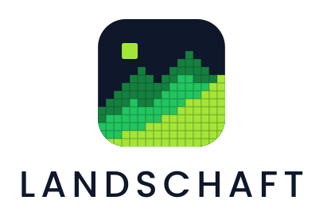

<p align="center">
  <picture>
    <source media="(prefers-color-scheme: dark)" srcset="assets/logos/landschaft_ridge_stacked_dark.svg">
    
  </picture>
</p>

<p align="center">
  <b>Fast, landscape analysis for Python.</b><br>
  Habitat patterns, fragmentation, landscape metrics and ecological connectivity,<br>
  from a single raster to maps larger than memory.
</p>

<p align="center">
  
  
  
</p>

---

Landschaft brings the established methods of landscape ecology together in one
Python package, with a C++17/OpenMP core behind a numpy / xarray / dask / rasterio
API. It reproduces the reference tools of each method, checked against their outputs
in the test suite, and runs from a few to several hundred times faster.

| Area | What it covers | Reproduces |
|---|---|---|
| **Habitat patterns** | MSPA, SPA, object accounting, contortion | GuidosToolbox |
| **Fragmentation** | density at many scales (FAD, FOS), landscape mosaics, contagion, entropy | GuidosToolbox |
| **Landscape metrics** | 133 patch, class and landscape metrics, sample plots, moving windows, time series | landscapemetrics, FRAGSTATS |
| **Habitat networks** | PC, IIC, ECA, node and link importance, ProtConn | Conefor, Makurhini |
| **Circuit connectivity** | omnidirectional and pairwise current flow, rasters and networks | Circuitscape, Omniscape |
| **Distance & restoration** | cost surfaces, least-cost paths and corridors, isochrone maps | GuidosToolbox |
| **Change detection** | simple and morphological change, fragmentation transitions | GuidosToolbox |
| **Routes on grids** | transitions from any rule, travel-time surfaces, least-cost distances and paths, random walks, randomised shortest paths, route overlap | gdistance |
| **Surface metrics** | texture of continuous rasters (ISO 25178): roughness, height distribution, bearing area curve, slopes, peaks and valleys, autocorrelation, orientation, fractal dimension, trend surfaces | geodiv |
| **Neutral landscape models** | simulated landscapes as null models: random, percolation, gradients, fractal surfaces, Gaussian fields, mosaics, clusters, classification | NLMR |
| **Large data** | out-of-core tiles and row blocks, parallel batches of rasters | |

## Installation

Landschaft is built from source and needs a C++17 compiler (MSVC 2019+, GCC 9+ or
Clang 10+). The simplest route is a [conda](https://conda-forge.org/download/)
environment:

```bash
conda create -n landschaft -c conda-forge python=3.12 numpy pandas scipy rasterio rioxarray \
      xarray dask matplotlib geopandas scikit-build-core pybind11 cmake ninja
conda activate landschaft
git clone https://github.com/sacridini/landschaft.git
cd landschaft
pip install --no-build-isolation -e .
```

Or with pip only: `pip install "landschaft[all] @ git+https://github.com/sacridini/landschaft.git"`.
Platform notes (Windows Build Tools, OpenMP on macOS) and troubleshooting are in the
[installation guide](docs/getting-started/installation.md).

### Docker

The image needs no compiler or Python on the host and includes every optional feature:

```bash
docker build -t landschaft .
docker run --rm -it -v "$PWD:/data" landschaft                 # Python shell
docker run --rm -v "$PWD:/data" landschaft python analysis.py  # run a script from the current folder
```

The current folder is mounted at `/data`, the working directory of the container.
`--build-arg PYTHON_VERSION=3.11` picks another Python, and
`docker build --target test -t landschaft:test . && docker run --rm landschaft:test`
runs the test suite in the container.

## Quick start

```python
import landschaft as ls

forest = ls.load_raster(ls.example_data("input"))    # bundled sample map
morph = ls.mspa(forest, edge_width=2)                # cores, edges, bridges, loops...
ls.write_raster(morph, "forest_mspa.tif")            # GeoTIFF with its colour table
print(ls.mspa_stats(morph))

landcover = ls.load_raster(ls.example_data("clc"), validate=None)
ls.landscape_metrics(landcover, level="landscape", metric=["shdi", "contag", "ed"])
```

Every function takes numpy arrays, georeferenced `xarray.DataArray`s or dask arrays,
and returns the same type; parallel functions use all cores but one unless given
`n_threads`.

## Documentation

The documentation website has a getting-started guide, tutorials by topic, the full
API reference with runnable examples, and the benchmarks and accuracy report. It is
built from [`docs/`](docs/index.md) with MkDocs:

```bash
pip install -e ".[docs]"
mkdocs serve        # http://127.0.0.1:8000, or `mkdocs build` for a static site/
```

## Validation and performance

Each tool is compared in the test suite with the program it reproduces: pixel for
pixel where the output is a map, value for value (to the last bit where the original
arithmetic can be reproduced) for tables, and to the original's own precision for
floating-point solvers. Typical speed-ups on the benchmark cases:

| Tools | Compared with | Agreement | Speed-up |
|---|---|---|---|
| MSPA | GuidosToolbox `mspa` 2.3 | identical pixels | 10–17× |
| Landscape metrics | landscapemetrics 2.2.2 | identical bits | 35–500× |
| Habitat networks | Makurhini, Conefor | to 1e-12 | 13–620× |
| Omniscape, Circuitscape | Omniscape 0.7, Circuitscape 6.1 | to 2e-11 | 3–45× |
| Grid distances | gdistance 1.6 | identical bits (least cost); 1e-14 (random walks) | 3–400× |
| Neutral landscape models | NLMR 1.4 (same seed) | identical bits | 2–6000× |

Methods, machines, full tables and the known differences are on the
[benchmarks and accuracy page](docs/benchmarks.md). To run the tests:

```bash
pip install -e ".[test]"
pytest
```

## Versioning

Landschaft follows [Semantic Versioning](https://semver.org/); while below 1.0, minor
versions may change the API. Changes are listed in the [changelog](CHANGELOG.md).

## License and credits

GPL-3.0-or-later. Landschaft ports code from GuidosToolbox and miallib,
© European Union (Joint Research Centre), authors Pierre Soille, Peter Vogt et al.,
both GPL-3.0-or-later; the example maps in `src/landschaft/data` come from the
[GTB repository](https://github.com/ec-jrc/GTB). GTB's `mspa` notes that its
interface is made available for non-commercial purposes: contact the JRC for
commercial use of MSPA.

Please cite the methods you use. For MSPA:

* Soille, P. & Vogt, P. (2009). Morphological segmentation of binary patterns.
  *Pattern Recognition Letters* 30(4), 456–459. doi:10.1016/j.patrec.2008.10.015
* Vogt, P. & Riitters, K. (2017). GuidosToolbox: universal digital image object
  analysis. *European Journal of Remote Sensing* 50(1), 352–361.
  doi:10.1080/22797254.2017.1330650
