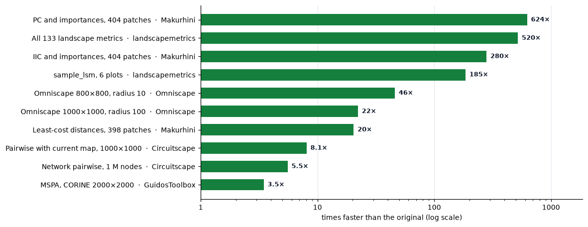

# Benchmarks & accuracy

Landschaft makes two promises: **the same results as the established tools**,
and **much less waiting for them**. This page shows how both are checked, with
the numbers.

<div class="grid cards ls-grid-3" markdown>

-   :material-check-decagram-outline:{ .lg .middle } **Same results**

    ---

    The tools are compared with the programs they reproduce: pixel for
    pixel, value for value, or to a stated tolerance where the original
    itself works in floating point. The exceptions are listed below.

-   :material-speedometer:{ .lg .middle } **Faster**

    ---

    C++ with OpenMP (and Eigen for the circuit solver): from a few times to
    hundreds of times faster than the originals.

-   :material-test-tube:{ .lg .middle } **Tested on every change**

    ---

    The comparisons live in the test suite: stored outputs of the originals,
    and live runs when the original is installed.

</div>

## Speed



How much faster Landschaft is than the tool it reproduces, on the cases in the
tables below (logarithmic scale). The original's time is its own run,
including its input and output where noted; Landschaft is timed in memory.

!!! info "How these were measured"
    The MSPA table was measured with `tools/benchmark.py` (version 0.53) on a
    desktop Intel Core i5-13600K (14 cores, 20 threads, 64 GB, Windows 11),
    the fastest of 10 alternating runs, with both programs kept on the
    performance cores. The other timings were recorded in the
    [changelog](about/changelog.md) when each tool was written, with the
    version given ("Since"). Times depend on the computer, the map and the options: treat them as
    orders of magnitude.

### Habitat patterns (MSPA)

Against GuidosToolbox's `mspa` executable (v2.3, whose time includes reading
and writing its TIFF files) on its sample map and on the CORINE forest map;
Landschaft with 1 thread and with the default 19. Every output was compared
pixel by pixel. Landschaft is 10 to 17 times faster.

| Map | Connectivity, edge width | GuidosToolbox | 1 thread | 19 threads | Identical |
|---|---|---|---|---|---|
| Sample, 1000² | 8, 1 | 0.46 s | 0.040 s | 0.029 s | yes |
| Sample, 1000² | 8, 5 | 0.56 s | 0.065 s | 0.054 s | yes |
| Sample, 1000² | 4, 20 | 0.68 s | 0.079 s | 0.068 s | yes |
| CORINE, 2000² | 8, 1 | 1.30 s | 0.095 s | 0.078 s | yes |
| CORINE, 2000² | 8, 5 | 1.53 s | 0.151 s | 0.137 s | yes |
| CORINE, 2000² | 4, 20 | 1.70 s | 0.213 s | 0.174 s | yes |

At scale, the CORINE map repeated 3 × 3 (6000 × 6000, 36 million pixels)
takes GuidosToolbox 20 to 26 s and Landschaft 1.4 to 2.3 s, again with
identical outputs.

MSPA's longest steps (geodesic distances, thinning, watershed) are ordered
propagations that must run in sequence to stay bit-exact, so one map takes
only 10 to 30 % less time with more threads. Many maps gain fully: run them side by side with
[`mspa_batch`](api/batch.md#landschaft.mspa_batch) or
[`batch`](api/batch.md#landschaft.batch).

!!! note "Hybrid processors"
    On processors with performance and efficiency cores (Intel 12th
    generation and later), Windows may move a busy process to the slower
    efficiency cores, especially when it runs in the background; any program
    then takes up to twice as long. Keep the terminal in the foreground for
    timings, and compare runs made side by side.

### Landscape metrics

Against the R package landscapemetrics 2.2.2.

| Task | landscapemetrics (R) | Landschaft | Since |
|---|---|---|---|
| All 133 metrics of `augusta_nlcd` (440 × 678) | 15.6 s | 0.03 s | 0.14 |
| `sample_lsm`, 6 plots of `augusta_nlcd` | 3.7 s | 0.02 s | 0.15 |
| Nearest-neighbour distances (`enn`) of `augusta_nlcd` | 2.4 s | 0.014 s | 0.14 |
| `get_nearestneighbour`, 1000 × 1000 | 1.8 s | 0.05 s | 0.18 |

At scale: a 10,000 × 10,000 map with 7.7 million patches gets all 133 metrics
(92 million values) in about 10 s, and maps larger than memory are read in
blocks with the same results.

### Habitat networks

Against the R package Makurhini (and, through it, gdistance).

| Task | Makurhini (R) | Landschaft | Since |
|---|---|---|---|
| IIC and node importances, 404 patches (`MK_dPCIIC`) | 1.4 s | 0.005 s | 0.30 |
| PC and node importances, 404 patches (`MK_dPCIIC`) | 10.6 s | 0.017 s | 0.30 |
| Least-cost distances, 398 patches over 222 k cells | 10.2 s | 0.5 s | 0.32 |
| Commute-time distances | | 13 × faster | 0.39 |

At scale: the 35 million centroid distances between 8,395 patches of a
4000 × 4000 map take 0.9 s, and all 4.3 million links of a 5,000-patch PC
graph are rated in 22 s.

### Circuit connectivity

Against Omniscape 0.7 and Circuitscape 6.1 (Julia), both with 20 threads.

| Task | Original | Landschaft | Since |
|---|---|---|---|
| Omniscape, 800 × 800, radius 10 | 29.4 s | 0.64 s | 0.43 |
| Omniscape, 700 × 700, radius 25 | 46.7 s | 1.36 s | 0.43 |
| Omniscape, 1000 × 1000, radius 100 | 275 s | 12.4 s | 0.43 |
| Circuitscape pairwise, 1000 × 1000, 20 focal points | 8.7 s | 2.7 s | 0.48 |
| … with the cumulative current map | 76.5 s | 9.5 s | 0.48 |
| Circuitscape one-to-all with maps, same map | 21.8 s | 4.6 s | 0.48 |
| Circuitscape network pairwise, 1 M nodes, 20 focal nodes | 27.7 s (CHOLMOD), 182 s (default cg+amg) | 5.0 s | 0.51 |

Every window and every circuit is solved exactly (a sparse Cholesky
factorisation), and the result does not depend on the number of threads.

### Neutral landscape models

The same landscapes as NLMR (same seeds, identical values), one model call each
(best of 5, default threads).

| Task | NLMR (R) | Landschaft | Since |
|---|---|---|---|
| `nlm_random`, 2000 × 2000 | 0.25 s | 0.044 s | 0.54 |
| `nlm_percolation`, 1000 × 1000 | 1.54 s | 0.014 s | 0.54 |
| `nlm_planargradient`, 2000 × 2000 | 0.25 s | 0.017 s | 0.54 |
| `nlm_edgegradient`, 2000 × 2000 | 0.31 s | 0.020 s | 0.54 |
| `nlm_distancegradient`, 2000 × 2000 | 0.25 s | 0.10 s | 0.54 |
| `nlm_distancegradient`, 360 × 90 (great-circle distances) | 0.06 s | 0.011 s | 0.54 |
| `landscape_classify` by proportions, 1000 × 1000 | 0.05 s | 0.019 s | 0.54 |

## Accuracy

### How results are compared

- **Stored references.** The outputs of the original tools on the example
  maps, on synthetic maps built to hit edge cases, and on the originals' own
  test cases are stored in `tests/data/reference`. Every run of the test
  suite compares with them.
- **Live runs.** When the original is installed, the tests also run it on
  freshly generated random maps and compare on the spot
  (`pytest -m live_reference`).
- **Original code, not a re-reading of it.** Where GuidosToolbox computes in
  IDL, its processing statements are copied verbatim from `guidostoolbox.pro`
  and run with [GDL](https://github.com/gnudatalanguage/gdl), the free IDL
  implementation, with GuidosToolbox's own `spatcon`, `grayspatcon`, `recode`
  and `ggeo` programs where it calls them.
- **Bits, then tolerances.** Integer maps and counts must be identical.
  Floating-point results are compared bit for bit where the original's
  arithmetic can be reproduced (landscapemetrics: R's 80-bit sums and x87
  `log`/`sqrt`), and otherwise to the tolerance given below, typically the
  precision of the original itself.

### Results by tool

| Tools | Compared with | Agreement |
|---|---|---|
| MSPA | GuidosToolbox `mspa` v2.3 executable: sample map with 7 parameter sets, 10 synthetic scenes, live random scenes; during development 1,200 random cases and CORINE with edge widths up to 100 | identical, 0 differing pixels |
| MSPA Tiling | GuidosToolbox's IDL code with its GDAL tools and `mspa`, in GDL | identical |
| SPA, Accounting | GuidosToolbox's IDL code in GDL | identical maps and statistics |
| FAD, FAD-MS, FOS, landscape mosaic, contagion and clustering | GuidosToolbox's IDL code and `spatcon` / `grayspatcon` / `recode` | identical maps; single-precision means and standard deviations to 1e-4 (Landschaft computes in double) |
| FAD-MS change, landscape mosaic heatmap and heatmap change | GuidosToolbox's IDL code in GDL | identical |
| Isochrone maps A and AB, least-cost path | GuidosToolbox's `ggeo` and IDL post-processing | identical |
| 133 landscape metrics and the utilities | landscapemetrics 2.2.2 (R): 14 maps (its example data, NA cells, non-square cells, degenerate layouts) × 5 option sets, live random maps | identical bits; `gyrate` and rare `enn` ties to a relative 1e-10; `circle` is randomised in landscapemetrics |
| FRAGSTATS extras, `convention="fragstats"`, spatial signatures | pylandstats, scikit-learn, FRAGSTATS' definitions | same values |
| Habitat graphs: indices, node and link importances, centrality | Makurhini (`MK_dPCIIC`, `MK_dPCIIC_links`, `MK_RMCentrality`) and Conefor Sensinode 2.2 / 2.7.1 | Makurhini: unrounded values to 1e-12, its rounded output exactly; Conefor: to its single precision (6 digits) |
| Nodes and distances (centroid, edge, least-cost, commute-time) | Makurhini's `nodesfile` / `distancefile` (gdistance) | identical bits; commute-time to 1e-11 |
| ProtConn, grids, ECA change, focal nodes | Makurhini (`MK_ProtConn`, `MK_Connect_grid`, `MK_dECA`, `MK_dECA_grid`, `MK_Focal_nodes`) | its rounded tables exactly; ECA change to 1e-13 |
| Settlement probabilities (SAMC) | samc and Makurhini's `MK_dPC_SAMC` | 1e-14 |
| Omniscape | Omniscape 0.7 with the CHOLMOD solver: its test configurations and synthetic maps | 1.7e-11 |
| Circuitscape raster modes | Circuitscape 6.1 with CHOLMOD: its own test cases (advanced, 17 pairwise, 25 one-to-all / all-to-one) | advanced: currents to 1.2e-13 of the largest; pairwise: resistances to 1e-12, maps to 3e-13; one-to-all: 5e-14 |
| Circuitscape network mode | Circuitscape's network test cases and six synthetic ones | 1.1e-14 |
| Neutral landscape models: random, percolation, gradients, classification | NLMR 1.4.0 (R 4.4.2) with the same seeds; R's generator and the libstdc++ distributions of NLMR's C++ code against R and the Rtools compiler | identical bits |

The default solver of Omniscape and Circuitscape (conjugate gradients with an
algebraic multigrid) is itself only about 2e-7 away from the exact solution;
Landschaft's solves are exact, so it is compared with their exact (CHOLMOD)
runs.

### Checked in other ways

These tools follow GuidosToolbox's method, but are not compared with a run of
its code:

| Tools | How they are checked |
|---|---|
| Network components and importance of MSPA cores and bridges | an independent step-by-step reproduction of GuidosToolbox's IDL routine |
| Spatial entropy | an independent reproduction of GuidosToolbox's `entropy_mspainp.pro` |
| Restoration status, parcellation | GuidosToolbox's values for its sample map |
| Cost distance, least-cost path, restoration corridor, contortion, simple and morphological change, FOS change, GraySpatCon metrics other than those of FOS | unit tests on constructed cases |

!!! warning "Known differences"
    - **Euclidean distance, distance to resistance, influence zones and
      proximity** depend on IDL's `MORPH_DISTANCE`, which does not always pick
      the nearest object near the boundaries between the zones of different
      objects (about 1 % of the pixels of the test cases). Landschaft's
      distances are exact Euclidean distances, so these maps can differ from
      GuidosToolbox's in detail; influence zones and proximity are marked
      experimental.
    - **MSPA Tiling** reproduces GuidosToolbox's tiling exactly, including its
      approximation near the tile seams when objects are larger than the
      overlap. A map that fits in one tile gets the MSPA of the whole map
      (GuidosToolbox drops the first `overlap / 2` columns).

## Reproduce

The comparisons are part of the test suite:

```bash
pip install -e ".[all,test]"
pytest                              # every test, stored references included
pytest -m live_reference            # also run the originals that are installed
```

The live runs look for the originals in these environment variables:

| Variable | Original |
|---|---|
| `LANDSCHAFT_MSPA_EXE` | GuidosToolbox's `mspa` executable (`MSPAstandalone/mspa_win64.exe`) |
| `LANDSCHAFT_GDL_EXE` | GDL, to run GuidosToolbox's IDL code |
| `LANDSCHAFT_SPATCON_EXE`, `LANDSCHAFT_GRAYSPATCON_EXE`, `LANDSCHAFT_GGEO_EXE` | GuidosToolbox's helper programs |
| `LANDSCHAFT_RSCRIPT`, `LANDSCHAFT_R_LIBS` | R with landscapemetrics and Makurhini |
| `LANDSCHAFT_JULIA`, `LANDSCHAFT_JULIA_PROJECT` | Julia with Circuitscape and Omniscape |

`tools/make_reference*.py` regenerate the stored references from the
originals, and `python tools/benchmark.py --exe <mspa executable>` repeats
the MSPA timings.
