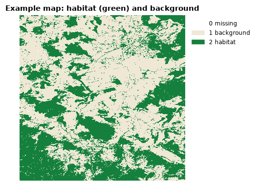
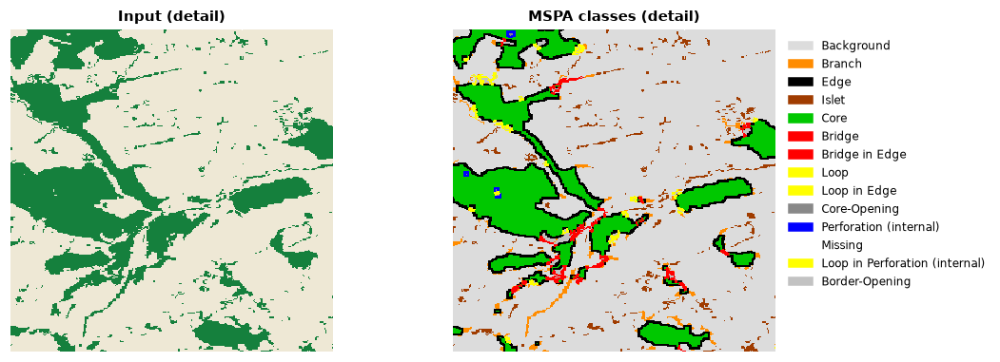

# Quickstart

This walkthrough analyses the example map that ships with Landschaft. It needs
nothing but a working [installation](installation.md). Run the code in a Jupyter notebook, or save it in a `.py` file
and run it with `python`.

## 1. Load a map

```python
import landschaft as ls

forest = ls.load_raster(ls.example_data("input"))
print(forest.shape, forest.dtype)   # (1000, 1000) uint8
print(forest.rio.crs)               # its coordinate reference system
```

`ls.example_data("input")` is the path of a GeoTIFF inside the package;
`load_raster` reads any raster file the same way, e.g.
`ls.load_raster("my_forest.tif")`. The result is an `xarray.DataArray`: the
pixel values plus the georeferencing (coordinates, CRS, NoData), which every
Landschaft function keeps.

The map is coded the way habitat analyses expect it:

| value | meaning |
|---|---|
| 0 | missing data (outside the study area, clouds...) |
| 1 | background: anything that is not habitat |
| 2 | foreground: the habitat, here forest |



Your own maps rarely come coded this way; [core concepts](concepts.md#habitat-maps)
shows how to build such a map from a land-cover or tree-cover raster with
`ls.reclassify`.

## 2. Look at it

```python
ls.plot(forest)
```

`ls.plot` draws the map on an interactive map over satellite imagery: inline
in a notebook, in a window of its own from a script. The
[plotting page](plotting.md) shows how it draws every kind of data and how to
choose the colours.

## 3. Analyse the habitat pattern

Morphological Spatial Pattern Analysis (MSPA) gives every habitat pixel a
role: **core** (interior habitat), **edge** (the outer boundary),
**perforation** (the boundary of holes inside the habitat), **bridge**
(connecting two cores), **loop** (connecting a core to itself), **branch**
(a dead end) and **islet** (too small to have a core).

```python
morph = ls.mspa(forest, edge_width=2)
ls.plot(morph)                       # GuidosToolbox's colours and class names
```

`edge_width=2` makes edges two pixels wide; everything further inside a patch
is core. On a 1,000 × 1,000 map this takes a fraction of a second.



## 4. Summarise

```python
stats = ls.mspa_stats(morph)
print(stats)
```

Each row is a class, with its number of pixels, its share of the data area
and its share of the habitat. The table is a pandas `DataFrame`: save it with
`ls.save(stats, "mspa_classes.csv")` (or `.xlsx`) or keep working with it in pandas.

## 5. Save the map

```python
ls.write_raster(morph, "forest_mspa.tif")
```

The GeoTIFF keeps the georeferencing and embeds the MSPA colour table, so it
opens in QGIS or ArcGIS with the usual colours.

## Where next

- [Core concepts](concepts.md): how to prepare your own data.
- The [tutorial](../tutorials/index.md) of your topic, from habitat patterns to circuit connectivity.
- [Configuration](configuration.md): threads and memory for large maps.
