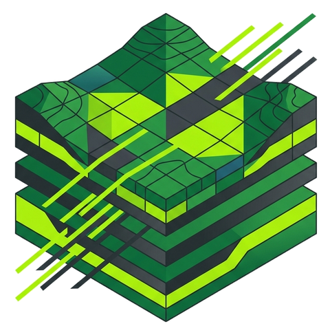

# Landschaft

<div class="ls-hero" markdown>

<div markdown>

<p class="ls-hero__title"><span>Landschaft</span></p>

<p class="ls-hero__tagline">
Fast, exact landscape analysis for Python. Map habitat structure, measure
fragmentation, compute landscape metrics and model ecological connectivity,
from a single raster on a laptop to continental maps larger than memory.
</p>

[Get started](getting-started/index.md){ .md-button .md-button--primary }
[Tutorials](tutorials/index.md){ .md-button }
[Learn](learn/index.md){ .md-button }
[GitHub :fontawesome-brands-github:](https://github.com/sacridini/landschaft){ .md-button }

<div class="ls-badges">
<span>Python 3.10+</span><span>C++17 · OpenMP</span><span>numpy · xarray · dask</span><span>GPL-3.0</span>
</div>

</div>

<div class="ls-hero__image" markdown>

</div>

</div>

<div class="ls-stats">
<div><strong>130+</strong><small>landscape metrics</small></div>
<div><strong>7</strong><small>established tools reproduced and validated</small></div>
<div><strong>up to 600×</strong><small>faster than the tools it reproduces</small></div>
<div><strong>Out-of-core</strong><small>rasters larger than memory</small></div>
</div>

## What you can do

<div class="grid cards ls-grid-4" markdown>

-   :material-shape-outline:{ .lg .middle } **Habitat patterns**

    ---

    Split habitat into cores, edges, bridges, loops and islets; classify
    objects by size; describe the shape and texture of every patch.

-   :material-chart-bell-curve-cumulative:{ .lg .middle } **Fragmentation**

    ---

    Habitat density at many observation scales, fragmentation classes,
    landscape mosaics, contagion and spatial entropy, as maps and statistics.

-   :material-table-large:{ .lg .middle } **Landscape metrics**

    ---

    130+ patch, class and landscape metrics, sample plots, moving windows,
    time series, spatial signatures and rasters larger than memory.

-   :material-graph-outline:{ .lg .middle } **Habitat networks**

    ---

    Patches and distances as a graph: equivalent connected area, probability
    of connectivity, node and link importance, protected-area connectivity.

-   :material-flash-outline:{ .lg .middle } **Circuit connectivity**

    ---

    Current flow between habitat areas and omnidirectional connectivity
    across whole landscapes, on rasters and on networks.

-   :material-map-marker-path:{ .lg .middle } **Distance & restoration**

    ---

    Distance maps, cost surfaces, least-cost paths and corridors,
    restoration priorities and travel-time (isochrone) maps.

-   :material-compare-horizontal:{ .lg .middle } **Change detection**

    ---

    Compare two dates: simple and morphological change, shifts between
    fragmentation classes and heat maps of landscape change.

-   :material-database-arrow-right-outline:{ .lg .middle } **Big data & batch**

    ---

    Folders of rasters in parallel, tiles for maps larger than memory,
    streaming tables with millions of rows.

</div>

## A taste

=== "Habitat patterns"

    ```python
    import landschaft as ls

    forest = ls.load_raster(ls.example_data("input"))  # 0 missing, 1 background, 2 forest
    morph = ls.mspa(forest, edge_width=2)              # cores, edges, bridges, loops...
    ls.mspa_stats(morph)                                # area of every class
    ```

=== "Landscape metrics"

    ```python
    import landschaft as ls

    landcover = ls.load_raster(ls.example_data("clc"), validate=None)
    ls.landscape_metrics(landcover, level="landscape", metric=["shdi", "contag", "ed"])
    ```

=== "Habitat networks"

    ```python
    import landschaft as ls

    landcover = ls.load_raster(ls.example_data("clc"), validate=None)
    graph = ls.HabitatGraph.from_raster(
        landcover, habitat=[23, 24, 25],          # forest classes
        distance="edge", max_distance=2000,       # edge-to-edge distances, metres
        landscape_area=landcover.size * 25 * 25,  # 25 m cells
    )
    graph.overall(["PC", "IIC"], distance=1000, probability=0.5)
    ```

=== "Circuit connectivity"

    ```python
    import xarray as xr
    import landschaft as ls

    landcover = ls.load_raster(ls.example_data("clc"), validate=None)[:600, :600]
    resistance = xr.where(landcover.isin([23, 24, 25]), 1.0, 25.0)  # forest is easy to cross
    flow = ls.omniscape(resistance, radius=30, block_size=5)
    flow["cum_currmap"].plot()
    ```

## Why Landschaft

<div class="grid cards" markdown>

-   :material-lightning-bolt:{ .lg .middle } **Fast**

    ---

    A C++17 core with OpenMP, cache-friendly algorithms and exact sparse
    solvers. Typical runs take seconds where the original tools take minutes
    or hours. [See the benchmarks](benchmarks.md)

-   :material-check-decagram-outline:{ .lg .middle } **Exact**

    ---

    The tools are checked against the reference implementations of their
    methods, to the last bit where the method allows it and to the solver's
    precision where it does not. [How each tool is checked](benchmarks.md#accuracy)

-   :material-language-python:{ .lg .middle } **Pythonic**

    ---

    numpy arrays, georeferenced `xarray.DataArray`s, dask, GeoTIFFs,
    GeoDataFrames and pandas tables in and out. No GUI, no temporary files,
    no other language to install.

-   :material-arrow-expand-all:{ .lg .middle } **Scales**

    ---

    Rasters larger than memory by tiles or row blocks, collections of maps in
    parallel within a memory budget, and all cores but one by default.

</div>

!!! success "Validated against established tools"

    Landschaft reproduces the methods of GuidosToolbox (MSPA, fragmentation,
    accounting, restoration planning), the R package landscapemetrics and
    FRAGSTATS (landscape metrics), Conefor Sensinode and Makurhini (habitat
    networks), and Circuitscape and Omniscape (circuit connectivity), and is
    [tested against their outputs](benchmarks.md#accuracy). You do not need to know any of them to use
    it: the [tutorials](tutorials/index.md) start from scratch, and the
    [Learn](learn/index.md) course explains the landscape ecology behind every
    tool.
