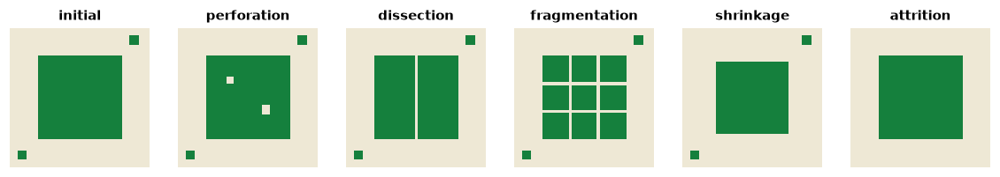

<p class="ls-chapter">Chapter 10</p>

# Landscape change

Landscapes are never still. Forests are cleared and regrow, towns expand,
fields are abandoned, rivers shift. Pattern at one date is a snapshot of a
process, and many of the most important questions are about change: how
much habitat was lost, **how** it was lost, and what that did to
connectivity. This chapter is about comparing maps of the same place at
different dates, and about the traps of doing so.

!!! abstract "In this chapter"
    - the spatial processes of landscape transformation, and their
      signatures in simple metrics;
    - why comparing two maps is harder than it looks: map error and
      misregistration;
    - transition matrices between classes;
    - change in connectivity versus change in habitat amount.

## How habitat is lost: spatial processes

The same loss of area can happen in very different ways. Forman (1995)
described five spatial processes of land transformation:

| Process | What happens | Example |
|---|---|---|
| **perforation** | holes appear inside habitat | clearings, small settlements in a forest |
| **dissection** | habitat is cut by thin lines | roads, power lines |
| **fragmentation** | habitat is broken into several pieces | agricultural expansion |
| **shrinkage** | patches become smaller | clearing from the edges |
| **attrition** | patches disappear | the small woodlots of a farmland |

They often follow each other in time, from perforation and dissection early
on to shrinkage and attrition late in the transformation of a landscape.
Each leaves a signature in three simple measures: habitat area, number of
patches and edge length. Let us draw one landscape and transform it in the
five ways:

```python
import numpy as np
import pandas as pd
import landschaft as ls


def initial():
    m = np.ones((100, 100), dtype="uint8")
    m[20:80, 20:80] = 2            # a large forest
    m[5:12, 85:92] = 2             # two small woods
    m[88:94, 6:12] = 2
    return m


scenarios = {"initial": initial()}
m = initial(); m[35:40, 35:40] = 1; m[55:62, 60:66] = 1
scenarios["perforation"] = m
m = initial(); m[20:80, 49:51] = 1
scenarios["dissection"] = m
m = initial(); m[20:80, 39:41] = 1; m[20:80, 59:61] = 1; m[39:41, 20:80] = 1; m[59:61, 20:80] = 1
scenarios["fragmentation"] = m
m = initial(); m[20:80, 20:80] = 1; m[24:76, 24:76] = 2
scenarios["shrinkage"] = m
m = initial(); m[5:12, 85:92] = 1; m[88:94, 6:12] = 1
scenarios["attrition"] = m

signatures = pd.DataFrame({
    name: ls.Landscape(m, res=10).class_metrics(["ca", "np", "te"]).set_index("class").loc[2]
    for name, m in scenarios.items()
}).T
signatures
```



Compared with the initial landscape, all five lose area, but:

| Process | Area | Patches | Edge |
|---|---|---|---|
| perforation | ↓ | = | ↑ |
| dissection | ↓ (a little) | ↑ | ↑ |
| fragmentation | ↓ | ↑↑ | ↑↑ |
| shrinkage | ↓ | = | ↓ |
| attrition | ↓ | ↓ | ↓ |

Bogaert et al. (2004) turned these signatures into a decision tree that
identifies the dominant process from the change in area, perimeter and
number of patches between two dates (dissection and fragmentation are told
apart by how much area is lost). Knowing the process matters because the
ecological consequences differ: dissection by roads adds barriers and
mortality with little habitat loss; attrition removes stepping stones; shrinkage
reduces interior habitat.

## Comparing maps is harder than it looks

A change map is the difference between two maps, and each map has errors.
If two independent maps of the same unchanged landscape are each 90%
accurate, they can disagree on up to 20% of the cells: apparent change that
is entirely error. Real change in a decade is often a few percent of the
landscape, smaller than the error. Good practice is to estimate the accuracy
of the change itself from reference samples, and to report areas with
confidence intervals (Olofsson et al., 2014). Transitions that are
systematic (always from one class to the same other class) are more likely
to be real than random swaps (Pontius et al., 2004).

A second source of false change is **misregistration**: the two maps are
shifted relative to each other by a fraction of a cell or more. Every
boundary then appears as a strip of gain on one side and loss on the other.
Here is the forest map compared with itself, shifted by a single cell:

```python
forest = ls.load_raster(ls.example_data("input")).values
shifted = forest.copy()
shifted[:, 1:] = forest[:, :-1]            # the same map, one cell to the right

simple = ls.simple_change(forest, shifted)
{"gain": simple.gain, "loss": simple.loss,
 "as % of the forest": 100 * (simple.gain + simple.loss) / (forest == 2).sum()}
```

Nothing changed, yet a pixel-by-pixel comparison reports 55 000 cells of
gain and loss, 13% of the forest. **Morphological change detection** keeps
as real change only what affects the structure of the patches, and labels
thin strips of change along boundaries as *spurious*:

```python
mcd = ls.morphological_change(forest, shifted)
{"structural gain": mcd.mcd_gain, "structural loss": mcd.mcd_loss, "spurious": mcd.spurious}
```

All of the apparent change is recognised as spurious. With real maps from
different sensors, dates or classifiers, boundary noise of this kind is
common, and separating it from structural change avoids reporting
fragmentation that never happened.

## Transition matrices

A **transition matrix** (or cross-tabulation) counts the cells that moved
from each class at the first date (rows) to each class at the second
(columns). The diagonal is persistence; off-diagonal cells are the
transitions (Pontius et al., 2004). For fragmentation classes
([chapter 3](fragmentation.md)), the matrix shows whether habitat moved
towards more intact or more fragmented conditions:
`ls.fos_change(before, after)` computes it from two fragmentation maps,
`ls.fad_multiscale_change` at several observation scales at once, and
`ls.landscape_mosaic_change` for the land-use mix around the habitat.
The [change detection tutorial](../tutorials/change-detection.md) goes
through all three.

## Connectivity changes faster than habitat

Losing 1% of the habitat does not mean losing 1% of the connectivity. If
the lost habitat was a stepping stone, connectivity can fall much more; if
it was an isolated patch, much less. The change in the equivalent connected
area (dECA; [chapter 7](networks.md)) compared with the change in habitat
area (dA) makes this explicit (Saura et al., 2011):

- **dECA < dA < 0**: connectivity was lost faster than habitat;
- **dA < dECA < 0**: connectivity was lost more slowly than habitat;
- and similarly for gains.

Let us clear two forest patches of similar size from the CORINE map: patch
84 (47 ha), the stepping stone of [chapter 7](networks.md#on-a-real-landscape),
and patch 113 (52 ha), a patch of similar size with almost no role in the
network:

```python
landcover = ls.load_raster(ls.example_data("clc"))
landscape_area = landcover.size * 25 * 25 / 1e4          # hectares


def forest_graph(landcover):
    return ls.HabitatGraph.from_raster(landcover, habitat=[23, 24, 25], area_unit="ha",
                                       distance="edge", max_distance=10_000,
                                       landscape_area=landscape_area)


now = forest_graph(landcover)
patch_ids = np.asarray(now.to_raster(pd.DataFrame({"id": now.ids, "patch": now.ids}), "patch"))

rows = []
for patch in (84, 113):
    later = landcover.copy()
    later.values[patch_ids == patch] = 12                 # cleared for arable land
    table = ls.conn.eca_change([now, forest_graph(later)], "PC", distance=2000,
                               probability=0.5, landscape_area=landscape_area,
                               names=["now", f"without patch {patch}"])
    rows.append(table.iloc[1])

pd.DataFrame(rows)[["time", "area", "ECA", "dA", "dECA", "comparison"]].round(3)
```

Both clearings remove about 0.1% of the forest. Losing patch 113 barely
changes the connectivity. Losing patch 84 reduces the equivalent connected
area by almost 2%, twenty times the habitat loss: the network loses a link
between larger forests. Monitoring habitat area alone would treat the two
clearings as equivalent.

## Good practice for change analyses

1. Use maps made with the **same method, legend and resolution** at both
   dates, ideally a consistent time series rather than independent maps.
2. **Co-register** the maps and check their agreement in areas known to be
   stable.
3. Estimate the **accuracy of the change**, not only of each map, and
   report uncertainty (Olofsson et al., 2014).
4. Separate **structural change** from boundary noise (morphological change
   detection) before computing fragmentation and connectivity changes.
5. Report change in **connectivity** alongside change in amount (dECA and
   dA), and identify the **process** (perforation, dissection...) behind
   the change.
6. For many dates, use `ls.SpatioTemporalAnalysis` to compute and plot
   metrics along the series ([tutorial](../tutorials/landscape-metrics.md#several-maps-and-time-series)).

!!! success "Key points"
    - The same loss of area can happen by perforation, dissection,
      fragmentation, shrinkage or attrition, each with a signature in area,
      number of patches and edge.
    - Map error and misregistration create apparent change, often larger
      than real change; estimate the accuracy of change and filter boundary
      noise.
    - Transition matrices show from which class to which class the landscape
      moved.
    - Connectivity can change much faster, or slower, than habitat amount;
      compare dECA with dA.

## Check your understanding

1. Between two dates, forest area fell by 3%, the number of patches stayed
   the same and total edge increased. Which process is most likely?
2. Two land-cover maps of the same year, from different sources, disagree on
   8% of the landscape. What does that imply for a change analysis using one
   map per date?
3. Why can a small clearing reduce the ECA of a landscape much more than
   its share of the habitat?

??? success "Answers"
    1. Perforation: area lost inside the patches (holes), which adds internal
       edge without changing the number of patches.
    2. That differences of that order between dates could be entirely due to
       the maps rather than to change; use maps made with the same method, or
       quantify the accuracy of the change.
    3. Because it may remove a stepping stone or a link on the best paths
       between larger patches, so the reachable habitat of the whole network
       falls, not only the habitat of the cleared patch.

## References

<div class="ls-refs" markdown>

- Bogaert, J., Ceulemans, R., & Salvador-Van Eysenrode, D. (2004). Decision tree algorithm for detection of spatial processes in landscape transformation. *Environmental Management*, 33(1), 62–73.
- Forman, R. T. T. (1995). *Land Mosaics: The Ecology of Landscapes and Regions*. Cambridge University Press.
- Olofsson, P., Foody, G. M., Herold, M., Stehman, S. V., Woodcock, C. E., & Wulder, M. A. (2014). Good practices for estimating area and assessing accuracy of land change. *Remote Sensing of Environment*, 148, 42–57.
- Pontius, R. G., Jr., Shusas, E., & McEachern, M. (2004). Detecting important categorical land changes while accounting for persistence. *Agriculture, Ecosystems & Environment*, 101(2–3), 251–268.
- Saura, S., Estreguil, C., Mouton, C., & Rodríguez-Freire, M. (2011). Network analysis to assess landscape connectivity trends: application to European forests (1990–2000). *Ecological Indicators*, 11(2), 407–416.

</div>
