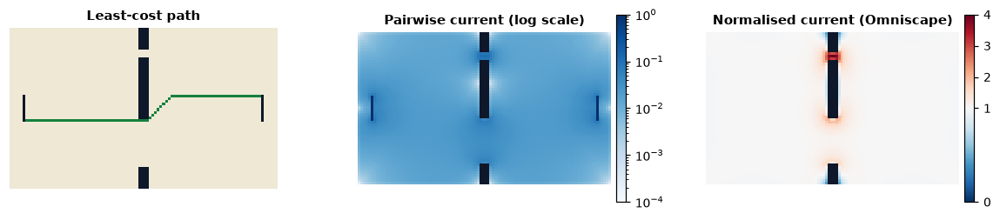

<p class="ls-chapter">Chapter 8</p>

# Circuit theory

What does an electrical circuit have to do with a deer crossing a valley?
More than it seems. In 2006, the geneticist Brad McRae showed that genetic
differentiation between populations is predicted by the **effective
resistance** of the landscape between them, computed exactly as an engineer
computes the resistance of a network of resistors (McRae, 2006). The reason
is a deep mathematical link between electric current and **random walks**.
Since then, circuit theory has become one of the main tools of connectivity
science (McRae et al., 2008; Dickson et al., 2019).

!!! abstract "In this chapter"
    - the correspondence between random walkers and electric circuits;
    - Ohm's law, resistors in series and in parallel, effective resistance;
    - why redundant routes matter, and what least-cost paths miss;
    - current density, pinch points and barriers;
    - pairwise, advanced, one-to-all and omnidirectional analyses, and how
      to read them.

## From random walkers to circuits

Imagine an animal that does not know the landscape. At every step it moves
to a neighbouring cell, choosing more often the cells that are easier to
cross. This is a **random walk** on the landscape, weighted by the
**conductance** of each cell (the inverse of its resistance). Doyle and Snell
(1984) showed that such random walks and electric circuits obey the same
equations:

| Random walk | Electric circuit |
|---|---|
| ease of moving between two cells | conductance (1 / resistance) |
| probability that a walker starting at a cell reaches A before B | voltage at the cell, with A at 1 V and B grounded |
| net number of times walkers pass through a cell going from A to B | current through the cell |
| expected time to go from A to B and back (commute time) | proportional to the effective resistance between A and B |

Every result about current therefore has a meaning in terms of movement. The
**current** through a cell is the expected net number of passages of a
walker moving from the source to the ground: where current is high, movement
is funnelled.

## Ohm's law and effective resistance

A resistor of resistance *R* carrying a current *I* has a voltage *V* = *R I*
across it (Ohm's law). Resistors combine in two ways:

<div class="ls-formula" markdown>
series: R = R<sub>1</sub> + R<sub>2</sub> &nbsp;&nbsp;&nbsp;&nbsp;&nbsp;&nbsp; parallel: 1/R = 1/R<sub>1</sub> + 1/R<sub>2</sub>
<small>In series, resistances add: a longer route is harder. In parallel, conductances add: a second route makes the connection easier.</small>
</div>

The **effective resistance** between two nodes of a network is the single
resistance that would carry the same current for the same voltage. It
combines the length of the routes (series) and their number and width
(parallel). Here is a chain of two links of resistance 1, then the same
chain with a second, parallel route:

```python
import numpy as np
import landschaft as ls
from landschaft import circuit

one_route = [[1, 2, 1.0], [2, 3, 1.0]]                       # 1 - 2 - 3
two_routes = one_route + [[1, 4, 1.0], [4, 3, 1.0]]          # and 1 - 4 - 3

r1 = circuit.circuitscape_network_pairwise(one_route, [1, 3]).resistances[1, 2]
r2 = circuit.circuitscape_network_pairwise(two_routes, [1, 3]).resistances[1, 2]
{"one route": r1, "two routes": r2}
```

The second route halves the effective resistance, while the **least-cost
distance** (the cheapest single route, 2 in both cases) does not change.
This is the key difference between the two approaches: circuit theory
rewards redundancy. Wide corridors and multiple routes are better connected
than a single thin corridor of the same length, which matches our intuition
about how populations exchange individuals and genes (McRae & Beier, 2007).

### Commute time

The correspondence can be checked directly. For a network with *m* links of
unit resistance, the expected **commute time** between two nodes (the
number of steps a random walker needs to go from one to the other and back)
is 2 *m* times their effective resistance (Chandra et al., 1996). In the
square network above, *m* = 4 and the effective resistance is 1, so the
commute time should be 8 steps. A simulation:

```python
rng = np.random.default_rng(0)
neighbours = {1: [2, 4], 2: [1, 3], 3: [2, 4], 4: [1, 3]}


def commute_time(start, target):
    node, steps, reached = start, 0, False
    while True:
        node = neighbours[node][rng.integers(2)]
        steps += 1
        if node == target:
            reached = True
        elif reached and node == start:
            return steps


round(float(np.mean([commute_time(1, 3) for _ in range(20_000)])), 2)
```

The walkers need 8 steps on average, as the circuit predicts. In
Landschaft, `HabitatGraph.from_raster(..., distance="commute-time")` uses
this quantity as the distance between habitat patches
([chapter 7](networks.md#choosing-distances-and-probabilities)).

## Current on a landscape: pinch points

On a raster, every cell is a node connected to its neighbours by resistors
of the cells' resistances. Consider a simple landscape: open land of uniform
resistance crossed by an impassable wall with two gaps, a narrow one (3
cells) and a wide one (18 cells). Current flows from a line of cells on the
left to a line on the right:

```python
resistance = np.ones((60, 100))
resistance[:, 48:52] = np.nan          # NaN: impassable wall
resistance[8:11, 48:52] = 1.0          # narrow gap, 3 cells
resistance[34:52, 48:52] = 1.0         # wide gap, 18 cells

points = np.zeros(resistance.shape)
points[25:35, 5] = 1                   # focal region 1, on the left
points[25:35, 94] = 2                  # focal region 2, on the right

flow = circuit.circuitscape_pairwise(resistance, points, cum_map=True)
current = np.asarray(flow.cum_current)

narrow = np.nansum(current[8:11, 50])
wide = np.nansum(current[34:52, 50])
{"share through narrow gap": narrow / (narrow + wide),
 "current per cell, narrow": current[8:11, 50].mean(),
 "current per cell, wide": current[34:52, 50].mean()}
```

Now the single best route:

```python
open_land = np.where(np.isnan(resistance), 0, resistance)      # 0: impassable here
path = ls.least_cost_path(open_land, points == 1, points == 2)
rows_crossed = np.flatnonzero(np.asarray(path.lcp_mask)[:, 50])
rows_crossed
```



The least-cost path goes through the wide gap and ignores the narrow one
entirely. Circuit theory sends about a quarter of the flow through the
narrow gap, which holds only a seventh of the gap width, so the current per
cell there is about twice as high: a **pinch point**. If the narrow gap were
closed, a quarter of the movement would have to find another way. Pinch
points are where corridors are most vulnerable and where protection or
restoration is most efficient (McRae et al., 2008).

## The modes of a circuit analysis

| Mode | Current flows | Answers | Tool |
|---|---|---|---|
| **pairwise** | between every pair of focal points or regions, one pair at a time | effective resistance between all pairs (an isolation matrix), cumulative current | `circuit.circuitscape_pairwise` |
| **advanced** | from sources you place to grounds you place | flow between specific areas, e.g. from a population to all suitable habitat | `circuit.circuitscape_advanced` |
| **one-to-all / all-to-one** | from each point to all others (or the reverse) | how connected each point is to the rest | `circuit.circuitscape_one_to_all` |
| **omnidirectional** | between all cells within a moving window | connectivity everywhere, without choosing points | `ls.omniscape` |

These are the modes of the Circuitscape software (Shah & McRae, 2008;
Anantharaman et al., 2020), whose results Landschaft reproduces. The
pairwise resistance matrix can be compared with genetic distances
between populations (isolation by resistance; McRae, 2006; McRae & Beier,
2007). The cumulative current map highlights corridors and pinch points
between the chosen points. Networks given as lists of links, rather than
rasters, are analysed with `circuitscape_network_pairwise` and
`circuitscape_network_advanced`.

## Omnidirectional connectivity

Choosing focal points biases the result towards them: corridors appear
between the chosen reserves and nowhere else. **Omniscape** avoids the
choice (McRae et al., 2016; Landau et al., 2021). A circular window of a
given radius moves over the landscape; in each window, current flows from
every source cell towards the centre, and the currents of all windows are
summed. Sources are usually the cells of good habitat, with strength
proportional to their quality. The result, the **cumulative current**, maps
how much movement every cell carries between all places within the radius.

Cumulative current is high where movement concentrates, but also simply
where there are many sources. The **flow potential**, the current the same
sources would produce in a landscape of uniform resistance, is the baseline;
their ratio, the **normalised current**, reads:

| Normalised current | Reading |
|---|---|
| well above 1 | movement is **channelised**: more flow than expected, corridors and pinch points |
| about 1 | **diffuse** flow, as in an unobstructed landscape |
| well below 1 | movement is **impeded**: barriers, or areas avoided |

```python
omni = ls.omniscape(resistance, radius=15, block_size=1,
                    flow_potential=True, normalized_current=True)
normalised = np.asarray(omni["normalized_cum_currmap"])
{"narrow gap": np.nanmean(normalised[8:11, 48:52]),
 "wide gap": np.nanmean(normalised[34:52, 48:52]),
 "open land": np.nanmean(normalised[:, 20])}
```

With no focal points at all, the omnidirectional analysis finds the same
pinch point: in the narrow gap the flow is more than three times what an
unobstructed landscape would carry, in the wide gap somewhat more, and in
the open land about as expected.

The **radius** plays the role of the dispersal distance
([chapter 2](scale.md)): choose it from the species' movement ability. The
`block_size` option solves one window per block of cells, which speeds up
large analyses considerably with little effect on the result.

## When to use circuit theory

Use it when:

- the movement of interest is **exploratory** (dispersal of juveniles,
  gene flow over generations) rather than directed by knowledge of the
  landscape;
- **redundancy** matters: wide corridors and multiple routes should count
  more than a single thin path;
- you need to find **pinch points** and barriers, or to map connectivity
  everywhere (omnidirectional).

Prefer least-cost analysis ([chapter 9](restoration.md)) when you need a
single corridor to delineate or restore, or when animals move with knowledge
of the landscape (seasonal migration). Prefer graph indices
([chapter 7](networks.md)) to rank patches by their contribution to
reachable habitat. As in every resistance-based model, the result is only
as good as the resistance surface ([chapter 6](connectivity.md#resistance-surfaces)).

!!! success "Key points"
    - Random walks on a landscape and electric current obey the same
      equations; current measures the net passage of random walkers.
    - Effective resistance combines the length and the number of routes;
      parallel routes lower it, unlike least-cost distance.
    - High current density marks pinch points, where movement is funnelled
      and most vulnerable.
    - Pairwise and advanced modes connect chosen places; omnidirectional
      analysis maps connectivity everywhere; normalised current separates
      channelised from diffuse and impeded flow.

## Check your understanding

1. Two reserves are joined by one corridor. A second, identical corridor is
   restored in parallel. What happens to their effective resistance and to
   their least-cost distance?
2. A cell has a very high cumulative current in an omnidirectional map, but
   a normalised current of 1. How do you interpret it?
3. Why is current density higher in a narrow gap than in a wide one?

??? success "Answers"
    1. The effective resistance halves (two equal resistances in parallel);
       the least-cost distance does not change, since the best single route
       is the same.
    2. Much movement passes through it, but no more than the same sources
       would produce in an unobstructed landscape: it is a busy area because
       of its many sources, not a bottleneck.
    3. The same flow must cross fewer cells, so each cell carries more of it,
       as water speeds up in a narrow section of a river.

## References

<div class="ls-refs" markdown>

- Anantharaman, R., Hall, K., Shah, V. B., & Edelman, A. (2020). Circuitscape in Julia: high performance connectivity modelling to support conservation decisions. *Proceedings of the JuliaCon Conferences*, 1(1), 58.
- Chandra, A. K., Raghavan, P., Ruzzo, W. L., Smolensky, R., & Tiwari, P. (1996). The electrical resistance of a graph captures its commute and cover times. *Computational Complexity*, 6, 312–340.
- Dickson, B. G., Albano, C. M., Anantharaman, R., et al. (2019). Circuit-theory applications to connectivity science and conservation. *Conservation Biology*, 33(2), 239–249.
- Doyle, P. G., & Snell, J. L. (1984). *Random Walks and Electric Networks*. Mathematical Association of America.
- Landau, V. A., Shah, V. B., Anantharaman, R., & Hall, K. R. (2021). Omniscape.jl: software to compute omnidirectional landscape connectivity. *Journal of Open Source Software*, 6(57), 2829.
- McRae, B. H. (2006). Isolation by resistance. *Evolution*, 60(8), 1551–1561.
- McRae, B. H., & Beier, P. (2007). Circuit theory predicts gene flow in plant and animal populations. *Proceedings of the National Academy of Sciences*, 104(50), 19885–19890.
- McRae, B. H., Dickson, B. G., Keitt, T. H., & Shah, V. B. (2008). Using circuit theory to model connectivity in ecology, evolution, and conservation. *Ecology*, 89(10), 2712–2724.
- McRae, B. H., Popper, K., Jones, A., et al. (2016). *Conserving Nature's Stage: Mapping Omnidirectional Connectivity for Resilient Terrestrial Landscapes in the Pacific Northwest*. The Nature Conservancy, Portland, Oregon.
- Shah, V. B., & McRae, B. H. (2008). Circuitscape: a tool for landscape ecology. In *Proceedings of the 7th Python in Science Conference* (pp. 62–65).

</div>
