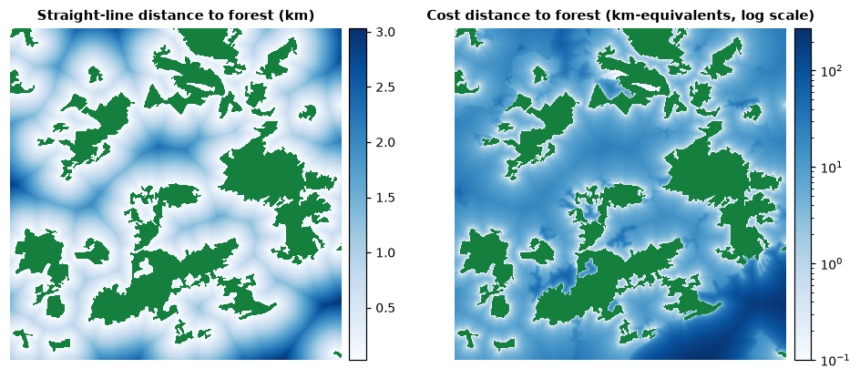

<p class="ls-chapter">Chapter 6</p>

# Landscape connectivity

Habitat that cannot be reached is of little use. A woodland isolated by
kilometres of cropland may never be colonised by a forest beetle; a
population cut off from its neighbours loses genetic diversity and cannot be
rescued after a bad year. **Connectivity**, the ease with which organisms
move between the parts of a landscape, links the pattern of the previous
chapters to the processes of dispersal, gene flow and range shifts. This
chapter introduces the concepts; chapters [7](networks.md), [8](circuits.md)
and [9](restoration.md) present the three families of models.

!!! abstract "In this chapter"
    - what connectivity is: structural, functional, potential and actual;
    - dispersal and dispersal kernels;
    - resistance surfaces: how the matrix is turned into a cost of movement;
    - cost distance versus straight-line distance;
    - the families of connectivity models and the assumptions of each.

## What connectivity is

The classic definition is *the degree to which the landscape facilitates or
impedes movement among resource patches* (Taylor et al., 1993). Two
properties follow from it. Connectivity is a property of the
**landscape**, not only of the habitat: the land between patches matters.
And it is **species-specific**: the same hedge that connects woodlands for a
dormouse is irrelevant for a bat and invisible for a deer.

Three distinctions organise the literature (Tischendorf & Fahrig, 2000;
Calabrese & Fagan, 2004):

| Kind | Based on | Example measure |
|---|---|---|
| **structural** | the physical arrangement of habitat only | distance to the nearest patch, presence of corridors, MSPA bridges |
| **potential** | structure plus limited knowledge of the organism (a dispersal distance, a resistance to movement) | graph indices with a dispersal kernel, cost distances, circuit models |
| **actual (realised)** | observed movement | tracking, mark–recapture, gene flow |

Structural connectivity is easy to map but says nothing on whether an
organism actually moves; actual connectivity is what matters but is costly to
measure and specific to a place and time. Most applied work uses
**potential** connectivity: models that combine the map with a few,
well-chosen facts about the species. All the connectivity tools of Landschaft
are of this kind. Their results are hypotheses about movement, to be tested
with movement or genetic data when possible (Bélisle, 2005).

## Dispersal

Dispersal is any movement that can lead to gene flow: from the place of
birth to the place of breeding, or between breeding places. It has three
stages, emigration, transfer and immigration, each influenced by the
landscape (Bowler & Benton, 2005). Connectivity models focus on the
**transfer** stage: how far organisms go and which routes they take.

A **dispersal kernel** describes the probability of moving a given distance.
The simplest and most used in connectivity indices is the negative
exponential:

<div class="ls-formula" markdown>
p(d) = e<sup>−k d</sup>, &nbsp;&nbsp;&nbsp; with k = −ln(p<sub>0</sub>) / d<sub>0</sub>
<small>p(d): probability of covering distance d; k is set so that the probability at a reference distance d<sub>0</sub> is p<sub>0</sub>, for instance p<sub>0</sub> = 0.5 at the median dispersal distance.</small>
</div>

```python
import numpy as np
import pandas as pd

median_dispersal = 1000.0                       # metres: half the dispersers go further
k = -np.log(0.5) / median_dispersal
distances = np.array([0, 250, 500, 1000, 2000, 4000, 8000])
pd.DataFrame({"distance (m)": distances, "p(d)": np.exp(-k * distances).round(3)})
```

Each doubling of the distance squares the probability: 0.5 at 1 km, 0.25
at 2 km, 0.06 at 4 km. The kernel is a statement about the species,
calibrated from telemetry, mark–recapture or allometric relations with body
size, and it matters most in its tail: rare long-distance dispersal events
drive colonisation and range expansion (Nathan, 2006). When the kernel is
uncertain, analyse several distances ([chapter 2](scale.md)).

## Resistance surfaces

Straight-line distance treats all land between patches as equally easy to
cross, which it rarely is. A **resistance surface** assigns every cell a
value proportional to the cost, energy, risk or reluctance of crossing it
(Zeller et al., 2012). Movement models then measure distances in units of
accumulated resistance rather than metres.

Resistance values come from three sources, from weakest to strongest (Spear
et al., 2010; Zeller et al., 2012):

1. **Expert opinion**: ranks of land-cover classes from literature and
   experience. Fast, but subjective and hard to validate.
2. **Habitat suitability**: resistance as a decreasing function of a habitat
   model's suitability. A negative exponential transformation, which keeps
   resistance low across most of the good habitat and rises steeply in poor
   habitat, often performs better than a linear one (Keeley et al., 2016).
3. **Movement or genetic data**: resistance values that best explain
   observed paths, telemetry locations or genetic distances between
   populations.

Resistance values are **relative**: what matters is the ratio between
classes. Report how they were obtained and test how sensitive the results
are to them, for example by halving and doubling the contrast between
habitat and matrix.

### Try it: cost distance versus straight-line distance

Build a resistance surface for a forest species from land cover (forest and
semi-natural areas easy to cross, farmland ten times harder, built-up land
fifty times, water a hundred times), then measure, from every cell, the
distance to the nearest forest in both ways:

```python
from scipy import ndimage
import landschaft as ls

landcover = ls.load_raster(ls.example_data("clc"), validate=None)[:800, :800]   # 20 x 20 km

table = {}
table.update({c: 50.0 for c in range(1, 12)})     # artificial surfaces
table.update({c: 10.0 for c in range(12, 23)})    # agricultural areas
table.update({c: 1.0 for c in range(23, 35)})     # forest and semi-natural areas
table.update({c: 100.0 for c in range(35, 45)})   # wetlands and water
resistance = np.vectorize(table.get)(landcover.values).astype(float)

forest = np.isin(landcover.values, [23, 24, 25])
euclidean_m = ndimage.distance_transform_edt(~forest) * 25          # metres
cost_m = np.asarray(ls.cost_distance(resistance, forest)) * 25      # metres x resistance
```

`cost_distance` accumulates, along the cheapest route from the sources,
the resistance of each step times its length in cells; multiplying by the
cell size expresses it in "resistance-weighted metres": the length of the
route if all of it had resistance 1. Now compare the cells that lie about
1 km from the nearest forest:

```python
ring = (euclidean_m > 950) & (euclidean_m < 1050)
pd.Series(cost_m[ring] / 1000).describe(percentiles=[0.05, 0.5, 0.95]).round(1)
```



All these cells are 1 km from forest as the crow flies, yet their cost
distances range from about 9 to more than 100 km-equivalents: across farmland
a forest species pays about ten times the straight-line distance, across
towns and water far more. Two places at the same distance from habitat can
be very differently connected to it, which is the whole point of
resistance-based models.

## The families of connectivity models

| Family | The landscape is... | Movement is assumed to... | Answers | Chapter |
|---|---|---|---|---|
| **simple indices** | patches and distances | – | how isolated is each patch? (`enn`, proximity) | [5](metrics.md) |
| **graphs** | nodes (patches) and links (distances or probabilities) | depend on the distance between patches, via a threshold or a kernel | how much habitat is reachable? which patches and links matter? | [7](networks.md) |
| **circuits** | a conductive surface | follow random walks: every route used, in proportion to its ease | where does movement concentrate? where are pinch points and barriers? | [8](circuits.md) |
| **least-cost** | a cost surface | follow the single cheapest route, with full knowledge of the landscape | what is the best corridor between two areas, and what does it cost? | [9](restoration.md) |

The families are complementary rather than competing (McRae et al., 2008;
Kindlmann & Burel, 2008). Graphs summarise connectivity at the level of
patches and are ideal for ranking conservation priorities; least-cost
paths give a single, easily mapped corridor, but assume an animal that knows
the whole landscape; circuits consider all routes and highlight
bottlenecks, assuming an animal that knows nothing beyond its next step. Real
behaviour lies somewhere in between. A robust conclusion is one that holds
across more than one model.

!!! success "Key points"
    - Connectivity is a property of the whole landscape and of a species; it
      can be structural, potential or actual.
    - Dispersal kernels express how the probability of movement decreases
      with distance; their tail matters.
    - Resistance surfaces translate the matrix into a cost of movement;
      their values are relative, should be justified and should be tested.
    - Cost distance can differ from straight-line distance by an order of
      magnitude.
    - Graph, circuit and least-cost models make different assumptions about
      movement and answer different questions.

## Check your understanding

1. A map shows that two reserves are linked by an MSPA bridge. What kind of
   connectivity does that establish, and what is still unknown?
2. With a negative exponential kernel of p = 0.5 at 500 m, what is the
   probability of crossing 1.5 km?
3. Why should resistance values be tested with a sensitivity analysis?

??? success "Answers"
    1. Structural connectivity. Whether the species can and does move along
       the bridge (its width, its quality, the species' behaviour) is
       unknown: that is functional or actual connectivity.
    2. 1.5 km is three times 500 m, so p = 0.5³ = 0.125.
    3. Because they are usually uncertain (often from expert opinion), and
       the location of corridors and the ranking of patches can change with
       them. Conclusions that survive a range of plausible values are more
       credible.

## References

<div class="ls-refs" markdown>

- Bélisle, M. (2005). Measuring landscape connectivity: the challenge of behavioral landscape ecology. *Ecology*, 86(8), 1988–1995.
- Bowler, D. E., & Benton, T. G. (2005). Causes and consequences of animal dispersal strategies: relating individual behaviour to spatial dynamics. *Biological Reviews*, 80(2), 205–225.
- Calabrese, J. M., & Fagan, W. F. (2004). A comparison-shopper's guide to connectivity metrics. *Frontiers in Ecology and the Environment*, 2(10), 529–536.
- Keeley, A. T. H., Beier, P., & Gagnon, J. W. (2016). Estimating landscape resistance from habitat suitability: effects of data source and nonlinearities. *Landscape Ecology*, 31, 2151–2162.
- Kindlmann, P., & Burel, F. (2008). Connectivity measures: a review. *Landscape Ecology*, 23, 879–890.
- McRae, B. H., Dickson, B. G., Keitt, T. H., & Shah, V. B. (2008). Using circuit theory to model connectivity in ecology, evolution, and conservation. *Ecology*, 89(10), 2712–2724.
- Nathan, R. (2006). Long-distance dispersal of plants. *Science*, 313(5788), 786–788.
- Spear, S. F., Balkenhol, N., Fortin, M.-J., McRae, B. H., & Scribner, K. (2010). Use of resistance surfaces for landscape genetic studies: considerations for parameterization and analysis. *Molecular Ecology*, 19(17), 3576–3591.
- Taylor, P. D., Fahrig, L., Henein, K., & Merriam, G. (1993). Connectivity is a vital element of landscape structure. *Oikos*, 68(3), 571–573.
- Tischendorf, L., & Fahrig, L. (2000). On the usage and measurement of landscape connectivity. *Oikos*, 90(1), 7–19.
- Zeller, K. A., McGarigal, K., & Whiteley, A. R. (2012). Estimating landscape resistance to movement: a review. *Landscape Ecology*, 27, 777–797.

</div>
