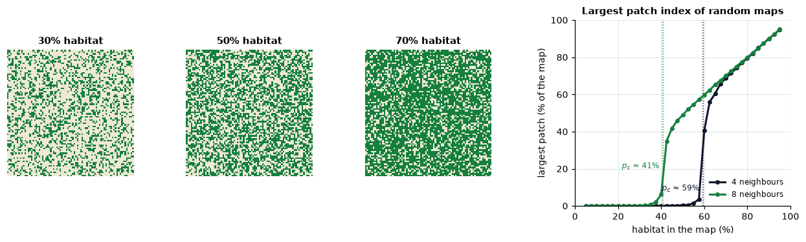

<p class="ls-chapter">Chapter 3</p>

# Habitat loss and fragmentation

Habitat loss is the main driver of the current biodiversity crisis, and
fragmentation is the word most often attached to it. The two are not the
same. A landscape can lose half of its forest while the rest stays in one
block, or keep all of its forest but have it broken into a hundred pieces.
This chapter separates the two ideas, explains the mechanisms through which
fragmentation acts (edges, isolation, thresholds) and shows how to measure
it around every point of a map.

!!! abstract "In this chapter"
    - habitat loss versus fragmentation *per se*, and the debate about the
      effects of each;
    - edge effects: what they are and how deep they reach;
    - thresholds and percolation, with neutral landscape models;
    - habitat density in moving windows, fragmentation classes, several
      observation scales and landscape mosaics;
    - which tool answers which question.

## Two processes behind one word

As a **process**, habitat fragmentation usually has four consequences at
once: less habitat, more patches, smaller patches and more isolated patches
(Fahrig, 2003). The first is **habitat loss**; the other three describe the
**configuration** of what remains, and together they are called
**fragmentation *per se***.

The distinction matters because the two have different effects. Reviewing
more than a hundred studies, Fahrig (2003) found that habitat loss has
large, consistently negative effects on biodiversity, whereas fragmentation
*per se*, at a constant amount of habitat, has weaker effects, as often
positive as negative. A later review reached a stronger conclusion: most
significant effects of fragmentation *per se* are positive (Fahrig, 2017).
Others disagree, stressing that the few large and intact areas are
irreplaceable for many specialist species and that the positive effects are
often driven by generalists and by the matrix (Fletcher et al., 2018; see
also Fahrig et al., 2019). A related proposal, the **habitat amount
hypothesis**, states that the number of species at a site depends mainly on
the amount of habitat in the surrounding landscape, regardless of how it is
divided into patches (Fahrig, 2013).

You do not need to take sides to draw the practical lesson: **always
measure the amount of habitat alongside its configuration**, and interpret a
configuration metric only after accounting for amount. The two are strongly
correlated in real landscapes (fragmented landscapes are usually the ones
with little habitat), and many configuration metrics change with amount
alone (Neel et al., 2004).

### Try it: same amount, different configuration

Neutral landscape models are artificial maps with known properties (Gardner
et al., 1987). Here are three maps with exactly 30% habitat: one random, two
with increasing spatial aggregation (random noise smoothed with a Gaussian
filter before thresholding):

```python
import numpy as np
import pandas as pd
from scipy import ndimage
import landschaft as ls

rng = np.random.default_rng(7)
noise = rng.random((400, 400))


def habitat_map(field, amount):
    """Habitat (2) in the `amount` share of the cells with the lowest values."""
    return np.where(field < np.quantile(field, amount), 2, 1).astype("uint8")


maps = {
    "random": habitat_map(noise, 0.3),
    "clumped": habitat_map(ndimage.gaussian_filter(noise, 3), 0.3),
    "very clumped": habitat_map(ndimage.gaussian_filter(noise, 10), 0.3),
}
summary = {
    name: ls.Landscape(m, res=25).class_metrics(["pland", "np", "area_mn", "lpi", "ed"])
          .set_index("class").loc[2]
    for name, m in maps.items()
}
pd.DataFrame(summary).T.round(1)
```

Habitat amount (`pland`) is identical; everything else differs by one or two
orders of magnitude: the number of patches, their mean area, the share of
the landscape in the largest patch (`lpi`) and the edge density. A species
that needs patches of at least 10 ha finds none in the random map and
dozens in the clumped ones, with the same amount of habitat.

## Edge effects

An **edge** is the boundary between habitat and another land cover, and
**edge effects** are the changes in conditions and processes near it (Murcia,
1995; Ries et al., 2004). They are of three kinds:

| Kind | Examples, for a forest edge |
|---|---|
| **abiotic** | more light and wind, higher temperature, lower humidity |
| **direct biological** | tree mortality and damage, invasion by light-demanding plants |
| **indirect biological** | more nest predation and parasitism, changes in competition and pollination |

Edge effects make small and irregular fragments behave as if they were much
smaller than their area suggests: their interior is all near an edge. How
deep the effects reach depends on the variable and the ecosystem. In central
Amazonian forest fragments, different effects were detected from a few tens
of metres to about 300 m from the edge, and in some cases further (Laurance
et al., 2002). A global analysis found that 70% of the world's forest lies
within 1 km of an edge (Haddad et al., 2015).

Edge depth is the ecological meaning behind several parameters of this
course: the `edge_width` of MSPA ([chapter 4](morphology.md)) and the
`edge_depth` of core-area metrics ([chapter 5](metrics.md)). Choose them
from the literature on the species or process you study.

## Thresholds and percolation

Does a landscape lose its connectivity gradually as habitat is removed, or
suddenly? Percolation theory, from physics, gives a striking answer for
random maps (Gardner et al., 1987; Stauffer & Aharony, 1994). Fill a grid at
random with habitat in a proportion *p*. Below a **critical proportion**
*p*<sub>c</sub>, habitat forms many small, separate clusters; above it, one
cluster suddenly spans the whole map. For a square grid in which cells
connect by their sides (4 neighbours), *p*<sub>c</sub> ≈ 0.593; when
diagonal neighbours also connect (8 neighbours), *p*<sub>c</sub> ≈ 0.407.

```python
rows = []
for p in [0.2, 0.3, 0.4, 0.5, 0.55, 0.6, 0.65, 0.7, 0.8]:
    random_map = np.where(rng.random((300, 300)) < p, 2, 1).astype("uint8")
    row = {"habitat_%": 100 * p}
    for directions in (4, 8):
        largest = ls.Landscape(random_map, directions=directions).class_metrics(["lpi"])
        row[f"largest patch, {directions} neighbours (%)"] = largest.set_index("class").loc[2, "lpi"]
    rows.append(row)

pd.DataFrame(rows).round(1)
```



The largest patch index jumps from almost nothing to most of the habitat
over a narrow range of *p*, near 0.4 with 8 neighbours and near 0.6 with 4.
Three lessons carry over to real landscapes:

1. **Change can be abrupt.** Small additional losses near a threshold can
   disconnect a landscape. Andrén (1994) found that effects of fragmentation
   on birds and mammals, beyond those of habitat loss alone, appeared mostly
   in landscapes with less than 10–30% of suitable habitat. Thresholds in
   species' responses depend on their dispersal ability (With & Crist, 1995).
2. **The connectivity rule matters.** Whether diagonal cells are connected
   (`directions`, `connectivity` parameters) changes the answer. For a
   species it means: can it cross where two patches touch only at a corner?
3. **Real landscapes are not random.** Aggregated habitat stays connected
   at lower amounts, as the neutral maps above suggested. Neutral models are
   a baseline, not a prediction.

## Measuring fragmentation around every cell

Patch metrics ([chapter 5](metrics.md)) give one number per patch, class or
landscape. An alternative, introduced for continental forest assessments,
describes fragmentation **around every cell**: move a window across the map
and measure the habitat in it (Riitters et al., 2000, 2002). The result is a
map, which shows *where* the landscape is fragmented, not just how much.

### Habitat density

The simplest measure is the share of habitat in the window around each
habitat cell, the **forest area density** (FAD; Vogt & Riitters, 2017), or
more generally habitat area density:

<div class="ls-formula" markdown>
FAD = 100 × (habitat cells in the window) / (valid cells in the window)
<small>A window of 27 × 27 cells of 25 m covers 675 m × 675 m (45.6 ha). Missing cells are left out of the denominator.</small>
</div>

Its values are summarised in six classes: *intact* (100%), *interior*
(90–100%), *dominant* (60–90%), *transitional* (40–60%), *patchy*
(10–40%) and *rare* (below 10%).

```python
forest = ls.load_raster(ls.example_data("input"))
density = ls.fad(forest, window_size=27)
density.stats
```

At this scale, 7% of the forest is intact and a third interior, and the
average density around forest cells is 74%.

### Several observation scales

A forest cell can be intact within 175 m and patchy within 6 km. The
**multiscale** analysis computes the density at five window sizes at once
(7, 13, 27, 81 and 243 cells) and combines them (Vogt & Riitters, 2017):

```python
multi = ls.fad_multiscale(forest)
multi.stats[["observation_scale", "intact_%", "interior_%", "patchy_%", "average_fad"]]
```

The average density falls steadily from 85% in 7-cell windows to 51% in
243-cell windows: this forest is solid at the scale of a few hundred metres
but only transitional at the scale of several kilometres. This is the
[scale dependence of chapter 2](scale.md) turned into a result: rather than
choose one scale, report the curve.

### Area, edges or aggregation?

Density measures the **amount** of habitat around a cell. Two companions
measure its **arrangement** in the window:

| Measure | Question | Tool |
|---|---|---|
| area density (FAD) | how much of the neighbourhood is habitat? | `ls.fad`, `ls.fos(method="FAD")` |
| edge density (FED) | how much habitat edge is in the neighbourhood? | `ls.fos(method="FED")` |
| area clustering (FAC) | how aggregated is the habitat in the neighbourhood? | `ls.fos(method="FAC")`, `ls.clustering_fac` |
| contagion (Pff) | if I am on habitat, how likely is my neighbour habitat? | `ls.contagion_pff` |

The pair of **density** (*P*<sub>f</sub>) and **contagion**
(*P*<sub>ff</sub>) is the basis of the classic forest fragmentation model of
Riitters et al. (2000): with the same density, low contagion indicates
habitat scattered in small pieces, high contagion habitat in compact
blocks.

### Continuous maps

Not every landscape is well described as habitat versus non-habitat.
Percent tree cover, for example, varies continuously. `ls.fos` accepts such
**grayscale** maps (0–100%), and `ls.gray_spatial_convolution` computes the
mean, variability, diversity or contagion of any percentage map in a moving
window: the [gradient view](landscape-ecology.md#patches-corridors-and-the-matrix)
of landscape structure.

## The landscape mosaic: what surrounds the habitat?

Density says how much habitat surrounds a cell, not what the rest is. Is
a forest cell surrounded by farmland or by suburbs? The **landscape mosaic**
(Riitters et al., 2009) describes each window by the shares of three
land-cover types (agriculture, natural, developed) and places it in a
triangle of compositions divided into 19 classes: pure, dominated by one or
two types, or mixed. It captures the **human context** of the habitat,
which matters for edge effects of different kinds (a road and a crop field do
not produce the same edge). See the
[fragmentation tutorial](../tutorials/fragmentation.md#landscape-mosaic) for
an example.

## Which tool for which question?

| Question | Tool | Output |
|---|---|---|
| How much habitat surrounds every point, at one scale? | `ls.fad` | density map and six classes |
| How does that change with the observation scale? | `ls.fad_multiscale` | one map per scale, statistics per scale |
| Is habitat fragmented by edges or scattered, around every point? | `ls.fos` (FED, FAC), `ls.contagion_pff` | class maps |
| What land uses surround the habitat? | `ls.landscape_mosaic` and its heatmap | 19 or 103 classes |
| How disordered is the pattern overall? | `ls.spatial_entropy`, `ls.spatial_entropy_map` | an index or a map |
| How many patches, how large and how isolated? | patch metrics, [chapter 5](metrics.md) | tables |
| Which pixels are core, edge or corridor? | MSPA, [chapter 4](morphology.md) | class map |

!!! success "Key points"
    - Fragmentation as a process combines habitat loss with changes in
      configuration (more, smaller, more isolated patches). Their effects
      differ; measure amount together with configuration.
    - Edge effects make fragments effectively smaller than their area; their
      depth is species- and variable-specific.
    - Connectivity can collapse abruptly near a threshold of habitat amount;
      the threshold depends on the connectivity rule and on aggregation.
    - Moving-window measures map fragmentation around every cell, at one or
      many scales; density measures amount, contagion and clustering measure
      arrangement.

## Check your understanding

1. Two landscapes have 25% forest. In one, forest density around forest
   cells averages 85%; in the other, 40%. What does this tell you?
2. Why can the removal of the same 5 hectares of habitat have almost no
   effect in one landscape and a large one in another?
3. A study finds that bird richness is higher in landscapes with more
   forest patches. Does that show that fragmentation is good for birds?

??? success "Answers"
    1. With the same amount, the first forest is aggregated in large blocks
       (most forest cells are surrounded by forest), the second scattered in
       small pieces or thin strips: fragmentation *per se* differs.
    2. Because of thresholds: near the critical amount, a small loss can cut
       the only link between large clusters, while far from it the same loss
       only trims an edge. Position (a bridge or an edge) matters as well as
       amount ([chapter 4](morphology.md)).
    3. Not by itself. The number of patches is correlated with the amount of
       forest, so the effect must be tested at a constant amount; and the
       result can be driven by generalist or edge species while forest
       specialists decline (Fahrig, 2017; Fletcher et al., 2018).

## References

<div class="ls-refs" markdown>

- Andrén, H. (1994). Effects of habitat fragmentation on birds and mammals in landscapes with different proportions of suitable habitat: a review. *Oikos*, 71(3), 355–366.
- Fahrig, L. (2003). Effects of habitat fragmentation on biodiversity. *Annual Review of Ecology, Evolution, and Systematics*, 34, 487–515.
- Fahrig, L. (2013). Rethinking patch size and isolation effects: the habitat amount hypothesis. *Journal of Biogeography*, 40(9), 1649–1663.
- Fahrig, L. (2017). Ecological responses to habitat fragmentation per se. *Annual Review of Ecology, Evolution, and Systematics*, 48, 1–23.
- Fahrig, L., Arroyo-Rodríguez, V., Bennett, J. R., et al. (2019). Is habitat fragmentation bad for biodiversity? *Biological Conservation*, 230, 179–186.
- Fletcher, R. J., Jr., Didham, R. K., Banks-Leite, C., et al. (2018). Is habitat fragmentation good for biodiversity? *Biological Conservation*, 226, 9–15.
- Gardner, R. H., Milne, B. T., Turner, M. G., & O'Neill, R. V. (1987). Neutral models for the analysis of broad-scale landscape pattern. *Landscape Ecology*, 1(1), 19–28.
- Haddad, N. M., Brudvig, L. A., Clobert, J., et al. (2015). Habitat fragmentation and its lasting impact on Earth's ecosystems. *Science Advances*, 1(2), e1500052.
- Laurance, W. F., Lovejoy, T. E., Vasconcelos, H. L., et al. (2002). Ecosystem decay of Amazonian forest fragments: a 22-year investigation. *Conservation Biology*, 16(3), 605–618.
- Murcia, C. (1995). Edge effects in fragmented forests: implications for conservation. *Trends in Ecology & Evolution*, 10(2), 58–62.
- Neel, M. C., McGarigal, K., & Cushman, S. A. (2004). Behavior of class-level landscape metrics across gradients of class aggregation and area. *Landscape Ecology*, 19, 435–455.
- Ries, L., Fletcher, R. J., Jr., Battin, J., & Sisk, T. D. (2004). Ecological responses to habitat edges: mechanisms, models, and variability explained. *Annual Review of Ecology, Evolution, and Systematics*, 35, 491–522.
- Riitters, K., Wickham, J., O'Neill, R., Jones, B., & Smith, E. (2000). Global-scale patterns of forest fragmentation. *Conservation Ecology*, 4(2), 3.
- Riitters, K. H., Wickham, J. D., O'Neill, R. V., et al. (2002). Fragmentation of continental United States forests. *Ecosystems*, 5, 815–822.
- Riitters, K. H., Wickham, J. D., & Wade, T. G. (2009). An indicator of forest dynamics using a shifting landscape mosaic. *Ecological Indicators*, 9(1), 107–117.
- Stauffer, D., & Aharony, A. (1994). *Introduction to Percolation Theory* (2nd ed.). Taylor & Francis.
- Vogt, P., & Riitters, K. (2017). GuidosToolbox: universal digital image object analysis. *European Journal of Remote Sensing*, 50(1), 352–361.
- With, K. A., & Crist, T. O. (1995). Critical thresholds in species' responses to landscape structure. *Ecology*, 76(8), 2446–2459.

</div>
