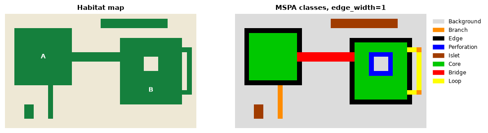

<p class="ls-chapter">Chapter 4</p>

# The shape of habitat

Two forest patches of 100 ha can be ecologically very different. A square
patch of 1 km × 1 km has an interior up to 500 m away from any edge; a strip
of 100 m × 10 km has no point further than 50 m from one. The strip, though, may be a corridor linking two
larger forests, something the square cannot do. Shape and position decide
which role a piece of habitat plays. This chapter introduces the tools that
read those roles from a map, pixel by pixel, using the mathematics of shape:
**mathematical morphology**.

!!! abstract "In this chapter"
    - why shape matters: the core-area model;
    - erosion, dilation and the structuring element, in plain words;
    - Morphological Spatial Pattern Analysis (MSPA): the seven structural
      classes and how to read them;
    - choosing the edge width;
    - simplified patterns (SPA), objects by size, landscape division and
      contortion.

## Why shape matters: the core-area model

If edge effects reach a depth *d* into a patch ([chapter 3](fragmentation.md#edge-effects)),
only the part of the patch further than *d* from its boundary offers
interior conditions. This **core area** depends on both area and shape
(Laurance & Yensen, 1991). For a square patch of side *L*, it is
(*L* − 2*d*)², so with *d* = 100 m:

| Square patch | Area | Core area | Core share |
|---|---|---|---|
| 1 000 m × 1 000 m | 100 ha | 64 ha | 64% |
| 500 m × 500 m | 25 ha | 9 ha | 36% |
| 200 m × 200 m | 4 ha | 0 ha | 0% |

Small patches lose their interior first, and elongated or convoluted
patches lose it faster than compact ones of the same area. The core-area
idea is behind the core metrics of [chapter 5](metrics.md) (`core`, `cai`,
`tca`) and behind the first class of MSPA.

## Mathematical morphology in plain words

Mathematical morphology is a branch of image analysis that studies shapes by
probing them with a small reference shape, the **structuring element**
(Serra, 1982; Soille, 2003). Two operations are enough to follow this chapter:

- **Erosion** keeps a habitat cell only if the structuring element centred on
  it fits entirely inside the habitat. It peels a layer off every patch, and
  removes patches thinner than the element.
- **Dilation** adds every cell touched by the structuring element centred on
  a habitat cell. It grows every patch by a layer, fills narrow gaps and
  merges close patches.

Erosion followed by dilation (an **opening**) removes thin parts and keeps
the bulk; dilation followed by erosion (a **closing**) fills narrow gaps. With
a 3 × 3 square as structuring element, erosion is exactly "remove the cells
that have a non-habitat neighbour, diagonals included", and that is the core
area with an edge depth of one cell.

## Morphological Spatial Pattern Analysis

MSPA applies a sequence of morphological operations to a binary habitat map
and gives every habitat cell one of seven mutually exclusive classes
(Vogt et al., 2007; Soille & Vogt, 2009):

| Class | Geometric definition | Ecological reading |
|---|---|---|
| **Core** | further from the background than the edge width | interior habitat |
| **Edge** | the outer boundary of a core area | habitat exposed to the matrix |
| **Perforation** | the boundary of a hole inside a core area | internal edge: clearings, gaps |
| **Bridge** | a non-core strip connecting two different core areas | structural corridor |
| **Loop** | a non-core strip connecting a core area to itself | alternative route, shortcut |
| **Branch** | a non-core strip attached at one end only | dead end, spur |
| **Islet** | a patch too small or thin to contain any core | fragment, possible stepping stone |

### Try it on a drawing

A small artificial landscape makes the classes concrete. Two blocks of
habitat (A and B), a strip joining them, a clearing inside B, a strip that
leaves B and comes back, a dead-end strip, a small fragment and a thin
isolated strip:

```python
import numpy as np
import landschaft as ls

toy = np.ones((24, 40), dtype="uint8")   # 1 = background
toy[3:15, 2:14] = 2                      # block A
toy[5:19, 24:37] = 2                     # block B
toy[8:10, 14:24] = 2                     # a strip joining A and B
toy[9:12, 29:32] = 1                     # a clearing inside B
toy[7:17, 38] = 2                        # a strip leaving B...
toy[7, 37] = toy[16, 37] = 2             # ...and coming back
toy[14:22, 9] = 2                        # a dead-end strip from A
toy[19:22, 4:6] = 2                      # a small fragment
toy[1:3, 20:34] = 2                      # a thin isolated strip

morph = ls.mspa(toy, edge_width=1, internal=False)
ls.mspa_stats(morph)[["pixels", "pct_foreground"]].head(7)
```



Every structure got its class: the strip between A and B is a **bridge**,
the strip leaving and re-entering B a **loop**, the dead end a **branch**,
the ring around the clearing **perforation**, and both the small fragment
and the long thin strip are **islets**: the strip is large (28 cells) but
never wider than two cells, so it has no core. Size alone would not have
told you that.

The core is precisely the erosion described above:

```python
from scipy import ndimage

eroded = ndimage.binary_erosion(toy == 2, structure=np.ones((3, 3), dtype=bool))
bool(np.array_equal(eroded, morph == 17))      # 17 is the code of Core
```

The other classes follow from how each non-core cell relates to the cores:
MSPA finds which core areas every strip touches, and whether it touches one
(loop), two or more (bridge), or only at one end (branch).

### Reading MSPA on a real landscape

```python
forest = ls.load_raster(ls.example_data("input"))
morph = ls.mspa(forest, edge_width=2)
ls.mspa_stats(morph)[["pixels", "pct_foreground"]].head(7)
```

About 60% of this forest is core. Bridges, loops and branches hold about
16% of it, yet they are the structural links of the forest: a
network of cores joined by bridges is a *structural* ecological network,
from which the connectivity tools of [chapter 7](networks.md#networks-from-habitat-patterns)
start. MSPA has been used to map green infrastructure at national scale
(Wickham et al., 2010) and, combined with network analysis, to identify the
forest connectors most important for connectivity (Saura et al., 2011).

!!! warning "Structure is not function"
    MSPA describes geometry. A bridge is a strip that *could* serve as a
    corridor; whether a species uses it depends on its width relative to
    the species' needs, on what lies along it and on the species' behaviour.
    Treat MSPA classes as hypotheses about function, to be combined with
    knowledge of the species ([chapter 6](connectivity.md)).

## Choosing the edge width

The edge width is the key parameter of MSPA and has a direct ecological
meaning: the **depth of edge effects**, expressed in cells.

<div class="ls-formula" markdown>
edge_width = depth of edge effects (m) / cell size (m)
<small>Edge effects reaching 100 m into a forest mapped at 25 m give edge_width = 4.</small>
</div>

Larger widths turn narrow patches into bridges, loops, branches and islets,
and shrink the core to the interior of the large patches (the
[patterns tutorial](../tutorials/patterns.md#the-edge-width) shows it on the
example map). Because the edge width is counted in cells, it must be
converted when the resolution changes ([chapter 2](scale.md)). When the
depth of edge effects is uncertain, run MSPA with two or three widths that
bracket the plausible values and report how the classes change.

A second parameter, `connectivity`, decides whether cells touching only at
a corner belong to the same patch (8) or not (4); see the
[percolation example](fragmentation.md#thresholds-and-percolation) for how
much this can matter.

## Simplified patterns

When seven classes are more than a question needs, SPA summarises the
pattern in fewer (2, 3, 5 or 6) classes: from "habitat with a core versus
small linear features" to a split close to MSPA. It is the same morphology
with the classes merged, and a good choice for maps communicated to
non-specialists. See the [tutorial](../tutorials/patterns.md#simplified-pattern-analysis-spa).

## Objects by size

A separate question is how the habitat is distributed among objects of
different sizes: is most of the forest in a few large blocks or spread over
many small pieces? **Accounting** labels every habitat object (a group of
connected habitat cells) and groups them into size classes:

```python
objects = ls.accounting(forest, thresholds=(50, 250, 1000, 5000, 20000))
objects.stats[["range", "pct_objects", "pct_area"]]
```

This is the typical signature of a fragmented landscape: 94% of the objects
are smaller than 50 cells, yet together they hold less than 5% of the
forest, while three objects above 20 000 cells hold 64%. Conservation
priorities follow: the few large objects hold most of the habitat and, as
[chapter 7](networks.md) shows, most of the connectivity. Size thresholds
can be set from species' area requirements (minimum area for a viable
population or a territory).

## How divided is the landscape?

Jaeger (2000) proposed measures of landscape division based on a simple
probability: pick two points at random in the landscape; how likely is it
that they are **not** in the same patch of habitat?

<div class="ls-formula" markdown>
DIVISION = 1 − Σ<sub>i</sub> (a<sub>i</sub> / A)²  &nbsp;&nbsp;&nbsp;&nbsp;
MESH = Σ<sub>i</sub> a<sub>i</sub>² / A
<small>a<sub>i</sub>: area of habitat patch i; A: total area of the landscape. MESH, the effective mesh size, is the size of the patches if the landscape were divided into equal patches with the same DIVISION.</small>
</div>

These are easy to compute by hand from the patch areas, which is a good way
to check that you understand them:

```python
landcover = ls.load_raster(ls.example_data("clc"), validate=None)
forest_lc = ls.Landscape(ls.reclassify(landcover, foreground=[23, 24, 25]))

patches = forest_lc.patch_metrics(["area"])
a = patches.loc[patches["class"] == 2, "area"].to_numpy()        # hectares
A = forest_lc.landscape_metrics(["ta"])["ta"].iloc[0]           # 250 000 ha

by_hand = {"division": 1 - ((a / A) ** 2).sum(), "mesh": (a ** 2).sum() / A}
by_tool = forest_lc.class_metrics(["division", "mesh"]).set_index("class").loc[2]
by_hand, by_tool.to_dict()
```

The forest of the CORINE example has a division of 0.997: two random points
of the landscape are almost never in the same forest patch. Its effective
mesh size is about 750 ha, compared with 50 000 ha of forest in total. MESH
is additive and scale-consistent, which has made it popular in monitoring
programmes of landscape fragmentation (Jaeger, 2000). `ls.parcellation`
reports the same family of measures for every class of a binary map.

## Contorted boundaries

Finally, **contortion** measures how convoluted the boundary of each object
is relative to its size: compact objects score low, elongated and dendritic
ones high. It complements the shape metrics of [chapter 5](metrics.md) with
one value per object on a map (see the
[tutorial](../tutorials/patterns.md#contortion-how-convoluted-are-the-boundaries)).

## Which tool for which question?

| Question | Tool |
|---|---|
| Which habitat cells are interior, edge, corridor or fragment? | `ls.mspa` |
| The same, in fewer classes for communication | `ls.spa` |
| How is the habitat distributed among small and large objects? | `ls.accounting` |
| How divided is the landscape? | `ls.parcellation`, `division`, `mesh`, `split` metrics |
| How convoluted is each object? | `ls.contortion`, shape metrics |
| How much interior habitat does each patch have? | core-area metrics ([chapter 5](metrics.md)) |

!!! success "Key points"
    - Edge effects make the useful interior of a patch depend on its area and
      shape (the core-area model).
    - Mathematical morphology probes shapes with a structuring element; the
      core is an erosion of the habitat.
    - MSPA assigns every habitat cell a structural role: core, edge,
      perforation, bridge, loop, branch or islet. The roles are structural
      hypotheses about ecological function.
    - The edge width is the depth of edge effects in cells; convert it when
      the grain changes, and test its influence.
    - Size-class accounting and division measures describe how the habitat
      is split among objects.

## Check your understanding

1. A long, 50 m wide riparian forest along a river, mapped at 25 m, is
   analysed with `edge_width=2`. What MSPA classes do you expect, and why?
2. Why might two patches with the same area have very different core areas?
3. A landscape has a DIVISION of 0.2 for forest. What does that say about
   the forest?

??? success "Answers"
    1. No core at all (two cells wide is never wider than twice the edge
       width), so the strip is a bridge where it connects two core areas, a
       loop or branch where it touches one, and an islet if it touches none.
    2. Because core area depends on shape: an elongated or convoluted patch
       has more of its area near the boundary than a compact patch.
    3. Two random points of the landscape have an 80% chance of lying in the
       same forest patch: the forest covers most of the landscape in one large
       block (DIVISION close to 0 means little division).

## References

<div class="ls-refs" markdown>

- Jaeger, J. A. G. (2000). Landscape division, splitting index, and effective mesh size: new measures of landscape fragmentation. *Landscape Ecology*, 15(2), 115–130.
- Laurance, W. F., & Yensen, E. (1991). Predicting the impacts of edge effects in fragmented habitats. *Biological Conservation*, 55(1), 77–92.
- Saura, S., Vogt, P., Velázquez, J., Hernando, A., & Tejera, R. (2011). Key structural forest connectors can be identified by combining landscape spatial pattern and network analyses. *Forest Ecology and Management*, 262(2), 150–160.
- Serra, J. (1982). *Image Analysis and Mathematical Morphology*. Academic Press.
- Soille, P. (2003). *Morphological Image Analysis: Principles and Applications* (2nd ed.). Springer.
- Soille, P., & Vogt, P. (2009). Morphological segmentation of binary patterns. *Pattern Recognition Letters*, 30(4), 456–459.
- Vogt, P., Riitters, K. H., Estreguil, C., Kozak, J., Wade, T. G., & Wickham, J. D. (2007). Mapping spatial patterns with morphological image processing. *Landscape Ecology*, 22, 171–177.
- Vogt, P., & Riitters, K. (2017). GuidosToolbox: universal digital image object analysis. *European Journal of Remote Sensing*, 50(1), 352–361.
- Wickham, J. D., Riitters, K. H., Wade, T. G., & Vogt, P. (2010). A national assessment of green infrastructure and change for the conterminous United States using morphological image processing. *Landscape and Urban Planning*, 94(3–4), 186–195.

</div>
