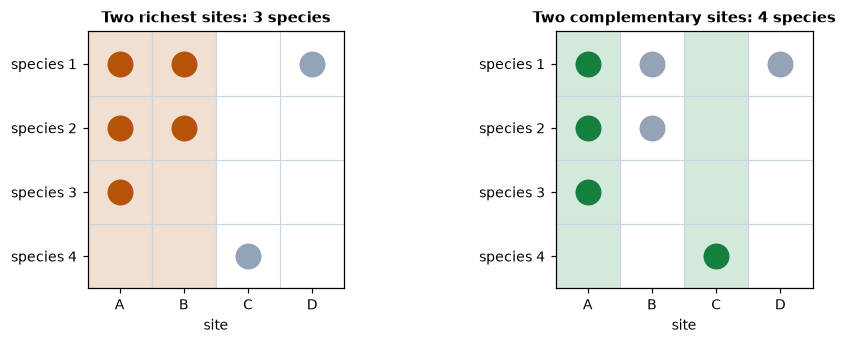
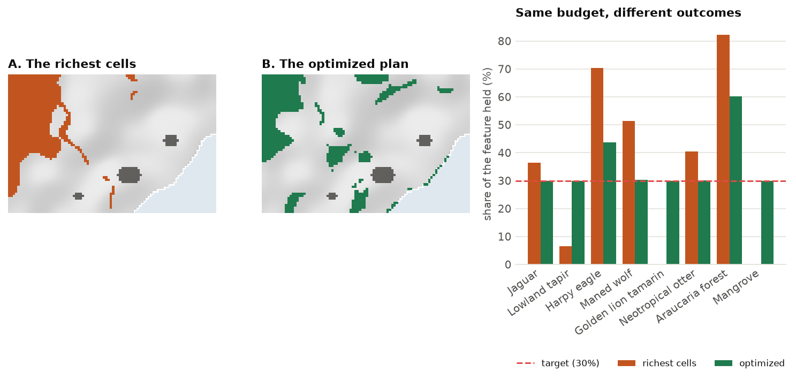

<p class="ls-chapter">Chapter 12.1</p>

# Conservation priorities

The earlier chapters described landscapes: how much habitat there is, in what shapes, how connected, how it
changes. Conservation also has to make choices. Money, land and time are limited, and no agency can protect
every forest or restore every wetland. This part of the course is about choosing *where*, for many species at
once, in a way that can be explained and defended. That is the job of **systematic conservation planning** and
of the **spatial prioritization** at its core.

The topic is large enough to fill ten chapters. This first one asks *why* we need methods at all. The others
cover the ingredients, the two families of methods (ranking and optimization), spatial design, trade-offs,
evaluation, management actions and the planning process. No background in mathematics is assumed: every idea
comes with a map, a chart and a few lines of code you can run.

!!! abstract "In this chapter"
    - why "protect the richest places" fails, shown with a real experiment;
    - representation, complementarity, irreplaceability, efficiency and persistence;
    - the four ways to set priorities, and the two families of methods in `ls.prioritize`;
    - what a prioritization produces, and what it is not;
    - a map of the chapters that follow.

## A problem every planner faces

Imagine you work for an environmental agency. You have a map of your state and a mandate: *protect enough
habitat to keep every threatened species alive in the long term.* You also have a budget, and every hectare
costs money. You may have to buy the land, compensate its owner, or give up what it would produce as farmland.

Which areas should you choose?

A natural first idea is to pick the places with the most species, the **hotspots**. It sounds reasonable, but
it often fails. The richest places tend to hold the same common species over and over, while rare species
living elsewhere are left out. You can spend the whole budget and still miss your goals.

Spatial prioritization asks a different question. It looks at **all the areas at once**: *which combination
of areas, together, reaches every goal at the least total cost?*

!!! note "In plain words"
    You state **what you want** (targets for species and habitats), **what it costs** (a cost map) and **what
    the rules are** (these parks already exist, those cities cannot be protected). A prioritization method
    searches the combinations of areas and returns the best one it can prove. It does not decide *for* you.
    It shows the consequences of the goals and rules you chose.

## Systematic conservation planning

Most protected areas of the twentieth century were chosen *ad hoc*: for scenery, for recreation, or because
the land was of little use for anything else. The result was reserves on steep, remote, unproductive land,
while lowland habitats and the species that live in them were left out (Pressey 1994). Global analyses show
the consequence: many species, especially those with small ranges, do not occur in any protected area at all
(Rodrigues et al. 2004).

**Systematic conservation planning** (Margules & Pressey 2000) replaced this with an explicit procedure:

1. **state goals** for the features to conserve (species, habitats, ecosystem services);
2. **measure** what existing reserves already achieve (a **gap analysis**);
3. **choose new areas** that fill the gaps as efficiently as possible;
4. **implement, manage and monitor**, and revise the plan as things change.

Step 3, the choice of areas, is **spatial prioritization** (Moilanen et al. 2009), and it is what
`ls.prioritize` does. [Chapter 12.10](prioritization/process.md) returns to the whole process: who takes
part, how goals are chosen, and how a map becomes action on the ground.

## Core ideas

Kukkala & Moilanen (2013) review the concepts behind every method. Five of them do most of the work:

- **Representation**: every feature should be covered, not just the common or charismatic ones.
- **Complementarity**: the value of an area depends on what the other areas already hold. A second site with
  the same species as the first adds little; a site with species found nowhere else adds a lot (Pressey et
  al. 1993).
- **Irreplaceability**: how much the goals depend on a particular area. A site holding the only population of
  a species cannot be replaced.
- **Efficiency**: reaching the goals with the least area or cost, which leaves the rest of the landscape for
  other uses.
- **Adequacy and persistence**: features must be covered well enough to survive. That means large,
  connected, well-managed areas, not scattered fragments.

Complementarity is the idea that most separates systematic planning from intuition. Here it is with four
sites and four species:

```python
import numpy as np
import landschaft as ls

sites = np.array([[1, 1, 0, 1],     # species 1 in sites A, B and D
                  [1, 1, 0, 0],     # species 2 in A and B
                  [1, 0, 0, 0],     # species 3 only in A
                  [0, 0, 1, 0]],    # species 4 only in C
                 dtype="float32")[:, None, :]
print("species per site:", sites.sum(axis=0)[0])      # A, B, C, D
res = ls.prioritize.zonation(sites)
print("rank:", np.asarray(res.rank)[0])               # 0 = least important
```



If only two sites can be protected, the richest ones, A and B, protect three species: B adds nothing that A
does not already have. A ranking with Zonation puts A and C on top (ranks 0.75 and 0.5), and together they
hold all four species. Site C is poor but irreplaceable.

!!! note "In plain words"
    Think of picking a football team. The five best individual players might all be strikers, and then you
    have no goalkeeper. A good coach picks the players who, *together*, cover every position. Complementarity
    means choosing the team, not the individuals.

## The experiment: hotspots against a plan

Four sites are easy to reason about. A real landscape is not. **Serra Verde** is the imaginary coastal region
used throughout this part of the course ([chapter 12.2](prioritization/concepts.md) describes it in detail).
It has 4825 planning units of 1 km², eight features from widespread to very rare, and a cost for every unit.
The goal is to protect **30 % of the habitat of each feature**. Two strategies spend exactly the same money:

**A. Pick the richest cells.** Score every cell by how much biodiversity it holds (the sum of the eight
habitat maps), then select cells from the highest score down until the money runs out. Many "hotspot" maps
follow this logic.

**B. Optimize.** Ask `ls.prioritize` for the cheapest set of cells that meets every target, a *minimum-set*
problem ([chapter 12.4](prioritization/optimization.md)). Its cost becomes the budget of strategy A.

```python
import xarray as xr

P = ls.prioritize
cost = ls.load_raster(P.example_data("cost"))
features = ls.load_raster(P.example_data("features"))

# B. the cheapest plan that holds 30 % of every feature
p = (P.problem(cost, features)
       .add_min_set_objective()
       .add_relative_targets(0.3)
       .add_binary_decisions())
plan = p.solve()
budget = plan.cost
print(f"optimized plan: {int(plan.values.sum())} cells, {budget / 1000:.1f} million USD")

# A. the richest cells, from the top down, until the same budget is spent
richness = features.sum("band").where(np.isfinite(cost))
order = np.argsort(-richness.values, axis=None)          # richest first, the ocean (NaN) last
spent = np.nancumsum(cost.values.ravel()[order])
hot = xr.zeros_like(cost).where(np.isfinite(cost))
hot.values.ravel()[order[spent <= budget]] = 1

compare = P.eval_feature_representation_summary(p, plan)[["feature", "relative_held"]]
compare["richest_cells"] = P.eval_feature_representation_summary(p, hot)["relative_held"]
compare.round(2)
```

<figure markdown>

<figcaption>A: the richest cells crowd into the north-western mountains, where four features overlap.
B: the optimized plan spreads across the landscape. Right: with the same 37 million USD, the richest cells
hold 82 % of the araucaria forest and 70 % of the harpy eagle's habitat, far more than the target, but only
7 % of the lowland tapir and nothing at all of the golden lion tamarin and the mangrove. The optimized plan
meets all eight targets.</figcaption>
</figure>

### What went wrong with the hotspots?

The richest cells are in the mountains, where the jaguar, the harpy eagle, the maned wolf and the araucaria
forest overlap. Selecting them is excellent for those four features, and each new mountain cell adds a little
more of the *same* features. But:

- the **golden lion tamarin** lives only in two small lowland fragments with few other species, so those
  cells never reach the top of the list;
- the **mangrove** grows on a thin coastal strip, also with low "richness";
- the **lowland tapir** lives along river valleys with few other species.

The optimized plan behaves differently because it values **sets of cells**, not single cells. Once some
mountain cells already hold 30 % of the araucaria forest, more of them add nothing to the targets. The next
dollar goes further on something the plan does not have yet: a tamarin fragment, a piece of mangrove. That
is complementarity at the scale of a real landscape, and no fixed score can capture it.

The second lesson is **efficiency**. Where two places hold the same features, the plan takes the cheaper one,
and it avoids the expensive land around cities and roads whenever there is an alternative. Efficiency is not
about being stingy. Every dollar saved can protect something else, or make a plan politically feasible.

## Four ways to set priorities

| Approach | Question it answers | In `ls.prioritize` |
|---|---|---|
| **Scoring** | Which places score highest on an index (richness, endemism, threat)? | not a method of its own: hotspot maps, `ls.bio` indices |
| **Ranking** | In what order would we give up the landscape, keeping as much of everything for as long as possible? | `zonation` ([chapter 12.3](prioritization/ranking.md)) |
| **Minimum set** | What is the cheapest set of areas that meets a target for every feature? | `add_min_set_objective` ([chapter 12.4](prioritization/optimization.md)) |
| **Maximal coverage** | With this budget, what set of areas achieves the most? | `add_max_utility_objective`, `add_min_shortfall_objective`, ... |

Scoring ignores complementarity, as the experiment showed. The other three take it into account and belong to
two families:

- **Ranking** (Zonation; Moilanen et al. 2005, 2022) orders every cell from the least to the most important.
  It needs no target and no budget: the best 10 % lies inside the best 30 %, so one map answers every budget.
  This makes it useful early in planning, while targets are still being negotiated, and for very large maps.
- **Optimization** (Marxan, prioritizr; Ball et al. 2009, Hanson et al. 2025) finds the best *set* of areas
  for a given target or budget, often with a proof of how close it is to the best possible. It handles
  spatial rules (compact reserves, corridors, contiguity), management actions, existing reserves and
  trade-offs exactly.

The two are complementary, not rivals. [Chapter 12.9](prioritization/together.md) shows how to use them
together: a ranking to explore, an optimized plan to decide.

## What a prioritization produces

Depending on how the problem is framed, `ls.prioritize` returns:

- **a plan**: a map of the areas to select (1) or not (0), the most common output;
- **a ranking**: a priority for every cell, with performance curves for every feature;
- **a plan with actions**: for each area, *which* management actions to take (fire control here,
  restoration there), [chapter 12.8](prioritization/actions.md);
- **importance maps**: how essential each selected area is and how easily another could replace it,
  [chapter 12.7](prioritization/evaluation.md);
- **alternative plans** that are almost equally good, for stakeholders to choose from, and **trade-off
  curves** between cost, compactness and representation, [chapter 12.6](prioritization/tradeoffs.md).

## What prioritization is not

Be clear about the limits of the approach:

- **It is a decision-support tool, not a decision-maker.** The output depends entirely on the data and goals
  you provide. Different, equally reasonable goals lead to different maps, so good planning involves
  stakeholders in choosing those goals.
- **It is only as good as its data.** Species distribution models have errors, and costs are estimates.
  Always test how sensitive the results are.
- **It does not replace field knowledge.** A selected area may be impractical for reasons that are in no
  map. Use the results as the start of a discussion, and iterate.
- **High threat is not the same as high priority** (Game et al. 2013). A place may be very threatened and
  still a poor investment if action there is unlikely to work.

## Where it is used

Spatial prioritization is used by governments, NGOs, companies and researchers worldwide:

- **protected-area targets**, such as Target 3 of the Kunming-Montreal Global Biodiversity Framework:
  30 % of land and sea by 2030;
- **restoration**: where to restore degraded land to recover the most biodiversity or carbon per dollar
  (Strassburg et al. 2020);
- **licensing and offsets**: where to compensate for the impacts of infrastructure;
- **marine spatial planning**: where to place no-take zones while limiting the cost to fisheries;
- **land-use planning**: balancing agriculture, water and biodiversity in watersheds and municipalities;
- **threat management**: which threats to fight, where, to protect the most species (Cattarino et al. 2015).

[Chapter 12.10](prioritization/process.md#recipes) shows how each of these is written with `ls.prioritize`.

## The chapters of this part

<div class="grid cards" markdown>

-   **12.2 · [Key concepts](prioritization/concepts.md)**

    ---

    Planning units, features, costs, targets and decisions, and Serra Verde, the example region.

-   **12.3 · [Ranking a landscape](prioritization/ranking.md)**

    ---

    How Zonation ranks a landscape: marginal loss, core-area and additive-benefit rules, performance curves.

-   **12.4 · [Optimization](prioritization/optimization.md)**

    ---

    Objectives and targets, how solvers work, optimality gaps, heuristics against exact methods.

-   **12.5 · [Spatial design](prioritization/spatial.md)**

    ---

    Fragmentation, compactness, neighbours, contiguity, corridors and connectivity, and what they cost.

-   **12.6 · [Trade-offs](prioritization/tradeoffs.md)**

    ---

    Calibrating penalties and budgets, Pareto fronts, alternative plans and portfolios.

-   **12.7 · [Evaluating a plan](prioritization/evaluation.md)**

    ---

    Representation, importance and irreplaceability, landscape metrics and extinction risk of a plan.

-   **12.8 · [Management actions](prioritization/actions.md)**

    ---

    Threats, actions and their benefits: multi-action planning, response curves and dependencies.

-   **12.9 · [Ranking and optimization together](prioritization/together.md)**

    ---

    Comparing Zonation with optimized plans, using SDMs as features, large problems.

-   **12.10 · [The planning process](prioritization/process.md)**

    ---

    From workshops to implementation: scenarios, good practices, common mistakes and use cases.

</div>

!!! success "Key points"
    - Systematic planning makes goals explicit and chooses areas for what they add to the whole.
    - "The richest places first" over-protects common features and misses rare ones; in Serra Verde it met
      five of eight targets with the money that met all eight.
    - Complementarity (sets, not single areas) and efficiency (the same for less) are what methods add.
    - Ranking orders the whole landscape; optimization finds the best set for a target or budget. They answer
      different questions and work well together.
    - A prioritization supports a decision; it does not make it.

## Check your understanding

1. In the four-site example, why is site C ranked above site B even though B has more species?
2. In Serra Verde, the richest cells hold 82 % of the araucaria forest. Why is that a *problem* for the plan
   rather than a success?
3. A colleague proposes protecting the cells with the most threatened species per km². Name two things this
   score ignores.

??? success "Answers"
    1. Complementarity: B's species (1 and 2) are also in A, so once A is kept, B adds nothing. Species 4
       lives only in C; without C it is lost. C is irreplaceable, B is not.
    2. The target was 30 %. The extra 52 % of araucaria forest cost money that could have bought tamarin
       fragments and mangrove, the features the hotspots missed entirely.
    3. Complementarity (the next cell may hold the same species as those already chosen) and cost (a cheap
       cell with fewer species may give more per dollar). It also ignores whether action there would
       succeed.

## References

<div class="ls-refs" markdown>

- Ball, I. R., Possingham, H. P., & Watts, M. E. (2009). Marxan and relatives: software for spatial conservation prioritization. In A. Moilanen, K. A. Wilson & H. P. Possingham (Eds.), *Spatial Conservation Prioritization* (pp. 185–195). Oxford University Press.
- Cattarino, L., Hermoso, V., Carwardine, J., Kennard, M. J., & Linke, S. (2015). Multi-action planning for threat management: a novel approach for the spatial prioritization of conservation actions. *PLoS ONE*, 10(5), e0128027.
- Game, E. T., Kareiva, P., & Possingham, H. P. (2013). Six common mistakes in conservation priority setting. *Conservation Biology*, 27(3), 480–485.
- Hanson, J. O., Schuster, R., Strimas-Mackey, M., Morrell, N., Edwards, B. P. M., Arcese, P., Bennett, J. R., & Possingham, H. P. (2025). Systematic conservation prioritization with the prioritizr R package. *Conservation Biology*, 39(1), e14376.
- Kukkala, A. S., & Moilanen, A. (2013). Core concepts of spatial prioritisation in systematic conservation planning. *Biological Reviews*, 88(2), 443–464.
- Margules, C. R., & Pressey, R. L. (2000). Systematic conservation planning. *Nature*, 405, 243–253.
- Moilanen, A., Franco, A. M. A., Early, R. I., Fox, R., Wintle, B., & Thomas, C. D. (2005). Prioritizing multiple-use landscapes for conservation: methods for large multi-species planning problems. *Proceedings of the Royal Society B*, 272, 1885–1891.
- Moilanen, A., Lehtinen, P., Kohonen, I., Jalkanen, J., Virtanen, E. A., & Kujala, H. (2022). Novel methods for spatial prioritization with applications in conservation, land use planning and ecological impact avoidance. *Methods in Ecology and Evolution*, 13(5), 1062–1072.
- Moilanen, A., Wilson, K. A., & Possingham, H. P. (Eds.) (2009). *Spatial Conservation Prioritization: Quantitative Methods and Computational Tools*. Oxford University Press.
- Pressey, R. L. (1994). Ad hoc reservations: forward or backward steps in developing representative reserve systems? *Conservation Biology*, 8(3), 662–668.
- Pressey, R. L., Humphries, C. J., Margules, C. R., Vane-Wright, R. I., & Williams, P. H. (1993). Beyond opportunism: key principles for systematic reserve selection. *Trends in Ecology & Evolution*, 8(4), 124–128.
- Rodrigues, A. S. L., Andelman, S. J., Bakarr, M. I., Boitani, L., Brooks, T. M., Cowling, R. M., et al. (2004). Effectiveness of the global protected area network in representing species diversity. *Nature*, 428, 640–643.
- Strassburg, B. B. N., Iribarrem, A., Beyer, H. L., Cordeiro, C. L., Crouzeilles, R., Jakovac, C. C., et al. (2020). Global priority areas for ecosystem restoration. *Nature*, 586, 724–729.

</div>
