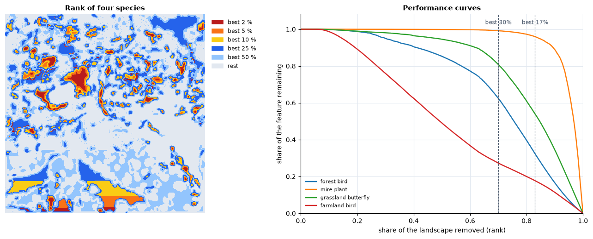

<p class="ls-chapter">Chapter 12</p>

# Conservation priorities

The earlier chapters described landscapes: how much habitat, in what shapes,
how connected, how it changes. Conservation also has to decide. Money, land
and time are limited, and not every forest can be protected or every
wetland restored. This chapter is about choosing *where*, for many species
at once, in a way that can be explained and defended: systematic
conservation planning, and the spatial prioritization at its core.

!!! abstract "In this chapter"
    - why priorities need to be set systematically, and what went wrong
      when they were not;
    - representation, complementarity, irreplaceability, efficiency and
      persistence;
    - scoring, minimum-set, maximal-coverage and ranking approaches;
    - how Zonation ranks a landscape: marginal loss, the core-area and
      additive-benefit rules, iterated sorting;
    - reading rank maps and performance curves;
    - weights, costs, existing reserves and connectivity;
    - data, uncertainty and common mistakes.

## Why prioritize systematically?

Most protected areas of the twentieth century were chosen *ad hoc*: for
scenery, for recreation, or because the land was of little use for anything
else. The result is reserves concentrated on steep, remote, unproductive
land, while the lowland habitats and the species that live in them are left
out (Pressey 1994). Global analyses show the consequence: many species,
especially those with small ranges, do not occur in any protected area at
all (Rodrigues et al. 2004).

**Systematic conservation planning** (Margules & Pressey 2000) replaced this
with an explicit procedure: state goals for the features to conserve
(species, habitats, ecosystem services), measure what existing reserves
already achieve (a **gap analysis**), choose new areas that fill the gaps as
efficiently as possible, then implement, manage and monitor. The choice of
areas, the step this chapter is about, is **spatial prioritization**
(Moilanen et al. 2009).

## Core ideas

Kukkala & Moilanen (2013) review the concepts behind every method. Five of
them do most of the work:

- **Representation**: every feature should be covered, not just the most
  common or the most charismatic.
- **Complementarity**: the value of an area depends on what the others
  already hold. A second site with the same species as the first adds little;
  a site with species found nowhere else adds a lot (Pressey et al. 1993).
- **Irreplaceability**: how much the goals depend on a particular area; a
  site holding the only population of a species cannot be replaced.
- **Efficiency**: reaching the goals with the least area or cost, leaving the
  rest of the landscape for other uses.
- **Adequacy and persistence**: features must be covered well enough to
  survive: large, connected, well-managed areas, not scattered fragments.

Complementarity is the idea that most separates systematic planning from
intuition. Four sites and four species:

```python
import numpy as np
import landschaft as ls

sites = np.array([[1, 1, 0, 1],     # species 1 in sites A, B and D
                  [1, 1, 0, 0],     # species 2 in A and B
                  [1, 0, 0, 0],     # species 3 only in A
                  [0, 0, 1, 0]],    # species 4 only in C
                 dtype="float32")[:, None, :]
print("species per site:", sites.sum(axis=0)[0])      # A, B, C, D
res = ls.prioritize.zonation(sites)
print("rank:", np.asarray(res.rank)[0])               # 0 = least important
```


If only two sites can be protected, the richest ones, A and B, protect three
species: B adds nothing that A does not have. Zonation ranks A and C highest
(ranks 0.75 and 0.5): together they hold all four. Site C is poor, but
irreplaceable.

## Four ways to set priorities

| Approach | Question it answers | Example tools |
|---|---|---|
| **scoring** | which places score highest on an index (richness, endemism, threat)? | hotspot maps, `ls.bio` indices |
| **minimum set** | what is the cheapest set of areas that meets a target for every feature? | Marxan (Ball et al. 2009), prioritizr |
| **maximal coverage** | what set of a given size or budget covers the most? | integer programming |
| **ranking** | in what order would we give up the landscape, keeping as much of everything for as long as possible? | Zonation |

Scoring ignores complementarity, as the example showed. Minimum-set and
maximal-coverage methods need a target or a budget before the analysis, and
their solutions for different budgets need not be nested. A **ranking**
gives a priority to every cell: the best 10 % lies inside the best 30 %, so
the same map answers every budget, and the order degrades gracefully from
the most to the least important land. That makes rankings useful early in
planning, when targets are still negotiated, and for comparing land uses
across a whole region.

## How Zonation ranks

Zonation (Moilanen et al. 2005, 2022) builds the ranking backwards: it
removes the cells one after the other, always the one whose removal causes
the smallest **marginal loss** to the features, given the cells still
remaining. The last cells remaining are the most important.

Every feature j is first scaled so that its values over the landscape sum
to 1: f<sub>ij</sub> is the share of feature j in cell i, and R<sub>j</sub>
the share still remaining. The marginal loss δ<sub>i</sub> of cell i
combines, over the features, the fraction w<sub>j</sub> f<sub>ij</sub> / R<sub>j</sub>
of what remains of each that the cell would take away (w<sub>j</sub> is the
feature's weight). The **rules** differ in how they combine them:

| Rule | Marginal loss δ<sub>i</sub> | Behaviour |
|---|---|---|
| `CAZMAX` (core-area) | max<sub>j</sub> w<sub>j</sub> f<sub>ij</sub> / R<sub>j</sub> | a cell is as valuable as its most important feature; protects the core of every feature's distribution |
| `CAZ1` | Σ<sub>j</sub> w<sub>j</sub> f<sub>ij</sub> / R<sub>j</sub> | adds the losses: cells with many features rise |
| `CAZ2` (Zonation 5's default) | √( Σ<sub>j</sub> (w<sub>j</sub> f<sub>ij</sub> / R<sub>j</sub>)² ) | between the two: large single losses dominate, several moderate ones still count |
| `ABF` (additive benefit) | Σ<sub>j</sub> w<sub>j</sub> [R<sub>j</sub><sup>z</sup> − (R<sub>j</sub> − f<sub>ij</sub>)<sup>z</sup>] | the loss of a benefit V(R) = R<sup>z</sup> that saturates: the first losses of a feature cost little, the last ones much |

`CAZMAX`, `CAZ1` and `CAZ2` are one family, the p-norms of the relative
losses for p = ∞, 1 and 2 (`CAZP` takes any p). ABF (Arponen et al.
2005; Moilanen 2007) represents the idea that each feature's benefit grows
with the fraction kept, with diminishing returns: with z = 0.25, keeping
half of a species gives 84 % of its benefit.

In the example above, all features start at R<sub>j</sub> = 1. Site D holds
a third of species 1 and nothing else, so its core-area loss is 1/3; B holds
half of species 2 (1/2); A and C each hold all of a species (1). D goes
first. Species 1 then has R<sub>1</sub> = 2/3, and B's loss is
max((1/3) / (2/3), 1/2) = 0.5: B goes next, and A and C remain. You can check the
first step:

```python
f = sites[:, 0, :] / sites[:, 0, :].sum(axis=1, keepdims=True)   # f_ij
print("CAZMAX losses of A, B, C, D:", f.max(axis=0).round(3))
```

Recomputing every loss after every removal is slow on maps of millions of
cells. Zonation 5 turns the problem around: given an order of removal, the
remaining share of every feature when each cell goes is known, and so is
every cell's loss at that point. Sorting the cells by these losses gives a
new order; Zonation repeats until the order stops changing (the mean
**ranking error** falls below 0.01 %), usually after tens to a few hundred
sorts.

## Reading the results

The **rank map** gives every cell a value from 0 (removed first) to almost 1
(the most important). The top fraction of the landscape is a threshold on
it: the best 17 % are the cells ranked 0.83 or more.

The **performance curves** follow every feature as the landscape is
removed: at each rank, the share of the feature still in the remaining cells.
They answer the practical question: if the best 30 % were protected, how much
of each species would it hold? Four species of the CORINE map from the
[tutorial](../tutorials/prioritization.md), each smoothed with a dispersal
kernel of about 500 m, so that a cell's value is the habitat around it (see
[connectivity](#connectivity-and-persistence) below):

```python
import pandas as pd
import xarray as xr

clc = ls.load_raster(ls.example_data("clc"))

def share(*codes):
    """The fraction of every 125 m cell covered by the land-cover classes."""
    return clc.isin(codes).coarsen(x=5, y=5).mean().astype("float32")

names = ["forest_bird", "mire_plant", "grassland_butterfly", "farmland_bird"]
species = xr.concat([share(23, 24, 25), share(35, 36), share(18, 26),
                     share(20, 21) + 0.3 * share(12)], dim="species")
res = ls.prioritize.zonation(species, names=names,
                             connectivity=[ls.prioritize.Kernel("negexp", 4)] * 4)   # 4 cells of 125 m

def kept(res, best):
    """The share of every feature in the best `best` fraction of the cells."""
    fc = res.feature_curves
    return fc.iloc[(fc["rank"] - (1 - best)).abs().argmin(), 1:]

pd.DataFrame({"best 17 %": kept(res, 0.17), "best 30 %": kept(res, 0.30)}).round(2)
```



The mire plant, which lives in a few bogs, is almost entirely in the best
17 % (96 %); the grassland butterfly has half of its habitat there (54 %) and
81 % in the best 30 %; the forest bird, spread over a fifth of the map, 32 %
and 62 %; the farmland bird, spread thinly over half of the map, a fifth to a
quarter (18 % and 27 %). (The straight edges at the bottom of the rank map
are ties between cells of equal value; see [data and
uncertainty](#data-and-uncertainty).) The curve of a feature
falls slowly while cells poor in it are removed, then steeply: its steep part
marks where the landscape could not be given up without losing it.

The area percentages echo policy targets: 17 % of land in protected areas
(Aichi Target 11, 2010) and 30 % by 2030 (Target 3 of the Kunming-Montreal
Global Biodiversity Framework, 2022). A performance curve shows what a given
share of land achieves for each feature, which is the substance behind such
targets. The **area under the mean curve** (`res.auc`) summarises a whole
ranking in one number, to compare alternatives.

## Weights, costs and what is already protected

**Weights** say how much a feature matters relative to the others: a
threatened species, an endemic one, or one the project is responsible for.
They multiply its losses, so its cells are removed later. Negative weights
mark features to avoid: a threat, an invasive species, land with conflicting
uses.

**Costs** turn the question into one of efficiency: the marginal loss of a
cell is divided by its cost, so cheap cells that hold a little of everything
move up (Naidoo et al. 2006). The curves can then be read against the budget
instead of the area. Costs can be land prices, management costs, or the
opportunity cost of forgone production.

**Existing reserves** enter as a hierarchic mask: cells of a higher mask
level are removed only after all the cells of lower levels, so they rank on
top and the rest of the landscape is ranked for what they lack. The share of
every feature within the reserves is the gap analysis; the cells ranked just
below them are the best extensions.

## Connectivity and persistence

A cell of forest surrounded by forest is worth more to a forest species than
the same cell alone in a field: populations in large, connected areas
persist, those in isolated fragments often do not
([chapters 3](fragmentation.md), [6](connectivity.md) and
[7](networks.md)). Zonation takes this into account by **smoothing** each
feature with a dispersal kernel before the ranking (Moilanen et al. 2005):
every cell receives value from the habitat around it, at the scale the
species moves. The ranking then favours compact, connected areas over
scattered fragments, at a small cost in raw coverage. **Interactions** link
features to one another (a predator to its prey, a pollinator to its
flowers), and the **matrix connectivity** of Zonation 5 lets features of
related habitats count for one another.

## Data and uncertainty

A ranking is only as good as the maps it ranks. Some cautions:

- **Surrogates.** Species distribution models, habitat maps and land-cover
  classes stand in for the true distributions. Their errors pass into the
  ranking, unevenly: rare species with few records are the least certain and
  often the most influential.
- **Extent and edges.** A species rare in the study area may be common next
  door; a ranking within administrative borders gives priority to the edge of
  ranges. Where possible, rank within the ecological context, or weight
  features by the share of their global range the region holds.
- **Resolution.** Coarse cells mix habitats and overstate co-occurrence
  ([chapter 2](scale.md)).
- **Ties.** Cells with exactly the same values have the same marginal loss,
  and like any sort Zonation orders them by their position (row by row). A
  map with large uniform areas (every cell of a class worth the same) gets
  arbitrary stripes in its rank map; ranks within such ties mean nothing.
  Smoothing with a dispersal kernel, or any more informative feature, breaks
  them.
- **Alternatives.** Rankings with different rules, weights, costs or data
  differ in detail. The robust priorities are those that hold across them;
  the flexibility map (`ZonationResult.flexibility_map`) shows how far each
  cell could move before its loss differs markedly from its neighbours in the
  order.

Game et al. (2013) review mistakes common in priority setting, among them
ignoring costs, confusing high threat with high priority, and ignoring the
chance that actions succeed. A ranking says where the landscape is
irreplaceable for the features in the analysis; turning it into actions needs
the people, institutions and threats of the place.

!!! success "Key points"
    - Systematic planning makes goals explicit and chooses areas for what
      they add to the whole: complementarity, not scores.
    - Zonation ranks the whole landscape by removing, again and again, the
      cells whose loss matters least; the order answers every budget at once.
    - The rules differ in how they combine the losses of the features:
      CAZMAX follows the worst-off feature, ABF the sum of benefits, CAZ2 sits
      between.
    - Performance curves show what any share of land achieves for every
      feature; weights, costs, reserves and connectivity turn a generic
      ranking into a plan.
    - Rankings inherit the errors of their data: test alternatives and keep
      the priorities that hold.

## Check your understanding

1. In the four-site example, why is site C ranked above site B even though
   B has more species?
2. A ranking with `CAZMAX` and one with `ABF` of the same data give
   different best 10 %. Which one would you expect to hold more of the
   rarest species, and which more of the species on average?
3. A region wants to protect 30 % of its land. Why is a ranking more useful
   than a single minimum-set solution while the target and budget are still
   being negotiated?

??? success "Answers"
    1. Complementarity: B's species (1 and 2) are also in A, so once A is
       kept, B adds nothing. Species 4 occurs only in C: without C it is lost.
       C is irreplaceable; B is not.
    2. CAZMAX keeps the core of every feature, whatever the others do, so it
       tends to protect more of the rarest; ABF adds benefits over all
       features and tends to give a higher average coverage, letting a few
       features fall lower.
    3. A ranking is nested: the best 20 %, 30 % or 40 % come from the same
       map, and the performance curves show what each option achieves for
       every feature, so the trade-offs of different targets and budgets can
       be discussed without new analyses.

## References

<div class="ls-refs" markdown>

- Arponen, A., Heikkinen, R. K., Thomas, C. D., & Moilanen, A. (2005). The value of biodiversity in reserve selection: representation, species weighting, and benefit functions. *Conservation Biology*, 19(6), 2009–2014.
- Ball, I. R., Possingham, H. P., & Watts, M. E. (2009). Marxan and relatives: software for spatial conservation prioritization. In A. Moilanen, K. A. Wilson & H. P. Possingham (Eds.), *Spatial Conservation Prioritization* (pp. 185–195). Oxford University Press.
- Game, E. T., Kareiva, P., & Possingham, H. P. (2013). Six common mistakes in conservation priority setting. *Conservation Biology*, 27(3), 480–485.
- Kukkala, A. S., & Moilanen, A. (2013). Core concepts of spatial prioritisation in systematic conservation planning. *Biological Reviews*, 88(2), 443–464.
- Margules, C. R., & Pressey, R. L. (2000). Systematic conservation planning. *Nature*, 405, 243–253.
- Moilanen, A. (2007). Landscape Zonation, benefit functions and target-based planning: unifying reserve selection strategies. *Biological Conservation*, 134(4), 571–579.
- Moilanen, A., Franco, A. M. A., Early, R. I., Fox, R., Wintle, B., & Thomas, C. D. (2005). Prioritizing multiple-use landscapes for conservation: methods for large multi-species planning problems. *Proceedings of the Royal Society B*, 272, 1885–1891.
- Moilanen, A., Lehtinen, P., Kohonen, I., Jalkanen, J., Virtanen, E. A., & Kujala, H. (2022). Novel methods for spatial prioritization with applications in conservation, land use planning and ecological impact avoidance. *Methods in Ecology and Evolution*, 13(5), 1062–1072.
- Moilanen, A., Wilson, K. A., & Possingham, H. P. (Eds.) (2009). *Spatial Conservation Prioritization: Quantitative Methods and Computational Tools*. Oxford University Press.
- Naidoo, R., Balmford, A., Ferraro, P. J., Polasky, S., Ricketts, T. H., & Rouget, M. (2006). Integrating economic costs into conservation planning. *Trends in Ecology & Evolution*, 21(12), 681–687.
- Pressey, R. L. (1994). Ad hoc reservations: forward or backward steps in developing representative reserve systems? *Conservation Biology*, 8(3), 662–668.
- Pressey, R. L., Humphries, C. J., Margules, C. R., Vane-Wright, R. I., & Williams, P. H. (1993). Beyond opportunism: key principles for systematic reserve selection. *Trends in Ecology & Evolution*, 8(4), 124–128.
- Rodrigues, A. S. L., Andelman, S. J., Bakarr, M. I., Boitani, L., Brooks, T. M., Cowling, R. M., et al. (2004). Effectiveness of the global protected area network in representing species diversity. *Nature*, 428, 640–643.

</div>
