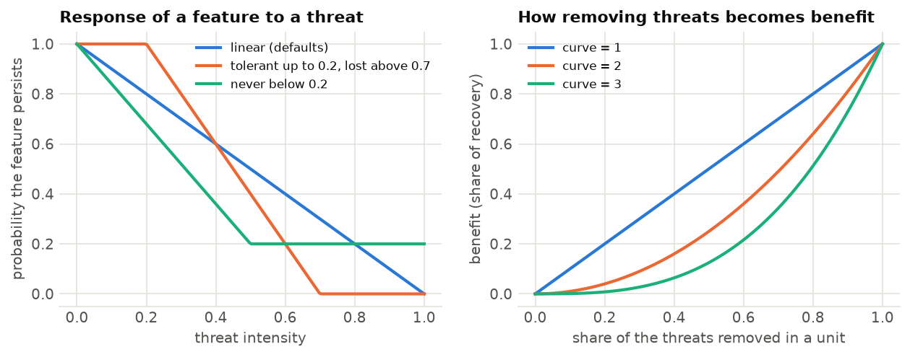

<p class="ls-chapter">Chapter 12.8</p>

# Management actions

Protecting land is one conservation action among many. In most landscapes biodiversity is lost to
**threats**: deforestation, fire, invasive species, overgrazing, pollution. Fighting a threat where it
harms the most species can achieve more than buying land where nothing threatens them. **Multi-action
planning** decides *which* action to take *where*: protect here, fight fire there, restore elsewhere, at the
least cost or with the most benefit (Cattarino et al. 2015; Salgado-Rojas et al. 2020).

!!! abstract "In this chapter"
    - threats, actions, sensitivity and benefit: the vocabulary of multi-action planning;
    - a multi-action plan for Serra Verde's deforestation and fire;
    - recovery and conservation targets, and maximizing benefit with a budget;
    - response curves: how features respond to threats and to their removal;
    - dependencies between places, such as along a river;
    - inputs as tables, for any planning units;
    - zones of management, and when to use zones, actions or restoration.

## From places to actions

The problems of the previous chapters choose *places*. A multi-action problem chooses *actions in places*:

| Ingredient | Meaning | In Serra Verde |
|---|---|---|
| **planning units** | the places, each with a cost of **monitoring** (managing it at all) | the 4825 cells, with the land cost |
| **features** | what should benefit | the eight species and habitats |
| **threats** | what harms the features, with an intensity in every unit | deforestation along roads and around cities; fire in a band across the west |
| **actions** | one per threat: removing it from a unit, at a cost | fighting deforestation (30 per cell) and fire (10 per cell) |
| **sensitivity** | which features each threat harms, and how much | by default every feature to every threat |

The benefit of a unit for a feature then has two parts (Salgado-Rojas et al. 2020):

- **conservation**: the feature's amount in a monitored unit that *no* threat harms. Being managed is enough
  to keep it;
- **recovery**: the amount that comes back when the threats that harm it are removed by actions.

Targets can be set for each: so much recovered, so much conserved.

!!! note "In plain words"
    Think of a doctor with a limited budget for a population of patients. Some are healthy and only need a
    check-up (conservation). Others are ill and need a specific treatment (an action against a threat).
    Treating the wrong illness, or treating patients who would recover anyway, wastes the budget.
    Multi-action planning matches treatments to patients.

## A plan against deforestation and fire

The threats of Serra Verde come with the example data. `actions_raster_data` turns rasters of costs,
features and threats into the inputs of a multi-action problem:

```python
import numpy as np
import pandas as pd
import landschaft as ls

P = ls.prioritize
cost = ls.load_raster(P.example_data("cost"))
features = ls.load_raster(P.example_data("features"))
threats = ls.load_raster(P.example_data("threats"))     # bands: deforestation, fire (intensity 0-1)

d = P.actions_raster_data(cost, features, threats, action_cost=[30, 10],
                          target_recovery=0.3, target_conservation=0.1)
print(d.n_units, "planning units,", d.n_actions, "possible actions")
```

Each unit where a threat occurs is a possible action. The targets ask for 30 % of each feature's *threatened*
amount to be recovered and 10 % of its *unthreatened* amount to be conserved. `minimizeCosts` meets them at
the least total cost of monitoring and actions:

```python
sol = d.problem("minimizeCosts").add_highs_solver(gap=0.01).solve()
print(sol.status, f"total cost {sol.objective:,.0f}")
sol.cost()                      # monitoring, then every threat's actions
```

```python
b = sol.benefit()
b["feature"] = [str(n) for n in features.band.values]
b.round(1)
```

<figure markdown>

<figcaption>Left and middle: the intensity of deforestation (along the highway and around the cities) and of
fire (a band across the west). Right: the plan. Fire is fought in large blocks of the western forests, where
it threatens the jaguar, the harpy eagle and the araucaria forest. Deforestation is fought along the coast
and around the cities, where it threatens the mangrove and the tamarin. A few cells (light green) are only
managed, to conserve features no threat harms there.</figcaption>
</figure>

`sol.maps()` returns the plan as rasters (a band for monitoring, one per threat), and `sol.action_summary()`
as a table of every unit's actions. `ls.plot(sol)` draws it.

### With a budget

When the money is fixed, `maximizeBenefits` finds the plan with the most total benefit within it:

```python
best = d.problem("maximizeBenefits", budget=20_000).add_highs_solver(gap=0.01).solve()
b = best.benefit()
b["feature"] = [str(n) for n in features.band.values]
b[["feature", "benefit.conservation", "benefit.recovery"]].round(1)
```

Like maximum utility ([chapter 12.4](optimization.md#budget-objectives)), maximizing total benefit favours
widespread features: here the tamarin and the mangrove get nothing, and the tapir almost nothing. Benefits are added up in each feature's
own units, so a widespread feature always offers more benefit per dollar. Targets (with `minimizeCosts`), or
features scaled to comparable totals, are the remedies.

## How features respond

How much does a feature suffer from a threat, and how much does it gain when the threat is removed? Two
curves answer it.

**Sensitivity.** A feature's probability of persisting falls as the intensity of a threat grows. The
`sensitivity` table (`feature`, `threat` and the four parameters `delta1` to `delta4`) shapes this
response. By default it is a straight line from full persistence with no threat to none at the strongest
threat. A feature can also tolerate a threat up to some intensity, or never be lost entirely.

**Curve.** How the removal of threats in a unit turns into benefit. With `curve=1`, benefit grows in
proportion to the share of the threats removed; with `curve=2` or `3`, half the threats removed gives a
quarter or an eighth of the benefit. Partial action is worth little, and the plan prefers to remove all the
threats from fewer units.

<figure markdown>

<figcaption>Left: three sensitivities of a feature to a threat, set by `delta1` to `delta4`: linear (the
default), tolerant up to an intensity of 0.2 and lost above 0.7, and never falling below 0.2. Right: the
benefit of removing a share of the threats from a unit, with `curve` 1, 2 and 3.</figcaption>
</figure>

```python
sens = pd.DataFrame({"feature": ["mangrove", "golden_lion_tamarin"], "threat": ["deforestation"] * 2,
                     "delta1": [0.0, 0.1], "delta2": [0.5, 0.6], "delta3": [0.0, 0.0], "delta4": [1.0, 1.0]})
d2 = P.actions_raster_data(cost, features, threats, action_cost=[30, 10], sensitivity=sens,
                           target_recovery=0.3, target_conservation=0.1)
s2 = d2.problem("minimizeCosts").add_highs_solver(gap=0.01).solve()
print(f"only the mangrove and the tamarin, and only to deforestation: {s2.objective:,.0f}")
```

When a sensitivity table is given, only its pairs count: here the mangrove and the tamarin are harmed by
deforestation, and the other features by nothing, so for them only conservation targets apply.

## Dependencies between places

In a river, what happens upstream reaches every place downstream. Managing a reach whose upstream reaches
are left degraded wastes money. `add_directional_dependencies` expresses this. Its `flow` table pairs each
unit (`target_pu`) with the unit it depends on (`source_pu`). Managing the target without its source then
either costs a penalty (soft) or is not allowed (`hard=True`):

<!-- no-run -->
```python
# every river cell depends on the river cell just upstream of it (higher elevation)
flow = pd.DataFrame({"source_pu": upstream_ids, "target_pu": downstream_ids})
plan = (d.problem("minimizeCosts")
          .add_directional_dependencies(flow, penalty=50)          # or hard=True
          .add_highs_solver(gap=0.01)
          .solve())
plan.dependency_penalty()                                         # what the plan pays for broken links
```

The same tool expresses any one-way dependence: a corridor that is useless unless its ends are managed, a
wetland that depends on its catchment, a restoration site that needs a seed source.

## Several good plans, and tables

Multi-action problems take the same portfolios as the others (`add_gap_portfolio`, `add_cuts_portfolio`,
... [chapter 12.6](tradeoffs.md#alternative-plans)), and `ls.plot` draws their frequency of every action.

`actions_raster_data` is for rasters. For properties, watersheds or any other units, `actions_data` takes
the tables of the R package prioriactions directly: planning units, features, their distribution, threats,
their distribution, sensitivity and boundary. Its results are identical to prioriactions', and much
faster on large problems: Landschaft solves a multi-action problem of 100 000 units to a 1 % gap in under a
second, where a general solver needs about a minute.

## Zones, actions or restoration

Three questions about *what to do where* look alike and lead to different models:

| | The question | Per planning unit | In Landschaft |
|---|---|---|---|
| **Zones** | which use does every place get? | one zone at most, exclusive | `problem({zone: cost}, ..., contribution=)` |
| **Actions** | which threats are fought where? | several actions, with monitoring | `actions_raster_data`, `actions_data` |
| **Restoration** | how much of every converted place to restore? | a share of the cell | `restoration_problem` |

**Zoning** is the oldest of them in practice: protected-area plans, marine spatial plans and land-use
zoning divide a region into zones with different rules, such as no-take, sustainable use or restoration
(Watts et al. 2009). Every zone has its own cost (often an opportunity cost that falls when some use goes
on) and its own worth for the features: a feature may count fully under strict protection, partly where
sustainable use goes on, and only by the habitat that comes back where land is restored. The targets are
then met by the sum over the zones, each zone's amounts counted by its contribution, and some targets may
ask for a zone of their own, such as a share of every feature under strict protection. The model is the
minimum set of chapter 12.4 with one decision per unit and zone and one row per unit that keeps it in one
zone at most: `add_mandatory_allocation_constraints` makes it exactly one, for plans that zone a whole region.

```python
import numpy as np
import landschaft as ls

P = ls.prioritize
cost = ls.load_raster(P.example_data("cost"))
features = ls.load_raster(P.example_data("features"))
pz = (P.problem({"protect": cost, "use": cost * 0.45}, features, contribution={"use": 0.5})
        .add_min_set_objective()
        .add_relative_targets(0.3)
        .add_relative_targets(0.1, zone="protect"))
zplan = pz.solve()

# by hand: every unit in one zone at most, and the plan's cost is the sum of its units' costs in their zones
v = zplan.values                                   # units x zones
c = np.stack([cost.values.ravel()[pz.units.index], 0.45 * cost.values.ravel()[pz.units.index]], axis=1)
bool(v.sum(axis=1).max() <= 1), round(float((v * c).sum()), 2) == round(zplan.cost, 2)
```

Boundary penalties keep each zone compact; a matrix of zones says how much the edge between two zones
costs, and the neighbour and contiguity constraints of chapter 12.5 take one as well. Zones are an
exclusive choice per unit; actions against threats are not (a unit may be monitored, burnt less and
weeded at once), and restoration decides a share of every cell, its benefit growing with the habitat it
gives back. When a plan mixes them, the zones' contributions can come from the other two: the restoration
zone of the [tutorial](../../tutorials/conservation-plans.md#zones-of-management) counts the share of every
cell that is pasture or cropland, the land `restoration_problem` would restore.

!!! success "Key points"
    - Zoning gives every unit at most one zone, each with its own cost and contribution to the features.
    - Targets are summed over the zones by default; a target of a zone asks for that zone alone.
    - Multi-action planning decides which action to take where: monitoring, and actions against threats.
    - Benefit comes from conservation (managed, unthreatened) and recovery (threats removed).
    - Sensitivity says how features suffer from threats; the curve how removing threats becomes benefit.
    - Like maximum utility, maximizing total benefit favours widespread features; targets balance them.
    - Directional dependencies link places that depend on one another, such as reaches of a river.

## Check your understanding

1. In Serra Verde, fire is fought in the west and deforestation near the coast. Why not everywhere?
2. What does `curve=3` change in a plan, and when is it realistic?
3. A feature is harmed by no threat in a unit. Can the unit still contribute to the feature's targets?

??? success "Answers"
    1. Each action costs money and only pays where the threat occurs and harms features that need
       recovery. Fire threatens the mountain species in the west; deforestation threatens the coastal
       ones. Acting elsewhere would cost without helping the targets.
    2. With a cubic curve, removing part of the threats in a unit gives little benefit. The plan then
       removes all of them from fewer units. It is realistic when a threat must be fully removed to make a
       difference, as with an invasive predator that recolonizes from any remaining individuals.
    3. Yes, through conservation: if the unit is monitored, the feature's amount there counts towards its
       conservation target.

## References

<div class="ls-refs" markdown>

- Carwardine, J., O'Connor, T., Legge, S., Mackey, B., Possingham, H. P., & Martin, T. G. (2012). Prioritizing threat management for biodiversity conservation. *Conservation Letters*, 5(3), 196–204.
- Cattarino, L., Hermoso, V., Carwardine, J., Kennard, M. J., & Linke, S. (2015). Multi-action planning for threat management: a novel approach for the spatial prioritization of conservation actions. *PLoS ONE*, 10(5), e0128027.
- Hermoso, V., Linke, S., Prenda, J., & Possingham, H. P. (2011). Addressing longitudinal connectivity in the systematic conservation planning of fresh waters. *Freshwater Biology*, 56(1), 57–70.
- Salgado-Rojas, J., Álvarez-Miranda, E., Hermoso, V., Garcia-Gonzalo, J., & Weintraub, A. (2020). A mixed integer programming approach for multi-action planning for threat management. *Ecological Modelling*, 418, 108901.
- Watts, M. E., Ball, I. R., Stewart, R. S., Klein, C. J., Wilson, K., Steinback, C., Lourival, R., Kircher, L., & Possingham, H. P. (2009). Marxan with Zones: software for optimal conservation based land- and sea-use zoning. *Environmental Modelling & Software*, 24(12), 1513–1521.
- Wilson, K. A., Underwood, E. C., Morrison, S. A., Klausmeyer, K. R., Murdoch, W. W., Reyers, B., et al. (2007). Conserving biodiversity efficiently: what to do, where, and when. *PLoS Biology*, 5(9), e223.

</div>
