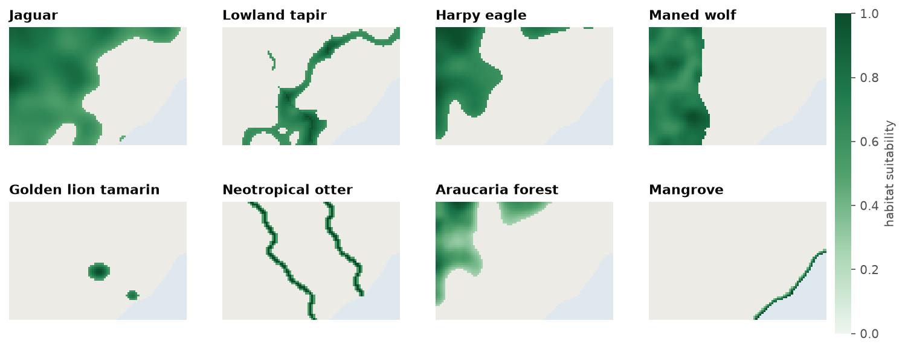

<p class="ls-chapter">Chapter 12.2</p>

# Key concepts

Every prioritization, from a small watershed to a continent, is built from the same handful of
ingredients. Once they are clear, any planning problem can be read as a list of answers to five
questions, and any script of `ls.prioritize` as the same list written in code.

!!! abstract "In this chapter"
    - planning units, features, costs, targets and decisions;
    - Serra Verde, the example region used in this part of the course;
    - how a problem is written with `ls.prioritize`, one ingredient at a time.

| Ingredient | The question it answers | In `ls.prioritize` |
|---|---|---|
| **Planning units** | Into which pieces is the landscape divided? | the cells of the cost raster, polygons, H3 cells or table rows |
| **Features** | What should be conserved? | one raster (or column) per species, habitat or service |
| **Cost** | What does it take to conserve each piece? | the values of the cost raster or column |
| **Targets** | How much of each feature is enough? | `add_relative_targets`, `add_absolute_targets`, `add_manual_targets`, ... |
| **Decisions** | What can be done with each piece? | `add_binary_decisions`, `add_proportion_decisions`, ... |

## Serra Verde

The examples of these chapters use **Serra Verde**, an imaginary coastal region that ships with
Landschaft (`ls.prioritize.example_data`). It is synthetic, but built to behave like real
planning data: mountains in the north-west where land is cheap, a coastal plain with three cities,
a highway and two rivers where land is dear, eight features from widespread to very rare, three
protected areas, maps of habitat condition, carbon and two threats.

```python
import numpy as np
import landschaft as ls

P = ls.prioritize
cost = ls.load_raster(P.example_data("cost"))
features = ls.load_raster(P.example_data("features"))
print(cost.shape, "cells;", int(np.isfinite(cost.values).sum()), "planning units")
[str(b) for b in features.band.values]
```

<figure markdown>

<figcaption>Serra Verde: 60 x 90 cells of 1 km. The ocean (south-east) has no cost and is not part of the
problem, which leaves 4825 planning units. Land costs from 25 to 256 thousand USD per km²: cheap in the
mountains, dear around the cities and along the roads.</figcaption>
</figure>

## Planning units

To decide *where*, the landscape is first cut into pieces. Each piece is a **planning unit**: the
smallest area that can be selected or not. Planning units can be grid cells, properties,
watersheds, municipalities or hexagons. In `ls.prioritize` they are:

- the **cells of a raster** with a cost (cells without a value, NaN, are not planning units: the
  ocean of Serra Verde);
- **polygons** of a vector layer (`problem(polygons, features, cost_column="cost")`): the amounts of
  the features in every polygon are computed exactly from the rasters, cell fractions included;
- **H3 hexagons** (`h3_units`), an equal-area grid that suits regional and global problems;
- the **rows of a table**, when the amounts are already known per unit.

The size of the units is a trade-off ([chapter 2](../scale.md) discusses grain in general):

- **smaller units** describe the landscape more precisely, but make the problem larger, and may give
  plans too detailed to implement;
- **larger units** are faster and closer to how land is managed (a property, a watershed), but mix
  good and poor areas in the same unit.

!!! tip "Rule of thumb"
    Use the resolution at which decisions will be implemented, and no finer than the resolution of
    the biodiversity data. National plans often use cells of 1 to 10 km; municipal plans 100 m to
    1 km. [Chapter 12.9](together.md#large-problems) shows how to solve a fine problem on coarser
    blocks when it is too large.

## Features

**Features** are what the plan should conserve:

- **species**: the modelled distribution or habitat suitability of a jaguar, a tree, a frog
  ([chapter 13](../sdm.md) explains how such maps are made);
- **ecosystems and habitats**: mangroves, grasslands, old-growth forest;
- **ecosystem services**: carbon, water provision, pollination;
- anything with a spatial **amount**: cultural sites, spawning grounds, climate refugia.

Each feature is a map in which every planning unit holds an amount: presence (1) or absence (0), a
probability or suitability between 0 and 1, a number of individuals, tonnes of carbon.

<figure markdown>

<figcaption>Habitat suitability of the eight features. The jaguar and the maned wolf are widespread; the
golden lion tamarin lives in two small lowland forest fragments and the mangrove in a thin coastal strip.
Rare features have few places where they can be conserved, and they usually drive the shape of a plan.</figcaption>
</figure>

## Cost

Conservation is never free. The **cost** of a planning unit says what it takes to include it:

- **acquisition**: the price of the land;
- **opportunity cost**: the income lost by not farming, logging or fishing there (Naidoo et al.
  2006);
- **management**: patrols, fences, restoration, every year;
- **area**: with no cost data, the area of each unit (a constant for a grid) makes the plan as small
  as possible.

Cost is what makes the problem interesting. Without it, the best plan would be to protect
everything; with it, the question becomes which places give the most for what they cost.

!!! warning "Cost and missing values"
    The cost raster also says **which cells are planning units**: cells without a value are left
    out. A cost of **zero** is a valid planning unit that costs nothing, and the solver will happily
    select it. Use missing values for "not part of the problem", and zero only for "free".

## Targets

A **target** says how much of each feature is enough:

- **relative**: a share of the feature's total amount, `0.3` for 30 %;
- **absolute**: an amount in the units of the feature, 500 km² of habitat, 2 million tonnes of
  carbon;
- **manual**: per feature, with a sense (`>=`, `<=` or `=`), for instance at most a given amount of
  an invasive species;
- **log-linear**: a share that falls as the feature's range grows (Rodrigues et al. 2004): high for
  rare species, low for widespread ones;
- **sub-regional**: a target inside every region, for instance 30 % of each species in each state.

```python
p = P.problem(cost, features)
p.add_relative_targets(0.3)                                           # 30 % of every feature
p.add_relative_targets([0.3, 0.3, 0.3, 0.3, 0.6, 0.3, 0.3, 0.6])      # more of the rare ones
p.add_loglinear_targets(10, 0.9, 2000, 0.2)                           # 90 % up to a total of 10, 20 % from 2000
```

Where do targets come from? From policy (protecting 30 % of land and sea by 2030, Target 3 of the
Kunming-Montreal Global Biodiversity Framework), from ecology (the area a viable population needs),
or from the people involved. [Chapter 12.4](optimization.md) shows how the choice changes the plan
and its price.

## Decisions

What can be done with each planning unit? The **decision type** says it:

- **binary** (`add_binary_decisions`): a unit is selected (1) or not (0), the usual case for
  reserves;
- **proportion** (`add_proportion_decisions`): any share of a unit, for instance "restore 40 % of
  this cell", when units are large and actions can apply to part of them;
- **semi-continuous** (`add_semicontinuous_decisions`): any share up to a limit.

Existing reserves and places that cannot be used enter as **locked** units:
`add_locked_in_constraints` (always selected) and `add_locked_out_constraints` (never). When the
decision is not "in or out" but *which action against which threat*, the problem becomes a
[multi-action plan](actions.md).

## Putting it together

A problem is written by adding ingredients, one method each, all starting with `add_`. Every method
returns a new problem and leaves the old one untouched, so variants (other targets, other costs) are
cheap to make and compare, and the order of the calls does not matter:

```python
protected = ls.load_raster(P.example_data("protected"))
p = (P.problem(cost, features)
       .add_min_set_objective()              # the objective: next chapters
       .add_relative_targets(0.3)            # targets
       .add_locked_in_constraints(protected) # what is already protected
       .add_binary_decisions())              # decisions
sol = p.solve()
sol.status, round(sol.cost), int(sol.values.sum())
```

```python
sol.coverage[["feature", "relative_target", "relative_held", "met"]].round(3)
```

The **coverage** table is the first thing to read after any solve: for every target, how much the
plan holds and whether it is met. The one ingredient not discussed yet is the **objective**:
whether to meet every target at the least cost, or to do the most with a fixed budget. That is the
subject of [chapter 12.4](optimization.md); before it, [chapter 12.3](ranking.md) shows the other
great family of methods, which does without targets at all.

!!! success "Key points"
    - Planning units, features, costs, targets and decisions are the five answers every plan needs.
    - Missing cost values leave cells out of the problem; zero costs make them free.
    - Targets can be relative, absolute, per feature, log-linear or per region.
    - A problem is built by adding ingredients; each addition gives a new problem.

## References

<div class="ls-refs" markdown>

- Naidoo, R., Balmford, A., Ferraro, P. J., Polasky, S., Ricketts, T. H., & Rouget, M. (2006). Integrating economic costs into conservation planning. *Trends in Ecology & Evolution*, 21(12), 681–687.
- Rodrigues, A. S. L., Akçakaya, H. R., Andelman, S. J., Bakarr, M. I., Boitani, L., Brooks, T. M., et al. (2004). Global gap analysis: priority regions for expanding the global protected-area network. *BioScience*, 54(12), 1092–1100.

</div>
