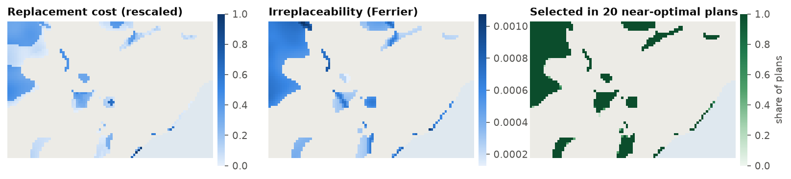

<p class="ls-chapter">Chapter 12.7</p>

# Evaluating a plan

A solution is not the end of an analysis. It is a proposal to check: does it meet the targets, by how much,
at what cost, in what shape? Which of its places are essential, and which could be swapped for others?
This chapter covers the evaluation tools of `ls.prioritize`. All of them work on any plan, whether it came
from the solver, from Zonation, or was drawn by hand in a workshop.

!!! abstract "In this chapter"
    - the summaries to read after every solve: units, cost, boundary, representation, targets;
    - importance: replacement cost, irreplaceability, rarity-weighted richness, rank importance and
      selection frequency;
    - the shape of a plan with landscape metrics and MSPA;
    - extinction risk;
    - a complete report, as a web page.

## The first look

Every evaluation function takes the problem and a solution, and returns a table:

```python
import numpy as np
import pandas as pd
import landschaft as ls

P = ls.prioritize
cost = ls.load_raster(P.example_data("cost"))
features = ls.load_raster(P.example_data("features"))
p = (P.problem(cost, features).add_min_set_objective().add_relative_targets(0.3)
       .add_binary_decisions().add_highs_solver(gap=0.001))
sol = p.solve()

pd.concat([P.eval_n_summary(p, sol), P.eval_cost_summary(p, sol)["cost"],
           P.eval_boundary_summary(p, sol)["boundary"]], axis=1)
```

```python
P.eval_target_coverage_summary(p, sol)[["feature", "met", "relative_target", "relative_held",
                                        "relative_shortfall"]].round(3)
```

The **target coverage** says, for every target, whether it is met and by how much. With a minimum set every
target is met, and most only just: the solver buys no more than needed. A feature well above its target
(here the araucaria forest, at 60 % for a target of 30 %, and the harpy eagle, at 44 %) comes "for free" with
the others. It lives where the plan must go anyway.

`eval_feature_representation_summary` gives the same for every feature, with or without targets, which is
what you need to compare plans made with different objectives. The figures of
[chapter 12.1](../prioritization.md#the-experiment-hotspots-against-a-plan) and
[12.4](optimization.md#budget-objectives) are bar charts of it.

!!! tip "Evaluate any plan"
    The `solution` argument can be a `Solution`, a raster of 0/1 (or shares) on the planning units' grid,
    a table with a `solution` column, or an array. A park agency's own proposal, a plan from another tool or
    the existing reserves can all be evaluated against the same problem:
    `P.eval_target_coverage_summary(p, protected)` is a **gap analysis**.

## Which places matter most?

A plan of 800 cells is a long list. Stakeholders ask which cells are essential and which could be swapped:
**importance** scores rank the selected units. They answer slightly different questions:

| Measure | Question | Cost |
|---|---|---|
| `eval_replacement_importance` (Cabeza & Moilanen 2006) | how much dearer does the plan get if this unit is lost and the rest re-optimized? | one solve per selected unit |
| `eval_ferrier_importance` (Ferrier et al. 2000) | how likely is this unit to be needed to meet the targets, over all plans of the same size? | instant |
| `eval_rare_richness_importance` (Albuquerque & Beier 2015) | how much rare biodiversity does this unit hold? | instant |
| `eval_rank_importance` (Jung et al. 2021) | how early does this unit enter the plan as the budget grows? | a few solves |
| portfolio selection frequency ([12.6](tradeoffs.md#alternative-plans)) | in how many near-optimal plans does this unit appear? | one portfolio |

```python
rc = P.eval_replacement_importance(p, sol)            # rescaled from 0.01 to 1
fe = P.eval_ferrier_importance(p, sol)                 # one band per feature, plus "total"
rw = P.eval_rare_richness_importance(p, sol)
port = p.add_highs_solver(gap=0.01).add_gap_portfolio(20, pool_gap=0.02).solve()

sel = sol.selection.values > 0.5
scores = pd.DataFrame({"replacement": rc.values[sel], "ferrier": fe.sel(band="total").values[sel],
                       "rarity": rw.values[sel], "frequency": port.frequency.values[sel]})
scores.corr(method="spearman").round(2)
```

<figure markdown>

<figcaption>Three views of the importance of the cells of Serra Verde's 30 % plan. Replacement cost (left)
and Ferrier's irreplaceability (middle) are highest in the tamarin's lowland fragments and the mangrove,
which have no substitutes. Right: in 20 plans within 2 % of the optimum, most cells are always selected,
while a few cells in the mountains swap places from one plan to the next.</figcaption>
</figure>

!!! note "In plain words"
    **Replacement cost** is the price of losing a cell: if a landowner refuses, how much more will the rest
    of the plan cost? **Irreplaceability** is the chance the cell is needed: if it holds the only habitat
    left of a species, it is needed in every plan. **Selection frequency** is a vote among good plans. The
    three usually agree on the essential cells and disagree on the ordinary ones, which is fine: the
    ordinary ones are, by definition, interchangeable.

In Serra Verde, Ferrier's irreplaceability and rarity-weighted richness rank the cells much alike (a
Spearman correlation of 0.86), and replacement cost agrees with them moderately (0.55). Selection frequency
agrees with none of them, and for a simple reason: 794 cells are in all 20 near-optimal plans and only 20
cells vary, so it separates a handful of interchangeable cells from the rest. It is most informative when the
portfolio is wider (a larger `pool_gap`) or the problem has many near-ties.

Replacement cost is the most direct, and the slowest: it solves the problem again for every selected unit
(in parallel, with the solution as a starting point). Use a small gap, since a gap of 1 % on a 37 million
plan is 370 thousand USD of noise, more than the replacement cost of most cells. Ferrier's and rarity
scores are instant and work on any plan.

## The shape of a plan

A plan is also a landscape: a map of selected and unselected cells. The tools of
[chapter 5](../metrics.md) and [chapter 4](../morphology.md) describe its shape:

```python
lm = P.eval_landscape_metrics(sol, metric=["np", "area", "enn"])     # families, as in landscapemetrics
lm[["metric", "value"]].round(1)
```

```python
mspa, areas = P.eval_mspa(sol)
areas
```

The number of patches (`np`), their areas and the distance from each to the nearest other patch (`enn`) say
how fragmented the plan is: here 17 patches. MSPA says how much of it is **core** (far from any edge): 59 %
of the plan, with 27 % edge and 6 % islets, cells too small to have a core. Comparing plans with and without a boundary penalty
([chapter 12.5](spatial.md)) with these measures shows what compactness bought.

## Extinction risk

Targets say whether a plan reaches a threshold. The species-area relationship ([chapter
12.4](optimization.md#extinction-risk-instead-of-targets)) says what a plan is worth for persistence: the
risk 1 − (held / total)<sup>z</sup> of every feature, and their sum, the expected number of features lost
if all habitat outside the plan disappeared.

```python
P.eval_extinction_risk(p, sol).round(3)
```

It is a coarse model. Real responses to habitat loss vary between species and depend on configuration, not
only area. Use it to compare plans, not to predict extinctions.

## A complete report

`report` runs the usual evaluations at once (summary, representation, targets, importance, optionally the
extinction risk and a comparison with Zonation) and `ls.plot` turns them into a web page with maps, charts
and tables, to send to colleagues or stakeholders:

```python
r = P.report(p, sol, extinction_z=0.25)
page = ls.plot(r, show=False).save("serra_verde_report.html")
```

`ls.plot` also draws any solution, portfolio or trade-off on its own: `ls.plot(sol)` opens an interactive
map, `ls.plot(port)` the selection frequency, `ls.plot(cal)` the calibration curve.

## A checklist

Before presenting a plan, check:

1. **status and gap**: `"optimal"` and a small gap, or a reason why not;
2. **targets**: all met, and which ones are far above their target (and why);
3. **cost**: in the units of the cost layer, with the penalty terms reported apart from it;
4. **shape**: the number and size of patches, and whether isolated cells make sense on the ground;
5. **importance**: the essential places, and the flexible ones;
6. **alternatives**: a portfolio or scenarios, to show that other choices exist;
7. **data**: the features and costs that drive the result, and how certain they are.

!!! success "Key points"
    - Read the target coverage after every solve; features far above target come "for free".
    - The evaluation functions work on any plan: solutions, existing reserves, hand-drawn proposals.
    - Replacement cost, irreplaceability and selection frequency agree on essential places and disagree
      on interchangeable ones.
    - Landscape metrics and MSPA describe a plan's shape; extinction risk its value for persistence.
    - `report` and `ls.plot` package all of it for others.

## Check your understanding

1. A cell has a replacement cost of zero. What does this mean?
2. Why use a small gap when computing replacement costs?
3. How would you do a gap analysis of Serra Verde's existing protected areas?

??? success "Answers"
    1. Without it, the solver finds another plan of the same cost: an equally good substitute exists.
    2. Each replacement cost is the difference between two optimized costs. If each is only known to within
       1 %, the difference is mostly noise for cells whose real replacement cost is small.
    3. Load the protected areas as a raster (`P.example_data("protected")`) and evaluate it as a solution:
       `P.eval_target_coverage_summary(p, protected)` gives how much of every target they already meet.

## References

<div class="ls-refs" markdown>

- Albuquerque, F., & Beier, P. (2015). Rarity-weighted richness: a simple and reliable alternative to integer programming and heuristic algorithms for minimum set and maximum coverage problems in conservation planning. *PLoS ONE*, 10(3), e0119905.
- Baisero, D., Schuster, R., & Plumptre, A. J. (2022). Redefining and mapping global irreplaceability. *Conservation Biology*, 36(2), e13806.
- Cabeza, M., & Moilanen, A. (2006). Replacement cost: a practical measure of site value for cost-effective reserve planning. *Biological Conservation*, 132(3), 336–342.
- Ferrier, S., Pressey, R. L., & Barrett, T. W. (2000). A new predictor of the irreplaceability of areas for achieving a conservation goal, its application to real-world planning, and a research agenda for further refinement. *Biological Conservation*, 93(3), 303–325.
- Jung, M., Arnell, A., de Lamo, X., García-Rangel, S., Lewis, M., Mark, J., et al. (2021). Areas of global importance for conserving terrestrial biodiversity, carbon and water. *Nature Ecology & Evolution*, 5, 1499–1509.
- Soille, P., & Vogt, P. (2009). Morphological segmentation of binary patterns. *Pattern Recognition Letters*, 30(4), 456–459.

</div>
