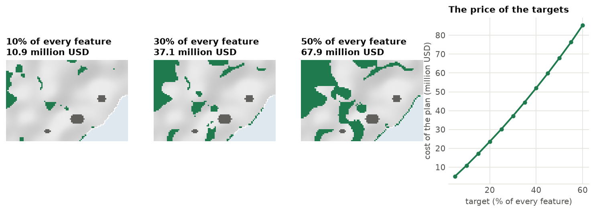
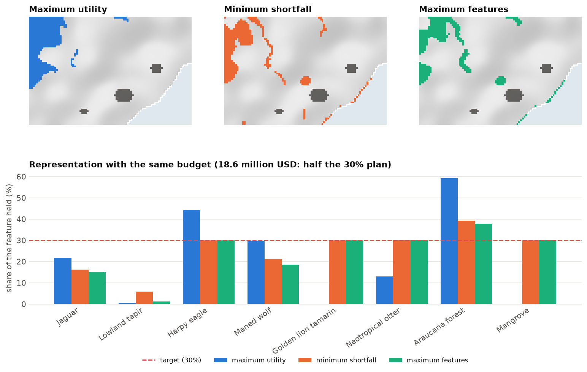
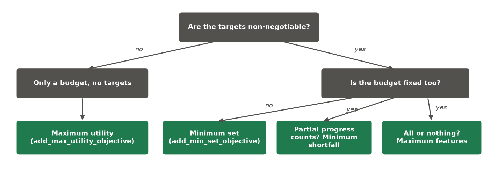
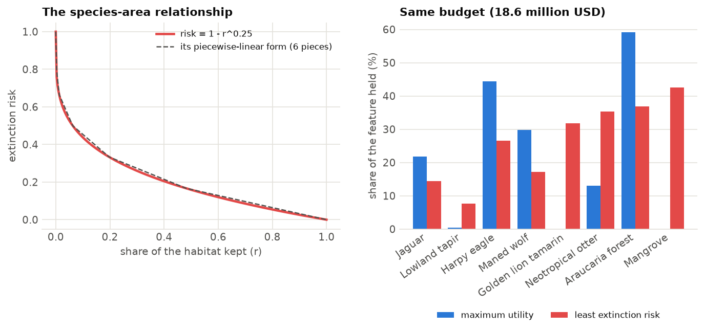
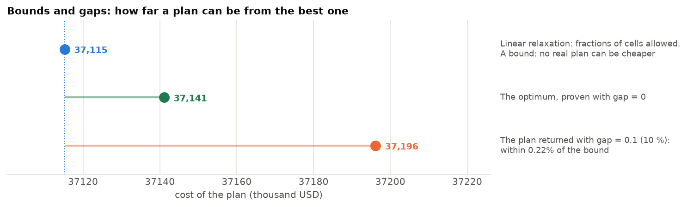
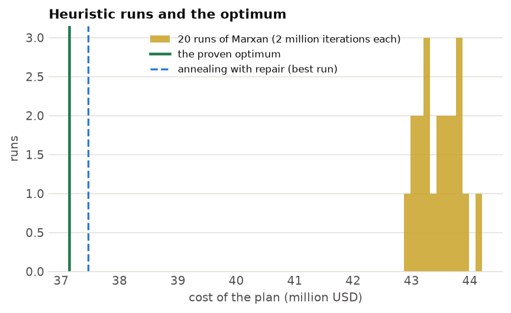

<p class="ls-chapter">Chapter 12.4</p>

# Optimization

The objective is the question you ask. Two planners with the same data but different objectives get different
maps, and both can be right. This chapter shows how to choose the question, how targets and budgets change
the answer, and what happens inside the solver that finds it, without needing the mathematics.

!!! abstract "In this chapter"
    - the two ways to frame a question: targets or a budget;
    - the minimum-set problem and the price of targets;
    - the budget objectives (utility, shortfall, features, extinction risk) and how to choose one;
    - what a solver does, what an optimality gap means, and how to read a solution;
    - exact methods against heuristics such as simulated annealing;
    - the equations, for those who want them.

## Two ways to frame the question

Almost every conservation question belongs to one of two families.

=== "I know what I need (targets)"

    *"We must protect 30 % of every ecosystem. What is the cheapest way?"*

    You fix the **targets**, and the solver minimizes the **cost**. This is the **minimum-set** problem,
    the classic question of systematic conservation planning.

    <!-- no-run -->
    ```python
    p.add_min_set_objective().add_relative_targets(0.3)
    ```

=== "I know what I have (a budget)"

    *"We have 20 million dollars. What is the best we can do with it?"*

    You fix the **budget**, and the solver maximizes the **benefit**. There are several ways to define
    benefit, which is why there are several budget objectives.

    <!-- no-run -->
    ```python
    p.add_max_utility_objective(20_000)        # costs in thousand USD
    ```

## The minimum set

The minimum-set objective finds the cheapest set of planning units that meets **every** target. It is the
right choice when targets are not negotiable: when they come from law or from an international commitment.

The price of this certainty is that you do not control the cost. It is whatever the targets require:

```python
import numpy as np
import landschaft as ls

P = ls.prioritize
cost = ls.load_raster(P.example_data("cost"))
features = ls.load_raster(P.example_data("features"))
base = P.problem(cost, features).add_min_set_objective().add_binary_decisions()

for t in (0.1, 0.3, 0.5):
    s = base.add_relative_targets(t).solve()
    print(f"{t:.0%} of every feature: {int(s.values.sum())} cells, {s.cost / 1000:.1f} million USD")
```

<figure markdown>

<figcaption>Minimum-set plans for Serra Verde with targets of 10 %, 30 % and 50 % of every feature. The cost
rises faster than the target: 10.9, 37.1 and 67.9 million USD. Tripling the target from 10 % to 30 % more than
triples the cost, because the cheapest places are used first and every further step must buy dearer
land.</figcaption>
</figure>

If the targets cannot be met (say, 60 % of a species whose habitat is half inside cities that were locked
out), the problem has no solution, and the solve reports `status == "infeasible"`. Check the feature totals
and the locked-out units before raising targets.

## Budget objectives

When the money is fixed, you must say what "doing the most" means. `ls.prioritize` offers the objectives of
prioritizr (Hanson et al. 2025) and one of its own:

| Objective | What it optimizes within the budget | Good for |
|---|---|---|
| `add_max_utility_objective` | the total amount of all features held (weighted) | the most biodiversity per dollar overall; no targets |
| `add_min_shortfall_objective` | the sum of the shortfalls, each as a share of its target | progress on every feature at once |
| `add_min_largest_shortfall_objective` | the largest shortfall of any single feature | leaving no feature far behind |
| `add_max_features_objective` | the number of targets fully met (weighted) | securing as many features as possible completely ("triage") |
| `add_max_cover_objective` | the number of features held at all, any amount above zero | a first presence of every feature; no targets |
| `add_max_phylo_div_objective` | the evolutionary history (branch length of a phylogeny) with targets met | the tree of life, not just species counts (Faith 1992) |
| `add_max_phylo_end_objective` | the same, weighting branches by how restricted they are | phylogenetic endemism (Rosauer et al. 2009) |
| `add_min_extinction_risk_objective` | the expected loss of species from the species-area relationship | persistence without arbitrary targets |

Here are three of them spending **the same budget**, half of what the 30 % minimum set costs:

```python
budget = 0.5 * base.add_relative_targets(0.3).solve().cost
with_targets = P.problem(cost, features).add_relative_targets(0.3).add_binary_decisions()
plans = {
    "max utility": P.problem(cost, features).add_max_utility_objective(budget).add_binary_decisions(),
    "min shortfall": with_targets.add_min_shortfall_objective(budget),
    "max features": with_targets.add_max_features_objective(budget),
}
for name, q in plans.items():
    s = q.add_highs_solver(gap=0.005).solve()
    held = P.eval_feature_representation_summary(base.add_relative_targets(0.3), s)["relative_held"]
    print(f"{name:13s} targets met: {int((held >= 0.3 - 1e-6).sum())} of 8;  held: {held.round(2).tolist()}")
```

<figure markdown>

<figcaption>Maximum utility piles up the most total habitat, but in the cheap mountains: it leaves the tamarin
and the mangrove with nothing and the tapir with almost nothing. Minimum shortfall and maximum features use
the targets to spread the money. They secure the rare features (tamarin, otter, mangrove), the harpy
eagle and the araucaria forest, five targets of eight, and share what is left among the widespread
ones.</figcaption>
</figure>

A few lessons from this comparison:

- **Maximum utility favours widespread, cheap features.** Without weights, a km² of common habitat counts as
  much as a km² of a rare one. Feature weights (`add_feature_weights`) correct this, or the totals of every
  feature can be scaled to one before solving.
- **Minimum shortfall measures gaps as shares of each target**, so a small gap for a rare species counts as
  much as a large gap for a common one. With targets, it is a balanced default.
- **Maximum features is all or nothing** for each feature. It suits cases where partial protection has
  little value (a population 80 % protected may still collapse), but it abandons the features it cannot fully
  secure.

### Choosing an objective

<figure markdown>

<figcaption>A decision tree for the objective. When not sure, do not pick one budget: draw the whole curve
between money and targets (a Pareto front, chapter 12.6). It is often the most useful figure for decision
makers.</figcaption>
</figure>

### Extinction risk instead of targets

Targets are thresholds: 29 % of a species' habitat counts for nothing if the target is 30 %. Ecology suggests
something smoother. By the **species-area relationship**, the share of species, or of a population's
persistence, that a habitat keeps grows as a power of its area, S ∝ A<sup>z</sup> with z near 0.25 (Pereira
& Daily 2006). The risk of losing a feature when a share r of its habitat is kept is then 1 − r<sup>z</sup>.
The first losses cost little; the last ones cost much.

`add_min_extinction_risk_objective(budget, z=0.25)` minimizes the sum of these risks over the features.
The curve enters the model as a few straight segments, which keeps it exact at their ends and fast to solve.

```python
risk = P.problem(cost, features).add_min_extinction_risk_objective(budget).add_binary_decisions()
s = risk.add_highs_solver(gap=0.005).solve()
P.eval_extinction_risk(base.add_relative_targets(0.3), s).round(3).tail(3)
```

<figure markdown>

<figcaption>Left: the extinction risk 1 − r<sup>0.25</sup> as the share r of habitat kept grows, and its
piecewise-linear form. The steep start means losing the last fragments of a species is very costly. Right:
with the same budget, minimizing risk spreads the habitat across all eight features, while maximum utility
concentrates it on a few. The expected number of features lost, the sum of the risks, falls from 4.0 to
2.4.</figcaption>
</figure>

## Inside the solver

### A problem too large to try every answer

Serra Verde has 4825 planning units. Each can be in or out of the plan, so there are 2<sup>4825</sup>
possible plans, a number with 1453 digits. Trying them all is impossible, even on every computer on Earth
for the age of the universe. Yet the solve above takes a fraction of a second. How?

`ls.prioritize` writes the problem as a **mixed integer linear program** (MILP):

- one **variable** per planning unit, x<sub>i</sub> = 1 if it is selected and 0 if not;
- an **objective**: the total cost Σ c<sub>i</sub> x<sub>i</sub>, to minimize;
- **constraints**: for every feature j, the amount held Σ r<sub>ij</sub> x<sub>i</sub> must reach its
  target T<sub>j</sub>.

```python
model = base.add_relative_targets(0.3).compile()
model                               # rows: one per target; columns: one per planning unit
```

A **solver** is a program, built over decades for airline schedules and supply chains, that searches such
models cleverly. `ls.prioritize` translates the conservation problem into the solver's language and the
answer back into maps; you never deal with the solver directly.

!!! note "In plain words"
    Imagine first allowing *fractions* of cells: 0.3 of this one, 0.7 of that one. This relaxed problem is
    easy to solve exactly, and its cost is a **bound**: no real plan can be cheaper. Then the solver
    **branches**. It picks a cell with a fraction and tries two sub-problems, one with that cell fully in and
    one with it fully out. Any branch whose bound is already worse than the best plan found so far is
    discarded, along with the billions of plans beneath it. This is **branch and bound**.

### The optimality gap

At any moment the solver knows two numbers: the cost of the **best plan found** and a **bound** that no plan
can beat. Their relative difference is the **optimality gap**. A gap of 0.01 is a proof: *this plan costs at
most 1 % more than the best possible one*. When the gap reaches the value you asked for, the solver stops.

```python
exact = base.add_relative_targets(0.3).add_highs_solver(gap=0.001).solve()
loose = base.add_relative_targets(0.3).add_highs_solver(gap=0.1).solve()
print(f"gap 0.1%: cost {exact.cost:,.0f}  bound {exact.bound:,.0f}  gap {exact.gap:.3%}")
print(f"gap 10%:  cost {loose.cost:,.0f}  bound {loose.bound:,.0f}  gap {loose.gap:.2%}")
```

Asked for 0.1 %, the solver returns a plan within 0.01 % of the bound in under a second. Closing the gap
completely (`gap=0`) proves that the optimum is 37,141, but takes about 40 seconds: the last fraction of a
percent is usually the slowest part of the proof, and rarely worth it.

<figure markdown>

<figcaption>The linear relaxation (fractions of cells allowed) gives a bound below every real plan. The
optimum lies between it and any plan found. A plan solved to a 10 % gap carries its own proven bound: the
optimum cannot be below it. In practice the plans found are often much closer to the optimum than the gap
guarantees.</figcaption>
</figure>

The default gap is 10 %, as in prioritizr: generous, but the plan found is usually much closer (the first
plan of this chapter came within 0.2 %). For exploration, 1 to 5 % is plenty and much faster on hard problems;
for a final plan, ask for a small gap with `add_highs_solver(gap=...)` and report it. The `status` of a solution says how the solve
ended: `"optimal"` (the gap asked for was reached), `"time_limit"`, `"infeasible"`.

### Solvers in `ls.prioritize`

| Solver | Method | When |
|---|---|---|
| `add_highs_solver` (default) | exact (MILP), open source, built in | almost always |
| `add_gurobi_solver` | exact (MILP), commercial, needs a licence | very large or hard models, if you have it |
| `add_anneal_solver` | simulated annealing, as in Marxan | Marxan comparisons; penalties on huge maps |

Behind HiGHS, Landschaft adds engines of its own for the problems that general solvers find hard: covering
problems with millions of units, boundary and connectivity penalties, multi-action plans. They start the
solver from a near-optimal plan and fix the units whose choice is already proven, so the same models solve
in seconds instead of hours. You do not choose them: they run when they apply, and the gap and status keep
their meaning.

## Exact methods and heuristics

There are two families of methods for finding good sets of areas:

| | Heuristics (simulated annealing, greedy) | Exact optimization (MILP) |
|---|---|---|
| **How it works** | starts from a random or partial plan and improves it step by step | formulates the problem mathematically and solves it with branch and bound |
| **Quality** | no guarantee: the answer can be far from the best, and you cannot tell how far | a proven gap: "at most 1 % dearer than the best possible plan" |
| **Repeatability** | different runs give different answers | the same input gives the same answer |
| **Speed** | fast, even on huge problems | very fast on most problems; some spatial rules are slow |

Marxan (Ball et al. 2009) made **simulated annealing** the standard tool of conservation planning for two
decades. It swaps units in and out at random, accepting worse plans early on (like a metal cooling slowly)
to escape poor local solutions. It works well, but it cannot say how good its answer is. Beyer et al. (2016)
showed that integer programming finds better plans, often much faster, on the same problems.

```python
anneal = base.add_relative_targets(0.3).add_anneal_solver(num_reps=10, seed=1).solve()
print(f"annealing: {anneal.cost:,.0f}   optimum: {exact.cost:,.0f}   "
      f"({anneal.cost / exact.cost - 1:.1%} dearer)")
```

<figure markdown>

<figcaption>Twenty runs of Marxan's simulated annealing (2 million iterations each) on the 30 % problem of
Serra Verde. They cost from 42.9 to 44.2 million USD, 15 to 19 % more than the proven optimum of 37.1
million, and five of them miss a target. None of them knows how far it is from the best plan. The
annealing solver of `ls.prioritize` repairs and trims every run, which brings its best run to 37.5 million,
within 1 % of the optimum, and reports the gap to the bound.</figcaption>
</figure>

Heuristics still have a place: for problems too large or too non-linear for an exact solver, to reproduce a
Marxan analysis, and as a starting point (`solve(start=...)`) for an exact solver.

## Weights, locks and other rules

The objective and the targets are the core of the question. Real plans add more:

- **feature weights** (`add_feature_weights`): how much a feature matters in a budget objective, for
  instance more for threatened or endemic species;
- **locked units**: `add_locked_in_constraints` (existing reserves, always selected) and
  `add_locked_out_constraints` (cities, mines, never selected);
- **linear constraints** (`add_linear_constraints`): any other limit on a sum over the selected units, such
  as "at most 2000 km² of farmland" or "at least 500 km² in the north";
- **penalties** (boundary, connectivity, linear): soft preferences that add a cost to undesirable plans,
  traded off against the objective;
- **spatial constraints** (neighbours, contiguity, corridors): hard rules about the shape of the plan.

Constraints are hard: the plan must obey them. Penalties are soft: the plan pays for breaking them. The next
chapter is about the most important of both, the **shape** of the plan.

```python
protected = ls.load_raster(P.example_data("protected"))
urban = ls.load_raster(P.example_data("urban"))
plan = (base.add_relative_targets(0.3)
            .add_locked_in_constraints(protected)
            .add_locked_out_constraints(urban)
            .solve())
print(f"with reserves and cities: {plan.cost / 1000:.1f} million USD")
```

## The equations

You do not need them to use `ls.prioritize`, but they make precise what each objective means. With
x<sub>i</sub> ∈ {0, 1} the decision for planning unit i (or 0 ≤ x<sub>i</sub> ≤ 1 with proportion
decisions), c<sub>i</sub> its cost, r<sub>ij</sub> the amount of feature j in it, T<sub>j</sub> the target of
feature j, B the budget and w<sub>j</sub> the feature weights:

| Objective | Model |
|---|---|
| minimum set | minimize Σ<sub>i</sub> c<sub>i</sub> x<sub>i</sub> subject to Σ<sub>i</sub> r<sub>ij</sub> x<sub>i</sub> ≥ T<sub>j</sub> for every j |
| maximum utility | maximize Σ<sub>j</sub> w<sub>j</sub> Σ<sub>i</sub> r<sub>ij</sub> x<sub>i</sub> subject to Σ<sub>i</sub> c<sub>i</sub> x<sub>i</sub> ≤ B |
| minimum shortfall | minimize Σ<sub>j</sub> w<sub>j</sub> y<sub>j</sub> / T<sub>j</sub> subject to Σ<sub>i</sub> r<sub>ij</sub> x<sub>i</sub> + y<sub>j</sub> ≥ T<sub>j</sub>, y<sub>j</sub> ≥ 0, budget |
| minimum largest shortfall | minimize z subject to z ≥ y<sub>j</sub> / T<sub>j</sub> for every j, the shortfall rows and the budget |
| maximum features | maximize Σ<sub>j</sub> w<sub>j</sub> m<sub>j</sub> subject to Σ<sub>i</sub> r<sub>ij</sub> x<sub>i</sub> ≥ m<sub>j</sub> T<sub>j</sub>, m<sub>j</sub> ∈ {0, 1}, budget |
| minimum extinction risk | minimize Σ<sub>j</sub> w<sub>j</sub> (1 − v<sub>j</sub>) subject to v<sub>j</sub> ≤ a<sub>k</sub> + b<sub>k</sub> (Σ<sub>i</sub> r<sub>ij</sub> x<sub>i</sub> / R<sub>j</sub>) for every segment k of r<sup>z</sup>, budget |

Penalties add terms to the objective. The boundary penalty, for instance, adds
p Σ<sub>i,k</sub> b<sub>ik</sub> (x<sub>i</sub> + x<sub>k</sub> − 2 x<sub>i</sub> x<sub>k</sub>) / 2 plus the
exposed edges of selected units: the length of the plan's outline, weighted by p
([chapter 12.5](spatial.md)). The product x<sub>i</sub> x<sub>k</sub> is written with an extra variable and
three linear constraints, which keeps the model linear. `Problem.compile()` returns the exact model, and it is
the same, row by row, as prioritizr's.

!!! success "Key points"
    - With firm targets, minimize cost (minimum set); with a firm budget, choose what "the most" means.
    - The cost of a plan grows faster than its targets: the cheapest land goes first.
    - Maximum utility favours common features; shortfall objectives and weights balance them.
    - A solver proves how good its plan is: the optimality gap. Heuristics cannot.
    - Constraints are hard rules; penalties are soft preferences paid for in the objective.

## Check your understanding

1. A ministry must protect 30 % of every ecosystem by law and wants to know the cost. Which objective? And
   an NGO with 5 million dollars?
2. A plan has a gap of 2 % and costs 40 million. What is the least the best possible plan could cost?
3. With maximum utility and no weights, why does the plan avoid the mangrove even though it is rare?
4. Why can't simulated annealing report a gap?

??? success "Answers"
    1. The ministry: minimum set (targets fixed, cost unknown). The NGO: a budget objective, for instance
       minimum shortfall if it has targets, maximum utility if not.
    2. About 40 / 1.02 = 39.2 million: the bound proves no plan is cheaper.
    3. Maximum utility adds up amounts. The mangrove's total amount is small, and it grows on dear coastal
       land, so each dollar buys more total habitat in the cheap mountains. Weights or targets fix this.
    4. A gap needs a bound, a proof that no plan is better. Annealing only compares the plans it visits, so
       it never proves anything about those it did not visit. (`ls.prioritize`'s annealing solver adds the
       bound of the linear relaxation, so it can report a gap after all.)

## References

<div class="ls-refs" markdown>

- Ball, I. R., Possingham, H. P., & Watts, M. E. (2009). Marxan and relatives: software for spatial conservation prioritization. In A. Moilanen, K. A. Wilson & H. P. Possingham (Eds.), *Spatial Conservation Prioritization* (pp. 185–195). Oxford University Press.
- Beyer, H. L., Dujardin, Y., Watts, M. E., & Possingham, H. P. (2016). Solving conservation planning problems with integer linear programming. *Ecological Modelling*, 328, 14–22.
- Faith, D. P. (1992). Conservation evaluation and phylogenetic diversity. *Biological Conservation*, 61(1), 1–10.
- Hanson, J. O., Schuster, R., Strimas-Mackey, M., Morrell, N., Edwards, B. P. M., Arcese, P., Bennett, J. R., & Possingham, H. P. (2025). Systematic conservation prioritization with the prioritizr R package. *Conservation Biology*, 39(1), e14376.
- Huangfu, Q., & Hall, J. A. J. (2018). Parallelizing the dual revised simplex method. *Mathematical Programming Computation*, 10(1), 119–142.
- Pereira, H. M., & Daily, G. C. (2006). Modeling biodiversity dynamics in countryside landscapes. *Ecology*, 87(8), 1877–1885.
- Rosauer, D., Laffan, S. W., Crisp, M. D., Donnellan, S. C., & Cook, L. G. (2009). Phylogenetic endemism: a new approach for identifying geographical concentrations of evolutionary history. *Molecular Ecology*, 18(19), 4061–4072.
- Wolsey, L. A. (2020). *Integer Programming* (2nd ed.). Wiley.

</div>
