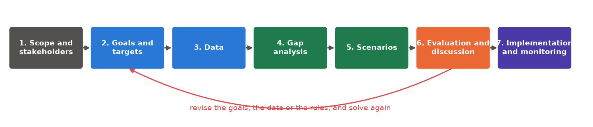

<p class="ls-chapter">Chapter 12.10</p>

# The planning process

Running a solver is a small part of a conservation plan. Most of the work, and most of the value, lies in
framing the problem well and in discussing the results with the people who will live with them. This
chapter places `ls.prioritize` in a real planning project, collects good practices and common mistakes,
and ends with recipes for common planning questions.

!!! abstract "In this chapter"
    - the stages of a systematic conservation plan, and where the software fits;
    - scenarios rather than "the answer";
    - good practices and common mistakes;
    - recipes: 30x30, restoration, offsets, regions, carbon, threats, marine plans, phases;
    - `ls.prioritize` for users of prioritizr, prioriactions, Marxan and Zonation.

## The stages of a plan

Planning projects differ, but most follow a sequence like this (Margules & Pressey 2000; Pressey & Bottrill
2009):

<figure markdown>

<figcaption>The stages of a systematic conservation plan. The software works in stages 4 to 6; the loop back
from the discussion to the goals is where most plans are made.</figcaption>
</figure>

1. **Scope and stakeholders.** Define the region, the time frame, and who must be involved: agencies,
   landowners, communities, companies. A technically perfect plan that nobody supports will not be
   implemented (Knight et al. 2008).
2. **Goals and targets.** Turn broad goals ("protect our biodiversity") into measurable targets ("30 % of
   each ecosystem, 60 % for threatened species").
3. **Data.** Gather maps of features, costs, threats, existing protected areas and constraints, on one grid.
   [Chapter 13](../sdm.md) makes species maps; [chapter 9](../restoration.md) costs and distances.
4. **Gap analysis.** Measure what existing protected areas already achieve. Some features are often well
   covered, others not at all.
5. **Scenarios.** Solve under different targets, budgets, costs and spatial rules.
6. **Evaluation and discussion.** Which places are irreplaceable, which flexible, how do scenarios differ?
   Show maps and trade-off curves, collect feedback, and return to stage 2 as often as needed.
7. **Implementation and monitoring.** Turn the chosen scenario into action (new reserves, restoration
   contracts, management programmes) and check whether the targets are met on the ground.

## Scenarios, not "the answer"

A common misunderstanding is to expect one definitive map. Planners produce **scenarios** that answer
"what if" questions:

- What if the targets are 20 %, 30 % or 40 %?
- What if cost is land price, or the income lost by farmers?
- What if existing reserves are, or are not, part of the plan?
- What if the plan must be compact, or connected?

Comparing scenarios shows which places are selected *whatever the assumptions*, strong candidates for
immediate action, and which depend on them, open to negotiation. In `ls.prioritize` scenarios are cheap:
every `add_` returns a new problem, so one base problem gives many variants
([chapter 12.6](tradeoffs.md#scenarios-and-sensitivity)).

```python
import numpy as np
import pandas as pd
import xarray as xr
import landschaft as ls

P = ls.prioritize
cost = ls.load_raster(P.example_data("cost"))
features = ls.load_raster(P.example_data("features"))
base = P.problem(cost, features).add_min_set_objective().add_binary_decisions()

plans = {t: base.add_relative_targets(t).solve() for t in (0.2, 0.3, 0.4)}
always = np.logical_and.reduce([s.selection.values > 0.5 for s in plans.values()])
print("cells selected in all three scenarios:", int(always.sum()))
```

## Good practices

- **Document every choice.** Why this cost layer, these targets, this penalty? A short table of
  assumptions makes a plan defensible.
- **Look at the inputs before solving.** Most surprising results come from a misaligned raster, a wrong
  unit or a wrong NoData value. `ls.plot(cost)` and `ls.plot(features)` take a second.
- **Ask for a small gap for final results** (`add_highs_solver(gap=0.01)` or less). The default of 10 % is for
  exploring, not for reporting.
- **Calibrate penalties** rather than copying values from other studies ([chapter 12.6](tradeoffs.md)).
- **Test sensitivity**: alternative costs, targets and data, and portfolios of near-optimal plans.
- **Report target coverage, not only maps**: `eval_target_coverage_summary` says what each scenario achieves
  for each feature ([chapter 12.7](evaluation.md)).
- **Share the outputs** as GeoTIFFs (`sol.save(...)` or `ls.write_raster(sol.selection, ...)`) and as a
  report (`P.report`), so that others can inspect them.

## Common mistakes

Game et al. (2013) list six common mistakes in priority setting. With the pitfalls of the software, they
make a useful checklist:

!!! failure "Treating the map as a decision"
    The map shows the consequences of the chosen inputs. It is a starting point for negotiation.

!!! failure "Ignoring costs, or mixing their units"
    Plans without costs favour expensive places; costs in different currencies or time frames (a purchase
    price plus a yearly management cost) make meaningless plans. Put all costs in one currency and one
    time frame.

!!! failure "Confusing threat with priority"
    The most threatened place is not always the best investment: action there may be expensive, or
    unlikely to work. Multi-action planning ([chapter 12.8](actions.md)) weighs both.

!!! failure "Forgetting that the cost raster defines the planning units"
    A zero is a planning unit that costs nothing, and the solver will take it; NoData is not a planning
    unit at all.

!!! failure "Too many features of one kind"
    With 500 bird species and one ecosystem type, birds drive the plan. Group features, weight them, or set
    targets per group.

!!! failure "Ignoring the probability of success, and what would happen anyway"
    Protecting land nobody would ever clear adds little. Where it is known, weight benefit by the threat
    that action removes, and cost by the chance of success.

## Recipes

The same few building blocks answer very different questions. Each recipe gives the question, how it
translates into a problem, and code on Serra Verde that you can adapt to your own data.

### National 30x30 strategy

*"Which new areas complete our network so that 30 % of every ecosystem is protected?"* A gap analysis, then
a minimum set that builds on the existing reserves and excludes land that is not available:

```python
protected = ls.load_raster(P.example_data("protected"))
urban = ls.load_raster(P.example_data("urban"))
p = base.add_relative_targets(0.3)

gap = P.eval_target_coverage_summary(p, protected)        # what the reserves hold today
print(gap[["feature", "relative_held"]].round(2).to_string(index=False))

plan = p.add_locked_in_constraints(protected).add_locked_out_constraints(urban).solve()
new = (plan.selection.values > 0.5) & (np.nan_to_num(protected.values) == 0)
print(f"new areas: {int(new.sum())} km², {np.nansum(cost.values * new) / 1000:.1f} million USD")
```

### Restoration

*"Where should we restore degraded land to recover the most biodiversity per dollar?"* The benefit of
restoring is the **gain**, not the habitat present today. Here the gain of a cell is its habitat times its
degradation, and any share of a cell can be restored:

```python
condition = ls.load_raster(P.example_data("condition"))
gain = features * (1 - condition)                           # habitat that restoration would bring back
restore = (P.problem(cost, gain).add_max_utility_objective(5_000)
             .add_proportion_decisions().solve())
print(f"cells restored at least in part: {int((restore.values > 0.01).sum())}")
```

!!! warning "Use gains, not current habitat"
    With today's habitat as features, the plan "restores" the places already in good condition. Estimate
    the gain first: from condition, as here, or from distribution models under the restored land cover.

### Biodiversity offsets

*"Where should a company compensate the habitat lost to a new road?"* Absolute targets equal to the losses
(times an offset ratio), outside the footprint and the existing reserves (additionality):

```python
footprint = xr.zeros_like(cost).where(np.isfinite(cost))
footprint[40:46, 30:42] = 1                                   # the project's area
lost = (features * footprint).sum(["y", "x"]).values         # habitat lost, per feature
eligible = cost.where((footprint == 0) & (np.nan_to_num(protected) == 0))
offset = (P.problem(eligible, features).add_min_set_objective()
            .add_absolute_targets(2 * lost).add_binary_decisions().solve())   # an offset ratio of 2
print(f"offset: {int(offset.values.sum())} km², {offset.cost / 1000:.1f} million USD")
```

### Plans across regions

*"How do we share the effort fairly between three states?"* A plan for the whole region concentrates the
effort where land is cheapest. **Subregional targets** require 30 % of each feature *within each state*. The
difference in cost is the **price of fairness**:

```python
regions = ls.load_raster(P.example_data("regions"))          # 1, 2, 3
names = [str(n) for n in features.band.values]
targets = pd.DataFrame([{"region": r, "feature": f, "target": 0.3} for r in (1, 2, 3) for f in names])
fair = base.add_relative_targets(0.0).add_subregional_targets(regions, targets).solve()
whole = base.add_relative_targets(0.3).solve()
print(f"price of fairness: {fair.cost / whole.cost - 1:.1%}")
```

A feature absent from a state gets a target of zero there. Compare also the share of each state's land the
two plans select.

### Carbon as a co-benefit

*"Can the plan also store carbon?"* Add carbon as a feature. With a target of zero it is only measured;
with a target, it is required:

```python
carbon = ls.load_raster(P.example_data("carbon"))
with_carbon = xr.concat([features, carbon.expand_dims(band=["carbon"])], dim="band")
pc = P.problem(cost, with_carbon).add_min_set_objective().add_binary_decisions()
species_only = pc.add_relative_targets([0.3] * 8 + [0.0]).solve()
held = P.eval_feature_representation_summary(pc.add_relative_targets(0.3), species_only)["relative_held"]
print(f"the species plan holds {held.iloc[-1]:.0%} of the carbon")
for t in (0.25, 0.3):
    s = pc.add_relative_targets([0.3] * 8 + [t]).solve()
    print(f"{t:.0%} of the carbon: {s.cost / species_only.cost - 1:.0%} dearer")
```

The plan for the species already holds a fifth of Serra Verde's carbon. A quarter costs about 8 % more,
and 30 % costs 28 % more: carbon is everywhere, so every extra share of it means much more land. Curves
like this one ([chapter 12.6](tradeoffs.md)) help to set carbon targets that are ambitious but affordable.

### Threat management

*"Which threats should we tackle, and where?"* A multi-action plan with threats, actions and their costs:
see [chapter 12.8](actions.md).

### Marine plans

*"Where can no-take zones go while displacing as little fishing as possible?"* A minimum set with fishing
effort as the cost, shipping lanes locked out, and a boundary penalty with `edge_factor=1`, since zones
must be simple to enforce:

<!-- no-run -->
```python
effort = ls.load_raster("fishing_effort.tif")             # the cost: fishing displaced
habitats = ls.load_raster("habitats.tif")                 # reefs, seagrass, spawning areas
plan = (P.problem(effort, habitats).add_min_set_objective().add_relative_targets(0.2)
          .add_binary_decisions().add_locked_out_constraints(ls.load_raster("shipping_lanes.tif"))
          .add_boundary_penalties(calibrated_value, edge_factor=1.0)
          .solve())
```

Report the share of fishing effort displaced, not only the area protected.

### Plans in phases, and extinction risk

*"We can only act on part of the plan each year: where do we start?"* Rank the plan's units by importance
([chapter 12.7](evaluation.md#which-places-matter-most)) or build it in phases with `iterative_solve`
([chapter 12.6](tradeoffs.md#plans-in-phases)). *"Which areas reduce extinction risk the most?"* The minimum
extinction risk objective ([chapter 12.4](optimization.md#extinction-risk-instead-of-targets)).

## Coming from R or Marxan

`ls.prioritize` follows the vocabulary of prioritizr, so most scripts translate line by line:

| prioritizr (R) | `ls.prioritize` |
|---|---|
| `problem(cost, features)` | `P.problem(cost, features)` |
| `add_min_set_objective()` and the others | the same names, as methods: `p.add_min_set_objective()` |
| `add_relative_targets(0.3)` | `p.add_relative_targets(0.3)` |
| `add_boundary_penalties(penalty, edge_factor)` | `p.add_boundary_penalties(penalty, edge_factor)` |
| `add_locked_in_constraints(x)` | `p.add_locked_in_constraints(x)` |
| `add_binary_decisions()` | `p.add_binary_decisions()` |
| `add_highs_solver(gap = 0.1)` | `p.add_highs_solver(gap=0.1)` |
| `solve(p)` | `p.solve()` |
| `eval_target_coverage_summary(p, s)` | `P.eval_target_coverage_summary(p, s)` |
| `compile(p)` | `p.compile()` (the same model, row by row) |

Pipes (`%>%`) become method chains, and every method returns a new problem. Extensions beyond prioritizr:
subregional targets, corridors, minimum extinction risk, calibration helpers, and the comparison with
Zonation.

| Other tools | In `ls.prioritize` |
|---|---|
| prioriactions (`inputData`, `problem`, `solve`) | `actions_data`, `ActionsData.problem`, `ActionsProblem.solve` |
| Marxan (`input.dat`, `pu.dat`, `spec.dat`, `puvspr.dat`) | `P.marxan(pu, spec, puvspr, bound, blm=...)`, the same tables |
| Zonation 5 (`z5 --mode=CAZ2 settings.z5`) | `P.zonation(...)`, or `P.run_project("settings.z5")` |

Results are the same as the originals': prioritizr and prioriactions models agree row by row, Marxan with
the same seed gives the same runs, and Zonation 5 the same ranking. That makes it easy to move an existing
analysis and check it.

!!! success "Key points"
    - The software works in the middle of a longer process; goals, data and discussion matter more.
    - Produce scenarios; trust the places selected in all of them.
    - Document choices, check inputs, use small gaps for final plans, calibrate penalties, report coverage.
    - Most planning questions are recipes of the same ingredients: targets, costs, locks, objectives.

## Check your understanding

1. A stakeholder asks why their land is in the plan. What would you show them?
2. Why lock out existing reserves in an offset problem?
3. In Serra Verde, the price of fairness between the three states is 9 %. Is that a lot?

??? success "Answers"
    1. Its importance (replacement cost or irreplaceability), the features it holds that are rare
       elsewhere, and whether near-optimal alternatives without it exist (a portfolio). If there are, the
       plan can do without it at a small cost.
    2. Additionality: protecting land already protected does not compensate any loss.
    3. It depends on the budget and the stakes, but it is often a small price for a plan every state can
       accept. A plan that is 9 % cheaper but rejected by two states protects nothing.

## References

<div class="ls-refs" markdown>

- Game, E. T., Kareiva, P., & Possingham, H. P. (2013). Six common mistakes in conservation priority setting. *Conservation Biology*, 27(3), 480–485.
- Hanson, J. O., Schuster, R., Strimas-Mackey, M., Morrell, N., Edwards, B. P. M., Arcese, P., Bennett, J. R., & Possingham, H. P. (2025). Systematic conservation prioritization with the prioritizr R package. *Conservation Biology*, 39(1), e14376.
- Knight, A. T., Cowling, R. M., Rouget, M., Balmford, A., Lombard, A. T., & Campbell, B. M. (2008). Knowing but not doing: selecting priority conservation areas and the research–implementation gap. *Conservation Biology*, 22(3), 610–617.
- Kukkala, A. S., & Moilanen, A. (2013). Core concepts of spatial prioritisation in systematic conservation planning. *Biological Reviews*, 88(2), 443–464.
- Margules, C. R., & Pressey, R. L. (2000). Systematic conservation planning. *Nature*, 405, 243–253.
- Pressey, R. L., & Bottrill, M. C. (2009). Approaches to landscape- and seascape-scale conservation planning: convergence, contrasts and challenges. *Oryx*, 43(4), 464–475.
- Strassburg, B. B. N., Iribarrem, A., Beyer, H. L., Cordeiro, C. L., Crouzeilles, R., Jakovac, C. C., et al. (2020). Global priority areas for ecosystem restoration. *Nature*, 586, 724–729.

</div>
