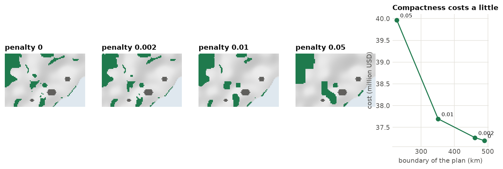
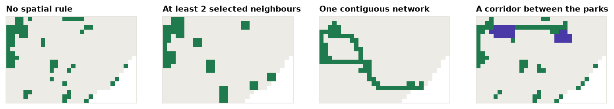

<p class="ls-chapter">Chapter 12.5</p>

# Spatial design

A plan that meets every target on paper can still fail on the ground if it is a scatter of tiny, isolated
cells. This chapter explains why the shape of a plan matters, and the tools `ls.prioritize` offers to control
it: penalties that make plans compact or connected, and constraints that force neighbours, contiguity or
corridors.

!!! abstract "In this chapter"
    - why fragmented plans fail, and the "salt and pepper" problem;
    - boundary penalties: what the penalty value means and how compactness trades against cost;
    - neighbours, contiguity and corridors as hard rules;
    - connectivity beyond adjacency: dispersal, rivers and least-cost distances;
    - choosing between penalties and constraints.

## The salt and pepper problem

Left alone, the solver has no reason to put selected cells next to each other. If two isolated cells are a
little cheaper than two neighbouring ones, it takes the isolated ones. On a detailed grid this gives plans
that look like salt and pepper sprinkled on the map.

Fragmented plans are a problem because of:

- **edge effects**: small patches are exposed on every side to wind, fire, invasive species, hunting and
  noise, and their interior habitat degrades ([chapter 3](../fragmentation.md));
- **viability**: many species need large, continuous areas to keep viable populations;
- **management**: every separate patch needs its own fences, patrols and negotiations with neighbours.
  Twenty small reserves cost far more to run than one large one;
- **movement**: animals and plants must move between patches, more so as the climate changes
  ([chapter 6](../connectivity.md)).

The shape of habitat was the subject of [chapter 4](../morphology.md); the same measures apply to a plan, and
[chapter 12.7](evaluation.md) shows how to compute them.

## Boundary penalties

The most common remedy is the **boundary penalty**, Marxan's *boundary length modifier* (BLM; Ball et al.
2009). It adds to the objective a value proportional to the plan's **boundary**: the length of the edges
between selected and unselected cells. Compact plans have short boundaries for the area they cover, so the
solver is pulled towards them.

```python
import numpy as np
import landschaft as ls

P = ls.prioritize
cost = ls.load_raster(P.example_data("cost"))
features = ls.load_raster(P.example_data("features"))
p = P.problem(cost, features).add_min_set_objective().add_relative_targets(0.3).add_binary_decisions()

for penalty in (0, 0.002, 0.01, 0.05):
    q = p if penalty == 0 else p.add_boundary_penalties(penalty)
    s = q.add_highs_solver(gap=0.02).solve()
    km = P.eval_boundary_summary(p, s)["boundary"].iloc[0] / 1000
    print(f"penalty {penalty:<6} cost {s.cost / 1000:5.1f} million USD   boundary {km:4.0f} km   "
          f"objective {s.objective:,.0f}")
```

<figure markdown>

<figcaption>The 30 % minimum set of Serra Verde with four boundary penalties. As the penalty grows, scattered
cells disappear and the plan gathers into a few compact blocks. The chart shows the trade-off: the boundary
falls from about 490 km to 225 km, less than half, while the cost rises from 37.2 to 40.0 million USD, about
8 %.</figcaption>
</figure>

Three things to notice:

1. **The objective is no longer the cost.** It now includes the penalty times the boundary. Report the cost
   (`s.cost`) and the boundary (`eval_boundary_summary`) separately.
2. **The first steps are cheap.** The first penalties remove a lot of boundary for little money; past a
   point, each extra bit of compactness gets expensive. A good value usually lies near the **knee** of the
   curve. [Chapter 12.6](tradeoffs.md) shows how to find it objectively.
3. **The penalty has units.** Here cost is in thousand USD and boundary in metres, so a penalty of 0.01
   means "I would pay 10 USD to avoid one metre of boundary", 10 000 USD per km. With other data, useful
   values are very different. That is why the value must be **calibrated**, never copied from another
   study.

!!! note "In plain words"
    The boundary penalty is a tax on the plan's outline. Every metre of edge between protected and
    unprotected land costs something. A plan of a few round blocks pays little tax; a plan of a thousand
    scattered cells pays a lot. The higher the tax, the rounder the plan, and the more it may cost in land.

!!! info "What is `edge_factor`?"
    Cells on the edge of the study area (along the coast, here) have sides that touch no other planning
    unit. `add_boundary_penalties(penalty, edge_factor=0.5)` counts those sides at half their length.
    Use `edge_factor=0` when the edge of the study area is not a real edge (a political border across
    continuous forest), and `1` when it is (a coastline).

## Rules on the shape of the plan

Penalties are preferences: the plan may stay fragmented if compactness would be too dear. Sometimes the
shape is a rule. `ls.prioritize` has three kinds of spatial constraints:

| Constraint | What it requires |
|---|---|
| `add_neighbors_constraints(k)` | every selected unit has at least *k* selected neighbours: no isolated cells |
| `add_contiguity_constraints()` | all selected units form one connected network |
| `add_feature_contiguity_constraints()` | the units counted for each feature form one connected network, a network per feature |
| `add_corridor_constraints(terminals, resistance)` | given areas (parks, say) are selected and joined by selected units, through low resistance |

Hard constraints guarantee the shape you ask for, but they make the problem much harder to solve. Each adds
many variables and rows (a flow through the network, for contiguity and corridors). The examples below
therefore use Serra Verde on blocks of 3 x 3 km (`coarsen`, [chapter 12.9](together.md#large-problems)) and
a 20 % target:

```python
c, f = P.coarsen(cost, features, 3)
base = P.problem(c, f).add_min_set_objective().add_relative_targets(0.2).add_binary_decisions()

plain = base.add_highs_solver(gap=0.01).solve()
neigh = base.add_neighbors_constraints(2).add_highs_solver(gap=0.01, time_limit=60).solve()
print(f"no rule: {plain.cost:,.0f}   at least 2 neighbours: {neigh.cost:,.0f}")
```

<!-- no-run -->
```python
# one network, and a corridor between the two mountain parks: each takes from tens of seconds to a minute
contig = base.add_contiguity_constraints().add_highs_solver(gap=0.05, time_limit=120).solve()
terminals = ...   # a raster on the blocks' grid, 1 in the two parks (see the figure script)
corr = base.add_corridor_constraints(terminals, resistance=c).add_highs_solver(gap=0.05, time_limit=120).solve()
```

<figure markdown>

<figcaption>The same problem on 3 km blocks under four rules. No rule: scattered blocks. At least two
selected neighbours: no block stands alone, but the plan stays in several pieces. One contiguous network:
a single winding network that reaches every feature, at a much higher cost. A corridor between the parks
(purple): the parks are linked by a chain of cheap blocks, and the rest of the plan stays free.</figcaption>
</figure>

On these blocks the cost grows from 24.9 million USD with no rule to 27.8 with two neighbours and 31.8 with a
single network. Contiguity is the most demanding rule: it is practical for small problems, or when the
features lie close to each other. For a whole region, prefer penalties, and use corridors between a few
terminals.

## Connectivity beyond adjacency

Two areas do not need to touch to be connected. Birds fly, seeds float down rivers, fish swim between reefs.
When you know how a feature moves, a **connectivity matrix** (how strongly each pair of planning units is
linked) brings it into the plan:

- `add_connectivity_penalties(penalty, data)` rewards selecting strongly connected pairs together;
- `add_asym_connectivity_penalties(penalty, data)` penalizes breaking one-way links, such as a river reach
  upstream of a selected one (Hermoso et al. 2011);
- in multi-action plans, `add_directional_dependencies` makes the benefit of an action downstream depend on
  what is done upstream ([chapter 12.8](actions.md)).

The matrices come from simple helpers, or from the connectivity tools of earlier chapters:

| Helper | Connectivity |
|---|---|
| `adjacency_matrix(x)` | 1 between units that touch |
| `boundary_matrix(x)` | the length of the boundary they share (what the boundary penalty uses) |
| `connectivity_matrix(x, y)` | shared boundary times the mean of a raster `y`, such as habitat quality |
| `proximity_matrix(x, distance)` | 1 between units closer than a distance |
| `decay_connectivity(distances, median)` | a dispersal probability that halves every `median` metres, from any distances: Euclidean, least-cost (`ls.cost`, [chapter 9](../restoration.md)) or resistance distances (`ls.circuit`, [chapter 8](../circuits.md)) |

For example, connectivity through the habitat of the lowland tapir, which follows the rivers:

```python
cm = P.connectivity_matrix(c, f.sel(band="lowland_tapir"))    # shared edge x mean tapir habitat
q = base.add_connectivity_penalties(0.005, cm).add_highs_solver(gap=0.02).solve()
before = P.eval_connectivity_summary(base, plain, cm)["connectivity"].iloc[0]
after = P.eval_connectivity_summary(base, q, cm)["connectivity"].iloc[0]
print(f"cost {plain.cost:,.0f} -> {q.cost:,.0f};  tapir connectivity {before:,.0f} -> {after:,.0f}")
```

With a penalty of 0.005, the plan keeps pairs of blocks along the tapir's rivers together: the connectivity
inside the plan almost doubles (from 0.43 to 0.81 million) for about 1 % more cost. A penalty four times
larger triples it again, but makes the plan 45 % dearer: like the boundary penalty, this one needs
calibration.

!!! warning "Penalties and their sign"
    A connectivity *penalty* in prioritizr's sense is a reward: a positive value makes connected pairs
    more attractive. The boundary penalty, on the other hand, makes fragmented plans less attractive.
    In both cases the value is an exchange rate between the units of cost and of the matrix, and it
    must be calibrated.

## Penalties or constraints?

| | Penalties (boundary, connectivity, linear) | Constraints (neighbours, contiguity, corridors) |
|---|---|---|
| **What they guarantee** | nothing: a preference, paid for in the objective | the shape, exactly |
| **What they need** | a value to calibrate | no value, but a clear rule |
| **Cost to solve** | moderate: Landschaft's engines handle them on large maps | high: practical on hundreds to a few thousand units |
| **When** | almost always, to avoid salt and pepper | when the rule is a requirement: a corridor between parks, no isolated cells |

A good practice is to start without spatial rules, look at the plan, then add a boundary penalty calibrated
on the knee of the trade-off, and constraints only where a rule is truly needed.

!!! success "Key points"
    - Without spatial terms, plans fragment: edges, viability, management and movement all suffer.
    - A boundary penalty is a tax on the plan's outline; its value has units and must be calibrated.
    - The first steps of compactness are cheap; the last are expensive.
    - Neighbour, contiguity and corridor constraints force a shape, at a price in cost and solving time.
    - Connectivity matrices bring dispersal, rivers and least-cost distances into the plan.

## Check your understanding

1. A colleague used a boundary penalty of 0.5 in a study with costs in USD and boundaries in km. Can you use
   the same value with costs in thousand USD and boundaries in metres?
2. Why does a plan with at least two neighbours per cell still come in several pieces?
3. A water agency wants to protect river reaches, and knows that pollution flows downstream. Which tool
   expresses this?

??? success "Answers"
    1. No. Their 0.5 USD per km is 0.5 / 1000 thousand USD per 1000 m, that is 5 × 10<sup>-7</sup> in your
       units. Better still, calibrate it anew: the right value also depends on the landscape.
    2. The rule is local: each cell needs neighbours, but a group of three cells satisfies it on its own.
       Only contiguity constraints join all groups into one network.
    3. Asymmetric connectivity penalties (a matrix from upstream to downstream reaches), or, with
       management actions, directional dependencies.

## References

<div class="ls-refs" markdown>

- Ball, I. R., Possingham, H. P., & Watts, M. E. (2009). Marxan and relatives: software for spatial conservation prioritization. In A. Moilanen, K. A. Wilson & H. P. Possingham (Eds.), *Spatial Conservation Prioritization* (pp. 185–195). Oxford University Press.
- Beger, M., Linke, S., Watts, M., Game, E., Treml, E., Ball, I., & Possingham, H. P. (2010). Incorporating asymmetric connectivity into spatial decision making for conservation. *Conservation Letters*, 3(5), 359–368.
- Hermoso, V., Linke, S., Prenda, J., & Possingham, H. P. (2011). Addressing longitudinal connectivity in the systematic conservation planning of fresh waters. *Freshwater Biology*, 56(1), 57–70.
- Önal, H., & Briers, R. A. (2006). Optimal selection of a connected reserve network. *Operations Research*, 54(2), 379–388.
- Stewart, R. R., & Possingham, H. P. (2005). Efficiency, costs and trade-offs in marine reserve system design. *Environmental Modeling & Assessment*, 10(3), 203–213.
- Williams, J. C., ReVelle, C. S., & Levin, S. A. (2005). Spatial attributes and reserve design models: a review. *Environmental Modeling & Assessment*, 10(3), 163–181.

</div>
