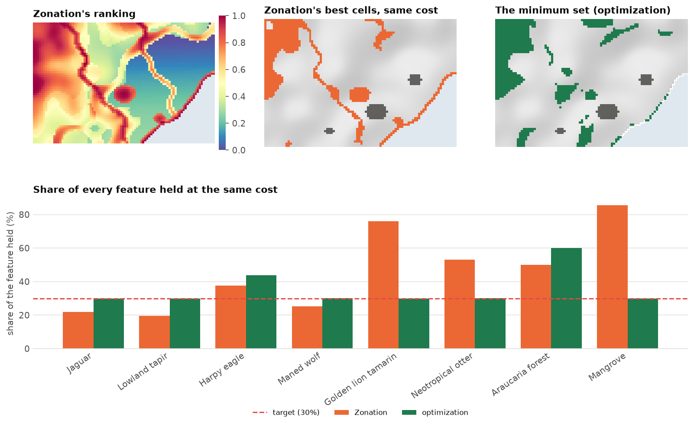
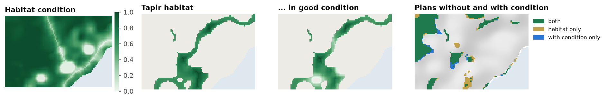
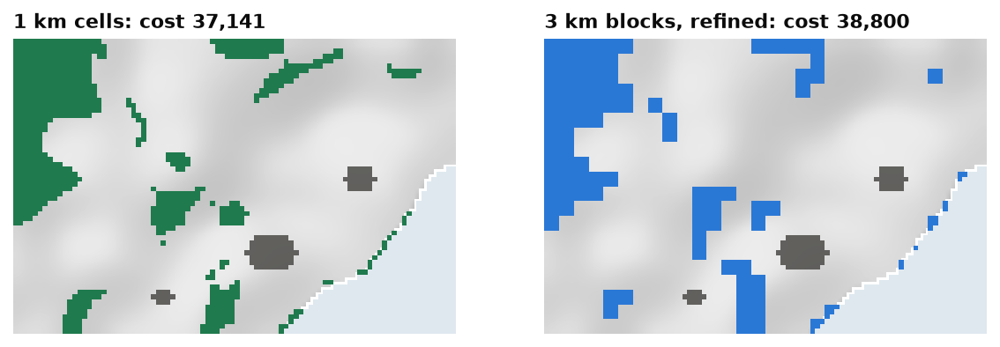

<p class="ls-chapter">Chapter 12.9</p>

# Ranking and optimization together

Zonation ([chapter 12.3](ranking.md)) and the optimization of `ls.prioritize`
([chapter 12.4](optimization.md)) are often presented as rival schools. They answer different questions, and
in Landschaft they work on the same data. This chapter compares their answers on the same problem, shows how
each can feed the other, brings in species distribution models as features, and ends with what to do when
a problem is too large.

!!! abstract "In this chapter"
    - what a ranking and an optimized plan each hold at the same cost;
    - Zonation's feature transforms (condition, connectivity) as inputs to optimization;
    - a ranking as the starting point of a solve;
    - species distribution models as features;
    - large problems: coarse blocks, H3 cells, and what scales to millions of cells.

## Same cost, different answers

`compare_zonation` runs Zonation on the problem's features and costs, cuts the ranking at the cost of an
optimized plan, and compares the two:

```python
import numpy as np
import landschaft as ls

P = ls.prioritize
cost = ls.load_raster(P.example_data("cost"))
features = ls.load_raster(P.example_data("features"))
p = (P.problem(cost, features).add_min_set_objective().add_relative_targets(0.3)
       .add_binary_decisions().add_highs_solver(gap=0.001))
sol = p.solve()

comp = P.compare_zonation(p, sol)
comp.summary.round(2)
```

```python
comp.table[["feature", "milp", "zonation"]].round(2)
```

<figure markdown>

<figcaption>Top: Zonation's ranking of Serra Verde (CAZ2, with costs), the best cells of the ranking for
the cost of the 30 % plan, and the plan itself. Bottom: the share of every feature each one holds. The
ranking holds more of the rare features (76 % of the tamarin, 85 % of the mangrove) and less of the common
ones (around 20 % of the jaguar and the tapir); the plan holds exactly what the targets ask, and a little
more where it comes free.</figcaption>
</figure>

The difference is in the questions:

- **The ranking** keeps, at every share of the landscape, as much as possible of *every* feature's
  distribution, weighted toward the rarest (that is CAZ2's rule). It knows no targets. At this cost it meets
  five of the eight 30 % targets, and holds on average 46 % of every feature, against 36 % for the plan.
- **The plan** meets every target exactly, at the least cost. It does nothing more than asked: a
  target of 30 % means 30 %.

Neither is wrong. The ranking is the better summary of *where the landscape is irreplaceable*; the plan is
the better answer to *what is the cheapest way to reach these goals*. A good workflow uses both: the ranking
to explore and discuss, before targets are fixed; the plan once they are; and the comparison to show what
the targets leave out.

## Zonation's transforms as features

Zonation 5 transforms features before ranking: it weights them by habitat **condition**, smooths them with
**connectivity** kernels, links them by **interactions**. `zonation_features` applies the same transforms and
returns the features in their own units, ready for an optimization problem. Here, the habitat of every
feature is weighted by its condition, so that degraded habitat counts for less:

```python
condition = ls.load_raster(P.example_data("condition"))
good = P.zonation_features(features, condition=[condition] * 8)
pc = (P.problem(cost, good).add_min_set_objective().add_relative_targets(0.3)
        .add_binary_decisions().add_highs_solver(gap=0.001))
plan_c = pc.solve()
a, b = sol.selection.values > 0.5, plan_c.selection.values > 0.5
print(f"cost {sol.cost:,.0f} -> {plan_c.cost:,.0f};  shared cells {int((a & b).sum())}, "
      f"habitat only {int((a & ~b).sum())}, condition only {int((~a & b).sum())}")
```

<figure markdown>

<figcaption>Habitat condition is poor around the cities, along the roads and on farmland in the
lowlands. Weighting the tapir's habitat by it shrinks the habitat near the cities. With all features
weighted, the plan moves away from degraded land: 689 cells are in both plans, 123 only in the plain one,
60 only in the one with condition.</figcaption>
</figure>

The same works with `connectivity=[ls.prioritize.Kernel("negexp", 3)] * 8` (habitat valued by the habitat
around it, [chapter 12.3](ranking.md#connectivity-and-persistence)) and the other transforms of `zonation`.

## A ranking as a starting point

Solvers work faster from a good plan. `solve(start="zonation")` ranks the problem's features with Zonation,
takes cells from the top of the ranking until every target is met, and gives that plan to the solver as a
start. A `ZonationResult` or a rank raster of your own can be given instead:

```python
quick = p.solve(start="zonation")
print(quick.status, f"{quick.cost:,.0f}")
```

On problems that solve in a second, as here, it changes little. On hard problems (with penalties, or very
large), it gives the solver a good plan to improve from the first moment.

## Species distribution models as features

Features are often the predictions of species distribution models ([chapter 13](../sdm.md)).
`sdm_features` turns fitted `ls.sdm` models into a feature stack: the predicted suitability, or presence and
absence with a threshold.

<!-- no-run -->
```python
results = {"species_a": res_a, "species_b": res_b}          # ls.sdm.fit results
feats = P.sdm_features(results, env, threshold="max_tss")    # 1 where present, 0 elsewhere
p = P.problem(cost, feats).add_min_set_objective().add_relative_targets(0.3).add_binary_decisions()
```

Suitability or presence? Suitabilities keep the information of the model and favour the best habitat;
thresholds give areas that are easier to explain, but treat marginal and excellent habitat alike. With
suitabilities, remember that a target of 30 % is 30 % of the *total suitability*, not of the range.

## Large problems

Serra Verde has 4825 planning units. National and continental plans have millions. What scales?

| Problem | What to expect |
|---|---|
| minimum set and budget objectives | millions of cells: Landschaft's covering engine solves a minimum set of 10 million cells in about a minute |
| boundary and connectivity penalties | hundreds of thousands of cells, with a modest gap (1-5 %) |
| multi-action plans | hundreds of thousands of units to a 1 % gap in seconds |
| contiguity and corridors | thousands of units |
| Zonation rankings | any size: rasters larger than memory are ranked in blocks |

When a problem is too large, or too slow with its spatial rules, solve it on **coarser blocks** and
**refine** the result. `coarsen` sums the costs and amounts of blocks of cells, and `refine` maps the blocks
back to the cells:

```python
c3, f3 = P.coarsen(cost, features, 3)           # blocks of 3 x 3 cells
coarse = (P.problem(c3, f3).add_min_set_objective().add_relative_targets(0.3)
            .add_binary_decisions().add_highs_solver(gap=0.001).solve())
fine = P.refine(coarse, cost)                    # the selected blocks' cells, on the 1 km grid
print(f"1 km cells: {sol.cost:,.0f};  3 km blocks: {coarse.cost:,.0f} "
      f"({coarse.cost / sol.cost - 1:.1%} dearer)")
```

<figure markdown>

<figcaption>The 30 % plan on 1 km cells and on 3 km blocks (refined back to cells). The block plan is about
5 % dearer, since every block must be bought whole, but nine times smaller as a problem, and its shapes are
already compact.</figcaption>
</figure>

Because block amounts are sums of their cells, the refined plan holds exactly what the block plan does: every
target stays met. Coarse blocks are also a good place to calibrate penalties and test spatial rules before
solving the fine problem.

**H3 cells** (`h3_units`) are another option for regional and global problems: hexagons of equal area,
with six neighbours each, that suit boundary penalties and connectivity better than square cells near the
poles.

!!! tip "Speed checklist"
    - Ask for the gap you need: 1 % for exploring, smaller for the final plan.
    - Solve with `n_threads` (all cores but one by default).
    - Calibrate penalties on coarse blocks first.
    - Start from a ranking (`start="zonation"`) on hard problems.
    - For very large maps, prefer penalties to contiguity and corridor constraints.

!!! success "Key points"
    - A ranking keeps as much as possible of every feature at every budget; a plan meets explicit targets
      at least cost. Use the first to explore, the second to decide, and the comparison to show the
      difference.
    - Zonation's condition and connectivity transforms can shape the features of an optimization problem.
    - A ranking can start a solve; SDM predictions can be its features.
    - Large problems: coarsen and refine, H3 cells, and the right gap.

## Check your understanding

1. At the same cost, Zonation holds 85 % of the mangrove and the optimized plan 30 %. Is the plan worse for
   the mangrove?
2. Why does weighting the features by condition make the plan *cheaper* here?
3. Why does the plan on 3 km blocks still meet every target on the 1 km grid?

??? success "Answers"
    1. It holds what the target asked for. If 30 % is not enough for the mangrove, the target should be
       higher; the ranking shows what a plan centred on rarity would hold instead.
    2. Targets are relative: 30 % of each feature's condition-weighted total. Degraded habitat counts for
       less in the totals and in the plan, and a good part of it lies on dear land near cities and roads,
       which the plan no longer needs.
    3. A block's amounts are the sums of its cells'. The refined plan selects all the cells of the selected
       blocks, so it holds exactly the amounts the block plan holds.

## References

<div class="ls-refs" markdown>

- Moilanen, A., Lehtinen, P., Kohonen, I., Jalkanen, J., Virtanen, E. A., & Kujala, H. (2022). Novel methods for spatial prioritization with applications in conservation, land use planning and ecological impact avoidance. *Methods in Ecology and Evolution*, 13(5), 1062–1072.
- Hanson, J. O., Schuster, R., Strimas-Mackey, M., Morrell, N., Edwards, B. P. M., Arcese, P., Bennett, J. R., & Possingham, H. P. (2025). Systematic conservation prioritization with the prioritizr R package. *Conservation Biology*, 39(1), e14376.
- Kujala, H., Lahoz-Monfort, J. J., Elith, J., & Moilanen, A. (2018). Not all data are equal: influence of data type and amount in spatial conservation prioritisation. *Methods in Ecology and Evolution*, 9(11), 2249–2261.
- Schuster, R., Hanson, J. O., Strimas-Mackey, M., & Bennett, J. R. (2020). Exact integer linear programming solvers outperform simulated annealing for solving conservation planning problems. *PeerJ*, 8, e9258.
- Uber Technologies (2018). *H3: a hexagonal hierarchical geospatial indexing system*. https://h3geo.org

</div>
