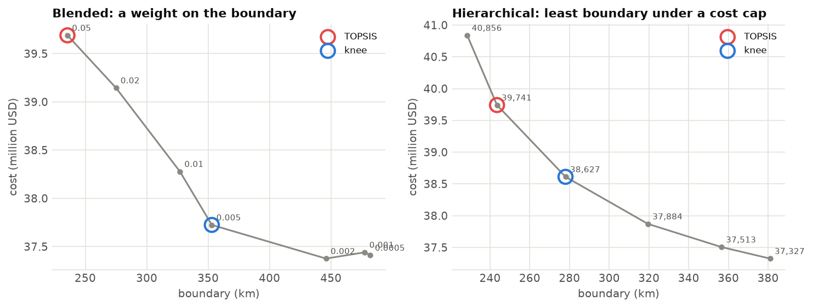

<p class="ls-chapter">Chapter 12.6</p>

# Trade-offs and alternatives

Every plan is a compromise: between cost and compactness, between money and the share of every species
protected, between what one group wants and what another needs. A single "optimal" map hides these
compromises. This chapter shows how to bring them into the open: trade-off curves, objective ways of
choosing a point on them, and sets of alternative plans that are almost equally good.

!!! abstract "In this chapter"
    - calibrating a penalty: the blended and hierarchical approaches, the knee and TOPSIS;
    - Cohon's trade-off rate as a starting value;
    - the Pareto front between budget and representation;
    - portfolios of near-optimal plans, and what they say about flexibility;
    - scenarios, phased plans and sensitivity analysis.

## Calibrating a penalty

[Chapter 12.5](spatial.md) showed that a boundary penalty buys compactness with money, and that its value has
units and must be calibrated. Calibrating means solving the problem for a range of values and choosing one on
the resulting curve of cost against boundary. `ls.prioritize` offers the two approaches of prioritizr's
calibration guide (Hanson et al. 2025) and two ways to choose.

### The blended approach

Solve with several penalty values; every value gives a plan with some cost and some boundary:

```python
import numpy as np
import landschaft as ls

P = ls.prioritize
cost = ls.load_raster(P.example_data("cost"))
features = ls.load_raster(P.example_data("features"))
p = P.problem(cost, features).add_min_set_objective().add_relative_targets(0.3).add_binary_decisions()

cal = P.calibrate_penalty(p.add_highs_solver(gap=0.02), "boundary", values=[0.001, 0.003, 0.01, 0.03])
cal.table[["value", "cost", "boundary", "topsis", "knee"]].round(1)
```

The candidates are solved in parallel. The table marks two choices:

- the **knee** of the curve (Satopää et al. 2011): the point farthest from the straight line between the two
  ends, where the curve bends most. Before it, compactness is cheap; after it, expensive;
- **TOPSIS** (Hwang & Yoon 1981): the candidate closest to the ideal (least cost *and* least boundary) and
  farthest from the anti-ideal, after scaling both criteria. With equal weights it tends to pick a more
  balanced, often more compact, point than the knee.

```python
best = cal.best("knee")
print(f"knee: penalty {cal.table.loc[cal.table['knee'], 'value'].iloc[0]}, cost {best.cost:,.0f}")
```

!!! note "In plain words"
    The knee answers "up to where is compactness a bargain?". TOPSIS answers "which plan is the best
    all-rounder, if cost and compactness matter equally?". Neither is *the* answer; both are defensible,
    reproducible starting points for a discussion.

### The hierarchical approach

The blended approach mixes two quantities in one objective, and its penalty values have no direct meaning.
The **hierarchical** approach asks a clearer question in two steps: first, what is the least cost of meeting
the targets? Then, *how compact can the plan be if we accept spending 1 %, 2 %, 5 % ... more?*

<!-- no-run -->
```python
hier = P.calibrate_budget(p.add_highs_solver(gap=0.05, time_limit=180), "boundary",
                          inflation=[0.005, 0.01, 0.02, 0.04, 0.07, 0.1])
hier.table[["value", "cost", "boundary", "topsis", "knee"]]
```

Each candidate is a *minimum penalties* problem (`add_min_penalties_objective`): the least boundary that
meets every target within a budget. These problems are harder than the blended ones, which is why the example
gives a time limit; on large maps, run them on coarser blocks first.

<figure markdown>

<figcaption>Calibrating the boundary penalty of Serra Verde's 30 % plan. Left: the blended approach, labelled
by the penalty value. Right: the hierarchical approach, labelled by the cost cap (thousand USD). Both curves
fall steeply at first: the first million USD above the minimum cost removes far more boundary than the
next ones. The circles mark the candidates TOPSIS and the knee choose.</figcaption>
</figure>

### A starting value: Cohon's method

Where to start the search? Cohon et al. (1979) proposed the slope between the two extremes: the least-cost
plan (ignoring the boundary) and the least-boundary plan (ignoring the cost). The ratio of their differences
in cost and boundary is a penalty at which neither criterion dominates. `cohon_penalty` computes it, and
`calibrate_penalty` without `values` searches from 1/100 to 100 times it. Finding the least-boundary plan is
a hard problem on a fine grid, so the example uses blocks of 6 x 6 km. The value it gives holds for problems
on those blocks only: on a coarser grid the cost of a unit grows faster than its boundary (36 times against 6
times here), so the useful penalties are much larger than on the 1 km grid.

```python
c, f = P.coarsen(cost, features, 6)
coarse = P.problem(c, f).add_min_set_objective().add_relative_targets(0.3).add_binary_decisions()
value, ideals = P.cohon_penalty(coarse.add_highs_solver(gap=0.05))
print(f"Cohon penalty on 6 km blocks: {value:.4g}")
ideals.round(0)
```

## Money against representation

The minimum set answers one question: what does it cost to meet every target? Decision makers often ask the
reverse: *what do we get for 10, 20 or 30 million?* The **Pareto front** answers it by solving the minimum
shortfall problem ([chapter 12.4](optimization.md)) for a range of budgets:

```python
front = P.pareto_front(p, n=6)
front.table[["value", "cost", "shortfall", "met"]].round(2)
```

<figure markdown>

<figcaption>What each budget buys in Serra Verde. The total shortfall (the sum, over the eight features, of
the share of each target still missing) falls quickly at first and slowly at the end: the first millions
cover the cheap, common habitat; the last ones buy the dear coastal land of the mangrove and the tamarin.
The labels count the targets fully met. That count does not always rise with the budget, because minimum
shortfall reduces the total gap, not the number of targets met.</figcaption>
</figure>

Every point of the front is **efficient** (Pareto-optimal): no plan is both cheaper and closer to the
targets. Points off the front are dominated, and choosing among the points on it is a political decision,
not a technical one. The front makes that decision informed.

## Alternative plans

The optimal plan is rarely the only good one. Often hundreds of plans cost within 1 % of the optimum, and
they may differ a lot in *where* they are. Showing only one hides this flexibility, and stakeholders may reject
a plan for a reason that a near-identical alternative would avoid. A **portfolio** is a set of good plans:

| Portfolio | What it returns |
|---|---|
| `add_gap_portfolio(n, pool_gap)` | up to *n* distinct plans within `pool_gap` of the optimum (from the solver's pool) |
| `add_cuts_portfolio(n)` | the best plan, then the best that differs from it, and so on (each forbids the earlier ones) |
| `add_top_portfolio(n)` | as cuts, each solved to optimality: the *n* best plans |
| `add_shuffle_portfolio(n)` | the problem solved with its units in random orders: plans of equal quality when there are ties |

```python
port = p.add_gap_portfolio(10, pool_gap=0.02).add_highs_solver(gap=0.01).solve()
print(len(port), "plans; costs from", round(port.summary["cost"].min()), "to", round(port.summary["cost"].max()))
f = port.frequency.values
print("units in every plan:", int(np.nansum(f == 1)), " in some plans:", int(np.nansum((f > 0) & (f < 1))))
```

The **selection frequency** (`port.frequency`) is the share of the plans that select every unit. Units in
every plan are hard to replace; units in a few are interchangeable. It is a simple, intuitive measure of
irreplaceability, and [chapter 12.7](evaluation.md) compares it with formal ones.

## Scenarios and sensitivity

A plan depends on choices that could reasonably be different: targets, costs, weights, data. Good practice
is to solve **scenarios** and keep the priorities that hold across them. Since every `add_` method returns a
new problem, scenarios are a loop:

```python
scenarios = {
    "30 % of everything": p,
    "60 % of the rare ones": p.add_relative_targets([0.3, 0.3, 0.3, 0.3, 0.6, 0.3, 0.3, 0.6]),
    "area instead of cost": P.problem(cost * 0 + 1, features).add_min_set_objective()
                              .add_relative_targets(0.3).add_binary_decisions(),
}
plans = {k: q.solve() for k, q in scenarios.items()}
for k, s in plans.items():
    print(f"{k:22s} {int(s.values.sum()):4d} cells, {np.nansum(cost.values * s.selection.values):9,.0f}")
```

For any other parameter, `calibrate(make, values, criterion)` builds the same kind of trade-off table:
`make(value)` returns the problem for every value (a feature weight, a target, a cost layer), and
`criterion(problem, solution)` measures what is traded against the cost.

### Plans in phases

Protected areas are created over years, not at once. `iterative_solve` solves, changes the problem, and
solves again, optionally keeping what earlier steps protected. For instance, 20 % by 2026, 25 % by 2028 and
30 % by 2030, each step building on the last:

```python
def next_step(step, solution, problem):
    return problem.add_relative_targets(0.2 + 0.05 * (step + 1))

phases, table = P.iterative_solve(p.add_relative_targets(0.2), next_step, 3, lock_previous=True)
table[["step", "cost", "units"]].round(0)
```

Phased plans cost a little more than a plan made at once for the final target, since early choices can't be
undone. The steps can also take their input from a land-use simulation: [chapter 14](../simulation.md)'s
`ls.simulate` changes the landscape between phases, and `protected_cells` passes the protected cells to it as
areas where land use may not change.

!!! success "Key points"
    - Penalties are calibrated by solving over a range of values and choosing on the curve: the knee or
      TOPSIS give reproducible choices.
    - The hierarchical approach asks a clearer question: how compact can the plan be for x % more cost?
    - The Pareto front shows what every budget buys; choosing a point on it is a political decision.
    - Many plans are almost as good as the optimum. Portfolios show them, and their selection frequency
      shows which places are hard to replace.
    - Solve scenarios, and trust the priorities that hold across them.

## Check your understanding

1. The knee of a calibration curve is at a penalty of 0.003, and TOPSIS chooses 0.03. Which plan would you
   expect to be more compact, and which cheaper?
2. Why does the number of targets met not always increase along the Pareto front of minimum shortfall?
3. A unit is selected in 10 of 10 plans of a gap portfolio, another in 3 of 10. Which would you discuss
   first with landowners if both were hard to acquire?

??? success "Answers"
    1. The penalty of 0.03 weighs the boundary ten times more: the TOPSIS plan is more compact and
       dearer; the knee plan cheaper and more fragmented.
    2. Minimum shortfall minimizes the sum of the gaps. With a larger budget it may close several gaps
       partly instead of one completely, so the total falls while the count of fully met targets drops.
    3. The unit in 3 of 10 plans has good alternatives: if it is hard to acquire, another plan can do
       without it. The unit in every plan is the one the targets depend on, the one to negotiate first.

## References

<div class="ls-refs" markdown>

- Ardron, J. A., Possingham, H. P., & Klein, C. J. (Eds.) (2010). *Marxan Good Practices Handbook*, Version 2. Pacific Marine Analysis and Research Association.
- Cohon, J. L., Church, R. L., & Sheer, D. P. (1979). Generating multiobjective trade-offs: an algorithm for bicriterion problems. *Water Resources Research*, 15(5), 1001–1010.
- Hanson, J. O., Schuster, R., Strimas-Mackey, M., Morrell, N., Edwards, B. P. M., Arcese, P., Bennett, J. R., & Possingham, H. P. (2025). Systematic conservation prioritization with the prioritizr R package. *Conservation Biology*, 39(1), e14376.
- Hwang, C. L., & Yoon, K. (1981). *Multiple Attribute Decision Making: Methods and Applications*. Springer.
- Satopää, V., Albrecht, J., Irwin, D., & Raghavan, B. (2011). Finding a "kneedle" in a haystack: detecting knee points in system behavior. *31st International Conference on Distributed Computing Systems Workshops*, 166–171.
- Stewart, R. R., & Possingham, H. P. (2005). Efficiency, costs and trade-offs in marine reserve system design. *Environmental Modeling & Assessment*, 10(3), 203–213.

</div>
