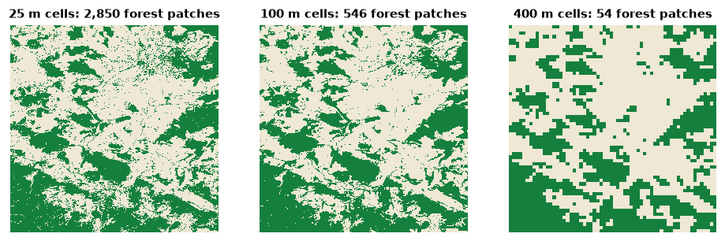

<p class="ls-chapter">Chapter 2</p>

# Scale

Ask how fragmented a forest is and the honest answer begins with "at what
scale?". Seen through 10 m pixels, a forest crossed by tracks and clearings
is a mosaic of pieces; through 1 km pixels it is a single block. Seen around
a single tree it is intact; over a whole region it may be rare. Levin (1992)
called scale *the central problem in ecology*: there is no single correct
scale at which to describe a system, and every measurement of pattern is
made at some scale, chosen or not.

!!! abstract "In this chapter"
    - the components of scale: grain, extent and thematic resolution;
    - how landscape measurements change with each of them, shown on the
      example maps;
    - the scale of effect: the extent at which a landscape matters to an
      organism;
    - how scale enters every tool of Landschaft, and practical rules for
      choosing it.

## The components of scale

In landscape ecology, scale has precise components (Turner et al., 1989;
Wiens, 1989):

| Component | Definition | In a raster map |
|---|---|---|
| **Grain** | the finest level of spatial resolution | the cell size (25 m, 30 m, 1 km...) |
| **Extent** | the overall size of the area studied | the size of the map, plot or window |
| **Thematic resolution** | how finely the categories are defined | the number of classes of the legend |
| **Temporal grain and extent** | how often, and over how long, the landscape is observed | the dates of the maps |

Grain and extent bound what can be seen. Nothing smaller than the grain can
be detected, and nothing larger than the extent. A 30 m land-cover map cannot
show hedgerows 5 m wide; a map of one municipality cannot show a migration
route of 200 km.

Two other notions of scale must not be confused with these:

- The **cartographic scale** of a paper map (1:25 000) is a ratio; a "large"
  cartographic scale shows a *small* area in detail. Ecologists say "large
  scale" to mean a large extent. Avoid the ambiguity: speak of grain and
  extent.
- The **minimum mapping unit** (MMU) is the smallest area a map delineates.
  It can be much larger than the cell size: the CORINE map used in this
  course has 25 m cells but was drawn with an MMU of 25 ha. Its effective
  grain is therefore about 500 m, not 25 m.

## Grain: the same landscape at different resolutions

Most landscape measurements change with the grain, some predictably and
some erratically (Turner et al., 1989; Wu, 2004). Let us see it happen. We
take the binary forest map of the examples and make it coarser by
**majority rule**: each block of *k* × *k* cells becomes one cell, forest if
at least half of the block is forest.

```python
import numpy as np
import landschaft as ls

forest = ls.load_raster(ls.example_data("input")).values   # 0 missing, 1 background, 2 forest


def coarsen(habitat, k):
    """Majority aggregation of k x k blocks of a 0/1/2 habitat map."""
    n_rows, n_cols = habitat.shape[0] // k, habitat.shape[1] // k
    blocks = habitat[: n_rows * k, : n_cols * k].reshape(n_rows, k, n_cols, k)
    share = (blocks == 2).mean(axis=(1, 3))
    return np.where(share >= 0.5, 2, 1).astype("uint8")
```

We treat the cells of this map as 25 m, as the tutorials do, and compute
four class metrics of the forest at grains from 25 to 400 m:

```python
import pandas as pd

rows = []
for k in [1, 2, 4, 8, 16]:
    grain = 25 * k                                           # metres
    metrics = ls.Landscape(coarsen(forest, k), res=grain).class_metrics(
        ["pland", "np", "area_mn", "ed"])
    rows.append(metrics[metrics["class"] == 2].assign(grain_m=grain))

by_grain = pd.concat(rows).set_index("grain_m")[["pland", "np", "area_mn", "ed"]]
by_grain.round(1)
```



Read the table column by column:

- **Percentage of forest** (`pland`) barely moves, 40–46%: majority
  aggregation roughly preserves the amount of each class. *Composition* is
  fairly robust to grain.
- **Number of patches** (`np`) falls from about 2 850 to about 50: small
  patches disappear, and patches separated by narrow gaps merge.
- **Mean patch area** (`area_mn`) grows about fifty-fold, the mirror image of
  the number of patches.
- **Edge density** (`ed`) falls about six-fold: coarse cells smooth the
  boundaries, and edges shorter than a cell vanish.

*Configuration* metrics, those that describe the arrangement of patches, are
the most sensitive. This is why a statement such as "the forest has 2 850
patches" means nothing without its grain, and why landscapes can only be
compared at the same grain (Wu, 2004).

!!! warning "Majority rule is only one way to aggregate"
    Coarsening by majority removes minority classes from every block, so
    rare and linear features (hedges, rivers, roads) disappear first. Other
    rules (random, nearest, "any presence") give different results. When
    you must compare maps of different resolutions, resample them all to
    the coarsest grain with the same rule, and report it.

## Thematic resolution

The number of classes matters as much as the cell size (Buyantuyev & Wu,
2007). CORINE Land Cover has three nested levels: 44 classes, grouped in 15,
grouped in 5. Merging the 26 classes present in the example into the five
top-level groups (artificial, agricultural, forest and semi-natural,
wetlands, water):

```python
import xarray as xr

landcover = ls.load_raster(ls.example_data("clc"), validate=None)
level1 = xr.where(landcover <= 11, 1,              # artificial surfaces
         xr.where(landcover <= 22, 2,              # agricultural areas
         xr.where(landcover <= 34, 3,              # forest and semi-natural areas
         xr.where(landcover <= 39, 4, 5)))).astype("uint8")   # wetlands, water

compare = pd.concat({
    "26 classes": ls.Landscape(landcover).landscape_metrics(["pr", "np", "shdi", "ed"]),
    "5 classes": ls.Landscape(level1, res=25).landscape_metrics(["pr", "np", "shdi", "ed"]),
})
compare.round(2)
```

The landscape did not change; the legend did. Yet the number of patches
halves, the Shannon diversity (`shdi`, [chapter 5](metrics.md)) falls from
1.8 to 1.0 and the edge density by a third, because boundaries between
classes of the same group are no longer edges. Diversity and edge metrics
depend on the legend by construction. Choose the classes for the question
(a forest bird does not distinguish broad-leaved from mixed forest if both
serve it) and keep them fixed across the landscapes you compare.

## Extent

Enlarging the extent adds new patches and classes and, eventually, new
kinds of landscape. Two effects are worth remembering:

- **The map border truncates patches.** Patches cut by the edge of the map
  look smaller and have artificially straight boundaries. The smaller the
  extent relative to the patches, the stronger the bias. Landschaft follows
  the convention of FRAGSTATS and landscapemetrics: the map border is not
  counted as edge unless you ask (`count_boundary=True`).
- **Rare classes need large extents.** Class-level metrics of a class with
  three patches in the study area are dominated by chance.

O'Neill et al. (1996) proposed a rule of thumb that is still useful: the
**grain** should be two to five times smaller than the smallest features of
interest, and the **extent** two to five times larger than the largest
patches.

## The scale of effect

For an organism, which part of the landscape matters? A population of
forest birds in a woodlot responds to the forest around it, but within what
radius: 250 m, 1 km, 5 km? The extent at which landscape structure best
predicts a biological response is the **scale of effect** (Jackson &
Fahrig, 2012). It depends on the species (dispersal distance, home range),
on the response (abundance, occupancy, genetic diversity) and on the
landscape variable itself (Holland et al., 2004; Miguet et al., 2016).

The standard way to find it is a **multi-scale analysis**: measure the
landscape in buffers of several radii around each sampling site, relate each
radius to the response, and keep the radius with the strongest relation.
Studies that choose one radius *a priori*, without testing, often miss the
scale of effect and underestimate the effect of the landscape (Jackson &
Fahrig, 2015).

Landschaft computes the landscape side of such an analysis in one call. Here
are three hypothetical sites, and the percentage of forest within circles of
250 m to 4 km around each:

```python
xmin, xmax, ymin, ymax = ls.Landscape(landcover).extent
sites = np.array([[xmin + 12_000, ymin + 12_000],
                  [xmin + 25_000, ymin + 25_000],
                  [xmax - 12_000, ymax - 12_000]])
radii = [250.0, 500.0, 1000.0, 2000.0, 4000.0]

forest_lc = ls.reclassify(landcover, foreground=[23, 24, 25])
plots = ls.scale_sample(forest_lc, sites, size=radii, shape="circle",
                        what=["lsm_c_pland"], verbose=False)

forest_share = (plots[plots["class"] == 2]
                .pivot(index="plot_id", columns="size", values="value")
                .reindex(index=[1, 2, 3], columns=radii)
                .fillna(0.0))                 # no forest in the circle: 0%
forest_share.round(1)
```

All three sites lie in open farmland (0% forest within 500 m) but in
landscapes with 9 to 24% forest within 4 km. Whether site 2 is "less
forested" than site 3 depends on the radius: at 2 km they are close, at 4 km
site 3 has three times more forest. With a response variable measured at
each site (say, the abundance of a forest bird), you would correlate it with
each column and keep the radius that explains it best.

## Scale in the tools of Landschaft

Almost every tool has a scale parameter. Most are counted in **cells**, so
their meaning on the ground depends on the grain:

| Parameter | Tools | Sets | On the ground |
|---|---|---|---|
| `window_size` | density, fragmentation, mosaic, window metrics | the neighbourhood of every cell | side = cells × grain |
| `edge_width` | MSPA, SPA | how deep edge effects reach | depth = cells × grain |
| `edge_depth` | core-area metrics | the same, for patch metrics | depth = cells × grain |
| `size` | sample plots, `scale_sample` | the radius (circle) or half-side (square) | map units |
| `distance`, `max_distance` | habitat networks | dispersal distance | map units |
| `radius` | omnidirectional circuits | the reach of movement | cells × grain |

A 27-cell window over 25 m cells covers 675 m × 675 m, about 46 ha; over
30 m Landsat cells it covers 810 m × 810 m, about 66 ha. When you move an
analysis to a map of another resolution, **convert the parameters so that
the distances on the ground stay the same**, and report them in metres, not
in cells.

!!! tip "Choosing scales in practice"
    1. Start from the biology: dispersal distance, home range, the depth of
       edge effects, the size of the management unit.
    2. Check that the map can resolve it (grain) and contains it (extent).
    3. When the right scale is unknown, analyse several and report them all:
       `fad_multiscale` does this for habitat density, `scale_sample` for
       metrics around points, and the network tools accept lists of
       distances.
    4. Report grain, extent, legend and every scale parameter in map units.

!!! success "Key points"
    - Scale has components: grain, extent and thematic resolution. Each
      changes the values of landscape measurements.
    - Composition (how much of each class) is more robust to grain than
      configuration (how it is arranged).
    - A map's effective grain can be coarser than its cell size (the minimum
      mapping unit).
    - The scale of effect is found empirically by multi-scale analysis.
    - Compare landscapes only at the same grain, extent and legend, and
      report scale parameters in map units.

## Check your understanding

1. A study reports that a forest reserve "has an edge density of 45 m/ha".
   What else do you need to know to compare it with another reserve?
2. You run an analysis with `window_size=27` on a 10 m map, then on a 100 m
   map of the same area. Are the two results comparable? What would make
   them so?
3. Why might two studies of the same bird species report different scales
   of effect?

??? success "Answers"
    1. The grain and the minimum mapping unit of the map, its legend (what
       counts as edge), whether the map border was counted as edge, and the
       extent.
    2. No: the windows cover 270 m and 2.7 km on the ground. Use a window of
       about 27 × 10 / 100 ≈ 3 cells on the 100 m map (the nearest odd size),
       and remember that the coarser map has also lost the finest features.
    3. Because the scale of effect depends on the response variable
       (abundance, occupancy, breeding success), on the landscape variable,
       on the region (landscapes with different structure) and on the range
       of radii tested; it is not a fixed property of the species.

## References

<div class="ls-refs" markdown>

- Buyantuyev, A., & Wu, J. (2007). Effects of thematic resolution on landscape pattern analysis. *Landscape Ecology*, 22, 7–13.
- Holland, J. D., Bert, D. G., & Fahrig, L. (2004). Determining the spatial scale of species' response to habitat. *BioScience*, 54(3), 227–233.
- Jackson, H. B., & Fahrig, L. (2012). What size is a biologically relevant landscape? *Landscape Ecology*, 27, 929–941.
- Jackson, H. B., & Fahrig, L. (2015). Are ecologists conducting research at the optimal scale? *Global Ecology and Biogeography*, 24(1), 52–63.
- Levin, S. A. (1992). The problem of pattern and scale in ecology. *Ecology*, 73(6), 1943–1967.
- Miguet, P., Jackson, H. B., Jackson, N. D., Martin, A. E., & Fahrig, L. (2016). What determines the spatial extent of landscape effects on species? *Landscape Ecology*, 31, 1177–1194.
- O'Neill, R. V., Hunsaker, C. T., Timmins, S. P., Jackson, B. L., Jones, K. B., Riitters, K. H., & Wickham, J. D. (1996). Scale problems in reporting landscape pattern at the regional scale. *Landscape Ecology*, 11, 169–180.
- Turner, M. G., O'Neill, R. V., Gardner, R. H., & Milne, B. T. (1989). Effects of changing spatial scale on the analysis of landscape pattern. *Landscape Ecology*, 3, 153–162.
- Wiens, J. A. (1989). Spatial scaling in ecology. *Functional Ecology*, 3(4), 385–397.
- Wu, J. (2004). Effects of changing scale on landscape pattern analysis: scaling relations. *Landscape Ecology*, 19, 125–138.

</div>
