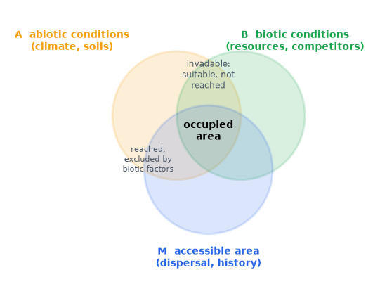
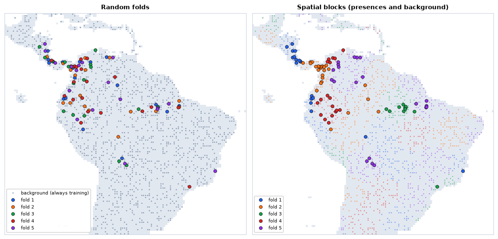
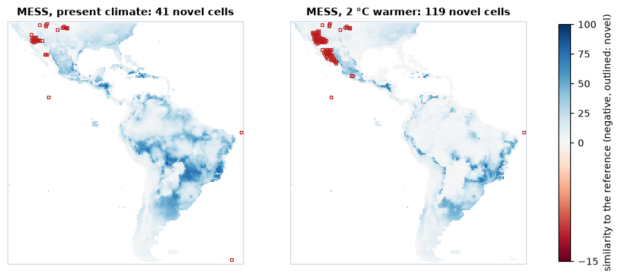

<p class="ls-chapter">Chapter 13</p>

# Species distributions

Most of this course took the habitat map as given: forest or not, a land-cover
class, a suitability surface someone else produced. For many species no such
map exists, or the one that exists says more about the vegetation than about
the animal. What we usually have instead are *records*: places where the
species was seen, collected or trapped, and maps of the environment. A
**species distribution model** (SDM; also *ecological niche model* or
*habitat suitability model*) relates the two, and projects the relationship
onto every cell of a map (Guisan & Zimmermann 2000; Elith & Leathwick 2009).
This chapter is about what such a model estimates, what goes wrong with the
data, how the models work, how to evaluate them honestly and where their
predictions can be trusted.

!!! abstract "In this chapter"
    - the niche and the distribution, the BAM diagram, presence-only and
      presence-absence data, and what background points are;
    - errors in the records and their cures: cleaning, thinning, sampling
      bias, target-group background and the accessible area;
    - predictors and collinearity (VIF);
    - the main algorithms: GLM and GAM, Maxent and its equivalence with
      point processes, random forests, boosting and ensembles;
    - evaluation: why random cross-validation is optimistic, spatial blocks,
      AUC and its limits, TSS, the Boyce index and omission rates;
    - thresholds, projection to new conditions, and extrapolation (MESS,
      MOP, ExDet);
    - common mistakes, and how suitability maps feed the other chapters.

## Niche and distribution

Hutchinson (1957) defined the **fundamental niche** of a species as the set
of environmental conditions in which it can maintain a population: a volume
in a space whose axes are temperature, rainfall, soil and the rest. The
**realized niche** is the smaller part of it the species occupies once
competitors, predators and mutualists are taken into account. Niches live in
*environmental* space; distributions live in *geographic* space, and a model
moves between the two: it learns which conditions the records occupy, then
asks where on the map those conditions occur.

The **BAM diagram** (Soberón & Peterson 2005; Peterson et al. 2011) shows
why the two spaces do not match. Three sets of places matter: **A**, where
the abiotic conditions are suitable; **B**, where the biotic conditions are
(food, hosts, no superior competitor); and **M**, the area the species has
been able to reach by dispersal over the relevant period. The species occurs
where all three overlap. Places suitable in A and B but outside M are
*invadable*: unoccupied for want of access, not of suitability.



Correlative models fitted to climate mostly estimate something between A and
the realized distribution, depending on the data and on how M was handled.
Keeping the diagram in mind prevents the commonest misreading: a suitability
map is not a map of where the species *is*.

## Presences, absences and background

With **presence-absence** data (surveys that record where the species was
looked for and not found), a model estimates the probability of presence in
a cell, for the detection effort of the survey. Most data are
**presence-only**: museum and herbarium specimens and observations
aggregated by GBIF, with no record of where people looked without success.
Presence-only models contrast the presences with **background points**: a
sample of the conditions available in the study area. Background points are
not absences; the species may well occur at some of them. The model learns
how the conditions at the presences differ from those available, which is
*relative* suitability: without knowing the prevalence of the species, the
probability of presence cannot be recovered from presence-only data (Ward et
al. 2009; Guillera-Arroita et al. 2015).

The brown-throated sloth (*Bradypus variegatus*), the classic example data of
Maxent, has 116 records in Central and South America. `ls.sdm.prepare` does
the whole preparation in one call (the [tutorial](../tutorials/species-distributions.md)
goes through every step):

```python
import numpy as np
import pandas as pd
import landschaft as ls

occ = ls.load_table(ls.sdm.example_data("bradypus"))
env = ls.load_raster(ls.sdm.example_data("bioclim"))     # 9 climate variables, 0.5 degree
data = ls.sdm.prepare(occ, env, background=2000)
print(data)
print(data.report[["step", "presences", "removed", "detail"]])
```

Three records fail the cleaning tests, 21 share a cell with an earlier record,
four collinear predictors are dropped, and 2 000 background points are drawn:
92 presences against 2 000 samples of the continent.

## Records and their problems

Occurrence data are opportunistic, and the model inherits every flaw they
have.

**Georeferencing errors.** Coordinates filled in from the name of a country
or a province put records at its centroid or capital; specimens without a
locality get the address of the museum that holds them; swapped or zeroed
coordinates put land animals in the sea or at 0° 0′. The tests of
CoordinateCleaner (Zizka et al. 2019), `ls.sdm.clean_occurrences`, flag
such records against reference data of centroids, capitals, institutions and
coastlines, and flag geographic outliers far from the other records of the
species.

**Pseudo-replication.** Several records in one cell carry the same predictor
values: kept, they weigh that cell more than the others and put copies on
both sides of a validation split. Keeping **one record per cell** of the
predictor grid is the minimum.

**Sampling bias.** Records cluster near roads, rivers, towns and research
stations. A model fitted to them learns the bias as if it were the species'
preference: if the accessible places are warmer, "warm" looks suitable.
Two cures are common. **Spatial thinning** removes records until none is
closer than a given distance to another (`ls.sdm.thin`, the algorithm of
spThin; Aiello-Lammens et al. 2015), which evens out the density of records
and often improves models (Boria et al. 2014). The **target-group
background** draws the background with the same bias as the presences: from
the records of all species of the same group collected by the same methods,
so that the bias cancels between presences and background (Phillips et al.
2009). The effort is estimated as a kernel density of those records
(`ls.sdm.bias_surface`, the bias grid of Fourcade et al. 2014) and the
background drawn in proportion to it (`ls.sdm.background(..., bias=...)`).

**The accessible area.** Background points describe the conditions the
species could have chosen from. Drawing them from places it could never have
reached (across a sea, beyond a mountain range) makes the model learn
geography, not ecology, and inflates its scores: the distant background is
easy to tell apart. The background, the selection of predictors and the
evaluation belong in **M**, the accessible area of the BAM diagram (Barve et
al. 2011; VanDerWal et al. 2009), approximated in practice by a buffer
around the records, the ecoregions they fall in, or a dispersal-informed
polygon (`ls.sdm.accessible_area`).

## Predictors and collinearity

Predictors should be chosen for their likely effect on the species
(physiological limits, water balance, resources), not because they are
available. Climate layers are strongly correlated with each other, and
correlated predictors make the contribution of each one unstable: a model
can trade one for another with almost no change in fit, and the trade
breaks down when the correlation changes, in a different region or a future
climate (Dormann et al. 2013).

The **variance inflation factor** of a predictor measures how well the
others predict it. Regress it on all the others and take

<div class="ls-formula" markdown>
VIF<sub>j</sub> = 1 / (1 − R<sub>j</sub>²)
<small>R<sub>j</sub>²: the coefficient of determination of predictor j regressed on all the others. VIF = 1 for an independent predictor; above 5 or 10, the others nearly determine it.</small>
</div>

The nine bioclimatic variables of the example include bio7, the annual range
of temperature, which is bio5 − bio6 exactly: the three are perfectly
collinear.

```python
allvars = data.redo(predictors=False)          # the same preparation, all nine predictors
print(ls.sdm.vif(allvars.X).round(1))
```

Five of the temperature variables have VIFs in the thousands or infinite.
`prepare` drops, one at a time, the predictor with the largest VIF until all
are below 10 (the stepwise procedure of the R package usdm), and keeps bio5,
bio7, bio8, bio16 and bio17. Their VIFs can be checked with ordinary least
squares:

```python
def vif_by_hand(table):
    out = {}
    for col in table.columns:
        y = table[col].to_numpy()
        X = np.column_stack([np.ones(len(table)), table.drop(columns=col).to_numpy()])
        beta, *_ = np.linalg.lstsq(X, y, rcond=None)
        r2 = 1 - ((y - X @ beta) ** 2).sum() / ((y - y.mean()) ** 2).sum()
        out[col] = 1 / (1 - r2)
    return pd.Series(out)

pd.DataFrame({"by hand": vif_by_hand(data.X),
              "ls.sdm.vif": ls.sdm.vif(data.X).set_index("variable")["vif"]}).round(3)
```

Both give VIFs between 1.4 (bio17) and 3.8 (bio8). A VIF filter is a
statistical safeguard, not a substitute for ecological reasoning: when two
correlated variables have different meanings for the species, keep the one
the biology points to (`keep=`).

## The algorithms in brief

| Family | Idea | Strengths | Watch out for |
|---|---|---|---|
| **GLM** (logistic regression) | log-odds of presence as a linear function of the predictors, with quadratic terms for unimodal responses | interpretable, smooth, extrapolates predictably | response shapes must be specified |
| **GAM** | the same with smooth functions of each predictor | flexible, still additive and interpretable | wiggly curves with few records |
| **Maxent** (Phillips et al. 2006) | a log-linear model of the relative occurrence rate, with many *features* (linear, quadratic, product, hinge, threshold) and a lasso penalty | designed for presence-background data; the most used SDM | defaults overfit small samples; tune the regularisation |
| **Random forests** (Breiman 2001) | many classification trees on bootstrap samples, averaged | interactions without specification; robust | memorises the training data; needs down-sampling of the background (Valavi et al. 2021) |
| **Boosted regression trees** (Elith et al. 2008) | trees added one at a time, each fitting what the others missed, with a small learning rate | often the most accurate | many settings; overfits without care |
| **Ensembles** (Araújo & New 2007) | an average of several models, often weighted by their scores | averages out the quirks of each | the average of biased models is still biased |

**Maxent** deserves a closer look, because it is less exotic than its name.
It models the relative occurrence rate of the species over the cells of the
study area:

<div class="ls-formula" markdown>
π(z) = exp(η(z)) / Σ<sub>i</sub> exp(η(z<sub>i</sub>)) &nbsp;&nbsp;&nbsp;&nbsp; η(z) = Σ<sub>j</sub> β<sub>j</sub> h<sub>j</sub>(z)
<small>z: the predictors in a cell; h<sub>j</sub>: features of them (z, z², products, hinges); the sum in the denominator runs over the background. The coefficients β maximise the likelihood of the presences minus a lasso penalty λ Σ |β<sub>j</sub>|, the regularisation that keeps the model simple.</small>
</div>

This is a **Poisson point process** model: presences as points scattered
over the landscape with an intensity proportional to exp(η(z)) (Warton &
Shepherd 2010; Renner & Warton 2013). It is also, exactly, the limit of a
logistic regression of presences against background points as the weight of
the background grows to infinity (Fithian & Hastie 2013): **infinitely
weighted logistic regression**. maxnet, the open-source implementation in R
(Phillips et al. 2017), fits Maxent this way, with the lasso path of glmnet.
Two consequences matter in practice. The intercept, and hence the prevalence,
is not estimable from presence-only data, so Maxent's "probabilities"
(the logistic and cloglog outputs) rest on an assumed prevalence; and the
regularisation multiplier and the feature classes are the settings to tune
(Elith et al. 2011; Muscarella et al. 2014).

No algorithm wins everywhere. In the largest comparison of presence-only
methods, tuned Maxent, down-sampled random forests, boosted trees and
ensembles performed best on average, with large differences between
species (Valavi et al. 2022). The quality of the records, the background and
the predictors usually matters more than the choice among good algorithms.

## Evaluating a model

A model is evaluated on data it was not fitted to. In **k-fold
cross-validation** the records are split into k groups (folds); each fold in
turn is predicted by a model fitted to the others.

**Why random folds are optimistic.** Records are spatially autocorrelated:
neighbours share conditions and often the same sampling trip. With random
folds, every test record has training records next to it, nearly copies of
itself, and the scores measure how well the model *interpolates* between
known points rather than how well it predicts elsewhere (Roberts et al.
2017). **Spatial blocks**, larger than the range of autocorrelation and
assigned to folds whole, keep test records away from training ones (Valavi
et al. 2019, `ls.sdm.spatial_blocks`; `prepare` uses five folds of
hexagonal blocks by default).

```python
from sklearn.ensemble import RandomForestClassifier

rf = RandomForestClassifier(n_estimators=300, min_samples_leaf=3, random_state=1)
for name, d in (("random folds", ls.sdm.random_folds(data, 5, seed=1)), ("spatial blocks", data)):
    s = ls.sdm.fit(d, {"rf": rf}).summary.loc["rf"]
    print(f"{name:15s} AUC {s['auc_test', 'mean']:.2f}  TSS {s['tss', 'mean']:.2f}  "
          f"Boyce {s['boyce', 'mean']:.2f}")
```



The same forest scores an AUC of 0.89 with random folds and 0.82 with
spatial blocks; the Boyce index falls from 0.72 to 0.52. Neither number is
wrong, but only the second says something about predicting where there are
no records.

### AUC

The **area under the ROC curve** is the probability that a random presence
gets a higher prediction than a random background point: 1 for a perfect
ranking, 0.5 for a random one. It is the Mann-Whitney statistic, and can be
computed from ranks:

<div class="ls-formula" markdown>
AUC = (R<sub>1</sub> − n<sub>1</sub>(n<sub>1</sub> + 1)/2) / (n<sub>1</sub> n<sub>0</sub>)
<small>R<sub>1</sub>: the sum of the ranks of the presences among all predictions (ties share their mean rank); n<sub>1</sub>, n<sub>0</sub>: the numbers of presences and background points.</small>
</div>

Take the crudest model imaginable: the annual range of temperature, with
the sign reversed (sloths are tropical, where temperature varies little over
the year).

```python
score = -data.X["bio7"].to_numpy()             # the less seasonal, the more suitable
pres, bg = score[data.y == 1], score[data.y == 0]
ranks = pd.Series(np.concatenate([pres, bg])).rank().to_numpy()
n1, n0 = len(pres), len(bg)
auc = (ranks[:n1].sum() - n1 * (n1 + 1) / 2) / (n1 * n0)
e = ls.sdm.evaluate(pres, bg)
print(f"AUC by hand {auc:.4f}, ls.sdm.evaluate {e.stats['auc']:.4f}")
```

One variable, no fitting, and an AUC of 0.86, higher than the random
forest scored on spatial blocks. AUC has well-known limits (Lobo et al.
2008). With background points it cannot reach 1, because the species may
occur at some of them. It
rewards a model for telling the species apart from far-away, obviously
unsuitable land, so the same model scores higher with a larger study area:
AUCs of models with different backgrounds cannot be compared. And it weighs
the whole ranking, including parts no one will use. Report it, but not
alone.

### TSS, the Boyce index and omission

The **true skill statistic** (Allouche et al. 2006) evaluates a threshold:
sensitivity (the share of presences predicted present) plus specificity
(the share of background or absences predicted absent) minus 1. It ranges
from −1 to 1, with 0 for a random model; the maximum over all thresholds is
reported.

```python
t = e.thresholds["max_spec_sens"]               # the threshold of maximum TSS
sens, spec = (pres >= t).mean(), (bg < t).mean()
print(f"TSS by hand {sens + spec - 1:.4f}, ls.sdm.evaluate {e.stats['max_tss']:.4f}")
```

With background points, "specificity" is the share of the available area
predicted unsuitable, so TSS too depends on the extent.

The **continuous Boyce index** (Boyce et al. 2002; Hirzel et al. 2006) was
designed for presence-only data. A window slides along the range of
predictions; in each, it compares the share of presences with the share of
the background predicted in that window:

<div class="ls-formula" markdown>
F<sub>i</sub> = P<sub>i</sub> / E<sub>i</sub> &nbsp;&nbsp;&nbsp;&nbsp; Boyce = Spearman correlation of F<sub>i</sub> with the suitability of window i
<small>P<sub>i</sub>: the share of the presences predicted in window i; E<sub>i</sub>: the share of the background. A good model has F &lt; 1 at low suitability and F &gt; 1 at high suitability, rising steadily: Boyce near 1. Near 0 the model is no better than chance; negative, worse.</small>
</div>

**Omission rates** detect overfitting (Radosavljevic & Anderson 2014;
Muscarella et al. 2014). Set a threshold on the training presences, either
the lowest prediction at any of them (*minimum training presence*) or the
one 10 % of them fall below; then count the test presences below it. A model
that generalises omits about 0 % and 10 % of them; much more means it has
memorised the training records. So does a large gap between the training and
the test AUC. `ls.sdm.fit` reports all of these per fold: `auc_train`,
`auc_test`, `auc_diff`, `tss`, `boyce`, `or_mtp` and `or_10p`.

## Thresholds

Many uses need a map of presence and absence: a range size, an overlap with
protected areas, the habitat of an MSPA or a graph. A **threshold** turns
continuous suitability into a binary map, and the choice changes the area
mapped. For presence-only data, the threshold that maximises sensitivity
plus specificity (maximum TSS) performs well and is a sound default (Liu et
al. 2013). The minimum training presence (the lowest prediction at any
presence) and the 10th percentile of the presences keep all or 90 % of the
records inside the mapped range, at the cost of a larger area. Keep the continuous map wherever the
analysis allows it: a threshold throws away the gradient, as it does for
any continuous surface ([chapter 11](surfaces.md#patches-or-gradients)).

## Projection and extrapolation

Models are projected to other regions and other times: the effect of a
future climate, the risk of an invasion. A correlative model only knows the
conditions it was fitted to; beyond them it **extrapolates**, and different
algorithms extrapolate in different, mostly arbitrary ways: a GLM's
quadratic keeps falling, a tree stays flat at its last value. Two
precautions are standard.

**Clamping** holds every predictor at the edge of its training range before
predicting, so that responses stay flat outside it (`ls.sdm.predict` clamps
by default, as Maxent does).

**Mapping novelty** shows where the projection should not be trusted. The
**multivariate environmental similarity surface** (MESS; Elith et al. 2010)
compares each predictor in each cell with its distribution in the reference
data. If f is the percentage of reference values at or below the cell's
value p:

<div class="ls-formula" markdown>
similarity = 2f if f ≤ 50; &nbsp; 2(100 − f) if 50 &lt; f &lt; 100; &nbsp; 100 (p − min)/(max − min) if f = 0; &nbsp; 100 (max − p)/(max − min) if f = 100
<small>Positive inside the reference range (100 at the median), negative outside it (in percent of the range). The MESS of a cell is the smallest similarity over its predictors: negative where at least one is outside anything the model saw.</small>
</div>

A warmer climate, 2 °C on every temperature variable (the bioclimatic
temperatures are in tenths of a degree), checked for one cell by hand:

```python
temps = ["bio1", "bio5", "bio6", "bio8", "bio9"]          # bio7, a range, does not change
warmer = env.copy()
warmer.loc[{"band": temps}] = env.sel(band=temps) + 20

def similarity(p, v):
    f = 100 * (v <= p).mean()
    if f == 0:
        return 100 * (p - v.min()) / (v.max() - v.min())
    if f == 100:
        return 100 * (v.max() - p) / (v.max() - v.min())
    return 2 * f if f <= 50 else 2 * (100 - f)

new = warmer.sel(band=data.predictors)
cell = new.sel(x=-60.25, y=-3.25).to_pandas()                # near Manaus
by_hand = min(similarity(cell[p], data.X[p].to_numpy()) for p in data.predictors)
m = ls.sdm.mess(data, new)
print(round(by_hand, 3), round(float(m.sel(band="mess", x=-60.25, y=-3.25)), 3))
present = ls.sdm.mess(data, env.sel(band=data.predictors)).sel(band="mess")
print(int((present < 0).sum()), "cells novel today,", int((m.sel(band="mess") < 0).sum()), "if 2 degrees warmer")
```



With the whole map as reference, 41 cells are novel today and 119 in the
warmer climate, nearly all of them in the deserts of north-western Mexico
and the south-western United States: the hottest places of today have no
analogue once they warm, because nothing in the data is hotter. There the
projection is a guess, whatever the model says.

MESS looks at one predictor at a time. A cell can be inside every range and
still hold a *combination* never seen, warm and dry where the warm places of
the reference were wet. **ExDet** (Mesgaran et al. 2014; `ls.sdm.exdet`)
separates the two kinds of novelty: NT1 below 0 for values outside the
ranges, NT2 above 1 for new combinations, measured by the Mahalanobis
distance to the reference (here it finds the same 119 cells, and no new
combination). The **mobility-oriented parity** (MOP; Owens et al. 2013;
`ls.sdm.mop`) measures the distance from each cell to its nearest reference
conditions, and flags the cells outside the ranges.

## Common mistakes

| Mistake | Better |
|---|---|
| raw GBIF records straight into the model | clean the coordinates, one record per cell, check the flags by eye |
| background from the whole continent or the whole world | background from the accessible area M; report how M was set |
| ignoring sampling bias | thin the records, or a target-group background |
| dozens of collinear climate layers | few predictors with an ecological rationale; VIF or correlation filter |
| random cross-validation, AUC alone | spatial blocks; AUC with TSS, Boyce and omission rates |
| comparing AUCs of models with different study areas | compare models on the same background and folds |
| reading presence-only suitability as probability of presence | relative suitability; probabilities need presence-absence data or a known prevalence |
| default settings of Maxent, random forests or boosting | tune complexity on spatial folds; down-sample random forests |
| projecting to new climates without checking novelty | MESS, MOP or ExDet maps with every projection; clamp |
| one threshold applied without saying which | report the method; keep the continuous map where possible |

## Distributions in the landscape

A suitability map is the beginning of most of the analyses of this course.
Thresholded, it is the **habitat** of a species: the input of fragmentation
analyses ([chapter 3](fragmentation.md)), MSPA ([chapter 4](morphology.md)),
landscape metrics ([chapter 5](metrics.md)) and habitat networks, whose
patches and areas then belong to the species rather than to a land-cover
class ([chapter 7](networks.md)). Inverted, it is a **resistance surface**
for cost distances and circuits ([chapters 6](connectivity.md),
[8](circuits.md) and [9](restoration.md)); the transformation matters, and
negative exponential ones, in which resistance stays low until suitability
is quite poor, usually fit movement data better than a straight inversion
(Keeley et al. 2016). And maps of many species are the **features** of a
spatial prioritization ([chapter 12](prioritization.md)), where their errors
pass into the ranking, as that chapter warned. In every case, the
uncertainty of the model (the disagreement between algorithms, the
extrapolated areas) is worth carrying forward: a corridor or a priority
that only appears under one model is a weak one.

!!! success "Key points"
    - A distribution model relates records to the environment; it estimates
      suitability within the area the species could reach, not the
      distribution itself (BAM).
    - Presence-only models contrast presences with background points: they
      give relative suitability, not probability of presence.
    - Clean the records, keep one per cell, deal with sampling bias
      (thinning, target-group background) and draw the background from the
      accessible area.
    - Few, ecologically meaningful, not collinear predictors (VIF).
    - Maxent is a Poisson point process model, a logistic regression with
      infinitely weighted background; random forests and boosting need
      settings that prevent memorising.
    - Evaluate on spatial blocks, with several metrics (AUC, TSS, Boyce,
      omission rates); AUC depends on the study area.
    - Clamp projections and map where they extrapolate (MESS, MOP, ExDet).

## Check your understanding

1. A model of a lowland species fitted with background points from the whole
   of South America has an AUC of 0.95; refitted with background from a
   500 km buffer around the records, 0.70. Has the model become worse?
2. Why does a random forest with default settings often have a training AUC
   of 1 and a 10 % omission rate close to 1 on test folds?
3. A projection to 2070 shows high suitability in a region with negative
   MESS. What can you conclude about that region?

??? success "Answers"
    1. Not necessarily. With the whole continent as background, most
       background points are in places obviously unlike the records (cold
       mountains, deserts), and telling them apart is easy. The buffer
       leaves only plausible alternatives, a harder and more relevant task.
       AUCs from different backgrounds cannot be compared; the second model
       is probably the more useful one.
    2. Its trees are grown until every leaf is pure, so each presence is
       predicted almost perfectly from the trees that saw it: the training
       predictions at presences are near 1, and the threshold set on them is
       far above the predictions at new presences. The forest has memorised
       the records; limit the size of its leaves and the samples of its
       trees, or down-sample the background.
    3. Little. At least one predictor is outside the range of the data the
       model was fitted to, so the prediction there is an extrapolation
       whose shape depends on the algorithm (and on clamping), not on
       evidence. Report the area as uncertain, and check which predictor
       drives the novelty.

## References

<div class="ls-refs" markdown>

- Aiello-Lammens, M. E., Boria, R. A., Radosavljevic, A., Vilela, B., & Anderson, R. P. (2015). spThin: an R package for spatial thinning of species occurrence records for use in ecological niche models. *Ecography*, 38(5), 541–545.
- Allouche, O., Tsoar, A., & Kadmon, R. (2006). Assessing the accuracy of species distribution models: prevalence, kappa and the true skill statistic (TSS). *Journal of Applied Ecology*, 43(6), 1223–1232.
- Araújo, M. B., & New, M. (2007). Ensemble forecasting of species distributions. *Trends in Ecology & Evolution*, 22(1), 42–47.
- Barve, N., Barve, V., Jiménez-Valverde, A., Lira-Noriega, A., Maher, S. P., Peterson, A. T., Soberón, J., & Villalobos, F. (2011). The crucial role of the accessible area in ecological niche modeling and species distribution modeling. *Ecological Modelling*, 222(11), 1810–1819.
- Boria, R. A., Olson, L. E., Goodman, S. M., & Anderson, R. P. (2014). Spatial filtering to reduce sampling bias can improve the performance of ecological niche models. *Ecological Modelling*, 275, 73–77.
- Boyce, M. S., Vernier, P. R., Nielsen, S. E., & Schmiegelow, F. K. A. (2002). Evaluating resource selection functions. *Ecological Modelling*, 157(2–3), 281–300.
- Breiman, L. (2001). Random forests. *Machine Learning*, 45, 5–32.
- Dormann, C. F., Elith, J., Bacher, S., Buchmann, C., Carl, G., Carré, G., et al. (2013). Collinearity: a review of methods to deal with it and a simulation study evaluating their performance. *Ecography*, 36(1), 27–46.
- Elith, J., Kearney, M., & Phillips, S. (2010). The art of modelling range-shifting species. *Methods in Ecology and Evolution*, 1(4), 330–342.
- Elith, J., & Leathwick, J. R. (2009). Species distribution models: ecological explanation and prediction across space and time. *Annual Review of Ecology, Evolution, and Systematics*, 40, 677–697.
- Elith, J., Leathwick, J. R., & Hastie, T. (2008). A working guide to boosted regression trees. *Journal of Animal Ecology*, 77(4), 802–813.
- Elith, J., Phillips, S. J., Hastie, T., Dudík, M., Chee, Y. E., & Yates, C. J. (2011). A statistical explanation of MaxEnt for ecologists. *Diversity and Distributions*, 17(1), 43–57.
- Fithian, W., & Hastie, T. (2013). Finite-sample equivalence in statistical models for presence-only data. *Annals of Applied Statistics*, 7(4), 1917–1939.
- Guillera-Arroita, G., Lahoz-Monfort, J. J., Elith, J., Gordon, A., Kujala, H., Lentini, P. E., et al. (2015). Is my species distribution model fit for purpose? Matching data and models to applications. *Global Ecology and Biogeography*, 24(3), 276–292.
- Guisan, A., & Zimmermann, N. E. (2000). Predictive habitat distribution models in ecology. *Ecological Modelling*, 135(2–3), 147–186.
- Hirzel, A. H., Le Lay, G., Helfer, V., Randin, C., & Guisan, A. (2006). Evaluating the ability of habitat suitability models to predict species presences. *Ecological Modelling*, 199(2), 142–152.
- Hutchinson, G. E. (1957). Concluding remarks. *Cold Spring Harbor Symposia on Quantitative Biology*, 22, 415–427.
- Keeley, A. T. H., Beier, P., & Gagnon, J. W. (2016). Estimating landscape resistance from habitat suitability: effects of data source and nonlinearities. *Landscape Ecology*, 31(9), 2151–2162.
- Liu, C., White, M., & Newell, G. (2013). Selecting thresholds for the prediction of species occurrence with presence-only data. *Journal of Biogeography*, 40(4), 778–789.
- Lobo, J. M., Jiménez-Valverde, A., & Real, R. (2008). AUC: a misleading measure of the performance of predictive distribution models. *Global Ecology and Biogeography*, 17(2), 145–151.
- Mesgaran, M. B., Cousens, R. D., & Webber, B. L. (2014). Here be dragons: a tool for quantifying novelty due to covariate range and correlation change when projecting species distribution models. *Diversity and Distributions*, 20(10), 1147–1159.
- Muscarella, R., Galante, P. J., Soley-Guardia, M., Boria, R. A., Kass, J. M., Uriarte, M., & Anderson, R. P. (2014). ENMeval: an R package for conducting spatially independent evaluations and estimating optimal model complexity for Maxent ecological niche models. *Methods in Ecology and Evolution*, 5(11), 1198–1205.
- Owens, H. L., Campbell, L. P., Dornak, L. L., Saupe, E. E., Barve, N., Soberón, J., et al. (2013). Constraints on interpretation of ecological niche models by limited environmental ranges on calibration areas. *Ecological Modelling*, 263, 10–18.
- Peterson, A. T., Soberón, J., Pearson, R. G., Anderson, R. P., Martínez-Meyer, E., Nakamura, M., & Araújo, M. B. (2011). *Ecological Niches and Geographic Distributions*. Princeton University Press.
- Phillips, S. J., Anderson, R. P., Dudík, M., Schapire, R. E., & Blair, M. E. (2017). Opening the black box: an open-source release of Maxent. *Ecography*, 40(7), 887–893.
- Phillips, S. J., Anderson, R. P., & Schapire, R. E. (2006). Maximum entropy modeling of species geographic distributions. *Ecological Modelling*, 190(3–4), 231–259.
- Phillips, S. J., Dudík, M., Elith, J., Graham, C. H., Lehmann, A., Leathwick, J., & Ferrier, S. (2009). Sample selection bias and presence-only distribution models: implications for background and pseudo-absence data. *Ecological Applications*, 19(1), 181–197.
- Radosavljevic, A., & Anderson, R. P. (2014). Making better Maxent models of species distributions: complexity, overfitting and evaluation. *Journal of Biogeography*, 41(4), 629–643.
- Renner, I. W., & Warton, D. I. (2013). Equivalence of MAXENT and Poisson point process models for species distribution modeling in ecology. *Biometrics*, 69(1), 274–281.
- Roberts, D. R., Bahn, V., Ciuti, S., Boyce, M. S., Elith, J., Guillera-Arroita, G., et al. (2017). Cross-validation strategies for data with temporal, spatial, hierarchical, or phylogenetic structure. *Ecography*, 40(8), 913–929.
- Soberón, J., & Peterson, A. T. (2005). Interpretation of models of fundamental ecological niches and species' distributional areas. *Biodiversity Informatics*, 2, 1–10.
- Valavi, R., Elith, J., Lahoz-Monfort, J. J., & Guillera-Arroita, G. (2019). blockCV: an R package for generating spatially or environmentally separated folds for k-fold cross-validation of species distribution models. *Methods in Ecology and Evolution*, 10(2), 225–232.
- Valavi, R., Elith, J., Lahoz-Monfort, J. J., & Guillera-Arroita, G. (2021). Modelling species presence-only data with random forests. *Ecography*, 44(12), 1731–1742.
- Valavi, R., Guillera-Arroita, G., Lahoz-Monfort, J. J., & Elith, J. (2022). Predictive performance of presence-only species distribution models: a benchmark study with reproducible code. *Ecological Monographs*, 92(1), e01486.
- VanDerWal, J., Shoo, L. P., Graham, C., & Williams, S. E. (2009). Selecting pseudo-absence data for presence-only distribution modeling: how far should you stray from what you know? *Ecological Modelling*, 220(4), 589–594.
- Ward, G., Hastie, T., Barry, S., Elith, J., & Leathwick, J. R. (2009). Presence-only data and the EM algorithm. *Biometrics*, 65(2), 554–563.
- Warton, D. I., & Shepherd, L. C. (2010). Poisson point process models solve the "pseudo-absence problem" for presence-only data in ecology. *Annals of Applied Statistics*, 4(3), 1383–1402.
- Zizka, A., Silvestro, D., Andermann, T., Azevedo, J., Duarte Ritter, C., Edler, D., et al. (2019). CoordinateCleaner: standardized cleaning of occurrence records from biological collection databases. *Methods in Ecology and Evolution*, 10(5), 744–751.

</div>
