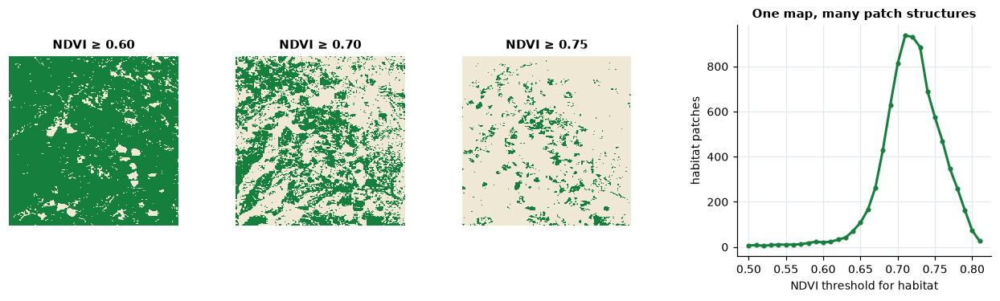
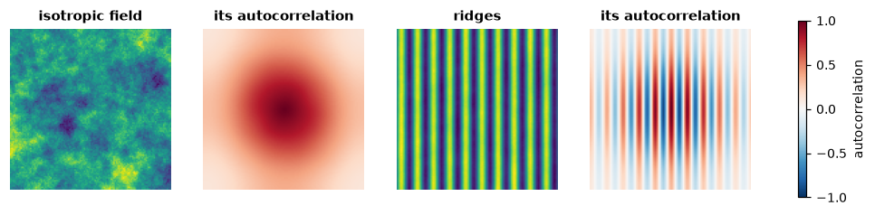

<p class="ls-chapter">Chapter 11</p>

# Continuous surfaces

Every chapter so far looked at landscapes through categorical maps: habitat
or not, forest or pasture, patches with sharp edges. Much of what shapes
organisms is not categorical at all. Canopy height, greenness, soil moisture,
temperature and elevation change gradually, and a forest thinning into
woodland has no edge to draw. This chapter treats the landscape as a
*surface*: a continuous variable measured in every cell, described by how it
varies rather than by the patches a threshold would cut out of it.

!!! abstract "In this chapter"
    - the patch-mosaic and the gradient models of landscape structure, and
      what a threshold does to a continuous map;
    - surface metrics: amplitude, height distribution, slopes and features,
      computed by hand on a tiny surface;
    - the bearing area curve;
    - the spatial structure of a surface: autocorrelation, anisotropy,
      direction, wavelength, fractal dimension;
    - surfaces in moving windows, and terrain indices of elevation models;
    - pitfalls in measuring surfaces.

## Patches or gradients?

The **patch-mosaic model**, on which landscape metrics rest
([chapter 5](metrics.md)), sees a landscape as discrete, internally uniform
patches with abrupt boundaries. It fits many human-shaped landscapes: a field
ends at a fence. The **gradient model** (McGarigal & Cushman, 2005) sees
structure as continuous variation in space, of which patches are a special
case. It fits variables that change gradually, and the way organisms respond
to many of them: a bird does not switch from forest to non-forest at 60 %
canopy cover.

Turning a continuous variable into patches needs a threshold, and the
threshold is rarely given by the ecology. The patch structure can depend on
it more than on the landscape:

```python
import numpy as np
import landschaft as ls

ndvi = ls.load_raster(ls.surface.example_data("orforest"))
for t in (0.60, 0.65, 0.70, 0.75):
    habitat = np.where(ndvi.values >= t, 2, 1).astype("uint8")
    m = ls.Landscape(habitat).class_metrics(["pland", "np"]).set_index("class").loc[2]
    print(f"NDVI >= {t:.2f}: {m['pland']:5.1f} % habitat in {int(m['np']):5d} patches")
```



At NDVI 0.60 the "forest" covers 92 % of the map in 21 patches; at 0.70 it
covers 42 % in 814 patches, at 0.75 only 9 % in 574. Nothing in the landscape
changed: only the threshold. Surface metrics describe the map
without choosing one (McGarigal et al., 2009).

## The reference surface

Surface metrics come from the measurement of engineered surfaces, where
roughness is measured as deviations from a reference plane; they are
standardised as ISO 25178. In a landscape the reference is the broad trend
of the variable: a gradient of greenness from one side of the map to the
other is not texture. The first step is therefore to remove it, fitting a
polynomial surface in the coordinates and keeping the residuals:

```python
z = ls.surface.remove_plane(ndvi)       # residuals from the best polynomial of order 0-3
print(z.attrs["order"], round(float(z.mean()), 12))
```

Everything that follows describes `z`, heights above (positive) and below
(negative) the trend.

## Surface metrics by hand

A tiny surface of 4 × 4 cells is enough to see the main metrics:

```python
toy = np.array([[ 0.2, -0.1,  0.0,  0.3],
                [-0.4,  0.1,  0.5, -0.2],
                [ 0.1, -0.3,  0.2,  0.0],
                [ 0.0,  0.4, -0.2, -0.6]])
dev = toy - toy.mean()
```

### Amplitude

The average roughness Sa and the root mean square roughness Sq measure how
far the surface strays from its mean:

<div class="ls-formula" markdown>
Sa = (1/N) Σ |z<sub>i</sub> − z̄|  &nbsp;&nbsp;&nbsp;&nbsp; Sq = √[ (1/N) Σ (z<sub>i</sub> − z̄)² ]
<small>N: number of cells with a value; z̄: their mean. Sq weights large deviations more than Sa.</small>
</div>

```python
by_hand = {"Sa": np.abs(dev).mean(), "Sq": np.sqrt((dev ** 2).mean())}
tool = ls.surface.metrics(toy, ["sa", "sq"])
print(by_hand, tool.to_dict())
```

### The shape of the height distribution

Two surfaces with the same Sq can look very different. The skewness Ssk and
the kurtosis Sku describe the distribution of heights:

<div class="ls-formula" markdown>
Ssk = (1/Sq³) (1/N) Σ (z<sub>i</sub> − z̄)³  &nbsp;&nbsp;&nbsp;&nbsp; Sku = (1/Sq⁴) (1/N) Σ (z<sub>i</sub> − z̄)⁴ − 3
<small>Ssk &lt; 0: deep valleys in a plateau (a closed forest with clearings); Ssk &gt; 0: peaks above a plain (scattered trees in grassland). Sku &gt; 0: a peaked distribution with long tails, a few extreme cells; Sku = 0 for a normal distribution.</small>
</div>

```python
sq = np.sqrt((dev ** 2).mean())
g1 = (dev ** 3).mean() / sq ** 3
print(g1, ls.surface.ssk(toy, adj=False))
print((dev ** 4).mean() / sq ** 4 - 3, ls.surface.sku(toy))
```

`ssk` by default multiplies by √(N(N−1))/(N−2), the adjusted coefficient
that corrects the bias of small samples.

### Slopes and features

Sdq, the root mean square slope, averages the squared height differences
between each cell and its right and lower neighbours; Sdr compares the
area of the surface, triangulated between cell centres, with the area of its
footprint. Peaks are cells higher than their eight neighbours (and than the
reference plane); Sds is their density:

```python
right = toy[:-1, :-1] - toy[:-1, 1:]
down = toy[:-1, :-1] - toy[1:, :-1]
print(np.sqrt((right ** 2 + down ** 2).mean()), ls.surface.sdq(toy))
print(ls.surface.find_peaks(toy))
```

On the 4 × 4 surface only the four inner cells can be peaks, and one is:
0.5, above all eight neighbours.

## The bearing area curve

Sort the heights from the highest and plot, for each, the share of the
surface at or above it: this is the **bearing area curve** (Abbott-Firestone
curve). Its top shows the peaks, its bottom the valleys, and its middle, the
*core*, the bulk of the surface. A straight line fitted to the flattest 40 %
of the curve separates the core (height range Sk) from the peaks above it
(Spk) and the valleys below it (Svk). The void volumes between the curve and
its top measure how much "room" the core and the valleys leave (Sci, Svi).

```python
curve = ls.surface.bearing_area(toy)
print(curve)
print(ls.surface.height_ba(toy, 0.5))     # the height with half the surface above it
```

On a forest's greenness, a long valley tail (large Svk) means a closed
canopy with deep, rare gaps; a long peak tail (large Spk), scattered crowns
rising above a lower canopy.

## Spatial structure

The metrics above ignore where the heights are: shuffling the cells leaves
them unchanged, as composition metrics are unchanged by shuffling
([chapter 5](metrics.md#composition-and-configuration)). Spatial metrics look
at arrangement.

- The **areal autocorrelation function** (`aacf`) gives, for every lag (a
  shift in x and y), how similar the surface is to itself shifted by that
  lag: 1 at zero lag, falling with distance. The **autocorrelation length**
  Sal is the shortest distance at which it drops to 0.2: the size of the
  "grain" of the texture ([chapter 2](scale.md)).
- The **texture aspect ratio** Str divides the shortest decay length by the
  longest: near 1 for an isotropic surface (the same in every direction),
  near 0 for a surface stretched in one direction, like ridges and valleys
  or rows of trees.
- The **Fourier spectrum** decomposes the surface into waves. Summing its
  amplitude by angle gives the dominant direction of the texture (Std), by
  radius the dominant frequency (Srw, a radius in the spectrum: the number
  of repetitions across the map, times the cell size).
- The **fractal dimension** Sfd, between 2 (a smooth surface) and 3 (a
  surface so rough that it fills space), measures how fast the surface area
  grows as it is measured with finer cells (Clarke, 1986).

```python
field = ls.nlm.gaussian_field(120, 120, autocorr_range=15, seed=1)
x = np.arange(120)
ridges = np.sin(2 * np.pi * x / 12)[None, :] + 0.3 * field.values
for name, s in (("isotropic field", field), ("ridges", ridges)):
    lengths = ls.surface.scl(s)
    print(f"{name:16s} Sal {lengths[0]:5.1f}  Str {ls.surface.stxr(s)[0]:.2f}  "
          f"Std {ls.surface.std(s)[0]:5.1f}  Srw {ls.surface.srw(s)[0]:5.1f}")
```



The Gaussian field decays at about the same rate in every direction (Str
0.73); the ridges stay correlated along their length and alternate across
it, which shows as a short Sal (3 cells, a quarter of their period), a low Str
(0.04), a direction of 0 degrees (the texture varies along x) and an Srw of
about 10: the ridges repeat 10 times across the 120 cells, a wavelength of
120 / 10 = 12 cells.

## Surfaces in moving windows

A single value per map hides where the surface is rough and where it is
smooth. Computing a metric in a window around every cell gives a *texture
image*, a map of heterogeneity that can enter a species distribution model
like any other covariate. The window size is the scale of the analysis
([chapter 2](scale.md)): choose it from the organism's perceptual range or
home range, not from the map.

```python
texture = ls.surface.window_metrics(z, ["sa", "sku"], window=9)
print(float(texture["sa"].mean()), float(texture["sku"].mean()))
```

## Elevation: terrain indices

A digital elevation model (DEM) is the most common surface of all, and
terrain has indices of its own, many of them designed with ecology in mind:

- **Slope and aspect**, from the height differences of the 3 × 3
  neighbourhood (Horn, 1981).
- **Topographic position index** (TPI; Weiss, 2001): the elevation minus
  the mean of a window. Positive on ridges and hilltops, negative in valleys
  and hollows, near 0 on flats and even slopes; with windows of several
  sizes it separates small hollows from large valleys. The hierarchical
  slope position (`hsp`; Murphy et al., 2010) sums it over scales.
- **Ruggedness**: the terrain ruggedness index (TRI; Riley et al., 1999)
  from the elevation differences with the neighbours, the vector ruggedness
  measure (VRM; Sappington et al., 2007) from the dispersion of the
  surface's orientation, so that a steep but even slope is not rugged.
- **Curvature** (Zevenbergen & Thorne, 1987): profile curvature along the
  slope (accelerating or slowing flow), planform curvature across it
  (converging or diverging flow).
- **Heat load** (McCune & Keon, 2002): potential solar radiation from
  slope, aspect and latitude, the warm south-west slopes of the northern
  hemisphere against the cool north-east ones; `trasp` is a simpler
  transformation of aspect (Roberts & Cooper, 1989).

The TPI of a cell is easy to check by hand:

```python
dem = ls.load_raster(ls.surface.example_data("orelevation"))
tpi = ls.surface.tpi(dem, 3)
window = dem.values[99:102, 199:202]
print(dem.values[100, 200] - window.mean(), float(tpi.values[100, 200]))
```

## Pitfalls

- **Remove the trend deliberately.** Metrics of a surface with a trend
  mostly measure the trend. `remove_plane` chooses the order of the
  polynomial by BIC; if the trend is ecologically meaningful (an elevation
  gradient), decide whether it is part of what you want to measure.
- **Units.** Amplitude metrics are in the units of the variable; slopes in
  units per cell; Sal and Srw in map units (metres on longitude/latitude
  rasters). Sdr and Ssc are computed on heights rescaled to 0–1, so they
  compare surfaces measured in different units.
- **Noise is roughness.** Sensor noise, clouds and stripes in imagery add
  to Sa, Sdq and the fractal dimension. Smooth or mask them first, and
  compare maps from the same sensor and processing.
- **Resolution.** Like landscape metrics, surface metrics depend on the
  grain ([chapter 2](scale.md)): slopes and roughness in particular. Compare
  maps at the same resolution.
- **Redundancy.** Sa and Sq, or Sdq and Sdr, are strongly correlated; a
  handful from different families (amplitude, distribution, spatial) says
  most of what the full set says, as with patch metrics
  ([chapter 5](metrics.md#redundancy-fewer-metrics-than-you-think)).
- **Edges and missing cells.** Windows that reach the edge of the map or a
  missing cell give missing values (or, for the Fourier metrics, use the
  largest square without missing cells).

!!! success "Key points"
    - Continuous variables need not be thresholded: surface metrics describe
      them directly, and thresholds can change patch structure more than the
      landscape does.
    - Remove the trend, then describe amplitude (Sa, Sq), the height
      distribution (Ssk, Sku, the bearing area curve), slopes and features
      (Sdq, Sdr, Sds) and spatial structure (Sal, Str, Std, Srw, Sfd).
    - Texture images map heterogeneity at a chosen scale.
    - Terrain indices (TPI, TRI, VRM, curvature, heat load) turn a DEM into
      ecologically meaningful variables.

## Check your understanding

1. Two forests have the same Sq of NDVI residuals, but one has Ssk = −2 and
   the other Ssk = +2. Describe each canopy.
2. Why does the number of habitat patches in the NDVI example change so
   much between thresholds 0.60 and 0.75?
3. A surface has a texture aspect ratio (Str) of 0.05. What does it look
   like, and which metric tells its orientation?

??? success "Answers"
    1. Ssk = −2: most cells are slightly above the mean, with rare, deep
       lows: a closed canopy with a few gaps or clearings. Ssk = +2: most
       cells slightly below the mean, with rare high cells: an open canopy
       with scattered dense crowns.
    2. Most cells lie between those values: the threshold cuts through the
       bulk of the height distribution, so small changes of threshold move
       many cells across it, splitting and merging patches. The landscape did
       not change; the definition of habitat did.
    3. Strongly anisotropic: stretched in one direction, like ridges,
       valleys or rows. The texture direction Std gives the orientation
       (and the wavelength Srw the spacing of the ridges).

## References

<div class="ls-refs" markdown>

- Clarke, K. C. (1986). Computation of the fractal dimension of topographic surfaces using the triangular prism surface area method. *Computers & Geosciences*, 12(5), 713–722.
- Horn, B. K. P. (1981). Hill shading and the reflectance map. *Proceedings of the IEEE*, 69(1), 14–47.
- ISO 25178-2 (2012). *Geometrical product specifications (GPS) — Surface texture: Areal — Part 2: Terms, definitions and surface texture parameters*. International Organization for Standardization.
- McCune, B., & Keon, D. (2002). Equations for potential annual direct incident radiation and heat load. *Journal of Vegetation Science*, 13(4), 603–606.
- McGarigal, K., & Cushman, S. A. (2005). The gradient concept of landscape structure. In J. A. Wiens & M. R. Moss (Eds.), *Issues and Perspectives in Landscape Ecology* (pp. 112–119). Cambridge University Press.
- McGarigal, K., Tagil, S., & Cushman, S. A. (2009). Surface metrics: an alternative to patch metrics for the quantification of landscape structure. *Landscape Ecology*, 24, 433–450.
- Murphy, M. A., Evans, J. S., & Storfer, A. (2010). Quantifying *Bufo boreas* connectivity in Yellowstone National Park with landscape genetics. *Ecology*, 91(1), 252–261.
- Riley, S. J., DeGloria, S. D., & Elliot, R. (1999). A terrain ruggedness index that quantifies topographic heterogeneity. *Intermountain Journal of Sciences*, 5(1–4), 23–27.
- Roberts, D. W., & Cooper, S. V. (1989). Concepts and techniques of vegetation mapping. In *Land Classifications Based on Vegetation: Applications for Resource Management* (pp. 90–96). USDA Forest Service General Technical Report INT-257.
- Sappington, J. M., Longshore, K. M., & Thompson, D. B. (2007). Quantifying landscape ruggedness for animal habitat analysis: a case study using bighorn sheep in the Mojave Desert. *Journal of Wildlife Management*, 71(5), 1419–1426.
- Smith, A. C., Dahlin, K. M., Record, S., Costanza, J. K., Wilson, A. M., & Zarnetske, P. L. (2021). The geodiv R package: tools for calculating gradient surface metrics. *Methods in Ecology and Evolution*, 12(11), 2094–2100.
- Weiss, A. D. (2001). *Topographic position and landforms analysis*. Poster presentation, ESRI User Conference, San Diego, CA.
- Zevenbergen, L. W., & Thorne, C. R. (1987). Quantitative analysis of land surface topography. *Earth Surface Processes and Landforms*, 12(1), 47–56.

</div>
