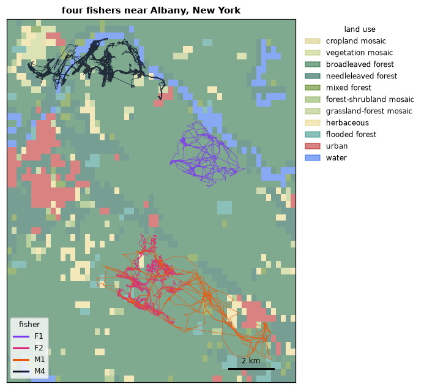
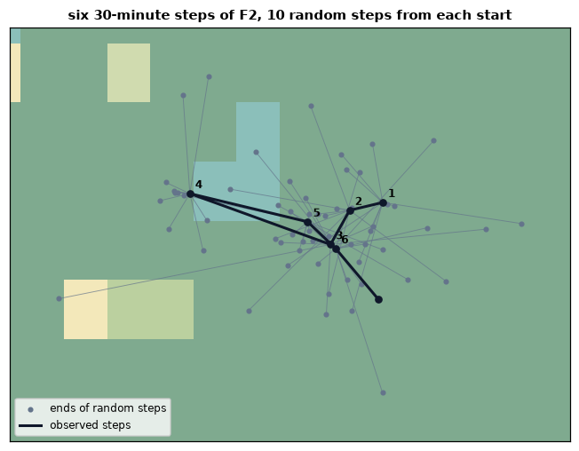

# Animal movement

A GPS collar records where an animal was, every few minutes, for weeks. A
track like that says how far and how fast the animal moves, how often it
turns, when it rests, and, set against maps of the landscape, which places it
seeks and which it avoids. This tutorial reads the tracks of fishers, a
forest carnivore, cleans them, measures their steps, and prepares the data of
a step selection function: every observed step next to the steps the animal
could have taken instead, with the landscape at the end of each.

**You will learn to:**

- read a Movebank file and drop the records without a location;
- measure the distance, duration, speed and turn of every step;
- thin a track, interpolate it, draw it as lines and project it locally;
- resample tracks at a regular rate, in bursts, and turn them into steps;
- summarize tracks: straightness, sinuosity, net squared displacement;
- draw random steps from fitted step-length and turn-angle distributions;
- attach the landscape to every step, observed or random.

Everything lives in `ls.move`. The [Learn chapter](../learn/movement.md)
explains the ideas behind steps and step selection.

## Reading the tracks

The example tracks are those of eight fishers (*Pekania pennanti*) tagged
near Albany, New York, in the winters of 2009 to 2011 (LaPoint et al. 2013),
as Movebank exports them. `load_tracks` reads the CSV (also `.csv.gz` and
Movebank's `.zip`) into a GeoDataFrame of points in longitude and latitude,
one row per record, ordered by animal and time:

```python
import numpy as np
import pandas as pd
import landschaft as ls

pd.set_option("display.width", 120, "display.max_columns", 10)
tracks = ls.load_tracks(ls.move.example_data("fishers"))
print(len(tracks), tracks.crs)
print(tracks[["individual-local-identifier", "timestamp"]].head(3))
```

```text
47347 EPSG:4326
  individual-local-identifier                 timestamp
0                          F1 2011-02-11 17:30:00+00:00
1                          F1 2011-02-11 17:40:00+00:00
2                          F1 2011-02-11 17:50:00+00:00
```

14443 of the 47347 records have no location: the collar woke up but found
no satellites.
Movebank also flags outliers, by hand or by its filters, as not visible.
Neither belongs in an analysis of movement:

```python
tracks = ls.move.filter_movebank_visible(tracks)  # no flagged outliers in this study
tracks = tracks[~tracks.geometry.is_empty]
tracks = ls.move.filter_unique(tracks)             # one record per animal and time
print(len(tracks))
print(tracks["individual-local-identifier"].value_counts().sort_index().to_dict())
```

```text
32904
{'F1': 1349, 'F2': 3004, 'F3': 1501, 'M1': 919, 'M2': 1638, 'M3': 2436, 'M4': 8958, 'M5': 13099}
```

Every function of `ls.move` finds the time and the animal in Movebank's
columns (`timestamp`, `individual-local-identifier`); a table with other
names is declared once with `ls.move.as_tracks(table, time="t", track="id")`.

## Steps

A **step** joins two consecutive locations of an animal. Its length, its
duration and their ratio, the speed, are given at the location where the step
starts, and the last location of each animal has none (NaN). Distances in
longitude and latitude are taken on the sphere, as `sf` does:

```python
tracks["step"] = ls.move.distance(tracks)             # metres
tracks["lag"] = ls.move.time_lags(tracks, "min")
tracks["speed"] = ls.move.speed(tracks, "km/h")
tracks["turn"] = ls.move.turn_angle(tracks, "deg")    # change of direction, -180 to 180
by_animal = tracks.groupby("individual-local-identifier").agg(
    days=("timestamp", lambda t: (t.max() - t.min()).days),
    lag_min=("lag", "median"),
    step_m=("step", "median"),
    km=("step", lambda s: s.sum() / 1000),
)
print(by_animal.round(1))
```

```text
                             days  lag_min  step_m     km
individual-local-identifier                              
F1                             19     10.0    25.3  115.8
F2                             18      2.0    40.2  183.2
F3                             16      2.1    35.4   78.4
M1                             20     15.0    29.8  171.5
M2                             24     10.0    32.1  185.1
M3                             22      2.2    45.6  168.2
M4                             50      2.0    27.0  375.6
M5                             67      2.0    32.2  608.4
```

The collars did not all record at the same rate: every 2 minutes for some
animals, every 10 or 15 minutes for others. Step lengths depend on the rate
(a 15-minute step can hide many 2-minute zigzags), so the steps of animals
sampled differently cannot be compared as they are. The turn angle is 0 for
an animal that keeps its direction and ±180° for one that turns back. A third
of the fishers' turns are under 45°, but more than a quarter are sharper than
135°, the back-and-forth of an animal foraging in a small area:

```python
turns = tracks["turn"].abs()
print(round(float((turns < 45).mean()), 3), round(float((turns > 135).mean()), 3))
```

```text
0.328 0.278
```

## Thinning, interpolating, drawing

`filter_per_interval` keeps one location per hour, day, week... of each
animal (the first, the last or a random one), and `interpolate` places
locations at regular times along the great circle between the records:

```python
hourly = ls.move.filter_per_interval(tracks, "hour")
regular = ls.move.interpolate(tracks, "15 mins", omit=True)  # only the new locations
print(len(hourly), len(regular))
```

```text
3817 23014
```

`track_lines` draws each animal's track as one line, and `aeqd_crs` gives an
azimuthal equidistant projection centred on the tracks, where distances
from the centre are true, for maps and for methods that need metres:

```python
lines = ls.move.track_lines(tracks).set_index("individual-local-identifier")
local = lines.to_crs(ls.move.aeqd_crs(tracks))
print((local.length / 1000).round(1).to_dict())
ls.write_vector(lines, "fishers.gpkg")
```

```text
{'F1': 115.9, 'F2': 183.4, 'F3': 78.4, 'M1': 171.6, 'M2': 185.2, 'M3': 168.3, 'M4': 375.9, 'M5': 608.8}
```

## The landscape

Four of the fishers (F1, F2, M1 and M4) lived inside maps of elevation (ASTER),
land use (GlobCover) and human population density, in the equal-area Albers
projection of the United States:

```python
elevation = ls.load_raster(ls.move.example_data("elevation"))
landuse = ls.load_raster(ls.move.example_data("landuse"))
popden = ls.load_raster(ls.move.example_data("popden"))
print(elevation.rio.crs, elevation.shape, landuse.shape, popden.shape)

four = tracks[tracks["individual-local-identifier"].isin(["F1", "F2", "M1", "M4"])]
four = four.to_crs(elevation.rio.crs)
```

```text
EPSG:5070 (272, 294) (54, 59) (18, 19)
```



## Regular steps, in bursts

A step selection function compares each observed step with the steps the
animal could have made in the same time, so its steps must all last about the
same. `resample` keeps the locations closest to a regular rate, here every
30 minutes give or take 3, and starts a new **burst** wherever the
next location is missing; `filter_min_n_burst` drops the bursts too short to
give a turn angle. `steps` then turns each burst into a table of steps,
with their starts (`x1_`, `y1_`), ends (`x2_`, `y2_`), length (`sl_`), turn
angle in radians (`ta_`) and times:

```python
bursts = ls.move.resample(four, "30min", "3min")
bursts = ls.move.filter_min_n_burst(bursts, 3)
steps = ls.move.steps(bursts)
print(len(bursts), len(steps))
print(steps.groupby("individual-local-identifier")["burst_"].nunique().to_dict())
print(steps[["sl_", "ta_", "dt_"]].head(3))
```

```text
2025 1735
{'F1': 35, 'F2': 55, 'M1': 47, 'M4': 153}
          sl_       ta_                    dt_
0  156.568355       NaN 0 days 00:28:41.001000
1   33.438832  0.408811 0 days 00:29:54.999000
2  847.938910       NaN 0 days 00:29:46.001000
```

The first step of each burst has no turn angle: it has no step before it.

## How each animal moved

The summaries of a track describe its shape as a whole. The **net squared
displacement** is the squared distance of each location from the first: it
levels off for an animal that stays in a home range and keeps growing for one
that disperses. **Straightness** is the distance from the first to the last
location over the length travelled (1 for a straight line), and **sinuosity**
(Benhamou 2004) measures tortuosity from the step lengths and turn angles:

```python
summary = pd.DataFrame({
    "travelled_km": ls.move.cum_dist(four) / 1000,
    "net_km": ls.move.tot_dist(four) / 1000,
    "straightness": ls.move.straightness(four),
    "sinuosity": ls.move.sinuosity(four),
})
nsd = pd.Series(ls.move.nsd(four), index=four.index)
summary["max_nsd_km2"] = nsd.groupby(four["individual-local-identifier"]).max() / 1e6
print(summary.round(3))
```

```text
                             travelled_km  net_km  straightness  sinuosity  max_nsd_km2
individual-local-identifier                                                            
F1                                115.872   0.731         0.006      0.110        4.813
F2                                183.320   0.475         0.003      0.162        7.248
M1                                171.662   2.097         0.012      0.079       33.054
M4                                375.960   0.764         0.002      0.188       12.097
```

All four ended their tracks within about 2 km of where they started, after
travelling 115 to 376 km, and a straightness near 0: residents moving
back and forth within a home range, not dispersers. M1's net squared
displacement went furthest, 33 km², about 5.7 km from its first location.

## Random steps

The steps the animal could have taken are drawn from distributions fitted to
the observed ones: a gamma distribution of step lengths and a von Mises
distribution of turn angles (Fortin et al. 2005; Avgar et al. 2016).
`fit_distr` fits them as amt does:

```python
sl = ls.move.fit_distr(steps["sl_"], "gamma")
ta = ls.move.fit_distr(steps["ta_"], "vonmises")
print(sl)
print(ta)
```

```text
Distribution(name='gamma', params={'shape': 0.620709849542739, 'scale': 373.75007438797786})
Distribution(name='vonmises', params={'kappa': 0.10521530196368925, 'mu': 0.0})
```

A shape below 1 means many short steps and a few long ones; a κ near 0 means
turn angles nearly uniform. `random_steps` pairs every observed step with
`n_control` random steps from the same start, fitting the distributions of
each animal on its own steps. The observed steps have `case_` True, and
`step_id_` groups each observed step with its random ones (a *stratum*). A
seed makes the draws reproducible; they are those of R with the same seed:

```python
ssf = ls.move.random_steps(steps, n_control=10, seed=1)
print(len(ssf), ssf["case_"].sum())
print(ssf[["individual-local-identifier", "step_id_", "case_", "sl_", "ta_"]].head(4))
```

```text
15026 1366
  individual-local-identifier  step_id_  case_         sl_       ta_
0                          F1         3   True  519.653431  2.486155
1                          F1         3  False  203.425007 -2.997933
2                          F1         3  False  154.901373 -1.844419
3                          F1         3  False  711.569342 -2.860248
```

1366 of the 1735 observed steps remain, each with 10 random steps: the 79
bursts with fewer than three steps are left out, with a warning.



Six observed steps of F2 in broadleaved forest (green; a patch of flooded forest
in teal) and the ten random steps drawn from the start of each.

## The landscape at every step

`extract_covariates` reads the rasters at the end of every step (or at its
start, or both), whatever their resolution, as long as they share the
steps' CRS. `time_of_day` says whether each step started by day or by night,
from the sun's position at its location:

```python
ssf = ls.move.extract_covariates(ssf, {"elevation": elevation, "landuse": landuse, "popden": popden})
ssf["forest"] = ssf["landuse"].isin([50, 70, 100]).astype(int)  # closed forest classes
ssf["tod"] = ls.move.time_of_day(ssf, where="start")
ssf["log_sl"] = np.log(ssf["sl_"])
ssf["cos_ta"] = np.cos(ssf["ta_"])
print(ssf[["case_", "elevation", "landuse", "popden", "tod"]].head(4))
```

```text
   case_  elevation  landuse      popden    tod
0   True  86.791870     50.0  123.920830  night
1  False  97.733833     50.0  123.920830  night
2  False  95.074120     50.0   40.978382  night
3  False  66.092552    210.0   52.696938  night
```

The table is ready for a step selection function: a conditional logistic
regression of `case_` on the covariates, with one stratum per animal and
`step_id_`, and `log_sl` and `cos_ta` to correct the step-length and
turn-angle distributions (an *integrated* step selection function; Avgar et
al. 2016). A first look compares the observed steps with the random ones:

```python
used = ssf.groupby("case_")[["forest", "elevation", "popden"]].mean()
print(used.round(3))
print(ssf.groupby(["tod", "case_"], observed=True)["forest"].mean().unstack().round(3))
```

```text
       forest  elevation   popden
case_                            
False   0.904     96.615  272.865
True    0.919     97.778  261.626
case_  False  True 
tod                
day    0.940  0.960
night  0.895  0.911
```

The observed steps end in forest a little more often than the random ones
(92% against 90%), by day and by night, and where fewer people live. How
strong that selection is, and whether it holds once the length and direction
of the steps are accounted for, is what the conditional logistic regression
estimates.

## Validation

The steps, filters, interpolation, lines and projection are those of R's
move2 0.5.0 bit for bit, and the resampling, steps, summaries, fitted
distributions, random steps (with the same seed) and covariates those of
amt 0.3.1, tested on random tracks and on these fishers. Where they err,
Landschaft does what they intend: move2's local projection is centred with
the wrong datum code (EPSG:4236 instead of 4326, about 900 m off here), amt
measures directions in longitude and latitude from the east and converts
sinuosity's radians as if they were degrees. See
[benchmarks & accuracy](../benchmarks.md#accuracy).

## Next steps

- The [API reference](../api/move.md) lists every option.
- The [Learn chapter on animal movement](../learn/movement.md) explains
  steps, sampling rates and step selection.
- [Circuit connectivity](circuit-connectivity.md) and
  [distance & restoration](distance-restoration.md) model movement across a
  whole landscape from resistance maps, which tracks can calibrate.

## References

- Avgar, T., Potts, J. R., Lewis, M. A. & Boyce, M. S. (2016). Integrated
  step selection analysis: bridging the gap between resource selection and
  animal movement. *Methods in Ecology and Evolution* 7, 619-630.
- Benhamou, S. (2004). How to reliably estimate the tortuosity of an animal's
  path: straightness, sinuosity, or fractal dimension? *Journal of
  Theoretical Biology* 229, 209-220.
- Fortin, D., Beyer, H. L., Boyce, M. S., Smith, D. W., Duchesne, T. &
  Mao, J. S. (2005). Wolves influence elk movements: behavior shapes a
  trophic cascade in Yellowstone National Park. *Ecology* 86, 1320-1330.
- LaPoint, S., Gallery, P., Wikelski, M. & Kays, R. (2013). Animal behavior,
  cost-based corridor models, and real corridors. *Landscape Ecology* 28,
  1615-1630.
