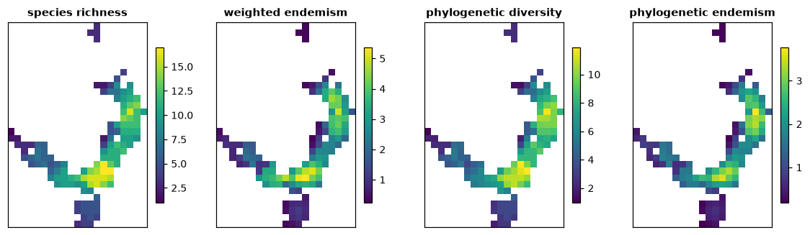
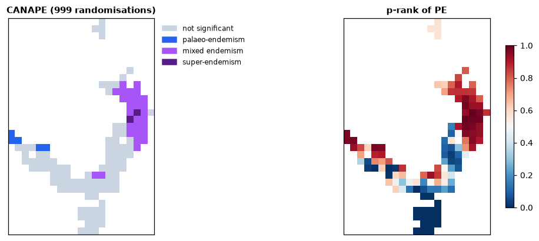
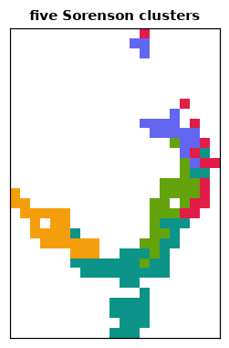

# Biodiversity analysis

Where are the places with many species, many species found nowhere else, or
long branches of the tree of life? `ls.bio` answers these questions from
species records: it is a port of [Biodiverse](https://shawnlaffan.github.io/biodiverse/)
(Laffan et al. 2010), and gives the same numbers as Biodiverse with the same
inputs, only faster.

**You will learn to:**

- count species records in grid cells;
- map richness, endemism, phylogenetic diversity and phylogenetic endemism
  in moving windows;
- test the indices against randomised data and classify centres of endemism
  with CANAPE;
- cluster the cells into regions of similar species composition;
- save the results, or export them for Biodiverse and other tools.

## From records to a BaseData

Biodiverse's vocabulary: species (or any other taxa) are **labels**, the
places they are counted in are **groups**, usually square cells. The example
data of Biodiverse ship with landschaft: 365 records of 31 species in eastern
Australia, with coordinates in metres, and a phylogeny of the species.

```python
import landschaft as ls

bd = ls.bio.BaseData.from_table(
    ls.bio.example_data("sites"),
    group_columns=["x", "y"],            # coordinates, snapped to 100 km cells
    label_columns=["genus", "species"],  # the label is "Genus:sp1"
    cell_sizes=[100000, 100000],
)
tree = ls.bio.read_tree(ls.bio.example_data("tree"))
bd, tree
```

The records fall in 127 cells. `bd.labels` and `bd.groups` list the names,
`bd.counts` is the sparse cell × species table and `bd.label_range()` the
number of cells of each species. Other sources work the same way:
`BaseData.from_dataframe` for a table in memory, `from_raster` and
`from_vector` for maps, `ls.bio.read_occurrences` for GBIF and Darwin Core
downloads, and `from_hex` and `from_h3` for hexagonal cells.

## Indices in moving windows

A spatial analysis computes indices for every cell from the records of its
**neighbourhood**, given as a Biodiverse spatial condition. Here, the cells
within 200 km:

```python
res = ls.bio.spatial_analysis(
    bd,
    "sp_circle (radius => 200000)",
    ["richness", "endemism_whole", "endemism_whole_lists", "pd", "pe", "phylo_rpe2"],
    tree=tree,
)
res.table[["RICHNESS_ALL", "ENDW_WE", "PD", "PE_WE"]].describe()
```



- **Richness** counts the species of the neighbourhood.
- **Weighted endemism** (`ENDW_WE`) adds, for each species, the share of its
  range inside the neighbourhood: a species found only there counts 1, a
  widespread one almost nothing.
- **Phylogenetic diversity** (`PD`, Faith 1992) is the total length of the
  branches linking the neighbourhood's species on the tree.
- **Phylogenetic endemism** (`PE_WE`, Rosauer et al. 2009) weights each branch
  by the share of its range in the neighbourhood.

The indices are the same as Biodiverse's, with the same names;
`ls.bio.list_calculations()` lists the 121 calculations and the 282
indices they return. Index values are in `res.table` (one row per cell) and
list indices, such as the endemism weight of each species
(`res.lists["ENDW_WTLIST"]`, from `endemism_whole_lists`), in long tables. `res.to_raster("PE_WE")` gives a map as an `xarray.DataArray`
and `res.to_geodataframe()` the cells as polygons.

Neighbourhoods can be any Biodiverse condition: `sp_self_only()` (the cell
alone), `sp_block (size => 300000)`, `$D <= 250000`, conditions on the
coordinates or on group properties. Two conditions give a second neighbour
set, used by the indices that compare two sets (turnover, beta diversity).

## Is it more than chance? Randomisations and CANAPE

Species-rich cells also tend to have high PD and PE, simply because they have
more species. A randomisation redistributes the records while keeping what
should not change, and counts how often the random values exceed the
observed ones. `rand_structured`, Biodiverse's default, keeps the richness of
every cell and the range size of every species:

```python
rnd = ls.bio.randomise(res, "rand_structured", iterations=999, seed=2024)
p = rnd.p_rank()          # 0.975 or more: higher than chance; 0.025 or less: lower
canape = rnd.canape()
canape["CANAPE_CODE"].value_counts()
```

**CANAPE** (categorical analysis of neo- and palaeo-endemism, Mishler et al.
2014) combines the tests of PE and relative PE (`phylo_rpe2`): cells with
significantly high PE are **neo-endemism** centres when their range-restricted
branches are short, **palaeo-endemism** centres when they are long, **mixed**
otherwise, and **super-endemism** centres when PE is very highly significant.



Of the 127 cells, 35 are centres of endemism: 28 mixed, 5 palaeo- and 2
super-endemism centres, mostly in the north-east. The p-ranks show the other
side of the test: in the south, PE is lower than chance, as the species there
are widespread.

The same seed gives the same randomisations as Biodiverse. `rnd.run(900)`
adds iterations, `rnd.comparison()` returns Biodiverse's counters and
`rnd.z_scores()` the z-scores. The other randomisations include the swap
algorithms (`rand_independent_swaps`, `rand_curveball`), spatially
structured ones (`rand_diffusion`, `rand_random_walk`) and complete spatial
randomness (`rand_csr_by_group`).

## Regions: cluster analysis

Clustering joins the cells with the most similar species until one tree
remains. The Sorenson dissimilarity with average linkage (UPGMA) is
Biodiverse's default; `cut` gives the regions:

```python
cl = ls.bio.cluster(bd, "SORENSON", "link_average", prng_seed=1)
regions = cl.cut(5)
regions.value_counts()
```



`cl.tree` is the dendrogram (a `Tree`; `cl.tree.to_newick()` for other
software) and `cl.nodes` the values of each join. Other indices include
`JACCARD`, `S2`, `BRAY_CURTIS` and `PHYLO_SORENSON` (with `tree=`); spatial
conditions limit the joins to neighbouring cells (`conditions=`), giving
spatially contiguous regions, and `ls.bio.region_grower` grows regions
that maximise an index.

## Saving and exporting

`ls.bio.save_session` stores basedatas, trees, matrices and results in one
file that `load_session` reads back; `to_biodiverse_csv` writes a result as
Biodiverse's "Delimited text" export does, byte for byte, for scripts and
tools that read Biodiverse's tables:

```python
ls.bio.save_session("study.lsbio", sites=bd, tree=tree, indices=res, regions=cl)
res.to_biodiverse_csv("indices.csv")                   # the scalar indices
res.to_biodiverse_csv("endemism_weights.csv", "ENDW_WTLIST")   # a list index
```

Trees convert to and from Bio.Phylo, DendroPy and ete (`tree.to_dendropy()`,
`ls.bio.Tree.from_ete(...)`).

## Going further

- **Group and label properties** (`read_properties`, `set_group_properties`,
  `set_label_properties`) feed the property indices (`lbprop_stats`,
  `gpprop_stats`), with numeric labels such as body sizes or dates
  (`numeric_label_stats`, `iei_stats`).
- **Label matrices** (`read_matrix`) give the matrix indices (`matrix_stats`,
  `mx_rao_qe`) and cluster indices from any dissimilarity.
- **Phylogenetic community structure**: `nri_nti_expected_values`,
  `phylo_mpd_mntd1` and the net relatedness and nearest taxon indices
  (Webb et al. 2002).
- **Threads**: every analysis takes `n_threads` (default: all cores but one).

The [API reference](../api/biodiversity.md) documents every class and
function.
