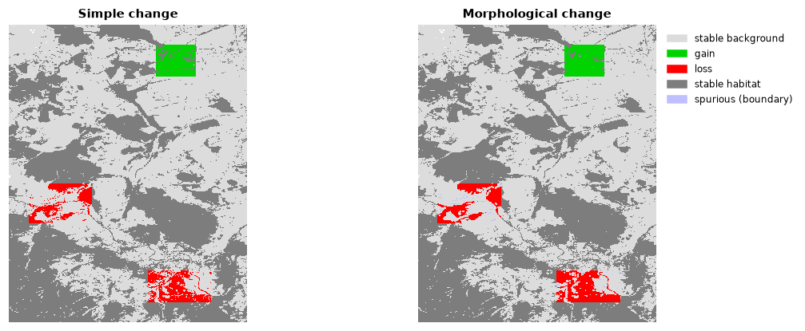

# Change detection

Two maps of the same area at two dates: what changed? Beyond counting pixels
gained and lost, the tools here separate real structural change from noise at
patch boundaries, and describe how fragmentation and the land-use mix shifted.

**You will learn to:**

- map habitat gains and losses;
- separate structural change from boundary noise, and measure elasticity;
- compare fragmentation classes between dates (transition matrices);
- follow fragmentation at several scales and the land-use mix over time.

**Input:** two [binary habitat maps](../getting-started/concepts.md#habitat-maps)
on the same grid (landscape-mosaic change uses three-class land-cover maps).

We make a second date from the example map by clearing two blocks of forest
and planting a new one:

```python
import numpy as np
import landschaft as ls

before = ls.load_raster(ls.example_data("input"))
after = before.copy()
v = after.values
v[600:700, 100:260] = np.where(v[600:700, 100:260] == 2, 1, v[600:700, 100:260])   # clear-cut
v[820:900, 400:560] = np.where(v[820:900, 400:560] == 2, 1, v[820:900, 400:560])   # clear-cut
v[250:330, 420:520] = np.where(v[250:330, 420:520] == 1, 2, v[250:330, 420:520])   # plantation
```

With real data, load both dates with `ls.load_raster` and make sure they share
the grid (same size, cell size and extent).

## Gains and losses

```python
simple = ls.simple_change(before, after)
simple.gain, simple.loss, simple.net_change
```

| Code in `simple.change_map` | Meaning |
|---|---|
| 11 | stable background |
| 12 | gain (background → habitat) |
| 21 | loss (habitat → background) |
| 22 | stable habitat |

`print(simple.summary())` gives the full report, and `ls.write_raster`
saves the map with its colour table.

## Structural change vs. boundary noise

Two maps made from different images or with different methods rarely agree
exactly along patch edges: a band of one or two pixels flips back and forth
without any real change. **Morphological change detection** keeps as real
change only what is connected to changes of the patches' interiors, and labels
the rest *spurious*:

```python
mcd = ls.morphological_change(before, after)
mcd.mcd_gain, mcd.mcd_loss, mcd.spurious, round(mcd.elasticity, 3)
```



Code 176 in `mcd.change_map` marks the spurious pixels. **Elasticity** relates
the total change to the habitat area: a stable landscape has a low value.

## Shifts between fragmentation classes

Compute the fragmentation of both dates at the same scale (see the
[fragmentation tutorial](fragmentation.md)), then compare:

```python
frag_before = ls.fos(before, window_size=27)
frag_after = ls.fos(after, window_size=27)
shift = ls.fos_change(frag_before.map, frag_after.map)
shift.matrix_6x6
```

The 6 × 6 matrix counts the habitat pixels that moved from each class (rows,
first date) to each class (columns, second date): the diagonal is stable,
above it fragmentation decreased, below it increased.
`shift.frag_increase_pct` and `shift.frag_decrease_pct` summarise it and
`shift.change_map` maps it.

## Several scales at once

```python
multi = ls.fad_multiscale_change(before, after)
list(multi.scales)
```

One transition table per observation scale (7 to 243 pixels) and one for the
multiscale combination, in `multi.scales` and `multi.averages`. It accepts
the maps directly (it runs the multiscale density on both) or results of
`ls.fad_multiscale`.

## Change of the land-use mix

With two three-class land-cover maps (1 agriculture, 2 natural, 3 developed),
`ls.landscape_mosaic_change(map_2000, map_2020, window_size=27)` compares
their [landscape-mosaic heat maps](fragmentation.md#landscape-mosaic): which
compositions became more or less frequent. `.to_csv(path)` writes the table.

## Next steps

- Metrics of many dates at once: `SpatioTemporalAnalysis` in the
  [landscape metrics tutorial](landscape-metrics.md#several-maps-and-time-series).
- Connectivity over time: `ls.conn.eca_change` in
  [habitat networks](habitat-networks.md).
