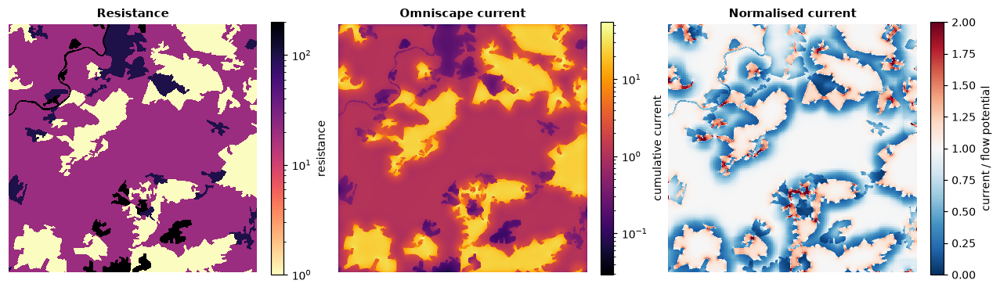
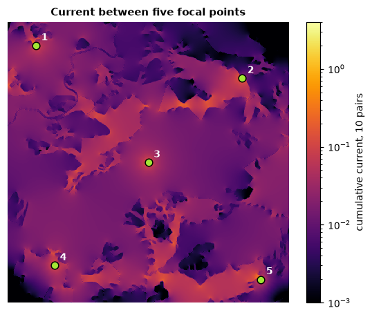

# Circuit connectivity

Circuit theory models movement across a landscape like electric current
through a conductive surface. Every cell has a **resistance** to movement
(low in habitat, high across roads, towns or water); current injected at one
place flows to another along *all* possible routes, most strongly along the
easiest ones. The resulting current map shows corridors, pinch points where
movement is funnelled, and areas where flow spreads out. Unlike a single
least-cost path, it accounts for redundant routes.

**You will learn to:**

- build a resistance map from land cover;
- map omnidirectional connectivity across a whole landscape (Omniscape);
- compute effective resistances and current between focal points (pairwise);
- inject and ground current where you choose (advanced mode);
- connect each point to all others (one-to-all, all-to-one);
- run existing INI files and networks given as edge lists.

## A resistance map

The resistance is a raster of positive values; NaN (or NoData) cells cannot be
crossed. A common way to build one is to give each land-cover class a value:

```python
import numpy as np
import landschaft as ls
from landschaft import circuit

landcover = ls.load_raster(ls.example_data("clc"))[:600, :600]   # 15 x 15 km

resistance = ls.reclassify(landcover, [
    (1, 12, 100.0),    # urban, industry, roads: hard to cross
    (12, 23, 20.0),    # agriculture: moderate
    (23, 35, 1.0),     # forest and natural vegetation: easy
    (35, 45, 200.0),   # wetlands and water: very hard
], dtype="float64")
```

The values are relative: what matters is the ratio between classes. They are
usually derived from expert opinion, habitat suitability or movement data.

## Omnidirectional connectivity (Omniscape)

Omniscape does not need start and end points. It moves a circular window over
the landscape; in every window, current flows from all the sources into the
centre. The sum over all windows, the **cumulative current**, shows how much
movement every cell carries between all places within the window's reach.

```python
flow = ls.omniscape(
    resistance,
    radius=30,                 # window radius in cells (750 m)
    block_size=5,              # one window per 5 x 5 block of cells: faster, corrected for artifacts
    flow_potential=True,       # the same with a uniform resistance, for comparison
    normalized_current=True,   # current / flow potential
)
flow
```

```python
ls.plot(flow)                  # every map on a log scale, over satellite imagery
ls.save(flow, "omniscape_out")  # one GeoTIFF per map, the settings as a table
```



| Output | Meaning |
|---|---|
| `cum_currmap` | cumulative current: where movement concentrates |
| `flow_potential` | the current if the whole landscape were equally easy to cross |
| `normalized_cum_currmap` | their ratio: above 1 = more movement than expected (corridors, pinch points), below 1 = less (impeded) |

By default every cell is a **source** in proportion to its conductance
(1 / resistance), so habitat both emits and carries movement. Pass
`source=` for your own source strengths, and `r_cutoff=` to stop cells above
a resistance from being sources. The radius should reflect the dispersal
distance of the species, in cells.

!!! tip "Speed"
    The time grows with the number of windows and their size: `block_size`
    of 3–9 cuts the windows by 9–81× with little effect on the result.
    Landschaft solves every window exactly and uses all cores but one.

## Between focal points (pairwise)

When there are specific places to connect (reserves, populations), mark them
on a raster of ids (0 elsewhere) and compute the **effective resistance**
between every pair, and the current that flows between them:

```python
points = np.zeros(resistance.shape)
for k, (row, col) in enumerate([(50, 60), (120, 500), (300, 300), (520, 100), (550, 540)], start=1):
    points[row, col] = k

pairs = circuit.circuitscape_pairwise(resistance, points, cum_map=True)
pairs.resistances
```

The first row and column hold the point ids; the rest is the effective
resistance between each pair: lower means better connected, through both
shorter and more numerous routes. `-1` marks points in parts of the landscape
that are not connected at all.



`pairs.cum_current` sums the current maps of all pairs (numpy arrays on the
resistance's grid); `voltage_maps=True` and `current_maps=True` keep the map
of every pair in `pairs.maps`. Cells of the same id form a **focal region**
(e.g. a reserve polygon rasterised), treated as a single node.
`included_pairs=` restricts the pairs to those listed in a file.

## Your own sources and grounds (advanced mode)

Inject current where you choose and let it flow to grounds:

```python
source = np.full(resistance.shape, np.nan)
source[50, 60] = 1.0                  # 1 A into this cell
ground = np.full(resistance.shape, np.nan)
ground[550, 540] = 0.0                # a direct ground (0 ohm) here

adv = circuit.circuitscape_advanced(resistance, source, ground)
adv.voltage.max(), adv.current.max()
```

`ground` holds resistances to ground (0 is a direct connection, NaN none);
`ground_is_resistance=False` reads conductances instead. With 1 A injected
and one direct ground, the voltage at the source is the effective resistance
between the two cells.

## One-to-all and all-to-one

```python
spread = circuit.circuitscape_one_to_all(resistance, points)
spread.resistances
```

Each point in turn is connected to all the others (`all_to_one=True`: all
the others inject into it). The table gives, per point, the resistance
between it and the rest; `cum_map=True` sums the current maps.

## Existing projects and networks

INI files of existing projects run as they are, and write the same output
files:

<!-- no-run -->
```python
circuit.circuitscape_ini("my_project.ini")   # raster or network, any mode
circuit.omniscape_ini("my_omniscape.ini")
```

Networks given as edge lists (node, node, resistance) instead of rasters:

```python
edges = [[1, 2, 2.0], [2, 3, 1.0], [1, 3, 4.0], [3, 4, 1.5]]
net = circuit.circuitscape_network_pairwise(edges, [1, 4])
net.resistances
```

`circuitscape_network_advanced(edges, sources, grounds)` is the advanced mode
on a network.

## Good practice

- Choose the radius (Omniscape) or the points (pairwise) from the ecology
  of the species, and test how sensitive the results are to the resistance
  values.
- Keep NoData to cells that truly cannot be crossed; use high resistances
  for strong barriers that are still crossable.
- Large maps: Omniscape's memory grows with the window size;
  `memory_limit=` caps it (fewer windows at once).

## Next steps

- Cost distances and single best routes: [distance & restoration](distance-restoration.md).
- Patch-based networks: [habitat networks](habitat-networks.md).
