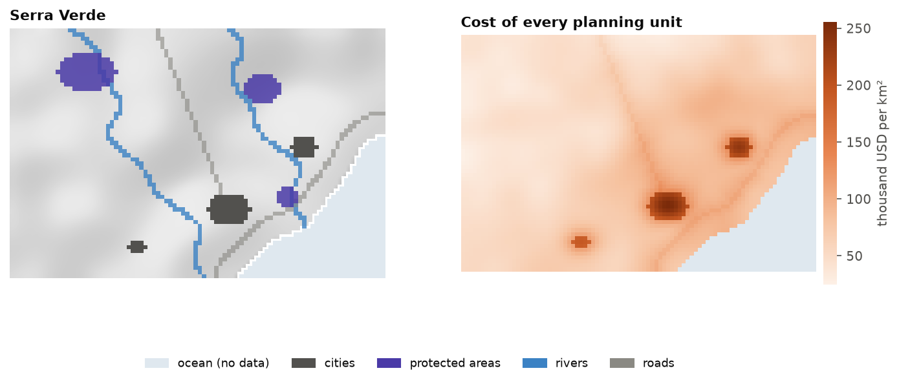
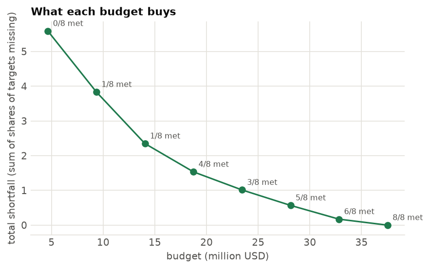
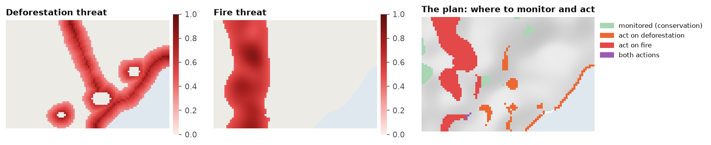
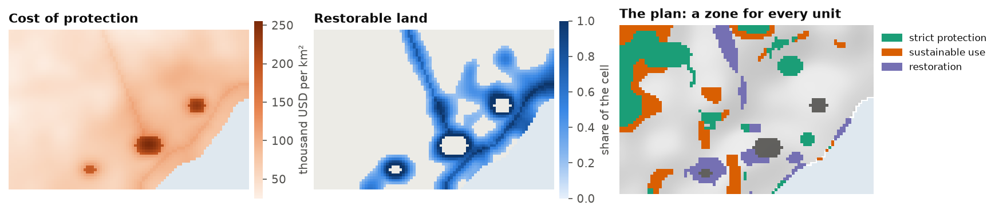

# Optimized conservation plans

Which set of places meets a conservation goal at the least cost, or achieves the most with a fixed budget?
`ls.prioritize` answers it with exact optimization, as the R package prioritizr does (the same models, row
by row), with engines of its own that solve large and spatial problems much faster. This tutorial builds a
complete plan for Serra Verde, the example region of the course chapters
[12.1 to 12.10](../learn/prioritization.md), which explain the ideas behind every step.

**You will learn to:**

- set up a problem from cost and feature rasters, and run a gap analysis of existing reserves;
- solve a minimum-set plan that builds on the reserves and avoids the cities;
- make it compact with a calibrated boundary penalty;
- see what each budget buys;
- find the places that matter most, and the alternatives;
- plan actions against threats;
- give every unit a zone: protection, sustainable use or restoration;
- compare with a Zonation ranking, and share the results.

## The data

Serra Verde ships with Landschaft: 60 x 90 cells of 1 km, with a land cost, eight features, three protected
areas, three cities and two threats. The cost raster defines the planning units: its 4825 cells with a value.

```python
import numpy as np
import pandas as pd
import landschaft as ls

P = ls.prioritize
cost = ls.load_raster(P.example_data("cost"))            # thousand USD per km²
features = ls.load_raster(P.example_data("features"))    # habitat suitability, 8 bands
protected = ls.load_raster(P.example_data("protected"))  # existing reserves (1)
urban = ls.load_raster(P.example_data("urban"))          # cities (1)
[str(b) for b in features.band.values]
```



## What the reserves hold today

A **problem** combines planning units, features, an objective, targets and decisions. Before solving it,
evaluate the existing reserves as if they were a plan, a **gap analysis**:

```python
p = (P.problem(cost, features)
       .add_min_set_objective()
       .add_relative_targets(0.3)
       .add_binary_decisions())

P.eval_target_coverage_summary(p, protected)[["feature", "relative_held", "met"]].round(3)
```

The three reserves hold up to a tenth of the mountain species and nothing of the tapir, the tamarin and the
mangrove. None of the targets of 30 % is met.

## A first plan

The cheapest set of cells that meets every target, keeping the reserves and leaving out the cities:

```python
p1 = (p.add_locked_in_constraints(protected)
        .add_locked_out_constraints(urban)
        .add_highs_solver(gap=0.001))
plan = p1.solve()
print(plan.status, f"cost {plan.cost / 1000:.1f} million USD, {int(plan.values.sum())} cells, gap {plan.gap:.3%}")
plan.coverage[["feature", "relative_target", "relative_held", "met"]].round(3)
```

`plan.selection` is the plan as a raster, `ls.plot(plan)` draws it, and `plan.save("plan.tif")` writes it.
The solver proves the plan is within 0.1 % of the cheapest possible (the **gap**,
[chapter 12.4](../learn/prioritization/optimization.md#the-optimality-gap)).

## A compact plan

The plan is scattered over many patches. A **boundary penalty** makes it compact at some extra cost. Its
value must be calibrated: solve with several values and choose on the curve of cost against boundary
([chapter 12.6](../learn/prioritization/tradeoffs.md#calibrating-a-penalty)):

```python
cal = P.calibrate_penalty(p1.add_highs_solver(gap=0.02), "boundary", values=[0.001, 0.003, 0.01, 0.03])
cal.table[["value", "cost", "boundary", "knee", "topsis"]].round(1)
```

```python
compact = cal.best("knee")
for name, s in (("first plan", plan), ("compact plan", compact)):
    lm = P.eval_landscape_metrics(s, metric="np")
    km = P.eval_boundary_summary(p1, s)["boundary"].iloc[0] / 1000
    print(f"{name:13s} {s.cost / 1000:5.1f} million USD, {km:4.0f} km of boundary, "
          f"{int(lm['value'].iloc[0])} patches")
```


The knee of the curve buys a much shorter boundary, in fewer patches, for a small part of the cost.
`ls.plot(cal)` draws the curve.

## What each budget buys

Decision makers often ask what a budget buys rather than what a target costs. The **Pareto front** solves
the minimum shortfall problem for a range of budgets:

```python
front = P.pareto_front(p1, n=6)
front.table[["value", "shortfall", "met"]].round(2)
```



The shortfall (the share of the targets still missing, summed over the features) falls fast with the first
millions and slowly with the last. Every budget includes the reserves, so the front starts above their cost.
(The figure shows the front of the plan without reserves.)

## The places that matter most

Which cells could not be replaced? **Replacement cost** solves the problem again without each selected cell;
a **portfolio** of near-optimal plans shows which cells are always chosen
([chapter 12.7](../learn/prioritization/evaluation.md)):

```python
rc = P.eval_replacement_importance(p1, plan)
port = p1.add_highs_solver(gap=0.01).add_gap_portfolio(10, pool_gap=0.02).solve()
f = port.frequency.values
print(f"{len(port)} plans within 2 %: {int(np.nansum(f == 1))} cells in all of them, "
      f"{int(np.nansum((f > 0) & (f < 1)))} in some")
```


## Actions against threats

Deforestation and fire threaten the features. A **multi-action** plan decides where to manage land and
where to act against each threat ([chapter 12.8](../learn/prioritization/actions.md)):

```python
threats = ls.load_raster(P.example_data("threats"))
d = P.actions_raster_data(cost, features, threats, action_cost=[30, 10],
                          target_recovery=0.3, target_conservation=0.1)
acts = d.problem("minimizeCosts").add_highs_solver(gap=0.01).solve()
print(f"{int(acts.units.sum())} cells managed, {int(acts.actions.sum())} actions")
acts.cost()
```



## Zones of management

A plan can also give every unit a **zone**: strict protection, sustainable use or restoration, each with its
own cost and its own worth for the features. Sustainable use is cheaper but counts half of every feature;
restoring pasture and cropland brings back their share of the cell; the targets are met by the sum over the
zones, and 10 % of every feature must be under strict protection
([chapter 12.8](../learn/prioritization/actions.md#zones-actions-or-restoration)):

```python
lc = ls.load_raster(P.example_data("land_cover"))
anthropic = lc.sel(band="pasture") + lc.sel(band="cropland")      # restorable share of every cell
costs = {"protect": cost,
         "use": cost * 0.45,
         "restore": (cost * 0.2).where(anthropic > 0.2)}         # no cost: the unit cannot go there
pz = (P.problem(costs, features, contribution={"use": 0.5, "restore": anthropic})
        .add_min_set_objective()
        .add_relative_targets(0.3)                    # 30 % of every feature, counted in every zone
        .add_relative_targets(0.1, zone="protect")    # and 10 % of it strictly protected
        .add_locked_in_constraints({"protect": protected})
        .add_locked_out_constraints({z: urban for z in costs})
        .add_boundary_penalties(0.0005)               # compact zones
        .add_highs_solver(gap=0.02))
zplan = pz.solve()
{z: round(c) for z, c in zplan.zone_costs.items()}
```

The plan keeps the reserves under protection, puts 560 cells under strict protection, 450 under sustainable
use and restores 284, for 40 450 thousand USD. `zplan.zones` is the map of the zones, and every evaluation
gives a row overall and one per zone:

```python
P.eval_n_summary(pz, zplan)
```



## Compared with a Zonation ranking

A Zonation ranking cut at the same cost holds more of the rare features and less of the common ones
([chapter 12.9](../learn/prioritization/together.md)):

```python
comp = P.compare_zonation(p1, plan)
comp.table[["feature", "milp", "zonation"]].round(2)
```

## Sharing the results

`report` gathers the summaries, representation, targets and importance; `ls.plot` makes a web page of them:

```python
r = P.report(p1, plan, extinction_z=0.25)
page = ls.plot(r, show=False).save("serra_verde_plan.html")
```

## Going further

- **Other objectives**: maximum utility, minimum shortfall, maximum features, phylogenetic diversity, and
  minimum extinction risk ([chapter 12.4](../learn/prioritization/optimization.md#budget-objectives)).
- **Spatial rules**: neighbours, contiguity, corridors and connectivity
  ([chapter 12.5](../learn/prioritization/spatial.md)).
- **Polygons and H3 cells** as planning units: `P.problem(polygons, features, cost_column="cost")`,
  `P.h3_units(cost, resolution)`.
- **Large problems**: `coarsen` and `refine`
  ([chapter 12.9](../learn/prioritization/together.md#large-problems)).
- **Marxan**: `P.marxan` runs Marxan's own tables and annealing; `add_anneal_solver` solves a problem with it.
- **Restoration**: how much of every converted cell to restore, for species, carbon and intactness:
  [restoration priorities](restoration-plans.md).
- **Recipes** for 30x30, restoration, offsets, regions and carbon:
  [chapter 12.10](../learn/prioritization/process.md#recipes).
- The [API reference](../api/prioritization.md#optimization) lists every function.
