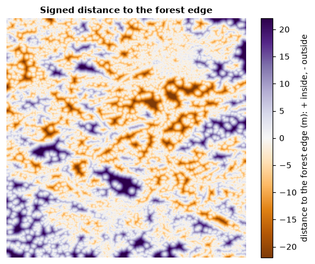
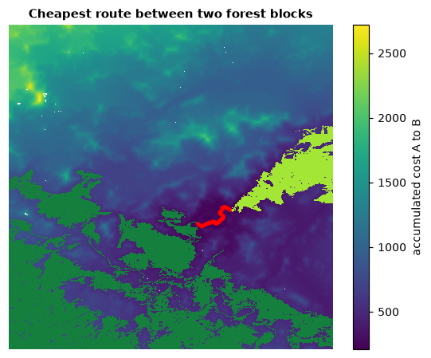

# Distance & restoration

Where would restoring habitat help the most? How far is every point from the
forest, and how costly is it to cross the land in between? This tutorial
measures distances and costs, finds the cheapest routes between habitat
areas and scores a landscape's restoration potential.

**You will learn to:**

- map distances to the habitat edge, inside and outside the habitat;
- score how connected a habitat is and how much could be gained;
- turn distance into a resistance to movement;
- compute accumulated cost from a set of cells;
- find the cheapest route between two habitat areas and its cost;
- delimit the zones of influence of large habitat objects.

```python
import numpy as np
import landschaft as ls

forest = ls.load_raster(ls.example_data("input"))   # 0 missing, 1 background, 2 forest
```

## Distance to the habitat edge

```python
distance = ls.euclidean_distance(forest, pixel_size=25)
distance.stats
```

`distance.signed_distance` holds, for every pixel, the straight-line distance
to the forest edge: positive inside the forest (how deep in the interior),
negative outside (how far from the nearest forest). `pixel_size` converts
pixels to metres; `mean_fg_distance`, `max_bg_distance` and the others
summarise the map.



## Restoration status

How connected is the habitat, and how much could it gain from reconnecting its
pieces?

```python
status = ls.restoration_status(forest)
status.nr_comp, round(status.doc, 1), round(status.rest_pot, 1)
```

| Value | Meaning |
|---|---|
| `nr_comp` | number of separate habitat objects |
| `eca` | equivalent connected area, pixels: the size of one object with the same connectivity |
| `doc` | degree of connectivity, `eca` over the total habitat, % |
| `rest_pot` | restoration potential, 100 − `doc`: what reconnecting everything would add |
| `larg_obj`, `aps` | largest object and average object size, pixels |

Here about half of the habitat is effectively connected; the rest is the
potential gain from restoration.

## From distance to resistance

Movement through non-habitat is often harder the further it is from habitat.
`distance_to_resistance` turns the distance to the forest into a resistance
map: 2 on the forest, from 3 next to it up to 100 far away, 0 on missing data.

```python
resistance = ls.distance_to_resistance(forest)
int(resistance.min()), int(resistance.max())
```

Any resistance map with values from 1 to 100 works in the tools below, e.g.
one derived from land cover as in the
[circuit connectivity tutorial](circuit-connectivity.md#a-resistance-map).

## Cheapest routes between two habitat areas

Mark the two areas to connect. Here we take the two largest forest objects
found by [accounting](patterns.md#objects-by-size-accounting):

```python
objects = ls.accounting(forest)
ids = objects.ids.values
first, second = objects.largest[0][0], objects.largest[1][0]

marker = np.zeros(forest.shape, dtype="uint8")
marker[ids == first] = 1           # object A
marker[ids == second] = 2          # object B
marker[forest.values == 0] = 3     # missing: not crossed
```

The **isochrone map** accumulates the cost of travelling from A to B through
every pixel and draws the cheapest route:

```python
route = ls.isochrone_map_ab(resistance, marker)
ls.plot(route)        # the cost map, the corridor and the path
ls.save(route, "route_ab")
route.min_cost, int(np.asarray(route.lcp).sum())
```



`route.cost` is the accumulated cost through each pixel (lowest along the
route), `route.lcp` the path itself and `route.map` the same in 0–100 display
codes. `ls.isochrone_map(resistance, marker)` gives the cost outward from A
alone (travel-time rings).

## Cost distance and least-cost paths

The same building blocks, separately:

```python
cost = ls.cost_distance(resistance, marker == 1)                 # accumulated cost from A
path = ls.least_cost_path(resistance, marker == 1, marker == 2)
path.path_length, path.rest_pixels, path.expense
```

`path.lcp_mask` is the path, `path.rest_pixels` the number of non-habitat
pixels on it (what would have to be restored) and `path.expense` its total
cost. `ls.restoration_corridor(forest, resistance, marker == 1, marker == 2)`
also reports how much the connectivity of the whole landscape would gain if
that corridor were restored, and how efficient the investment is.

## Zones of influence

Which large habitat object is the nearest to every point of the matrix?

```python
zones = ls.influence_zones(forest, min_area=5000)
len(zones.object_area)
```

Objects of at least `min_area` pixels each get a zone of the background
closest to them; `zones.zones` maps them and the lines between zones show
where two objects are equally far. `ls.proximity` measures how close
neighbouring objects are along those lines.

!!! warning "Experimental"
    Influence zones and proximity follow the original method but do not yet
    reproduce its distance transform exactly; results can differ in detail
    from other implementations.

## Next steps

- Current flow instead of a single best route:
  [circuit connectivity](circuit-connectivity.md).
- Change between two dates: [change detection](change-detection.md).
