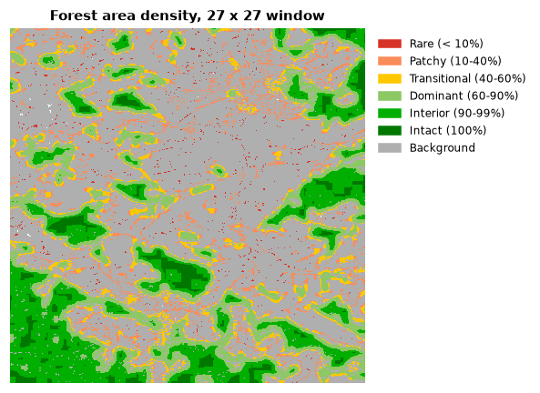
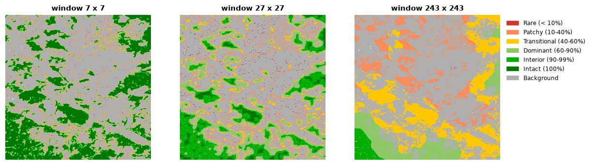
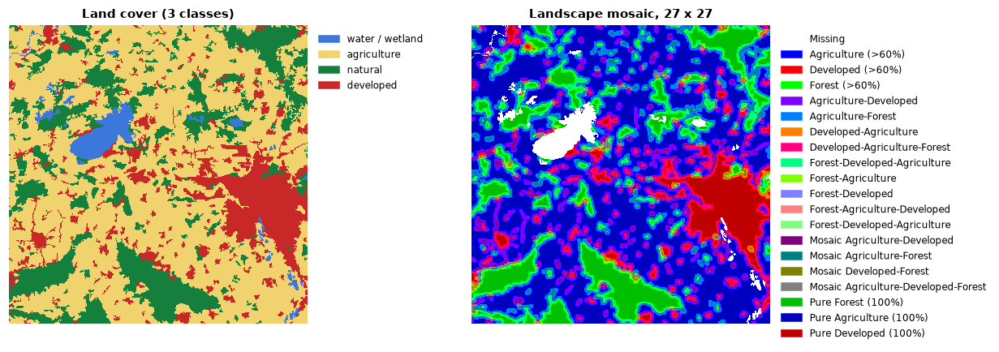

# Fragmentation

Fragmentation describes how habitat is broken up: whether an organism at a
given spot is surrounded by habitat or by a mix of habitat and other land.
The answer depends on **how far it looks around**, the *observation scale*:
a spot can sit inside a small, intact woodlot and yet in a region where forest
is rare. This tutorial measures fragmentation with moving windows, at one or
many scales, and describes the mix of land uses around every pixel.

**You will learn to:**

- map habitat density around every pixel and read its six classes;
- compare observation scales;
- choose between area density, edge density and clustering;
- work with continuous (percent-cover) maps;
- describe the mix of three land-cover types with a landscape mosaic;
- compute contagion, clustering, spatial entropy and other window statistics.

**Input:** a [binary habitat map](../getting-started/concepts.md#habitat-maps)
for most tools; a three-class land-cover map for the landscape mosaic; a
percentage map for the grayscale tools.

```python
import landschaft as ls

forest = ls.load_raster(ls.example_data("input"))
```

## Habitat density in a moving window

For every habitat pixel, **forest area density** (FAD) is the percentage of
habitat among the valid pixels of a square window centred on it. A window of
27 × 27 pixels over 25 m pixels looks at a 675 m × 675 m neighbourhood
(45.6 ha).

```python
result = ls.fad(forest, window_size=27)
result.stats
```

The densities are grouped in six classes, the standard way to report them:

| Class | Density | Meaning |
|---|---|---|
| Intact | 100% | only habitat in the window |
| Interior | 90 – < 100% | habitat with small gaps |
| Dominant | 60 – 90% | habitat dominates the neighbourhood |
| Transitional | 40 – 60% | habitat and other land in similar amounts |
| Patchy | 10 – 40% | habitat is the minority |
| Rare | < 10% | isolated habitat pixels |



| Attribute | Content |
|---|---|
| `result.density` | density map, 0–100% on habitat pixels (101 background, 102 missing) |
| `result.classes` | class map, 1 (rare) to 6 (intact) |
| `result.stats` | share of the habitat in each class and the average density |
| `result.summary()` | a printable report |

Save the density map with its standard colours:

```python
ls.write_raster(result.density, "fad27.tif")   # colour table of the six classes
```

## Several observation scales

The same pixel can be interior at a short distance and patchy at a long one.
`fad_multiscale` computes the densities at several window sizes at once
(7, 13, 27, 81 and 243 pixels by default) and combines them:

```python
multi = ls.fad_multiscale(forest)
multi.stats[["observation_scale", "intact_%", "interior_%", "rare_%", "average_fad"]]
```



The average density falls as the window grows: this forest is intact at the
scale of a few hundred metres but only transitional over several kilometres.
The last row of `stats`, *MultiScale*, averages over all scales; `avcon` is
the average connectivity. `multi.single_scales[27]` is the density map of one
scale and `multi.multiscale_map` the combined map.

## Fragmentation at a fixed observation scale

`fos` reports fragmentation at one scale with three ways of measuring it:

| Method | Measures | Use when |
|---|---|---|
| `"FAD"` | habitat **area** density: share of habitat in the window | the amount of habitat matters |
| `"FED"` | habitat **edge** density: how alike the neighbouring pixel pairs of the window are (few habitat edges score high) | the amount of edge matters |
| `"FAC"` | habitat **area clustering**: share of habitat–habitat pairs among all neighbouring pairs (binary maps only) | the aggregation of habitat matters |

and 6 classes (as above) or 5 (intact merged into interior):

```python
fos = ls.fos(forest, window_size=27, method="FAC", classes=5)
fos.stats
```

Besides the class map (`fos.map`) and the class shares, the result reports
patch statistics of the whole map: `fos.n_patches`, `fos.average_patch_size`,
`fos.eca` (equivalent connected area), `fos.coherence`, `fos.average` and
`fos.avcon`. `print(fos.summary())` shows everything.

### Percent-cover maps

`fos` also accepts **grayscale** maps: a percentage of habitat per pixel
(0–100, 255 missing), e.g. tree cover. Pixels of at least `gray_threshold`
percent count as habitat; the density is the mean percentage in the window:

```python
cover = ls.load_raster(ls.example_data("gscinput"))   # 0-100, 255 missing
gray = ls.fos(cover, window_size=27, gray_threshold=30)
gray.grayscale, gray.stats
```

## Landscape mosaic

When the question is not "how much habitat" but "what mix of land uses", the
landscape mosaic describes the composition of every window with three
land-cover types, coded 1 agriculture, 2 natural (forest), 3 developed and 0
missing. Each window falls in one of 19 classes, from pure (100% of one type)
through dominant (more than 60%) to mixed mosaics.

Build the three-class map from the CORINE example (classes 1–11 are
artificial surfaces, 12–22 agriculture, 23–34 forest and semi-natural areas,
35–44 wetlands and water):

```python
import xarray as xr

landcover = ls.load_raster(ls.example_data("clc"))
three = xr.where(landcover <= 11, 3,
         xr.where(landcover <= 22, 1,
         xr.where(landcover <= 34, 2, 0))).astype("uint8")

mosaic = ls.landscape_mosaic(three, window_size=27)
```



`ls.LM19_CLASSES` names the 19 classes and `ls.lm_colormap()` colours them.
With `output_classes=103` every window is placed in one of 103 finer cells of
the composition triangle. The share of the map in each of those cells, the
*heat map* of the landscape, comes from:

```python
heat = ls.landscape_mosaic_heatmap(three, window_size=27)
heat.to_csv("mosaic_heatmap.csv")
```

and `ls.landscape_mosaic_stats(three)` returns the same frequencies as a
table.

## Other window statistics

| Function | Result |
|---|---|
| `ls.contagion_pff(forest, window_size=7)` | contagion: probability that a neighbour of a habitat pixel is habitat |
| `ls.clustering_fac(forest, window_size=7)` | clustering: share of all joins that are habitat–habitat |
| `ls.spatial_entropy(forest)` | one index (0–100%) of the disorder of the habitat pattern |
| `ls.spatial_entropy_map(forest, window_size=50)` | the same in a moving window |
| `ls.gray_spatial_convolution(cover, metric="mean", window_size=7)` | window mean, median, majority, min, max, range, standard deviation, Shannon diversity and evenness, or contagion of a percentage map |

```python
entropy = ls.spatial_entropy(forest)
contagion = ls.contagion_pff(forest, window_size=13, as_byte=False)   # 0-1, NaN off habitat
smooth = ls.gray_spatial_convolution(cover, metric="stddev", window_size=9)
round(entropy.entropy_index, 1)
```

## Choosing a window size

- Match the window to the process: the home range of a species, the
  distance of seed dispersal, the scale of a management unit.
- Express it in map units: window side × pixel size (27 × 25 m = 675 m).
- Report several scales when the relevant one is unknown, which is what
  `fad_multiscale` is for.
- Windows must be odd (a centre pixel). Near missing data and the map
  border, only the valid pixels of the window count.

## Next steps

- Count and compare patches with [landscape metrics](landscape-metrics.md).
- Follow fragmentation over time in [change detection](change-detection.md).
