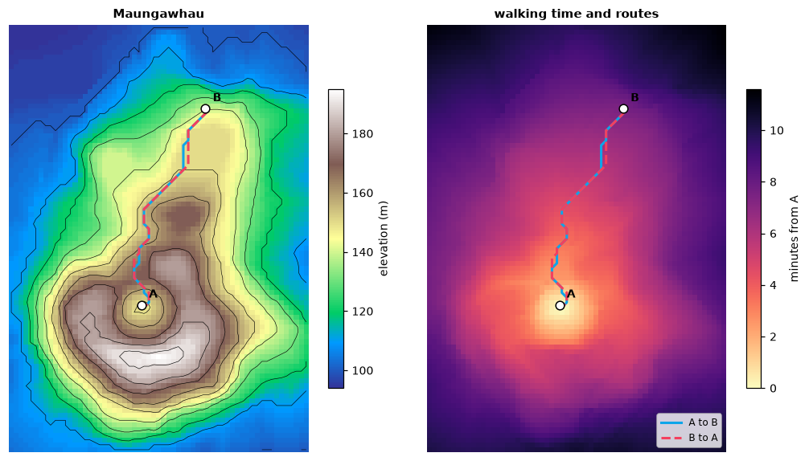
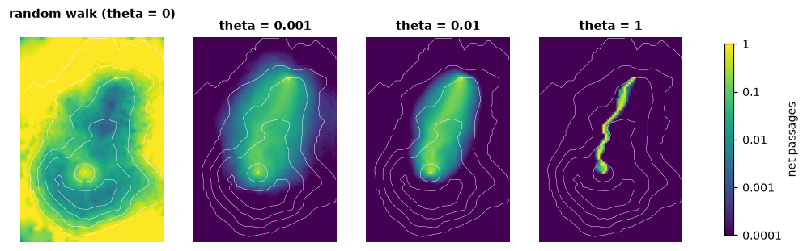
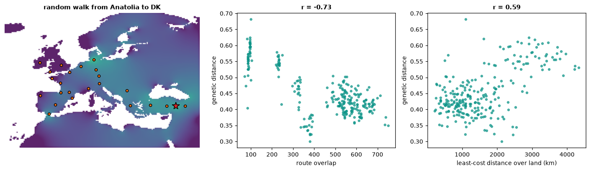

# Routes on grids

Many questions about movement come down to one: how hard is it to go from
here to there across this landscape? A hiker climbs slowly and descends
fast; an animal avoids open ground; people spread along coasts and valleys.
Seen as a graph, a raster answers these questions: every cell is a node,
neighbouring cells are joined, and each connection carries a *conductance*,
how easily it is crossed. Least-cost distances, cost surfaces, the route a
walker would take, how much two routes share: all are computed on that
graph.

**You will learn to:**

- build the graph of a raster (a *transition*) from any rule of the two
  cells' values, including direction-dependent ones;
- compute travel-time surfaces, least-cost distances and paths;
- go from the single best route to the whole bundle of likely routes, with
  random walks and randomised shortest paths;
- measure how much routes from a common origin overlap, and relate that to
  genetic distances between populations.

Everything lives in `ls.cost`. The results match the R package gdistance,
value for value where the arithmetic allows (transitions, cost distances and
paths) and to about 1e-12 where sparse linear systems are solved.

## A transition: the raster as a graph

`ls.cost.transition` connects every pair of neighbouring cells (4, 8 or 16
directions) that both have a value, with a function of the two values. The
connection's value is a conductance: large means easy.

```python
import numpy as np
import landschaft as ls

resistance = np.array([[1.0, 1.0, 4.0],
                       [1.0, 9.0, 4.0],
                       [1.0, 1.0, 1.0]])
tr = 1 / ls.cost.transition(resistance, "mean", 8)     # conductance = 1 / mean resistance
tr = ls.cost.geo_correction(tr)                        # / distance between cell centres
print(tr)
```

```text
Transition(3 x 3 cells, 8 directions, symmetric, conductance, 40 connections)
```

`geo_correction` divides every conductance by the distance between the two
cell centres, so that diagonal steps cost more than straight ones; on
longitude/latitude grids it uses distances on the ellipsoid. A symmetric
transition has one value per pair; with `symmetric=False` each direction has
its own, which is what slopes need.

## Hiking on a volcano

The Maungawhau volcano in Auckland ships as example data (elevation, 10 m
cells). Tobler's hiking function gives the walking speed from the slope:
about 6 km/h on a gentle descent, slower uphill and on steep descents.

```python
dem = ls.load_raster(ls.cost.example_data("maungawhau"))
rise = ls.cost.transition(dem, "diff", 8, symmetric=False)    # elevation to - elevation from
slope = ls.cost.geo_correction(rise)                          # rise / distance
speed = slope.map(lambda s: 6 * np.exp(-3.5 * np.abs(s + 0.05)) / 3.6, pairs="all")   # m/s
conductance = ls.cost.geo_correction(speed)                   # 1 / seconds per step
```

`map(..., pairs="all")` applies the function to every pair of neighbours,
also to the flat ones whose rise is 0 (and so had no connection). The cost of
a step is the reciprocal of the conductance, here the seconds it takes. From A
at the foot of the volcano to B on the other side, and back:

```python
A, B = (2667670, 6479000), (2667800, 6479400)
minutes = ls.cost.cost_distance(conductance, [A, B]) / 60
print(minutes.round(1))
```

```text
[[0.  7.5]
 [8.1 0. ]]
```

The two directions differ: the way back climbs where the way out descended.
`acc_cost` gives the travel time from A to every cell, and `shortest_path`
the routes:

```python
time_from_a = ls.cost.acc_cost(conductance, A)
there = ls.cost.shortest_path(conductance, A, B, output="lines")
back = ls.cost.shortest_path(conductance, B, A, output="lines")
print(round(float(time_from_a.max()) / 60, 1), round(there.length.iloc[0]), round(back.length.iloc[0]))
```

```text
11.6 487 487
```



Every cell of the volcano is less than 12 minutes from A. The two routes are
equally long (487 m) but take different lines around the crater. `cells` and
`transition` are the other outputs of `shortest_path`; among equally cheap
paths the function always returns the same one.

## From the best route to all likely routes

A least-cost path assumes a walker who knows the whole landscape. A random
walk assumes one who knows nothing and steps to a neighbour with a
probability proportional to the conductance. Randomised shortest paths sit
in between: the parameter `theta` sets how strongly the walk prefers cheap
routes, from the random walk (0) to the least-cost path (large values).
`passage` maps how often the walk from A to B crosses each cell:

```python
routes = {theta: ls.cost.passage(conductance, A, B, theta=theta) for theta in (0, 0.001, 0.01, 1)}
print({theta: round(float((p > 0.01).mean()), 3) for theta, p in routes.items()})
```

```text
{0: 0.917, 0.001: 0.18, 0.01: 0.118, 1: 0.019}
```



The random walk (`theta` = 0) passes through 92 % of the volcano's cells
more than once in a hundred walks; with `theta` = 0.001 (per second of
walking) 18 %, and with 1 it keeps to a narrow band (2 %) along the
least-cost route. The same
walks give distances: `rsp_distance` is the expected cost of the walk, and
`commute_distance` the expected time of a random walk to go and come back
(for symmetric transitions: it is the effective resistance of the circuit
view, times the sum of all conductances).

```python
print(ls.cost.rsp_distance(conductance, [A], [B], theta=0.1).round(0))
symmetric = ls.cost.geo_correction(1 / ls.cost.transition(dem, "mean", 8))
print(ls.cost.commute_distance(symmetric, [A, B]).round(0))
```

```text
[[534.]]
[[    0. 35013.]
 [35013.     0.]]
```

The randomised walk takes 534 s on average, 83 s more than the least-cost
route (451 s).

## Routes of dispersal from a common origin

If populations spread out from one origin, two populations whose routes
share much of the way should be closer genetically than two whose routes
split early. The example data hold the genetic distances between 23
European populations of the Y-chromosome haplogroup R1b1b2 and their
locations, and a map of Europe (land = 1, 1/3 degree cells).

```python
import pandas as pd

europe = ls.load_raster(ls.cost.example_data("europe"))
pops = pd.read_csv(ls.cost.example_data("pop_coord"))
genetic = pd.read_csv(ls.cost.example_data("gen_dist"), index_col="population")
walk = ls.cost.geo_correction(ls.cost.transition(europe, "mean", 16), "r", scale=True)

xy = pops[["x", "y"]].to_numpy()
routes = ls.cost.path_inc(walk, (37.0, 39.0), xy)    # from Anatolia
pairs = np.triu_indices(len(pops), 1)
g = genetic.loc[pops["population"], pops["population"]].to_numpy()[pairs]
print({name: round(float(np.corrcoef(m[pairs], g)[0, 1]), 2) for name, m in routes.items()})
```

```text
{'overlap': -0.73, 'nonoverlap': 0.56}
```

`path_inc` computes, for every population, the flow of a random walk from
the origin to it on every connection, then for every pair of populations the
flow the two routes share (`overlap`) and the flow they do not
(`nonoverlap`), each connection weighted by its cost. The more two routes
overlap, the smaller the genetic distance (a correlation of -0.73). For
comparison:

```python
coast = ls.cost.geo_correction(ls.cost.transition(europe, "mean", 16), "c")
least_cost = ls.cost.cost_distance(coast, xy)
commute = ls.cost.commute_distance(walk, xy)
print(round(float(np.corrcoef(least_cost[pairs], g)[0, 1]), 2),
      round(float(np.corrcoef(commute[pairs], g)[0, 1]), 2))
```

```text
0.59 -0.03
```



Least-cost distances over land explain less (0.59) and commute distances,
which ignore the direction of spread, nothing (-0.03). Correlations between
the pairs of one set of points are not independent: test them with a Mantel
test (permuting the populations) before drawing conclusions.

## Advanced options

- **Directions**: 16 directions add the knight moves (two cells one way, one
  the other), which make least-cost routes less angular.
- **Longitude/latitude grids**: distances between cells are geodesic; on a
  grid spanning 360 degrees the columns wrap around the 180th meridian. For
  random walks use `geo_correction(tr, "r")`, which also shrinks north-south
  connections towards the poles.
- **Any rule**: a callable receives the two cells' values (`x[0]` the first
  cell, `x[1]` the second) for all connections at once; `map`, `*`, `+` and
  numbers combine transitions; `normalize` gives the random walk's
  probabilities; `sum_reciprocal` adds resistances in series.
- **Weights for route overlap**: `path_inc(..., weight=...)` takes another
  transition or a list of them; `ls.cost.barriers(r, breaks=[...])` marks the
  connections that cross given values (or, without breaks, the boundaries
  between categories) and `ls.cost.areas(r)` those inside each category, to
  ask how much of the routes' overlap happens across a barrier or in an area.
- **Randomised shortest paths**: `method=2` in `rsp_distance` weights the
  steps by `P ** theta` instead of `exp(-theta * cost) * P`; `total_net` counts
  every passage instead of the net ones.
- **Speed**: the graph is never built as a matrix; least-cost searches run
  directly on the grid, and several sources in parallel. Linear systems are
  factorised with a nested-dissection sparse Cholesky (4 million cells: a
  cost surface in 0.6 s, a random-walk passage map in 4.5 s).
