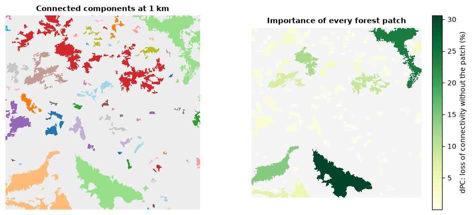

# Habitat networks

Animals and plants move between habitat patches. Seen from far away, a
landscape is a **network**: the patches are the *nodes* and the possibility
of moving between two patches is a *link*. Network indices measure how much
habitat is reachable, which patches and links hold the network together, and
what would be gained or lost by restoring or losing habitat.

**You will learn to:**

- build a network from a map or from tables;
- compute connectivity indices and the equivalent connected area;
- rank patches and links by their importance;
- map components and importance, compute centralities;
- measure the connectivity of protected areas (ProtConn);
- use least-cost and commute-time distances, compare dates, evaluate restoration.

## How habitat networks work

Each patch has an **attribute**, usually its area. Between two patches there
is a **distance** (edge to edge, centre to centre, or a least-cost distance
through a resistance map). Two classic indices summarise the network:

- **IIC** (integral index of connectivity) counts two patches as connected
  when a chain of links joins them, each link shorter than a threshold
  distance, and discounts long chains.
- **PC** (probability of connectivity) turns distances into dispersal
  probabilities that fall off exponentially: `probability=0.5` at
  `distance=1000` means a 50% chance of crossing 1 km. The probability
  between two patches is that of the best route.

Both are "reachable habitat" over the squared landscape area, between 0 and 1.
The **equivalent connected area** `EC(PC)` is more intuitive: the size of a
single patch that would give the same connectivity. It is at most the total
habitat area.

A tiny network makes this concrete: four patches, their areas (ha) and the
distances between them (m):

```python
import numpy as np
import landschaft as ls

areas = [100, 50, 20, 80]
distances = np.array([
    [0,    800,  1500, 5000],
    [800,  0,    600,  4000],
    [1500, 600,  0,    3000],
    [5000, 4000, 3000, 0],
])
toy = ls.HabitatGraph(areas, distances, landscape_area=10_000)
toy.overall(["NC", "PC"], distance=1000, probability=0.5)[["NC", "PC", "EC(PC)"]]
```

With 1 km links the first three patches form one component and the fourth
stands alone (`NC` = 2). `EC(PC)` lies between the largest patch (100 ha) and
the total habitat (250 ha).

## A network from a land-cover map

`from_raster` finds the patches of the habitat classes, measures their areas
and the distances between them:

```python
landcover = ls.load_raster(ls.example_data("clc"))
forest_net = ls.HabitatGraph.from_raster(
    landcover,
    habitat=[23, 24, 25],            # broad-leaved, coniferous and mixed forest
    area_unit="ha",
    distance="edge",                 # edge-to-edge distance, in metres
    max_distance=5000,               # links longer than 5 km are not kept
    landscape_area=landcover.size * 25 * 25 / 1e4,   # hectares, like the patch areas
)
forest_net
```

```python
ls.plot(forest_net, distance=1000)   # the patches and their links up to 1 km
```

| Argument | Options |
|---|---|
| `habitat` | classes that form patches (without it, every non-NoData value is a patch id) |
| `distance` | `"edge"`, `"centroid"`, `"least-cost"` (needs `resistance=`), `"commute-time"` |
| `max_distance` | pairs further apart are left out (faster; set it above the largest distance you will study) |
| `area_unit` | `"m2"`, `"ha"` or `"km2"` for the attributes |
| `landscape_area` | total area in the same unit; without it IIC and PC are NaN (their numerators are still reported) |

`HabitatGraph.from_vector(patches_gdf, ...)` does the same with polygons, and
`HabitatGraph.from_conefor("nodes.txt", "distances.txt")` reads existing
node and distance tables.

## Connectivity at several distances

```python
overall = forest_net.overall(["NC", "IIC", "PC"], distance=[500, 1000, 2000], probability=0.5)
overall[["distance", "NC", "IIC", "PC", "EC(PC)", "PCintra(%)", "PCstep(%)"]]
```

As the dispersal distance grows, components merge (`NC` falls) and the
equivalent connected area grows. `PCintra(%)` is the part of PC due to
habitat within patches and `PCstep(%)` the part that needs stepping stones:
at 2 km a third of the connectivity relies on patches in between.

## Which patches matter?

A patch's importance is the loss of the index when it is removed, in percent
(`dPC`), split into three parts:

| Part | Meaning |
|---|---|
| `dPCintra` | the habitat inside the patch itself |
| `dPCflux` | the dispersal flow that starts or ends in the patch |
| `dPCconnector` | its role as a stepping stone between other patches |

```python
importance = forest_net.node_importance("PC", distance=1000, probability=0.5)
importance.sort_values("dPC", ascending=False).head()
```

Put the values back on the map:

```python
dpc_map = forest_net.to_raster(importance, "dPC")
components = forest_net.components(distance=1000)
ls.plot(dpc_map)
ls.write_raster(dpc_map, "forest_dpc.tif")
```



Patches with a high `dPCconnector` are small but critical: they hold parts of
the network together. `node_importance(["IIC", "PC"], ...)` computes several
indices at once, and `["BC", "BCIIC", "BCPC"]` the betweenness centralities.

## Which links matter?

```python
links = forest_net.link_importance("PC", distance=1000, probability=0.5)
links.sort_values("dPC_removal", ascending=False).head()
```

`dPC_removal` is the loss of connectivity if a link were cut, e.g. by a new
road. `link_change(changes, ...)` evaluates new distances for given pairs,
and `centrality(distance)` returns degree, eigenvector, closeness and
betweenness of every node and its community:

```python
forest_net.centrality(1000).head()
```

## Connectivity of protected areas (ProtConn)

ProtConn is the percentage of a region that is **protected and connected**.
It needs the protected areas and the region as polygons (GeoDataFrames in a
metric CRS). As an illustration, treat the large forests of the example as
protected areas and the map extent as the region:

```python
import geopandas as gpd
import rasterio.features
import shapely

nodes = ls.conn.node_table(landcover, habitat=[23, 24, 25], area_unit="ha")
patch_area = forest_net.to_raster(nodes, "attribute")
large = (patch_area.values > 200).astype("uint8")                # forests above 200 ha
shapes = rasterio.features.shapes(large, mask=large == 1, transform=landcover.rio.transform())
protected = gpd.GeoDataFrame(geometry=[shapely.geometry.shape(s) for s, _ in shapes],
                             crs=landcover.rio.crs)
region = gpd.GeoDataFrame(geometry=[shapely.box(*landcover.rio.bounds())], crs=landcover.rio.crs)

protconn = ls.conn.protconn(protected, region, distance=[1000, 5000], probability=0.5)
protconn[["distance", "Prot", "ProtConn", "ProtUnconn", "RelConn"]]
```

`Prot` is the protected share of the region (%), `ProtConn` the protected
and connected share, `ProtUnconn` the difference and `RelConn` their ratio.
Transboundary protected areas (`transboundary=`), several regions
(`ls.conn.protconn_regions`), rasters of protected areas
(`ls.conn.protconn_raster`) and hexagonal grids (`ls.conn.make_grid`,
`ls.conn.connectivity_grid`) are covered in the
[API reference](../api/networks.md#protected-area-connectivity).

## Networks from habitat patterns

A habitat map analysed with MSPA already contains a network: its cores are
nodes and its bridges links. `gtn_components` and `gtn_importance` measure it
directly on the map:

```python
forest = ls.load_raster(ls.example_data("input"))
morph = ls.mspa(forest)
network = ls.gtn_components(morph)
network.num_components, network.eca, network.doc
```

## More

| Task | How |
|---|---|
| Least-cost distances through a resistance map | `from_raster(..., distance="least-cost", resistance=resistance)` |
| Random-walk (commute-time) distances | `distance="commute-time"` |
| Connectivity over time, ECA change | `ls.conn.eca_change([net_2000, net_2020], "PC", distance=..., landscape_area=...)` |
| Candidate patches for restoration | `HabitatGraph(..., restoration=flags)`, then `node_importance` |
| Connectivity around every patch | `ls.conn.focal_nodes(patches, ...)` |
| Settlement probabilities of a random walk | `HabitatGraph.from_samc(patches, resistance, ...)` |
| Export to other software | `graph.to_conefor("nodes.txt", "distances.txt")` |

## Next steps

- Connectivity as current flow across whole landscapes:
  [circuit connectivity](circuit-connectivity.md).
- Resistance and cost surfaces: [distance & restoration](distance-restoration.md).
