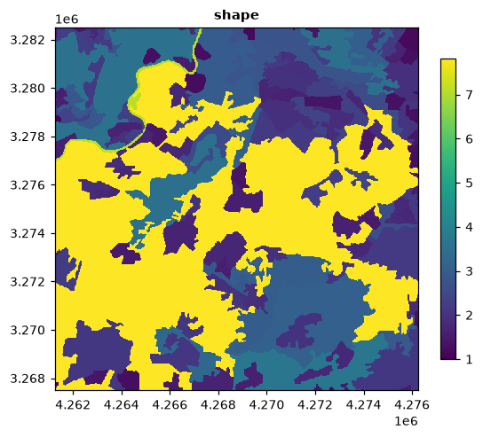
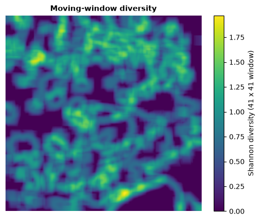
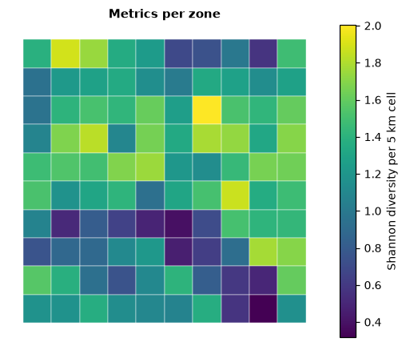

# Landscape metrics

Landscape metrics turn a categorical map into numbers: how many patches of
each land cover there are, how large and how complex they are, how
aggregated each class is, how diverse the landscape is. They are the standard
way to compare landscapes, follow them over time and relate their structure to
ecological processes.

**You will learn to:**

- compute metrics at the patch, class and landscape levels;
- find and select metrics among the 130+ available;
- set the options that change how patches and edges are counted;
- map metrics, sample them in plots, moving windows and zones;
- follow landscapes over time and group landscapes by their structure;
- handle rasters larger than memory and very large tables.

**Input:** any categorical raster (integer classes), such as a land-cover map.

## The three levels

A **patch** is a group of connected cells of the same class. Metrics exist at
three levels:

| Level | One value per | Examples |
|---|---|---|
| patch | patch | area, perimeter, shape index, distance to the nearest patch of the same class |
| class | class | total area, number of patches, edge density, aggregation index |
| landscape | map | total edge, Shannon diversity, contagion |

and fall into families: **area and edge**, **shape**, **core area**,
**aggregation** (how clumped or dispersed), **diversity** (how many classes,
how evenly spread) and **complexity** (information-theory measures).

## First metrics

```python
import landschaft as ls

landcover = ls.load_raster(ls.example_data("clc"))   # CORINE, 25 m
lc = ls.Landscape(landcover)
lc
```

`Landscape` prepares the map once (it finds all patches of all classes in one
pass) and then answers any number of metric requests quickly.

```python
lc.patch_metrics(["area", "perim", "shape"]).head()
```

Areas are in **hectares** and lengths in map units (metres here). The
`class` column is the land-cover code and `id` numbers the patches.

```python
lc.class_metrics(["ca", "pland", "np", "ed", "ai"]).head()
```

`ca` is the class area (ha), `pland` its share of the landscape (%), `np` the
number of patches, `ed` the edge density (m/ha) and `ai` the aggregation index
(%).

```python
lc.landscape_metrics(["shdi", "contag", "lsi"])
```

Shannon diversity (`shdi`), contagion (`contag`, %) and landscape shape index
(`lsi`) of the whole map.

These *wide* tables have one column per metric. The *long* format has one row
per value, which is convenient for many metrics and levels at once:

```python
table = lc.metrics(level=["class", "landscape"], type="aggregation metric")
table.head()
```

The one-call form, without keeping a `Landscape`, is
`ls.landscape_metrics(landcover, level="landscape")`.

## Finding metrics

```python
catalogue = ls.list_metrics()
len(catalogue), catalogue["type"].unique()
```

`list_metrics` shows every metric with its name, type and level. The same
filters select metrics everywhere (`level`, `metric`, `name`, `type`), and a
leading minus excludes:

```python
ls.list_metrics(level="landscape", type="diversity metric")[["metric", "name"]]
```

```python
lc.metrics(level="class", metric=["area", "shape"])   # area_mn, area_sd, shape_mn...
lc.metrics(level="landscape", type="-complexity metric").shape
```

Metrics are named by their standard abbreviations (`ca`, `shdi`,
`enn_mn`...). Upper-case abbreviations and full names work too in the wide
tables:

```python
lc.landscape_metrics(["SHDI", "shannon_diversity_index", "contagion"])
```

The most used metrics:

| Metric | Level | Meaning |
|---|---|---|
| `area`, `ca`, `ta` | patch, class, landscape | area (ha) |
| `pland` | class | percentage of the landscape |
| `np`, `pd` | class, landscape | number of patches, patches per 100 ha |
| `lpi` | class, landscape | largest patch index: share of the landscape in the largest patch |
| `te`, `ed` | class, landscape | total edge (m), edge density (m/ha) |
| `shape`, `frac` | patch (+ `_mn`, `_sd`, `_cv`...) | shape index, fractal dimension |
| `enn` | patch (+ stats) | distance to the nearest patch of the same class (m) |
| `core`, `cai` | patch (+ stats) | core area (ha) and core area index (%) |
| `ai`, `cohesion`, `division`, `mesh`, `split` | class, landscape | aggregation, cohesion and subdivision |
| `contag`, `iji` | landscape (`iji` also class) | contagion, interspersion and juxtaposition |
| `shdi`, `shei`, `sidi`, `siei`, `pr` | landscape | diversity, evenness, richness |

Statistics over patches exist for every patch metric: mean `_mn`, standard
deviation `_sd` and coefficient of variation `_cv`, and with `extras=True`
the area-weighted mean `_am`, the median `_md` and the range `_ra`.

## Options

Options are given when creating the `Landscape`:

| Option | Default | Effect |
|---|---|---|
| `directions` | 8 | 8: cells touching by a corner are the same patch; 4: only by a side |
| `edge_depth` | 1 | how many cells from the patch edge are not core |
| `consider_boundary` | False | whether the map border counts as an edge for core areas |
| `count_boundary` | False | whether the map border counts as edge in `te` and `ed` |
| `neighbourhood` | 4 | neighbours of the complexity metrics |
| `classes_max` | None | potential number of classes, for relative richness `rpr` |
| `nodata`, `res` | from the raster | NoData value and cell size (numpy arrays have cells of 1) |

```python
lc4 = ls.Landscape(landcover, directions=4, edge_depth=3)
lc4.class_metrics(["np", "tca"]).head()
```

## Maps of metrics

```python
area_map = lc.to_raster("area")   # every patch painted with its area
```

With matplotlib, `show_*` draw the patches and metrics directly:

```python
small = ls.Landscape(landcover[:600, :600])
fig = small.show_lsm("shape")        # shape index of every patch
```



`show_patches()` draws the patches, `show_cores()` their core and edge cells,
and `ls.show_correlation(table)` the correlation matrix of a set of metrics.

## Sample plots

Metrics of circles or squares around points, e.g. sampling sites:

```python
import numpy as np

xmin, xmax, ymin, ymax = lc.extent
rng = np.random.default_rng(1)
sites = np.column_stack([rng.uniform(xmin + 2000, xmax - 2000, 10),
                         rng.uniform(ymin + 2000, ymax - 2000, 10)])

plots = ls.sample_metrics(landcover, sites, size=1000, shape="circle",
                          level="landscape", metric=["shdi", "ed"])
plots.head()
```

`size` is the radius of a circle or half the side of a square, in map units.
`percentage_inside` is the area of the cells kept over the area of the plot:
every cell the plot touches is kept, so it can exceed 100%; plots on the map
border fall below. `y` can also be polygons (shapely geometries or a
GeoDataFrame). `ls.scale_sample` repeats the sampling for several sizes and
`ls.extract_metrics` returns the metrics of the patches under the points.

## Moving windows

A metric computed in a window around every cell gives a map of how the
landscape structure changes across space:

```python
maps = ls.window_metrics(landcover[:800, :800], window=41, what=["lsm_l_shdi"])
diversity = maps["shdi"]
```



`window` is an odd side in cells, or an array of zeros and ones for other
shapes (a disc, for example). Only landscape-level metrics are available.

## Zones

Metrics for each polygon of a vector layer, or for each cell of a regular
grid (needs geopandas):

```python
zones = ls.grid_zones(landcover, 5000)          # 5 km squares over the map
per_zone = ls.zonal_metrics(landcover, zones, level="landscape", metric=["shdi", "np"])
per_zone.head()
```

The result is a GeoDataFrame, ready to map or save
(`ls.write_table(per_zone, "zones.gpkg")`).



## Several maps and time series

A list of rasters gives a `layer` column:

```python
later = landcover.copy()
block = later.values[1200:1500, 1300:1700]
later.values[1200:1500, 1300:1700] = np.where(block == 12, 1, block)   # arable land built up

ls.landscape_metrics([landcover, later], level="landscape", metric=["np", "shdi"])
```

`SpatioTemporalAnalysis` organises such series by date and plots them:

```python
series = ls.SpatioTemporalAnalysis([landcover, later], dates=[2018, 2030])
series.class_metrics(["pland", "np"]).head()
```

It works on whole maps, on zones (`zones=`), around points (`points=`,
`size=`) or on a grid (`grid=`); `series.plot_metric("pland", classes="all")`
draws the trends.

## Spatial signatures

Describe many landscapes (or zones of one map) by a set of metrics, then
find the main gradients and groups among them:

```python
signatures = ls.SpatialSignatureAnalysis(
    landcover, grid=5000,
    landscape_metrics=["shdi", "ed", "np"], class_metrics=["pland"],
)
pca = signatures.pca()           # principal components of the metrics
groups = signatures.cluster(4)   # k-means groups of zones
np.bincount(groups)
```

`nmf`, hierarchical clustering (`cluster(k, method="ward")`) and the
clustergram (`clustergram`, `plot_clustergram`) are also available.

## Extra FRAGSTATS metrics

Some FRAGSTATS metrics need more information:

```python
contrast = {(12, 23): 0.8, (12, 2): 0.3, (2, 23): 0.9}   # edge contrast between classes
lcx = ls.Landscape(landcover, search_radius=500, connect_threshold=200, contrast=contrast)
lcx.class_metrics(["prox_mn", "connect", "cwed"], extras=True).head()
```

`prox` (proximity) and `simi` (similarity) use the patches within
`search_radius`; `connect` counts pairs of patches within
`connect_threshold`; `econ`, `cwed` and `teci` weigh edges by the contrast
between their classes (pairs not in the table give NaN).

## Very large rasters and tables

For rasters larger than memory, give a file and `block_rows`: the file is
read in blocks and only the patch tables stay in memory, with the same
results:

<!-- no-run -->
```python
big = ls.Landscape("continent_landcover.tif", block_rows="auto")
big.class_metrics(["ca", "np", "ed"])
```

Tables with millions of patches can be streamed to disk:

```python
lc.write_metrics("metrics.parquet", level="patch", metric=["area", "shape"])
```

## Next steps

- Connectivity between the patches: [habitat networks](habitat-networks.md).
- Patterns of a single habitat: [habitat patterns](patterns.md).
