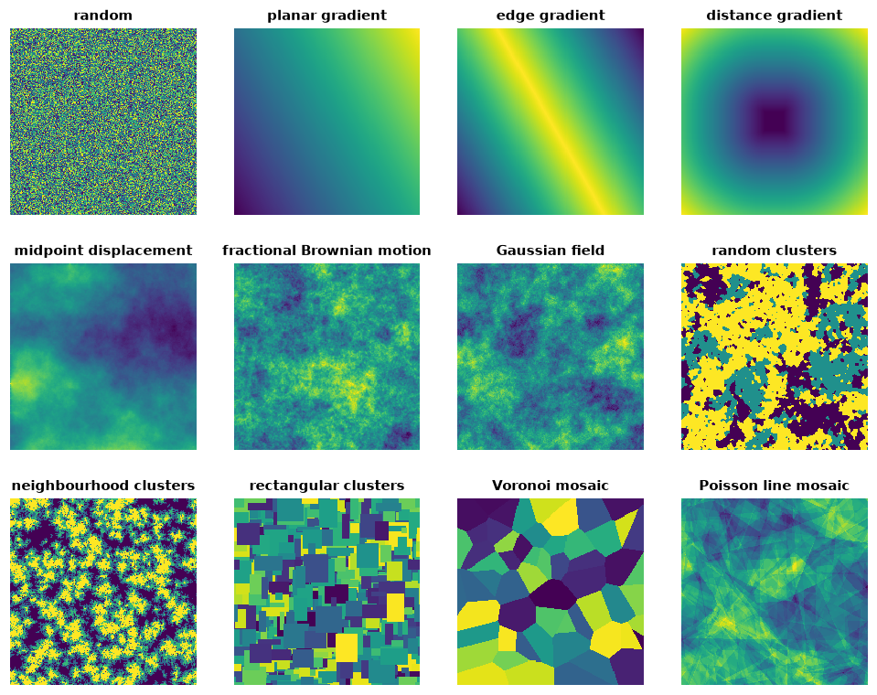
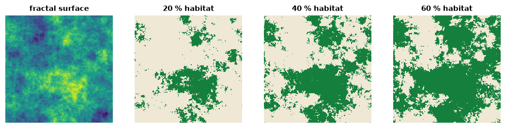
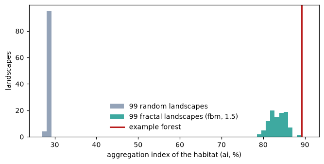

# Neutral landscapes

A neutral landscape model (NLM) builds a map from a rule and nothing else:
cells drawn at random, a gradient, clusters grown from seeds, a fractal
surface. Because no ecological process shaped it, an NLM is a *null model*:
comparing a real map, or the result of a simulation on it, with many NLMs
tells whether the pattern differs from what chance alone would give.

**You will learn to:**

- simulate the main families of neutral landscapes;
- turn a continuous model into habitat maps with a chosen habitat share;
- test whether a real map is more aggregated than random ones;
- reproduce landscapes made with the R package NLMR.

All models live in `ls.nlm` and return an `xarray.DataArray` on a grid with its
origin at (0, 0) and cells of size `resolution`. Every model takes a `seed`:
the same seed gives the same landscape, and the same landscape as NLMR.

## A gallery of models

```python
import numpy as np
import landschaft as ls

models = {
    "random": ls.nlm.random(200, 200, seed=1),
    "planar gradient": ls.nlm.planar_gradient(200, 200, direction=60),
    "edge gradient": ls.nlm.edge_gradient(200, 200, direction=60),
    "distance gradient": ls.nlm.distance_gradient(200, 200, origin=(90, 110, 90, 110), nlmr_compat=False),
    "midpoint displacement": ls.nlm.mpd(200, 200, roughness=0.6, seed=2, nlmr_compat=False),
    "fractional Brownian motion": ls.nlm.fbm(200, 200, fract_dim=1.4, seed=3),
    "Gaussian field": ls.nlm.gaussian_field(200, 200, autocorr_range=20, seed=4),
    "random clusters": ls.nlm.random_cluster(200, 200, p=0.55, ai=[0.3, 0.3, 0.4], seed=5),
    "neighbourhood clusters": ls.nlm.neigh(200, 200, p_neigh=0.95, p_empty=0.002, categories=4, seed=6),
    "rectangular clusters": ls.nlm.random_rectangular_cluster(200, 200, minl=5, maxl=30, seed=7),
    "Voronoi mosaic": ls.nlm.mosaic_tess(200, 200, germs=60, seed=8),
    "Poisson line mosaic": ls.nlm.mosaic_field(200, 200, n=20, seed=9),
}
```



They fall into a few families:

| Family | Models | Controls |
|---|---|---|
| No structure | `random`, `percolation` | habitat share (`prob`) |
| Gradients | `planar_gradient`, `edge_gradient`, `distance_gradient` | direction, origin |
| Fractal surfaces | `mpd`, `fbm` | roughness / `fract_dim`: how quickly detail fades |
| Random fields | `gaussian_field` | range of the autocorrelation, nugget |
| Clusters | `random_cluster`, `neigh`, `random_rectangular_cluster`, `curds` | compactness and size of the clusters |
| Mosaics | `mosaic_tess`, `mosaic_gibbs`, `mosaic_field` | number of tiles, spacing of the germs |

Continuous models are rescaled to 0-1 by default (`rescale=False` keeps the raw
values). Gradients and random surfaces can be combined with `ls.nlm.merge`, for
instance a regional gradient with local noise:

```python
blend = ls.nlm.merge(models["planar gradient"], models["fractional Brownian motion"], scaling=0.6)
```

## From continuous surfaces to habitat maps

Most analyses need categories. `ls.nlm.classify` cuts a continuous landscape
by class proportions (or by Jenks' natural breaks with `n=`), and
`ls.nlm.binarize` gives habitat/matrix maps at chosen habitat shares, the
highest values becoming habitat:

```python
surface = ls.nlm.fbm(200, 200, fract_dim=1.6, seed=3)
maps = ls.nlm.binarize(surface, [0.2, 0.4, 0.6])     # 1 matrix, 2 habitat
[float((maps.sel(p=b) == 2).mean()) for b in (0.2, 0.4, 0.6)]
```



The same surface keeps its structure at every share: the habitat grows from
the peaks, and the patches merge as the share rises (the percolation
threshold of [Learn chapter 3](../learn/fragmentation.md)).

## A null-model test

Is the forest of the example map more aggregated than chance would make it?
We take a corner of the map, measure the aggregation index (`ai`) of its
forest, and compare it with 99 random maps and 99 fractal maps with the same
amount of forest:

```python
forest = ls.load_raster(ls.example_data("input")).values[:250, :250]
habitat = np.where(forest == 2, 2, 1)             # the few missing cells as matrix
share = float((habitat == 2).mean())


def aggregation(m):
    table = ls.landscape_metrics(np.asarray(m), level="class", metric="ai")
    return float(table.loc[table["class"] == 2, "value"].iloc[0])


observed = aggregation(habitat)
random_ai = [aggregation(ls.nlm.binarize(ls.nlm.random(250, 250, seed=s), share)) for s in range(1, 100)]
fractal_ai = [aggregation(ls.nlm.binarize(ls.nlm.fbm(250, 250, fract_dim=1.5, seed=s), share)) for s in range(1, 100)]
observed, max(random_ai), min(fractal_ai), max(fractal_ai)
```



The forest's aggregation index is 89.2 %. Random maps with the same 28 % of
forest reach at most 29 %: the pattern is certainly not chance. The sharper
question is whether the forest is more aggregated than a spatially
autocorrelated surface of that roughness: the 99 fractal landscapes score 79 to
89 %, all of them below the forest. The rank of the observed value among the
replicates is the test: above all 99 replicates, the forest is more aggregated
than both null models at the 1 % level (one-sided).

The same design works for any response: the output of a dispersal model, an
occupancy map, a connectivity index. Use models whose structure matches the
hypothesis: `random` tests for any structure at all, `fbm` and
`gaussian_field` for aggregation beyond a given autocorrelation, cluster and
mosaic models for patch shapes and sizes.

## Reproducing NLMR

Every model follows its NLMR counterpart value for value. The seed is NLMR's
`user_seed`:

<!-- no-run -->
```r
# R
library(NLMR)
r <- nlm_mpd(ncol = 129, nrow = 129, roughness = 0.7, user_seed = 42)
```

```python
# Python: the same values
m = ls.nlm.mpd(129, 129, roughness=0.7, seed=42)
```

A few models behave in NLMR differently from what their documentation says;
`nlmr_compat=True` (the default) keeps these behaviours so that results match,
and `nlmr_compat=False` does what the documentation promises:

| Model | NLMR's behaviour (`nlmr_compat=True`) | `nlmr_compat=False` |
|---|---|---|
| `mpd` | square output of `max(nrow, ncol) ± 1` cells | the size asked for |
| `distance_gradient` | `origin` as rows then columns; great-circle distances in metres for rasters up to 360 × 90 cells | origin as columns then rows; Euclidean distances |
| `mosaic_field` | `n = 1` sums three mosaics | one mosaic |
| `mosaic_tess`, `mosaic_gibbs` | values given in GEOS's order of the Voronoi cells (with shapely) | each germ its own value |

`nlm_fbm` and `nlm_gaussianfield` print a message in NLMR 1.4 (RandomFields left
CRAN); Landschaft gives the values of the replacements NLMR ships internally
(`simulate_fbm`, `simulate_gaussian_field`).

## Speed

The models run in C++ with OpenMP. The random numbers are drawn in NLMR's
order, and everything else runs in parallel: the fast Fourier transforms of the
spectral models, the diamond-square steps, the labelling and gap filling of the
cluster models, the rasterisation of the mosaics. Typical gains over NLMR are
2 to 8 times for the models NLMR computes in C++ or with FFTs, and 100 to 6000
times for those it computes cell by cell in R (`percolation`, `random_cluster`,
`mosaic_field`); see the [benchmarks](../benchmarks.md).
