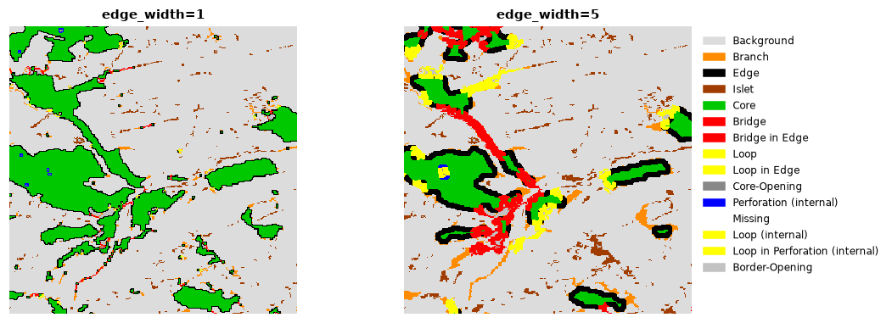
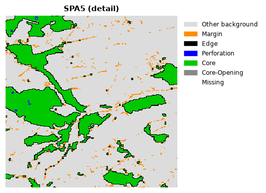
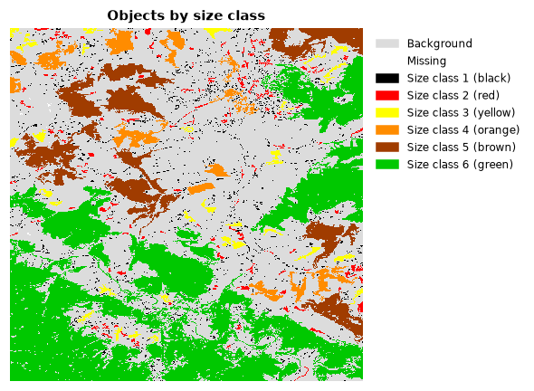

# Habitat patterns

How is the habitat of a landscape arranged? Is most of it interior habitat,
far from disturbances at the edges, or thin strips and scattered fragments?
Which pieces of habitat connect larger areas? This tutorial describes the
spatial pattern of habitat pixel by pixel and object by object.

**You will learn to:**

- classify every habitat pixel by its structural role (MSPA);
- use the simpler, faster summary classes (SPA);
- group habitat objects by size (accounting);
- measure how finely a landscape is divided into parcels;
- measure how contorted habitat boundaries are.

**Input:** a [binary habitat map](../getting-started/concepts.md#habitat-maps)
(0 missing, 1 background, 2 habitat). We use the example map that ships with
the package.

```python
import landschaft as ls

forest = ls.load_raster(ls.example_data("input"))
forest.shape
```

## Morphological Spatial Pattern Analysis (MSPA)

MSPA looks at the shape of the habitat with a structuring element of a given
width, the **edge width**, and gives every habitat pixel one of seven roles:

| Class | Meaning | Ecological reading |
|---|---|---|
| **Core** | further from the background than the edge width | interior habitat |
| **Edge** | the outer boundary of a core area | exposed to the matrix |
| **Perforation** | the boundary of a hole inside a core area | interior disturbance, clearings |
| **Bridge** | connects two different core areas | corridor between habitat areas |
| **Loop** | connects a core area to itself | alternative route around a core |
| **Branch** | attached to a core at one end only | dead end, spur |
| **Islet** | a patch too small to contain any core | isolated fragment, stepping stone |

### Run it

```python
morph = ls.mspa(forest, edge_width=2)
```

The result has the same shape and georeferencing as the input, with a class
code in every pixel (see the table of codes below). Background stays 0 and
missing data becomes 129.

### How much of each class?

```python
stats = ls.mspa_stats(morph)
stats
```

`pixels` is the area of each class, `pct_data` its share of the mapped area
and `pct_foreground` its share of the habitat. With 2-pixel edges about 60% of
this forest is core; bridges, loops and branches together are a small but
structurally important part (about 16%).

### The edge width

The edge width is the key parameter: it says how far into a patch the
influence of its surroundings reaches, in pixels. It should reflect the
ecology of the species or process you study and the pixel size: with 25 m
pixels, `edge_width=4` means that edge effects reach 100 m into the forest.

```python
narrow = ls.mspa(forest, edge_width=1)
wide = ls.mspa(forest, edge_width=5)
core_share = {
    "edge_width=1": ls.mspa_stats(narrow).loc["Core", "pct_foreground"],
    "edge_width=5": ls.mspa_stats(wide).loc["Core", "pct_foreground"],
}
core_share
```



With wider edges, narrow patches have no core left: they turn into bridges,
loops, branches and islets, and the core shrinks to the interior of the
larger patches.

### Other options

| Option | Default | Meaning |
|---|---|---|
| `connectivity` | 8 | 8: pixels touching by a corner belong to the same patch; 4: only by a side |
| `edge_width` | 1 | width of edges and perforations, in pixels |
| `transition` | True | loops and bridges that cross an edge are drawn in their own colours (changes only the colour table) |
| `internal` | True | features inside holes of a core get +100, and holes are labelled core-opening (100) or border-opening (220) |

The full list of class codes is in `ls.MSPA_CLASSES`:

```python
ls.MSPA_CLASSES
```

### Save and display

```python
ls.write_raster(morph, "forest_mspa.tif")   # GeoTIFF with the MSPA colour table
```

To draw the classes with their colours in Python, use the `show_classes`
helper of [core concepts](../getting-started/concepts.md#plotting-maps) with
`ls.mspa_colormap()`.

## Simplified pattern analysis (SPA)

When the seven MSPA classes are more than you need, SPA summarises the
pattern in 2, 3, 5 or 6 classes, from "habitat that has a core vs. small
linear features" (SPA2) to a split close to MSPA (SPA6):

| Variant | Classes |
|---|---|
| SPA2 | contiguous (core, edge, perforation), small linear features |
| SPA3 | core, edge (+ perforation), margin |
| SPA5 | core, edge, perforation, margin |
| SPA6 | core, edge, perforation, margin, islet |

```python
spa = ls.spa(forest, variant=5)
spa.stats
```

`spa.map` is the class map (`ls.SPA_CLASSES` names the codes), `spa.stats`
the class areas and `spa.porosity` the ratio of the core-openings to the
core area. `print(spa.summary())` gives a full report.



## Objects by size: accounting

Accounting finds every separate habitat object (a group of connected habitat
pixels) and groups them into size classes. It answers questions like "how
much of the forest is in large, intact blocks and how much in fragments?".

```python
acc = ls.accounting(forest, thresholds=(50, 250, 1000, 5000, 20000))
acc.stats
```

The thresholds are the upper sizes of the classes, in pixels: objects of 1 to
50 pixels are class 1, 51 to 250 class 2, and so on; objects above the last
threshold are the last class. In the example, 94% of the objects are tiny but
they hold less than 5% of the forest, while three objects hold 64% of it.



The result also has:

| Attribute | Content |
|---|---|
| `acc.classes` | map of size classes (colours: `ls.accounting_colormap()`) |
| `acc.ids` | map of object numbers |
| `acc.area` | map where every object pixel holds the area of its object |
| `acc.object_area` | area of every object |
| `acc.largest` | the three largest objects |
| `acc.summary()` | a printable report, with hectares for a given `pixel_resolution` |

`thresholds="auto"` proposes classes from the range of object sizes, and
`highlight_largest=True` marks the three largest objects on the map.

## Parcels: how divided is the landscape?

Parcellation treats every connected region of the same value (habitat or
background) as a parcel and measures how finely the landscape is cut:

```python
parcels = ls.parcellation(forest)
parcels.stats
```

| Column | Meaning |
|---|---|
| `Count` | number of parcels of the class |
| `APS` | average parcel size, pixels |
| `AWAPS` | area-weighted average parcel size: the size of the parcel a random pixel falls in |
| `DIVISION` | probability that two random pixels of the class are in different parcels (0 = one parcel, 1 = infinitely divided) |
| `PARC` | degree of parcellation, % |

`parcels.global_stats` holds the same values for the whole landscape, and
`ls.parcellation(forest, return_labels=True).parcel_labels` a map of the
parcels.

## Contortion: how convoluted are the boundaries?

Contortion measures how much the boundary of each habitat object bends,
relative to its size: compact objects score low, elongated or dendritic ones
high.

```python
contortion = ls.contortion(forest, min_area=100)
int(contortion.max())
```

Values: 0 missing, 1 background, 2 objects that were left out (smaller than
`min_area` or without an interior), 3 and more the contortion of each
object.

## Next steps

- Measure fragmentation at different observation scales in the
  [fragmentation tutorial](fragmentation.md).
- Process many maps or maps larger than memory with MSPA in
  [large data & batch](large-data.md).
- Every function and option: [API reference](../api/patterns.md).
