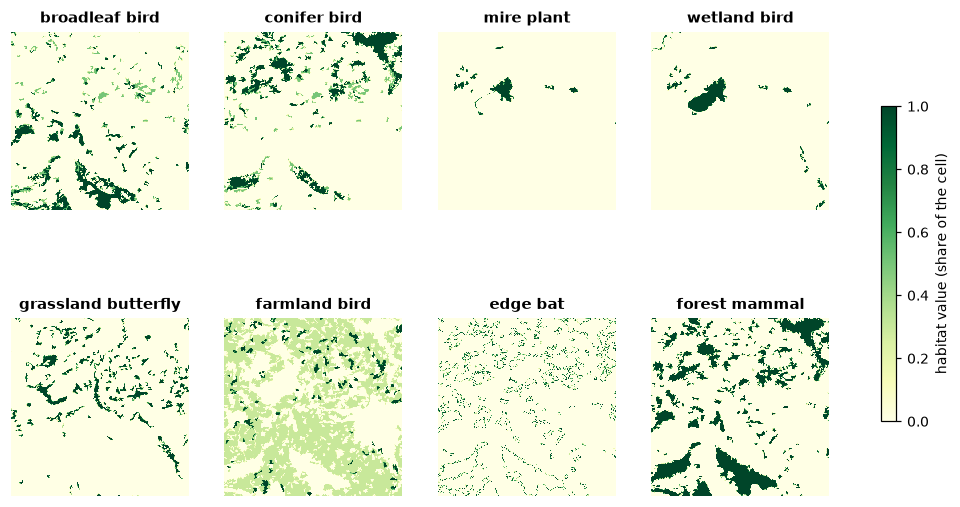
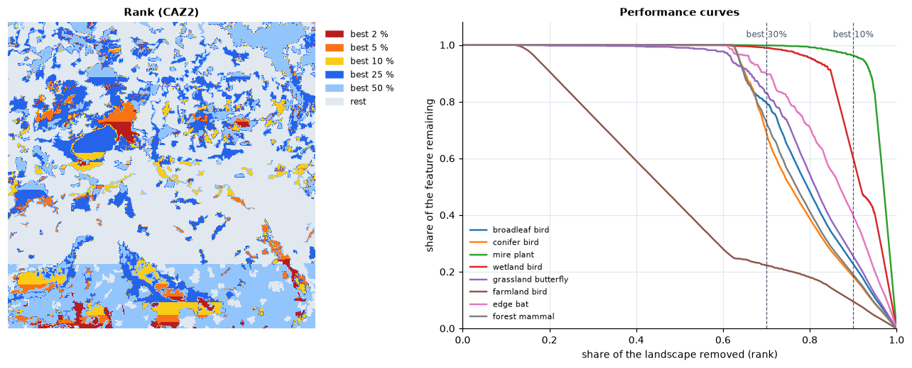
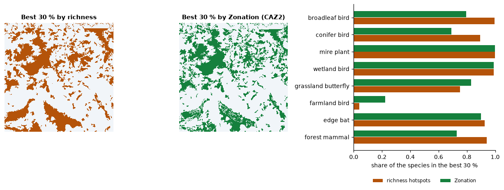
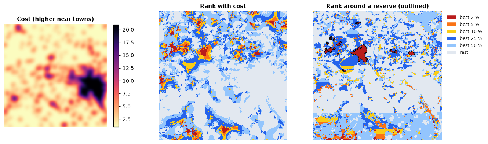
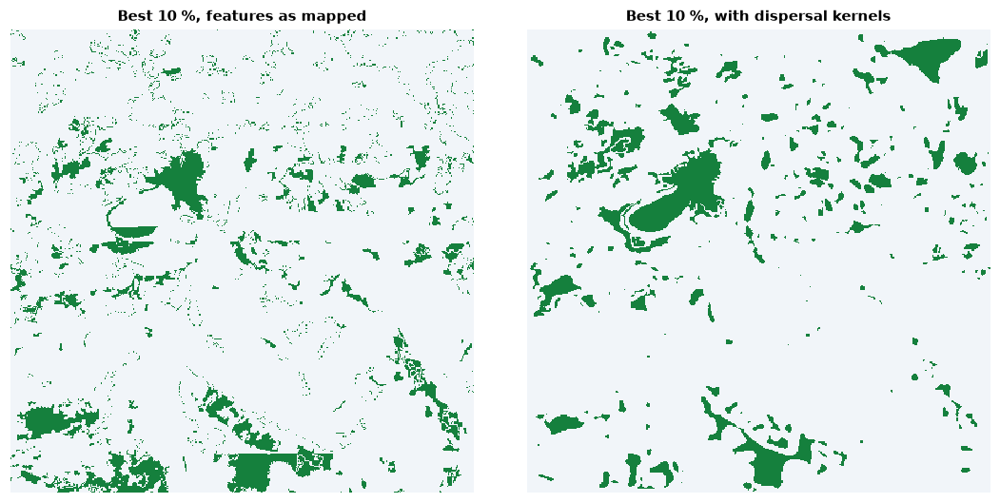

# Conservation priorities

Which places matter most for a set of species, habitats or ecosystem
services, taken together? `ls.prioritize` ranks every cell of a landscape
from the least to the most important, as [Zonation 5](https://zonationteam.github.io/Zonation5/)
does (Moilanen et al. 2022): same rank maps and curves, bit for bit, several
times faster. The ideas behind it are in the course chapter
[Conservation priorities](../learn/prioritization.md).

**You will learn to:**

- rank a landscape for several features and read the rank map and the
  performance curves;
- see why complementarity beats richness hotspots;
- give features weights, bring in costs and existing reserves;
- account for dispersal with connectivity kernels;
- write Zonation's files and run existing Zonation projects.

## Features from a land-cover map

Zonation ranks cells by **features**: anything with a value in every cell
whose total should be kept, usually species distributions (occurrences,
habitat suitability, abundance). Here eight hypothetical species take their
habitat from the CORINE land-cover map that ships with landschaft: the
fraction of every 125 m cell covered by the classes each one lives in.

```python
import numpy as np
import pandas as pd
import xarray as xr
import landschaft as ls

P = ls.prioritize
clc = ls.load_raster(ls.example_data("clc"), validate=None)

def share(*codes):
    """The fraction of every 125 m cell (5 x 5 CORINE cells) in the classes."""
    return clc.isin(codes).coarsen(x=5, y=5).mean().astype("float32")

broadleaf, conifer, mixed = share(23), share(24), share(25)
forest = broadleaf + conifer + mixed
names = ["broadleaf_bird", "conifer_bird", "mire_plant", "wetland_bird",
         "grassland_butterfly", "farmland_bird", "edge_bat", "forest_mammal"]
species = xr.concat([
    broadleaf + 0.5 * mixed,              # a bird of broadleaved and mixed woods
    conifer + 0.5 * mixed,                # a bird of coniferous and mixed woods
    share(35, 36),                        # a plant of marshes and peat bogs
    share(35, 36, 40, 41),                # a bird of mires and open water
    share(18, 26),                        # a butterfly of pastures and grasslands
    share(20, 21) + 0.3 * share(12),      # a bird of mosaic farmland, rarer in arable land
    4 * forest * (1 - forest),            # a bat of forest edges
    forest ** 2,                          # a mammal of large forests
], dim="species").assign_coords(species=names)
species.shape
```



Features can be GeoTIFF files, NumPy arrays or `xarray`/`dask` stacks
(`features, y, x`); each is scaled to sum 1, so a rare species counts as much
as a widespread one.

## A first ranking

```python
res = P.zonation(species, names=names)
res.iterations, res.ranking_error
```

Zonation removes the cells in the order of their **marginal loss**, the loss
to the features of removing a cell at the point where it is removed, then
sorts again with the new losses until the order is consistent (136
iterations here, down to a mean ranking error of 0.01 %). `res.rank` is the
rank map: 0 for the cell removed first, close to 1 for the most important.
The best 10 % of the landscape are the cells with rank 0.9 or more.

The **performance curves** (`res.feature_curves`) say how much of every
feature remains as the landscape is removed: the value at rank 0.9 is the
share of each species in the best 10 %.

```python
def kept(res, best):
    """The fraction of every feature in the best `best` fraction of the cells."""
    fc = res.feature_curves
    return fc.iloc[(fc["rank"] - (1 - best)).abs().argmin(), 1:]

pd.DataFrame({"best 10 %": kept(res, 0.1), "best 30 %": kept(res, 0.3)}).round(2)
```



The best 30 % hold 69 % to 100 % of every species, except the farmland bird,
spread thinly over the arable half of the map: 22 %. The mire plant, found
only in the bogs, is almost entirely in the best 10 % (96 %).

The straight band across the bottom of the rank map is not in the landscape.
Every cell of pure arable land has exactly the same value, so they tie, and
Zonation breaks ties by the order of the cells, row by row: the last rows
rank higher. Ranks within a tie carry no meaning; the dispersal kernels of
the [connectivity](#connectivity) section remove most ties. `res.summary_curves` adds the mean, minimum and maximum over the
features, and the area and cost remaining.

## Complementarity, not hotspots

An intuitive alternative is to protect the richest places: rank the cells by
the sum of the features. The `LOAD` rule evaluates any given ranking with the
same curves:

```python
richness = (species / species.sum(dim=("y", "x"))).sum("species")
hotspots = P.zonation(species, names=names, rule="LOAD", solution=richness)
pd.DataFrame({"hotspots": kept(hotspots, 0.3), "zonation": kept(res, 0.3)}).round(2)
```



The hotspots are the forests, where four species overlap: they take more of
the forest species, but leave the farmland bird with 4 %. Zonation's order is
**complementary**: once a species is well covered, its cells lose value, and
the cells of species still poorly covered come first. The rule decides how
the losses of the features combine (see the
[course](../learn/prioritization.md#how-zonation-ranks)):

```python
for rule in ("CAZMAX", "CAZ1", "CAZ2", "ABF"):
    k = kept(P.zonation(species, names=names, rule=rule), 0.3)
    print(f"{rule:7s} smallest {k.min():.2f}  mean {k.mean():.2f}")
```

`CAZMAX` (the core-area Zonation of the earlier versions) follows the worst
covered feature, `ABF` (additive benefit) the sum of the benefits, and
`CAZ2`, Zonation 5's default, sits between: its smallest coverage in the best
30 % is nearly CAZMAX's with nearly ABF's mean.

## Weights

A red-listed species, or a feature that matters more for the project, can
weigh more. Weights multiply the feature's losses:

```python
weighted = P.zonation(species, names=names, weights=[1, 1, 1, 1, 3, 1, 1, 1])
kept(res, 0.1)["grassland_butterfly"], kept(weighted, 0.1)["grassland_butterfly"]
```

Tripling the weight of the grassland butterfly raises its share in the best
10 % from 25 % to 56 %. Negative weights mark features to avoid (a threat,
an invasive species); `weight_groups` shares a weight among features, and
`groups` gives curves per group (`res.group_curves`).

## Costs and existing reserves

Land costs more near towns. With a **cost** per cell, the order balances the
loss to the features against the cost saved: cheap cells with a little of
everything move up.

```python
towns = share(*range(1, 12))
near_towns = P.convolve(towns.values, P.Kernel("gaussian", 8, cut=3))    # within about 1 km
cost = towns.copy(data=(1 + 20 * near_towns).astype("float32"))

plain = P.zonation(species, names=names, cost=cost, cost_in_ranking=False)   # cost only tracked
cheap = P.zonation(species, names=names, cost=cost)

def kept_for_budget(res, budget):
    """The features in the best cells worth `budget` of the total cost, and their area."""
    s = res.summary_curves
    i = (s["remaining_cost"] / s["remaining_cost"].iloc[0] - budget).abs().argmin()
    return res.feature_curves.iloc[i, 1:], s["remaining_area"].iloc[i] / s["remaining_area"].iloc[0]

for r, label in ((plain, "ranked without cost"), (cheap, "ranked with cost")):
    k, area = kept_for_budget(r, 0.1)
    print(f"{label}: {area:.0%} of the area, smallest {k.min():.2f}, mean {k.mean():.2f}")
```

For a tenth of the total cost, the ranking with cost protects 27 % of the
landscape instead of 15 %, and the mean coverage of the species rises from
0.49 to 0.68.

Areas already protected enter as a **hierarchic mask**: cells of a higher
level are removed after all the cells of lower levels, so the rest of the
landscape is ranked for what the reserves lack. Say the large bog is a
reserve:

```python
reserves = (share(36) > 0.5).astype("uint8")
protected = P.zonation(species, names=names, hierarchic_mask=reserves)
protected.hierarchic_mask_ranks, kept(protected, float(reserves.mean())).round(2)
```



The reserve covers 1.4 % of the map (ranks from 0.986) and holds 92 % of the
mire plant, 45 % of the wetland bird and almost nothing of the others: a gap
analysis in one line. The cells ranked just below it are those that best
complete it.

## Connectivity

Isolated cells of habitat are worth less to a species than cells in large,
connected areas. Zonation's **connectivity transforms** smooth each feature
with a dispersal kernel before the ranking, so cells near much habitat gain
value. Kernels are per feature, with distances in cells:

```python
kernels = [P.Kernel("negexp", d) for d in (4, 4, 1, 8, 2, 4, 8, 16)]   # mean dispersal, x 125 m
connected = P.zonation(species, names=names, connectivity=kernels)

for r, label in ((res, "as mapped"), (connected, "with dispersal")):
    best = np.where(r.rank.values >= 0.9, 2, 1).astype("uint8")
    n = ls.Landscape(best).class_metrics(["np"]).set_index("class").loc[2, "np"]
    print(f"{label}: best 10 % in {int(n)} patches")
```



With dispersal, the best 10 % gather in 293 patches instead of 1 479.
`interaction` and `interaction2` link a feature to the resources of another
(a predator to its prey, a pollinator to its plants) and
`matrix_connectivity` lets features of different habitats count for one
another; `condition` and `retention` lower the value of degraded or already
impacted cells.

## Zonation's files and projects

`res.write(folder)` writes what `z5` writes: `rankmap.tif`,
`feature_curves.csv`, `summary_curves.csv`, `features_info.csv` and the rest,
in Zonation's formats. The post-processing analyses are methods of the result
(`area_statistics`, `solution_comparison`, `histogram`, `flexibility_map`),
as are the impact assessments (`impact`, `cumulative_impact`).

<!-- no-run -->
```python
res.write("zonation_output")
res.area_statistics("municipalities.tif")          # sizes, mean ranks and coverage per zone
```

Projects prepared for Zonation 5 run as they are, with the switches of the
`z5` command line:

<!-- no-run -->
```python
res = ls.prioritize.run_project("settings.z5", "-wh", mode="CAZ2", output="output")
```

## Going further

- **Large maps**: the features are read in blocks of rows and stored in one
  or two bytes per value, as runs; `storage=` keeps the large arrays in
  memory-mapped files for maps larger than the memory (see the
  [API reference](../api/prioritization.md#large-maps)).
- **16 bits**: `bits=16` quantizes as `z5_16bit` does, for features with a
  long tail of small values.
- **Threads**: `n_threads` (default: all cores but one); the result does not
  depend on it.

The [API reference](../api/prioritization.md) documents every option.
