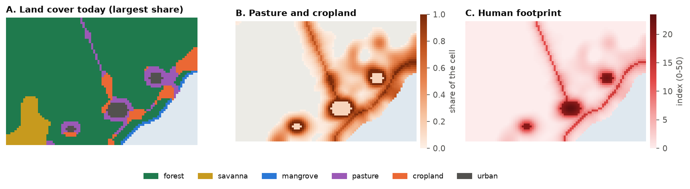
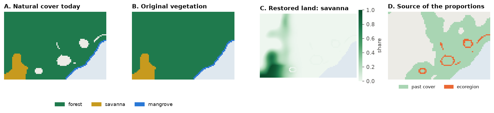
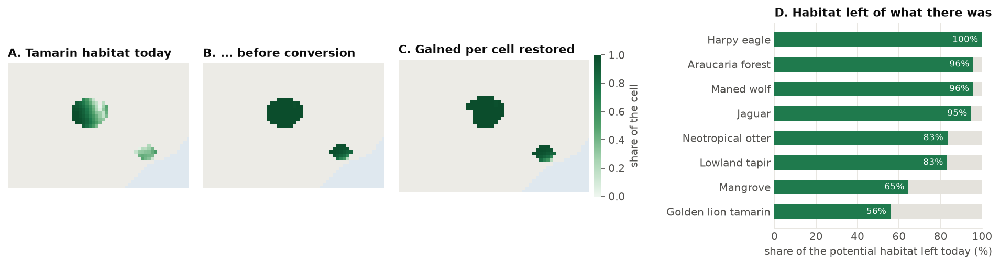
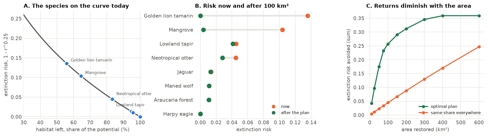
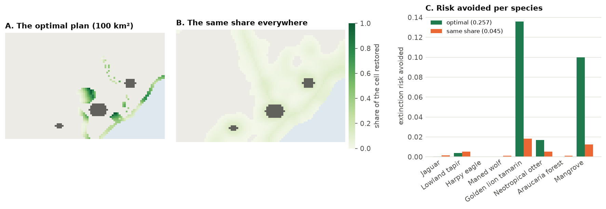
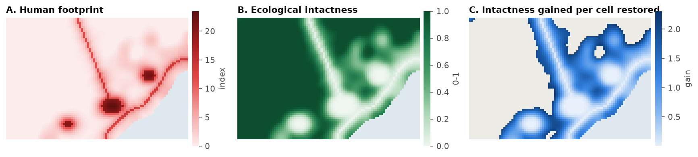
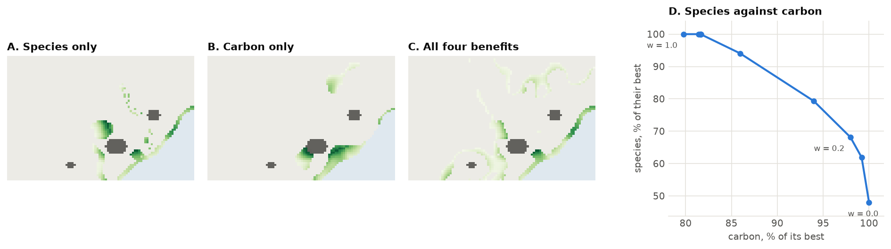
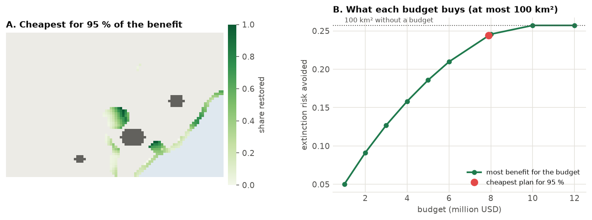
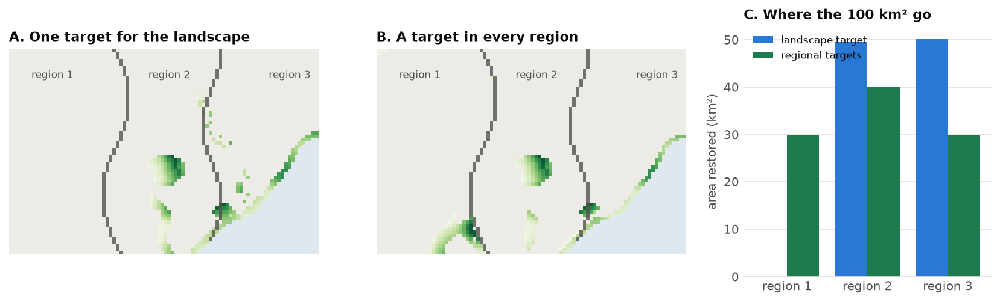
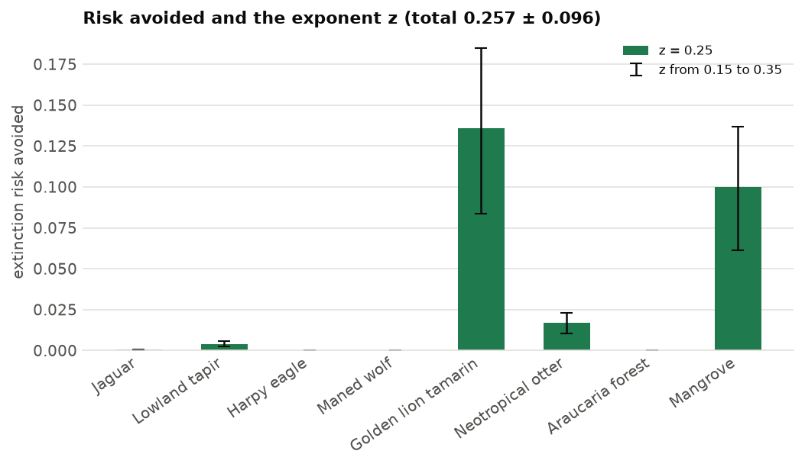

# Restoration priorities

Where should converted land be restored, and how much of each place, to bring back the most biodiversity, carbon
and ecological integrity for a given area or budget? This tutorial builds a complete restoration plan for Serra
Verde, the example region of the [optimized conservation plans](conservation-plans.md), with the restoration
problem of `ls.prioritize`: the model of Strassburg et al. (2020), *Global priority areas for ecosystem
restoration*, solved exactly.

**You will learn to:**

- find the original vegetation of converted land, and what restoring it brings back;
- measure each species' habitat today and before conversion, and what every restored cell gives it;
- turn habitat into extinction risk, and see why the rarest species drive the plan;
- solve a plan for an area target, and compare it with restoring everywhere alike;
- add ecosystems, carbon and ecological intactness, and weigh them against each other;
- plan with a budget, find the cheapest plan for a benefit, and set targets per region;
- report the uncertainty of the results, and save them.

!!! info "Background"
    [Chapter 9](../learn/restoration.md) of the course introduces restoration, and
    [chapter 12](../learn/prioritization.md) conservation planning: targets, costs, objectives and why a plan
    made by optimization does better than ranking cells one by one.

## How the model works

A converted cell is rarely all pasture or all crops: the model works with the **share** of every land-cover class
in each cell, and decides the share of each cell to restore, from 0 to its converted share. Restoring a cell turns
its pasture and cropland back into the natural vegetation that was there, which adds habitat to the species
that live in that vegetation. The benefit of a plan is the sum of what it brings:

| Benefit | What restoring a cell adds | Method |
|---|---|---|
| species | less extinction risk for the species whose habitat it grows | `add_extinction_risk_benefit` |
| ecosystems | less risk of collapse for its ecoregion | `add_extinction_risk_benefit` with `ecosystem_areas` |
| carbon | the carbon the restored vegetation holds | `add_linear_benefit` |
| intactness | less human pressure on it and its surroundings | `add_intactness_benefit` |

The extinction risk of a species follows the **species-area relationship**: with a share r of its original habitat
left, its risk is 1 − r<sup>z</sup> (z = 0.25). The curve is steep for species that have lost much habitat and flat
for those that have lost little, so the same hectare restored avoids far more risk for a rare species than for a
common one. Because the curve is concave, a plan that cannot be improved locally is the best of all, which `solve()` finds and
**proves**: it returns the plan with a bound on the best possible benefit.

## The data

Serra Verde ships with the layers a restoration plan needs: the share of six land-cover classes in every 1 km cell,
the natural cover in the past, the human footprint, four ecoregions, the carbon restored vegetation would hold,
and the cost of land.

```python
import numpy as np
import landschaft as ls

P = ls.prioritize
cover = ls.load_raster(P.example_data("land_cover"))          # share of each class (6 bands)
past = ls.load_raster(P.example_data("past_cover"))           # natural classes in the past (3 bands)
features = ls.load_raster(P.example_data("features"))         # habitat suitability of 8 features
footprint = ls.load_raster(P.example_data("footprint"))       # human footprint index (0-50)
ecoregions = ls.load_raster(P.example_data("ecoregions"))     # 4 ecoregions
carbon = ls.load_raster(P.example_data("carbon_potential"))   # t/ha in restored vegetation
cost = ls.load_raster(P.example_data("cost"))                 # thousand USD per km²
regions = ls.load_raster(P.example_data("regions"))           # 3 administrative regions

natural = ["forest", "savanna", "mangrove"]
anthropic = ["pasture", "cropland"]
print([str(b) for b in cover.band.values])
print(f"pasture and cropland: {float(cover.sel(band=anthropic).sum()):.0f} km²")
```



Pasture and cropland cover 916 km², along the roads and around the three cities. The cities themselves (urban) are
neither natural nor anthropic here: they are not restored. Your own data can have any classes; the land cover is a
`(band, y, x)` raster whose band names are the classes, the shares of a cell summing to at most 1.

## Step 1: the original vegetation

What would grow back on a converted cell? `ls.original_vegetation` gives the anthropic share of each cell back to
the natural classes, in the proportions they had there in the `past`. Where the past map has no natural cover left,
or the cell is almost all converted (above `threshold`, 95 %), it uses the proportions of the cell's
**ecoregion**. Compute them from the past map, as the mean proportions of its cells:

```python
props = past / past.sum("band")                 # the natural classes' proportions in each cell's past
eco_props = props.copy()
codes = ecoregions.values
for code in np.unique(codes[np.isfinite(codes)]):
    inside = codes == code
    eco_props.values[:, inside] = np.nanmean(props.values[:, inside], axis=1)[:, None]

veg = ls.original_vegetation(cover, natural, anthropic, past=past, ecoregions=eco_props)
print(veg.classes)
source, cells = np.unique(veg.source.values[np.isfinite(veg.source.values)], return_counts=True)
print(dict(zip(source.astype(int).tolist(), cells.tolist())))      # cells per source
```



The result holds the `original` cover (one band per natural class), the proportions restored land becomes in each
cell (`restore`), the `source` of those proportions (0 the past, 1 the ecoregion, 2 a fallback) and the
`anthropic` share: the land a plan can restore. Here the past map covers almost every cell; the ecoregion fills the
117 nearly converted cells at the edge of the cities (map D).

!!! tip "No past map?"
    Without `past`, the current natural shares are used; without `ecoregions`, equal proportions. Equal
    proportions put mangrove inland next to the cities, so give the ecoregions whenever a cell can be fully
    converted. `restore_to="current"` makes restored land take the cell's current natural classes instead.

## Step 2: the habitat of every species

A species' **area of habitat** is the part of its range covered by the natural classes it lives in. With
land-cover shares, every cell of the range counts for its area times the share of those classes. Given the
original vegetation, `ls.sdm.area_of_habitat` also gives the habitat before conversion (the **potential**) and
how much habitat each species gains per unit of each cell restored: what the plan needs.

Here the ranges are the cells where each feature's suitability is above 0; with real data they come from range
maps or [species distribution models](species-distributions.md). A table says which classes each species lives in:

```python
ranges = (features > 0).astype("float32")
suitability = {
    "jaguar": ["forest", "savanna"], "lowland_tapir": ["forest"], "harpy_eagle": ["forest"],
    "maned_wolf": ["savanna"], "golden_lion_tamarin": ["forest"],
    "neotropical_otter": ["forest", "mangrove"], "araucaria_forest": ["forest"], "mangrove": ["mangrove"],
}
aoh = ls.sdm.area_of_habitat(ranges, cover, natural, suitability=suitability, original=veg)

t = aoh.table[["species", "current", "potential"]].copy()
t["left"] = t["current"] / t["potential"]
t.round(2)
```



`current` and `potential` are in km². The golden lion tamarin keeps 56 % of its habitat and the mangrove
65 %; the harpy eagle, in remote mountain forest, has lost almost none. `aoh.gain_map(species)` maps the
habitat a species gains per cell restored (map C): 1 where a cell would become its habitat in full.

!!! note "Elevation limits"
    `area_of_habitat(..., elevation=dem, elevation_limits=table)` removes from each range the cells outside the
    species' elevations, as in Brooks et al. (2019).

## Step 3: a first plan

A **restoration problem** starts from the land that can be restored (the original vegetation's anthropic share),
adds benefits and targets, and is solved. The first plan restores 100 km², about a ninth of the converted land, for
the most extinction risk avoided:

```python
p = (P.restoration_problem(veg)
       .add_extinction_risk_benefit(aoh, name="species")
       .add_area_target(100))                     # km², at most
plan = p.solve()
print(plan.status, f"{plan.area:.1f} km²", f"benefit {plan.benefit:.4f}, bound {plan.bound:.4f}",
      f"{plan.seconds:.2f} s")
print(f"{p.n} cells can be restored; the plan restores {int((plan.values > 0).sum())} of them, "
      f"{int((plan.values >= p.upper - 1e-9).sum())} in full")
```

`plan.restored` is the plan as a raster: the share of each cell restored (NaN where nothing can be). The status
`optimal` means the bound and the benefit agree within the tolerance (`add_highs_solver(tolerance=...)`,
1e-7 by default): no plan of 100 km² avoids more risk.

How does each species fare? `eval_risk_reduction` gives every species' habitat and risk before and after:

```python
rr = P.eval_risk_reduction(p, plan)
rr.table[["species", "risk_before", "risk_after", "reduction"]].round(4)
```



The plan goes almost entirely to the two species furthest down the curve (map A): it restores the golden lion
tamarin's forest and the mangrove to (nearly) their potential, which removes nearly all their risk (B), and gives the
otter part of what it lost. The widespread species gain little: restoring their habitat would avoid little risk.
Past a point, more area buys less and less (C): once the rare species are back to their potential, each km² goes
to species with flatter curves.

### Compared with restoring everywhere alike

The same 100 km² spread over every converted cell in proportion to its converted share (`uniform`), and the
procedure of the original model (`method="steps"`: cells ranked by benefit, the target met in steps with the
benefits recomputed between them):

```python
uni = p.uniform()
steps = p.solve(method="steps", steps=10)
print(f"optimal {plan.benefit:.4f}, steps {steps.benefit:.4f}, same share everywhere {uni.benefit:.4f}")
```



Spreading the effort avoids almost six times less risk (0.045 against 0.257). The stepwise procedure comes close here, but it is a
heuristic: it gives no bound, and on other data its result depends on the number of steps.

## Step 4: more benefits

### Ecosystems

The risk of collapse of an ecosystem follows the same curve, with the natural area of its ecoregion now and before
conversion. `ecosystem_areas` gives them in the form `add_extinction_risk_benefit` takes:

```python
eco = P.ecosystem_areas(cover, natural, anthropic, ecoregions)
eco.table[["species", "current", "potential"]].round(1)   # "species": the ecoregion's code
```

The coast (ecoregion 1) and the lowland forest (2) have lost about a third of their area; the montane forest (3)
and the savanna (4) little.

### Carbon

Carbon is a **linear** benefit: each km² restored adds its carbon, whatever else is restored. The map is in t/ha;
in million tonnes per km² it is `carbon * 100 / 1e6`:

```python
carbon_mt = carbon * 100 / 1e6                   # Mt of carbon per km² restored
```

### Ecological intactness

The **intactness** of a cell (Beyer et al. 2020) is high when it and its surroundings bear little human pressure.
It comes from the human footprint: a cell's quality is q = exp(−γ HFI), and its intactness the mean of
(q<sub>cell</sub> q<sub>neighbour</sub>)<sup>z</sup> over the neighbours within a radius, weighted down with distance. Restoring a share of a cell lowers its footprint by the
pressure of the land restored, here 4 for pasture and 7 for cropland (Venter et al. 2016):

```python
reduction = ((4 * cover.sel(band="pasture") + 7 * cover.sel(band="cropland"))
             / cover.sel(band=anthropic).sum("band")).fillna(0)
q = ls.intactness(footprint, radius=3)                       # radius in cells
gain = ls.intactness_gradient(footprint, reduction, radius=3)  # what restoring each cell adds
print(f"mean intactness {float(q.mean()):.3f}")
```



`intactness_gradient` is the derivative of the total intactness of the landscape with respect to the share of each
cell restored: the cell's own intactness rises, and so does that of its neighbours. It is highest at the fringe of
the converted land, where restoring one cell reconnects intact surroundings; in the middle of a city's footprint a
restored cell stays low in quality and adds little. `add_intactness_benefit` takes the footprint and the reduction
and computes it.

### Putting them on one scale

The four benefits are in different units: a risk avoided, a few million tonnes of carbon, a sum of intactness in the
hundreds. Weights of 1 would let the largest number win. A simple, transparent choice is to divide each benefit by
the most it can reach alone, so each counts from 0 to 1:

```python
base = P.restoration_problem(veg).add_area_target(100)
benefits = {
    "species": lambda q, w=1.0: q.add_extinction_risk_benefit(aoh, weight=w, name="species"),
    "ecosystems": lambda q, w=1.0: q.add_extinction_risk_benefit(eco, weight=w, name="ecosystems"),
    "carbon": lambda q, w=1.0: q.add_linear_benefit(carbon_mt, weight=w, name="carbon"),
    "intactness": lambda q, w=1.0: q.add_intactness_benefit(footprint, reduction, radius=3, weight=w,
                                                            name="intactness"),
}
best = {name: add(base).solve().benefit for name, add in benefits.items()}   # each benefit alone
print({k: round(v, 4) for k, v in best.items()})

multi = base
for name, add in benefits.items():
    multi = add(multi, 1 / best[name])
both = multi.solve()
share = {k: round(v / best[k], 3) for k, v in both.benefits.set_index("benefit")["value"].items()}
print(both.status, share)
```

The plan with all four reaches 99 % of the best for the ecosystems, 87 % for carbon, 78 % for the species and 65 %
for intactness: each gives up a little, none is sacrificed.



Each benefit alone asks for different places (maps A and B): the species need the tamarin's forest and the
mangrove; carbon, the wet lowlands by the coast. To see the trade-off, change the weight w between two benefits and
trace the curve (D):

```python
for w in (0.0, 0.2, 0.5, 1.0):
    q = benefits["carbon"](benefits["species"](base, w / best["species"]), (1 - w) / best["carbon"])
    v = q.solve().benefits.set_index("benefit")["value"]
    print(f"w = {w:.1f}: species {v['species'] / best['species']:.0%}, carbon {v['carbon'] / best['carbon']:.0%}")
```

The curve bends: carbon alone (w = 0) gets the species 48 % of their best; w = 0.2 gets them 68 % for 2 % less
carbon, and w = 0.5 their best for 82 % of the carbon. Planners pick a point on it with the people involved; the weights are a choice, not a fact of the data.

## Step 5: costs and budgets

Restoring costs money: the land, the work, the income the land no longer gives. `add_budget` limits the spending;
the cost is per km² restored:

```python
for budget in (2000, 5000, 8000):                 # thousand USD
    s = p.add_budget(budget, cost).solve()
    print(f"{budget / 1000:.0f} million USD: {s.area:5.1f} km², benefit {s.benefit:.4f} ({s.status})")
```

The inverse question, how cheaply can a benefit be reached, is `add_min_cost_objective`. The cheapest plan for
95 % of the first plan's benefit:

```python
plan_cost = float(np.nansum(plan.restored.values * cost.values))
cheap = p.add_min_cost_objective(0.95 * plan.benefit, cost).solve()
print(f"first plan {plan_cost / 1000:.2f} million USD; for 95 % of its benefit {cheap.cost / 1000:.2f} million "
      f"USD and {cheap.area:.0f} km² ({cheap.status})")
```



The last 5 % of the benefit costs 1.3 million USD, 15 % of the first plan's cost. Past about 10 million USD the area
target, not the budget, limits the plan (B).

!!! tip "Evaluate any plan"
    `p.evaluate(restored)` computes the benefits, area and cost of any plan, a raster of shares restored: a plan
    drawn by hand, from another tool or from a previous year.

## Step 6: targets per region

Plans often have to share the effort: every municipality, state or watershed restores its part. `add_area_target`
takes a raster of regions and a target for each (a mapping, or a table with the columns `region`, `target` and
optionally `sense`):

```python
by_region = (P.restoration_problem(veg)
               .add_extinction_risk_benefit(aoh, name="species")
               .add_area_target({1: 30, 2: 40, 3: 30}, regions=regions))
shared = by_region.solve()
for r in (1, 2, 3):
    inside = regions.values == r
    print(f"region {r}: {np.nansum(np.where(inside, plan.restored.values, 0)):5.1f} km² without regional "
          f"targets, {np.nansum(np.where(inside, shared.restored.values, 0)):5.1f} km² with them")
print(f"benefit {shared.benefit:.4f} against {plan.benefit:.4f}")
```



Without regional targets, region 1 gets nothing: its species are in good shape. Sharing the effort costs
9 % of the benefit (0.234 against 0.257), the price of the rule, which a planner can now put in front of decision makers. Use
`sense=">="` for minimum targets (each region restores at least its part) and `"="` for exact ones.

## Step 7: uncertainty

The exponent z of the species-area relationship is uncertain: 0.25 is a typical value, but estimates vary from about 0.15
to 0.35 (the original model uses a standard deviation of 0.1). `eval_risk_reduction(z_sd=...)` propagates it to the total by the delta
method; `ls.uncertainty.interval` turns it into a confidence interval:

```python
ru = P.eval_risk_reduction(p, plan, z_sd=0.1)
low, high = ls.uncertainty.interval(ru.total, ru.sd)
print(f"risk avoided {ru.total:.3f} ± {ru.sd:.3f} (95 %: {low:.3f} to {high:.3f})")
```



The species' z err together (`method="correlated"`, the default) when they come from one study; `"independent"`
treats them as separate estimates and gives a smaller deviation. The z of each species can also be set:
`add_extinction_risk_benefit(aoh, z={"golden_lion_tamarin": 0.3})`.

The same holds for any linear total. With an error of 25 % in each cell's carbon, `ls.uncertainty.sum_sd` gives the
deviation of the plan's carbon, independent errors or fully correlated (a bias of the carbon map):

```python
on_plan = np.nan_to_num(plan.restored.values)               # km² restored per cell (cells of 1 km²)
total = float(np.nansum(carbon.values * 100 * on_plan))     # tonnes
sd = 0.25 * carbon.values * 100
print(f"carbon {total / 1e6:.3f} Mt; sd {ls.uncertainty.sum_sd(sd, weights=on_plan) / 1e6:.3f} Mt if independent, "
      f"{ls.uncertainty.sum_sd(sd, weights=on_plan, correlation=1.0) / 1e6:.3f} Mt if correlated")
```

`ls.uncertainty` also has `product_sd`, `delta_method` and `monte_carlo` for other combinations
([API](../api/uncertainty.md)).

## Saving and sharing

Every result saves in one call. A plan becomes a folder with the shares restored (`restored.tif`), the benefits
(`benefits.csv`) and a summary (`summary.json`); a single map is one GeoTIFF:

```python
plan.save("restoration_plan")                          # restored.tif, benefits.csv, summary.json
rr.save("risk_by_species")                             # the table per species and the totals
veg.save("original_vegetation")                        # original.tif, restore.tif, source.tif, anthropic.tif
ls.write_raster(plan.restored, "restored_share.tif")   # just the map
page = ls.plot(plan.restored, show=False)              # an interactive map
```

## Going further

- **Partial benefits.** `add_extinction_risk_benefit(aoh, restoration_discount=0.3)` counts restored land as 70 %
  habitat, for young or degraded restoration; it can differ per species.
- **Limits per cell.** `restoration_problem(veg, limit=0.5)` restores at most half of each cell's converted land;
  `limit` can be a raster (0 on land that must stay in production).
- **Sense of the area target.** `add_area_target(100, sense="=")` restores exactly 100 km²; `">="` with a budget
  asks for at least that area.
- **Larger landscapes.** The exact method scales with the cells: its linear programs have only the problem's rows
  (targets and budget). 9 x 10<sup>4</sup> cells and 500 species solve in about a second.
- **Restoration in other planners.** To choose whole cells against targets, use [optimized conservation
  plans](conservation-plans.md) with the gains as features ([recipe](../learn/prioritization/process.md#restoration));
  to restore corridors between habitat patches, see [distance and restoration](distance-restoration.md).
- The [API reference](../api/prioritization.md#restoration-planning) lists every method;
  [original vegetation and intactness](../api/distance.md) and [area of habitat](../api/sdm.md#area-of-habitat)
  are general tools.

## References

- Beyer, H. L., Venter, O., Grantham, H. S. & Watson, J. E. M. (2020). Substantial losses in ecoregion intactness
  highlight urgency of globally coordinated action. *Conservation Letters* 13, e12692.
- Brooks, T. M. et al. (2019). Measuring terrestrial area of habitat (AOH) and its utility for the IUCN Red List.
  *Trends in Ecology & Evolution* 34, 977-986.
- Strassburg, B. B. N. et al. (2020). Global priority areas for ecosystem restoration. *Nature* 586, 724-729.
- Venter, O. et al. (2016). Sixteen years of change in the global terrestrial human footprint. *Nature
  Communications* 7, 12558.
