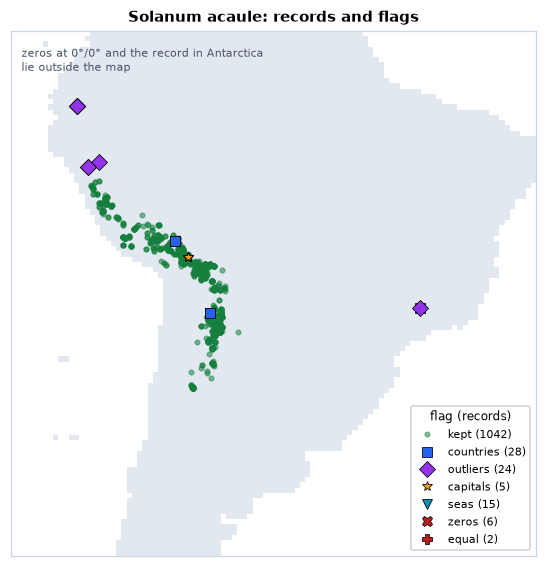
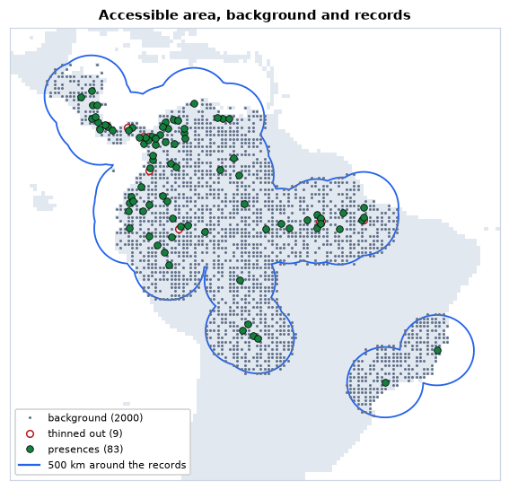
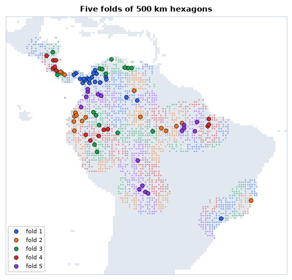
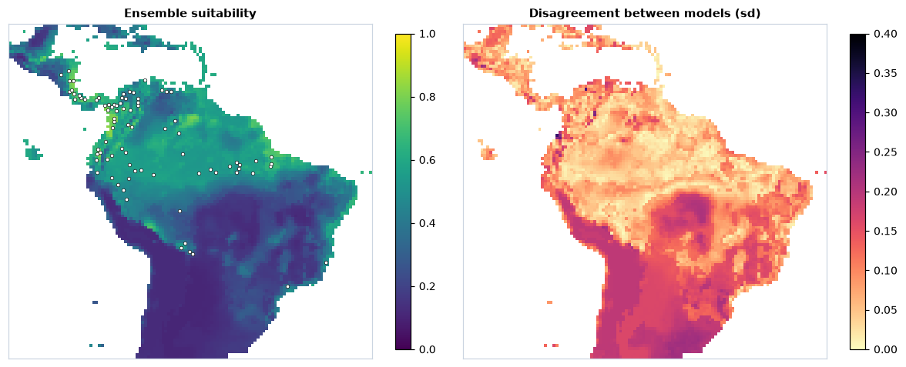
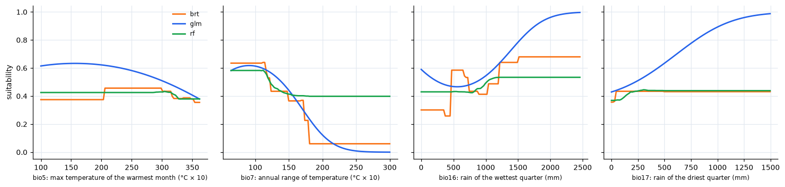
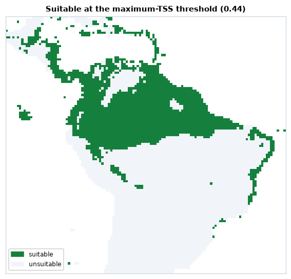
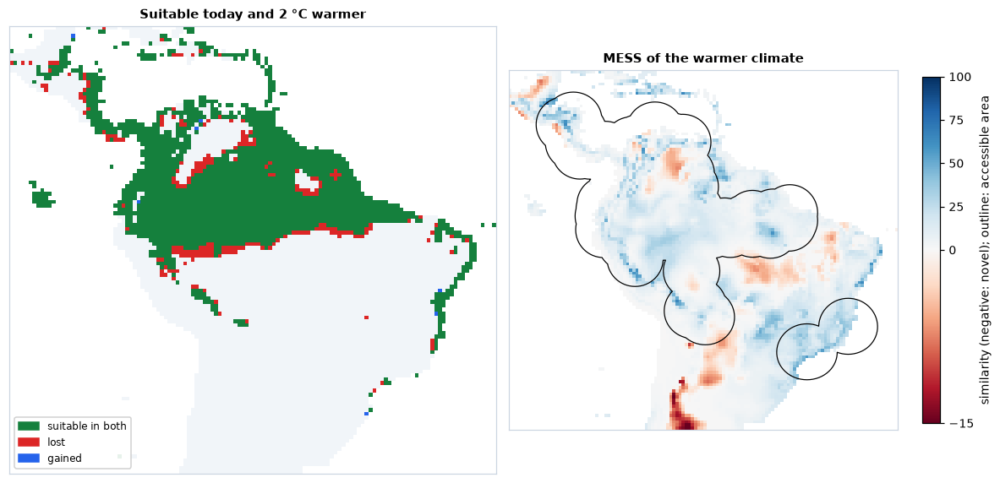

# Species distributions

Where could a species live? A species distribution model relates the places
where it was recorded to the environment there, and maps the result over a
whole region. Most of the work is in the data: cleaning the records,
removing the bias of where people looked, choosing the area and the
predictors, and splitting the data so that the evaluation is honest.
`ls.sdm` does each of those steps with one call, keeps a record of every
choice, and hands the data to scikit-learn, whose models it then
cross-validates, combines and projects. The ideas behind it are in the
course chapter [Species distributions](../learn/sdm.md).

**You will learn to:**

- flag and remove suspicious occurrence records;
- prepare records and predictors in one call, read its report, and redo it
  with other choices;
- do the same step by step: thinning, accessible area, collinearity,
  background, spatial folds;
- fit and cross-validate scikit-learn models and read their scores;
- project an ensemble, its uncertainty, response curves and the importance
  of each predictor;
- turn suitability into a presence/absence map;
- project to a warmer climate and map where the model extrapolates;
- save everything.

The steps reproduce the R packages the field relies on (CoordinateCleaner,
spThin, usdm, blockCV, ENMeval, ecospat, predicts, mop, dsmextra), value
for value and with the same random draws for the same seed where they are
right; where they err, each function's notes say what is corrected.

## Cleaning occurrence records

The example data come from the R packages dismo and predicts. `acaule` holds
1366 GBIF records of a wild potato of the Andes, *Solanum acaule*, as they
were downloaded: with the country, the locality, the institution and the
basis of each record, and with the usual problems.

```python
import numpy as np
import pandas as pd
import landschaft as ls

records = ls.load_table(ls.sdm.example_data("acaule"))
print(len(records), records["species"].nunique())
records["species"] = "Solanum acaule"          # one species, spelled 12 ways
flags = ls.sdm.clean_occurrences(records, action="flag", countries={"column": "ISO2"})
print(flags.filter(like="flag").sum())
```

```text
1366 12
flag_invalid         284
flag_equal             2
flag_zeros             6
flag_capitals          5
flag_centroids         0
flag_seas             15
flag_countries        28
flag_outliers         24
flag_gbif              0
flag_institutions      0
flagged              324
dtype: int64
```

The names are unified first: the outlier test compares the records of each
species, and twelve spellings would make twelve small species. With
`action="flag"`, `clean_occurrences` keeps every record and adds a column per
test (True: suspicious) and `flagged` (any). The tests are those of
CoordinateCleaner: 284 records have no coordinates (`invalid`); 6 lie at 0° 0′
and 2 have equal longitude and latitude; 5 sit within 10 km of a capital, 15
in the sea, 28 outside the country they claim (the test runs when you name
the column of country codes), and 24 far from all the others. The reference
data (capitals, centroids, institutions, coastlines) are downloaded once and
cached. A look at the suspects shows why each was flagged:

```python
tests = [c for c in flags.columns if c.startswith("flag_")]
why = flags[tests].apply(lambda row: ", ".join(c[5:] for c in tests if row[c]), axis=1)
suspicious = flags.assign(why=why)[flags["flagged"] & ~flags["flag_invalid"]]
print(suspicious[["country", "lon", "lat", "why"]].head(10))
```

```text
        country       lon       lat                  why
95    Argentina -66.03333 -21.88333            countries
97      Bolivia -46.08333 -21.43333  countries, outliers
107        Peru -76.61667  -7.46667             outliers
123     Bolivia -68.15000 -16.50000             capitals
129   Argentina -66.03333 -21.88333            countries
145   Argentina -66.03333 -21.88333            countries
281        Peru -77.65520  -7.99020             outliers
302  Antarctica -76.30000 -76.30000      equal, outliers
330     Bolivia -69.35000 -15.01000            countries
375     Bolivia -68.15000 -16.50000             capitals
```



A "Bolivian" record at 46° W lies in Brazil, 20 degrees east of the Andes
(probably a mistyped longitude); two specimens sit on La Paz, a locality
georeferenced to the city; a record in "Antarctica" has the same number as
longitude and latitude. Others are less clear: the three "Argentinian"
records at 21.9° S fall a few kilometres from the border, and a
herbarium label may well be right about the country and slightly wrong
about the point. Flagging rather than dropping lets you look before you
decide. The default (`action="drop"`) returns the records that pass every
test:

```python
kept = records[~flags["flagged"]]
print(len(kept))
```

```text
1042
```

## The whole preparation in one call

The rest of the tutorial models the brown-throated sloth, *Bradypus
variegatus*: 116 records from Central and South America, and nine WorldClim
bioclimatic variables at 0.5° (temperatures in tenths of a degree,
precipitation in millimetres).

```python
occ = ls.load_table(ls.sdm.example_data("bradypus"))
env = ls.load_raster(ls.sdm.example_data("bioclim"))
data = ls.sdm.prepare(occ, env, background=5000)
print(data)
print(data.report)
```

```text
SDMData(92 presences, 5000 background, 5 predictors: bio5, bio7, bio8, bio16, bio17; folds: 5)
               step  presences  removed                              detail
0             input        116        0
1             clean        113        3  capitals 1, seas 1, institutions 1
2      one per cell         92       21
3              area         92        0      whole extent of the predictors
4        predictors         92        0     dropped bio1, bio6, bio9, bio12
5        background         92        0                         5000 points
6  predictor values         92        0
7             folds         92        0                             5 folds
```

`prepare` runs the steps in order: clean the records with the default tests,
keep one per cell of the predictors, choose the area (by default the whole
map), drop collinear predictors (VIF above 10), draw background points
(10 000 by default; the land of this coarse map has fewer than 10 000 cells,
so 5 000 here), extract the predictor values, and split everything into five
folds of spatial blocks. The report says what each step removed and why.
`data.settings` holds every choice, seeds included: what the methods section
of a paper needs.

```python
for key, value in data.settings.items():
    print(f"{key:16s} {value}")
```

```text
seed             1
clean            True
predictors       {'vif': 10.0, 'seed': 1}
background       {'n': 5000, 'seed': 1}
folds            {'blocks': 'hexagons', 'size': None, 'method': 'spatial_blocks', 'k': 5, 'selection': 'random', 'seed': 1, 'blocks_used': 72}
weights          balanced
n_presences      92
n_background     5000
predictors_used  ['bio5', 'bio7', 'bio8', 'bio16', 'bio17']
```

`data` is ready for any scikit-learn estimator: `data.X` (the predictor
values), `data.y` (1 presence, 0 background), `data.sample_weight` (presences
and background weigh the same in total) and `data.cv` (the folds, as
scikit-learn's `cv=` takes them).

Every argument of `prepare` takes `False` to skip a step, a number for its
main setting, a dict of the step's arguments, or a function of yours. The
defaults are a starting point, not a recommendation for this species. Three
choices deserve thought: how far apart the records should be, which area the
species could have reached, and how strict the collinearity filter is.

## Step by step

Each step is a function of its own. Cleaning and one record per cell first:

```python
occ1 = ls.sdm.clean_occurrences(occ)
occ1 = ls.sdm.one_per_cell(occ1, env)
for d in (25_000, 50_000, 100_000, 200_000):
    print(f"at least {d // 1000:3d} km apart: {len(ls.sdm.thin(occ1, d, seed=1))} records")
```

```text
at least  25 km apart: 88 records
at least  50 km apart: 83 records
at least 100 km apart: 63 records
at least 200 km apart: 42 records
```

**Thinning** removes records until none is closer than the distance to
another, keeping as many as possible (the randomised algorithm of spThin,
with distances in metres). The sloth records cluster in Central America and
on the Andean slopes; 50 km evens out the worst clusters at the cost of 9
records.

The **accessible area** bounds the background: a buffer of 500 km around the
thinned records, cut to nothing else here (`within=` would cut it to a
country or a biome). The collinearity of the predictors is measured inside
it:

```python
occ2 = ls.sdm.thin(occ1, 50_000, seed=1)
area = ls.sdm.accessible_area(occ2, distance=500_000)
print(round(float(area.to_crs("EPSG:6933").area.iloc[0]) / 1e12, 1))   # million km2
print(ls.sdm.vif(env, area=area, seed=1).round(1))
```

```text
12.6
  variable      vif
0     bio1      inf
1     bio5   5812.8
2     bio6  14622.1
3     bio7   5452.5
4     bio8     39.0
5     bio9      inf
6    bio12     36.9
7    bio16     18.7
8    bio17      9.0
```

The area covers 12.6 million km², less than half of the 27.5 million km² of
land on the map. bio7, the
annual range of temperature, is bio5 − bio6, so the temperature variables are
perfectly collinear. `select_predictors` drops the variable with the largest
VIF, recomputes, and repeats until all are below the threshold; a stricter
threshold of 5 also removes bio8:

```python
env2 = ls.sdm.select_predictors(env, vif=5, area=area, seed=1)
print(env2.attrs["selection"]["excluded"], env2.attrs["selection"]["kept"])
```

```text
['bio1', 'bio6', 'bio9', 'bio12', 'bio8'] ['bio5', 'bio7', 'bio16', 'bio17']
```

Four predictors remain: the maximum temperature of the warmest month, the
annual range of temperature, and the rainfall of the wettest and of the
driest quarters. `keep=["bio12"]` would keep a variable you want whatever its
VIF. Background points are drawn in the area, from cells with a value in
every predictor and without a presence, then everything goes into one
`SDMData` with spatial folds of 500 km hexagons:

```python
bg = ls.sdm.background(env2, 2000, occ=occ2, area=area, seed=1)
careful = ls.sdm.dataset(occ2, bg, env2)
careful = ls.sdm.spatial_blocks(careful, size=500_000, k=5, seed=1)
print(careful)
```

```text
SDMData(83 presences, 2000 background, 4 predictors: bio5, bio7, bio16, bio17; folds: 5)
```



The same preparation, from the one call, with the four choices changed:

```python
again = data.redo(thin=50_000, area=500_000, predictors=5, background=2000,
                  folds={"size": 500_000, "k": 5})
print(again.X.equals(careful.X), np.array_equal(again.folds, careful.folds))
```

```text
True True
```

Every random step takes the seed of `prepare` (1 by default), so the step by
step and the one call draw the same records, cells and folds.

## Spatial folds

Each fold holds whole blocks, presences and background together, so the
records a fold tests are far from those the model learns from:

```python
kind = np.where(careful.y == 1, "presences", "background")
print(pd.crosstab(careful.folds, kind, rownames=["fold"], colnames=[None]))
```

```text
      background  presences
fold
1            382         20
2            423         17
3            371         16
4            419         14
5            405         16
```



The blocks are assigned to folds at random, keeping the best of 100 tries:
the one with the most even numbers of presences and background. Blocks
should be larger than the range of spatial autocorrelation of the
predictors; 500 km is a common order of magnitude for climate at this
resolution. `quadrant_folds`, `checkerboard_folds`, `buffer_folds`,
`random_folds` and `jackknife_folds` (for very few records) make the other
designs of ENMeval and blockCV.

## Fitting models

`ls.sdm.fit` takes any scikit-learn estimator (anything with `fit` and
`predict_proba`), fits it on every training set of the folds, scores it on
the test fold, and fits it once more to all the data. Three classics: a
logistic regression with quadratic terms (a GLM), a random forest and
gradient boosting:

```python
from sklearn.ensemble import HistGradientBoostingClassifier, RandomForestClassifier
from sklearn.linear_model import LogisticRegression
from sklearn.pipeline import make_pipeline
from sklearn.preprocessing import PolynomialFeatures, StandardScaler

models = {
    "glm": make_pipeline(StandardScaler(), PolynomialFeatures(2),
                         LogisticRegression(max_iter=5000)),
    "rf": RandomForestClassifier(n_estimators=500, random_state=1),
    "brt": HistGradientBoostingClassifier(random_state=1),
}
res = ls.sdm.fit(careful, models)
cols = ["auc_train", "auc_test", "auc_diff", "tss", "boyce", "or_mtp", "or_10p"]
print(res.summary.xs("mean", axis=1, level=1)[cols].round(2))
```

```text
       auc_train  auc_test  auc_diff   tss  boyce  or_mtp  or_10p
model
brt         1.00      0.67      0.33  0.35   0.58    1.00    1.00
glm         0.75      0.67      0.10  0.36   0.40    0.03    0.18
rf          1.00      0.67      0.33  0.32   0.50    1.00    1.00
```

Every model gets `data.sample_weight` (in a pipeline, its last step), so
that 83 presences weigh as much as 2 000 background points.

`res.summary` gives the mean (and standard deviation) over the five folds:
the AUC on the training and the test folds and their difference, the
maximum TSS, the Boyce index, and the omission rates of the test presences
at the minimum and the 10th percentile of the training presences. Look at
the two trees: a training AUC of 1, a gap of 0.33 to the test AUC and
omission rates of 1. With scikit-learn's defaults they grow until they have
memorised every training record, so every test presence falls below the
lowest training one. They are overfitted, and their equal test AUC hides it.
Smaller samples per tree (a crude form of the down-sampling Valavi et al.
2021 recommend for presence-background data), larger leaves, shallower
trees and a slower learning rate fix it:

```python
models["rf"] = RandomForestClassifier(n_estimators=500, max_samples=0.1, min_samples_leaf=5, random_state=1)
models["brt"] = HistGradientBoostingClassifier(learning_rate=0.02, max_iter=200, max_depth=2,
                                               min_samples_leaf=20, random_state=1)
res = ls.sdm.fit(careful, models)
print(res.summary.xs("mean", axis=1, level=1)[cols].round(2))
```

```text
       auc_train  auc_test  auc_diff   tss  boyce  or_mtp  or_10p
model
brt         0.86      0.69      0.17  0.35   0.46    0.24    0.42
glm         0.75      0.67      0.10  0.36   0.40    0.03    0.18
rf          0.71      0.69      0.12  0.37   0.57    0.01    0.10
```

The forest now omits 1 % and 10 % of the test presences, as a model that
generalises should; the boosting is better but still overfits (42 % at the
10th percentile). The scores per fold, in `res.metrics`, show how much they
vary between regions:

```python
print(res.metrics.query("model == 'glm'")[["fold", "n_test", "auc_test", "tss", "boyce", "or_10p"]].round(2))
```

```text
   fold  n_test  auc_test   tss  boyce  or_10p
0     1      20      0.70  0.35   0.67    0.20
1     2      17      0.74  0.48   0.80    0.06
2     3      16      0.61  0.26   0.08    0.06
3     4      14      0.78  0.47   0.63    0.00
4     5      16      0.54  0.23  -0.16    0.56
```

Folds 3 and 5 are poorly predicted (Boyce near or below 0): regions whose
presences the other regions do not explain well. An AUC near 0.7 may look
modest. It is measured against background from a 500 km buffer, plausible
places for a sloth; the same GLM on the one-call data, with background from
the whole map, scores much higher:

```python
whole = ls.sdm.fit(data, {"glm": models["glm"]})
print(round(whole.summary.loc["glm", ("auc_test", "mean")], 2))
```

```text
0.86
```

The model is not better: telling the Amazon from Patagonia is easy. AUCs
can only be compared between models with the same background and folds
(see [AUC](../learn/sdm.md#auc) in the course).

## Projecting the models

`ls.sdm.predict` projects every model onto the predictor rasters, in blocks
of rows (rasters larger than memory work), and combines them into an
ensemble weighted by each model's cross-validated AUC above 0.5, with the
standard deviation between the models:

```python
suit = ls.sdm.predict(res, env)
print([str(b) for b in suit.band.values])
print({k: round(v, 3) for k, v in res.weights().items()})
```

```text
['ensemble', 'sd', 'glm', 'rf', 'brt']
{'glm': 0.174, 'rf': 0.193, 'brt': 0.187}
```



Suitability is highest in the humid lowlands and Andean foothills of
north-western South America and in Central America, where most records are.
The models agree best where the records are, and disagree most in central
Brazil and the south of the continent, largely outside the accessible area:
there the predictors take values the models rarely or never saw, and each
extrapolates in its own way. The
predictors are clamped to their range in the data before predicting
(`clamp=True`), so the responses stay flat beyond it.

## What the models learned

Response curves show how the suitability of each model changes along one
predictor, with the others at their mean; permutation importance, how much
the AUC drops when a predictor's values are shuffled:

```python
curves = ls.sdm.response_curves(res)
imp = ls.sdm.importance(res)
print(imp.pivot(index="predictor", columns="model", values="importance").round(3))
```

```text
model        brt    glm     rf
predictor
bio16      0.103  0.060  0.032
bio17      0.047  0.036  0.017
bio5       0.019  0.063  0.014
bio7       0.233  0.145  0.112
```



All three agree that the annual range of temperature matters most:
suitability falls steeply as it grows from about 11 to 18 °C, the line between
the tropics, where the year is evenly warm, and the seasonal climates
around them. Rainfall comes next. The curves also show the character of
each algorithm: the GLM is smooth and keeps rising with rainfall, the trees
make steps and stay flat beyond the data.

## From suitability to presence and absence

A binary map needs a threshold. The default of `ls.sdm.threshold` maximises
sensitivity plus specificity (the maximum TSS), computed from the ensemble
at the presences and the background:

```python
ens = suit.sel(band="ensemble")
at = ls.extract(ens, careful.coords)["suitability"].to_numpy()
t = ls.sdm.threshold(at[careful.y == 1], at[careful.y == 0])
today = ens >= t
print(round(float(t), 3), f"{float(today.where(ens.notnull()).mean()):.0%}")
```

```text
0.44 23%
```



23 % of the land of the map is above 0.44. `ls.sdm.evaluate` gives the
whole table of thresholds (kappa, sensitivity, specificity, TSS at every
candidate) and the other usual choices: `"mtp"` (the lowest prediction at a
presence), `"p10"`, `"equal_sens_spec"` and more.

## A warmer climate

The predictors 2 °C warmer: 20 added to every temperature variable (in
tenths of a degree; bio7, a range, does not change). The same models, the
same threshold:

```python
temps = ["bio1", "bio5", "bio6", "bio8", "bio9"]
future = env.copy()
future.loc[{"band": temps}] = env.sel(band=temps) + 20
later = ls.sdm.predict(res, future).sel(band="ensemble") >= t
print(int((today & later).sum()), int((today & ~later).sum()), int((~today & later).sum()))
```

```text
2025 232 13
```

2 025 cells stay suitable, 232 are lost and 13 gained. Before reading the
change, check where the warmer climate is outside the data:

```python
new = future.sel(band=careful.predictors)
mess = ls.sdm.mess(careful, new, full=True)
novel = mess.sel(band="mess") < 0
print(int(novel.sum()), int((ls.sdm.mess(careful, env.sel(band=careful.predictors)).sel(band="mess") < 0).sum()))
print({str(b): int((mess.sel(band=b) < 0).sum()) for b in mess.band.values[:-1]})
mop = ls.sdm.mop(careful, new)
print([str(b) for b in mop.band.values], int(mop.sel(band="basic").sum()))
print(int((novel & today).sum()))
```

```text
2912 2063
{'bio5_mess': 1428, 'bio7_mess': 1980, 'bio16_mess': 6, 'bio17_mess': 0}
['mop', 'basic'] 2912
30
```



The MESS is negative in 2 912 cells of the warmer climate, and already in
2 063 today: the models were fitted inside the accessible area, and much of
the map outside it, Mexico and the south-western United States above all,
then the far south, has more seasonal climates than any cell of the data
even now. The `full=True` bands name the culprits: the annual range of
temperature (1 980 cells), unchanged by the warming, and the maximum
temperature (1 428 cells), which the warming pushes beyond the hottest
places in the data. The 849 cells it adds lie in hot lowlands, such as the
llanos of the Orinoco, north-eastern Brazil and the Chaco. MOP flags the same 2 912
cells as outside the reference ranges (`basic`) and gives the distance to
the nearest reference conditions (`mop`). Only 30 of the cells suitable
today become novel: the projection over the current range rests on
conditions the models have seen; beyond it, it does not. `ls.sdm.exdet`
adds the cells inside every range whose *combination* of values is new.

## Maxent (MaxNet)

Maxent is the most used model for presence-background data. `ls.sdm.MaxNet`
is a native implementation of maxnet (Phillips et al. 2017), Maxent's
open-source version in R: the same features (linear, quadratic, product,
hinge, threshold) and the same regularised fit, behind scikit-learn's API.
It is the default model of `fit`, and mixes with the others:

```python
res_all = ls.sdm.fit(careful, {**models, "maxnet": ls.sdm.MaxNet()})
print(res_all.summary.xs("mean", axis=1, level=1)[["auc_test", "tss", "boyce", "or_10p"]].round(2))
suit_all = ls.sdm.predict(res_all, env)
print([str(b) for b in suit_all.band.values])
```

```text
        auc_test   tss  boyce  or_10p
model
brt         0.69  0.35   0.46    0.42
glm         0.67  0.36   0.40    0.18
maxnet      0.69  0.35   0.52    0.14
rf          0.69  0.37   0.57    0.10
['ensemble', 'sd', 'glm', 'rf', 'brt', 'maxnet']
```

`ls.sdm.fit(careful)` without models fits MaxNet alone, with maxnet's
defaults (the feature classes chosen by the number of presences,
regularisation multiplier 1).

Its default settings, like those of the trees, can overfit small samples:
compare the omission rates of a few settings of its regularisation on the
spatial folds before choosing one (Radosavljevic & Anderson 2014).

## Saving the results

Maps go to GeoTIFF with `ls.write_raster` (one band per layer, with their
names); the data and the results save into folders of CSV tables and a JSON
summary:

```python
ls.write_raster(suit, "bradypus_suitability.tif")
folder = careful.save("bradypus_data")
print(sorted(p.name for p in folder.iterdir()))
folder = res.save("bradypus_models")
print(sorted(p.name for p in folder.iterdir()))
```

```text
['data.csv', 'report.csv', 'summary.json']
['metrics.csv', 'ranges.csv', 'summary.csv', 'summary.json']
```

`data.csv` has one row per presence or background point (coordinates, `y`,
weight, fold and predictor values); data made by `prepare` also save their
settings in `summary.json` and the accessible area as `area.gpkg`. The
fitted estimators themselves are ordinary scikit-learn objects in
`res.models`, to keep with `joblib.dump` if needed.

## Going further

- **Your own records**: `ls.sdm.download_gbif("Tapirus terrestris",
  country="BR")` queries GBIF (no account needed), or read a GBIF download
  with `ls.bio.read_occurrences`; `prepare(..., species=...)` picks one
  species from a table of many.
- **Sampling bias**: `bias_surface(group_records, env, bandwidth=...)` is
  the kernel density of the records of the whole taxonomic group, and
  `background(..., bias=that)` draws the background with it (target-group
  background); `distance=` draws within or beyond a distance of the records.
- **Stacked models**: `res.predictions` holds every model's out-of-fold
  predictions (from the model fitted without the row's fold), to fit a
  model on top of them, e.g. with the distance to an expert range map.
- **Tuning**: `data.cv` is a list of (train, test) indices, so
  `GridSearchCV(model, grid, cv=careful.cv)` tunes any estimator on the
  spatial folds.
- **Evaluation by hand**: `ls.sdm.evaluate`, `boyce` and `omission_rate`
  score any predictions, e.g. at independent survey data.
- **Large rasters**: `predict` works block by block, on dask-backed rasters
  (`ls.load_raster(..., chunks="auto")`) too.

The [API reference](../api/sdm.md) documents every option.
