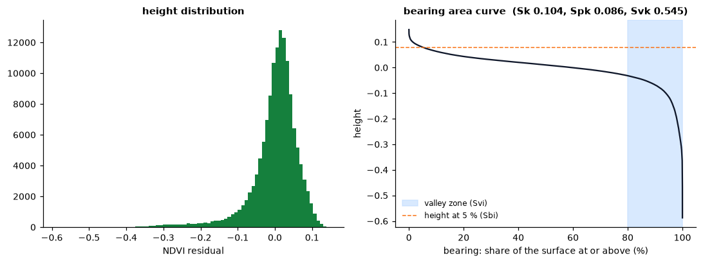
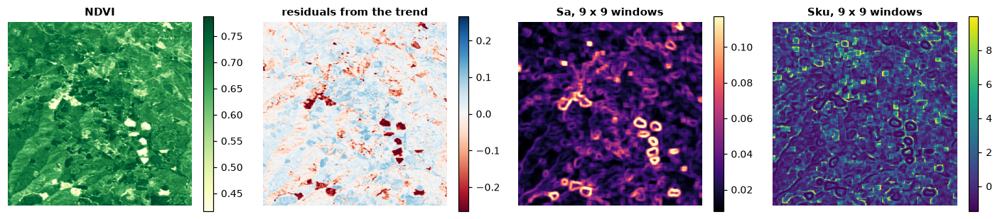
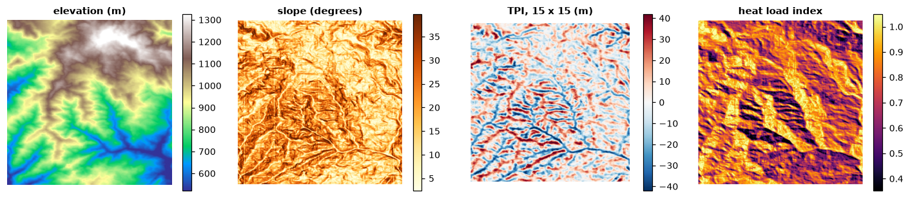

# Surface texture

Not every landscape is a mosaic of patches. Vegetation greenness, canopy
height, soil moisture, elevation vary continuously, and classifying them into
habitat and non-habitat throws most of that variation away. *Surface metrics*
describe a continuous raster as it is: how much it varies, how its heights are
distributed, how steep and rough it is, whether its texture has a direction or
a dominant wavelength. They come from the ISO 25178 standard for engineered
surfaces, brought to landscape ecology as *gradient surface metrics*
(McGarigal et al. 2009).

**You will learn to:**

- remove a trend from a surface and describe what remains with amplitude,
  slope and feature metrics;
- read the bearing area curve of a surface and its parameters;
- map texture with metrics in a moving window;
- measure the spatial structure of a surface: correlation lengths, texture
  direction and wavelength, fractal dimension;
- compute terrain indices of a DEM: slope, TPI, ruggedness, curvature, heat
  load;
- classify landforms with geomorphons;
- delineate the hilltops protected by Brazil's Forest Code.

Everything lives in `ls.surface`. The metrics follow the R packages geodiv
(surface metrics) and spatialEco (terrain indices), value for value where they
are right; where they err, each function's notes say what is corrected.

## A surface and its trend

The example data are three rasters of about 30 m cells over south-western
Oregon: summer NDVI, the same NDVI with its trend removed, and elevation.
Surface metrics describe variation around a reference plane, so a broad trend
(a gradient of greenness across the map) is removed first.

```python
import landschaft as ls

ndvi = ls.load_raster(ls.surface.example_data("orforest"))
z = ls.surface.remove_plane(ndvi)
print(z.attrs["order"], round(float(z.mean()), 12))
```

```text
2 0.0
```

`remove_plane` fits least-squares polynomial surfaces of order 0 to 3 in the
cell coordinates and subtracts the one with the least BIC; `fit_plane` gives a
surface of a chosen order. What remains, the *residual surface*, is what the
metrics describe.

## Whole-surface metrics

`ls.surface.metrics` computes every metric at once (or those named), and
metrics that share a computation are computed once:

```python
m = ls.surface.metrics(z, ["sa", "sq", "ssk", "sku", "sdq", "sds", "s10z", "sdr"])
print(m.round(4))
```

```text
sa      0.0437
sq      0.0643
ssk    -1.9820
sku     6.8255
sdq     0.0439
sds     0.0480
s10z    0.6661
sdr     0.1773
dtype: float64
```

- **Amplitude.** Sa is the mean absolute deviation from the mean height, Sq
  the root mean square. Ssk and Sku describe the height distribution: a
  negative skewness means deep valleys among a high plateau (here: patches of
  low greenness in a green forest), a large kurtosis a peaked distribution
  with long tails.
- **Slopes.** Sdq is the root mean square slope (height change per cell), Sdr
  how much larger the surface is than its footprint, in percent.
- **Features.** Sds counts peaks (cells higher than their 8 neighbours) per
  cell; S10z averages the five highest peaks and five deepest valleys.

`ls.surface.list_metrics()` lists all 27.

## The bearing area curve

The bearing area (Abbott-Firestone) curve sorts the heights: for every height,
the share of the surface at or above it. Its shape tells where the material
is. A *core line* fitted through the flattest 40 % of the curve separates the
peaks above it (Spk), the core (Sk) and the valleys below (Svk); Sbi compares
Sq with the height at 5 % bearing, Sci and Svi measure the void volume of the
core and valley zones.

```python
curve = ls.surface.bearing_area(z)
print(ls.surface.height_ba(z, [0, 0.05, 0.5, 0.95, 1]).round(4))
print(ls.surface.metrics(z, ["sbi", "sci", "svi", "sk", "spk", "svk"]).round(4).to_dict())
```

```text
[ 0.1485  0.0798  0.0105 -0.1144 -0.5872]
{'sbi': 0.8063, 'sci': 0.0679, 'svi': 0.0127, 'sk': 0.1041, 'spk': 0.0863, 'svk': 0.5453}
```



The deep tail of low-greenness cells shows as a long valley zone: Svk is
several times Spk.

## Texture images

A single number summarises a whole map; a *texture image* maps how the
surface varies from place to place. `window_metrics` computes any metric in a
square or circular moving window around every cell:

```python
tex = ls.surface.window_metrics(z, ["sa", "sku"], window=9)
print(tex)
ls.plot(tex)          # one layer per metric
```

```text
<xarray.Dataset> Size: 2MB
Dimensions:      (y: 371, x: 371)
Coordinates:
  * y            (y) float64 3kB 43.1 43.1 43.1 43.1 ... 43.0 43.0 43.0 43.0
  * x            (x) float64 3kB -123.0 -123.0 -123.0 ... -122.9 -122.9 -122.9
    spatial_ref  int64 8B 0
Data variables:
    sa           (y, x) float64 1MB 0.01981 0.02097 0.02069 ... 0.01507 0.01247
    sku          (y, x) float64 1MB -0.8997 -0.9333 -0.8448 ... 0.9568 2.054
Attributes:
    window:   9
    shape:    square
```



Sa is highest where the window straddles the edge of a clearing (the rings
around the dark patches of the residuals) and low inside even stands; Sku is
highest where a few cells stand out from an even background, just outside
those edges and in scattered gaps. Windows run in parallel; extremes and peak
counts take shortcuts, the other metrics are computed on each window as on a
raster.

## Spatial structure

The autocorrelation function (`aacf`) and the Fourier spectrum of a surface
describe its spatial structure:

```python
print(ls.surface.scl(z).round(1))        # fastest and slowest decay to 0.2 and 1/e (m)
print(ls.surface.stxr(z).round(3))       # texture aspect ratio: 0 oriented, 1 isotropic
print(ls.surface.std(z).round(3))        # texture direction (degrees) and its index
print(ls.surface.srw(z).round(1))        # dominant radial wavelength, index, half-power wavelength
print(round(ls.surface.sfd(z), 4))       # fractal dimension
```

```text
[ 247.8  164.8 6873.  6873. ]
[0.036 0.024]
[90.     0.197]
[4.0970e+02 6.0000e-01 1.6387e+03]
2.0001
```

Distances are in map units, metres on longitude/latitude rasters like this
one. The correlation lengths say how far one must move for the surface to be
unrelated to itself; their ratio, whether the texture is stretched in one
direction.

## Terrain indices

A DEM is a surface too, with indices of its own:

```python
dem = ls.load_raster(ls.surface.example_data("orelevation"))
slope = ls.surface.terrain(dem, "slope")               # degrees, Horn's method
aspect = ls.surface.terrain(dem, "aspect")
tpi = ls.surface.tpi(dem, 15)                          # elevation minus the 15 x 15 mean
tri = ls.surface.tri(dem)                              # terrain ruggedness
vrm = ls.surface.vrm(dem, 5)                           # vector ruggedness
hli = ls.surface.hli(aspect, slope, scaled=True)       # heat load (latitude from the raster)
curv = ls.surface.curvature(dem, "profile")
for name, v in [("slope", slope), ("tpi", tpi), ("tri", tri), ("vrm", vrm), ("hli", hli)]:
    print(name, round(float(v.mean()), 3), round(float(v.max()), 3))
ls.plot([dem, slope, tpi])     # one map, a layer each
ls.write_raster(slope, "slope.tif")
```

```text
slope 18.454 62.107
tpi 0.178 60.898
tri 23.148 141.534
vrm 0.012 0.165
hli 0.771 1.072
```



- **TPI** is positive on ridges and hilltops, negative in valleys; its
  multi-scale sum `hsp` gives a hierarchical slope position.
- **TRI** and **VRM** measure ruggedness: TRI from elevation differences, VRM
  from the dispersion of the surface's normal vectors, so a steep but even
  slope is not rugged.
- **Heat load** (McCune & Keon 2002) combines slope, aspect folded about the
  warmest direction (south-west in the northern hemisphere) and latitude.
- `curvature`, `srr`, `dissection`, `spherical_sd` and `trasp` complete the
  set.

## Landforms

Geomorphons (Jasiewicz & Stepinski 2013) classify each cell into one of ten
landforms by looking along eight lines of sight up to a search distance:
whether the terrain rises, falls or stays level in each direction. Unlike
slope or curvature from a 3 x 3 window, they capture the form of the site at
the scale of the search, and make expressive covariates for species
distribution and land change models. They need a projected DEM:

```python
utm = ls.reproject(ls.load_raster(ls.surface.example_data("orelevation")), "EPSG:32610", res=30)
forms = ls.surface.geomorphons(utm, search=20)
print(forms.share()[["name", "share"]].round(3).to_string())
```

```text
           name  share
form                  
1          flat  0.000
2          peak  0.014
3         ridge  0.110
4      shoulder  0.003
5          spur  0.215
6         slope  0.363
7        hollow  0.182
8     footslope  0.004
9        valley  0.098
10          pit  0.011
```

Slopes, spurs and hollows dominate these mountains. `forms.ternary` keeps the
pattern of each cell (one of 498), and `measures=True` adds intensity,
exposition, range and the shape of each geomorphon. The forms are GRASS GIS's
`r.geomorphon` bit for bit, with its errors corrected.

## Hilltop protection areas

Brazil's Forest Code (Lei 12.651/2012) protects the tops of hills at least
100 m high with a mean slope above 25°: the area above two thirds of their
height, measured from the base (the plain or water around them, or the
saddle where they meet higher ground). `hilltop` finds every summit with its
base and marks the protected area of those that qualify:

```python
h = ls.surface.hilltop(dem)
hills = h.hills[h.hills.qualifies]
print(hills[["top", "base", "base_kind", "height", "mean_slope", "threshold", "app_cells"]].round(1))
print(len(h.hills), "summits")
conama = ls.surface.hilltop(dem, min_height=50, min_slope=16.7, slope="line")   # CONAMA 303/2002
print(int(conama.hills["qualifies"].sum()), "hills,", int(conama.app.sum()), "cells with the older rule")
ls.plot([dem, h.app])
```

```text
         top   base base_kind  height  mean_slope  threshold  app_cells
hill
208   1068.0  909.0    saddle   159.0        25.6     1015.0        115
625 summits
12 hills, 1400 cells with the older rule
```

Of 625 summits, one is a hill for the law: 159 m above the saddle that
joins it to higher ground, with a mean slope of 25.6°. The rest are bumps on
larger landforms or too gentle; the highest summit of the map stands 957 m
above the lowest point but its slopes average 18°. Give the plains and water
bodies around the hills as `plain=` (a mask) so that their bases are taken
from them. The older rule of CONAMA 303/2002 (50 m, a slope of 30 % along
the line from the summit to its foot) finds twelve hills here. Bases,
heights and slopes depend on the DEM's resolution and accuracy: the result
is a starting point for field and legal work.

## Validation

Every metric is checked in the test suite against R: against geodiv and
spatialEco (with terra) themselves where they are right, and where they err
against their code with the error corrected. The corrections cover the root
mean square height and the moments built on it, the seven-point slopes, the
valley search, the summit curvature, the bearing area curve's areas, the
centre of the Fourier images, the fractal dimension's prisms, the choice of
trend surface, curvature's second derivatives, hsp's z-scores and the heat
load's southern hemisphere; see the [benchmarks](../benchmarks.md#accuracy)
and each function's notes. Typical gains in speed are tens to thousands of
times over the R packages. `hilltop` follows the law rather than a program
(Dinamica EGO's `CalcHilltop` applies the older CONAMA rule with other
definitions); it is checked against an independent computation of the
landforms on random DEMs and on cones and ranges of known geometry.
