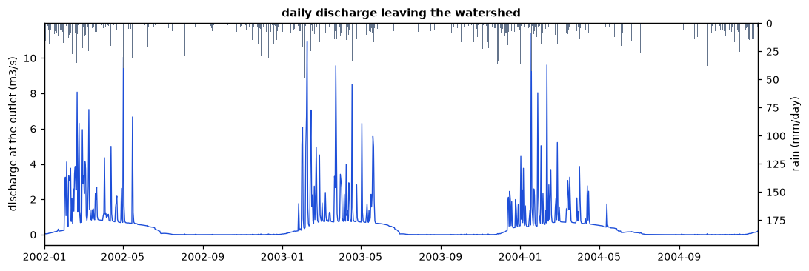
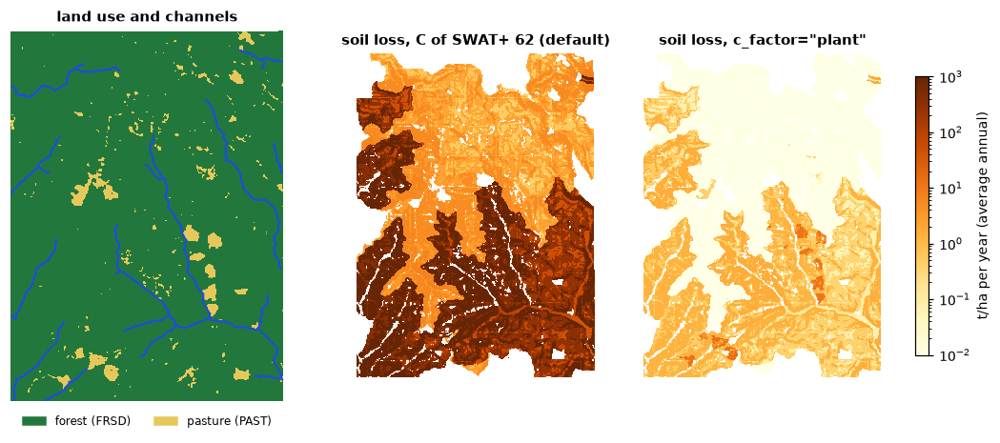

# Watershed simulation

How much of the rain becomes streamflow, how much the vegetation returns to the
air, and how much soil the runoff carries away? A watershed model answers it
day by day, from the terrain, the land use, the soils and the weather. The one
in Landschaft is the core of SWAT+ (the Soil and Water Assessment Tool of
USDA-ARS and Texas A&M AgriLife), ported to C++: for the part of SWAT+ it
covers, it gives SWAT+'s own results, value for value, which is checked against
SWAT+ itself on official examples and on projects made here.

**You will learn to:**

- divide a watershed into subbasins, channels and hydrologic response units
  (HRUs) from a DEM, a land use map and a soil map;
- write the weather a model needs, with the weather generator for the gaps;
- turn both into a SWAT+ project, which also runs in SWAT+ itself;
- simulate it and read its water balance, streamflow and soil loss;
- choose the cover factor of the erosion equation;
- compare a land use scenario with today's.

Everything lives in `ls.hydro.swat`.

## The landscape

`example_landscape` gathers the inputs of a small model from the example data:
the Oregon DEM projected to 30 m cells, a land use map from the NDVI (forest
above 0.55, pasture below) and two soils by elevation. The weather is made up,
one station with four years of daily rain and temperature.

```python
import numpy as np
import pandas as pd
import landschaft as ls

ex = ls.hydro.swat.example_landscape()
dem, landuse, soils = ex["dem"], ex["landuse"], ex["soils"]
print(dem.shape, dem.rio.crs, dem.rio.resolution())
print(ex["landuse_lookup"], ex["soil_lookup"])
print(landuse.to_series().value_counts(normalize=True).round(2).to_dict())
```

```text
(371, 273) EPSG:32610 (30.0, -30.0)
{1: 'FRSD', 2: 'PAST'} {10: 'UPLAND_LOAM', 20: 'VALLEY_CLAY_LOAM'}
{1.0: 0.96, 2.0: 0.04}
```

The lookups name each code as SWAT+'s databases do: `FRSD` (deciduous
forest) and `PAST` (pasture) are rows of its plant database. The soils come
as a table, one row per layer, in the columns of SWAT+'s `soils.sol` (an
ArcSWAT or QSWAT+ *usersoil* table works too): depth (mm), bulk density, water
capacity, saturated conductivity (mm/h), clay (%), erodibility...

```python
print(ex["soil_table"][["name", "hyd_grp", "dp", "bd", "awc", "soil_k", "clay", "usle_k"]])
```

```text
               name hyd_grp      dp    bd   awc  soil_k  clay  usle_k
0       UPLAND_LOAM       B   200.0  1.35  0.15    20.0  18.0    0.28
1       UPLAND_LOAM       B   700.0  1.45  0.13    12.0  22.0    0.28
2       UPLAND_LOAM       B  1500.0  1.55  0.11     6.0  25.0    0.28
3  VALLEY_CLAY_LOAM       C   250.0  1.30  0.17     6.0  32.0    0.30
4  VALLEY_CLAY_LOAM       C   900.0  1.40  0.15     3.0  36.0    0.30
5  VALLEY_CLAY_LOAM       C  1500.0  1.50  0.13     1.5  38.0    0.30
```

The valley soil conducts water three to four times slower than the upland
one, layer for layer: that will matter.
The weather has wet winters and dry summers, about 1100 mm a year:

```python
print(ex["pcp"].resample("YE").sum().round(0).T)
print(ex["tmax"].resample("QE").mean().round(1).T.iloc[:, :4])
```

```text
        2001-12-31  2002-12-31  2003-12-31  2004-12-31
valley       985.0      1086.0      1299.0       955.0
        2001-03-31  2001-06-30  2001-09-30  2001-12-31
valley         8.2        19.6        23.8        11.9
```

## Dividing the watershed

`watershed` does what QSWAT+ does: it conditions the DEM, finds the streams
draining more than `stream_threshold` km², splits them into channels at the
junctions, gives each channel its subbasin, and divides every subbasin into
HRUs, the areas of one land use, soil and slope band. With
`hru_method="filter"` an HRU is kept when its land use, soil and slope band
each cover at least 10 % of the subbasin (the area of the others goes to
them).

```python
w = ls.hydro.swat.watershed(dem, landuse, soils, landuse_lookup=ex["landuse_lookup"],
                            soil_lookup=ex["soil_lookup"], soil_table=ex["soil_table"],
                            stream_threshold=1.0, slope_bands=(15, 35),
                            hru_method="filter", thresholds=(10, 10, 10))
print(w)
hrus = w.tables["gis_hrus"]
print(hrus.groupby(["landuse", "soil"])["arsub"].agg(["count", "sum"]).round(0))
```

```text
SwatWatershed(33 subbasins, 128 HRUs, 8075.9 ha)
                          count      sum
landuse soil
FRSD    UPLAND_LOAM          62  16517.0
        VALLEY_CLAY_LOAM     57  15430.0
PAST    UPLAND_LOAM           5    540.0
        VALLEY_CLAY_LOAM      4   2232.0
```

The tables are QSWAT+'s (`gis_subbasins`, `gis_channels`, `gis_hrus`,
`gis_routing`...), and `w.subbasins`, `w.hrus` and `w.channels` are the maps
of the division, on the DEM's grid.

## Weather

`climate` writes the weather files of the project and the statistics of the
weather generator, which SWAT+ uses for the days and the variables without
measurements (here radiation, humidity and wind, from the monthly means given):

```python
wx = ls.hydro.swat.climate(ex["stations"], pcp=ex["pcp"], tmax=ex["tmax"], tmin=ex["tmin"],
                           monthly=ex["monthly"])
print(wx, wx.period())
print(wx.wgn.loc["valley", ["tmp_max_ave", "tmp_min_ave", "pcp_ave", "wet_dry", "wet_wet"]].round(2).head(4))
```

```text
SwatClimate(1 stations, pcp, tmax, tmin) (Timestamp('2001-01-01 00:00:00'), Timestamp('2004-12-31 00:00:00'))
       tmp_max_ave  tmp_min_ave  pcp_ave  wet_dry  wet_wet
month
1             5.59        -4.83   151.68     0.78     0.66
2             7.40        -3.06   172.35     0.52     0.61
3            10.59        -0.04   106.60     0.39     0.60
4            15.34         4.85    83.78     0.34     0.43
```

`wet_dry` and `wet_wet` are the chances of rain after a dry and after a wet
day. The half-hour rain intensity (`pcp_hhr`), which the erosion needs, cannot
come from daily data and is given in `monthly`.

## The project

`from_tables` writes the SWAT+ project from the division and the weather,
file for file as the SWAT+ Editor writes it (its databases of plants, tillage,
fertilizers, its default parameters). The project runs here, and in SWAT+ 62
itself once written to a folder:

```python
project = ls.hydro.swat.from_tables(w, wx)
project.watershed = w            # what hru_map and channel_map need
print(project)
print(project.text("time.sim").splitlines()[2])
folder = project.write("my_model/TxtInOut")      # runs in SWAT+ 62 itself, too
print(len(list(folder.iterdir())))
```

```text
SwatProject(62 files)
       0      2001         0      2004         0
62
```

`ls.hydro.swat.from_rasters` does `watershed` and `from_tables` in one call,
and `load_txtinout` reads a TxtInOut folder made by QSWAT+ and the editor (or
`load_qswat_project` a QSWAT+ database).

## Simulating

`run` simulates every day of the period and returns what SWAT+ prints, the
tables of its `print.prt`, chosen with `tables`: water (`wb`), nutrients
(`nb`), losses (`ls`) and plants and weather (`pw`) of each HRU and of the
basin, the channels and the aquifers, by day, month, year or average annual
(`aa`). The editor's project skips the first year, a warm-up for the soil
water and the aquifers:

```python
result = ls.hydro.swat.run(project, tables={"basin_wb": ["year", "aa"], "hru_wb": "aa",
                                            "hru_ls": "aa", "channel_sd": "day"})
print(result)
cols = ["precip", "snofall", "et", "surq_gen", "latq", "perc", "wateryld"]
print(result.table("basin_wb", "year")[cols].astype(float).round(1))
```

```text
SwatResult(1461 days, tables: hru_wb[aa], hru_nb[year/aa], hru_ls[aa], hru_pw[year/aa], basin_wb[year/aa], basin_nb[year/aa], basin_ls[year/aa], basin_pw[year/aa], channel_sd[day], aquifer[year/aa])
            precip  snofall     et  surq_gen  latq   perc  wateryld
date
2002-12-31  1085.9    336.6  514.1     243.6  21.6  306.6     265.2
2003-12-31  1299.0    202.5  500.9     292.8  24.4  369.0     317.2
2004-12-31   955.0    257.1  502.9     192.0  20.0  274.9     212.0
```

All in mm over the basin: rain and snow, evapotranspiration, surface runoff,
lateral flow in the soil, percolation below the soil to the aquifers, and the
water yield, what leaves the land surface for the channels the same day.
Averaged over the three printed years:

```python
aa = result.table("basin_wb", "aa")[cols].astype(float).iloc[0]
print(aa.round(1).to_dict())
print(round(aa["et"] / aa["precip"], 2), round((aa["surq_gen"] + aa["latq"]) / aa["precip"], 2))
```

```text
{'precip': 1108.2, 'snofall': 264.2, 'et': 503.6, 'surq_gen': 241.7, 'latq': 21.9, 'perc': 315.4, 'wateryld': 263.6}
0.45 0.24
```

45 % of the rain goes back to the air and 24 % runs off at once; the rest
percolates and reaches the channels later through the aquifers. Where it runs
off depends on the soil much more than on the vegetation:

```python
hru_wb = result.table("hru_wb", "aa").droplevel("date")
by = pd.DataFrame({"landuse": hrus["landuse"].values, "soil": hrus["soil"].values,
                   "surq_gen": hru_wb["surq_gen"].values, "latq": hru_wb["latq"].values,
                   "perc": hru_wb["perc"].values, "et": hru_wb["et"].values})
print(by.groupby(["landuse", "soil"]).mean().round(0))
```

```text
                          surq_gen  latq   perc     et
landuse soil
FRSD    UPLAND_LOAM            3.0  24.0  629.0  432.0
        VALLEY_CLAY_LOAM     443.0  16.0   56.0  562.0
PAST    UPLAND_LOAM           10.0  22.0  599.0  458.0
        VALLEY_CLAY_LOAM     412.0  20.0   56.0  593.0
```

On the upland loam nearly all the water that is not evaporated percolates; the
valley clay loam passes 56 mm a year below the root zone, fills, and sheds
some 430 mm over the surface.

## Streamflow

`reach_discharge` gives the daily discharge leaving each channel (m3/s); the
outlet is the channel with the most water:

```python
q = ls.hydro.swat.reach_discharge(project, result=result)
outlet = int(q.mean().idxmax())
flow = q[outlet]
print(outlet, round(float(flow.mean()), 2), round(float(flow.max()), 1), flow.idxmax().date())
monthly = flow.groupby(flow.index.month).mean().astype(float).round(2)
print(monthly.to_dict())
```

```text
33 0.61 11.4 2004-01-18
{1: 0.76, 2: 2.33, 3: 1.48, 4: 1.27, 5: 1.03, 6: 0.32, 7: 0.03, 8: 0.0, 9: 0.0, 10: 0.0, 11: 0.01, 12: 0.26}
```



The river runs from January to June and dries in the summer. Its baseflow
comes from the shallow aquifers, which the editor sets up to release water
only while their water table is above 3 m (`flo_min` in `aquifer.aqu`): the
dry summer stops the recharge, the water table sinks below that depth and the
baseflow stops until the winter rains raise it again. Aquifer parameters, like
every other, are edited in the project's files (`project.text`,
`project.set_text`) before running.

## Soil loss

SWAT+ computes the soil loss of each HRU and day with the modified universal
soil loss equation (MUSLE): from the runoff and its peak rate, the soil's
erodibility, the slope and its length, and a cover factor C, the protection
the vegetation and the litter give. SWAT+ 62 takes C from the cover of the
residue times the cover of the growing biomass, a method of the APEX model in
which a tall canopy hardly protects the soil (drops fall from high), so that a
forest is protected only by its litter. `c_factor="plant"` takes SWAT+'s
earlier method instead, the minimum C of each plant in its database (0.001
for a forest, 0.005 for a pasture), raised as the cover thins:

```python
swatplus = result.table("hru_ls", "aa")["sedyld"].droplevel("date")
plant = ls.hydro.swat.run(project, tables={"hru_ls": "aa"}, c_factor="plant")
classic = plant.table("hru_ls", "aa")["sedyld"].droplevel("date")
loss = pd.DataFrame({"landuse": hrus["landuse"].values, "soil": hrus["soil"].values,
                     "swatplus": swatplus.values, "plant": classic.values})
print(loss.groupby(["landuse", "soil"])[["swatplus", "plant"]].mean().astype(float).round(2))
```

```text
                          swatplus  plant
landuse soil
FRSD    UPLAND_LOAM           3.23   0.00
        VALLEY_CLAY_LOAM    580.97   0.78
PAST    UPLAND_LOAM           2.43   0.20
        VALLEY_CLAY_LOAM    158.52   7.91
```

The two methods agree on where the soil is lost, on the runoff of the valley
soil, but not on how much: with SWAT+ 62's factor the litter of these forests
(about 1 t/ha in the model) leaves a C of 0.6 to 0.7, and the forests lose
more soil than the pastures. Water, plants and nutrients in the soil are the
same with both; only the sediment and what travels with it change. The
results of either method are SWAT+'s with that method.

```python
erosion = ls.hydro.swat.hru_map(project, "sedyld", result=plant)     # t/ha per year
print(erosion.shape, round(float(erosion.mean()), 2), round(float(erosion.quantile(0.95)), 2))
```

```text
(371, 273) 0.61 1.64
```



`hru_map` paints each cell with the value of its HRU (here the average annual
loss, t/ha), NaN outside the watershed and on the cells of HRUs folded into
others; `channel_map` does the same for the channels on the stream cells.

## A land use scenario

What if the forests of the valleys were cleared for pasture? A scenario is
another land use map through the same steps; `run_many` simulates several
projects at once, one per thread:

```python
cleared = landuse.where(~((landuse == 1) & (soils == 20)), 2)   # the valley forests become pasture
print(cleared.to_series().value_counts(normalize=True).round(2).to_dict())
scenario = ls.hydro.swat.from_rasters(dem, cleared, soils, landuse_lookup=ex["landuse_lookup"],
                                      soil_lookup=ex["soil_lookup"], soil_table=ex["soil_table"],
                                      climate=wx, stream_threshold=1.0, slope_bands=(15, 35),
                                      hru_method="filter", thresholds=(10, 10, 10))
now, then = ls.hydro.swat.run_many([project, scenario],
                                   tables={"basin_wb": "aa", "basin_ls": "aa"}, c_factor="plant")
for name, r in (("today", now), ("valleys cleared", then)):
    wb = r.table("basin_wb", "aa").iloc[0]
    sed = r.table("basin_ls", "aa").iloc[0]
    print(name, round(float(wb["surq_gen"]), 1), round(float(wb["wateryld"]), 1), round(float(wb["et"]), 1),
          round(float(sed["sedyld"]), 3))
```

```text
{2.0: 0.54, 1.0: 0.46}
today 241.7 263.6 503.6 0.623
valleys cleared 227.4 249.3 520.3 3.712
```

Pasture on half of the watershed changes the water little, a little less
runoff and more evapotranspiration, but the basin's soil loss grows six times,
from 0.62 to 3.71 t/ha a year. Maps like `hru_map(..., "sedyld")` of such
scenarios are the costs and benefits a restoration plan weighs (see
[Restoration priorities](restoration-plans.md)).

## Projects from elsewhere

A model made with QSWAT+ and the SWAT+ Editor runs as it is, from its
TxtInOut folder (or a zip of it). The package carries one of the official
examples of SWAT+, the forested Hubbard Brook watershed:

```python
hb = ls.hydro.swat.load_txtinout(ls.example_data("swat_hubbard_brook"))
res = ls.hydro.swat.run(hb, tables={"hru_wb": "year"}, nyskip=1)
print(res.table("hru_wb", "year")[["precip", "snofall", "snomlt", "et", "wateryld"]].astype(float).round(0).head(3))
```

```text
                precip  snofall  snomlt     et  wateryld
date       hru
2001-12-31 1    1004.0    311.0   336.0  333.0     323.0
           2    1004.0    311.0   336.0  333.0     328.0
           3    1004.0    311.0   336.0  333.0     332.0
```

Files written for SWAT+ before version 62 can differ in meaning: in the
official examples the fifth value of `parameters.bsn`, which SWAT+ 62 reads as
the peak rate factor (484), is 1, and SWAT+ then computes peak rates and
erosion hundreds of times too low without a word. `run` warns
(`SwatProjectWarning`) when it sees one; the packaged example has 484.

What the port does not simulate (reservoirs, wetlands and rice paddies,
pesticides, salts, other constituents, the CENTURY carbon model, water
allocation, Green-Ampt infiltration, sub-daily steps) is refused with a clear
error when a project uses it, rather than silently skipped.
